# Zukunftsbild und Umsetzungsauftrag
## Lernender Human-AI-Teaming-Partner für komplexe Planung
 
--- 

## 1. Zukunftsbild

Wir entwickeln ein System, das Menschen bei wiederkehrenden, komplexen Planungsentscheidungen unterstützt. Das System zeigt nicht nur eine einzelne Empfehlung, sondern mehrere mögliche Vorgehensweisen und deren erwartete Folgen.

Mehrere Algorithmen bearbeiten dieselbe Situation aus unterschiedlichen Perspektiven. Ein Verfahren kann beispielsweise vorgegebene Fahrwege priorisieren, ein anderes kurze Wege suchen, ein weiteres als einfache Vergleichsbasis zufällig handeln. Eine lernende PPO-Policy versucht, aus vergleichbaren Situationen, Simulationsergebnissen und ausgeführten Aktionen bessere Entscheidungen abzuleiten und die erwartete Wirkung einer Aktion zu bewerten. Der Mensch kann sich ebenfalls aktiv einbringen: Er kann eine eigene Aktion ausführen oder zunächst simulativ prüfen lassen, was passieren könnte. Das System kann dann einschätzen, wie erfolgversprechend die Aktion unter den definierten Kriterien ist und welche Alternativen ebenfalls möglich wären.

Die menschliche Entscheidung bleibt eine eigene Perspektive. Sie wird nicht automatisch als Fehler, Trainingslabel oder Reward interpretiert.

Der Anwender bleibt Entscheider. Er kann Vorschläge annehmen, ablehnen oder übersteuern. Das System macht Unsicherheit, Zielkonflikte und mögliche Folgen sichtbar, ohne die menschliche Entscheidung automatisch als richtig oder falsch zu bewerten.

---

## 2. Was der Anwender erleben soll

Für jede relevante Entscheidung soll der Anwender verständlich sehen können:

- welche Algorithmen welche Option vorgeschlagen haben;
- welche weiteren gültigen Optionen existieren;
- wie jede Option in einer Simulation abschneidet;
- welche Zielkonflikte bestehen, zum Beispiel Pünktlichkeit gegenüber Wartezeit;
- wie sicher oder unsicher die Prognose ist;
- ob die aktuelle Entscheidung von ähnlichen erfolgreichen Planungen abweicht.

Wenn genügend historische Daten vorhanden sind, kann das System beispielsweise fragen:

> In 50 vergleichbaren Situationen wurde zuerst Zug A priorisiert. Deine aktuelle Entscheidung priorisiert Zug B. Was ist diesmal anders?

Die Frage ist als Reflexionshilfe zu verstehen, nicht als Vorwurf. Der Anwender kann erklären, welche Information oder Randbedingung das System nicht berücksichtigt hat.
 

---

## 3. Bewertungsquellen klar trennen

Die Umsetzung muss drei unterschiedliche Arten von Bewertung unterscheiden:

### 3.1 Simulierte Wirkung

Eine Aktion wird in einer sicheren Kopie der Umgebung ausgeführt. Die Simulation liefert eine begrenzte Prognose über Ankunft, Verspätung, Wartezeit, Konflikte und Deadlocks.

Die Simulation ist eine Schätzung. Sie ist keine Garantie für den realen Verlauf, insbesondere bei Störungen oder unvollständigen Zustandsdaten.

### 3.2 Historischer Vergleich

Eine aktuelle Entscheidung kann mit kontextuell ähnlichen historischen Fällen verglichen werden. 
 
Im aktuellen Prototypen wird die Datenherkunft (Prognose, "echte" Ausführung) nicht  unterschieden; in dieser vereinfachten Betrachtung werden die anfallenden Daten gemeinsam für das PPO-Policy-Training berücksichtigt. Ob diese Vereinfachung fachlich und statistisch sinnvoll ist, muss ein eigenes Experiment zeigen.

Dabei muss zunächst geprüft werden, wie verständlich und zuverlässig sich Prognoseergebnisse im Vergleich zu real beobachteten Ergebnissen bewerten lassen und ob diese Bewertung auf andere Situationen übertragbar ist. Falls sich die Prognosen als ausreichend belastbar erweisen, könnten sie helfen, das Problem der Datensparsamkeit zu reduzieren: Werden ausschliesslich reale Ergebnisse zugelassen, benötigt das Training sehr lange, weil keine Zeitbeschleunigung möglich ist. Können dagegen geeignete simulierte oder prognostizierte Ergebnisse kontrolliert einbezogen werden, lassen sich deutlich schneller grössere Datenmengen erzeugen.

---

## 4. Mehrere Algorithmen als gleichberechtigte Perspektiven

Die Architektur unterstützt aktuell mehrere Policy-Typen, ohne eine einzelne Policy als automatisch richtig zu behandeln:

- regelbasierte Dispositon/Planung oder Deadlock-Vermeidung;
- kürzester oder effizientester Weg;
- bestehende Solver oder Baselines;
- Zufallsverfahren als technische Vergleichsbasis;
- gelernte Policies;
- menschliche Aktion als eigene beobachtete Perspektive.

Die Auswahl der besten Aktion erfolgt anhand expliziter Kriterien und nicht allein anhand einer Policy-Konfidenz - resp. der Mensch kann seine Idee immer durch übersteuern dem System vorgeben. Der Mensch entscheidet, das System bewertet. Falls der Mensch nicht eingreift, läuft alles automatisiert ab.  

---

## 5. Lernsprinzipien

Die Datenquellen bleiben getrennt und auditierbar:

- eigene On-Policy-Rollouts für PPO;
- Vorschläge anderer Policies für Vergleich, Ranking und Evaluation;
- simulierte Gegenfakten für Kandidatenbewertung und Distillation;

Eine nicht ausgeführte Aktion erhält keinen beobachteten Reward. 

Der PPO-Critic, der PPO-Reward und der gewichtete Simulationsscore müssen im Datenmodell und in der Benutzeroberfläche unterscheidbar bleiben. Sie beantworten unterschiedliche Fragen:

- PPO-Reward: Was hat die lernende Policy in ihrem On-Policy-Rollout erhalten?
- Critic/Value: Welchen erwarteten Return schätzt das Modell für den Zustand beziehungsweise die Aktion?
- Simulationsscore: Wie bewertet die definierte Multi-Objective-Funktion eine getestete Alternative?

---

## 6. Interaktion und Human Factors

Das System muss drei Nutzungsweisen unterstützen:

### Empfehlung

Die AI schlägt vor. Der Mensch entscheidet.

### Co-Learning

Die AI stellt Optionen, Prognosen und Rückfragen bereit. Der Mensch vergleicht, entscheidet und kann seine Gründe reflektieren.

### Director

Die AI darf innerhalb expliziter Grenzen autonomer handeln. Der Mensch überwacht, setzt Grenzen und kann jederzeit eingreifen.

Für alle Modi gelten:

- Der Anwender kann eine AI-Aktion übersteuern.
- Unsicherheit und Datenbasis der Bewertung werden sichtbar gemacht.
- Jede Aktion kann mittels Simulationscore oder PPO-Policy score / Actor/Critic bewertet werden
- Rückfragen sind neutral und nicht beschämend formuliert.
- Feedback ist optional und wird nicht als Leistungsbewertung dargestellt.
- Persönliche Daten und Begründungen werden nur zweckgebunden und nachvollziehbar gespeichert.
- Der Mensch bleibt für die fachliche Freigabe und die Verantwortung zuständig, solange keine anders definierte Betriebsfreigabe besteht.

---

## 7. Erwartungen und Verantwortungen nach Zielgruppe

### Management

Management erhält eine Entscheidungsgrundlage für einen begrenzten Pilot, kein Versprechen eines fertigen autonomen Produkts. Vor einer Investitions- oder Betriebsentscheidung müssen Nutzen, Kosten, Risiken, Datenbedarf, Rechenzeit, Integrationsaufwand und Go-/No-Go-Kriterien dokumentiert sein.

Ein erfolgreicher Flatland-Lauf beweist weder Produktivität noch Return on Investment im Bahnbetrieb. Er zeigt zunächst, dass ein definierter Lern- und Vergleichskreislauf in einem definierten Labor funktioniert.

### Data Scientists

Data Scientists erhalten getrennte Datenquellen, reproduzierbare Splits, versionierte Features, nachvollziehbare Rewards und definierte Evaluationsprotokolle. Sie müssen erkennen können, ob ein Ergebnis aus On-Policy-Lernen, Simulation, historischem Replay oder menschlichem Verhalten stammt.

Feedback darf nicht ohne Prüfung als Label verwendet werden. Labelqualität, Verzerrungen, Selektionsprozesse und fachliche Freigabe müssen dokumentiert werden. Jede neue Lernquelle braucht eine Hypothese, eine Baseline und eine kontrollierte Evaluation.

### Software- und Systemarchitekten

Architekten müssen die Verantwortungsgrenzen zwischen Szenariozustand, Policy Registry, OnlineLearner, Fork-Simulation, Archiv, Retrieval, UI und Audit-Log festlegen. Datenverträge müssen Herkunft, Zeitstempel, Policy-Version, Szenarioversion, Zufallsseed, Zieldefinition, Ergebnisstatus und Unsicherheit enthalten.

Die Architektur muss Wiederholbarkeit, Fehlertoleranz, Versionierung, Zugriffskontrolle, Beobachtbarkeit und Rollback unterstützen. Ein Ausfall von Archiv, Retrieval oder einer einzelnen Policy darf nicht zu einer stillen Empfehlung oder unkontrollierten autonomen Aktion führen.

### Disponenten und Anwender

Anwender erhalten Optionen und nachvollziehbare Folgen, keine Black-Box-Anweisung. Sie müssen eine Empfehlung ablehnen, eine eigene Aktion ausführen, eine Begründung ergänzen und einen historischen Vergleich als nicht passend markieren können.

Die Interaktion muss auch dann sinnvoll bleiben, wenn keine Policy, keine Simulation oder kein historischer Vergleich verfügbar ist. In diesem Fall wird die fehlende Grundlage klar angezeigt und die menschliche Entscheidung nicht künstlich gerankt.

### Human Factors und Psychologie

Der Pilot muss prüfen, ob Vertrauen, mentale Belastung, Automationsbias, Verantwortungsgefühl, Erklärbarkeit und Lernnutzen tatsächlich verbessert werden. Ein häufiger Klick auf «Akzeptieren» ist kein Beweis für Vertrauen oder bessere Entscheidungen.

Erhebungen und Feedback sollen freiwillig, zweckgebunden und getrennt von einer individuellen Leistungsbeurteilung sein. Die Gestaltung muss Dissens ermöglichen und darf keine Beschämung oder unklare Verantwortungsverschiebung erzeugen.

---

## 8. Technische Ausbaustufen

### Aktueller Implementierungsstand: v0 Online-PPO-Inspector

Der aktuelle vertikale Slice ist als Experiment und nicht als Produktionsnachweis
einzuordnen. Er umfasst den Walensee-Ansatz im Online-PPO-Training und verwendet
`lab:online-ppo` als stabile, unabhängige PPO-v2-Evaluationspolicy. Die laufende
Policy treibt eine gemeinsame Fork-Simulation der Umgebung. Für jeden aktiven Zug
wird die Beobachtung an seinem eigenen nächsten Entscheidungspunkt erfasst; die
Züge müssen daher nicht gleichzeitig an derselben Stelle der Simulation ankommen.

An diesem Entscheidungspunkt bewertet PPO2 alle zulässigen sichtbaren Aktionen.
Die Agenteninspektion zeigt die Aktionswerte, die beste bewertete Aktion, die
tatsächlich von der laufenden Simulation gewählte Aktion und die Zeit bis zum
nächsten Entscheidungspunkt. Abgeschlossene Züge werden als `done` behandelt und
nicht weiter bewertet. Nicht zulässige Aktionen bleiben als solche kenntlich und
werden nicht als normale fehlende Werte dargestellt.

Die vier Aktionswerte sind direkt bedienbar. Ein Klick setzt einen menschlichen
Override über denselben Toggle-/Entscheidungslog wie die Aktion am Zug in der Map;
ein erneuter Klick auf die aktive Aktion hebt den Override wieder auf. Ein
separater Reset am Zeilenende löscht den Override ebenfalls. Diese Bedienung
ändert nicht automatisch PPO-On-Policy-Daten oder einen beobachteten Reward.

Die aktuelle Wertanzeige ist eine begrenzte Critic-basierte Ein-Schritt-Schätzung
der Form $Q(s,a) \approx r + \gamma V(s')$. Sie ist daher kein vollständiger
langfristiger Q-Wert und darf nicht mit PPO-Reward oder dem späteren
Multi-Objective-Simulationsscore gleichgesetzt werden.

#### Bedeutung der Werte in der Agententabelle

Die Tabelle zeigt die Q-/Value-Schätzung und zusätzlich den Advantage-Wert für
jede sichtbare Aktion. Beide Werte sind Prognosen aus dem PPO-Netz und keine
Garantie für den späteren Verlauf:

- **Q-Value $Q(s,a):** Schätzt, wie gut es aus dem aktuellen Zustand $s$ ist,
  die konkrete Aktion $a$ auszuführen. Im aktuellen v0 wird dafür eine
  Umgebungskopie einen Schritt mit dieser Aktion ausgeführt. Der unmittelbare
  Reward wird mit dem vom Critic geschätzten Folgezustand kombiniert:
  $Q(s,a) \approx r(s,a) + \gamma V(s')$.
- **State-Value $V(s)$:** Schätzt den erwarteten Wert des aktuellen Zustands,
  bevor eine konkrete Aktion ausgewählt wird. Er dient als Referenzwert für den
  Zustand und als Baseline im PPO-Training.
- **Advantage $A(s,a)$:** Zeigt, ob eine konkrete Aktion besser oder schlechter
  als diese Zustandsreferenz ist: $A(s,a) = Q(s,a) - V(s)$. Ein positiver Wert
  bedeutet „besser als erwartet“, ein negativer Wert „schlechter als erwartet“
  und ein Wert nahe $0$ „ungefähr wie erwartet“.

Die zusätzlichen Advantage-Spalten stehen am rechten Ende der Tabelle. Ein
Pluszeichen und die positive Farbe markieren einen positiven Advantage, ein
Minuszeichen und die Warnfarbe einen negativen Advantage. Die Anzeige vergleicht
damit Aktionen relativ zueinander; sie ist weder eine Konfidenz noch ein
beobachteter Reward. Wird eine Aktion nicht ausgeführt, bleibt ihr Wert eine
Gegenfaktenschätzung aus der Fork-Simulation.

### Datenfluss des PPO2-Trainings

Der Online-Learner läuft als eigener Hintergrundprozess. Er erzeugt seine
Trainingsdaten aus eigenen Episoden in Flatland. Die Szenarien werden aus der
Konfiguration gezogen; dazu gehören aktuell generierte Netze und der Walensee-
Ansatz `pf-ch-wn-wal-long-approach`. Der folgende Ablauf zeigt, welche Daten in
den PPO-Rollout gelangen und welche Daten bewusst in getrennten Puffern bleiben:

```mermaid
flowchart LR
A["Flatland-Szenario<br/>Generator oder Walensee"] --> B["Umgebungszustand s"]
B --> C["Beobachtung<br/>Features + Aktionsmaske"]
C --> D["Actor-Critic PPO2<br/>Logits + Value V(s)"]
D --> E["Maskierte Verteilung<br/>Aktion a, log pi(a|s)"]
E --> F["Flatland env.step"]
F --> G["Shaped Reward r<br/>und nächster Zustand"]
G --> B
E --> H["On-Policy RolloutStep"]
G --> H
H --> I["PPO Rollout Buffer<br/>obs, mask, action, logp, value, reward"]
I --> J["Episode-Ende<br/>GAE Advantages + Returns"]
J --> K["PPO Update<br/>Clipped Policy Loss + Value Loss + Entropy"]
K --> L["Kandidatenversion"]
L --> M["Evaluation gegen stabile<br/>Version und Baseline"]
M --> N{"Sicher und besser?"}
N -->|ja| O["Stabile Version publizieren"]
N -->|nein| P["Weiterlernen oder Rollback"]
O --> Q["lab:online-ppo<br/>Checkpoint für Evaluation"]

C -.-> R["Andere Policy-Vorhersagen<br/>Vergleichspuffer"]
C -.-> S["Gegenfakten in Forks<br/>Counterfactual Buffer"]
T["Menschlicher Override"] -.-> U["User Interaction Buffer"]
S -.->|bessere Kandidaten| V["Distillation Buffer"]
U -.->|besser als AI| V
V -.->|separater Distillation-Term| K
```

Der Datenfluss im Einzelnen:

1. **Zustand und Beobachtung:** Das Flatland-Szenario liefert den aktuellen
  Zustand. Der Observation Builder erzeugt pro aktivem Zug die Feature-
  Beobachtung und eine Maske der zulässigen Aktionen.
2. **PPO-Entscheidung:** Das Actor-Critic-Modell berechnet Aktionslogits und
  den Critic-Wert $V(s)$. Nicht zulässige Aktionen werden maskiert. Aus der
  verbleibenden Verteilung werden Aktion, Log-Wahrscheinlichkeit und Value für
  den eigenen On-Policy-Rollout gespeichert.
3. **Ausführung und Reward:** Die Aktion wird in der Umgebung ausgeführt. Der
  Shaped Reward berücksichtigt die im Experiment definierten Zielgrössen und
  wird der letzten Entscheidung des jeweiligen Zuges zugeordnet.
4. **Rollout-Aufbereitung:** Am Episodenende berechnet der Learner aus Reward,
  Value und Folgezustand die Generalized-Advantage-Schätzung (GAE) sowie den
  Return. Erst danach werden die `RolloutStep`-Einträge in den PPO-Rollout-
  Buffer übernommen.
5. **PPO-Update:** Sobald mindestens 2048 On-Policy-Entscheidungen gesammelt
  sind, trainiert PPO in Mini-Batches mit vier Epochen. Der Update kombiniert
  den geclippten Policy-Loss, den Value-Loss und einen Entropie-Term. Die
  Advantage-Werte werden standardmässig normalisiert.
6. **Zusatzsignale:** Vorhersagen anderer Policies, Counterfactual-Fork-
  Ergebnisse und menschliche Overrides werden separat gespeichert. Ein
  deutlich besserer Gegenfakt oder eine entsprechend bewertete menschliche
  Aktion kann einen Distillation-Sample erzeugen. Diese Daten werden nicht
  stillschweigend zu beobachtetem PPO-Reward umdeklariert.
7. **Sicherheitsprüfung und Veröffentlichung:** Die Kandidatenversion wird auf
  festen Evaluationsszenarien gegen die stabile Version und die Baseline
  geprüft. Bei ausreichender Sicherheit und Verbesserung wird sie als
  `online-ppo.pt` publiziert und im Hub unter `lab:online-ppo` angeboten.

Die spätere Agenteninspektion verwendet diesen veröffentlichten Checkpoint als
Evaluator in einer eigenen gemeinsamen Fork-Simulation. Diese Evaluation zeigt
PPO-Werte und Gegenfakten an, fügt die angezeigten, nicht ausgeführten Optionen
aber nicht automatisch dem On-Policy-Reward des Trainings hinzu.

#### Value-, Advantage- und Return-Berechnung

Der Value-Head des Actor-Critic-Modells schätzt für jede eigene PPO-Beobachtung
den Zustandswert $V_\theta(s_t)$. Nach der Ausführung und dem Eintreffen des
Rewards wird zunächst der TD-Fehler berechnet:

$$
\delta_t = r_t + \gamma (1-d_t) V_\theta(s_{t+1}) - V_\theta(s_t)
$$

Dabei ist $d_t=1$, wenn der Zug beziehungsweise die Episode beendet ist. Aus
den TD-Fehlern berechnet der Learner rückwärts den GAE-Vorteil:

$$
A_t = \delta_t + \gamma \lambda (1-d_t) A_{t+1}
$$

Der Trainings-Return für den Value-Head ist:

$$
R_t = A_t + V_\theta(s_t)
$$

Im PPO-Update wird der neue Critic gegen diesen Return trainiert:

$$
L_{value} = \operatorname{MSE}\left(V_\theta(s_t), R_t\right)
$$

Für die Matrix wird zusätzlich an einem Entscheidungspunkt eine begrenzte
Aktionsbewertung berechnet. Für jede zulässige Aktion $a$ wird eine Umgebungskopie
einen Schritt ausgeführt und der Wert geschätzt:

$$
Q_{1\text{-step}}(s_t,a) = r_t(a) + \gamma (1-d_t(a))V_\theta(s_{t+1}^{(a)})
$$

Diese Aktionswerte dienen der sichtbaren Rangfolge und Override-Unterstützung.
Sie ersetzen weder den langfristigen PPO-Return noch den beobachteten Reward
einer tatsächlich ausgeführten menschlichen Aktion.

### Stufe 1: Experiment stabilisieren

- mehrere Policies zuverlässig abfragen;
- gültige und nicht vorgeschlagene Kandidaten in begrenzten Forks testen;
- Ergebnisse und Unsicherheit strukturiert speichern;
- stabile Policy, Baseline, Evaluation und Rollback beibehalten;
- keine Live-Session-Aktion ungeprüft als PPO-On-Policy-Daten verwenden.

### Stufe 2: Anwenderbewertung sichtbar machen

- simulierte Bewertung der aktuellen menschlichen Aktion anzeigen;
- tatsächliches Ergebnis nach Ausführung nachführen;
- Unterschiede zwischen Prognose und Ergebnis darstellen;
- Policy-Ausfälle und fehlende Vorschläge sichtbar behandeln;
- Bewertungsbegriffe für Anwender verständlich benennen.

### Stufe 3: Historischen Vergleich aufbauen

- Planungsarchiv mit Zuständen, Aktionen, Kontext und Ergebnisqualität aufbauen;
- Ähnlichkeitssuche mit erklärbaren Filterkriterien implementieren;
- Erfolgskriterien und Vergleichsfenster konfigurierbar machen;
- Abweichungen zwischen aktueller Entscheidung und Referenzfällen erklären;
- keinen Vergleich anzeigen, wenn die Datenbasis zu klein oder nicht vergleichbar ist.

### Stufe 4: Reflexion und Lernen

- neutrale Rückfragen aus Abweichungen erzeugen;
- Anwenderantworten als Kontext und Feedback erfassen;
- Antworten nicht automatisch als Reward verwenden;
- geprüfte Signale getrennt von Rohfeedback in Lernpipelines überführen;
- Auswirkungen auf Policy-Versionen nachvollziehbar auditieren.

### Stufe 5: Kontrollierter Betriebsübergang

- Schattenbetrieb gegen menschliche und bestehende technische Entscheidungen durchführen;
- Freigabegrenzen, Abbruchkriterien und Eskalationswege mit dem Fachbereich testen;
- Policy-Drift, Datenqualitätsfehler, Ausfälle und Laufzeitüberschreitungen überwachen;
- Director-Aktionen zunächst nur simulieren oder vorschlagen;
- autonome Ausführung erst nach separater Sicherheits-, Human-Factors- und Betriebsfreigabe aktivieren.

---

## 9. Nicht-Ziele

Die erste Ausbaustufe soll nicht:

- eine Produktionsfreigabe durch Simulation ersetzen;
- jede menschliche Aktion automatisch als Trainingsbeispiel verwenden;
- eine historische Statistik als objektive Wahrheit darstellen;
- den Anwender durch eine einzelne Policy-Konfidenz überstimmen;
- aus einer kleinen Zahl von Demonstratorläufen allgemeine Leistungsversprechen ableiten;
- eine autonome Director-Funktion ohne klare Grenzen und Eingriffsmöglichkeit aktivieren.

Folgende Aussagen sind ausdrücklich unzulässig:

- «Die AI weiss, was richtig ist», wenn nur ein Modellscore oder eine Simulation vorliegt;
- «Die letzten 50 Fälle beweisen die beste Strategie», wenn Vergleichbarkeit und Erfolgskriterium nicht dokumentiert sind;
- «Die AI hat aus dem Betrieb gelernt», wenn die Daten nicht geprüft, freigegeben und in der passenden Lernmethode verarbeitet wurden;
- «Die Empfehlung ist sicher», wenn lediglich eine Policy-Übereinstimmung oder ein hoher Konfidenzscore vorliegt.

---

## 10. Offene Entscheidungen vor dem Pilot

Vor der Implementierung des nächsten Slices müssen Fachbereich und Technik mindestens folgende Punkte schriftlich entscheiden:

1. Welche konkrete Planungsaktion und welcher Entscheidungspunkt werden zuerst unterstützt?
2. Welche Ziele, Sicherheitsgrenzen und Mindestkriterien definieren eine akzeptable Aktion?
3. Welche Zustände und Aktionen dürfen archiviert werden, und welche Daten dürfen für Training verwendet werden?
4. Wie werden ähnliche Fälle bestimmt, und ab welcher Fallzahl wird ein Vergleich angezeigt?
5. Wie lange darf eine Fork-Simulation dauern, bevor sie als nicht verfügbar gilt?
6. Wie werden zufällige Störungen, fehlende Zustände und widersprüchliche Policy-Ergebnisse dargestellt?
7. Welche Metriken, Baselines, Testfälle und Freigabeschwellen gelten für jede Policy-Version?
8. Welche Rolle darf in welchem Modus autonom handeln, und wer darf den Modus ändern?
9. Welche Audit-, Datenschutz-, Aufbewahrungs- und Löschregeln gelten für Anwenderaktionen und Begründungen?
10. Welche Human-Factors-Instrumente messen Belastung, Vertrauen, Automationsbias und tatsächlichen Lernnutzen?

Keine dieser Fragen darf durch einen Defaultwert verdeckt werden, wenn sie die fachliche Sicherheit oder die Interpretation eines Ergebnisses verändert.

---

## 11. Akzeptanzkriterien für die Umsetzung

Die Ausbaustufe ist fachlich akzeptabel, wenn:

1. mindestens drei unterschiedliche Policy-Perspektiven dieselbe Situation bewerten können;
2. der Anwender Vorschläge vergleichen und eine eigene Aktion ausführen kann;
3. simulierte Wirkung, beobachtete Wirkung und historische Vergleichswerte getrennt angezeigt werden;
4. jede Bewertung ihre Datenbasis und Unsicherheit kenntlich macht;
5. nicht ausgeführte Aktionen keinen beobachteten Reward erhalten;
6. PPO-On-Policy-Daten von anderen Vorschlägen und Anwenderfeedback getrennt bleiben;
7. historische Vergleichsfälle nach Kontext und Erfolg ausgewählt werden;
8. eine menschliche Erklärung gespeichert werden kann, ohne automatisch als Wahrheit oder Reward zu gelten;
9. neue Policy-Versionen gegen stabile Version und Baseline geprüft werden;
10. Sicherheitsverletzungen, Policy-Ausfälle und Rollbacks nachvollziehbar protokolliert werden;
11. der Anwender in Empfehlung und Co-Learning die Kontrolle behält;
12. Director-Autonomie nur innerhalb expliziter Grenzen aktiviert werden kann.
13. jede Funktion in Dokumentation und Oberfläche als Experiment, v0, Pilot-Ausbau oder Zielbild einordenbar ist;
14. eine fehlende Datenbasis zu «nicht bewertet» führt und nicht zu einer erfundenen Rangfolge;
15. Prognose, Beobachtung und historischer Vergleich mit Herkunft, Version und Zeit getrennt gespeichert werden;
16. Offline-, Online-, Sicherheits- und Human-Factors-Metriken separat ausgewiesen werden;
17. Policy-Drift, OOD-Zustände und Laufzeitüberschreitungen eine definierte Fallback-Reaktion auslösen;
18. Management eine Go-/No-Go-Entscheidung anhand dokumentierter Metriken und Risiken treffen kann;
19. Data Scientists Datenleckage, Reward-Verzerrung und Quellenvermischung prüfen können;
20. Architekten Versionierung, Auditierbarkeit, Zugriffskontrolle und Rollback nachweisen können;
21. Anwender eine Empfehlung ablehnen, eine eigene Aktion ausführen und eine nicht passende Begründung erfassen können;
22. Human-Factors-Tests zeigen, dass die neue Funktion nicht lediglich Automationsbias oder Leistungsdruck erhöht.

---

## 12. Wiederverwendbarer Umsetzungs-Prompt

> Entwickle die nächste Ausbaustufe des LAB-Online-PPO-Systems als Human-AI-Teaming-Partner für komplexe, wiederkehrende Planungsentscheidungen.
>
> > Nutze die bestehende Flatland- und OnlineLearner-Architektur. Unterstütze mehrere Policy-Perspektiven und vergleiche ihre gültigen Handlungsvorschläge in begrenzten Fork-Simulationen. Zeige dem Anwender Optionen, erwartete Wirkungen, Zielkonflikte und Unsicherheit. Ermögliche jederzeit eine menschliche Entscheidung oder Übersteuerung.
> >
> > Trenne strikt zwischen PPO-On-Policy-Rollouts, Vorschlägen anderer Policies, simulierten Gegenfakten, beobachteten Ergebnissen, historischen Vergleichsfällen und menschlichem Feedback. Verwende keine nicht ausgeführte Aktion als beobachteten Reward. Vermische PPO-Reward, Critic/Value und Simulationsscore nicht.
> >
> > Ergänze als konfigurierbaren Ausbau ein Planungsarchiv mit kontextbewusster Ähnlichkeitssuche. Vergleiche eine aktuelle Entscheidung nur mit ausreichend ähnlichen und erfolgreich bewerteten Fällen. Wenn die Datenbasis nicht ausreicht, zeige keinen scheinpräzisen Vergleich an.
> >
> > Formuliere Rückfragen neutral und reflexionsorientiert. Speichere Antworten als Kontext und Feedback, aber behandle sie nicht automatisch als Reward, Wahrheit oder Fehlerlabel. Halte menschliche Kontrolle, Unsicherheitsanzeige, Audit-Log, Evaluation gegen stabile Version und Baseline sowie Rollback als Sicherheitsanforderungen ein.
> >
> > Implementiere zuerst einen vertikalen, testbaren Slice: eine konkrete Planungsaktion, mehrere Policy-Vorschläge, eine Fork-Bewertung, eine menschliche Übersteuerung, ein beobachtetes Ergebnis und eine verständliche Anzeige. Begrenze Forks auf relevante Entscheidungspunkte und einen definierten Horizont.
> >
> > Ergänze danach Historienvergleich, Reflexionsdialog und weitere Lernsignale. Weise für jede Funktion aus, ob sie experimentell belegt, im v0 vorhanden, ein Pilot-Ausbau oder ein Zielbild ist. Kennzeichne ausdrücklich, was nicht automatisch aus Live-Sessions abgeleitet werden darf.
> >
> > Lege vor dem Coding den Datenvertrag, die Metriken, die Baselines, die Unsicherheits- und Fallback-Logik, den Auditbedarf sowie die Zuständigkeit von Management, Data Science, Architektur, Fachanwendern und Human Factors fest. Schreibe zuerst Tests für Datenquellentrennung, fehlende Vergleichsdaten, Policy-Ausfall, Rollback, Override und die Unterscheidung von Prognose und beobachtetem Ergebnis.
> >
> > Behandle einen erfolgreichen LAB-Lauf nicht als Produktionsnachweis. Validiere zunächst in einem begrenzten Schattenbetrieb gegen menschliche und bestehende technische Baselines. Eine autonome Aktion darf erst nach separater Sicherheits-, Betriebs- und Human-Factors-Freigabe aktiviert werden.
