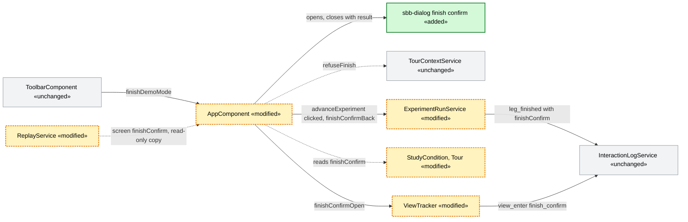
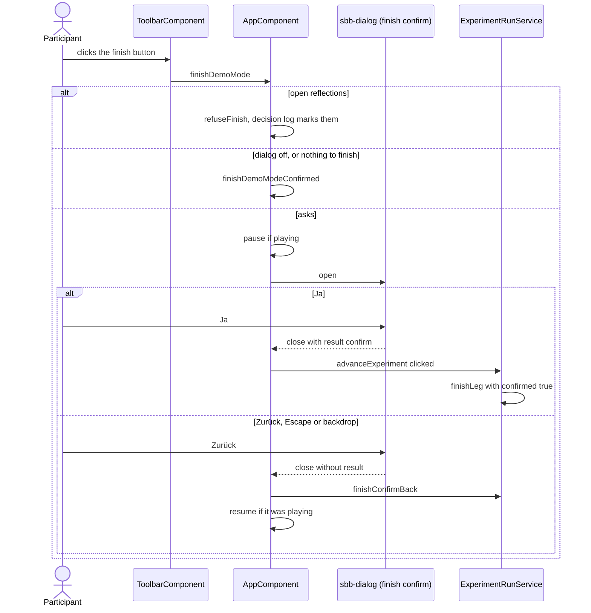

# Confirm "Szenario abschliessen" with a dialog (#180)

> **Status:** plan of 2026-11-16, built by 2026-11-16. Based on `main` `fd0c70cb`. Issue
> [#180](https://github.com/flatland-association/flatland-ui-hub/issues/180) ("Dialog einfügen: Szenario abschliessen
> bestätigen", label "plan b"). Branch `feature/180-confirm-finish-scenario`, PR [#206](https://github.com/flatland-association/flatland-ui-hub/pull/206). Open questions: none (§9.1). Code review (2026-11-16): F-1–F-4, F-7 open, planned in S-6–S-10; F-5, F-6, F-8 follow-ups (§1.4).
>
> **Why:** One click on the finish button ends the scenario for good: the leg is recorded as finished and the run moves
> to the next scenario or the questionnaire. A participant who clicks it by mistake breaks the experiment; a
> confirmation dialog catches that click.

## 1. Introduction and goals

*What the change is for: the requirements, the qualities that matter, who has a stake, and what it leaves out.*

### 1.1 Requirements overview (functional requirements)

*The issue's text and the numbered requirements the rest of the plan refers to.*

> "Szenario abschliessen" sollte bestätigt werden müssen (mittels Dialog "Aktuelles Szenario abschliessen?"
> [JA][Zurück]), damit nicht Teilnehmende durch einen Fehl-Klick das Experiment durcheinander bringen.

Requirements:

- **REQ-1** A click on the finish button that ends a scenario opens a dialog "Aktuelles Szenario abschliessen?"
  instead of finishing at once: in an experiment run ("Szenario abschliessen → …") and in a tour ("Modus abschliessen
  & Umfrage →", "Nächster Modus", "Tour beenden"). (Q-1)
- **REQ-2** "Ja" finishes the scenario exactly as the button does today (same `finishReason: 'clicked'`, same next
  step).
- **REQ-3** "Zurück" closes the dialog; the scenario goes on as if the button had not been clicked.
- **REQ-4** The dialog is on by default; an experiment (study condition or tour) can turn it off. (Q-1, added
  2026-11-16 by the maintainer)
- **REQ-5** The simulation pauses while the dialog is open and resumes on "Zurück" if it was playing. (Q-3, added
  2026-11-16)
- **REQ-6** The run record says, per scenario, whether it was finished through the dialog and how often "Zurück" was
  chosen, in a field of its own. (Q-4, added 2026-11-16)
- **REQ-7** Every session of a guided condition records whether the condition asks (`true` or `false`), so "turned
  off" can be told from "recorded before #180", as #174 does for `shiftSummary`. (Added 2026-11-16 by the maintainer,
  from the comparison with #174's plan.)
- **REQ-8** The replay shows the dialog while the participant saw it, with the cursor and the clicks on "Zurück" and
  "Ja", as #174 asks of the replay ("what the participant saw"). (Added 2026-11-16 by the maintainer, from the same
  comparison.)

### 1.2 Quality goals (non-functional requirements)

*The few qualities the design must reach, each with a concrete scenario.*

| ID | Priority | Quality goal | Scenario |
|---|---|---|---|
| NFR-1 | 1 | The study data stay comparable. | A leg finished through the dialog keeps its `leg_finished` event and `finishReason: 'clicked'`; the new field is additive; the dialog buttons are logged as clicks with stable ids. |
| NFR-2 | 2 | The dialog is in the participant's language and keyboard-usable. | In de/en/fr the title and buttons are translated; Escape and the backdrop mean "Zurück"; focus starts in the dialog. |

### 1.3 Stakeholders

*Who asks for the change, decides on it, reviews it or works with the result, and what they expect.*

| Role | Name | Expectations |
|---|---|---|
| Study leads (Plan B: FHNW and SBB user studies) | issue author | No experiment broken by a mis-click; mis-clicks visible in the data. |
| Participants | - | A short, clear question; "Zurück" costs nothing, not even simulated time. |
| Maintainers | flatland-ui-hub maintainers | A small diff that reuses Lyne and keeps the logged ids stable. |

### 1.4 Follow-ups (not in this PR)

*What this PR leaves out, why, and where it goes later.*

| Follow-up | Why not in this PR | From | Findings | Issue |
|---|---|---|---|---|
| Confirm "Schicht beenden" (tour guide, Director panel) too. | It calls `store.endShift()` directly from two other components; Plan B hides it (`control.endShift`, and in the guide also `hasShiftSummary()`). | Q-5 | - | untracked |
| A `data-log` id on the finish button itself (today logged with the fallback `target`). | Its label is a computed string, not a key; the deciding click is now "Ja", which gets an id. | §4.5 | - | untracked |
| Replace the other `window.confirm` calls (saved runs, layout designer, infrastructure builder) by `sbb-dialog`. | Internal tools, outside the issue. | §3 | - | untracked |
| Read the finish dialog's switch from the running tour, not from the start screen's selection. | No tour turns the dialog off yet, so nothing differs today. | code review | F-5 | - |
| Resume after the finish dialog only once the pause has answered. | The toolbar's play/pause on `main` has the same race; fix both together in the store. | code review | F-6 | - |
| One template for the finish dialog's content, shared by the live dialog and its replay copy. | A refactoring; the two are in step today. | code review | F-8 | - |

## 2. Constraints

*What limits the design from outside: platform, organisation and conventions.*

| ID | Constraint | Kind | Explanation |
|---|---|---|---|
| C-1 | Angular standalone + signals + SBB Lyne. | technical | `AGENTS.md`, "Keep the stack". Lyne 4.14 (`^4.13.0` in `package.json`) ships `sbb-dialog`. |
| C-2 | No inline user-facing text. | convention | Title and buttons are keys in `frontend/public/i18n/{en,de,fr}.json`; German in Swiss spelling with *du*. |
| C-3 | `data-log` ids are study data. | convention | New controls get new keys; `npm run i18n:check` checks them; `docs/experiment-logging.md`'s click-id table is generated by `frontend/scripts/data-log-ids.mjs`. |
| C-4 | Leave `_recordTrajectory`, scenario-refresh throttling and `_recoverPolicyAndRetry*` alone. | convention | `AGENTS.md` guardrails; this change does not come near them. |
| C-5 | Study conditions and tours are code, not data. | technical | `StudyCondition` (`core/demo/study-conditions.ts`) and `Tour` (`core/demo/tours.ts`) are static TypeScript; "per experiment" config is a field there, like `shiftSummary`. |

### 2.1 Limitations

*What the built code gets wrong or ignores, each with the TODO or issue that tracks it.*

- A tour without an experiment run writes no `leg_finished`, so its dialog answers are only in the click stream (when
  click logging is on), not in a field (REQ-6 covers experiment runs).
- "Schicht beenden" still ends a scenario without asking (follow-up, Q-5).
- In the replay the finish click itself has no splash: the finish button has no `data-log` id, so the replay cannot
  place it (follow-up in §1.4). The dialog's clicks have one (REQ-8).
- The replay's dialog is a read-only copy (§4.6): a change to the live dialog's look must be made in both places.

### 2.2 Assumptions

*What must hold for the design to be correct, but is not checked in code.*

Not checked in code; they hold by construction of the toolbar (`toolbar.component.html`) and `app.component.ts`.

- The finish button (`ToolbarComponent.requestFinishDemoMode()` → `AppComponent.finishDemoMode()`) and "Schicht
  beenden" are the only ways a participant ends a scenario by hand; the automatic ends (`advanceExperiment('endShift')`
  after `shiftEnded`, `advanceExperiment('episodeEnd')`) need simulated time to pass.
- While the dialog is open the simulation is paused and the dialog is modal, so no automatic end and no other click
  can change the phase under it.

## 3. Context and scope (checked 2026-11-16 on `main` `fd0c70cb`)

*The code on the base branch that the change works in, as it is before the change, and where the change stops.*

Context:

- `features/toolbar/toolbar.component.html`: the finish button, shown when `store.session() && demoActive`, an
  `sbb-secondary-button` with label `finishLabel ?? <tour labels>` and `(click)="requestFinishDemoMode()"`, which only
  emits `finishDemoMode`. It has no `data-log` id. Before:
  [`1-before-finish-button.png`](confirm-finish-scenario/1-before-finish-button.png).
- `ExperimentRunService.finishLabel` (`core/demo/experiment-run.service.ts`): in phase `running`
  "Szenario abschliessen → …" (`experimentRun.finish.toQuestionnaire` / `toReview` / `toLeg`); in `legSurvey`,
  `review`, `finalSurvey` "Weiter zum Fragebogen" (`toFinalSurvey`), which only reopens a questionnaire.
- `AppComponent.finishDemoMode()`: first `tourContext.refuseFinish()` (open reflections in a tour that asks for
  reasons), then `advanceExperiment()` during a run, else the tour's survey (`openSurvey()`), its next mode
  (`advanceDemo()`, `startTourLeg()`) or its end (`demoComplete`).
- `advanceExperiment('clicked')` in phase `running` calls `ExperimentRunService.finishLeg(reason)`, which pauses,
  writes the leg into `tourContext.recordShift(...)` (`ShiftRecord`, the run record's `legs`) and emits `leg_finished`
  via `interactionLog.noteLegFinished(...)`. `runError` is the precedent for an optional field in both.
- `AppComponent` already pauses and resumes around a shown reflection (`_resumeAfterReflection`:
  `store.pause()`, then `store.play(store.activePolicy() || store.defaultPolicy(), store.playSpeed())`).
- "Schicht beenden": `TourGuideComponent.endShift()` and `DirectorDirectiveComponent.endShift()` call
  `store.endShift()`; in a run `_legEndsWithShift` then calls `advanceExperiment('endShift')`. The guide shows its
  button only where `control.endShift` is not hidden and the condition has the Schichtbilanz (`hasShiftSummary()`,
  `tour-guide.component.html:52`, #174 finding 7); the Director panel's only checks `control.endShift`. Plan B hides
  both (`layout-presets.ts`) and has no Schichtbilanz.
- Per-experiment switches: `StudyCondition.shiftSummary?: boolean` with `hasShiftSummary(c)` (absent = on) is the
  pattern; `Tour` has optional switches of the same kind (`studyLogging`, `surveyParts`, …).
- Clicks are logged by `ClickLogService`; `resolveTarget()` takes the nearest `data-log`.
- No `sbb-dialog` is used yet; confirmations elsewhere are `window.confirm` (`saved-runs-list.component.ts:138`,
  layout designer, infrastructure builder). Lyne's dialog opens with `showPopover()` (its overlay base,
  `overlay/overlay-base-element.js`), so it lives in the browser's top layer: above every z-index of the page,
  wherever it sits in the DOM.

Scope: the change adds the dialog to `AppComponent`, the switch to `StudyCondition` and `Tour`, and the field to the
leg's record. It only reads `TourContextService.refuseFinish()`; the toolbar, `finishLabel`, `LegFinishReason` and
the event names stay as they are.

## 4. Solution strategy

*The fundamental choices and why, the rules the design follows, how it is verified, and the design of each part.*

| Quality goal | Scenario | Solution approach | Details |
|---|---|---|---|
| NFR-1 | Same `leg_finished`, stable click ids | The dialog sits in front of the unchanged `advanceExperiment()` and tour branches; "Ja" runs them as today; the answer goes into one additive field. | §4.3, §4.5 |
| NFR-2 | Translated, keyboard-usable | Lyne `sbb-dialog` (focus trap, Escape, backdrop) with translation keys. | §4.3, §4.4 |
| NFR-1 | Code review findings (phase 2) | The dialog never outlives its leg, the record takes "Ja" from the dialog itself, the debrief and Escape don't trigger it by accident, and its replay copy follows the theme. | §9.3, §11.1 |

### 4.1 Design principles

*The rules the design follows, each with its decision, the concepts it reuses instead of building new ones, and what
is not new on purpose.*

- **DP-1 The component that decides what "finish" does also asks.** `AppComponent.finishDemoMode()` opens the dialog
  after its reflection check and runs today's branch on "Ja"; the toolbar keeps only emitting. (Q-2)
- **DP-2 Every hand-made end of a scenario asks, unless the experiment turns it off.** Experiment runs in phase
  `running` and tours ask; "Weiter zum Fragebogen" ends nothing and doesn't ask; the switch is
  `finishConfirm: false` on the condition or tour. (Q-1)
- **DP-3 Asking costs no simulated time.** The simulation pauses while the dialog is open. (Q-3)
- **DP-4 Asking does not change what is recorded, only adds to it.** "Ja" keeps `finishReason: 'clicked'`; the
  answer is one additive field `finishConfirm` on the leg. (Q-4)
- **DP-5 Refusal before question.** When open reflections refuse the finish, the participant sees that, not the
  dialog. (Q-2)

Reused concepts:

| Need | Reused concept | Instead of |
|---|---|---|
| Modal with focus trap, Escape, backdrop | Lyne `sbb-dialog` + `sbb-dialog-title`, `sbb-dialog-actions`, `sbb-dialog-close="confirm"` (the `close` event's `result`) | `window.confirm` (buttons can't be "Ja"/"Zurück" nor translated) or a hand-built overlay like `rationale-capture` |
| Per-experiment switch | `shiftSummary?: boolean` / `hasShiftSummary(c)` (absent = on) | A UI-config item (`ui-config.json` is per deployment, not per experiment) or a setting |
| Pause and resume | `AppComponent`'s reflection pause (`store.pause()`, `store.play(activePolicy ‖ defaultPolicy, playSpeed)`) | A new playback state |
| Refusal for open reflections | `TourContextService.refuseFinish()` where it is called today | Moving the check |
| Recording the answer | Optional field next to `runError` in `ShiftRecord` and `leg_finished` | A new event type such as `finish_confirmed`, or a new `LegFinishReason` |
| Recording whether the condition asks (REQ-7) | The session header's run fields from `runContext()`, as `header.shiftSummary` (#174 findings 3, 13) | Inferring it from the leg field's absence, which old records share |
| Logging each click | `ClickLogService` with `data-log` ids | Own click events |
| When the dialog was open (REQ-8) | `ViewTracker`'s overlay views (`view_enter`), as help, settings and the questionnaire | A new context event type such as `finish_confirm_open` |
| Drawing it in the replay | `ReplayService.screen()` and the read-only copies in `.replay-screen`, as the questionnaire and the Schichtbilanz | The live `sbb-dialog`, which opens in the browser's top layer, over the replay's cursor, splashes and controls |

Not new on purpose: no new endpoint, event type, `LegFinishReason`, UI-config item or setting (the replay needs one
new value of `view_enter`'s `view`, PAT-3); `finishDemoMode` and
`finishLabel` keep their signatures; the toolbar is not touched.

### 4.2 Verification

*How each requirement and quality goal is shown to work: tests, CI checks, before and after screenshots.*

Screenshots: `plan-b-p01` (five scenarios) with `ui-configs/plan-b.json`, German UI, production build served by the
backend; before on `main` `fd0c70cb`, after on this branch, by `scripts/docshots-confirm-finish-scenario.mjs` (S-2).

| ID | Requirement | Test or check | Result | Screenshots |
|---|---|---|---|---|
| REQ-1 | Dialog instead of finishing at once | `app.component.spec.ts` ("asks instead of finishing, and pauses meanwhile", "asks in a tour too"); running app | ✅ The click opens the dialog; on `main` it went straight to scenario 2/5. | [`1-before-finish-button.png`](confirm-finish-scenario/1-before-finish-button.png), [`1-after-finish-button.png`](confirm-finish-scenario/1-after-finish-button.png) (unchanged), [`1-after-dialog.png`](confirm-finish-scenario/1-after-dialog.png) |
| REQ-2 | "Ja" finishes as before | spec ("\"Zurück\" goes on playing, counted; \"Ja\" finishes the leg as a click"); running app | ✅ "Ja" opens scenario 2/5's intro, `finishReason: 'clicked'`, as one click did on `main`. | [`2-before-finish.png`](confirm-finish-scenario/2-before-finish.png), [`2-after-finish.png`](confirm-finish-scenario/2-after-finish.png) |
| REQ-3 | "Zurück" goes on | spec (close without result); running app, also with Escape | ✅ Back in scenario 1/5, playing. | [`3-after-back.png`](confirm-finish-scenario/3-after-back.png) |
| REQ-4 | On by default, off per experiment | spec ("finishes at once where the condition turns it off"); `study-conditions.spec.ts` (`hasFinishConfirm`) | ✅ No condition or tour sets it off yet (§4.4). | - |
| REQ-5 | Paused while open | spec (pause on open, resume after "Zurück", no resume when paused before); running app: the step counter | ✅ Step 6 when the dialog opened and still 6 two seconds later; 7 after "Zurück". | footer without "Läuft" in [`1-after-dialog.png`](confirm-finish-scenario/1-after-dialog.png), with it in [`3-after-back.png`](confirm-finish-scenario/3-after-back.png) |
| REQ-6 | Answer in the record | `experiment-run.service.spec.ts` (present, per reason, reset per leg, absent when off); running app: the persisted run state | ✅ Leg 1 after one "Zurück" and "Ja": `finishConfirm: {"confirmed": true, "backs": 1}`; on `main` no such field. | - |
| REQ-7 | The switch in every guided session's header | `experiment-run.service.spec.ts` (`runContext()`), `interaction-log.service.spec.ts` (header in and outside a guided run); running app: saved records | ✅ Both Plan B sessions' headers: `"finishConfirm": true`, next to `"shiftSummary": false`. | [`7-record-header.png`](confirm-finish-scenario/7-record-header.png) |
| REQ-8 | The replay shows the dialog | `view-tracker.service.spec.ts` (overlay `finish_confirm`, the working screen after it), `replay.service.spec.ts` (`screen()` while the view is on); running app: a recorded Plan B run with one "Zurück" and one "Ja", replayed | ✅ The record has two `finish_confirm` views (0:14 and 0:23); the replay draws the dialog for both, with the cursor and a splash on "Zurück", then on "Ja". Before, nothing at that moment. | [`8-before-replay-yes.png`](confirm-finish-scenario/8-before-replay-yes.png), [`8-after-replay-back.png`](confirm-finish-scenario/8-after-replay-back.png), [`8-after-replay-yes.png`](confirm-finish-scenario/8-after-replay-yes.png), [`8-record-views.png`](confirm-finish-scenario/8-record-views.png) |
| NFR-1 | Study data comparable | `npm run i18n:check` (51 click ids, all keys: two new ids, each in the dialog and its replay copy; 47 on `main`); click-id table regenerated; field documented in `docs/experiment-logging.md` | ✅ | - |
| NFR-2 | Translated, keyboard-usable | `npm run i18n:check`; running app: focus and Escape | ✅ Focus is in the dialog on open; Escape closes it like "Zurück". The en/fr texts are checked by `i18n:check` only: `plan-b-p01`'s briefing switches the UI to German. | - |
| DP-2 | No dialog for "Weiter zum Fragebogen" | spec ("does not ask for \"Weiter zum Fragebogen\"") | ✅ | - |

Read from the page (`scripts/docshots-confirm-finish-scenario.mjs`, 2026-11-16):

| Where | Before (`main` `fd0c70cb`) | After (this branch) |
|---|---|---|
| After the finish click | scenario 2/5's intro card | dialog "Aktuelles Szenario abschliessen?" [Zurück] [Ja], step counter stopped |
| Leg 1's record | `finishReason: 'clicked'` | `finishReason: 'clicked'`, `finishConfirm: {confirmed: true, backs: 1}` |

### 4.3 The dialog (REQ-1–REQ-3, REQ-5; Q-1, Q-2, Q-3)

- `app.component.html` gets one `<sbb-dialog #finishConfirm backdrop="translucent">` in the main branch of the
  template, with `sbb-dialog-title` "Aktuelles Szenario abschliessen?" and in `sbb-dialog-actions`
  `sbb-secondary-button sbb-dialog-close` "Zurück" and `sbb-button sbb-dialog-close="confirm"` "Ja". No body text.
  `translucent` keeps the working screen visible behind it (the default `opaque` hides it completely).
- `finishDemoMode()`:
  1. `tourContext.refuseFinish()` → return (unchanged);
  2. `finishConfirmAsked()` (a run in phase `running` with `experimentRun.hasFinishConfirm()`, or a tour without a
     run with `selectedTour().finishConfirm !== false`) → remember `store.playing()`, `store.pause()`,
     `finishConfirm.open()`, return;
  3. else today's branches, moved unchanged into `finishDemoModeConfirmed()`.
- `(close)`: `event.result === 'confirm'` → `finishDemoModeConfirmed()`; else `experimentRun.finishConfirmBack()`
  (counts the "Zurück", §4.5) and resume if it was playing, as the reflection pause does.
- Prototyped on 2026-11-16 in both places of Q-2 (patches kept locally): the dialog, the pause and "Ja"/"Zurück"
  work in the running app.

### 4.4 Switch per experiment (REQ-4; Q-1)

- `StudyCondition.finishConfirm?: boolean` and `Tour.finishConfirm?: boolean`: "Ask before a scenario is finished by
  hand; `false` = finish at once (#180). Absent = ask."
- `hasFinishConfirm(c)` in `study-conditions.ts` next to `hasShiftSummary(c)`; `ExperimentRunService.hasFinishConfirm`
  as a `computed` next to `hasShiftSummary`.
- No condition or tour sets it to `false` in this PR; the study leads decide per experiment.

### 4.5 Translations, click ids and the record field (REQ-6, NFR-1; C-2, C-3; Q-4)

| Key (= `data-log` id) | de | en | fr |
|---|---|---|---|
| `experimentRun.finishConfirm.title` | Aktuelles Szenario abschliessen? | Finish the current scenario? | Terminer le scénario en cours ? |
| `experimentRun.finishConfirm.yes` | Ja | Yes | Oui |
| `experimentRun.finishConfirm.back` | Zurück | Back | Retour |

- The two buttons carry `data-log="experimentRun.finishConfirm.yes"` / `…back`; the French needs a native reviewer.
  `docs/experiment-logging.md`'s click-id table is regenerated (`node frontend/scripts/data-log-ids.mjs`).
- Record field, on the leg's `ShiftRecord` and its `leg_finished` event, present when the dialog was on for the leg:

```diff
 {
   "seq": 41, "t": 1763290000000, "simStep": 38, "mode": "co-learning",
   "type": "leg_finished",
   "payload": {
     "legId": "plan-b-tutorial",
     "legIndex": 0,
     "reason": "clicked",
     "elapsedWallMs": 312004,
     "elapsedSteps": 38,
     "episodeDone": false,
+    "finishConfirm": { "confirmed": true, "backs": 1 }   // added: ended with "Ja"; "Zurück" chosen once before
   }
 }
```

  - `confirmed`: `true` when the leg ended with "Ja" (`reason: 'clicked'`); `false` when it ended otherwise
    (`endShift`, `episodeEnd`, `aborted`).
  - `backs`: how often the dialog was closed without "Ja" in this leg (Zurück, Escape, backdrop); reset in
    `legStarted()`. Not persisted: a resumed leg restarts on a fresh session and counts from 0.
  - Absent when the condition turned the dialog off. The same object goes into `ShiftRecord.finishConfirm` (the run
    record's `legs`). Nothing is removed; values are illustrative.
- Session header (REQ-7), filled from `ExperimentRunService.runContext()` like `shiftSummary`: `true` or `false` in
  every session of a guided condition; absent in tours, free sessions and records made before #180.

```diff
 "header": { "sessionId": "b3f2f07c", "conditionId": "plan-b-p01", "legId": "tutorial", "legIndex": 0,
   "shiftSummary": false,
+  "finishConfirm": true,   // added: the condition asks before a hand-made finish
   "…": "…" }
```

### 4.6 The dialog in the replay (REQ-8)

- **Logged:** `ViewTracker` treats the open dialog as an overlay view, `finish_confirm` (with `legId` in a guided
  run), after help, settings and the questionnaire; `AppComponent.finishConfirmOpen` feeds it. When it closes, the
  working screen is entered again. Its time is the gap to the next `view_enter`, so the record also says how long
  the participant hesitated.

```diff
 { "type": "view_enter", "payload": { "view": "session", "detail": { "centerTab": "map", "layoutId": "preset-plan-b" } } }
+{ "type": "view_enter", "payload": { "view": "finish_confirm", "detail": { "legId": "tutorial" }, "from": "session" } }   // added
 { "type": "view_enter", "payload": { "view": "session", "detail": { "…": "…" }, "from": "finish_confirm" } }
```

- **Replayed:** `ReplayService.screen()` is `'finishConfirm'` while that view is on. `app.component.html` then draws
  a read-only copy of the dialog in `.replay-screen` (title and the two buttons with the same `data-log` ids,
  `inert`), placed where the live dialog is, so the recorded cursor and the click splashes (placed by `data-log`)
  land on its buttons.
- **Why a copy:** Lyne's `sbb-dialog` opens in the browser's top layer (`showPopover()`). Reused in the replay, it
  covered the cursor, the splashes and the replay controls ("Abspielen" could not be pressed); no z-index helps
  against the top layer. `.replay-screen` sits under them (900 < 960 splashes, 965 cursor, 1000 controls).

## 5. Building block view

*The components the change adds or changes: an overview, why the system is split this way, what each is responsible
for, the important interfaces, and the planned data model.*

### 5.1 Finishing a scenario

*One white box: its building blocks, why it is split this way, and the interfaces between them.*



Notation: [Flowchart in Mermaid](https://mermaid.js.org/syntax/flowchart.html); green «added», yellow dashed
«modified», grey «unchanged».

**Motivation:** `AppComponent` already decides what a finish does, checks the reflections first and pauses around
reflections; the question joins it there (DP-1, DP-5). The run service, which writes the leg's record, keeps the
answer (DP-4).

**Contained building blocks:**

| Component | Responsibility | Change |
|---|---|---|
| `AppComponent` | Runs the experiment's and the tour's flow: legs, questionnaires, review. | 🟨 modified: a hand-made finish first asks "Aktuelles Szenario abschliessen?" and pauses the simulation meanwhile. |
| Finish confirm dialog (`sbb-dialog` in `app.component.html`) | Asks the participant to confirm finishing the current scenario. Not a general-purpose confirm service. | 🟩 added: a mis-click on the finish button can be taken back with "Zurück". |
| `ExperimentRunService` | Holds the run's phase and records leg ends. Not for deciding when to ask. | 🟨 modified: the leg's record says whether it was finished through the dialog and how often "Zurück" was chosen. |
| `StudyCondition`, `Tour` | Describe an experiment or tour as authored. | 🟨 modified: an experiment can turn the dialog off. |
| `ToolbarComponent` | Shows the finish button and hands the request on. | ⬜ unchanged |
| `ViewTracker` | Logs which screen the participant sees and when. Not what they do there (clicks, decisions). | 🟨 modified: the record says when the finish dialog was open, and for how long. |
| `ReplayService` | Replays a recorded run as it was seen. Not for changing the record. | 🟨 modified: a replay shows the finish dialog with the participant's cursor and clicks on it. |

## 6. Runtime view

*How the components work together at runtime: the flows and modes the change adds or changes, when it changes behaviour.*

### 6.1 Finishing a scenario by hand (REQ-1–REQ-6; Q-2, Q-3)

*One flow or mode, as a sequence or state diagram.*



Notation: [Sequence diagram in Mermaid](https://mermaid.js.org/syntax/sequenceDiagram.html). In a tour without a run,
"Ja" runs the tour's branch (survey, next mode, end) and nothing goes to `ExperimentRunService`.

## 8. Crosscutting concepts

*What the change introduces that other code will follow, and what it changes for existing callers.*

### 8.1 New patterns

*What is new compared with the base branch.*

Compared with `main`. What is reused, and what is not new on purpose, is in §4.1.

| ID | New | Defined in |
|---|---|---|
| PAT-1 | First use of Lyne `sbb-dialog` in the app, for a participant-facing confirmation (`backdrop="translucent"`, result via `sbb-dialog-close="confirm"`). | §4.3 |
| PAT-3 | `view_enter` value `finish_confirm`, and a read-only copy of a top-layer Lyne overlay in `.replay-screen` for the replay. | §4.6 |
| PAT-2 | Record field `finishConfirm: {confirmed, backs}` on `ShiftRecord` and `leg_finished`, and `header.finishConfirm` in every guided session (REQ-7). | §4.5 |

### 8.2 Breaking changes

*What breaks for whom, and the migration path.*

None for callers: `finishDemoMode` and `finishLabel` keep their signatures, `leg_finished`, `ShiftRecord` and the
session header only gain optional fields (absent in old records, so readers treat absent as "no dialog").
`RunContext` gains a required `finishConfirm: boolean | null`; its only writers, `ExperimentRunService.runContext()`
and `AppComponent`'s tour context, set it. Visible change only: a hand-made
finish now needs a second click ("Ja"). Analyses that count finish-button clicks should count
`experimentRun.finishConfirm.yes` or read `finishConfirm` instead. `view_enter` gains the value `finish_confirm`
(REQ-8): an analysis that sums the time per view now sees the dialog's seconds there, not in `session`.
`AppViewSource` gains a required `finishConfirmOpen`; its only implementer is `AppComponent`.

## 9. Decisions

*The decisions behind the plan: the questions still open, the decisions taken, and how each review finding was settled.*

### 9.1 Open questions

*Choices not made yet, each with its options and a proposal.*

✅ ~~**(Q-1) Where does the dialog appear?**~~ **Decided 2026-11-16:** by default for every hand-made end of a
scenario, in experiment runs and tours; each experiment can turn it off (`finishConfirm: false`, §4.4). "Weiter zum
Fragebogen" ends nothing and doesn't ask.

✅ ~~**(Q-2) Who opens the dialog: the toolbar (a) or `AppComponent` (b)?**~~ **Decided 2026-11-16:** b). Both were prototyped on 2026-11-16 and
screenshotted in leg 1 of `plan-b-p01`: [a) toolbar](confirm-finish-scenario/q2-a-toolbar-dialog.png),
[b) `AppComponent`](confirm-finish-scenario/q2-b-app-dialog.png). The pictures are the same; a pixel diff differs
only in the simulation state (step counter, session id). Lyne's dialog opens in the browser's top layer
(`showPopover()`), so where it sits in the DOM doesn't show. The difference is in the workflow and the code:
- a) Toolbar: `requestFinishDemoMode()` opens it, "Ja" emits the unchanged `finishDemoMode`. `AppComponent` stays
  untouched, but the toolbar must call `refuseFinish()` itself first (a second, harmless call), resume with its own
  policy, and get the tour's switch as a new `@Input` (the tour is `AppComponent.selectedTour()`). The dialog goes
  away with the toolbar when its slot disappears (it is inside `@if (store.session() && demoActive)`).
- b) `AppComponent`: `finishDemoMode()` asks after its existing reflection check and runs today's branches on "Ja".
  The condition and the tour, the reflection check and the pause/resume pattern are all already there; no new input.
  `AppComponent` grows by ~25 lines.

Why b): with Q-1 (tours too, switch per experiment) and Q-3 (pause) everything the dialog needs lives in
`AppComponent`; a) would have to pass it all into the toolbar.

✅ ~~**(Q-3) Does the simulation pause while the dialog is open?**~~ **Decided 2026-11-16:** yes, if the diff is
small. It is: `store.pause()` on open, resume on "Zurück" with the reflection pause's call (prototyped, ~4 lines). It
also removes the need to close the dialog on an automatic end: no simulated time passes while it is open.

✅ ~~**(Q-4) Is the answer logged beyond the click stream?**~~ **Decided 2026-11-16:** a field of its own,
`finishConfirm: {confirmed, backs}` on the leg (§4.5).

✅ ~~**(Q-5) Does "Schicht beenden" also ask?**~~ **Decided 2026-11-16:** a), a follow-up (§1.4). New since Q-1: in an experiment run the guide's and the Director panel's
"Schicht beenden" also end the scenario for good (`store.endShift()` → `advanceExperiment('endShift')`). Outside a run
it only opens the shift screen, which has "← Zurück zur laufenden Schicht". Plan B hides it (`control.endShift`); the
guide's button also needs the Schichtbilanz (`hasShiftSummary()`, #174 finding 7), so in a run only conditions with a
Schichtbilanz (e.g. `colearning-experiment`) and the Director panel show it.
- a) Not in this PR (follow-up, §1.4).
- b) Ask there too: `TourGuideComponent` and `DirectorDirectiveComponent` would need a way to reach the dialog (a
  request signal in `TourContextService`, which both already inject), and `finishConfirm.confirmed` would also be
  `true` for `reason: 'endShift'`.

Why a): Plan B, the study the issue is for, doesn't show it; b) adds a new cross-component request for
conditions that don't need it yet.

### 9.2 Decision log

*Every decision by date, with why it was taken and what follows from it.*

| Date | Decision | Why | Consequences |
|---|---|---|---|
| 2026-11-16 | ✅ Lyne `sbb-dialog` with `backdrop="translucent"`, not `window.confirm` or a hand-built overlay (§4.3). | `window.confirm`'s buttons can't be "Ja"/"Zurück" nor translated; Lyne is the stack (C-1) and brings focus trap and Escape. The default `opaque` backdrop hid the working screen in the prototype. | First `sbb-dialog` in the app (PAT-1). |
| 2026-11-16 | ✅ Q-1: ask by default for every hand-made end of a scenario, in runs and tours; off per experiment (§4.4). | Maintainer: one safe default, opt-out where a study doesn't want it. A switch on `StudyCondition`/`Tour` like `shiftSummary`, not a UI-config item, because it is per experiment. | REQ-1, REQ-4; "Schicht beenden" raised as Q-5. |
| 2026-11-16 | ✅ Q-3: pause while the dialog is open (§4.3). | Maintainer, if the diff is small; it is ~4 lines reusing the reflection pause. | REQ-5; no close-on-automatic-end needed. |
| 2026-11-16 | ✅ Q-4: the answer in a field of its own (§4.5). | Maintainer. The field also carries the "Zurück" count, the mis-clicks the issue is about. | REQ-6, PAT-2; docs in `docs/experiment-logging.md`. |
| 2026-11-16 | ✅ Q-2: `AppComponent` asks, not the toolbar (§4.3). | Both prototyped; the same picture. The reflection check, the pause pattern, the condition and the tour are already in `AppComponent`; the toolbar would need them passed in. | DP-1; toolbar unchanged; `AppComponent` +~25 lines. |
| 2026-11-16 | ✅ Q-5: "Schicht beenden" doesn't ask in this PR. | Hidden in Plan B; asking there needs a new cross-component request. | Follow-up in §1.4; limitation in §2.1. |
| 2026-11-16 | ✅ The switch goes into every guided session's header (REQ-7, §4.5). | Maintainer, after the comparison with #174's plan: without it "turned off" and "before #180" look the same, the gap #174 closed for `shiftSummary` (its findings 3, 13). | S-4; `RunContext.finishConfirm`. |
| 2026-11-16 | ✅ The replay draws the dialog, as a read-only copy logged as the overlay view `finish_confirm` (REQ-8, §4.6). | Maintainer, after the comparison with #174's plan (the replay shows what the participant saw). Prototyped: the live `sbb-dialog` in the replay sits in the top layer over the cursor and the replay controls, so a copy in `.replay-screen`. | S-5; PAT-3; a second place to keep in step with the live dialog (§2.1). |

### 9.3 Code Review Findings

*Findings from code reviews, PR comments and TODOs, with their status and the commits that fix them.*

PR [#206](https://github.com/flatland-association/flatland-ui-hub/pull/206), based on `main` fd0c70cb. Code review findings (F-1–F-8) were added on 2026-11-16, at 5c644b79; their line numbers refer to it. Fixed: ✅ fixed, ⏭️ open and taken over by a follow-up (§1.4), — dropped, ⚠️ resolved on GitHub without a code change and without a reason, empty open. "resolved" in Source marks threads resolved and checkboxes ticked on GitHub; ❌ next to ✅ marks a finding fixed in the code whose PR comment is not resolved yet.

| Fixed | ID | Source | Category | Severity | Finding | Commit message |
|---|---|---|---|---|---|---|
|  | F-1 | code review | bug | medium | `frontend/src/app/app.component.ts:1436-1441`: nothing closes the dialog when the leg ends without it. `store.pause()` is an HTTP round trip, so a step already in flight can still end the episode; `_legEndsWithEpisode` then moves the run on (next leg or leg survey) under the open dialog. A later "Ja" finishes the next leg at once as `clicked` with `finishConfirm.confirmed: true`; "Zurück" counts a back for a leg that never asked. Fix: close the dialog (without counting) when the leg finishes or the phase leaves `running`. Open: planned in S-6. | fix(experiment-run): close the finish dialog when the leg ends without it. |
|  | F-2 | code review | bug | medium | `frontend/src/app/app.component.html:438`, `frontend/src/app/app.component.ts:1453-1457`: the tour debrief's last button ("Zur nächsten Schicht", "Zum Fragebogen", "Zur Übersicht") also calls `finishDemoMode()`, so in a tour with a debrief it asks "Aktuelles Szenario abschliessen?" after the shift has ended, on the Schichtabschluss screen. In a run the phase check keeps it out; in a tour nothing does. The plan's §3 and §4.3 don't name the debrief. Fix: the debrief calls `finishDemoModeConfirmed()`, or `finishConfirmAsked()` returns false while `shiftScreenOpen()`. Open: planned in S-7. | fix(tour): finish from the debrief without asking again. |
|  | F-3 | code review | bug | medium | `frontend/src/app/app.component.ts:2120-2159`: Escape on the dialog closes it (Lyne's window `keydown` listener only calls `preventDefault()`, `core/controllers/escapable-overlay-controller.js`), then reaches `onEscapeDeselectAgent`, which has no `finishConfirmOpen()` branch: a selected train is deselected, a change the participant didn't ask for. Fix: return early while `finishConfirmOpen()` (or when `event.defaultPrevented`). Open: planned in S-8. | fix(experiment-run): keep the selected train when Escape closes the finish dialog. |
|  | F-4 | code review | robustness | low | `frontend/src/app/core/demo/experiment-run.service.ts:249`: `confirmed` is derived from `reason === 'clicked'`, not from the dialog's "Ja". Every other `clicked` finish in phase `running` is recorded as confirmed: the stale "Ja" of F-1, the fallback in `finishDemoMode()` when the view child is missing, a resume into a questionnaire (`app.component.ts:1136`, `advanceExperiment()` defaults to `clicked`). Fix: set a flag in `onFinishConfirmClose`, as `finishConfirmBack()` counts the backs, and record it. Open: planned in S-9. | fix(experiment-run-record): record "Ja" from the dialog, not from the finish reason. |
| ⏭️ | F-5 | code review | bug | low | `frontend/src/app/app.component.ts:1456`: outside a run, the switch is read from `selectedTour()`, the start screen's selection (`TOURS[0]` as fallback), not from the running tour. A plain demo (`startDemoSession()`) uses whatever tour was last selected. No tour sets `finishConfirm: false` yet, so nothing differs today. Fix: read it from the running tour's context. Open: taken over by a follow-up (§1.4). | fix(tour): read the finish dialog's switch from the running tour. |
| ⏭️ | F-6 | code review | robustness | low | `frontend/src/app/app.component.ts:1438,1466`: "Zurück" calls `store.play()` without waiting for the asynchronous `pause()`. A quick "Zurück" can send `play` before `pause` answers; the late answer then sets `playing` false while the backend plays. A failed `pause()` leaves the simulation running behind the dialog. The toolbar's play/pause has the same race on `main`. Fix: open the dialog once `pause()` has answered, or resume only when `playing()` is false. Open: taken over by a follow-up (§1.4). | fix(experiment-run): resume after the finish dialog only once the pause has answered. |
|  | F-7 | code review | style | low | `frontend/src/app/app.component.scss:1894,1900`: the replay copy uses `--sbb-color-white` and `--sbb-color-cloud`; `sbb-dialog` uses the theme-aware `--sbb-background-color-1` and `--sbb-background-color-4` (`light-dark(...)`). In dark mode the replay shows a white card where the participant saw a dark dialog. Fix: use the same tokens. Open: planned in S-10. | style(replay): draw the finish dialog's copy in the theme's colours. |
| ⏭️ | F-8 | code review | design | low | `frontend/src/app/app.component.html:1181-1203,1206-1215`, `frontend/src/app/app.component.scss:1891-1907`: the replay copy repeats the live dialog's title, buttons, keys and `data-log` ids, and copies Lyne's dialog width and paddings (`55.75rem`, `8x`/`6x`). A change to one side drifts silently, and the recorded clicks miss the copy's buttons. Fix: one `ng-template` for title and actions used by both; the sizes from Lyne's dialog variables. Open: taken over by a follow-up (§1.4). | refactor(replay): share the finish dialog's content between the live dialog and its replay copy. |

**Issue references**: the PR closes #180. The code names #180 only as the origin of a change (as `main` does for other issues), with no TODO pointing back to it.

## 10. Glossary

*The domain and technical words the plan uses, with their code symbols.*

- **Experiment run** (`ExperimentRunService`, `active()`): a participant's guided pass through a condition's
  scenarios. Not a tour without a condition.
- **Leg / scenario** (`ExperimentLeg`, `legIndex`): one scenario of the run, played on its own session. In the UI
  "Szenario". In a tour, one mode step (`demoStepIndex`).
- **Phase** (`ExperimentRunService.phase()`): `briefing`, `running`, `legSurvey`, `review`, `finalSurvey`; only
  `running` asks.
- **Hand-made finish**: the finish button's click (`finishDemoMode()`). Not the automatic ends (`endShift` after
  `shiftEnded`, `episodeEnd`) and, for now, not "Schicht beenden" (Q-5).
- **Finish reason** (`LegFinishReason`): `clicked`, `endShift`, `episodeEnd`, `aborted`; stays `clicked` after "Ja".
- **Finish confirmation** (`finishConfirm`): the dialog; also the switch on `StudyCondition`/`Tour` and the record
  field `{confirmed, backs}`.
- **Click id** (`data-log`): the translation key that names a control in the click stream. Not the displayed label.

## 11. Execution plan and status

*The commits that build the change, in order, and which of them are done: the source of the PR's status.*

### 11.1 Steps

*One row per commit: what it does, the findings it fixes, its message, and its SHAs once committed.*

#### Phase 1: The dialog, its record and its replay ✅

| ID | Findings | Step | Category | Severity | Commit message | Commit(s) | Needs | Blocked by |
|---|---|---|---|---|---|---|---|---|
| ✅ S-1 | - | Switch `finishConfirm` on `StudyCondition`/`Tour` and `hasFinishConfirm` (§4.4); the dialog with pause in `AppComponent` (§4.3); keys in en/de/fr; `finishConfirm` record field (§4.5); spec cases (§4.2); click-id table and the field in `docs/experiment-logging.md`. | feature | medium | `feat(experiment-run): ask "Aktuelles Szenario abschliessen?" before a scenario is finished by hand.` | a74e605c | - | - |
| ✅ S-2 | - | `scripts/docshots-confirm-finish-scenario.mjs`; before and after screenshots in `docs/plans/confirm-finish-scenario/`; §4.2 results filled in. | docs | low | `docs(plans): confirm finish scenario: screenshots and verification.` | f027fbb8 | S-1 | - |
| ✅ S-3 | - | Align with #174's plan: §3 and Q-5 name the guide's `hasShiftSummary()` gate of "Schicht beenden"; `docs/README.md` lists this plan; `experiment-workflow.md` §5.4 names the dialog; §3 and Q-2 say the dialog opens in the browser's top layer (`showPopover()`), not `position: fixed`. | docs | low | `docs(plans): confirm finish scenario: align with the plan of #174.` | 59dcf352 | S-2 | - |
| ✅ S-4 | - | `header.finishConfirm` from `runContext()` (§4.5, REQ-7), with specs; `docs/experiment-logging.md`. | feature | low | `feat(experiment-run-record): record whether the condition asks before a scenario is finished.` | d05dca85 | S-3 | - |
| ✅ S-5 | - | The overlay view `finish_confirm` and the read-only dialog in the replay (§4.6, REQ-8), with specs; `docs/experiment-logging.md`'s view table; replay screenshots in `docs/plans/confirm-finish-scenario/` (row 8 of §4.2). | feature | low | `feat(replay): show the finish dialog with the participant's clicks on it.` | fd2adeae | S-4 | - |

#### Phase 2: Code review findings 💡

| ID | Findings | Step | Category | Severity | Commit message | Commit(s) | Needs | Blocked by |
|---|---|---|---|---|---|---|---|---|
| 💡 S-6 | F-1 | Close the dialog when the leg ends without it (phase leaves `running`, or a new session), without counting a back; spec: an episode end under the open dialog. | bug | medium | `fix(experiment-run): close the finish dialog when the leg ends without it.` |  | S-5 | - |
| 💡 S-7 | F-2 | `finishConfirmAsked()` is false while the Schichtabschluss screen is open, so the tour debrief's last button finishes without asking; spec. | bug | medium | `fix(tour): finish from the debrief without asking again.` |  | S-6 | - |
| 💡 S-8 | F-3 | `onEscapeDeselectAgent` returns while the dialog is open or the event is handled, so Escape keeps the selected train; spec. | bug | medium | `fix(experiment-run): keep the selected train when Escape closes the finish dialog.` |  | S-7 | - |
| 💡 S-9 | F-4 | `ExperimentRunService.finishConfirmYes()` sets a per-leg flag from the dialog's "Ja"; `finishLeg` records `confirmed` from it, not from the reason; specs. | robustness | low | `fix(experiment-run-record): record "Ja" from the dialog, not from the finish reason.` |  | S-8 | - |
| 💡 S-10 | F-7 | The replay copy's card and title border use `--sbb-background-color-1` and `--sbb-background-color-4`, as `sbb-dialog`. | style | low | `style(replay): draw the finish dialog's copy in the theme's colours.` |  | S-9 | - |

## 12. Change inventory

*Every file the change adds, modifies, renames or removes, and what stays unchanged on purpose.*

### 12.1 New files

*The files the change adds, and what each adds.*

| File | Adds |
|---|---|
| `scripts/docshots-confirm-finish-scenario.mjs` | Screenshots of §4.2 on `plan-b-p01` (S-2). |
| `docs/plans/confirm-finish-scenario/*.png` | The two Q-2 prototype shots; before and after shots `<N>-<before|after>-<slug>.png` per row of §4.2 (S-2). |

### 12.2 Modified files

*The files the change modifies, and what changes in each.*

| File | Changes |
|---|---|
| `frontend/src/app/app.component.html` | `<sbb-dialog #finishConfirm backdrop="translucent">` with title and the "Zurück"/"Ja" buttons and their `data-log` ids; its read-only copy in the replay (S-5). |
| `frontend/src/app/app.component.ts` | The tour's run context has `finishConfirm: null` (S-4); `finishConfirmOpen` for the view log (S-5). Imports `@sbb-esta/lyne-elements/dialog.js`; `finishDemoMode()` asks after `refuseFinish()` (`finishConfirmAsked()`, pause); today's branches move into `finishDemoModeConfirmed()`; `onFinishConfirmClose(event)`. |
| `frontend/src/app/app.component.spec.ts` | Cases of §4.2 (open, "Ja", "Zurück"/Escape, pause/resume, switch off, tour, `legSurvey`). |
| `frontend/src/app/core/demo/study-conditions.ts` | `StudyCondition.finishConfirm?: boolean`; `hasFinishConfirm(c)`. |
| `frontend/src/app/core/demo/tours.ts` | `Tour.finishConfirm?: boolean`. |
| `frontend/src/app/core/demo/experiment-run.service.ts` | `runContext()` returns `finishConfirm` (S-4); `hasFinishConfirm` computed; `finishConfirmBack()`; the `backs` counter (reset in `legStarted()`, not in `ExperimentRunState`); `finishConfirm` in `recordShift(...)` and `noteLegFinished(...)`. |
| `frontend/src/app/core/demo/experiment-run.service.spec.ts` | The field present/absent, `confirmed` per reason, `backs` reset per leg. |
| `frontend/src/app/core/demo/tour-context.service.ts` | `ShiftRecord.finishConfirm?: {confirmed: boolean; backs: number}`. |
| `frontend/public/i18n/{en,de,fr}.json` | `experimentRun.finishConfirm.{title,yes,back}`. |
| `docs/experiment-logging.md` | `finishConfirm` next to `runError` in the `leg_finished` section; click-id table regenerated (two new ids). |
| `docs/plans/experiment-workflow.md` | §5.4: the finish button asks first, unless `finishConfirm: false` (S-3). |
| `docs/README.md` | A line for this plan, next to #174's (S-3). |
| `frontend/src/app/core/interaction-log/session-record.ts` | `RunContext.finishConfirm`, `EMPTY_RUN_CONTEXT`, optional `SessionHeader.finishConfirm` (S-4). |
| `frontend/src/app/core/interaction-log/interaction-log.service.ts` / `.spec.ts` | The header copies `finishConfirm` from the run context; spec in and outside a guided run (S-4). |
| `frontend/src/app/core/interaction-log/view-tracker.service.ts` / `.spec.ts` | `AppViewSource.finishConfirmOpen`; the overlay view `finish_confirm` (S-5). |
| `frontend/src/app/core/replay/replay.service.ts` / `.spec.ts` | `screen()` is `'finishConfirm'` while the view is on (S-5). |
| `frontend/src/app/app.component.scss` | `.replay-screen--dialog`, `.replay-finish-confirm` (S-5). |

Unchanged on purpose: `toolbar.component.*` (with b) of Q-2), `finishLabel`, `LegFinishReason`, `advanceExperiment`,
`tour-guide` and `director-directive` (Q-5), `tour-briefings.ts` (its sentence stays true), the backend (records are
stored as sent).
