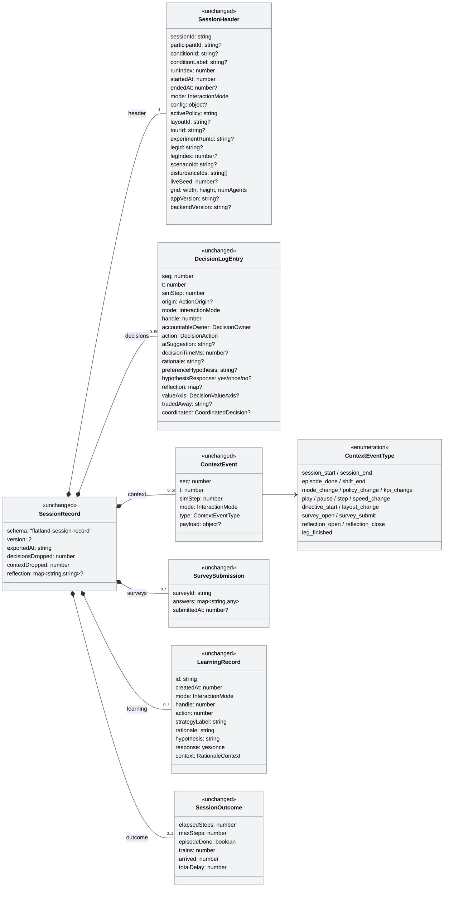
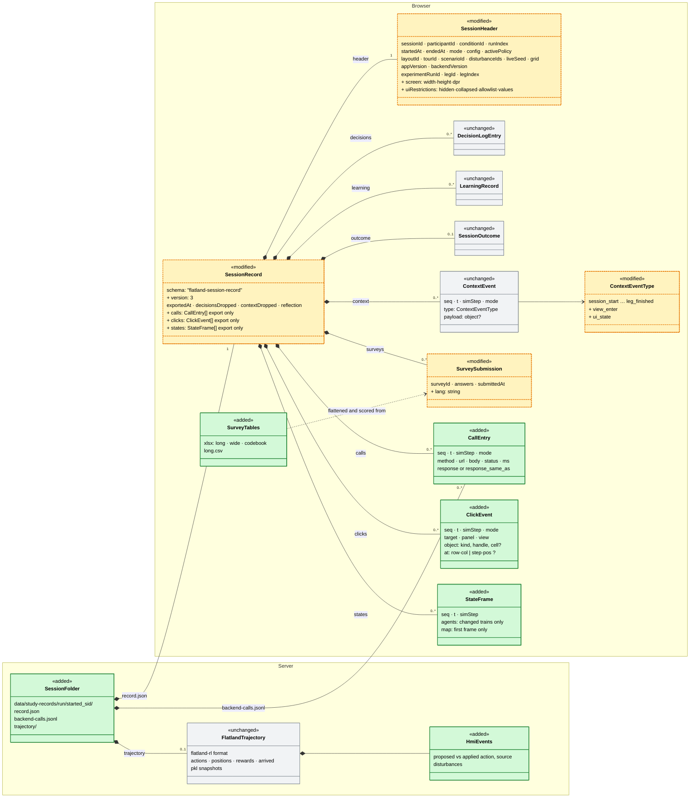

# Experiment logging (#129): frontend-first plan, data model and replay

> **Status:** plan, 2026-10-26, updated 2026-10-30. Nothing is built. Single plan for issue
> [#129](https://github.com/flatland-association/flatland-ui-hub/issues/129),
> [comment of 2026-10-23](https://github.com/flatland-association/flatland-ui-hub/issues/129#issuecomment-6361544578)
> (discussion with @CleverManu), which names five kinds of logging to start
> with. Open questions are in §13.
>
> **Approach (decided 2026-10-26): frontend-first.** The browser is the
> primary logger for every kind, built on today's session record and export.
> Two backend parts are kept because the browser cannot do them: the
> **server call log** (safety net) and the **flatland-rl trajectory**.
>
> **Why log broadly, and why replay (2026-10-30).** What a study will need
> to analyse is not known yet. So the plan does not try to guess the
> right events: it **logs whatever comes along** (every call with its
> response, every click, every screen, the train state and the UI state)
> and makes the data **checkable by replay**. If a replay of a run shows
> what the participant saw, the important things were caught; if
> something is missing on screen, the gap is visible and can be closed
> before the next study. Replay is not a hard requirement of its own, but
> it turns the weakness, not knowing what to log, into a strength: a test
> that the log is complete (§9).
>
> **Based on #156** (experiment workflow; PR #157 targets its branch since
> 2026-10-29), so data volume, performance and replay can be measured on its
> guided experiment. Rebased onto `main` once #146 and #156 are merged (§14).
>
> **This plan answers:**
> 1. How each of the five kinds is logged, and what is added or modified.
> 2. Whether everything is kept in memory or in browser storage, and how many
>    clicks would exhaust, say, 5 GB of RAM.
> 3. What the current and the planned data models look like (class diagrams
>    and JSON examples).
> 4. Which data a full replay needs, e.g. an "import JSON → replay the
>    experiment" feature in the settings/admin area.

---

**Terms** (as in [`experiment-workflow.md`](experiment-workflow.md), #156):

- **Tour:** a guided walk to *teach* (`Tour`, `core/demo/tours.ts`): modes
  in order, one leg each.
- **Condition** (`StudyCondition`) = **experiment**. The two words are
  synonyms: a condition is one experiment to *measure*, i.e. which scenarios
  in which order, layout, mode, briefing and questionnaires. With #156 one
  condition stands for one participant (`plan-b-p01` … `plan-b-p10`). On
  the start screen, conditions are listed under "Geführtes Experiment (mit
  Umfrage)". A tour is something else.
- **Run:** one execution of a tour or a condition, from its start to its
  end (or abort), with all its legs. A condition's run is an **experiment
  run** and has an id (`experimentRunId`, #156). A tour's run has no id
  today; step 4 gives it one, so its legs share a run folder (§4.2). A free
  session is a run of one session, identified by its `sid` (no run id). Not to be confused with `header.runIndex`, which counts
  *sessions* in this browser, not runs.
- **Leg:** one part of a run, played on its own backend session. It applies
  to **both** tours and conditions, but they differ:
  - **condition leg** (`ExperimentLeg`, #156): has an id (`legId`), its own
    scenario, disturbances and intro, and is named "⟨name⟩ (k/N)". The
    header carries `experimentRunId`, `legId` and `legIndex`.
  - **tour leg:** one entry of `Tour.modes`, with the leg's disturbances
    from `Tour.legDisturbanceIds`. It has no id of its own; the leg is
    `store.demoStepIndex`, and the header carries only `tourId`
    (`startTourLeg` → `setRunContext({tourId})`).
- **Session** (`sid`): one backend session, created by `POST /session`.
  `sid` is its **session id** (`header.sessionId`), not the scenario: every
  leg, every reset and every free session gets a new one. One session
  record and one server folder per `sid`.
- **Scenario** (`header.scenarioId`): the network and traffic a session
  plays, e.g. a Walensee preset. Many sessions share one scenario.
- **Mode** (`InteractionMode`): *who decides*: `recommendation` (the AI
  recommends, the human decides), `co-learning` (the AI offers neutral
  options, the human decides and reflects) or `director` (the AI runs on the
  human's directives, the human supervises). It is a value, not an entity.
  In the record it is `header.mode`, and changes during a session are
  `mode_change` events. A condition has one mode for all its legs, a tour
  one mode per leg (`Tour.modes`) (#156, Q30).

## 1. Scope

| # | Logging kind (issue comment) | Browser (primary) | Backend (kept) |
|---|---|---|---|
| 1 | Backend calls: timestamp + payload | `callLogInterceptor` → stream `calls` (§5.1) | server call log through Python `logging`, safety net (§5.1.2) |
| 2 | Clicks: when, which object or button | `ClickLogService` → stream `clicks` (§5.2) | – |
| 3 | Workflow transitions: when which view | `ViewTracker` → record `context` (§5.3) | – |
| 4 | flatland-rl artefacts: pkl per step, input and output (Trajectory API) | state messages → stream `states`, for replay (§5.4.1) | `TrajectoryRecorder`: pkl, TSVs, provenance (§5.4.2) |
| 5 | Questionnaire answers: format? HTML/Excel? | `lang` in the record; tables (long, wide, codebook) as CSV and `.xlsx` from the saved-runs list (§5.5, §5.6) | – |

It extends [`interaction-logging-plan.md`](interaction-logging-plan.md)
(P1–P4, built 2026-09-30) and does not start a parallel system. That plan
already produces one **session record** per backend session (header,
decisions, context events, surveys, reflection, outcome), autosaved to
`localStorage` and, with `STUDY_SINK_ENABLED`, saved on the server.

## 2. Decisions

| Date | Decision |
|---|---|
| 2026-10-23 | **Payload = request and response** bodies. Volume is handled by deduplication and rotation, not by dropping content. |
| 2026-10-23 | **Polling GETs: log them all.** Measure first; exclude routes only if the measurement calls for it (`STUDY_CALL_LOG_EXCLUDE`). |
| 2026-10-23 | **Calls are logged on both sides.** The browser copy is primary, the server copy is the safety net. |
| 2026-10-23 | **Backend: use the existing logging library and only parametrise it.** FastAPI, Starlette and uvicorn log through Python's standard `logging`, configured with a `dictConfig` file. |
| 2026-10-23 | **Opt-in at server start, full retention by default**, optional retention by time or volume, as far as the `logging` handlers offer it. |
| 2026-10-23 | **No logging library in the frontend.** The library rule applies to the backend only. |
| 2026-10-23 | **Log files are separated by user session**, except calls without a session, which are kept in a separate file. |
| 2026-10-23 | **Session directory key `<started>_<sid>`**, sorts by name, no colons (safe on Windows), unique. *Changed 2026-10-29:* `<started>` is a readable UTC time, `2026-10-29_08-04-00Z_a1b2c3d4`, the same format as the run folders (§4.2). |
| 2026-10-23 | **Retention across sessions: KISS, per session.** Configuration limits each session's own file. The app never deletes session folders; they are removed by name, by hand. |
| 2026-10-23 | **User documentation** ships with each kind, with an example for each option and links to the full library documentation (§11). |
| 2026-10-26 | **Frontend-first**, keeping the server call log and the backend trajectory (this plan). |
| 2026-10-26 | **Older exports are ignored** by the replay: no migration or best-guess grouping of version 2 records. |
| 2026-10-26 | **KISS data model** (§7): no participant log, no new export format, no extra event types for legs, guide steps or session links, no stored survey scores. |
| 2026-10-27 | **Click ids are the translation keys** of the control's label (`data-log="decision.hold"`). A rule in `AGENTS.md` keeps these keys stable (§5.2). |
| 2026-10-27 | **Clicks only.** Hover/dwell, scroll and zoom, keyboard shortcuts and panel resize are a future extension, not built now. |
| 2026-10-29 | **One global "Study logging" setting** (on/off) for every run: free sessions, tours and conditions. A tour or condition definition can enforce it, and so can the deployment; precedence definition > deployment > setting > default off (Q2). |
| 2026-10-29 | **One server folder per run, one subfolder per session**, at the same depth for all: `<start>_<conditionId>_<runId>` for a guided condition, `<start>_tour-<tourId>_<runId>` for a tour, `<start>_free_<sid>` for a free session (a run of one session); `<start>` as a readable UTC time (`2026-10-29_08-03-12Z`) (§4.2, Q5). |
| 2026-10-29 | **Own format for the trajectory, consortium mapping later.** A3S/TraceRL has no published log schema; mapping our provenance file to its DecisionBlock is a later refinement (Q8). |
| 2026-10-29 | **"Schritt im Szenario" is a leg**: covered by the per-leg session, the run and leg in the header, `leg_finished` (#156) and `view_enter`; no new event (Q11). |
| 2026-10-29 | **Logged from "Experiment starten" on:** the start screen where the experiment is chosen is not logged; the briefing and each leg's intro ("Szenario starten") are, in the leg's session. Each new session's record starts with a `view_enter` for the screen shown (§5.3, Q14). |
| 2026-10-29 | **Faithful replay:** panel collapse and map/Marey zoom/pan are logged as state (`ui_state` via one small registry); the hidden browser tab is a view; the mouse cursor comes later (§5.3, Q13, Q23). |
| 2026-10-29 | **Trajectory inputs:** proposed and applied actions with provenance, no observations; only the main line is recorded, not what-if or sandbox forks (§5.4.2, Q15). |
| 2026-10-29 | **A pkl every 10 steps plus one after every out-of-band change** (scripted disturbance, episode-length change), exact through `load_env`; the UI replay doesn't use them (§5.4.2, Q16). |
| 2026-10-29 | **Questionnaires as tables, CSV and xlsx**: long format (question column, answer column, id columns), several runs and experiments in one table; no HTML (§5.5, Q18). |
| 2026-10-29 | **The survey download on submit stays** for free sessions and tours; #156 already suppresses it in guided conditions (Q21). |
| 2026-10-29 | **Saved-runs list with selection** on the start screen: download JSON, questionnaires as one `.xlsx` per run plus one over all selected runs (two levels, no per-session file), delete selected; other machines' exports are imported there instead of a backend script (§5.6). |
| 2026-10-29 | **xlsx and zip with `write-excel-file` and `fflate`** (MIT), lazy-loaded on export (Q33). |
| 2026-10-29 | **Click position in domain coordinates**, map and Marey only: the grid cell, or time and line position, also on empty areas; the screen size once in the header (§5.2, Q32). |
| 2026-10-29 | **Replay A (show again) is the replay to build**, in this plan (steps 23–27, Q27); B (re-run, fork) is out of scope, the trajectory and pkl snapshots are recorded as planned (Q22). |
| 2026-10-29 | **Warn on a build with uncommitted changes:** a note on the start screen (and in `start-demo.sh`) when the commit ends in `-dirty` or is unstamped; informs, doesn't block (Q26). |
| 2026-10-29 | **Replay picker** grouped condition/tour/free → run → leg, as the saved-runs list; "Replay run" includes the screens between legs (Q25). **#156's run file carries the streams** and is a full replay source (Q28). **Replay badge** top right with "REPLAY" and the recorded time; controls play, pause, speed and scrubbing; timeline markers later (§9.2). |
| 2026-10-29 | **All clicks are logged**, not only those on controls with a `data-log` id; untagged clicks get the fallback name (§5.2, Q10). |
| 2026-10-29 | **"Focus" means clicks for now.** View times (§5.3) are logged anyway; attention analysis is a later refinement (Q10). |
| 2026-10-29 | **Streams are browser only for now.** Clicks and states have no server copy; an appending server log is a possible future extension (§4.1, Q1). |
| 2026-10-30 | **UI restrictions in the header** (`uiRestrictions`: hidden, collapsed by default, policy allowlist, effective values of hidden settings); the values depend on the #146 extension that keeps stored browser settings from interfering (Q29, Q34). |
| 2026-10-30 | **Replay is built in this plan** (steps 23–27), early, as the completeness check of the logging (Q27). |
| 2026-10-30 | **Rewards: recorded as flatland gives them, not used as measures.** The study's measures stay `outcome` and #156's `ShiftKpis`; WP4 KPIs offline later (Q17). |
| 2026-10-30 | **Go/no-go limits** relative to logging off (frame p95 +10 %, no logging long task > 50 ms, request p95 +5 ms) plus no freeze over 0.2 s; sizes reported, not limited (Q3). |
| 2026-10-30 | **Questionnaire ids stay ours**, as in the repo: in-app questionnaires, `hmisurveys` items re-authored; `hmisurveys` has no item ids, so the codebook names the source file and item position (Q19). |
| 2026-10-30 | **Merge order: a chain** `main ← #146 ← #156 ← #157`. The hidden-settings change is built on #146 first, then #156 and #157 are rebased in turn and the three merge in that order (§14, Q34). |
| 2026-10-30 | **Log broadly, check by replay.** What a study needs is unclear, so everything that comes along is logged; a replay that shows what the participant saw confirms the log is complete (status block, §9). |

## 3. Today

### 3.1 Where the data lives

| Data | JS memory (signals, maps) | Browser storage (persisted to disk) | Server |
|---|---|---|---|
| Record header, context events | `InteractionLogService.header`, `contextEvents` | inside the whole record: `localStorage` `flatland_session_record_<sid>` | `PUT /study/records/{sid}`, only if the sink is on |
| Decisions | `SessionStore.decisionLog` (cap 500) + the service's archive `Map` (cap 5000) | inside the whole record | ″ |
| Survey answers | – | `localStorage` `flatland_survey_<sid>_<surveyId>` | inside the record |
| Co-Learning reflection | – | `localStorage` `flatland_colearning_reflection_<sid>` | inside the record |
| Learning records | `LearningStore.records` | `localStorage` (global, not per session) | inside the record (filtered to the session) |
| Record index, participant, run index | signals | `localStorage` `flatland_session_record_index_v1`, `flatland_study_participant_v1`, `flatland_study_run_index_v1` | – |
| Train positions over time | `SessionStore.trajectories` (compressed runs per train, `_recordTrajectory`) | – | – |
| Current env state | `SessionStore.state` (the last WebSocket message only) | – | – |
| Operator model | `OperatorModelService.profile` (mirror) | – | `backend/data/operator-profiles.json` |

So the answer to question 2 is **both**:

- **JS memory:** everything that is live sits in signals in the JS heap.
- **Browser storage:** the **whole session record** is also written as one
  JSON string to `localStorage` on every autosave, which is debounced to
  1.5 s, and immediately on session start/end, episode end, shift end and
  survey submit. `localStorage` survives a reload and a browser restart.
  Every saved session stays there until someone clicks "delete all" on the
  start screen.
- **Not used:** **IndexedDB is used nowhere** in the frontend (checked:
  no `indexedDB` / `IDBDatabase` in `src/`).

### 3.2 Capacity: what runs out first

Measured on 2026-10-26 (Node 20 / V8, which is the same engine as Chrome):

| Quantity | Value | How |
|---|---|---|
| One click event (envelope + target, panel, view, object, x/y) in the JS heap | **≈ 216 bytes** | 1 M events, `heapUsed` difference after GC |
| The same event as JSON | **≈ 180 bytes** | `JSON.stringify` |
| One state message over the WebSocket, default scenario (30×30, 3 trains) | **≈ 18 KB** | `serialize_env`. Of this, `rail_tiles`, `decision_cells` and `rail_grid` (≈ 16 KB) are static; `agents` is ≈ 1.8 KB. |
| The same, 60×60 with 20 trains | **≈ 41 KB** | static ≈ 29 KB, `agents` ≈ 12 KB, i.e. **≈ 600 bytes per train per step** |

**RAM.** 5 GB / 216 B ≈ **23 million click events**. At one click every two
seconds that is more than a year of continuous clicking. RAM is never the
limit, and a single tab could not use 5 GB anyway: Chrome caps one tab's JS
heap at about 4 GB, so the tab would crash before reaching 5 GB.

**What really runs out first, in today's design:**

1. **The caps.** `RECORD_CONTEXT_CAP` and `RECORD_DECISION_CAP` are 5000. A
   click stream would hit 5000 events within an hour, and the oldest would be
   dropped (counted in `contextDropped`, never silently).
2. **`localStorage` quota: ≈ 5 MB per origin**, shared by **all** saved
   session records, settings, designs and surveys. At ≈ 180 B per event,
   that is **≈ 25 000 events in total, across all sessions in that browser**.
   After that, `autosaveFailed` turns on and the footer warns.
3. **Cost per save.** Every autosave serialises the **whole** record
   (`JSON.stringify`), and every event appends by copying the whole array
   (`[...list, event]` in `_emit`). Both are O(n), which is fine at 5000
   events. At 100 000 events, every 1.5 s save would produce a ≈ 20 MB string
   and the UI would stutter long before memory became an issue.
4. **Server mirror:** `STUDY_RECORD_MAX_BYTES` = 5 MB per record (413 above
   that).

Logging state per step makes this worse quickly. 20 trains × 600 B × 500
steps ≈ 6 MB of `agents` alone, which is more than the whole `localStorage`
quota for one session.

**Consequence:** high-volume streams move out of `localStorage` and out of
the "rewrite the whole record" pattern, into **append-only chunks in
IndexedDB** (§4.1).

### 3.3 Today, per kind

- **1 Backend calls.**
  - Backend: the only middleware is CORS (`backend/app/main.py`). There are
    no request ids and no access log beyond uvicorn's. `settings.log_level`
    exists but nothing reads it.
  - Frontend: `provideHttpClient(withFetch()` without interceptors
    (`app.config.ts`). Almost all REST calls go through `core/api.service.ts`;
    `operator-model.service.ts` also calls the backend. The study sink uses
    raw `fetch` with keepalive, so an interceptor would not see it.
  - The session id is always a path parameter (`/session/{sid}/…`,
    `/ws/session/{sid}`). Calls without a session: `/policies`,
    `/session/scenario-presets`, `POST /session` before the id exists,
    `/operator/*`, `/health`.
  - **Play does not use HTTP.** `_play_loop` (`websockets.py`) steps the env
    and pushes the **full** serialised state over the WebSocket once per step
    (up to 20/s).
  - Polling: `/hmi/impact` 1.5 s, `/hmi/notifications` 2 s,
    `/director/activity` 2.5 s, Director scorecard 2 s, `/director/progress`
    1 s while planning, `/hmi/marey-data` per step while the Marey chart is
    shown, `/hmi/contentions` every N steps.
- **2 Clicks.**
  - The context stream has no click events. Decisions carry `origin`
    (`roster`/`table`/`map`/`marey`) and `handle`. Selection
    (`store.selectedHandle`) is not logged.
  - No stable target ids in the DOM: no `data-testid`/`data-action`, about
    six static `id`s; panel hosts have `data-panel-type` / `data-panel-zone`.
  - Labels are translated (about 820 `| transloco` calls), so text and
    `aria-label` change with the language.
  - Lyne buttons sit in shadow DOM. At document level the target is the host
    element; `composedPath()` gives the inner nodes.
  - Map and Marey handlers already know the object: `toggleSelect(handle)`,
    `onRailTileClick(t)`, `onStationClick(s)`,
    `onPillClick(handle, action, isOverride)`, `chooseTrainOption(...)`,
    `onAgentClick`, `onTopologyTileClick`, `onMareyPillClick`.
- **3 Workflow transitions.**
  - No router. Views are `@if` blocks in `app.component.html`, driven by
    signals: `store.session()`, `welcomeDoor`, `experimentKind`,
    `activeExperiment`, `tourOpeningOpen`, `store.demoIntroPending`,
    `surveyActive`, `helpActive`, `settingsMode`/`settingsTab`,
    `scenarioPolicyMode`, `shiftScreenOpen`, `demoComplete`,
    `store.reflectionRequested`, `pendingRationale`,
    `pendingStrategyReflection`, the center view tab.
  - Partly logged: `survey_open`/`survey_submit`,
    `reflection_open`/`reflection_close`, `layout_change`, `episode_done`,
    `shift_end`, `mode_change`, `play`/`pause`/`step`.
  - Not logged: tour leg (`store.demoStepIndex`, `demoPhase`), tour-guide
    step, intro screen, shift review, help and settings, center tabs, panel
    collapse/expand.
  - **Events outside a session are dropped** (`_emit` checks `_isLive()`):
    the start screen, a survey after the shift ended, the gap between two
    tour legs.
  - #156 adds the guided condition's workflow (`ExperimentRunService`,
    `phase()`: briefing → per leg running and leg questionnaire → review
    (Schichtbilanz) → final questionnaire → done) and sets
    `experimentRunId`, `legId` and `legIndex` in the header. Tours chain
    legs as before (`Tour.modes`, `surveyAfterEachMode`, `advanceDemo`),
    without a run id.
- **4 flatland-rl artefacts.**
  - flatland-rl 4.3.0 `flatland.trajectories` writes:

    ```
    <data_dir>/
      event_logs/ActionEvents.discrete_action.tsv                      # episode_id, env_time, agent_id, action
      event_logs/TrainMovementEvents.trains_positions.tsv              # ((r,c),dir)
      event_logs/TrainMovementEvents.trains_rewards_dones_infos.tsv
      event_logs/TrainMovementEvents.trains_arrived.tsv                # success_rate, normalized_reward
      serialised_state/<ep_id>.pkl                                     # initial env
      serialised_state/<ep_id>_step%04d.pkl                            # snapshots
      outputs/
    ```

    `Trajectory.create_empty(data_dir, env, ep_id)` saves the initial pkl;
    `action_collect`, `position_collect`, `rewards_dones_infos_collect` and
    `arrived_collect` buffer rows; `persist()` **rewrites** every TSV.
    `PolicyRunner.step()` is the reference sequence (`act_many` → collect
    actions → `env.step` → collect positions and rewards → callbacks →
    arrived on done). `TrajectorySnapshotCallbacks(snapshot_interval=n)`
    writes the step pkls. The action for step *i* sits at `env_time` *i*−1.
  - Our `env.step` call sites: `POST /session/{sid}/step`,
    `POST /session/{sid}/action` (`sessions.py`), `_play_loop`
    (`websockets.py`), sandbox / what-if forks (`sandbox.py`,
    `scenario_runner.py`). Actions come from `OverridePolicy` (default policy
    + pending human overrides).
  - The env is also changed outside `env.step`: `apply_due_disturbances`,
    malfunction re-seeding on reset, `_max_episode_steps` changes. Replaying
    actions alone (`TrajectoryEvaluator`) would **diverge**.
  - Nothing uses `flatland.trajectories` yet; only tests use `PolicyRunner`.
- **5 Questionnaires.**
  - Items are TypeScript data in `core/survey/survey-configs.ts`, adapted
    from AI4REALNET `hmisurveys`: NASA-TLX, Jian trust (`trust_N`),
    understanding (`und_1/2`), UEQ-S (`ueq_N`), open questions, mode-specific
    items. Scoring is in `core/survey/survey-scoring.ts`.
  - Answers are stored in `localStorage` and collected into the record
    (`surveys`, `reflection`) at save time (`_collectSurveys`). Submitting a
    survey also downloads a scored JSON.
  - **No CSV, Excel or HTML export anywhere.** Capture: yes; analysis
    format: no.

## 4. Architecture

### 4.1 Browser: record, streams, export

- **Small, record-like parts** (header, decisions, context and view events,
  surveys, outcome) stay in the session record in `localStorage`, as today.
- **High-volume streams** (`calls`, `clicks`, `states`) go to **IndexedDB**
  through one new `StreamStore`:
  - database `flatland_study_streams`, object store `chunks`, key
    `[sid, stream, n]`
  - append-only chunks of 500 events. Each append touches one small chunk,
    never the whole record, and is O(1) instead of `[...list, event]`.
  - **written through:** events are written to IndexedDB in small batches,
    at the latest every second and on `pagehide`, not only when a chunk is
    full. A crash loses at most the last second of clicks, calls and frames
    (Q1).
  - `navigator.storage.persist()` is requested once, so the browser does not
    evict the data under storage pressure. Quotas are browser-dependent but
    typically gigabytes per origin (`navigator.storage.estimate()`).
  - Failures (private window, quota) never break the app: they set
    `streamLogFailed`, shown in the footer next to the autosave warning.
  - "Delete all" on the start screen also deletes the streams.
- **Export: the same record, with the streams embedded.** On export the
  three streams are read from IndexedDB and added to the record as `calls`,
  `clicks` and `states`, and the file is compressed in the browser with the
  native `CompressionStream('gzip')` (no library). There is no new file
  format: the record in `localStorage` and on the server simply has no
  streams.
  - The footer button ("Sitzungsdaten exportieren") exports the **current
    backend session only**, as today. In a guided experiment that is the
    current leg, because every leg starts its own session (`startTourLeg` →
    `createSession`).
  - The start screen's "download all" becomes "Download JSON" in the
    saved-runs list (§5.6): today's format (`records: [...]`) for the
    selected runs, now as `.json.gz` with the streams embedded in each
    record. The runs in one file are told apart by `experimentRunId`
    (§9.2).
- **Server copy of the record:** the `PUT /study/records/{sid}` mirror
  stays as it is, under 5 MB and without streams. The server writes its own
  call log and trajectory (§4.2). Clicks and states exist only in the
  browser and its exports (**browser only for now**, decided 2026-10-29, Q1).
- **Future extension: appending server log** (not in the step plan; a
  possible refinement within this PR). Today's mirror sends the whole
  record, at most every 10 s. Instead, a new
  `POST /study/records/{sid}/events` takes numbered batches of lines
  (`{from: <seq>, lines: [...]}`) and appends them to
  `<started>_<sid>/record.jsonl`; lines already stored are skipped, so a
  resend is safe.
  - Lines: context events and new decisions as they are, a
    `decision_patch {seq, fields}` for the rationale added later, and a full
    line for the header, surveys, reflection, outcome and learning when they
    change.
  - A fold function rebuilds `record.json` from the lines (at session end
    and on `GET`), so analysis and replay read the same file as today.
  - Gains: sends every ~1 s at a few hundred bytes, the last batch on page
    close fits the 60 KB keepalive, no 5 MB limit, and nothing lost to
    the browser's rolling caps. With a `stream` field, the same endpoint
    can carry clicks, calls and (optionally, a few MB) states: the server
    copy of the streams.
  - Costs: the endpoint and fold in Python with tests, and line numbering
    and resend in `interaction-log.service.ts`. It would come right after
    step 3.

### 4.2 Server: one folder per run, one subfolder per session

Every session sits in a run folder, so all session folders are at the same
depth. A free session is a run of one session.

```
data/study-records/
  2026-10-29_08-03-12Z_colearning-experiment-2x_run-mh2k9q-x7f3a1/   # guided condition: <runStartedAt>_<conditionId>_<runId>
    2026-10-29_08-04-00Z_a1b2c3d4/    # leg 1: <started>_<sid>
      record.json                     # today's data/study-records/<sid>.json, moved
      backend-calls.jsonl             # kind 1, server copy
      trajectory/                     # kind 4
    2026-10-29_08-19-00Z_e5f6a7b8/    # leg 2
  2026-10-29_09-10-05Z_tour-colearning-intro_run-mh2m1c-k2p9d4/      # tour: <runStartedAt>_tour-<tourId>_<runId>
    2026-10-29_09-10-10Z_f1e2d3c4/    # tour leg 1
    2026-10-29_09-22-30Z_b5a6c7d8/    # tour leg 2
  2026-10-29_09-30-00Z_free_c9d0e1f2/                                # free session: <started>_free_<sid>
    2026-10-29_09-30-00Z_c9d0e1f2/
data/study-logs/
  sessionless/backend-calls.jsonl     # calls without a session
```

- **Run folder** (decided 2026-10-29, Q5), one shape for all three kinds,
  `<start>_<what>_<id>`:

  | Kind | `<what>` | `<id>` | `<start>` |
  |---|---|---|---|
  | guided condition | condition id | run id (#156) | run start |
  | tour | `tour-<tourId>` | run id (step 4) | run start |
  | free session | `free` | session id | session start |

  - **Time first everywhere** (decided 2026-10-29): run folders and session
    folders both start with their time, so every listing is in time order,
    and the runs of one condition are found by name
    (`ls -d *_plan-b-p03_*`).
  - `<start>`, and `<started>` of the session folders, are in UTC,
    written so people can read them, e.g. `2026-10-29_08-03-12Z` (no `:`,
    so the names also work on Windows, and they still sort by time).
  - The ids are reduced to `[A-Za-z0-9_-]`, as #156 does for the run file
    name (`filePart`).
  - All sessions of a run sit inside its folder: legs, resets and a leg
    resumed after a reload. A resumed run keeps its `startedAt` (#156), so
    it finds the same folder.
- **The server learns the run at session create.** It writes the call log
  and the trajectory itself, so the folder must be known before the first
  call. `POST /session` gets an optional
  `run: {kind: 'condition' | 'tour', id, run_id, run_started_at}`, which
  the frontend sends during a guided condition or a tour. Without it the
  server makes the `<started>_free_<sid>` folder. `Session` keeps it.
- `<started>` is a new `Session.started_at` (UTC), set in
  `SessionManager.create`. Nothing records it today.
- `session_dir(session)` builds the path; `find_session_dir(sid)` finds an
  existing `*/*_<sid>` folder after a restart.
- The study sink moves from `<sid>.json` to `…/<started>_<sid>/record.json`.
- **Records already on a server** (flat `data/study-records/<sid>.json`,
  the only logging that exists today) are not moved. `list_records` and
  `get_record` read them as well as the new folders, so they don't vanish
  from the list; new records are only written in the new layout.

### 4.3 Time axis, switches and code version

- **One time axis.** Browser events use `Date.now()`, server logs the server
  clock: the same machine in the lab, different machines on a hosted Space.
  Both sides log `simStep`, the stable join key. The browser also sends
  `X-Client-Seq` and `X-Client-Time` (§5.1), so the clock offset can be
  estimated.
- **Switches.**
  - Server parts are **opt-in at server start**: the call log by
    `UVICORN_LOG_CONFIG`, the trajectory by `STUDY_TRAJECTORIES_ENABLED`.
    Never on the public Space.
  - Browser streams: one global "Study logging" setting, which a
    deployment or a tour/condition definition can enforce (decided, Q2).
- **Code version.** The record header already has `appVersion`, the short
  git commit read from `/build-info.json` (`BuildInfoService`). Only the HF
  Space deploy writes a real commit there (`deploy-hf-space.yml`); the
  committed default says `dev`. A lab machine running `start-demo.sh`
  therefore exports `"appVersion": "dev"`, and nobody can tell later which
  code a participant used.
  - `start-demo.sh` writes `build-info.json` into the build output
    (`dist/frontend/browser/`) after `ng build`, from
    `git rev-parse --short HEAD`, the branch and the build time. The
    committed `frontend/public/build-info.json` stays untouched.
  - Uncommitted changes in the checkout (`git status --porcelain` not
    empty) add a `-dirty` suffix, e.g. `45906a8-dirty`, because the commit
    alone would then not describe the code (Q26).
  - Frontend and backend come from the same checkout in both setups, so one
    commit identifies both. `backendVersion` stays the package version.
  - `ng serve` during development still says `dev`.

## 5. Design per kind

### 5.1 Backend calls (timestamp + payload)

| | Browser call log (§5.1.1) | Server call log (§5.1.2) |
|---|---|---|
| Role | primary for analysis | safety net |
| Clock | browser, same as the session record | server |
| Survives | a backend restart | a closed tab, a lost browser profile, a full browser quota |
| Misses | calls after the tab closed, raw `fetch` | calls that never reached the server |

The copies are joined by `X-Client-Seq`. Gaps in `seq` on one side are a
finding in their own right: a request was lost or a tab was closed.

#### 5.1.1 Browser: `callLogInterceptor`

An `HttpInterceptorFn` (`core/interaction-log/call-log.interceptor.ts`):

- **Logs each call** into stream `calls`, with the record envelope (`seq`,
  `t`, `simStep`, `mode`) plus method, URL, request body, status, duration
  and response body.
- **Deduplicates:** when a response is identical to the previous one of the
  same route in the same session, the entry holds `"response_same_as": <seq>`
  instead of the body. Polling stays cheap.
- **Adds correlation headers:** `X-Client-Seq` (counter), `X-Client-Time`
  (`Date.now()`), `X-Participant-Id`. They give the clock offset, requests
  sent but never received, and attribution of sessionless calls.
- **Never logs** `/study/*` (the sink uses raw `fetch` anyway) or the
  `X-Study-Token`.

**WebSocket.** `WebSocketService` gets a `messages` Subject next to the
`lastMessage` signal, because a signal coalesces messages that arrive
between two effect runs. From it:

- connect, disconnect, `episode_done` and `error` go into stream `calls` as
  entries with `"method": "WS"`
- `state` messages go into stream `states` (§5.4.1)

#### 5.1.2 Server: Python `logging`, configured, no own writer

FastAPI has no logging library of its own: FastAPI, Starlette and uvicorn
all log through Python's standard `logging`, and uvicorn takes a `dictConfig`
file (`--log-config`). Files, rotation, queueing and levels therefore come
from configuration.

**What stays code.** No logging library reads request and response bodies,
so one small ASGI middleware (`app/core/call_log.py`) is needed:

```python
log = logging.getLogger("flatland.study.calls")      # parent: configured by dictConfig
...
target = session_logger(sid) if sid else log         # per-session files, below
if target.isEnabledFor(logging.INFO):                # off unless configured → bodies are never read
    target.info(json.dumps(entry, default=str)
```

- **Always mounted, off by configuration.** Without configuration the
  logger has no handler and level `WARNING`, so the middleware passes
  requests through and reads no bodies.
- **`route`** is the route template, so analysis can group calls without
  regexes. **`sid`** comes from the path; for `POST /session` from the
  response.
- **Request and response bodies.** The middleware wraps `send` to collect
  the response. Non-JSON responses (SPA files, health check) are logged as
  `{"contentType", "bytes"}`.
- **Deduplication** as in the browser (`response_same_as`).
- **Never logged:** `/study/*` (would recurse) and `X-Study-Token`.
  Further exclusions: `STUDY_CALL_LOG_EXCLUDE` (route templates).
- **WebSocket:** connect, disconnect, `episode_done` and `error` are logged
  from `websocket_session` / `_play_loop` as `"method": "WS"` lines. Per-step
  state pushes are not: the trajectory (§5.4.2) holds the env state.

**Opt-in at server start.** Call logging runs only when the server starts
with the configuration file. uvicorn reads every CLI option from a
`UVICORN_*` environment variable (click `auto_envvar_prefix`, checked), so
`start-demo.sh` and the Dockerfiles need no change:

```bash
UVICORN_LOG_CONFIG=logging.study.json uvicorn app.main:app …   # or: uvicorn … --log-config logging.study.json
```

**Configuration, full retention by default** (`backend/logging.study.json`,
JSON so no PyYAML dependency):

```json
{
  "version": 1,
  "disable_existing_loggers": false,
  "formatters": {"line": {"format": "%(message)s"}},
  "handlers": {
    "sessionless_file": {
      "class": "logging.handlers.TimedRotatingFileHandler",
      "filename": "data/study-logs/sessionless/backend-calls.jsonl",
      "when": "midnight", "backupCount": 0, "utc": true, "encoding": "utf-8",
      "formatter": "line"
    },
    "sessionless_queue": {"class": "logging.handlers.QueueHandler", "handlers": ["sessionless_file"]}
  },
  "loggers": {
    "flatland.study.calls": {"level": "INFO", "handlers": ["sessionless_queue"], "propagate": false}
  },
  "flatland_session_handler": {
    "class": "logging.handlers.TimedRotatingFileHandler",
    "filename": "{session_dir}/backend-calls.jsonl",
    "when": "midnight", "backupCount": 0, "utc": true, "encoding": "utf-8"
  }
}
```

- `TimedRotatingFileHandler` with `backupCount: 0` starts a new file every
  midnight and **never deletes** one.
- The file also keeps uvicorn's own loggers (`uvicorn`, `uvicorn.error`,
  `uvicorn.access`), because `--log-config` replaces uvicorn's default. The
  `uvicorn.config.LOGGING_CONFIG` default is copied in unchanged.
- `QueueHandler` (configurable in `dictConfig` since Python 3.12) keeps a
  slow disk from delaying a request. The backend runs Python 3.12/3.13.
- Write errors never fail a request: `logging` reports them via
  `handleError` on stderr.

**Per-session files.**

| Calls | Logger | File |
|---|---|---|
| with a session (`/session/{sid}/…`, `/ws/session/{sid}`, `POST /session` via the sid in its response) | `flatland.study.calls.session.<sid>` | `data/study-records/<run>/<started>_<sid>/backend-calls.jsonl` |
| without a session (`/policies`, `/session/scenario-presets`, `/operator/*`, `/health`) | `flatland.study.calls` | `data/study-logs/sessionless/backend-calls.jsonl` |

`dictConfig` is static and cannot open one file per session. This is the
one place where "only parametrise" needs a few lines of code, which still
only uses library classes:

- **The handler template lives in the same file.** `flatland_session_handler`
  uses the keys of a `dictConfig` handler (`class` plus its arguments), with
  a `{session_dir}` placeholder in `filename`. `dictConfig` ignores
  unknown top-level keys (checked), so uvicorn loads the file unchanged.
- **`session_logger(sid)`**, on the first call for a sid:
  1. reads the template from the same file (path from `UVICORN_LOG_CONFIG`)
  2. instantiates the named standard handler class with its arguments, with
     `filename` formatted with `session_dir(session)` (§4.2) for the live
     `Session`; after a backend restart `find_session_dir(sid)` finds the
     existing folder; with neither, the call goes to the sessionless file
  3. attaches it with the `line` formatter to the child logger
     `flatland.study.calls.session.<sid>`, `propagate = False`
  4. caches it
- **No template → no per-session file.** Session calls then land in the
  sessionless file, with their `sid`.
- **Lifecycle:** closed on `DELETE /session/{sid}`, at session end and on
  shutdown. Recreated on the first call after a restart (append mode, so
  the file continues). At most `STUDY_CALL_LOG_OPEN_FILES` (default 64)
  handlers stay open (LRU).
- **Writes** are synchronous per session; a single shared queue is the
  fallback if the measurement (Q3) shows slow requests.

**Optional retention, only what `logging` offers, set in the same file:**

| Want | Handler parameters | Effect |
|---|---|---|
| Full retention (default) | `TimedRotatingFileHandler`, `backupCount: 0` | daily files, none deleted |
| Retention by **time** | `TimedRotatingFileHandler`, `when: "midnight"`, `backupCount: N` | keeps the last N days |
| Retention by **volume** | `RotatingFileHandler`, `maxBytes: M`, `backupCount: N` | keeps at most about (N+1)·M bytes |

- One handler does either time or volume, not both. Combining them would
  need our own handler, which the requirement rules out.
- `RotatingFileHandler` needs `backupCount ≥ 1` to cap volume. With
  `backupCount: 0` and `maxBytes > 0` it reopens the same file in append mode
  and caps nothing (checked in CPython 3.13 `doRollover`).
- Retention applies **per session file**. Whole session folders are never
  deleted by the app; their names start with the start time, so they are
  removed by name, by hand (e.g. "move everything before `2026-10-01`").
- No gzip while writing; daily files can be compressed afterwards. A gzip
  `rotator` would be code.
- `settings.log_level` (`config.py`), which nothing reads, is dropped.

### 5.2 Clicks (when, which object or button)

Motivation (@CleverManu, #129): a clickstream as a pointer to where the
participant's attention is.

**One capturing listener.** `ClickLogService` registers one `click`
listener in the capture phase on `document`, walks `event.composedPath()`
and writes an event into stream `clicks`:

| Field | Source |
|---|---|
| `target` | first `data-log` attribute on the path; else `id`; else `tag` + translation-free fallback (`sbb-button`, index in panel) |
| `panel` | closest `[data-panel-type]` |
| `view` | current view from `ViewTracker` (§5.3) |
| `object` | the domain object, attached by the handler (below) |
| `at` | **map and Marey only** (decided 2026-10-29, Q32): where in the domain the click landed, also on empty track or background. Map: the grid cell `{row, col}`; Marey: `{step, pos}`, the time (sim step) and the position along the line. Independent of screen size, zoom and layout; with the recorded viewport (`ui_state`) a replay draws it in the right place. Other clicks have no position: their `target` says where. |

The screen size (`width`, `height`, `devicePixelRatio`) is recorded once,
in the header (`header.screen`).

Clicks into text inputs are logged as "field focused", **never** with their
value.

**`data-log` attributes, step by step.** A plain attribute
`data-log="map.zoomIn"` that reuses the translation key of the button label,
so the id is stable across languages. Rollout order:

1. decision controls: hold, release, accept, reject, pill, option, strategy
2. mode and policy controls, play/pause/step, the speed slider
3. panel headers: collapse, expand, tabs
4. everything else as time allows. Untagged clicks still appear, with the
   fallback.

**Keeping the ids stable (decided 2026-10-27).** Because the click ids are
translation keys, renaming a key would silently split one control into two
names across studies. Step 12 (§12) therefore adds a rule to `AGENTS.md`
(guardrail "No inline user-facing text") and, since that file points to it
for frontend rules, to `docs/reference/frontend-lyne-conventions.md`
("Keys"):

> **Translation keys used as `data-log` click ids are part of the study data.**
> Don't rename, move or delete them. Change the wording in
> `public/i18n/*.json` and keep the key. If a control's meaning changes, it
> gets a new key, and with it a new id.

A test lists all `data-log` ids (the table in the user documentation), so a
renamed or removed id shows up in review.

**Domain objects come from the handlers, not the DOM.** The map and Marey
handlers call `clickLog.object({kind: 'agent', handle})`,
`{kind: 'cell', r, c}`, `{kind: 'station', id}` or
`{kind: 'pill', handle, action}`. The service attaches it to the click the
capture listener has just opened, so no SVG element needs a `data-*`
attribute.

**Future extension, not built now (decided 2026-10-27):** hover/dwell over
trains, scroll and zoom on the map, keyboard shortcuts and panel resize.
Hover is the best attention proxy short of eye tracking, but 10–100× the
volume of clicks. If needed later, it gets its own stream next to `clicks`,
so the click format does not change.

**Storage.** Clicks go to stream `clicks` in IndexedDB, not into `context`,
so they cannot push semantic events out of the 5000 cap. Clicks after a
session ended go to that session until the next one starts (§5.3); clicks
on the start screen are not logged (Q14).

### 5.3 Workflow transitions (when which view)

**One `view_enter` event, derived from the signals.** `ViewTracker`
(`core/interaction-log/view-tracker.service.ts`) computes
`currentView(): {view, detail}` from the signals in §3.3 without changing
them, and emits `view_enter {view, detail, from}` when the value changes.
Time in a view is the time until the next `view_enter`; there is no
`view_leave`.

| `view` | `detail` |
|---|---|
| `start` | – (end marker only: the start screen itself is not logged, Q14) |
| `experiment` | `{phase}`: #156's `ExperimentRunService.phase()` outside `running` (`briefing`, `legSurvey`, `review`, `finalSurvey`, `done`) |
| `resume_prompt` | `{conditionId}` (#156's `pendingResume`) |
| `tour_opening` | `{tourId}` |
| `mode_intro` | `{tourId, leg, mode}` |
| `session` | `{centerTab, layoutId}` |
| `guide` | `{stepId}` (tour-guide step) |
| `reflection` | `{kind: 'co-learning' \| 'rationale' \| 'strategy'}` |
| `survey` | `{surveyId}` |
| `shift_review` | `{debrief: boolean}` |
| `help`, `settings` | `{tab}` |
| `demo_complete` | `{tourId}` |
| `gallery`, `designer` | – (outside experiments) |

Overlays (help, the guide, a reflection dialog, a survey on top of the
session) take precedence; when they close, the view below is entered again.

**"Step in the scenario"** needs no new event type:

- sim step: already covered by `play` / `pause` / `step`; `simStep` is in
  every envelope
- tour leg: each leg is its own session, and its header says which run and
  which leg it is (below)
- tour-guide step: a `view_enter` with `view: 'guide'`

**Between sessions (KISS).** Today `_emit` drops every event once a session
has ended, so the questionnaire after a leg, the intro of the next leg and
the debrief are lost. Instead, a session's record **keeps receiving events
after it ended, until the next session starts** or the participant returns
to the start screen. The questionnaire after leg 1 and the intro of leg 2
therefore land in leg 1's record, after its `endedAt`.

**From "Experiment starten" on (decided 2026-10-29, Q14).** The start
screen, where the experiment is chosen, is not logged. Everything after
"Experiment starten" is: the briefing and each leg's intro (the
"Was passiert / Deine Rolle / Ziel" screen with "Szenario starten"). In the
data model the run has started by then, and #156 creates the leg's session
right away.

- **Each new session's record starts with a `view_enter` for the screen
  currently shown.** #156 puts the intro on screen a moment before the
  leg's session exists (`advanceDemo()` / `startDemo()` before
  `createSession()`), so the intro's own `view_enter` would land in the
  previous leg's record, or nowhere for leg 1. Re-emitting the current
  view when a session starts puts every leg's intro into its own record.
  Its time is the session start, a request round-trip after the screen
  appeared.

There is no separate participant log and no new endpoint.

**Run and leg in the header: reuse #156.** A run spans several backend
sessions: one per leg, plus any reset. #156 already sets `experimentRunId`,
`legId` and `legIndex` for a guided condition (`ExperimentRunService` →
`setRunContext`). Step 4 sets the same two fields for a **tour**: a fresh
`experimentRunId` at tour start, kept for all its legs and resets, and
`legIndex` = `store.demoStepIndex` (`legId` stays null: tour legs have no
id). A free session gets no run id; it is grouped by its `sid`.

**Hidden browser tab (decided 2026-10-29, Q13).** While the tab is hidden
(`visibilitychange`), `ViewTracker` emits `view_enter {view: 'hidden'}`; on
return, the view below is entered again. Centre tabs, help and settings are
views as in the table above.

**UI state for a faithful replay (decided 2026-10-29, Q13, Q23).** Panel
collapse and the map and Marey viewports are logged as state, so a replay
shows what was visible, including after mouse-wheel zoom and drag-pan,
which produce no clicks. The mouse cursor is not logged (later, Q23).

- **One new concept, built once:** `UiStateRegistry`
  (`core/interaction-log/ui-state-registry.service.ts`). A component
  registers a writable signal under a stable key, one line each:
  `uiState.register('panel.decision-log.collapsed', this.collapsed)`.
- **One new event type:** `ui_state {key, value}` in `context`. Fast
  changes are smoothed: one event after 300 ms of quiet, as `kpi_change`
  already does for the KPI slider.
- **A snapshot at session start** of every registered key, so defaults
  such as #146's `collapsedByDefault` are recorded without a click.
- **What registers** (about 11 components):

  | Key | Source |
  |---|---|
  | `panel.<panelId>.expanded` | `panel-shell` `expanded`: one wrapper covers every layout panel |
  | `panel.<id>.collapsed` | the inner `collapsed` of `decision-log-panel`, `recommendations-panel`, `recommendations-classic`, `ai-activity`, `scenario-panel`, `kpi-filter`, `risk-uncertainty-panel` (`expanded`), `left-sidebar` (per group) |
  | `map.viewport` | `flatland-map` `zoom`, `panX`, `panY` |
  | `marey.viewport` | `marey-chart` `xRange`, `yRange` (they drive the drawing; the older `zoomX` / `panX` are kept only for compatibility and not logged), `axesSwapped` |

- **Replay** sets the values back through the same registry: the signals
  are writable. For a component that is not on screen yet, the registry
  keeps the last value and applies it when the component registers.
- **Limit:** a replay on a screen of another size crops the map slightly
  differently, because the visible area follows the screen's proportions.
- **Data:** a few hundred events per session.

### 5.4 flatland-rl artefacts (pkl per step, input and output)

#### 5.4.1 Browser: state stream (for replay)

`StateLogService` subscribes to `WebSocketService.messages` and writes one
frame per state message into stream `states`:

- `seq`, `t`, `simStep` (`elapsed_steps`), and `max_episode_steps` when it
  changed
- `agents`: **only the trains whose fields changed** since the previous
  frame
- the **first frame** of a session, and the first after a scenario change,
  also carries `map`: `width`, `height`, `rail_grid`, `rail_tiles`,
  `decision_cells`, and all trains

It cannot produce flatland's pkl or TSVs, and the state message has no
applied action per train (only `override_action`) and no rewards. These come
from the backend trajectory, so **`serialize_env` is not changed** (no
payload change).

#### 5.4.2 Backend: `TrajectoryRecorder`

Every experiment episode is written as a **flatland-rl Trajectory** in the
flatland-association format, so WP4 KPI tooling, `TrajectoryEvaluator` and
`Trajectory.fork` / `load_env` work on our data without conversion.

A recorder hangs off each `Session` (`app/core/trajectory_recorder.py`). It
copies the `PolicyRunner.step` sequence around **our** `env.step`, so the
play loop, the override logic and the throttling stay untouched:

```python
rec.before_step(env, applied_actions, proposed_actions)   # action_collect (applied)
env.step(applied_actions)
apply_due_disturbances(...)
rec.after_step(env)          # position_collect, rewards_dones_infos_collect,
                             # snapshot callback, arrived_collect on done
```

- **One helper, three call sites:** `step_env(session, actions, …)` (new,
  `app/core/env_step.py`) is used by `/step`, `/action` and `_play_loop`.
  Sandbox and what-if forks are not recorded (Q15).
- **Snapshots** (decided 2026-10-29, Q16): a pkl every
  `study_snapshot_interval` steps (default 10), **plus one right after
  every change made outside `env.step`**: a scripted disturbance
  (`apply_due_disturbances`) and a change to `_max_episode_steps`.
  `load_env(step)` loads the nearest earlier snapshot and steps it forward
  with the recorded actions (`TrajectoryEvaluator`); that is exact only if
  nothing else changed the env in between, which the extra snapshots
  guarantee. The default of 10 is checked against the pkl size in the
  measurement run (§10.1) and can change by setting.
- **Reset** or a new scenario closes the trajectory and starts a new `ep_id`
  in the same session folder.
- **Persist** at `episode_done`, on reset, on session delete and every 50
  steps (`PERSIST_EVERY`). Why not every step: flatland's
  `Trajectory.persist()` rewrites all four TSV files in full each time, so
  persisting every step costs more the longer the episode runs. 50 is a
  trade-off: a server crash loses at most the TSV rows of the last 49
  steps, while the pkl snapshots written so far are on disk already (the
  snapshot callback writes each one at once).
  - **Duplicate rows:** `persist()` does not clear its collect buffers, so
    calling it more than once writes earlier rows again. The recorder
    clears them after each persist, and a test (§10) checks that the TSVs
    have one row per step and agent.
  - Our own `HmiEvents` files are appended line by line every step, so
    they lose nothing.
- **Gating:** `STUDY_TRAJECTORIES_ENABLED`, never on the public Space.
- **Destination:** `<started>_<sid>/trajectory/` inside the session folder (§4.2: in the run folder for a guided condition).

**Beyond the standard format.** For human–AI teaming analysis the
interesting part is the difference between the AI's proposal and what was
applied. Two extra files in the same TSV style:

```
event_logs/HmiEvents.action_provenance.tsv
  episode_id, env_time, agent_id, proposed_action, applied_action, source   # source: policy|override|system_hold|reroute
event_logs/HmiEvents.disturbances.tsv
  episode_id, env_time, agent_id, kind, params                              # scripted disturbances
```

`trajectory/meta.json` holds the `sid`, scenario id / preset, seed, policy
id and every `policy_change` with its `env_time`, the reward configuration,
the flatland-rl and app versions and the `ep_id` list.

### 5.5 Questionnaire answers (format, HTML/Excel?)

- **JSON stays the source of truth.** The record already holds all answers.
- **One addition to the stored answers:** `lang`, the UI language at
  submit, so the codebook can tell which wording the participant saw.
- **Tables, CSV and xlsx (decided 2026-10-29, Q18).** The main format is
  **long**: one row per answer, with a question column, an answer column
  and the id columns. **Several runs and experiments go into one table**,
  told apart by the id columns (and one table per run, §5.6).
  - **long:** one row per run × leg × survey × item

    ```
    condition_id, experiment_run_id, run_started_at, leg_index, leg_id,
    session_id, mode, survey_id, after (leg | final), item_id, question,
    answer, scored_value, subscale, reverse, lang, submitted_at,
    participant_id
    ```

    `question` is the wording the participant saw, in `lang`, from the
    codebook, so the table reads on its own. `participant_id` stays as a
    column but is usually empty: with #156 the condition id names the
    person.
  - **wide:** one row per run × leg, one column per item, plus the
    subscale scores (NASA-TLX overall, trust mean, UEQ-S pragmatic /
    hedonic)

  Free-text answers are only in the long format, flagged so they can be
  stripped before hand-off.
- **Codebook:** item id → text EN/DE/FR, scale, reverse, subscale and
  source (instrument plus the item's position in the `hmisurveys` file,
  Q19), built at export from `survey-configs.ts` and
  `public/i18n/{en,de,fr}.json`. No script, no generated file.
- **One implementation, in the browser** (`survey-export.ts`): the tables
  are exported only from the saved-runs list (§5.6), as xlsx (sheets long,
  wide, codebook) plus the long CSV. Session records and #156 run files
  alike; files from other machines are imported there first. Scored values
  are computed at export with the existing `survey-scoring.ts`, so scoring
  is not copied. No HTML report.
- **Order of answers (optional, Q20):** a context event
  `survey_answer {surveyId, itemId, value}` per change of a rating or choice
  records hesitation and revisions. It is also what a step-by-step replay of
  questionnaires needs (§9.3).

### 5.6 Saved runs: select, export, delete (decided 2026-10-29)

Today the start screen shows one line, "N saved sessions", with "download
all" and "delete all". It becomes a **list of the saved runs** with a
selection, shared with the replay picker (§9.2).

- **Grouping** as in the picker: condition, tour or free session → run →
  legs (sessions), each with start and end time and duration. A free
  session is a run of one. Built from the saved session records by
  `experimentRunId` (§5.3, step 4 for tours), free sessions by `sid`.
- **Selection** per run, or "select all". Selecting a run selects its legs.
- **Actions on the selection:**

  | Action | Result |
  |---|---|
  | Download JSON | today's "download all" format, only the selection, `.json.gz` with the streams (§4.1) |
  | Questionnaires (xlsx) | one `.zip`: **one `.xlsx` per run** plus **one `all-runs.xlsx`** over all selected runs, each with the sheets long, wide and codebook (§5.5), plus `all-runs_long.csv` for scripts. Two levels only, no file per session: a session is a leg of its run and a column there. |
  | Delete selected | after a confirmation, removes those sessions' records, streams and survey answers from this browser; server copies are not touched |
  | Replay | opens the selected run or leg in replay (§9.2, steps 23–27) |

- **File names** follow the server's run folders (§4.2):
  `2026-10-29_08-03-12Z_plan-b-p03_run-mh2k9q-x7f3a1.xlsx`, and
  `<export time>_questionnaires.zip` around them.
- **Import** (step 22): export files and #156 run files from other machines
  are added to the list, in memory only, so several machines can be
  combined in one table without a backend script.
- **Why delete selected matters:** on a shared lab machine one
  participant's data can be removed after hand-over (Q7) without deleting
  everyone's.
- **xlsx and zip in the browser:** `write-excel-file` and `fflate` (both
  MIT), loaded only when exporting (Q33).
- **Access:** the list shows and exports other participants' data, and
  today nothing in the app limits who opens it; anyone at the browser can
  (as with today's "download all" / "delete all"). How to limit it is open
  (Q24).

## 6. Data model: current export (schema `flatland-session-record` v2)

Source: `frontend/src/app/core/interaction-log/session-record.ts`,
`core/decision-log.ts` and `core/learning-store.service.ts`.



**Legend** (same scheme as
[PR #156](https://github.com/flatland-association/flatland-ui-hub/pull/156):
everything here exists on the base (#156 included: `experimentRunId`,
`legId`, `legIndex`, `leg_finished`), so every class is grey +
`«unchanged»`. #156's run file (`ExperimentRunRecord`,
`experiment-run-record.ts`) wraps these records per guided run; it is
described in `experiment-workflow.md` §6.
Colours are set with plain `style` lines (no `classDef`), so they render in
IDE previews too.

### Example: today's export

The file `flatland-P07-B2-director-noforecast-2-a1b2c3d4.json`, shortened to
one or two entries per list:

```json
{
  "schema": "flatland-session-record",
  "version": 2,
  "exportedAt": "2026-10-26T09:42:10.512Z",
  "header": {
    "sessionId": "a1b2c3d4",
    "participantId": "P07",
    "conditionId": "B2-director-noforecast",
    "conditionLabel": "Director, no forecast",
    "runIndex": 2,
    "startedAt": 1792999380000,
    "endedAt": 1793001120000,
    "mode": "director",
    "config": { "width": 30, "height": 30, "agents": 3, "maxSteps": 400, "seed": 42,
                "malfunctionsEnabled": true, "surveyParts": ["nasa-tlx", "trust"],
                "decisionCountdown": 20, "autoPauseOnConflict": true },
    "activePolicy": "deadlock_avoidance",
    "layoutId": "B2-director-noforecast",
    "tourId": null,
    "experimentRunId": null, "legId": null, "legIndex": null,
    "scenarioId": "olten",
    "disturbanceIds": ["signal-failure-olten"],
    "liveSeed": 42,
    "grid": { "width": 30, "height": 30, "numAgents": 3 },
    "appVersion": "45906a8",
    "backendVersion": "0.9.0"
  },
  "decisions": [
    { "seq": 1, "t": 1792999512340, "simStep": 37, "origin": "map", "mode": "director",
      "handle": 2, "accountableOwner": "human", "action": "hold",
      "aiSuggestion": "proceed", "decisionTimeMs": 4210,
      "rationale": "Wait for the IC to clear the single track",
      "valueAxis": "punctuality", "tradedAway": "throughput" }
  ],
  "decisionsDropped": 0,
  "context": [
    { "seq": 1, "t": 1792999380050, "simStep": 0,  "mode": "director", "type": "session_start" },
    { "seq": 2, "t": 1792999381200, "simStep": 0,  "mode": "director", "type": "directive_start",
      "payload": { "policy": "deadlock_avoidance", "kpiPriorities": { "punctuality": 0.6 }, "resumed": false } },
    { "seq": 3, "t": 1792999381210, "simStep": 0,  "mode": "director", "type": "play" },
    { "seq": 4, "t": 1793001100000, "simStep": 400, "mode": "director", "type": "shift_end" }
  ],
  "contextDropped": 0,
  "surveys": [
    { "surveyId": "post-session-director",
      "answers": { "trust_1": 5, "und_2": 2, "open_best": "The dials were clear" },
      "submittedAt": 1793001300000 }
  ],
  "reflection": null,
  "learning": [],
  "outcome": { "elapsedSteps": 400, "maxSteps": 400, "episodeDone": true,
               "trains": 3, "arrived": 3, "totalDelay": 57 }
}
```

The values are illustrative. The field names and types are the ones in
`session-record.ts` and `decision-log.ts`.

## 7. Data model: planned, all five kinds



**Legend** (same scheme as
[PR #156](https://github.com/flatland-association/flatland-ui-hub/pull/156):
- green + `«added»` = **added**
- yellow, dashed border + `«modified»` = **modified**. A leading `+` marks
  the new fields.
- grey + `«unchanged»` = **reused unchanged**. The flatland trajectory is
  flatland-rl's own format, reused as is.

Colours are set with plain `style` lines (no `classDef`), so they render in
IDE previews too. The stereotypes repeat the status for renderers without
colour. The files and symbols behind each class are in §8. The server's
call log uses the same entry shape as the browser's, plus the session id,
the route template and the browser's sequence number. Calls without a
session go to `data/study-logs/sessionless/backend-calls.jsonl`.

### What changes, and why

| | What | Why, from the user's side |
|---|---|---|
| 🟨 | Session export | One exported file per session now also holds the backend calls, clicks and train movements. That one file is enough to analyse or replay the session. |
| 🟨 | Run and leg for tours | #156 already names the run and leg of a guided condition; tours get the same, so their legs are listed and replayed as one run too. |
| 🟨 | Screen changes | Records which screen the participant saw and when: map, Marey chart, questionnaire, intro, debrief. Time spent per screen can be measured. |
| 🟨 | Code version on lab machines | Shows exactly which version of the app a participant used, also when the app runs on a lab computer. Results from different versions are not mixed up by accident. |
| 🟨 | Questionnaire language | Shows which language version of the questions someone answered, which matters when comparing answers. |
| 🟨 | Screen size and UI restrictions | Records the screen size and which controls were hidden or restricted, so a missing click on a hidden button is not read as "not used". |
| 🟨 | Saved records on the start screen | The "N saved sessions" line becomes a list of runs to select, download, export as tables, delete and replay. |
| 🟩 | Backend calls | Shows what the app asked the server and what it answered, i.e. what each panel showed the participant at that moment. |
| 🟩 | Clicks | Shows when the participant clicked which button, train or track, as a hint where their attention was. |
| 🟩 | Train movements | Records where every train was at every step, so the session can be shown again exactly as the participant saw it. |
| 🟩 | Questionnaire tables | Puts the answers in spreadsheet-ready tables with a codebook, so analysts can use them in R, Python, SPSS or Excel directly. |
| 🟩 | Panel and zoom state | Records which panels were open and where the map and Marey chart were zoomed, so a replay shows what was visible. |
| 🟩 | Replay | Plays a leg or a whole run again as the participant saw it; whatever it can't show is a gap in the log. |
| 🟩 | Run and session folders on the server | Keeps everything of one run, and within it of one session, together on the server, named by start time and id, so it is easy to find, hand over or delete. |
| 🟩 | AI proposal vs. decision | For every train and step, shows whether the AI's proposal was applied or overridden by the person, and when disturbances hit. This is the core of the human–AI teaming analysis. |

**Kept small on purpose (KISS):**

- **No separate participant log.** Events after a session ended (questionnaire) go into that session's record until the next session starts (§5.3).
- **No new export format.** The streams are embedded in the exported record; "Download JSON" keeps today's "download all" format; #156's run file is reused as is, plus the streams.
- **Two new event types only:** `view_enter` and `ui_state`. None for legs (#156's header fields and `leg_finished` are reused), guide steps (screen changes) or UI restrictions (`ui_state`).
- **No stored scores.** The table export computes them from the answers with the existing scoring.
- **Server internals** (the backend `Session` object, file handlers) are not part of the data model; they are in §8.

### Example: planned export

**How changes are marked.** The examples are `diff` blocks, which GitHub
and most IDE previews colour line by line:

- `+` green = **added**
- `-` red = **removed**
- a `-` line followed by a `+` line = **modified** (old value, then new
  value)
- no prefix = unchanged

A `// added`, `// modified` or `// removed` comment repeats the status for
renderers without colour, as the `«added»` / `«modified»` stereotypes do in
the diagram. The comments make these blocks JSONC rather than JSON: strip
the prefixes and comments to get the actual file content.

**Nothing is removed** from the record. The only removals are outside it:
the server path `data/study-records/<sid>.json` moves into a folder, and
`Settings.log_level` goes.

**1. The exported session record, version 3**, shortened. `…` stands for
unchanged content shown in full in §6. In `localStorage` and in the
server's `record.json`, `calls`, `clicks` and `states` are absent:

```diff
  {
    "schema": "flatland-session-record",
-   "version": 2,                                   // modified
+   "version": 3,                                   // modified
    "exportedAt": "2026-10-26T09:42:10.512Z",
    "header": { "sessionId": "a1b2c3d4", "participantId": "P07", "tourId": "co-learning-cost-benefit", "…": "unchanged",
-     "experimentRunId": null, "legId": null, "legIndex": null,          // modified: #156 sets these for conditions only
+     "experimentRunId": "run-mh2m1c-k2p9d4", "legId": null, "legIndex": 1,   // modified: step 4 sets them for tours too
+     "screen": { "width": 1920, "height": 1080, "dpr": 1 } },                // added (§5.2)
    "decisions": [ "… unchanged …" ],
    "decisionsDropped": 0,
    "context": [
      { "seq": 1, "t": 1792999380050, "simStep": 0, "mode": "director", "type": "session_start" },
+     { "seq": 2, "t": 1792999500100, "simStep": 35, "mode": "director", "type": "view_enter",        // added event type
+       "payload": { "view": "session", "detail": { "centerTab": "marey" }, "from": "mode_intro" } },
      { "seq": 3, "t": 1793001100000, "simStep": 400, "mode": "director", "type": "shift_end" },
+     { "seq": 4, "t": 1793001150000, "simStep": 400, "mode": "director", "type": "view_enter",       // added: logged after the shift, until the next leg starts
+       "payload": { "view": "survey", "detail": { "surveyId": "post-session-director" }, "from": "shift_review" } }
    ],
    "contextDropped": 0,
    "surveys": [
      { "surveyId": "post-session-director",
        "answers": { "trust_1": 5, "und_2": 2, "open_best": "The dials were clear" },
-       "submittedAt": 1793001300000 }              // modified
+       "submittedAt": 1793001300000, "lang": "de" }   // modified: lang added
    ],
    "reflection": null,
    "learning": [],
    "outcome": { "…": "unchanged" },
+   "calls": [                                      // added, export only
+     {"seq":412,"t":1792999512310,"simStep":37,"mode":"director","method":"POST","url":"/session/a1b2c3d4/agent/2/override","body":{"action":4},"status":200,"ms":14,"response":{"ok":true,"handle":2,"action":4}},
+     {"seq":413,"t":1792999513500,"simStep":37,"mode":"director","method":"GET","url":"/session/a1b2c3d4/hmi/impact","body":null,"status":200,"ms":9,"response_same_as":405}
+   ],
+   "clicks": [                                     // added, export only
+     { "seq": 1, "t": 1792999508120, "simStep": 37, "mode": "director",
+       "target": "map.decisionPill", "panel": "map", "view": "session", "object": { "kind": "pill", "handle": 2 } }
+   ],
+   "states": [                                     // added, export only
+     { "seq": 1, "t": 1792999380100, "simStep": 0,
+       "map": { "width": 30, "height": 30, "rail_grid": "…", "rail_tiles": "…", "decision_cells": "…" },
+       "agents": [ "… all trains …" ] },
+     { "seq": 38, "t": 1792999512900, "simStep": 37,
+       "agents": [ { "handle": 2, "position": [12, 7], "direction": 1, "state": "STOPPED", "delay": 3, "override_action": 4 } ] }
+   ]
  }
```

**2. Server files:**

```diff
- data/study-records/a1b2c3d4.json                                   // removed: one flat file per session
+ data/study-records/2026-10-29_08-03-12Z_colearning-experiment-2x_run-mh2k9q-x7f3a1/   // added: folder per run (guided condition)
+   2026-10-29_08-04-00Z_a1b2c3d4/record.json             // added: subfolder per session, <started>_<sid>
+   2026-10-29_08-04-00Z_a1b2c3d4/backend-calls.jsonl     // added
+   2026-10-29_08-04-00Z_a1b2c3d4/trajectory/             // added
+ data/study-records/2026-10-29_09-10-05Z_tour-colearning-intro_run-mh2m1c-k2p9d4/      // added: folder per run (tour)
+   2026-10-29_09-10-10Z_f1e2d3c4/record.json             // added
+ data/study-records/2026-10-29_09-30-00Z_free_c9d0e1f2/                                // added: free session, a run of one
+   2026-10-29_09-30-00Z_c9d0e1f2/record.json             // added
+ data/study-logs/sessionless/backend-calls.jsonl                    // added
```

**3. Server call log**, one line per call. It is the same call as `seq` 412
in the export, seen by the server; `client.seq` joins them:

```diff
+ {"ts":1792999512.318,"seq":977,"sid":"a1b2c3d4","method":"POST","path":"/session/a1b2c3d4/agent/2/override","route":"/session/{sid}/agent/{handle}/override","query":{},"body":{"action":4},"status":200,"ms":12.4,"response":{"ok":true,"handle":2,"action":4},"client":{"seq":412,"t":1792999512310,"participant":"P07"}}
```

**4. Trajectory** (server), `…/trajectory/event_logs/`, as TSV. The
standard flatland-rl file is reused unchanged. The provenance file is new:

```diff
  ActionEvents.discrete_action.tsv                          // unchanged: flatland-rl format
  episode_id  env_time  agent_id  action
  3f6c…e2     36        2         4

+ HmiEvents.action_provenance.tsv                           // added
+ episode_id  env_time  agent_id  proposed_action  applied_action  source
+ 3f6c…e2     36        2         2                4               override
```

Action 2 is MOVE_FORWARD and action 4 is STOP_MOVING. The human's hold at
`simStep` 37 is the action for step 37, stored at `env_time` 36 following
flatland's indexing rule (§3.3).

**5. Questionnaire table, long** (sheet `long` and `long.csv`), one row per
item, columns as in §5.5 (`question` shortened):

```diff
+ condition_id,experiment_run_id,run_started_at,leg_index,leg_id,session_id,mode,survey_id,after,item_id,question,answer,scored_value,subscale,reverse,lang,submitted_at,participant_id
+ plan-b-p03,run-mh2k9q-x7f3a1,2026-10-29T08:03:12Z,0,wal-single-track,a1b2c3d4,co-learning,post-session-co-learning,leg,und_2,"Ich verstand…",2,6,understanding,true,de,2026-10-29T08:17:40Z,
```

All values are illustrative. Field names of new types are proposals until
built.

## 8. Change inventory

**Added** = the file or symbol does not exist yet. **Modified** = it exists
and changes. Frontend paths are relative to `frontend/src/app/` unless they
start with `frontend/`.

### 8.1 Shared

**Added**

| Path | Kind | Symbols | Purpose |
|---|---|---|---|
| `core/interaction-log/stream-store.ts` | service (root) | `StreamStore`: `append(sid, stream, event)`, `read(sid, stream)`, `delete(sid)`, signal `failed`; constants `STREAM_DB = 'flatland_study_streams'`, `STREAM_CHUNK_SIZE = 500`; type `StreamName = 'calls' \| 'clicks' \| 'states'` | IndexedDB chunks (§4.1) |
| ″ | function | `gzipJson(value): Promise<Blob>` | compressed export (§4.1) |
| ″ | performance marks | `performance.measure('flatland:stream-flush')`, `performance.measure('flatland:export')` | measurement run (§10.1) |
| `scripts/measure-experiment-logging.mjs` | script (step 19) | – | scripted click-through and measurement (§10.1) |
| `stream-store.spec.ts` | tests | – | §10 |
| `backend/app/core/session_manager.py` | functions | `session_dir(session) -> Path`, `find_session_dir(sid) -> Path \| None` | §4.2 |
| `docs/experiment-logging.md` | user documentation | – | §11 |

**Modified**

| Path | Symbol | Change |
|---|---|---|
| `core/interaction-log/session-record.ts` | `SessionRecord`, `SESSION_RECORD_VERSION` | optional `calls`, `clicks`, `states` (export only); version 2 → 3 |
| `core/interaction-log/interaction-log.service.ts` | `exportCurrent`, `exportAllSaved` | embed the streams from `StreamStore`, write `.json.gz` |
| ″ | `clearSaved` | also `StreamStore.delete` |
| ″ | `recordFor`, `downloadRunRecord` (#156) | `recordFor` attaches the leg's streams (async); the run file is written as `.json.gz` (Q28) |
| ″ | new signal `streamLogFailed` | mirrors `StreamStore.failed` |
| ″ | new signals `studyLoggingSetting` (stored in `localStorage` `flatland_study_logging`, like the other settings), computed `studyLoggingEnforced` (active tour or condition; deployment in step 18), computed `studyLoggingActive` | the "Study logging" switch, precedence definition > deployment > setting > default off (Q2); no new service. Stream appends are no-ops while it is off |
| `core/demo/experiment-run.service.ts` (#156) | `finish` | awaits the records with streams before the download (Q28) |
| `core/demo/tours.ts`, `core/demo/study-conditions.ts` | `Tour`, `StudyCondition` | optional `studyLogging?: boolean` (enforces the setting for its runs) |
| `app.component.html` | Session Settings, tab `basic` | "Study logging" toggle; disabled with "set by this experiment" while enforced |
| `app.component.html` | footer, next to `footer.autosaveFailed` | warning when `streamLogFailed()` |
| `frontend/public/i18n/{en,de,fr}.json` | `footer`, `settings` | new keys `footer.streamLogFailed`, `settings.studyLogging.*` |
| `backend/app/core/session_manager.py` | class `Session`, `SessionManager.create` | new attributes `started_at: datetime` (UTC), set on create, and `run` (optional) |
| `backend/app/models/session.py` | `SessionCreateRequest` | optional `run: {kind, id, run_id, run_started_at}` |
| `backend/app/api/sessions.py` | `POST /session` | passes `run` to `SessionManager.create` |
| `app.component.ts` | `createSession`, `legSessionOpts`, `startTourLeg` | sends `run` during a guided condition (`ExperimentRunService`) or a tour (step 4) |
| `backend/app/api/study.py` | `_record_path`, `list_records`, `get_record` | `<sid>.json` → `session_dir(...)/record.json`; existing flat `<sid>.json` files are still listed and read, not moved |
| `backend/tests/test_study_sink.py` | – | expects the new path |
| `docs/README.md` | – | links `docs/experiment-logging.md` |
| `start-demo.sh` | after `ng build` | writes `dist/frontend/browser/build-info.json` with commit (`-dirty` if the checkout has changes), branch and build time (§4.3); prints a warning on `-dirty` (Q26) |
| `core/build-info.service.ts` | `BuildInfoService` | computed `unversioned` (commit ends in `-dirty` or is `dev`) (Q26) |
| `app.component.html`, `public/i18n/{en,de,fr}.json` | Experiments door | a note while `unversioned()`; keys `welcome.build.unversioned*` (Q26) |

### 8.2 Kind 1: backend calls

**Added**

| Path | Kind | Symbols | Purpose |
|---|---|---|---|
| `core/interaction-log/call-log.interceptor.ts` | `HttpInterceptorFn` | `callLogInterceptor` | correlation headers, one `calls` entry per request (§5.1.1) |
| `core/interaction-log/session-record.ts` | type | `CallEntry` | entry shape |
| `backend/app/core/call_log.py` | module | constants `CALLS_LOGGER = "flatland.study.calls"`, `SESSION_LOGGER_PREFIX = "flatland.study.calls.session."`, `SESSION_TEMPLATE_KEY = "flatland_session_handler"` | names shared by code and config |
| ″ | ASGI middleware | `CallLogMiddleware` | collects request and response, deduplicates, logs |
| ″ | functions | `session_logger(sid)`, `close_session_logger(sid)`, `close_all_session_loggers()` | per-session child logger from the template; LRU |
| `backend/logging.study.json` | config | – | `dictConfig` file: sessionless handler, session template, uvicorn defaults |
| `backend/tests/test_call_log.py`, `call-log.interceptor.spec.ts` | tests | – | §10 |

**Modified**

| Path | Symbol | Change |
|---|---|---|
| `app.config.ts` | `provideHttpClient(withFetch()` | add `withInterceptors([callLogInterceptor])` |
| `core/websocket.service.ts` | `WebSocketService` | new `messages` Subject, fed in `onmessage`; `connected` and the Subject are observed for WS entries. `lastMessage` stays. |
| `backend/app/main.py` | module level | `app.add_middleware(CallLogMiddleware)`; shutdown hook calls `close_all_session_loggers()` |
| `backend/app/config.py` | `Settings` | **add** `study_call_log_exclude: str = ""`, `study_call_log_open_files: int = 64`; **remove** `log_level` (unused) |
| `backend/app/core/session_manager.py` | `SessionManager.delete` | calls `close_session_logger(sid)` |
| `backend/app/api/websockets.py` | `websocket_session`, `_play_loop` | log WS connect/disconnect, `episode_done`, `error` via `session_logger(sid)`. Stepping and throttling unchanged. |

**Unchanged on purpose:** `api.service.ts` (the interceptor sees its
calls), both Dockerfiles and the call-log part of `start-demo.sh` (opt-in
is an environment variable; `start-demo.sh` only gains the version stamp of
§8.1), the raw `fetch` of the study sink.

**Only if (Q4) is decided a) or b):** `core/operator-model.service.ts`
(`operatorId` from the participant id) and
`core/demo/tour-context.service.ts` (fresh-profile id).

### 8.3 Kind 2: clicks

**Added**

| Path | Kind | Symbols | Purpose |
|---|---|---|---|
| `core/interaction-log/click-log.service.ts` | service (root) | `ClickLogService`: capture listener on `document`, `object(obj)`, private `resolveTarget(path)` | §5.2 |
| `core/interaction-log/session-record.ts` | type | `ClickEvent` (with an inline `object`) | event shape |
| `click-log.service.spec.ts` | tests | – | §10 |

**Modified**

| Path | Symbol | Change |
|---|---|---|
| `features/flatland-map/flatland-map.component.ts` | `toggleSelect`, `onRailTileClick`, `onStationClick`, `onPillClick`, `chooseTrainOption` | one line each: `clickLog.object({...})` |
| ″ | SVG `click` (new, capture) | converts the pointer position to the grid cell under it (inverse of the `viewBox` transform), `clickLog.at({row, col})`, also on empty cells (Q32) |
| `features/marey-chart/marey-chart.component.ts` | `onAgentClick`, `onTopologyTileClick`, `onMareyPillClick` | same |
| ″ | SVG `click` (new, capture) | converts the pointer position to `{step, pos}` with the chart's coordinate helpers (`xRange` / `yRange`), `clickLog.at(...)` (Q32) |
| `core/interaction-log/session-record.ts`, `interaction-log.service.ts` | `SessionHeader`, `_start` | add `screen: {width, height, devicePixelRatio}` (Q32) |
| Templates with decision, mode, policy, playback and panel-header controls | `<button>` / `sbb-*` elements | add `data-log="<i18n key>"`, in the rollout order of §5.2 |
| `AGENTS.md` | guardrail "No inline user-facing text" | new sub-rule: translation keys used as `data-log` ids are stable (§5.2) |
| `docs/reference/frontend-lyne-conventions.md` | i18n "Keys" | the same rule, with the reason |

**Unchanged on purpose:** `train-action.service.ts` (`origin` stays),
`session.store.ts`, the i18n files.

### 8.4 Kind 3: workflow transitions

No backend changes.

**Added**

| Path | Kind | Symbols | Purpose |
|---|---|---|---|
| `core/interaction-log/view-tracker.service.ts` | service (root) | `ViewTracker`: computed `currentView()` from `AppViewState`, the store and #156's `ExperimentRunService.phase()` (a root service, read directly), emits `view_enter` | §5.3 |
| `core/interaction-log/app-view-state.ts` | injection token | `AppViewState` | gives `ViewTracker` read access to `AppComponent`'s view signals |
| `view-tracker.service.spec.ts` | tests | – | §10 |

**Modified**

| Path | Symbol | Change |
|---|---|---|
| `core/interaction-log/session-record.ts` | `ContextEventType` | add `view_enter` (and `survey_answer` if (Q20) says yes) |
| `core/interaction-log/interaction-log.service.ts` | `_isLive`, `_emit` | an ended session keeps receiving events until the next session starts or the start screen is shown |
| ″ | `setRunContext` (#156) | unchanged; step 4 calls it for tours too (a new `experimentRunId` at tour start, `legIndex`) |
| ″ | `SessionHeader`, `_start` | `uiRestrictions` snapshot from #146's `UiConfigService`; changes as `ui_state {key: 'uiRestrictions'}` (Q29, step 28) |
| `core/interaction-log/view-tracker.service.ts` | on session start | emits `view_enter` for the current view as the new record's first view event (§5.3, Q14) |
| ″ | `visibilitychange` listener | `view_enter {view: 'hidden'}` while the browser tab is hidden, the view below again on return (Q13) |
| `app.component.ts` | `startTourLeg` | passes `experimentRunId` and `legIndex` to `setRunContext`, as #156's `startConditionLeg` does (step 4) |
| ″ | providers | provides `AppViewState` with `welcomeDoor`, `surveyActive`, `helpActive`, `settingsMode`, `demoComplete`, `tourOpeningOpen`, `shiftScreenOpen`, `pendingResume` (read-only) |

**UI state (step 21)**

| Path | Kind / symbol | Change |
|---|---|---|
| `core/interaction-log/ui-state-registry.service.ts` | **added**, service (root) | `UiStateRegistry`: `register(key, signal)`, smoothing, snapshot at session start, `apply(key, value)` for replay |
| `ui-state-registry.service.spec.ts` | **added**, tests | §10 |
| `core/interaction-log/session-record.ts` | `ContextEventType` | add `ui_state` |
| `panel-shell.component.ts`, `decision-log-panel.component.ts`, `recommendations-panel.component.ts`, `recommendations-classic.component.ts`, `ai-activity.component.ts`, `scenario-panel.component.ts`, `kpi-filter.component.ts`, `risk-uncertainty-panel.component.ts`, `left-sidebar.component.ts` | constructor | one `uiState.register(...)` line each |
| `flatland-map.component.ts` | constructor | registers `map.viewport` (`zoom`, `panX`, `panY`) |
| `marey-chart.component.ts` | constructor | registers `marey.viewport` (`xRange`, `yRange`, `axesSwapped`) |

**Unchanged on purpose:** `session.store.ts` and `tour-guide.service.ts`
(observed, not called), `view-tabs.component.ts` (read via the store or the
token), the scenario-refresh throttling in `scenario-panel`,
`_recordTrajectory`, `core/demo/tours.ts`.

### 8.5 Kind 4: flatland-rl artefacts

**Added**

| Path | Kind | Symbols | Purpose |
|---|---|---|---|
| `core/interaction-log/state-log.service.ts` | service (root) | `StateLogService`: subscribes to `WebSocketService.messages`, writes frames with changed trains only, the map in the first frame | §5.4.1 |
| `core/interaction-log/session-record.ts` | type | `StateFrame` | frame shape |
| `backend/app/core/trajectory_recorder.py` | class | `TrajectoryRecorder(session_dir, env, meta)`: `before_step(env, applied, proposed, sources)`, `after_step(env)`, `on_reset(env)`, `close()` | wraps `Trajectory` and `TrajectorySnapshotCallbacks` |
| ″ | constants | `PROVENANCE_FILE`, `DISTURBANCE_FILE`, `PERSIST_EVERY = 50` | §5.4.2 |
| `backend/app/core/env_step.py` | function | `step_env(session, actions, proposed=None, sources=None)` | the one helper around `env.step` + `apply_due_disturbances` + recorder |
| `state-log.service.spec.ts`, `backend/tests/test_trajectory_recorder.py` | tests | – | §10 |

**Modified**

| Path | Symbol | Change |
|---|---|---|
| `backend/app/core/session_manager.py` | class `Session`; `SessionManager.create`, `delete` | attribute `trajectory: TrajectoryRecorder \| None`; created when enabled, closed on delete |
| `backend/app/api/sessions.py` | `step`, `manual_action` | inline `env.step` + `apply_due_disturbances` → `step_env(...)` |
| ″ | `reset_session` | `session.trajectory.on_reset(env)` (new `ep_id`) |
| ″ | `set_session_policy` | writes the policy change into `meta.json` |
| `backend/app/api/websockets.py` | `_play_loop` | `env.step` + `apply_due_disturbances` → `step_env(...)`; timing and pause check unchanged |
| `backend/app/policies/override_policy.py` | `OverridePolicy.act_many` | also exposes per-agent `proposed` action and `source`; behaviour unchanged |
| `backend/app/config.py` | `Settings` | add `study_trajectories_enabled: bool = False`, `study_snapshot_interval: int = 10` |

**Unchanged on purpose:** `serialize_env` (no payload change),
`sandbox.py` and `scenario_runner.py` (forks not recorded),
`apply_due_disturbances`.

### 8.6 Kind 5: questionnaires

**Added**

| Path | Kind | Symbols | Purpose |
|---|---|---|---|
| `core/survey/survey-export.ts` | functions | `toLongRows(records)`, `toWideRows(records)`, `codebook()` (from `survey-configs.ts` and `public/i18n/{en,de,fr}.json`), using `survey-scoring.ts`; `toWorkbook(rows)`, `zipExport(files)` with `write-excel-file` and `fflate`, lazy-loaded (Q33) | §5.5, §5.6 |
| `features/saved-runs/saved-runs-list.component.ts` (+ spec) | component | `SavedRunsListComponent`: grouping, selection, actions; reused by the replay picker | §5.6 (step 17) |
| `core/interaction-log/record-import.ts` | functions | `importFiles(files)`: session exports, "Download JSON" files, #156 run files → in-memory records | §5.6 (step 22) |
| `survey-export.spec.ts` | tests | – | §10 |

**Modified**

| Path | Symbol | Change |
|---|---|---|
| `core/interaction-log/session-record.ts` | `SurveySubmission` | add `lang: string` |
| `core/interaction-log/experiment-run-record.ts` (#156) | `ExperimentQuestionnaire` | add `lang: string` |
| `core/interaction-log/interaction-log.service.ts` | `_collectSurveys` | carries `lang` stored at submit |
| `features/survey/survey.component.ts` | submit handler | stores the UI language with the answers; the automatic JSON download stays as it is (Q21) |
| start screen, saved-records section | template + component | the "N saved sessions / download all / delete all" line becomes `SavedRunsListComponent`; new i18n keys (§5.6) |
| `core/interaction-log/interaction-log.service.ts` | `exportAllSaved`, `clearSaved` | take a selection of session ids; "all" stays the default |
| `frontend/package.json` | dependencies | `write-excel-file`, `fflate` (Q33) |

**Unchanged on purpose:** `survey-configs.ts`, `survey-scoring.ts` (reused,
not copied), the `localStorage` survey keys.

### 8.7 Replay (steps 23–27)

**Added**

| Path | Kind | Symbols | Purpose |
|---|---|---|---|
| `core/replay/replay.service.ts` | service (root) | `ReplayService`: `load(run \| session)`, `play()`, `pause()`, `speed` signal, `seek(t)`, `replayTime` signal; feeds `SessionStore` from `states` in place of `WebSocketService`, applies `context`, `view_enter` and `ui_state` (via `UiStateRegistry.apply`) at their timestamps | §9.2 |
| `core/replay/replay-http.interceptor.ts` | `HttpInterceptorFn` | answers each panel request from the recorded `calls` (same route, latest response before the replay time); active only in replay; no request leaves the browser | §9.2 |
| `features/replay/replay-badge.component.ts` | component | "REPLAY", the recorded time and the leg, top right; modelled on flatland-hmi's `replay-badge` | §9.2 |
| `features/replay/replay-controls.component.ts` | component | play, pause, speed, scrubbing slider | §9.2 |
| `*.spec.ts` (×4) | tests | – | §10 |

**Modified**

| Path | Symbol | Change |
|---|---|---|
| `core/websocket.service.ts` | connect | not connected while a replay runs |
| `app.config.ts` | `provideHttpClient(withInterceptors(...))` | adds the replay interceptor |
| `core/session.store.ts` | none | **not modified**: the replay writes its signals as `gallery-fixture.service.ts` already does |
| decision and override controls | read-only gating | disabled during replay, the same gating the Widget Gallery fixtures use |
| `features/saved-runs/saved-runs-list.component.ts` | actions | "Replay run" / "Replay leg" (§5.6) |
| `frontend/src/styles.scss` | tokens | new `--app-replay-badge-*` colour tokens |
| `frontend/public/i18n/{en,de,fr}.json` | `replay.*` | badge, controls, picker texts |

## 9. Full replay: which data is needed

**Replay is the completeness check of the logging** (see the status
block): since it is unclear what a study will need, everything that comes
along is logged, and replaying a run shows whether that is enough to see
what the participant saw. Anything missing on screen is a gap in the log.

"Replay" can mean two different things, and they need different data.

| | A. **Show again** (a recording) | B. **Re-run** (simulate again) |
|---|---|---|
| Goal | watch the experiment exactly as the participant saw it: map, panels, dialogs, decisions, in real or accelerated time | reproduce the env evolution in flatland, fork at any step, try what-ifs |
| Needs a backend | **no**: the recorded data drives the UI | yes: flatland must step the env |
| Source | the exported session (§4.1) | the trajectory (§5.4.2) |

### 9.1 Data checklist

✅ = in today's export · 🟡 = in this plan · ❌ = not planned yet

| Data | A | B | Status |
|---|---|---|---|
| Scenario identity: preset/scene id, seed, grid, train count, malfunction parameters, disturbance ids, max steps | ✓ | ✓ | ✅ header + `config` |
| Static infrastructure: `rail_grid`, `rail_tiles`, `decision_cells` (once) | ✓ | – | 🟡 first `states` frame (§5.4.1) |
| Initial env, exact (pkl) | – | ✓ | 🟡 `ep_id.pkl` (§5.4.2) |
| Train state per step (`agents[]`: position, direction, state, delay, malfunction, `next_decision`, `override_action`) | ✓ | (check) | 🟡 `states.frames` (§5.4.1) |
| Applied action per train per step, with provenance (policy / override / hold / reroute) | (nice) | ✓ | 🟡 `ActionEvents` + `HmiEvents.action_provenance` (backend only) |
| Rewards, dones, success rate per step | (nice) | ✓ | 🟡 trajectory (backend only) |
| Out-of-band env changes: disturbances, resets, `max_episode_steps` changes | ✓ | ✓ | 🟡 `HmiEvents.disturbances` + a pkl snapshot after each; `max_episode_steps` in frames |
| Policy and its version, policy changes | ✓ | ✓ | ✅ `activePolicy`, `policy_change`. The model **weights version** is ❌. |
| Determinism of policy and planner (seeded, CPU, no time limits) | – | ✓ | ❌ not guaranteed; Director CBS/PP and RL policies can vary. Not a problem for B: `load_env` steps forward with the **recorded** actions, not the policy, from snapshots every 10 steps and after each out-of-band change (§5.4.2, Q16). |
| Wall clock ↔ sim step: play, pause, step, speed | ✓ | – | ✅ context events |
| Mode, KPI weights, Director directives | ✓ | ✓ | ✅ context events |
| Layout, center tab, open/collapsed panels | ✓ | – | `layout_change` ✅, views 🟡 §5.3, collapse 🟡 `ui_state` §5.3 |
| Screens and dialogs (intro, survey, reflection, rationale, shift review, help) | ✓ | – | 🟡 §5.3 |
| Map and Marey viewport: zoom, pan; selected train | ✓ | – | zoom/pan 🟡 `ui_state` §5.3; `selectedHandle` ❌ |
| Panel contents (recommendations, proposals, contentions, impact, Director activity/strategies, Marey data, notifications) | ✓ | – | 🟡 call log **responses** (§5.1.1) |
| Human inputs: decisions, rationale text, reflection, survey answers | ✓ | ✓ (decisions) | ✅ |
| Clicks (as a cursor or highlight overlay) | (nice) | – | 🟡 §5.2 |
| Language and theme at the time | ✓ | – | ❌ (`lang` 🟡 only for surveys) |
| App, backend and flatland-rl versions | ✓ | ✓ | ✅ app/backend. flatland-rl 🟡 `meta.json`. |

### 9.2 Replay A: design (steps 23–27)

1. **Import.** In the settings/admin area, a "Replay a recorded session"
   entry takes exported sessions, "Download JSON" files or a folder of them
   (`.json.gz`). It never runs in a participant's flow. **There is no
   admin gate in the frontend today**: the only protection is the server's
   `STUDY_ADMIN_TOKEN`, which guards reading records over HTTP. How access
   to replay and the saved-runs list is limited is open (Q24).
2. **Choose what to replay.** One file can hold several guided experiments
   (§4.1). After the import, a list groups the sessions. It is the same
   saved-runs list as on the start screen (§5.6, step 17), with "Replay"
   as one more action:

   ```
   Geführtes Experiment (mit Umfrage)
     plan-b-p03 · run-mh2k9q · 29.10. 08:03–08:41                                    [Replay run]
       Leg 1 Walensee Einspur (1/2)    a1b2c3d4  08:04:00–08:16:10  12 min  questionnaire ✓   [Replay leg]
       Leg 2 Walensee Folgezug (2/2)   e5f6a7b8  08:19:00–08:33:55  15 min  questionnaire ✓   [Replay leg]
     plan-b-p04 · run-mh3a7c · 29.10. 10:10–10:41                                    [Replay run]
   Tour
     co-learning-intro · run-mh2m1c · 29.10. 09:10–09:34                             [Replay run]
       Leg 1 recommendation            f1e2d3c4  09:10:10–09:21:00  11 min                     [Replay leg]
       Leg 2 co-learning               b5a6c7d8  09:22:30–09:34:05  12 min                     [Replay leg]
   Free session
     c9d0e1f2 · 29.10. 11:02:15–(open)  3 min                                         [Replay]
   ```

   - **grouping** (decided 2026-10-29, Q25): condition, tour or free session
     → run (`experimentRunId`, step 4 for tours) → legs ordered by
     `legIndex`; the same list as on the start screen (§5.6). With #156 a
     condition id stands for one person, so there is no participant level.
   - each leg shows its **start and end time** (`header.startedAt` /
     `header.endedAt`, local time, with seconds) and its duration; a run shows
     the start of its first leg and the end of its last
   - a leg without `endedAt` (tab closed, browser crashed) shows "(open)" as
     its end, and its duration runs up to its last recorded event. The gap
     between two legs (e.g. 08:16:10–08:19:00) is the questionnaire and
     intro time
   - **Replay run** plays the legs one after the other, including the
     screens between them (questionnaire, next intro): the questionnaire is
     in the leg's record after its end, the next intro opens the next
     leg's record (§5.3, Q14, Q25)
   - **Sources** (Q28): session exports, "Download JSON" files and #156 run
     files, which carry the streams too, so one run file is enough to
     replay a whole run
   - **Replay leg** plays one session alone
   - only version 3 records are offered. Older exports (record version 2,
     without `experimentRunId` and streams) are ignored, with a short note
     naming how many were skipped
3. **ReplayService** (new) replaces the live sources instead of adding a
   second UI:
   - It feeds `SessionStore` from `states` in place of `WebSocketService`:
     the map from the first frame, then each frame's `agents` merged in.
   - An `HttpInterceptorFn` (new, active only in replay) answers each panel
     request from the recorded `calls`: same route, the nearest response at
     or before the replay time. No backend call leaves the browser.
   - It applies recorded context, view and click events to the UI signals at
     their timestamps: mode, layout, center tab, dialogs, selection.
4. **Replay indicator** (decided 2026-10-29): while a replay runs, a badge
   at the top right, as on television, shows **"REPLAY"** and the
   **recorded time** (date and time with seconds of the moment shown, e.g.
   `29.10. 08:07:42`), plus the leg ("Walensee Einspur (1/2)"). Modelled on
   flatland-hmi's `replay-badge` (a pill, `top: 8px; right: 8px`, above the
   content, no pointer events). Its colours are new tokens in
   `styles.scss` (no hardcoded colours) and its text is an i18n key.
5. **Controls in this plan:** play, pause, **speed** (e.g. ×0.5, ×1, ×2,
   ×5, ×10) and **scrubbing**: a slider along the timeline that jumps to
   any moment, like a video's progress bar.
   - Speed only scales the replay clock.
   - Scrubbing rebuilds the state at the chosen moment: every recorded
     change is a timestamped "latest value wins" event, so a jump forward
     applies all events up to that moment at once, without drawing in
     between, and a jump back resets to the start and does the same. Panel
     contents follow by themselves (the interceptor serves the latest
     response before the replay time). Skipping the gaps between legs is
     just scrubbing past them.
   - The one risk is visual: animations or one-off prompts that react to a
     sudden jump. That needs testing, not a new concept.
   - **Later, not in this plan:** markers on the timeline (decisions,
     disturbances, questionnaires, screen changes).
6. **Read-only.** Every decision and override control is disabled, using the
   same gating that already exists for the Widget Gallery fixtures
   (`gallery-fixture.service.ts` sets store signals directly).

**Missing for A beyond this plan:** `selectedHandle` as an event; language
and theme in the header; the mouse cursor (later, Q23). Map and Marey
zoom/pan and panel collapse are logged as `ui_state` (§5.3).

**Size estimate** for 20 trains, 500 steps and 30 minutes:

| Part | Size |
|---|---|
| States | ≈ 6 MB raw, far less with delta frames and gzip |
| Call log | grows with polling; deduplication and gzip keep it to a few MB |
| Everything else | < 1 MB |

Too much for `localStorage`, trivial for IndexedDB and a file.

**Variant B** needs nothing beyond §5.4.2. `Trajectory.load_existing` +
`load_env(step)` restore the env at any step, and `Trajectory.fork` branches
from it. A combined feature ("watch, then fork here and continue live")
would use A for watching and B for the fork.

### 9.3 Questionnaires in a replay ("Geführtes Experiment")

**Variant B cannot replay questionnaires.** B re-runs only the simulation in
flatland: trains, actions, rewards. Questionnaires, intro screens and
reflections happen in the UI and never reach the env.

**Variant A can, at two levels of detail:**

| Level | What the replay shows | Data needed | Status |
|---|---|---|---|
| A1: screens | after each leg, the questionnaire screen appears at the right time and is shown **filled in with the final answers** until the recorded submit time | `survey_open` / `survey_submit` ✅, final `answers` ✅, `view_enter` and run/leg in the header 🟡 §5.3 | covered by this plan |
| A2: filling process | the answers appear **one by one in the order and at the time they were given**, including changes of mind | `survey_answer {surveyId, itemId, value}` per change | optional (Q20) |

For free text, A2 would show the final text only. Keystrokes are never
logged. Clicks show *where* someone clicked, not the value they chose, so
they don't replace `survey_answer`.

## 10. Tests

- **Shared (frontend):** `StreamStore` appends across a chunk boundary,
  deletes, and on an IndexedDB failure sets `failed` without throwing; the
  export embeds the three streams and round-trips through
  `DecompressionStream`.
- **Shared (backend):** `session_dir` naming, with and without
  `run` (two legs of one run share the run folder, a free session gets
  `<start>_free_<sid>`, ids with
  unsafe characters are cleaned); `find_session_dir` after a restart at
  both levels; `test_study_sink.py` with the folder layout.
- **Kind 1:**
  - frontend: interceptor headers; one `calls` entry with request and
    response; `response_same_as` on an identical response; a store failure
    leaves the request untouched; WS `episode_done` produces a `"WS"` entry
  - backend (`test_call_log.py`): without configuration nothing is logged and
    no body is read; at INFO (`caplog`) a POST gives one record with both
    bodies; a repeated GET gives `response_same_as`; excluded routes and
    `/study/*` give nothing; two sessions write two files under
    `<started>_<sid>/`, a sessionless call goes to `sessionless/`;
    `POST /session` lands in the new session's file; without the template
    session calls fall back to the sessionless file; `DELETE /session/{sid}`
    closes the handler; `logging.study.json` loads with `dictConfig` and
    uvicorn's loggers still work; without `UVICORN_LOG_CONFIG` nothing is
    written
- **Kind 2:** path resolution (a shadow-DOM host, `data-log` wins over `id`,
  the panel lookup, an input value is never logged); a click on an empty
  map cell gives that cell in `at`, a Marey click gives `{step, pos}`, and
  both survive a zoom and pan (`ui_state`); a map handler attaches
  an object.
- **Kind 3:** `currentView()` precedence (overlay over session, survey after
  the shift ended); after a session ended, events still go to its record
  until the next session starts; a new session's record starts with a
  `view_enter` for the screen shown (leg 2's intro is in leg 2's record);
  the next leg of a tour keeps
  `experimentRunId` and increments `legIndex`.
- **UI state:** a registered signal produces one `ui_state` after the quiet
  period, not one per change; the snapshot at session start holds every
  key, including a panel collapsed by default; `apply` on a key whose
  component registers later is applied on registration; the hidden-tab
  view is entered and left on `visibilitychange`.
- **Kind 4:**
  - frontend: the map is in the first frame only; a frame holds only changed
    trains; two consecutive messages are both recorded (no coalescing)
  - backend (`test_trajectory_recorder.py`): a short episode via `/step`
    yields TSVs that `Trajectory.load_existing` reads; without disturbances
    `TrajectoryEvaluator` reproduces it; with a scripted disturbance
    `load_env(step)` matches the live env, also at a step between two
    snapshots and right after the disturbance; reset starts a new `ep_id`; after
    two persists the TSVs still have one row per step and agent; when off,
    nothing is written
- **Replay:** a fixture run replays its train positions frame by frame;
  a panel request in replay is answered from `calls` and no request leaves
  the browser; a seek forward and back lands on the same state as playing
  to that moment; speed ×2 halves the wall time; decision controls are
  disabled; the badge shows the recorded time and the leg; "Replay run"
  shows the questionnaire and the next intro between legs; a #156 run file
  replays like the session exports.
- **Kind 5:** a fixture record gives the expected long and wide rows; two
  runs of two conditions land in one table, told apart by their ids; a
  #156 run file and a session record give the same rows;
  reverse items carry their scored value; free text is flagged; a record
  without surveys is skipped; the codebook has every item in en, de and fr; a workbook has
  the three sheets.

### 10.1 Measurement run: data size and performance (Q3)

**What:** click through the two-scenario guided experiment from #156,
`colearning-experiment-2x` (legs `wal-single-track` and `wal-follower`,
deep link `#/experiment/colearning-experiment-2x`), and measure how much
data the logging creates and whether it slows the app down.

**Automated, by script.** A new `scripts/measure-experiment-logging.mjs`,
built on #156's `scripts/docshots-experiment-workflow.mjs`, which already
walks this condition with `puppeteer-core`. Same setup, no new package
dependency: `./start-demo.sh`, `puppeteer-core` installed outside the repo
and passed through `NODE_PATH`, Chromium from `CHROME`. Per run it:

1. starts from a clean browser (`localStorage` and IndexedDB cleared) with
   "Study logging" set as the configuration requires;
2. opens the deep link, passes the briefing and starts leg 1;
3. plays at a fixed speed until the episode ends (or a fixed number of
   steps), with **scripted participant activity** at a fixed rate: a click
   on a train every few seconds, accepting or overriding each offered
   decision in a fixed pattern, switching the centre tab once. This makes
   the click and call streams comparable between runs;
4. finishes the leg ("Szenario abschliessen"), fills the leg
   questionnaire, does the same for leg 2, then the Schichtbilanz and the
   final questionnaire;
5. exports: the footer export after each leg, "Download JSON" at the end, and
   #156's run file;
6. writes `result.json` and a Markdown table into an output folder named
   after the date and the build commit (`build-info.json`), outside the repo
   unless the results are committed.

**Configurations,** same condition, speed and scripted activity, three
repetitions each, median reported:

| | Browser streams | Server call log, trajectory |
|---|---|---|
| **A: baseline** | off | off |
| **B: browser** | on | off |
| **C: full** | on | on (`UVICORN_LOG_CONFIG`, `STUDY_TRAJECTORIES_ENABLED`) |

A can be measured today on #156, before any logging is built, which gives
the baseline for the record that exists already.

**Data size, per leg and per run:**

| Measure | How |
|---|---|
| Events and bytes per stream (`calls`, `clicks`, `states`) | read IndexedDB `flatland_study_streams` from the page and sum the chunks |
| Session record in `localStorage` | length of the `flatland_record_*` entries |
| Browser storage used | `navigator.storage.estimate().usage` before and after |
| Export files, raw and gzipped | sizes of the downloaded files (footer export per leg, "Download JSON", run file), unzipped for the raw size |
| Server folder | `du -b` per part of `<started>_<sid>/`: `record.json`, call log, trajectory TSVs, pkl files (config C) |

**Performance:**

| Measure | How |
|---|---|
| Frame times while playing: p50, p95, max, frames > 50 ms | `requestAnimationFrame` deltas, injected with `evaluateOnNewDocument` |
| Long tasks: count and total time | `PerformanceObserver('longtask')` |
| JS heap at start and end of each leg | CDP `Performance.getMetrics` (`JSHeapUsedSize`) |
| Cost of the logging itself: stream flush, export with gzip | `performance.measure` entries `flatland:stream-flush` and `flatland:export`, which step 3 adds (cheap, always on, no output) |
| UI responsiveness during an export | longest long task and longest frame inside the `flatland:export` window, limit 0.2 s; the export duration itself is reported, not limited (Q3) |
| Request latency per route: p50, p95 | the browser call log's `durationMs` (B, C); CDP network timing for A |
| Server overhead of the call log and trajectory | request latency C vs. B, and the play loop's existing timing log lines |

**Extrapolation in the result:** a four-leg Plan B run (`plan-b-p01`) and
ten participants, so whoever plans a study knows the disk and browser
storage needed. Optionally the same on a large grid (Gotthard) for the
upper bound.

**By hand, where the script can't (or as a check):**

1. `./start-demo.sh` with the configuration's server switches, Chrome with
   a fresh profile.
2. Open `http://localhost:8000/#/experiment/colearning-experiment-2x`,
   set "Study logging", start.
3. DevTools → Performance: record while a leg plays for a minute; note the
   frame times and long tasks.
4. Play both legs to the end with some clicks and decisions, fill the
   questionnaires.
5. DevTools → Application → Storage: note IndexedDB and `localStorage`
   use; export after each leg and at the end; note the file sizes.
6. `du -b` the session folders on the server.

**Go/no-go** (decided 2026-10-30, Q3): compared with A, frame-time p95 at
most 10 % worse, no long task from logging over 50 ms, request p95 at most
5 ms slower, and no single freeze over 0.2 s (including during an export).
Sizes are reported with the extrapolation, not limited.

## 11. User documentation

Each kind ships with its section in **one page**,
[`docs/experiment-logging.md`](../experiment-logging.md), in the same PR.
A kind is not done without it. The audience is whoever runs a study (the
facilitator, or the person who starts the server), not developers. Each
section has the same parts:

1. **What is logged:** a short sentence and **one real example entry**,
   copied from a test fixture so it stays correct.
2. **How to switch it on:** a copy-pasteable example for **each option**.
3. **Where the files are** and how to collect them after a session.
4. **Links to the full library documentation** for every option we only
   pass through.
5. **Privacy note:** which files contain free text or personal data.

Per kind:

| Kind | Examples to include |
|---|---|
| Session export (shared) | what the "Sitzungsdaten exportieren" button and "Download JSON" write; how to unzip a `.json.gz` (`gunzip`, a pandas snippet); browser storage warning (`streamLogFailed`) and what to do |
| 1 Backend calls | one browser `calls` entry and one server line; opt-in for `start-demo.sh`, `uvicorn` and `docker run -e UVICORN_LOG_CONFIG=…`; one complete handler block each for full retention, 30 days and 10 × 100 MB; `STUDY_CALL_LOG_EXCLUDE`; the folder layout, `sessionless/` and the `flatland_session_handler` template; removing old sessions by name |
| 2 Clicks | a plain button, a Lyne button and a map click with an object; switching on and off; the `data-log` id table (generated or checked by a test) |
| 3 Workflow transitions | the `view` table; a tour with two legs and a survey as `view_enter` events, with run and leg in the header; grouping the legs of one run with pandas |
| 4 flatland-rl trajectories | the folder layout with one row per TSV, including `HmiEvents.action_provenance.tsv`; switching on, and the snapshot interval setting (default 10, plus after each disturbance); loading with `Trajectory.load_existing`, `load_env(step)` and `TrajectoryEvaluator` |
| 5 Questionnaires | one long row and the wide header; the saved-runs list: selecting runs, the zip with one xlsx per run and `all-runs.xlsx`, importing other machines' exports, delete selected; the codebook columns and scoring; stripping flagged free text |
| Replay | opening a run or leg from the saved-runs list; the badge; play, pause, speed and scrubbing; what a replay can and can't show (§9.2), and that a gap in the replay is a gap in the log |

**Links:**

- Python `logging`: <https://docs.python.org/3/library/logging.html>
- `dictConfig` schema:
  <https://docs.python.org/3/library/logging.config.html#logging-config-dictschema>
- Handlers (`TimedRotatingFileHandler`, `RotatingFileHandler`,
  `QueueHandler`): <https://docs.python.org/3/library/logging.handlers.html>
- Logging cookbook (e.g. compressing rotated files):
  <https://docs.python.org/3/howto/logging-cookbook.html>
- uvicorn `--log-config` / `UVICORN_*`: <https://www.uvicorn.org/settings/#logging>
- flatland-rl Trajectory API: the flatland-rl documentation and
  `flatland/trajectories` in <https://github.com/flatland-association/flatland-rl>
  (check the exact page when writing)
- Browser storage: `CompressionStream` and IndexedDB on MDN

The page is linked from `docs/README.md` and, if there is a help link, from
the footer export and the start-screen saved-records section.

## 12. Implementation plan: one commit per step

**Rules for every step:**

- **One commit, green on its own.** All four CI checks pass after each
  commit (`npm run lint:styles`, `npm run i18n:check`, `ng build
  --configuration production`, `pytest -q`), so any step can be reverted or
  paused without breaking the branch.
- **Tests and user documentation in the same commit.** The step adds its
  tests (§10) and its section of `docs/experiment-logging.md` (§11). A step
  without its documentation is not done.
- **Visible changes are checked in the running app** (browser preview), not
  only with the build.
- **Commit messages** follow `type(scope): summary`. Each step's change list
  is in §8.
- **Step 1 comes first** because it creates `docs/experiment-logging.md`,
  which every later step adds a section to. "Needs" lists the other steps a
  step builds on.
- **Blocked steps wait.** A step that needs an answer from §13 is built only
  after the answer; the steps after it do not depend on it unless stated.

| # | Commit | What it does | Needs | Blocked by |
|---|---|---|---|---|
| 1 | `feat(study-sink): one folder per run and per session` | run folders for conditions, tours and free sessions, and `run` on `POST /session` (§4.2); tours send `run` once step 4 gives them a run id; `Session.started_at`, `session_dir`, `find_session_dir`; the study sink writes `<started>_<sid>/record.json`. Creates `docs/experiment-logging.md` (intro, where the files are) and links it from `docs/README.md`. | – | – |
| 2 | `feat(build-info): stamp the git commit in start-demo builds` | `start-demo.sh` writes `build-info.json` into the build output, with `-dirty` for uncommitted changes (§4.3), and warns on `-dirty`; the start screen notes a `-dirty` or unstamped build (Q26). Docs: "Code version". | – | – |
| 3 | `feat(interaction-log): IndexedDB stream store and compressed export` | `StreamStore`, `gzipJson`, record version 3 with optional `calls` / `clicks` / `states`; both exports and #156's run file write `.json.gz`, with the streams (Q28); "delete all" clears streams; footer warning `streamLogFailed`. The "Study logging" setting (signals in `InteractionLogService`, toggle in Session Settings) and the `studyLogging` field on `Tour` / `StudyCondition` (Q2); streams are written only while it is on. `performance.measure` marks for the stream flush and the export (§10.1). Docs: "Session export", "Switching logging on". | – | – |
| 4 | `feat(interaction-log): run id and leg index for tours` | #156 sets `experimentRunId` and `legIndex` for guided conditions only; `startTourLeg` now calls #156's `setRunContext` with them too: a new run id at tour start, kept for all its legs and resets; `startTourLeg` sends `run` (§4.2). | 1 | – |
| 5 | `feat(interaction-log): log screen changes as view_enter` | `ViewTracker`, `AppViewState`, `view_enter`; an ended session keeps receiving events until the next one starts; each new record starts with a `view_enter` for the current screen (Q14). The hidden browser tab is a view (Q13). Docs: "Workflow transitions". | 4 | – |
| 6 | `feat(call-log): browser call log with correlation headers` | `callLogInterceptor`, `CallEntry`, deduplication; `WebSocketService.messages` and WS entries. Docs: "Backend calls", browser part. | 3 | – |
| 7 | `feat(call-log): server call log via Python logging` | `call_log.py`, `logging.study.json`, middleware in `main.py`, per-session files, `Settings` changes (removes `log_level`), WS lines. Docs: "Backend calls", server part, with the retention examples and links. | 1, 6 | – |
| 8 | `refactor(env-step): one helper around env.step` | `step_env` used by `/step`, `/action` and `_play_loop`; no behaviour change, existing tests stay green. | – | – |
| 9 | `feat(trajectory): record flatland trajectories per session` | `TrajectoryRecorder`, `Session.trajectory`, provenance in `OverridePolicy.act_many`, `HmiEvents` files, `meta.json`, settings. Docs: "flatland-rl trajectories". | 1, 8 | – |
| 10 | `feat(interaction-log): browser state stream for replay` | `StateLogService`, `StateFrame` (map in the first frame, changed trains only). Docs: section 4, browser part. | 3, 6 | – |
| 11 | `feat(click-log): capture clicks with target, panel and object` | `ClickLogService`, `ClickEvent`; one line each in the map and Marey handlers; the click position `at` on map and Marey and `header.screen` (Q32). Docs: "Clicks". | 3, 5 | – |
| 12 | `feat(click-log): data-log ids on decision controls` | rollout group 1 of §5.2, plus a test that lists the ids for the docs table, and the stable-keys rule in `AGENTS.md` and the conventions doc. | 11 | – |
| 13 | `feat(click-log): data-log ids on mode, policy and playback controls` | rollout group 2. | 12 | – |
| 14 | `feat(click-log): data-log ids on panel headers and tabs` | rollout group 3. Further groups are separate commits when needed. | 13 | – |
| 15 | `feat(survey): store the UI language with the answers` | `SurveySubmission.lang` and #156's `ExperimentQuestionnaire.lang`. | – | – |
| 16 | `feat(survey): questionnaire tables (long, wide) and codebook` | `survey-export.ts`: table rows and codebook for any set of records, session records and #156 run files alike. The export button comes with the list (step 17). Docs: "Questionnaires". | 15 | – |
| 17 | `feat(study-data): saved-runs list with selection` | `SavedRunsListComponent` on the start screen: runs grouped with times, selection, download JSON, questionnaires as one `.xlsx` per run plus `all-runs.xlsx` (zip), delete selected (§5.6). Docs: "Saved runs". | 4, 16 | – |
| 18 | `feat(study-logging): deployment value and hideable toggle` | `"studyLogging"` in `ui-config.json` and its schema, item id `control.studyLogging` in `ui-config-items.ts`; a fixed value locks the toggle (Q2). Docs: deployment example for the public Space and a lab machine. | 3 | #146 in the base (§14, step 2b) |
| 19 | `test(measure): scripted click-through, baseline measurement` | `scripts/measure-experiment-logging.mjs` (§10.1), run in configuration A on #156; the baseline table goes into `docs/experiment-logging.md`. | – | – |
| 20 | `docs(experiment-logging): measured data size and performance` | rerun in B (after 3, 6, 10) and C (after 7, 9); results, extrapolation and go/no-go in `docs/experiment-logging.md` and §3.2; the measured run is also replayed as the completeness check (steps 23–27, as far as built). | 19, 3, 6, 10 (C: 7, 9) | – |
| 21 | `feat(interaction-log): UI state for replay: panel collapse, map and Marey viewport` | `UiStateRegistry`, `ui_state`, snapshot at session start, the registrations (§5.3, Q13, Q23). Docs: "Workflow transitions", UI state part. | 5 | – |
| 22 | `feat(study-data): import exports from other machines` | `record-import.ts`; imported runs appear in the list (in memory) and are exported with the rest (§5.6). | 17 | – |
| 23 | `feat(replay): replay mode with train movements and badge` | `ReplayService` feeds `SessionStore` from `states`; the WebSocket stays closed; decision controls are read-only; the replay badge with the recorded time; play and pause; "Replay leg" in the saved-runs list. Docs: "Replay". | 10, 17 | Q24 before use with real participants' data |
| 24 | `feat(replay): panel contents from the recorded calls` | `replay-http.interceptor.ts`. | 6, 23 | – |
| 25 | `feat(replay): screens and UI state` | `view_enter`, context events (mode, layout, dialogs) and `ui_state` (panel collapse, map and Marey viewport) applied at their timestamps. | 5, 21, 23 | – |
| 26 | `feat(replay): speed and scrubbing` | speed signal, `seek(t)`: apply all events up to t at once (back: reset first), the slider. | 25 | – |
| 27 | `feat(replay): replay a whole run` | "Replay run" across legs with the screens between them; #156 run files and imported files (step 22) as sources. | 22, 26 | – |
| 28 | `feat(interaction-log): UI restrictions in the header` | `header.uiRestrictions` from #146's `UiConfigService` at session start (`hidden`, `collapsedByDefault`, `policyAllowlist`, `values`); changes as `ui_state {key: 'uiRestrictions'}` (Q29). | 5, 21 | #146 in the base (§14, step 2b), including the hidden-settings change (§14.4, Q34) |

**Order.** Steps are built on #156 (this plan is already aligned with
it, §14.3); steps 18 and 28 wait until #146 is in the base (§14). Step 19 (baseline measurement)
needs nothing and can come first; step 20 repeats it once the streams
exist. Steps 1–5 are the foundation. After that, the
kinds are independent: 6–7 (calls), 8–9 (trajectory), 10 (states), 11–14
(clicks), 15–17 and 22 (questionnaires, saved-runs list, import) and 21
(UI state) can be built in any order or in parallel branches, as long as
each step's "Needs" are merged.

**Replay early (23–27).** The replay steps come as soon as what they replay
exists, not at the end: replay is the completeness check of the logging
(status block, §9). Step 23 needs only the train movements (10) and the
saved-runs list (17); each later replay step shows the next kind on screen.
Whatever a replay can't show is a gap in the log, fixed in the logging
step concerned. Step 20 also replays the measured run as that check.

**Not in this plan:**

- replay B (re-run, fork, what-if): out of scope (Q22)
- replay timeline markers: a later iteration (§9.2)
- `operator_id` = participant id: one extra commit after step 7, only if
  (Q4) is answered a) or b)
- `survey_answer` events: one extra commit after step 15, only if question
  Q20 says yes
- hover/dwell, scroll and zoom, keyboard shortcuts and panel resize: a
  future extension (§5.2)
- the appending server log and a server copy of the streams: a future
  extension or refinement (§4.1, Q1)

## 13. To clarify

💡 open · ✅ decided (the struck-through question with its decision). A
question with an open remainder stays 💡.

**Shared**

- ✅ ~~**(Q1) Server copy of browser-only streams.**~~ **Decided 2026-10-29:
  browser only for now.** Clicks and states stay in the browser and its
  exports; the server record copy stays today's `PUT`. A server copy is a
  possible future extension or refinement within this PR (§4.1 "Future
  extension: appending server log"), not part of the step plan.

  **Asked 2026-10-29: is data kept on a crash, a reload or an accidental
  end?** Yes, in all three cases, as long as the browser's own storage
  survives:

  | Incident | Browser (record, streams) | Server (call log, trajectory, record copy) |
  |---|---|---|
  | **Accidental reload or closed tab** | Kept. `pagehide` saves the record and flushes the streams. After the reload, #156 offers "resume": the leg restarts **from its beginning** on a new session; the interrupted session stays in the browser as its own record. | Kept. The record copy goes up as a keepalive on `pagehide` (≤ 60 KB, otherwise the last copy ≤ 10 s old). Call log and trajectory are written by the server and don't depend on the browser. |
  | **Browser crash** (no `pagehide`) | Kept up to the last ~1.5 s (record autosave) and ~1 s (streams). | Record copy up to ~10 s old: today's mirror (`MIRROR_THROTTLE_MS`), not part of the streams, sends the whole record (up to 5 MB) and so at most every 10 s, except right away on episode end, shift end, leg end and export. Call log complete. Trajectory: its in-memory part is written when the session ends or on the next 50-step persist; the pkl snapshots are on disk already. |
  | **Experiment ended by mistake** ("back to start", abort) | Kept. #156 ends the leg as `aborted` and saves the run file with `status: aborted`. | Kept. The session closes and the trajectory is written. |
  | **Server crash** | Kept. | Call log complete up to the crash; trajectory loses at most the steps since the last persist (≤ 49), the pkl files are kept. |

  **Gaps found:**
  - **The run file misses an interrupted leg.** #156 builds it from the
    finished legs only, so the session cut off by the reload is not in it.
    *Proposal:* the run file also takes every saved session record with the
    same `experimentRunId`, marked `interrupted`.
  - **Lost only if the browser storage goes too:** a private window,
    cleared site data or another machine. Then only the server parts are
    left, and clicks and states are gone. The future server copy (§4.1)
    would cover this case.
- ✅ ~~**(Q2) When are browser streams on?**~~ **Decided 2026-10-29:** one
  **global setting** "Study logging" (on/off) for every
  run: free sessions, tours and guided conditions alike. (#156 does not use
  the participant-id field, so that could not be the switch.) A tour or
  condition definition can **enforce** a value (`studyLogging: true |
  false`) that overrides the setting for its runs. While it does, the
  toggle shows the enforced value, disabled, with "set by this
  experiment".

  **Precedence:** experiment definition > deployment > participant's setting
  > default (off). The deployment value is for the public Space ("off",
  locked) and for lab machines ("on", locked).

  **What #146 can do here, and what it can't:**
  - **Hide the toggle:** yes, with no new mechanism. One new item id,
    `control.studyLogging`, in `ui-config-items.ts` and the schema. Then
    `ui-config.json` (deployment) or a preset `ui` block can list it under
    `hidden`.
  - **Set the value:** no. #146 is subtract-only by design ("nothing is
    ever added", the more restrictive wins), and on/off has no "more
    restrictive" side. The closest precedent is `policyAllowlist` with one
    entry, which hides the dropdown *and* fixes the policy. So something
    small is needed: a value field next to #146's, e.g. `"studyLogging":
    true` in `ui-config.json` for the deployment, and the same field on
    `Tour` / `StudyCondition` for the definition. A fixed value also hides
    or locks the toggle, as `policyAllowlist` does.
  - **Hidden is not the same as set.** A control hidden by #146 keeps the
    value the app would use anyway: its default, or whatever was last
    stored in that browser. Example: `control.contrast` hides the colour
    setting, but a contrast preset chosen earlier on the lab machine stays
    in `localStorage` and applies. For study logging that is not good
    enough, so the value must be set explicitly.
  - **Not in the preset's `ui` block:** logging belongs to the run, not to
    the layout. All ten Plan B conditions share `preset-plan-b`, so a
    preset value could not differ per condition.

  **Built in:** step 3 (the setting and the definition field) and step 18
  (the deployment value and hiding the toggle, after #146).

  **Server parts:** the server call log and the trajectory stay switched
  at server start (§4.3), because a browser setting must not be able to
  turn on server writing. Whether the server follows the browser setting
  per session is (Q31).
- ✅ **(Q3) Volume and performance:** *planned 2026-10-29:* click through
  #156's two-scenario guided experiment `colearning-experiment-2x` by
  script (by hand as fallback) and measure data size and performance with
  logging off, browser only and full (§10.1, steps 19–20). The result is
  extrapolated to a four-leg Plan B run and ten participants. Still open:
  which numbers decide go/no-go? *Proposal:* compared with A, frame-time
  p95 at most 10 % worse, no long task from logging over 50 ms, request
  p95 at most 5 ms slower; sizes are reported, not limited. **Decided
  2026-10-30: this proposal (relative to A) plus the 0.2 s freeze limit
  below; sizes are reported with the extrapolation, not limited.** **Export**
  (2026-10-29): no limit on its duration; it runs in the background. What
  is limited is how long it blocks the UI: no single freeze over 0.2 s
  while it runs (longest long task and longest frame inside the
  `flatland:export` window).
- 💡 **(Q4) Operator model: should `operator_id` become the participant id?**
  - **Today:**
    - `operator_id` keys the Co-Learning Level B operator model
      (`app/core/operator_model.py`), "the AI's picture of you", built from
      deliberate decisions in all three modes.
    - Users see it as the value profile, trust ratio and prior shifts
      (shift review, tour debrief), the warm start in the Co-Learning effect
      widget, the preferred focus in strategy options and reflection, and
      the suggested Director dials.
    - At shift end its evidence is saved to
      `backend/data/operator-profiles.json`.
    - The default is `operator1` for **everyone** on a backend, so a second
      participant starts warm with the first one's preferences. Two tours
      (`co-learning-cost-benefit`, `colearning-experiment`) use a fresh
      `interview-<timestamp>` profile.
    - With #156 the participant-id field is not used in a guided
      condition; the condition id names the person (`plan-b-p03`).
  - **Options:**
    - **a) one profile per participant:** `operatorId` = condition id in a
      guided condition, participant id elsewhere, else `operator1`. A
      participant's later runs start warm with their own earlier ones.
    - **b) as a), plus a fresh profile per tour or condition:**
      `<person>-<tourId|conditionId>`. Every run starts cold; no carry-over
      between runs, also for one person.
    - **c) leave it, only log it:** the record header gets the operator id.
      Cheapest, but participants on one backend share a profile.
    - **d) fresh profile per run:** `<conditionId>-<experimentRunId>`. The
      legs of one run share it (a resume keeps the run id, #156); a second
      run of the same condition starts cold.
  - **Discussion:**
    - The real question is a study-design one, for the Co-Learning owner:
      should what the AI learned about a person carry over into their next
      run? Yes is the point of co-learning over time; no avoids an order
      effect between conditions.
    - c) leaks one participant's preferences to the next on a shared lab
      backend, which confounds any study with more than one person. So
      c) alone is only acceptable if each participant gets a fresh backend.
    - In a guided condition a) and b) coincide, because the condition id
      is the person; they differ only for tours and free sessions.
    - a), b) and d) are each a few lines (where `operatorId` is set at
      session create) plus the header field; none needs new concepts.
    - Independent of the choice, the header should record the
      `operatorId` used, so the analysis can tell warm from cold starts.
  - *Proposal:* the condition id as `operatorId` in guided conditions
    (a = b there: one profile per person, a resume keeps it), today's
    behaviour for free sessions and tours, and the operator id in the
    header. One extra commit after step 7.
- ✅ ~~**(Q5) What is a "user session"?**~~ **Decided 2026-10-29:** one
  server folder per run, with each backend session (`sid` = session id,
  not the scenario id; see Terms) as a subfolder `<started>_<sid>`. Same
  depth for every kind: `<start>_<conditionId>_<runId>` for a guided
  condition, `<start>_tour-<tourId>_<runId>` for a tour (a run id for tours
  comes with step 4), and `<start>_free_<sid>` for a free session, which is
  a run of one session. `<start>` is a readable UTC time
  (`2026-10-29_08-03-12Z`) (§4.2).
- ✅ ~~**(Q6) Participant log vs. per-session separation.**~~ **Decided 2026-10-26
  (KISS): no participant log.** Events after a session ended go into that
  session's record until the next session starts. The start screen where
  the experiment is chosen is not logged (Q14).
- 💡 **(Q7) Consent, retention, custody, anonymisation: who owns it?**
  Decision 6.3 of [`interaction-logging-plan.md`](interaction-logging-plan.md)
  (2026-08-19) names four things to decide before data from real
  participants is collected:
  1. **consent wording:** what participants are told and agree to;
  2. **retention:** how long the files are kept, and who deletes them;
  3. **custody:** who holds the files (which machine or organisation, who
     gets `STUDY_ADMIN_TOKEN`);
  4. **anonymisation:** whether free text (reflection notes, open survey
     answers) is removed or reviewed before the data is handed on.

  *"Blocks nothing technically and everything ethically."* Since then
  nobody has owned it. The server record copy is off by default for this
  reason and must not be switched on where real participants take part,
  and #156 inherits the same blocker for its run file.

  **There is no consent text in the app or the repo:** no consent screen,
  no consent keys in `public/i18n/`, no consent form in `docs/`. If one
  exists, it is outside the repo (participant information sheet, consent
  form, ethics application), and what it covers is unknown here.

  **This plan makes it more pressing:** it records much finer behaviour
  than the decision log: every click and when, every screen and how long,
  the full content of every request and answer, and where every train was
  at every step. All of it in the lab machine's browser, part of it on the
  server.

  Open:
  - **Owner:** who owns these four points (study lead, WP lead)?
  - **Coverage:** does a consent form exist, and does it cover
    fine-grained interaction logging?
  - **In-app consent:** should the app show a consent screen before "Study
    logging" can be on (Q2)?

  The same owner decides who may replay (Q24).
- ✅ ~~**(Q8) Align with the consortium's logging (D3.1 §3, D3.2)?**~~
  **Decided 2026-10-29: our own format now, mapping later if needed.**
  - **Background:** D3.1 §3 names A3S (Agent as a Service) and TraceRL as
    the consortium's home for *"a structured audit trail of operator
    decisions, AI recommendations and uncertainty estimates"*; D3.2 names
    A3S for *"auditing, logging and what-if analysis"* (see
    [`ecosystem.md`](../reference/ecosystem.md)).
  - **Checked 2026-10-29** in `AI4REALNET/agent-as-a-service-trace-rl`
    (last change 2026-04-20): **no published log schema.** TraceRL records
    one *DecisionBlock* per step (observation, action, events, env time,
    agent id, extra info), linked to the previous block and stored via
    Redis. A wrapper around the environment writes them
    (`TrajectoryTrackingWrapper`, similar to our `TrajectoryRecorder`),
    built on their MazeRL framework, not on flatland's trajectory format.
  - **Overlap** is only the trajectory part (§5.4.2): the AI's proposal,
    the applied action and the disturbances per step. Clicks, screens,
    questionnaires, mode and condition are the human side of a study,
    which A3S does not record.
  - **So:** §5.4.2 writes flatland's own format plus our `HmiEvents` files.
    A mapping of `HmiEvents.action_provenance` to DecisionBlock fields is a
    later refinement, once the consortium documents a schema or asks for
    it.

**Kind 2: clicks**

- ✅ ~~**(Q9) Which interactions count?**~~ **Decided 2026-10-27: clicks only
  for now.** Hover/dwell over trains, scroll and zoom, keyboard shortcuts
  and panel resize are a future extension (§5.2). click position: (Q32).
- ✅ ~~**(Q10) All clicks or only tagged ones?**~~ **Decided 2026-10-29:
  all clicks.** A click on a control with a `data-log` id is logged under
  that id; any other click with the fallback name (§5.2). Clicks on empty
  or non-interactive areas can show confusion, and a lost click can't be
  recovered; the noise is filtered in analysis (keep entries with a
  `data-log` id). ~~Naming~~ **decided 2026-10-27: the translation keys**,
  kept stable by a rule in `AGENTS.md` (§5.2). ~~"Focus" as attention~~
  **decided 2026-10-29: clicks for now**, refined later if needed. *View
  times* are how long each screen was shown (map, Marey chart,
  questionnaire, intro, Schichtbilanz, help): §5.3 logs a `view_enter` on
  every screen change, and a view's time is the gap to the next
  `view_enter` (or the session end or page close), so no separate leave
  event is needed. They are logged anyway (step 5) and are available if
  attention is analysed later.

**Kind 3: workflow transitions**

- ✅ ~~**(Q11) What is "Schritt im Szenario"?**~~ **Decided 2026-10-29: a
  leg.** (From the #129 comment of 2026-10-23: "wann welche View (Schritt
  im Szenario, Szenario-Übergang, Formular...)".) Covered without a new
  event:
  - each leg is its own session, so its start and end are the session's
    `startedAt` / `endedAt`;
  - the header names the run and the leg (`experimentRunId`, `legId`,
    `legIndex`; #156 for conditions, step 4 for tours);
  - #156 logs `leg_finished` with the reason, and `view_enter` (step 5)
    logs the leg's intro and the screens between legs.

  The other readings are logged elsewhere anyway: sim steps as `simStep`
  in every event, tour-guide steps as `view_enter`, disturbances in
  `HmiEvents.disturbances`.
- ✅ ~~**(Q12) What is a "Szenario-Übergang"?**~~ **Answered by #156:** a guided
  condition chains its legs (briefing → per leg: intro, run, optional
  questionnaire → Schichtbilanz → final questionnaire), and
  counterbalancing is done by authoring one condition per participant
  (`experiment-workflow.md` §4). This plan only logs it (§14.3).
- ✅ ~~**(Q13) Granularity.**~~ **Decided 2026-10-29:** centre tabs, help
  and settings are views (as planned); the hidden browser tab is a view
  (`hidden`); panel collapse and the map and Marey viewports are logged as
  state (`ui_state`, one small registry, §5.3), because the replay needs
  them (Q23).
- ✅ ~~**(Q14) Before the first session.**~~ **Decided 2026-10-29: logged
  from "Experiment starten" on.** The start screen where the experiment is
  chosen is not logged. The briefing and each leg's intro (with "Szenario
  starten") are logged in the leg's session: the run has started by then.
  Each new session's record starts with a `view_enter` for the screen
  shown, because #156 shows the intro a moment before the session exists
  (§5.3).
- ✅ ~~**(Q15) "Input + output": what is input?**~~ **Decided 2026-10-29:
  the proposed and applied actions with their provenance, no
  observations; only the main line, no forks** (§5.4.2).

  **How our policies get their input (checked 2026-10-29):** they read the
  env directly, not the observation.
  - Each policy has the hook `build_observation_builder()`
    (`app/policies/base.py`, modelled on flatland-baselines): the
    deadlock-avoidance policy returns our own `FullEnvObservation`
    (`app/observations/`, an `ObservationBuilder` whose `get()` returns the
    env itself), the others flatland's `DummyObservationBuilder`.
  - **The hook is not wired into the env.** `env_factory.py` creates the
    env without `obs_builder_object`, so flatland's default
    `GlobalObsForRailEnv` computes an observation every step, which is
    passed to `act_many(handles, observations)` and then ignored. The
    policies get the env in `reset(env)` and read `env.agents`, the
    distance map and the transitions themselves.
  - So there is no meaningful observation to log: the standard one is
    unused, and ours would be the whole env, which the pkl snapshots
    (with `load_env(step)`) already restore. Logging observations would only make sense for a
    future learned policy that reads them (then via
    `TrajectoryObservationCallbacks`).

  **Forks vs. main line:** the *main line* is the episode the participant
  actually plays, stepped by `/step`, `/action` and the play loop. *Forks*
  are copies of the env (`RailEnvPersister` save/load) that the app
  simulates ahead and throws away: what-if previews, option impacts and
  proposal comparisons (`overrides.py`, `hmi.py`, through
  `scenario_runner.py`) and the sandbox (`sandbox.py`). Decided: only the
  main line. Forks are not recorded; what the participant explored is
  visible in the call log (the preview requests and their answers).
- ✅ ~~**(Q16) A pkl at every step?**~~ **Decided 2026-10-29: b) every N
  steps (default 10) plus one right after every out-of-band change**
  (scripted disturbance, episode-length change), still exact through
  `load_env`, which steps the nearest earlier snapshot forward with the
  recorded actions (§5.4.2). The UI replay (A) does not use the pkl files:
  it runs from the browser export (§9.2). They serve replay B and offline
  analysis.
- ✅ ~~**(Q17) Rewards and success rate:** the env's default reward or the WP4
  multi-objective/KPI rewards? flatland's `arrived_collect` or our
  `outcome`, or both reconciled?~~ **Decided 2026-10-30: record flatland's
  as they come, measure with ours.**
  - **Checked:** no tour or experiment uses flatland's reward. The backend
    returns `rewards` from `env.step`, the frontend never reads it. The
    measures in use come from the trains' state: the record's `outcome`
    (`arrived`, `totalDelay`, steps) and #156's Schichtbilanz `ShiftKpis`
    (`total`, `arrived`, `delayed`, `malfunctions`, `totalDelay`), stored
    per leg in the run file. Nothing here computes the WP4 KPIs (they live
    in `ai4realnet-orchestrators`).
  - **So:** the trajectory records the env's default reward and
    `arrived_collect` unchanged, without interpreting them. The study's
    measures stay `outcome` and `ShiftKpis`, already in the record. WP4
    KPIs can be computed offline from the trajectory later; no
    multi-objective reward is configured.

**Kind 5: questionnaires**

- ✅ ~~**(Q18) Who consumes the answers, with which tool?**~~ **Decided
  2026-10-29: tables, CSV and xlsx.** Long format with a question column,
  an answer column and id columns; several runs and experiments in one
  table, told apart by `condition_id`, `experiment_run_id`, `leg_index` and
  `survey_id`. Exported from the saved-runs list (§5.6) for a selection:
  one `.xlsx` per run plus one `all-runs.xlsx`, two levels only; other
  machines' exports are imported there. No HTML report (§5.5).
- ✅ ~~**(Q19) Item ids and external tools:** follow the `hmisurveys` ids so results
  compare across AI4REALNET studies? Will pre/post or demographic
  questionnaires move to an external tool (LimeSurvey, SoSci), which then
  needs matching participant and item ids?~~ **Decided 2026-10-30: as the
  repo does it already.**
  - **Repo practice:** all questionnaires are in the app; no external tool
    and no pre-session or demographic questionnaire exist. The
    `hmisurveys` items are re-authored word for word (licence option a,
    `tours-experiments-cleanup.md` §3), scored as `hmisurveys` does
    (`survey-scoring.ts`); each part names its instrument (`instrument`
    in `survey-configs.ts`). The participant key is the condition id (#156).
  - **`hmisurveys` has no item ids** (items are positional lists), so there
    is nothing to align to: our ids stay.
  - **Codebook:** a `source` column from the part's `instrument` plus the
    item's position in the `hmisurveys` file (e.g. `trust/trust.html #7`).
  - An external pre-questionnaire, if ever added, joins on the condition
    id; a later study-design question.
- 💡 **(Q20) Order of answers:** add `survey_answer` for hesitation/revision
  analysis and step-by-step replay (§9.3, level A2)?
  - **Today:** only the final answers are stored, with `survey_open` and
    `survey_submit` around them. The replay shows the questionnaire
    filled in with the final answers until the submit time (level A1).
  - **Options:**
    - **a) no:** final answers only (today).
    - **b) every change:** a context event
      `survey_answer {surveyId, itemId, value}` each time a rating or
      choice changes; free text only its final value (on blur), never
      keystrokes.
    - **c) first and final only:** the time of the first answer per item,
      no revisions. Gives answer order and time per item, not changes of
      mind.
  - **Discussion:**
    - b) is what hesitation and revision analysis needs (time per item,
      changes of mind), and what a step-by-step replay of the filling
      needs (A2).
    - Cost of b): one event type and one line in the survey component's
      change handler; a few dozen events per questionnaire, in the record,
      not a stream. One commit after step 15.
    - It is the same "log broadly, check by replay" trade as elsewhere:
      cheap now, unrecoverable later.
    - c) saves almost nothing over b) and loses the revisions.
    - Validated instruments (NASA-TLX, Jian) are scored on final answers
      only; b) adds data, it doesn't change scoring.
  - *Proposal:* b).
- ✅ ~~**(Q21) Should the automatic scored-JSON download on submit stay?**~~
  **Decided 2026-10-29: unchanged for now.** #156 already suppresses it
  inside a guided condition (the run file holds the answers); free
  sessions and tours keep the download on submit.

**Replay**

- ✅ ~~**(Q22) Which replay is wanted?**~~ **Decided 2026-10-29: A (show
  again)**, at full fidelity (Q23), built in this plan (steps 23–27, Q27). **B (re-run,
  fork, what-if) is out of scope here:** this plan only records the
  trajectory and the pkl snapshots as planned (§5.4.2), so B stays possible
  later and the data serves offline analysis.
- ✅ ~~**(Q23) Fidelity.**~~ **Decided 2026-10-29: a faithful replay**
  including map and Marey zoom/pan and panel collapse (`ui_state`, step
  21). The mouse cursor comes later: a new sampled stream (1–2 MB per
  30 min), comparable only on a fixed screen, and a consent question
  (Q7).
- 💡 **(Q24) Who may replay, and how is access limited?** A replay makes a
  recording watchable, and a recording is personal data:
  - **free text:** open survey answers, reflection notes, the "why?" of a
    decision, and the same texts in the call log's request bodies, i.e.
    the participant's own words, which can contain names, opinions about
    colleagues or the employer, or identifying details;
  - **behaviour:** every click, how long each screen was looked at,
    hesitations and mistakes;
  - **identity:** with #156 a condition id (`plan-b-p03`) stands for one
    person.

  **Today nothing in the app limits access.** There is no admin gate in the
  frontend; the server's `STUDY_ADMIN_TOKEN` only guards reading records
  over HTTP. Anyone holding an export file can read it (plain JSON), and
  anyone at the browser can open the saved-runs list (§5.6) and the replay
  (§9.2), e.g. the next participant on a shared lab machine after the
  thank-you page. Today's "download all" / "delete all" on the start screen
  has the same gap.

  Open:
  1. **Who may replay:** only the experimenter, researchers in the
     consortium, or also the participant (e.g. in a debrief)?
  2. **How access is limited in the app:** a) hide the list and replay in
     participant-facing deployments with #146 (a new control id); simple,
     but hides them for the experimenter on that machine too; b) a real
     gate (a PIN, or the server's admin token) before the list or replay
     opens; c) both.
  3. **A "hide free text" switch** in replay, for showing a run to a wider
     audience (team meeting, video for a paper)?

  Same owner as (Q7): consent, retention and custody decide most of this.
- ✅ ~~**(Q25) Replay picker.**~~ **Decided 2026-10-29:** condition, tour
  or free session → run → leg, the same list as the saved runs (§5.6);
  "Replay run" includes the screens between legs (questionnaire, next
  intro); run files are opened directly (Q28). The gaps between legs are
  skipped by scrubbing (§9.2).
- ✅ ~~**(Q26) Dirty checkouts in a study.**~~ **Decided 2026-10-29: warn,
  because it is cheap and adds no technical debt.** It reuses what step 2
  builds anyway:
  - `BuildInfoService` gets a computed `unversioned`: true when the commit
    ends in `-dirty` (uncommitted changes) or is `dev` (not stamped, e.g.
    `npm run start`). In both cases the record cannot name the exact code.
  - The start screen's Experiments door shows a note while it is true, e.g.
    "This build has uncommitted changes. Records will not name the exact
    code version." Three i18n keys (en, de, fr). It only informs, it does
    not block the start.
  - `start-demo.sh` prints the same warning when it stamps `-dirty`.
  - No new concept, no new state: one computed, one template line, one
    `echo`.
- ✅ ~~**(Q27) Own plan?**~~ **Decided 2026-10-30: c) in this plan.**
  Replay A is built here, as steps 23–27 (§12), right after the logging
  steps it replays, so it can check the log's completeness while the
  logging is still being built (status block, §9). It is the first time
  save/load is in scope: `interaction-logging-plan.md` §8 had left it
  out.
- ✅ ~~**(Q28) Experiment run file and the streams.**~~ **Decided
  2026-10-29: yes.** #156's run file also carries each leg's calls, clicks
  and train movements: `recordFor()` attaches the leg's streams from
  IndexedDB, and the run file is written gzipped like the exports. One run
  file is then enough to analyse or replay a whole guided experiment, and
  the replay picker opens it directly (§9.2).
- ✅ ~~**(Q29) UI restrictions in the record.**~~ **Decided 2026-10-30: yes,
  together with (Q34) option b.** The header gets `uiRestrictions`, a
  snapshot of #146's `UiConfigService` (deployment file and preset `ui`
  block merged) at session start:

  ```jsonc
  "uiRestrictions": {
    "hidden": ["control.contrast", "control.mapNavigation", "control.endShift"],
    "collapsedByDefault": ["widget.decision-log"],
    "policyAllowlist": ["deadlock_avoidance", "plan"],
    "values": { "control.contrast": "standard" }   // effective value of each hidden stored setting (Q34)
  }
  ```

  A change during a session (a preset's restrictions applied or cleared,
  `setRuntimeLayout`) is a `ui_state {key: 'uiRestrictions', value}` event,
  so no new event type. A missing click on a hidden button can then be told
  apart from "not used". Step 28.

  **Dependency on the #146 extension (Q34):** `values` is only the value
  the participant actually had if settings stored in the browser cannot
  interfere with the effective value, i.e. if #146 implements the
  requirement posted there (a hidden setting uses its default or a named
  value, never a leftover). Until then `values` records what applied, but
  it may be a leftover from an earlier user; `hidden`, `collapsedByDefault`
  and `policyAllowlist` don't depend on it.
- ✅ ~~**(Q30) One mode per condition, or per leg?**~~ **Answered by #156
  (its Q1, 2026-10-28, `experiment-workflow.md` §2b):** the legs of a
  condition differ in network and disturbance and share the condition's
  mode (between-subject; modes are compared across conditions). Tours keep
  one mode per leg (`Tour.modes`). The logging works either way: every
  leg's header has its `mode`, changes are `mode_change`, and the
  questionnaire tables have a `mode` column.
- 💡 **(Q31) Server parts and the "Study logging" setting:** should the server
  record the call log and trajectory only for sessions whose browser
  setting is on (a flag on session create), or every session while it is
  switched on at server start (Q2)?
- ✅ ~~**(Q32) Click coordinates.**~~ **Decided 2026-10-29: c) domain
  coordinates, map and Marey only.** Map clicks record the grid cell, Marey
  clicks the time and the position along the line, also on empty areas;
  they hold on any screen and, with `ui_state`, replay in place. Other
  clicks need no position (their target says where). The screen size is
  recorded once in the header (§5.2).

- ✅ ~~**(Q33) xlsx and zip in the browser.**~~ **Decided 2026-10-29: two
  small MIT libraries, loaded only when exporting:** `write-excel-file` for
  the xlsx files and `fflate` for the zip, through a dynamic `import()`, so
  the app bundle does not grow. Versions are pinned when step 17 adds
  them.
- 💡 **(Q34) Hidden settings keep a stale value (#146).** A control hidden
  by #146 keeps the value the app would use anyway: its default, or what
  was last stored in that browser. Example: `control.contrast` hides the
  contrast setting, but a preset chosen earlier on the lab machine stays in
  `localStorage` (`visual-encoding.ts:133`) and still applies; theme and
  colour scheme are stored the same way (`brand-theme.service.ts:48`,
  `color-scheme.service.ts:56`). Only a one-entry `policyAllowlist` also
  fixes the value. So a study condition can run with a leftover setting
  from an earlier user. Options: a) the condition resets hidden settings to
  their defaults (a #146 change), b) the record header notes the effective
  values (this plan, next to Q29), c) both. *Proposal:* c; raise a) on
  #146. **b) is decided with (Q29)** (`uiRestrictions.values`); a) is
  open on #146 and is what makes those values trustworthy.

  **On #146 (checked 2026-10-30):** the problem is raised in the review
  comment of 2026-10-29
  ([`configurable-ui-plan.md:1`](https://github.com/flatland-association/flatland-ui-hub/pull/146#discussion_r4414642735),
  "Reconsider:"), but without a requirement. The requirement below was
  posted there as a reply on 2026-10-30
  ([discussion_r4421121417](https://github.com/flatland-association/flatland-ui-hub/pull/146#discussion_r4421121417)):
  1. while a restriction hides a control, the setting behind it uses the
     app's **default** value;
  2. the value stored in the browser is **not overwritten** and applies
     again once the restriction is gone (e.g. after the run);
  3. optionally a config names the value instead of the default (like a
     one-entry `policyAllowlist`), e.g.
     `"fixed": {"control.contrast": "standard"}`;
  4. generic: an entry in `ui-config-items.ts` that hides a *stored*
     setting declares this, so new ids get it automatically;
  5. test: a stored non-default preset plus hidden `control.contrast`
     gives the default; clearing the restriction gives the stored one
     back.

  **Change spec** for #146: §14.4, posted there as a further reply
  ([discussion_r4422629937](https://github.com/flatland-association/flatland-ui-hub/pull/146#discussion_r4422629937)).

  Today it concerns only `control.contrast` (the visual-encoding preset);
  the other #146 ids hide controls without a stored value.

## 14. Rebase onto #146 and #156

> **Status:** checked 2026-10-29 against
> [#146](https://github.com/flatland-association/flatland-ui-hub/pull/146)
> (head `4341929`) and
> [#156](https://github.com/flatland-association/flatland-ui-hub/pull/156)
> (head `e7175d5`). Both are expected to merge into `main` before this PR
> ([#157](https://github.com/flatland-association/flatland-ui-hub/pull/157).
> This section assumes neither PR changes substantially before it merges.
>
> **Done 2026-10-29:** this branch is rebased on #156
> (`feature/131-experiment-workflow-definitions`), and PR #157 targets that
> branch, so the logging can be built and measured on #156's guided
> experiment.
>
> **Order (decided 2026-10-30): a chain, merged in order.**
> 1. The hidden-settings change (Q34) is built on #146 first (§14.4).
> 2. #156 is rebased onto #146 and targets #146's branch; #157 is rebased
>    onto the new #156 and keeps targeting #156's branch. The chain is
>    `main ← #146 ← #156 ← #157`.
> 3. They merge into `main` in that order: #146, then #156, then #157.
>    GitHub retargets each next PR to `main` when its base merges.
>
> So #146 is in this branch's base after step 2, and steps 18 and 28 are
> unblocked then, not only after the merges.

### 14.1 Why the rebase onto `main` stays easy

Until both PRs are merged, this branch changes only three docs files:

- `docs/plans/experiment-logging-frontend-and-replay.md` (new)
- `docs/README.md` (one line)
- `docs/plans/interaction-logging-plan.md` (one link)

Only `docs/README.md` is touched by one of the PRs (#156). Both insert one
line into the same list, but four unchanged lines lie between them, so git
merges them without a conflict.

**Trial on 2026-10-29:** `main` + #146 + #156, with the branch's three
commits and the latest uncommitted edit rebased on top, went through with no
conflict. The two PRs do conflict *with each other*, in
`frontend/src/app/core/demo/tours.ts`. Their authors resolve that, and it
doesn't affect this branch.

**Rule until #146 is merged:** code commits on this branch may build on
#156, but avoid the files #146 changes where possible. Steps 3–5, 11–16
and 2 (§12) edit the same files as #146 and #156:

- `session-record.ts`, `interaction-log.service.ts`
- `app.component.ts`, `survey.component.ts`
- `start-demo.sh`, `AGENTS.md`

Against #156 that is fine: it is the base. Against #146 each such step is
a possible conflict at the final rebase, so keep those edits small and
local, and prefer steps 3, 6 and 10 (needed for the measurement), which
touch no file of #146 except `app.component.ts` at most.

The backend-only steps 1, 7, 8 and 9 touch no file of either PR.

### 14.2 Procedure

The branches are pushed with open PRs, so each rebase needs a force push.
Nobody else commits to these branches. If that changes, merge the base in
instead of rebasing.

```bash
git fetch origin
# 1. #146: the hidden-settings change (§14.4) as a commit on #146's branch, pushed.

# 2a. #156 onto #146. One known conflict (checked 2026-10-30), core/demo/tours.ts:
#     #146 adds the tour 'plan-b-p01' after 'colearning-experiment', #156 moves
#     the experiments-door tours to STUDY_CONDITIONS. Resolve as #156's plan says
#     (experiment-workflow.md §2a): drop both from TOURS and add plan-b-p01 as a
#     StudyCondition with layoutId 'preset-plan-b', the same briefing, its own leg.
git switch feature/131-experiment-workflow-definitions
git rebase --onto origin/<146-branch> origin/main
git push --force-with-lease
gh api -X PATCH repos/flatland-association/flatland-ui-hub/pulls/156 -f base=<146-branch>

# 2b. #157 onto the new #156 (e7175d5 = the #156 head this branch was built on)
git switch feature/129-experiment-logging
git rebase --onto origin/feature/131-experiment-workflow-definitions e7175d5
git push --force-with-lease

# 3. merge #146, then #156, then #157 (each retargets to main when its base merges)
```

`--onto` replays only the branch's own commits. If a base PR is
squash-merged, the next PR is rebased with `--onto origin/main <old base
head>` before its own merge, for the same reason.

**Alignment.** The #156 rows of §14.3 are applied in this plan
(2026-10-30). The #146 rows are applied after step 2b, as
`docs(experiment-logging): align with #146`.

### 14.3 What changes in this plan because of #146 and #156

**#156: applied (2026-10-30).** #156 is the base, so the plan reuses what
it builds instead of adding it:

- `experimentRunId`, `legId`, `legIndex` (header, via `setRunContext`) and
  `leg_finished` are part of the current model (§6); step 4 only sets them
  for tours too (§5.3).
- The run file (`ExperimentRunRecord`) carries the streams and is gzipped
  (Q28); the saved-runs list, the tables and the replay read it like
  session exports (§5.5, §5.6, §9.2). `lang` goes into
  `ExperimentQuestionnaire` as well (step 15). The survey download on
  submit stays for free sessions and tours (Q21).
- #156's screens are views by its own names: `ViewTracker` reads
  `ExperimentRunService.phase()` (`experiment` view) and `pendingResume`
  (`resume_prompt`) (§5.3).
- A leg resumed after a reload is a new session with the same
  `experimentRunId` and `legIndex`; the list shows both sessions under the
  leg, in time order, marked "resumed". The run keeps its `startedAt`, so
  the server finds the same run folder (§4.2).

**#146: after the rebase onto `main`.**

| What #146 brings | Where this plan changes | Change |
|---|---|---|
| `start-demo.sh` copies `UI_CONFIG` into `backend/static/` on every start | step 2, §4.3 | No conflict: a different hunk. The build-info stamp stays inside the rebuild block, written into `dist/` before the copy, so it names the commit that was built. |
| `ui-config.json` and preset `ui` blocks hide controls (`control.endShift`, `widget.decision-log`, …) | §5.2, step 18, step 28, (Q29) | Click ids stay translation keys. The "Study logging" toggle gets the id `control.studyLogging` (step 18). The header records the effective restrictions (`uiRestrictions`, step 28); `values` depend on the #146 extension (Q34). |
| `AGENTS.md` rule "a plan says which files are new and which are modified" | §8 | Already met. Step 12's `AGENTS.md` edit goes into the guardrails, a different hunk. |
| changes to the toolbar, decision log, director directive, map, tour guide, mode intro and survey templates (#146 and #156) | steps 12–14 | The `data-log` rollout is written against the merged templates; check the controls listed per group against them. |

### 14.4 Change for #146: hidden settings use a defined value (Q34)

The requirement posted on #146
([discussion_r4421121417](https://github.com/flatland-association/flatland-ui-hub/pull/146#discussion_r4421121417)),
as a change on #146's head `4341929`; this spec is posted there as a
further reply (2026-10-30,
[discussion_r4422629937](https://github.com/flatland-association/flatland-ui-hub/pull/146#discussion_r4422629937))
and is implemented in a separate session. One commit on #146's branch, e.g.
`feat(ui-config): hidden settings use their default, not a stored value`.

**Problem.** `control.contrast` hides the colour-preset radios in Session
Settings, but `SessionStore.visualEncoding` is loaded from `localStorage`
(`flatland.visualEncoding.v1`) and still re-colours the app. A preset an
earlier user chose on a lab machine applies to the next participant, who
can't see or change it.

**Behaviour.**

1. While a restriction hides a stored setting, the app uses the setting's
   **default** (for `control.contrast`: preset `default`).
2. The stored value is **not overwritten**; when the restriction is
   cleared (`apply({})` at run end), the stored value applies again.
3. A config may name the value instead: `"fixed": {"control.contrast":
   "high-contrast"}`. A fixed id is also hidden, as a one-entry
   `policyAllowlist` hides the selector. The condition's `fixed` wins over
   the deployment's for the same id (the more specific source).
4. **Generic:** an item that hides a stored setting declares it in
   `ui-config-items.ts`, so a later id (theme, colour scheme) gets the same
   behaviour by one entry.

**Changes.**

| Path | Change |
|---|---|
| `core/config/ui-config-items.ts` | `UiConfigItem` gets optional `setting?: { default: string; values: readonly string[] }`; `control.contrast` declares `{ default: 'default', values: VISUAL_ENCODING_PRESETS ids }` |
| `core/config/ui-config.service.ts` | `UiConfig` gets optional `fixed?: Record<string, string>`, validated against `setting.values` (unknown id or value: warn and ignore, as today); `apply()` merges it (condition over baseline) and adds fixed ids to `hidden`; new `settingValue(id): string \| null`: the fixed value, else the default if hidden, else `null` ("use what is stored"); new `effectiveSettings(): Record<string, string>` for every hidden stored setting (read by #157 step 28) |
| `core/session.store.ts` | `visualEncoding` stays the stored value (load and save unchanged). New computed `effectiveVisualEncoding`: the preset named by `uiConfig.settingValue('control.contrast')`, else `visualEncoding()`. The CSS-variable effect reads `effectiveVisualEncoding()` |
| `public/ui-config.schema.json` | optional `fixed` object; property names are the ids with a `setting`, values their `values` |
| `ui-config.service.spec.ts`, `session.store` spec | a stored `high-contrast` plus hidden `control.contrast` gives the default; `apply({})` gives `high-contrast` back and storage still holds it; `fixed` gives the named preset and hides the radios; an unknown fixed value warns and is ignored; `effectiveSettings()` lists the value in effect |
| `docs/plans/configurable-ui-plan.md` | one paragraph: hidden stored settings, `fixed`, and why (study conditions must not inherit a leftover) |

**Not changed:** the subtract-only merge of `hidden`, `collapsedByDefault`
and `policyAllowlist`; theme and colour scheme (no #146 id hides them
yet; they get the behaviour by declaring `setting` when one is added).
