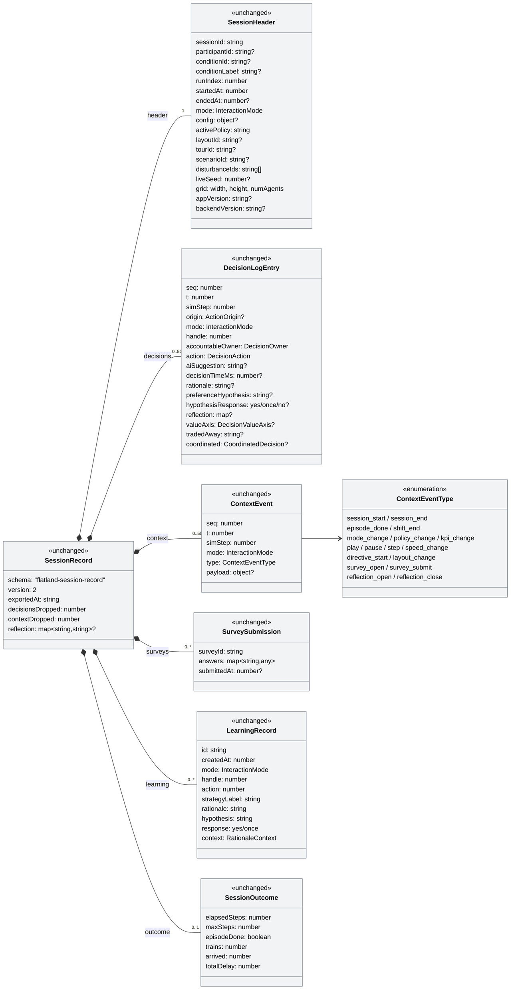
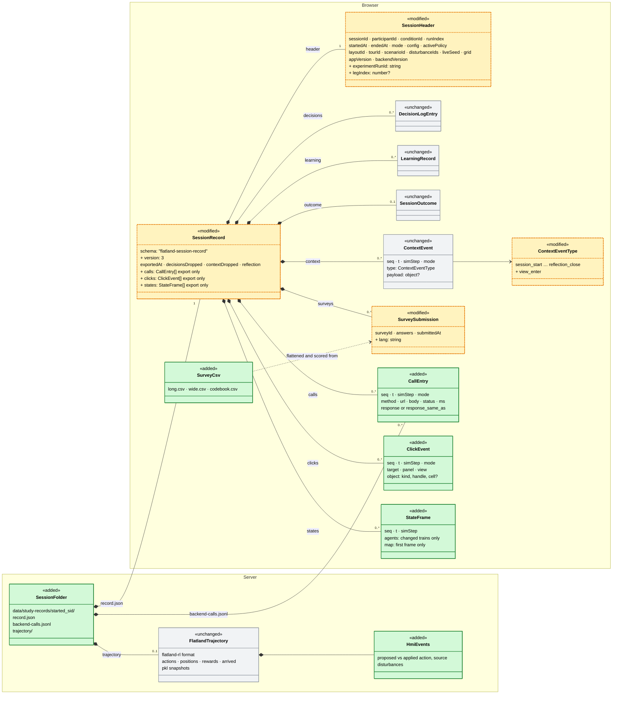

# Experiment logging (#129): frontend-first plan, data model and replay

> **Status:** plan, 2026-10-26. Nothing is built. Single plan for issue
> [#129](https://github.com/flatland-association/flatland-ui-hub/issues/129),
> [comment of 2026-10-23](https://github.com/flatland-association/flatland-ui-hub/issues/129#issuecomment-6361544578)
> (discussion with @CleverManu), which names five kinds of logging to start
> with. Open questions are in §13.
>
> **Approach (decided 2026-10-26): frontend-first.** The browser is the
> primary logger for every kind, built on today's session record and export.
> Two backend parts are kept because the browser cannot do them: the
> **server call log** (safety net) and the **flatland-rl trajectory**.
>
> **This plan answers:**
> 1. How each of the five kinds is logged, and what is added or modified.
> 2. Whether everything is kept in memory or in browser storage, and how many
>    clicks would exhaust, say, 5 GB of RAM.
> 3. What the current and the planned data models look like (class diagrams
>    and JSON examples).
> 4. Which data a full replay needs, e.g. an "import JSON → replay the
>    experiment" feature in the settings/admin area.

---

## 1. Scope

| # | Logging kind (issue comment) | Browser (primary) | Backend (kept) |
|---|---|---|---|
| 1 | Backend calls: timestamp + payload | `callLogInterceptor` → stream `calls` (§5.1) | server call log through Python `logging`, safety net (§5.1.2) |
| 2 | Clicks: when, which object or button | `ClickLogService` → stream `clicks` (§5.2) | – |
| 3 | Workflow transitions: when which view | `ViewTracker` → record `context` (§5.3) | – |
| 4 | flatland-rl artefacts: pkl per step, input and output (Trajectory API) | state messages → stream `states`, for replay (§5.4.1) | `TrajectoryRecorder`: pkl, TSVs, provenance (§5.4.2) |
| 5 | Questionnaire answers: format? HTML/Excel? | `lang` in the record, CSV export (§5.5) | optional `.xlsx` script (§5.5) |

It extends [`interaction-logging-plan.md`](interaction-logging-plan.md)
(P1–P4, built 2026-09-30) and does not start a parallel system. That plan
already produces one **session record** per backend session (header,
decisions, context events, surveys, reflection, outcome), autosaved to
`localStorage` and, with `STUDY_SINK_ENABLED`, saved on the server.

## 2. Decisions

| Date | Decision |
|---|---|
| 2026-10-23 | **Payload = request and response** bodies. Volume is handled by deduplication and rotation, not by dropping content. |
| 2026-10-23 | **Polling GETs: log them all.** Measure first; exclude routes only if the measurement calls for it (`STUDY_CALL_LOG_EXCLUDE`). |
| 2026-10-23 | **Calls are logged on both sides.** The browser copy is primary, the server copy is the safety net. |
| 2026-10-23 | **Backend: use the existing logging library and only parametrise it.** FastAPI, Starlette and uvicorn log through Python's standard `logging`, configured with a `dictConfig` file. |
| 2026-10-23 | **Opt-in at server start, full retention by default**, optional retention by time or volume, as far as the `logging` handlers offer it. |
| 2026-10-23 | **No logging library in the frontend.** The library rule applies to the backend only. |
| 2026-10-23 | **Log files are separated by user session**, except calls without a session, which are kept in a separate file. |
| 2026-10-23 | **Session directory key `<started>_<sid>`**, `<started>` in UTC ISO 8601 basic format, e.g. `20261026T080300Z_a1b2c3d4`: sorts by name, no colons (safe on Windows), unique. |
| 2026-10-23 | **Retention across sessions: KISS, per session.** Configuration limits each session's own file. The app never deletes session folders; they are removed by name, by hand. |
| 2026-10-23 | **User documentation** ships with each kind, with an example for each option and links to the full library documentation (§11). |
| 2026-10-26 | **Frontend-first**, keeping the server call log and the backend trajectory (this plan). |
| 2026-10-26 | **Older exports are ignored** by the replay: no migration or best-guess grouping of version 2 records. |
| 2026-10-27 | **Clicks only.** Hover/dwell, scroll and zoom, keyboard shortcuts and panel resize are a future extension, not built now. |
| 2026-10-26 | **KISS data model** (§7): no participant log, no new export format, no extra event types for legs, guide steps or session links, no stored survey scores. |

## 3. Today

### 3.1 Where the data lives

| Data | JS memory (signals, maps) | Browser storage (persisted to disk) | Server |
|---|---|---|---|
| Record header, context events | `InteractionLogService.header`, `contextEvents` | inside the whole record: `localStorage` `flatland_session_record_<sid>` | `PUT /study/records/{sid}`, only if the sink is on |
| Decisions | `SessionStore.decisionLog` (cap 500) + the service's archive `Map` (cap 5000) | inside the whole record | ″ |
| Survey answers | – | `localStorage` `flatland_survey_<sid>_<surveyId>` | inside the record |
| Co-Learning reflection | – | `localStorage` `flatland_colearning_reflection_<sid>` | inside the record |
| Learning records | `LearningStore.records` | `localStorage` (global, not per session) | inside the record (filtered to the session) |
| Record index, participant, run index | signals | `localStorage` `flatland_session_record_index_v1`, `flatland_study_participant_v1`, `flatland_study_run_index_v1` | – |
| Train positions over time | `SessionStore.trajectories` (compressed runs per train, `_recordTrajectory`) | – | – |
| Current env state | `SessionStore.state` (the last WebSocket message only) | – | – |
| Operator model | `OperatorModelService.profile` (mirror) | – | `backend/data/operator-profiles.json` |

So the answer to question 2 is **both**:

- **JS memory:** everything that is live sits in signals in the JS heap.
- **Browser storage:** the **whole session record** is also written as one
  JSON string to `localStorage` on every autosave, which is debounced to
  1.5 s, and immediately on session start/end, episode end, shift end and
  survey submit. `localStorage` survives a reload and a browser restart.
  Every saved session stays there until someone clicks "delete all" on the
  start screen.
- **Not used:** **IndexedDB is used nowhere** in the frontend (checked:
  no `indexedDB` / `IDBDatabase` in `src/`).

### 3.2 Capacity: what runs out first

Measured on 2026-10-26 (Node 20 / V8, which is the same engine as Chrome):

| Quantity | Value | How |
|---|---|---|
| One click event (envelope + target, panel, view, object, x/y) in the JS heap | **≈ 216 bytes** | 1 M events, `heapUsed` difference after GC |
| The same event as JSON | **≈ 180 bytes** | `JSON.stringify` |
| One state message over the WebSocket, default scenario (30×30, 3 trains) | **≈ 18 KB** | `serialize_env`. Of this, `rail_tiles`, `decision_cells` and `rail_grid` (≈ 16 KB) are static; `agents` is ≈ 1.8 KB. |
| The same, 60×60 with 20 trains | **≈ 41 KB** | static ≈ 29 KB, `agents` ≈ 12 KB, i.e. **≈ 600 bytes per train per step** |

**RAM.** 5 GB / 216 B ≈ **23 million click events**. At one click every two
seconds that is more than a year of continuous clicking. RAM is never the
limit, and a single tab could not use 5 GB anyway: Chrome caps one tab's JS
heap at about 4 GB, so the tab would crash before reaching 5 GB.

**What really runs out first, in today's design:**

1. **The caps.** `RECORD_CONTEXT_CAP` and `RECORD_DECISION_CAP` are 5000. A
   click stream would hit 5000 events within an hour, and the oldest would be
   dropped (counted in `contextDropped`, never silently).
2. **`localStorage` quota: ≈ 5 MB per origin**, shared by **all** saved
   session records, settings, designs and surveys. At ≈ 180 B per event,
   that is **≈ 25 000 events in total, across all sessions in that browser**.
   After that, `autosaveFailed` turns on and the footer warns.
3. **Cost per save.** Every autosave serialises the **whole** record
   (`JSON.stringify`), and every event appends by copying the whole array
   (`[...list, event]` in `_emit`). Both are O(n), which is fine at 5000
   events. At 100 000 events, every 1.5 s save would produce a ≈ 20 MB string
   and the UI would stutter long before memory became an issue.
4. **Server mirror:** `STUDY_RECORD_MAX_BYTES` = 5 MB per record (413 above
   that).

Logging state per step makes this worse quickly. 20 trains × 600 B × 500
steps ≈ 6 MB of `agents` alone, which is more than the whole `localStorage`
quota for one session.

**Consequence:** high-volume streams move out of `localStorage` and out of
the "rewrite the whole record" pattern, into **append-only chunks in
IndexedDB** (§4.1).

### 3.3 Today, per kind

- **1 Backend calls.**
  - Backend: the only middleware is CORS (`backend/app/main.py`). There are
    no request ids and no access log beyond uvicorn's. `settings.log_level`
    exists but nothing reads it.
  - Frontend: `provideHttpClient(withFetch())` without interceptors
    (`app.config.ts`). Almost all REST calls go through `core/api.service.ts`;
    `operator-model.service.ts` also calls the backend. The study sink uses
    raw `fetch` with keepalive, so an interceptor would not see it.
  - The session id is always a path parameter (`/session/{sid}/…`,
    `/ws/session/{sid}`). Calls without a session: `/policies`,
    `/session/scenario-presets`, `POST /session` before the id exists,
    `/operator/*`, `/health`.
  - **Play does not use HTTP.** `_play_loop` (`websockets.py`) steps the env
    and pushes the **full** serialised state over the WebSocket once per step
    (up to 20/s).
  - Polling: `/hmi/impact` 1.5 s, `/hmi/notifications` 2 s,
    `/director/activity` 2.5 s, Director scorecard 2 s, `/director/progress`
    1 s while planning, `/hmi/marey-data` per step while the Marey chart is
    shown, `/hmi/contentions` every N steps.
- **2 Clicks.**
  - The context stream has no click events. Decisions carry `origin`
    (`roster`/`table`/`map`/`marey`) and `handle`. Selection
    (`store.selectedHandle`) is not logged.
  - No stable target ids in the DOM: no `data-testid`/`data-action`, about
    six static `id`s; panel hosts have `data-panel-type` / `data-panel-zone`.
  - Labels are translated (about 820 `| transloco` calls), so text and
    `aria-label` change with the language.
  - Lyne buttons sit in shadow DOM. At document level the target is the host
    element; `composedPath()` gives the inner nodes.
  - Map and Marey handlers already know the object: `toggleSelect(handle)`,
    `onRailTileClick(t)`, `onStationClick(s)`,
    `onPillClick(handle, action, isOverride)`, `chooseTrainOption(...)`,
    `onAgentClick`, `onTopologyTileClick`, `onMareyPillClick`.
- **3 Workflow transitions.**
  - No router. Views are `@if` blocks in `app.component.html`, driven by
    signals: `store.session()`, `welcomeDoor`, `experimentKind`,
    `activeExperiment`, `tourOpeningOpen`, `store.demoIntroPending`,
    `surveyActive`, `helpActive`, `settingsMode`/`settingsTab`,
    `scenarioPolicyMode`, `shiftScreenOpen`, `demoComplete`,
    `store.reflectionRequested`, `pendingRationale`,
    `pendingStrategyReflection`, the center view tab.
  - Partly logged: `survey_open`/`survey_submit`,
    `reflection_open`/`reflection_close`, `layout_change`, `episode_done`,
    `shift_end`, `mode_change`, `play`/`pause`/`step`.
  - Not logged: tour leg (`store.demoStepIndex`, `demoPhase`), tour-guide
    step, intro screen, shift review, help and settings, center tabs, panel
    collapse/expand.
  - **Events outside a session are dropped** (`_emit` checks `_isLive()`):
    the start screen, a survey after the shift ended, the gap between two
    tour legs.
  - No experiment state machine. A study condition
    (`core/demo/study-conditions.ts`) is one scenario plus one survey; only
    tours chain legs (`Tour.modes`, `surveyAfterEachMode`, `advanceDemo`).
- **4 flatland-rl artefacts.**
  - flatland-rl 4.3.0 `flatland.trajectories` writes:

    ```
    <data_dir>/
      event_logs/ActionEvents.discrete_action.tsv                      # episode_id, env_time, agent_id, action
      event_logs/TrainMovementEvents.trains_positions.tsv              # ((r,c),dir)
      event_logs/TrainMovementEvents.trains_rewards_dones_infos.tsv
      event_logs/TrainMovementEvents.trains_arrived.tsv                # success_rate, normalized_reward
      serialised_state/<ep_id>.pkl                                     # initial env
      serialised_state/<ep_id>_step%04d.pkl                            # snapshots
      outputs/
    ```

    `Trajectory.create_empty(data_dir, env, ep_id)` saves the initial pkl;
    `action_collect`, `position_collect`, `rewards_dones_infos_collect` and
    `arrived_collect` buffer rows; `persist()` **rewrites** every TSV.
    `PolicyRunner.step()` is the reference sequence (`act_many` → collect
    actions → `env.step` → collect positions and rewards → callbacks →
    arrived on done). `TrajectorySnapshotCallbacks(snapshot_interval=n)`
    writes the step pkls. The action for step *i* sits at `env_time` *i*−1.
  - Our `env.step` call sites: `POST /session/{sid}/step`,
    `POST /session/{sid}/action` (`sessions.py`), `_play_loop`
    (`websockets.py`), sandbox / what-if forks (`sandbox.py`,
    `scenario_runner.py`). Actions come from `OverridePolicy` (default policy
    + pending human overrides).
  - The env is also changed outside `env.step`: `apply_due_disturbances`,
    malfunction re-seeding on reset, `_max_episode_steps` changes. Replaying
    actions alone (`TrajectoryEvaluator`) would **diverge**.
  - Nothing uses `flatland.trajectories` yet; only tests use `PolicyRunner`.
- **5 Questionnaires.**
  - Items are TypeScript data in `core/survey/survey-configs.ts`, adapted
    from AI4REALNET `hmisurveys`: NASA-TLX, Jian trust (`trust_N`),
    understanding (`und_1/2`), UEQ-S (`ueq_N`), open questions, mode-specific
    items. Scoring is in `core/survey/survey-scoring.ts`.
  - Answers are stored in `localStorage` and collected into the record
    (`surveys`, `reflection`) at save time (`_collectSurveys`). Submitting a
    survey also downloads a scored JSON.
  - **No CSV, Excel or HTML export anywhere.** Capture: yes; analysis
    format: no.

## 4. Architecture

### 4.1 Browser: record, streams, export

- **Small, record-like parts** (header, decisions, context and view events,
  surveys, outcome) stay in the session record in `localStorage`, as today.
- **High-volume streams** (`calls`, `clicks`, `states`) go to **IndexedDB**
  through one new `StreamStore`:
  - database `flatland_study_streams`, object store `chunks`, key
    `[sid, stream, n]`
  - append-only chunks of 500 events. Each append touches one small chunk,
    never the whole record, and is O(1) instead of `[...list, event]`.
  - `navigator.storage.persist()` is requested once, so the browser does not
    evict the data under storage pressure. Quotas are browser-dependent but
    typically gigabytes per origin (`navigator.storage.estimate()`).
  - Failures (private window, quota) never break the app: they set
    `streamLogFailed`, shown in the footer next to the autosave warning.
  - "Delete all" on the start screen also deletes the streams.
- **Export: the same record, with the streams embedded.** On export the
  three streams are read from IndexedDB and added to the record as `calls`,
  `clicks` and `states`, and the file is compressed in the browser with the
  native `CompressionStream('gzip')` (no library). There is no new file
  format: the record in `localStorage` and on the server simply has no
  streams.
  - The footer button ("Sitzungsdaten exportieren") exports the **current
    backend session only**, as today. In a guided experiment that is the
    current leg, because every leg starts its own session (`startTourLeg` →
    `createSession`).
  - The start-screen "export all" keeps today's format (`records: [...]`),
    now as `.json.gz` and with the streams embedded in each record. Several
    guided experiments therefore end up in the same file; §9.2 says how
    they are told apart.
- **Server copy of the record:** the `PUT /study/records/{sid}` mirror
  stays as it is, under 5 MB and without streams. The server writes its own
  call log and trajectory (§4.2). Clicks and states exist only in the
  browser and its exports (question 13.1).

### 4.2 Server: one folder per session

```
data/study-records/
  20261026T080300Z_a1b2c3d4/          # <started>_<sid>
    record.json                       # today's data/study-records/<sid>.json, moved
    backend-calls.jsonl               # kind 1, server copy
    trajectory/                       # kind 4
data/study-logs/
  sessionless/backend-calls.jsonl     # calls without a session
```

- `<started>` is a new `Session.started_at` (UTC), set in
  `SessionManager.create`. Nothing records it today.
- `session_dir(session)` builds the path; `find_session_dir(sid)` finds an
  existing `*_<sid>` folder after a restart.
- The study sink moves from `<sid>.json` to `<started>_<sid>/record.json`.

### 4.3 Time axis, switches and code version

- **One time axis.** Browser events use `Date.now()`, server logs the server
  clock: the same machine in the lab, different machines on a hosted Space.
  Both sides log `simStep`, the stable join key. The browser also sends
  `X-Client-Seq` and `X-Client-Time` (§5.1), so the clock offset can be
  estimated.
- **Switches.**
  - Server parts are **opt-in at server start**: the call log by
    `UVICORN_LOG_CONFIG`, the trajectory by `STUDY_TRAJECTORIES_ENABLED`.
    Never on the public Space.
  - Browser streams: see question 13.2 (proposal: on when a participant id
    is set, i.e. in study use, plus a toggle in settings).
- **Code version.** The record header already has `appVersion`, the short
  git commit read from `/build-info.json` (`BuildInfoService`). Only the HF
  Space deploy writes a real commit there (`deploy-hf-space.yml`); the
  committed default says `dev`. A lab machine running `start-demo.sh`
  therefore exports `"appVersion": "dev"`, and nobody can tell later which
  code a participant used.
  - `start-demo.sh` writes `build-info.json` into the build output
    (`dist/frontend/browser/`) after `ng build`, from
    `git rev-parse --short HEAD`, the branch and the build time. The
    committed `frontend/public/build-info.json` stays untouched.
  - Uncommitted changes in the checkout (`git status --porcelain` not
    empty) add a `-dirty` suffix, e.g. `45906a8-dirty`, because the commit
    alone would then not describe the code (question 13.26).
  - Frontend and backend come from the same checkout in both setups, so one
    commit identifies both. `backendVersion` stays the package version.
  - `ng serve` during development still says `dev`.

## 5. Design per kind

### 5.1 Backend calls (timestamp + payload)

| | Browser call log (§5.1.1) | Server call log (§5.1.2) |
|---|---|---|
| Role | primary for analysis | safety net |
| Clock | browser, same as the session record | server |
| Survives | a backend restart | a closed tab, a lost browser profile, a full browser quota |
| Misses | calls after the tab closed, raw `fetch` | calls that never reached the server |

The copies are joined by `X-Client-Seq`. Gaps in `seq` on one side are a
finding in their own right: a request was lost or a tab was closed.

#### 5.1.1 Browser: `callLogInterceptor`

An `HttpInterceptorFn` (`core/interaction-log/call-log.interceptor.ts`):

- **Logs each call** into stream `calls`, with the record envelope (`seq`,
  `t`, `simStep`, `mode`) plus method, URL, request body, status, duration
  and response body.
- **Deduplicates:** when a response is identical to the previous one of the
  same route in the same session, the entry holds `"response_same_as": <seq>`
  instead of the body. Polling stays cheap.
- **Adds correlation headers:** `X-Client-Seq` (counter), `X-Client-Time`
  (`Date.now()`), `X-Participant-Id`. They give the clock offset, requests
  sent but never received, and attribution of sessionless calls.
- **Never logs** `/study/*` (the sink uses raw `fetch` anyway) or the
  `X-Study-Token`.

**WebSocket.** `WebSocketService` gets a `messages` Subject next to the
`lastMessage` signal, because a signal coalesces messages that arrive
between two effect runs. From it:

- connect, disconnect, `episode_done` and `error` go into stream `calls` as
  entries with `"method": "WS"`
- `state` messages go into stream `states` (§5.4.1)

#### 5.1.2 Server: Python `logging`, configured, no own writer

FastAPI has no logging library of its own: FastAPI, Starlette and uvicorn
all log through Python's standard `logging`, and uvicorn takes a `dictConfig`
file (`--log-config`). Files, rotation, queueing and levels therefore come
from configuration.

**What stays code.** No logging library reads request and response bodies,
so one small ASGI middleware (`app/core/call_log.py`) is needed:

```python
log = logging.getLogger("flatland.study.calls")      # parent: configured by dictConfig
...
target = session_logger(sid) if sid else log         # per-session files, below
if target.isEnabledFor(logging.INFO):                # off unless configured → bodies are never read
    target.info(json.dumps(entry, default=str))
```

- **Always mounted, off by configuration.** Without configuration the
  logger has no handler and level `WARNING`, so the middleware passes
  requests through and reads no bodies.
- **`route`** is the route template, so analysis can group calls without
  regexes. **`sid`** comes from the path; for `POST /session` from the
  response.
- **Request and response bodies.** The middleware wraps `send` to collect
  the response. Non-JSON responses (SPA files, health check) are logged as
  `{"contentType", "bytes"}`.
- **Deduplication** as in the browser (`response_same_as`).
- **Never logged:** `/study/*` (would recurse) and `X-Study-Token`.
  Further exclusions: `STUDY_CALL_LOG_EXCLUDE` (route templates).
- **WebSocket:** connect, disconnect, `episode_done` and `error` are logged
  from `websocket_session` / `_play_loop` as `"method": "WS"` lines. Per-step
  state pushes are not: the trajectory (§5.4.2) holds the env state.

**Opt-in at server start.** Call logging runs only when the server starts
with the configuration file. uvicorn reads every CLI option from a
`UVICORN_*` environment variable (click `auto_envvar_prefix`, checked), so
`start-demo.sh` and the Dockerfiles need no change:

```bash
UVICORN_LOG_CONFIG=logging.study.json uvicorn app.main:app …   # or: uvicorn … --log-config logging.study.json
```

**Configuration, full retention by default** (`backend/logging.study.json`,
JSON so no PyYAML dependency):

```json
{
  "version": 1,
  "disable_existing_loggers": false,
  "formatters": {"line": {"format": "%(message)s"}},
  "handlers": {
    "sessionless_file": {
      "class": "logging.handlers.TimedRotatingFileHandler",
      "filename": "data/study-logs/sessionless/backend-calls.jsonl",
      "when": "midnight", "backupCount": 0, "utc": true, "encoding": "utf-8",
      "formatter": "line"
    },
    "sessionless_queue": {"class": "logging.handlers.QueueHandler", "handlers": ["sessionless_file"]}
  },
  "loggers": {
    "flatland.study.calls": {"level": "INFO", "handlers": ["sessionless_queue"], "propagate": false}
  },
  "flatland_session_handler": {
    "class": "logging.handlers.TimedRotatingFileHandler",
    "filename": "data/study-records/{started}_{sid}/backend-calls.jsonl",
    "when": "midnight", "backupCount": 0, "utc": true, "encoding": "utf-8"
  }
}
```

- `TimedRotatingFileHandler` with `backupCount: 0` starts a new file every
  midnight and **never deletes** one.
- The file also keeps uvicorn's own loggers (`uvicorn`, `uvicorn.error`,
  `uvicorn.access`), because `--log-config` replaces uvicorn's default. The
  `uvicorn.config.LOGGING_CONFIG` default is copied in unchanged.
- `QueueHandler` (configurable in `dictConfig` since Python 3.12) keeps a
  slow disk from delaying a request. The backend runs Python 3.12/3.13.
- Write errors never fail a request: `logging` reports them via
  `handleError` on stderr.

**Per-session files.**

| Calls | Logger | File |
|---|---|---|
| with a session (`/session/{sid}/…`, `/ws/session/{sid}`, `POST /session` via the sid in its response) | `flatland.study.calls.session.<sid>` | `data/study-records/<started>_<sid>/backend-calls.jsonl` |
| without a session (`/policies`, `/session/scenario-presets`, `/operator/*`, `/health`) | `flatland.study.calls` | `data/study-logs/sessionless/backend-calls.jsonl` |

`dictConfig` is static and cannot open one file per session. This is the
one place where "only parametrise" needs a few lines of code, which still
only uses library classes:

- **The handler template lives in the same file.** `flatland_session_handler`
  uses the keys of a `dictConfig` handler (`class` plus its arguments), with
  `{started}` and `{sid}` placeholders in `filename`. `dictConfig` ignores
  unknown top-level keys (checked), so uvicorn loads the file unchanged.
- **`session_logger(sid)`**, on the first call for a sid:
  1. reads the template from the same file (path from `UVICORN_LOG_CONFIG`)
  2. instantiates the named standard handler class with its arguments, with
     `filename` formatted from `started` and `sid`. `started` comes from the
     live `Session`; after a backend restart an existing `*_<sid>` folder is
     reused; with neither, the call goes to the sessionless file
  3. attaches it with the `line` formatter to the child logger
     `flatland.study.calls.session.<sid>`, `propagate = False`
  4. caches it
- **No template → no per-session file.** Session calls then land in the
  sessionless file, with their `sid`.
- **Lifecycle:** closed on `DELETE /session/{sid}`, at session end and on
  shutdown. Recreated on the first call after a restart (append mode, so
  the file continues). At most `STUDY_CALL_LOG_OPEN_FILES` (default 64)
  handlers stay open (LRU).
- **Writes** are synchronous per session; a single shared queue is the
  fallback if the measurement (question 13.3) shows slow requests.

**Optional retention, only what `logging` offers, set in the same file:**

| Want | Handler parameters | Effect |
|---|---|---|
| Full retention (default) | `TimedRotatingFileHandler`, `backupCount: 0` | daily files, none deleted |
| Retention by **time** | `TimedRotatingFileHandler`, `when: "midnight"`, `backupCount: N` | keeps the last N days |
| Retention by **volume** | `RotatingFileHandler`, `maxBytes: M`, `backupCount: N` | keeps at most about (N+1)·M bytes |

- One handler does either time or volume, not both. Combining them would
  need our own handler, which the requirement rules out.
- `RotatingFileHandler` needs `backupCount ≥ 1` to cap volume. With
  `backupCount: 0` and `maxBytes > 0` it reopens the same file in append mode
  and caps nothing (checked in CPython 3.13 `doRollover`).
- Retention applies **per session file**. Whole session folders are never
  deleted by the app; their names start with the start time, so they are
  removed by name, by hand (e.g. "move everything before `20261001T`").
- No gzip while writing; daily files can be compressed afterwards. A gzip
  `rotator` would be code.
- `settings.log_level` (`config.py`), which nothing reads, is dropped.

### 5.2 Clicks (when, which object or button)

Motivation (@CleverManu, #129): a clickstream as a pointer to where the
participant's attention is.

**One capturing listener.** `ClickLogService` registers one `click`
listener in the capture phase on `document`, walks `event.composedPath()`
and writes an event into stream `clicks`:

| Field | Source |
|---|---|
| `target` | first `data-log` attribute on the path; else `id`; else `tag` + translation-free fallback (`sbb-button`, index in panel) |
| `panel` | closest `[data-panel-type]` |
| `view` | current view from `ViewTracker` (§5.3) |
| `object` | the domain object, attached by the handler (below) |
| `x, y` | viewport coordinates normalised to 0–1 (question 13.9) |

Clicks into text inputs are logged as "field focused", **never** with their
value.

**`data-log` attributes, step by step.** A plain attribute
`data-log="map.zoomIn"` that reuses the translation key of the button label,
so the id is stable across languages. Rollout order:

1. decision controls: hold, release, accept, reject, pill, option, strategy
2. mode and policy controls, play/pause/step, the speed slider
3. panel headers: collapse, expand, tabs
4. everything else as time allows. Untagged clicks still appear, with the
   fallback.

**Domain objects come from the handlers, not the DOM.** The map and Marey
handlers call `clickLog.object({kind: 'agent', handle})`,
`{kind: 'cell', r, c}`, `{kind: 'station', id}` or
`{kind: 'pill', handle, action}`. The service attaches it to the click the
capture listener has just opened, so no SVG element needs a `data-*`
attribute.

**Future extension, not built now (decided 2026-10-27):** hover/dwell over
trains, scroll and zoom on the map, keyboard shortcuts and panel resize.
Hover is the best attention proxy short of eye tracking, but 10–100× the
volume of clicks. If needed later, it gets its own stream next to `clicks`,
so the click format does not change.

**Storage.** Clicks go to stream `clicks` in IndexedDB, not into `context`,
so they cannot push semantic events out of the 5000 cap. Clicks after a
session ended go to that session until the next one starts (§5.3); clicks on
the start screen before the first session are not logged.

### 5.3 Workflow transitions (when which view)

**One `view_enter` event, derived from the signals.** `ViewTracker`
(`core/interaction-log/view-tracker.service.ts`) computes
`currentView(): {view, detail}` from the signals in §3.3 without changing
them, and emits `view_enter {view, detail, from}` when the value changes.
Time in a view is the time until the next `view_enter`; there is no
`view_leave`.

| `view` | `detail` |
|---|---|
| `start` | `{door, experimentKind}` |
| `tour_opening` | `{tourId}` |
| `mode_intro` | `{tourId, leg, mode}` |
| `session` | `{centerTab, layoutId}` |
| `guide` | `{stepId}` (tour-guide step) |
| `reflection` | `{kind: 'co-learning' \| 'rationale' \| 'strategy'}` |
| `survey` | `{surveyId}` |
| `shift_review` | `{debrief: boolean}` |
| `help`, `settings` | `{tab}` |
| `demo_complete` | `{tourId}` |
| `gallery`, `designer` | – (outside experiments) |

Overlays (help, the guide, a reflection dialog, a survey on top of the
session) take precedence; when they close, the view below is entered again.

**"Step in the scenario"** needs no new event type:

- sim step: already covered by `play` / `pause` / `step`; `simStep` is in
  every envelope
- tour leg: each leg is its own session, and its header says which run and
  which leg it is (below)
- tour-guide step: a `view_enter` with `view: 'guide'`

**Between sessions (KISS).** Today `_emit` drops every event once a session
has ended, so the questionnaire after a leg, the intro of the next leg and
the debrief are lost. Instead, a session's record **keeps receiving events
after it ended, until the next session starts** or the participant returns
to the start screen. The questionnaire after leg 1 and the intro of leg 2
therefore land in leg 1's record, after its `endedAt`. Only the start screen
before a participant's first session is not logged (question 13.6). There is
no separate participant log and no new endpoint.

**One id per experiment run.** A guided experiment (tour) or a study
condition spans several backend sessions: one per leg, plus any reset. Today
they share only `participantId` + `tourId` / `conditionId`, and `runIndex`
counts **sessions**, not experiments, so two runs of the same tour by the
same participant cannot be told apart. The header gets `experimentRunId`, a
fresh id when a tour, a study condition or a free session starts
(`setRunContext`), kept for all its legs and resets, and `legIndex`, which
orders the legs.

### 5.4 flatland-rl artefacts (pkl per step, input and output)

#### 5.4.1 Browser: state stream (for replay)

`StateLogService` subscribes to `WebSocketService.messages` and writes one
frame per state message into stream `states`:

- `seq`, `t`, `simStep` (`elapsed_steps`), and `max_episode_steps` when it
  changed
- `agents`: **only the trains whose fields changed** since the previous
  frame
- the **first frame** of a session, and the first after a scenario change,
  also carries `map`: `width`, `height`, `rail_grid`, `rail_tiles`,
  `decision_cells`, and all trains

It cannot produce flatland's pkl or TSVs, and the state message has no
applied action per train (only `override_action`) and no rewards. These come
from the backend trajectory, so **`serialize_env` is not changed** (no
payload change).

#### 5.4.2 Backend: `TrajectoryRecorder`

Every experiment episode is written as a **flatland-rl Trajectory** in the
flatland-association format, so WP4 KPI tooling, `TrajectoryEvaluator` and
`Trajectory.fork` / `load_env` work on our data without conversion.

A recorder hangs off each `Session` (`app/core/trajectory_recorder.py`). It
copies the `PolicyRunner.step` sequence around **our** `env.step`, so the
play loop, the override logic and the throttling stay untouched:

```python
rec.before_step(env, applied_actions, proposed_actions)   # action_collect (applied)
env.step(applied_actions)
apply_due_disturbances(...)
rec.after_step(env)          # position_collect, rewards_dones_infos_collect,
                             # snapshot callback, arrived_collect on done
```

- **One helper, three call sites:** `step_env(session, actions, …)` (new,
  `app/core/env_step.py`) is used by `/step`, `/action` and `_play_loop`.
  Sandbox and what-if forks are not recorded (question 13.15).
- **Snapshots:** `snapshot_interval=1` by default, the "pkl at every step"
  of the issue, and the only exact record given the out-of-band changes.
- **Reset** or a new scenario closes the trajectory and starts a new `ep_id`
  in the same session folder.
- **Persist** at `episode_done`, on reset, on session delete and every 50
  steps.
- **Gating:** `STUDY_TRAJECTORIES_ENABLED`, never on the public Space.
- **Destination:** `data/study-records/<started>_<sid>/trajectory/`.

**Beyond the standard format.** For human–AI teaming analysis the
interesting part is the difference between the AI's proposal and what was
applied. Two extra files in the same TSV style:

```
event_logs/HmiEvents.action_provenance.tsv
  episode_id, env_time, agent_id, proposed_action, applied_action, source   # source: policy|override|system_hold|reroute
event_logs/HmiEvents.disturbances.tsv
  episode_id, env_time, agent_id, kind, params                              # scripted disturbances
```

`trajectory/meta.json` holds the `sid`, scenario id / preset, seed, policy
id and every `policy_change` with its `env_time`, the reward configuration,
the flatland-rl and app versions and the `ep_id` list.

### 5.5 Questionnaire answers (format, HTML/Excel?)

- **JSON stays the source of truth.** The record already holds all answers.
- **One addition to the stored answers:** `lang`, the UI language at
  submit, so the codebook can tell which wording the participant saw.
- **Browser CSV export** (no library), from the saved records, on the start
  screen next to "export all". Scored values are computed at export with the
  existing `survey-scoring.ts`, so scoring is not copied anywhere.
  - **long:** one row per participant × session × survey × item

    ```
    participant_id, condition_id, run_index, session_id, mode, survey_id,
    item_id, subscale, reverse, raw_value, scored_value, submitted_at, lang
    ```

  - **wide:** one row per participant × session, one column per item, plus
    the subscale scores (NASA-TLX overall, trust mean, UEQ-S pragmatic /
    hedonic)

  Free-text answers are only in the long format, flagged so they can be
  stripped before hand-off.
- **Codebook:** `frontend/scripts/export-survey-codebook.mjs`
  (`npm run survey:codebook`) writes item id → text EN/DE/FR, scale,
  reverse, subscale and source instrument from `survey-configs.ts` and
  `public/i18n/*.json`, as a CSV next to the answers.
- **Excel (only if question 13.18 wants it):** the backend script
  `backend/scripts/export_surveys.py` reads the two CSVs and the codebook
  and writes one `.xlsx` with three sheets (`openpyxl`, a new backend dev
  dependency).
- **Order of answers (optional, question 13.20):** a context event
  `survey_answer {surveyId, itemId, value}` per change of a rating or choice
  records hesitation and revisions. It is also what a step-by-step replay of
  questionnaires needs (§9.3).

## 6. Data model: current export (schema `flatland-session-record` v2)

Source: `frontend/src/app/core/interaction-log/session-record.ts`,
`core/decision-log.ts` and `core/learning-store.service.ts`.



**Legend** (same scheme as
[PR #156](https://github.com/flatland-association/flatland-ui-hub/pull/156)):
everything here exists today, so every class is grey + `«unchanged»`.
Colours are set with plain `style` lines (no `classDef`), so they render in
IDE previews too.

### Example: today's export

The file `flatland-P07-B2-director-noforecast-2-a1b2c3d4.json`, shortened to
one or two entries per list:

```json
{
  "schema": "flatland-session-record",
  "version": 2,
  "exportedAt": "2026-10-26T09:42:10.512Z",
  "header": {
    "sessionId": "a1b2c3d4",
    "participantId": "P07",
    "conditionId": "B2-director-noforecast",
    "conditionLabel": "Director, no forecast",
    "runIndex": 2,
    "startedAt": 1792999380000,
    "endedAt": 1793001120000,
    "mode": "director",
    "config": { "width": 30, "height": 30, "agents": 3, "maxSteps": 400, "seed": 42,
                "malfunctionsEnabled": true, "surveyParts": ["nasa-tlx", "trust"],
                "decisionCountdown": 20, "autoPauseOnConflict": true },
    "activePolicy": "deadlock_avoidance",
    "layoutId": "B2-director-noforecast",
    "tourId": null,
    "scenarioId": "olten",
    "disturbanceIds": ["signal-failure-olten"],
    "liveSeed": 42,
    "grid": { "width": 30, "height": 30, "numAgents": 3 },
    "appVersion": "45906a8",
    "backendVersion": "0.9.0"
  },
  "decisions": [
    { "seq": 1, "t": 1792999512340, "simStep": 37, "origin": "map", "mode": "director",
      "handle": 2, "accountableOwner": "human", "action": "hold",
      "aiSuggestion": "proceed", "decisionTimeMs": 4210,
      "rationale": "Wait for the IC to clear the single track",
      "valueAxis": "punctuality", "tradedAway": "throughput" }
  ],
  "decisionsDropped": 0,
  "context": [
    { "seq": 1, "t": 1792999380050, "simStep": 0,  "mode": "director", "type": "session_start" },
    { "seq": 2, "t": 1792999381200, "simStep": 0,  "mode": "director", "type": "directive_start",
      "payload": { "policy": "deadlock_avoidance", "kpiPriorities": { "punctuality": 0.6 }, "resumed": false } },
    { "seq": 3, "t": 1792999381210, "simStep": 0,  "mode": "director", "type": "play" },
    { "seq": 4, "t": 1793001100000, "simStep": 400, "mode": "director", "type": "shift_end" }
  ],
  "contextDropped": 0,
  "surveys": [
    { "surveyId": "post-session-director",
      "answers": { "trust_1": 5, "und_2": 2, "open_best": "The dials were clear" },
      "submittedAt": 1793001300000 }
  ],
  "reflection": null,
  "learning": [],
  "outcome": { "elapsedSteps": 400, "maxSteps": 400, "episodeDone": true,
               "trains": 3, "arrived": 3, "totalDelay": 57 }
}
```

The values are illustrative. The field names and types are the ones in
`session-record.ts` and `decision-log.ts`.

## 7. Data model: planned, all five kinds



**Legend** (same scheme as
[PR #156](https://github.com/flatland-association/flatland-ui-hub/pull/156)):
- green + `«added»` = **added**
- yellow, dashed border + `«modified»` = **modified**. A leading `+` marks
  the new fields.
- grey + `«unchanged»` = **reused unchanged**. The flatland trajectory is
  flatland-rl's own format, reused as is.

Colours are set with plain `style` lines (no `classDef`), so they render in
IDE previews too. The stereotypes repeat the status for renderers without
colour. The files and symbols behind each class are in §8. The server's
call log uses the same entry shape as the browser's, plus the session id,
the route template and the browser's sequence number. Calls without a
session go to `data/study-logs/sessionless/backend-calls.jsonl`.

### What changes, and why

| | What | Why, from the user's side |
|---|---|---|
| 🟨 | Session export | One exported file per session now also holds the backend calls, clicks and train movements. That one file is enough to analyse or replay the session. |
| 🟨 | Experiment run and leg | Shows which legs belong to the same guided experiment, even when someone runs the same experiment twice. The replay can then list and play them as one experiment, in order. |
| 🟨 | Screen changes | Records which screen the participant saw and when: map, Marey chart, questionnaire, intro, debrief. Time spent per screen can be measured. |
| 🟨 | Code version on lab machines | Shows exactly which version of the app a participant used, also when the app runs on a lab computer. Results from different versions are not mixed up by accident. |
| 🟨 | Questionnaire language | Shows which language version of the questions someone answered, which matters when comparing answers. |
| 🟩 | Backend calls | Shows what the app asked the server and what it answered, i.e. what each panel showed the participant at that moment. |
| 🟩 | Clicks | Shows when the participant clicked which button, train or track, as a hint where their attention was. |
| 🟩 | Train movements | Records where every train was at every step, so the session can be shown again exactly as the participant saw it. |
| 🟩 | Questionnaire tables | Puts the answers in spreadsheet-ready tables with a codebook, so analysts can use them in R, Python, SPSS or Excel directly. |
| 🟩 | Session folder on the server | Keeps everything of one session together on the server, named by its start time, so it is easy to find, hand over or delete. |
| 🟩 | AI proposal vs. decision | For every train and step, shows whether the AI's proposal was applied or overridden by the person, and when disturbances hit. This is the core of the human–AI teaming analysis. |

**Kept small on purpose (KISS):**

- **No separate participant log.** Events after a session ended (questionnaire, next intro) go into that session's record until the next session starts (§5.3).
- **No new export format.** The streams are embedded in the exported record; "export all" keeps today's format.
- **No extra event types** for tour legs, guide steps or session links. The header says the run and leg, and guide steps are screen changes.
- **No stored scores.** The CSV export computes them from the answers with the existing scoring.
- **Server internals** (the backend `Session` object, file handlers) are not part of the data model; they are in §8.

### Example: planned export

**How changes are marked.** The examples are `diff` blocks, which GitHub
and most IDE previews colour line by line:

- `+` green = **added**
- `-` red = **removed**
- a `-` line followed by a `+` line = **modified** (old value, then new
  value)
- no prefix = unchanged

A `// added`, `// modified` or `// removed` comment repeats the status for
renderers without colour, as the `«added»` / `«modified»` stereotypes do in
the diagram. The comments make these blocks JSONC rather than JSON: strip
the prefixes and comments to get the actual file content.

**Nothing is removed** from the record. The only removals are outside it:
the server path `data/study-records/<sid>.json` moves into a folder, and
`Settings.log_level` goes.

**1. The exported session record, version 3**, shortened. `…` stands for
unchanged content shown in full in §6. In `localStorage` and in the
server's `record.json`, `calls`, `clicks` and `states` are absent:

```diff
  {
    "schema": "flatland-session-record",
-   "version": 2,                                   // modified
+   "version": 3,                                   // modified
    "exportedAt": "2026-10-26T09:42:10.512Z",
    "header": { "sessionId": "a1b2c3d4", "participantId": "P07", "tourId": "co-learning-cost-benefit", "…": "unchanged",
+     "experimentRunId": "run-7f3e", "legIndex": 1 },   // added: groups the legs of one experiment run
    "decisions": [ "… unchanged …" ],
    "decisionsDropped": 0,
    "context": [
      { "seq": 1, "t": 1792999380050, "simStep": 0, "mode": "director", "type": "session_start" },
+     { "seq": 2, "t": 1792999500100, "simStep": 35, "mode": "director", "type": "view_enter",        // added event type
+       "payload": { "view": "session", "detail": { "centerTab": "marey" }, "from": "mode_intro" } },
      { "seq": 3, "t": 1793001100000, "simStep": 400, "mode": "director", "type": "shift_end" },
+     { "seq": 4, "t": 1793001150000, "simStep": 400, "mode": "director", "type": "view_enter",       // added: logged after the shift, until the next leg starts
+       "payload": { "view": "survey", "detail": { "surveyId": "post-session-director" }, "from": "shift_review" } }
    ],
    "contextDropped": 0,
    "surveys": [
      { "surveyId": "post-session-director",
        "answers": { "trust_1": 5, "und_2": 2, "open_best": "The dials were clear" },
-       "submittedAt": 1793001300000 }              // modified
+       "submittedAt": 1793001300000, "lang": "de" }   // modified: lang added
    ],
    "reflection": null,
    "learning": [],
    "outcome": { "…": "unchanged" },
+   "calls": [                                      // added, export only
+     {"seq":412,"t":1792999512310,"simStep":37,"mode":"director","method":"POST","url":"/session/a1b2c3d4/agent/2/override","body":{"action":4},"status":200,"ms":14,"response":{"ok":true,"handle":2,"action":4}},
+     {"seq":413,"t":1792999513500,"simStep":37,"mode":"director","method":"GET","url":"/session/a1b2c3d4/hmi/impact","body":null,"status":200,"ms":9,"response_same_as":405}
+   ],
+   "clicks": [                                     // added, export only
+     { "seq": 1, "t": 1792999508120, "simStep": 37, "mode": "director",
+       "target": "map.decisionPill", "panel": "map", "view": "session", "object": { "kind": "pill", "handle": 2 } }
+   ],
+   "states": [                                     // added, export only
+     { "seq": 1, "t": 1792999380100, "simStep": 0,
+       "map": { "width": 30, "height": 30, "rail_grid": "…", "rail_tiles": "…", "decision_cells": "…" },
+       "agents": [ "… all trains …" ] },
+     { "seq": 38, "t": 1792999512900, "simStep": 37,
+       "agents": [ { "handle": 2, "position": [12, 7], "direction": 1, "state": "STOPPED", "delay": 3, "override_action": 4 } ] }
+   ]
  }
```

**2. Server files:**

```diff
- data/study-records/a1b2c3d4.json                                   // removed: one flat file per session
+ data/study-records/20261026T080300Z_a1b2c3d4/record.json           // added: folder per session, <started>_<sid>
+ data/study-records/20261026T080300Z_a1b2c3d4/backend-calls.jsonl   // added
+ data/study-records/20261026T080300Z_a1b2c3d4/trajectory/           // added
+ data/study-logs/sessionless/backend-calls.jsonl                    // added
```

**3. Server call log**, one line per call. It is the same call as `seq` 412
in the export, seen by the server; `client.seq` joins them:

```diff
+ {"ts":1792999512.318,"seq":977,"sid":"a1b2c3d4","method":"POST","path":"/session/a1b2c3d4/agent/2/override","route":"/session/{sid}/agent/{handle}/override","query":{},"body":{"action":4},"status":200,"ms":12.4,"response":{"ok":true,"handle":2,"action":4},"client":{"seq":412,"t":1792999512310,"participant":"P07"}}
```

**4. Trajectory** (server), `…/trajectory/event_logs/`, as TSV. The
standard flatland-rl file is reused unchanged. The provenance file is new:

```diff
  ActionEvents.discrete_action.tsv                          // unchanged: flatland-rl format
  episode_id  env_time  agent_id  action
  3f6c…e2     36        2         4

+ HmiEvents.action_provenance.tsv                           // added
+ episode_id  env_time  agent_id  proposed_action  applied_action  source
+ 3f6c…e2     36        2         2                4               override
```

Action 2 is MOVE_FORWARD and action 4 is STOP_MOVING. The human's hold at
`simStep` 37 is the action for step 37, stored at `env_time` 36 following
flatland's indexing rule (§3.3).

**5. Survey export, long CSV**, one row per item:

```diff
+ participant_id,condition_id,run_index,session_id,mode,survey_id,item_id,subscale,reverse,raw_value,scored_value,submitted_at,lang
+ P07,B2-director-noforecast,2,a1b2c3d4,director,post-session-director,und_2,understanding,true,2,6,2026-10-26T09:41:40Z,de
```

All values are illustrative. Field names of new types are proposals until
built.

## 8. Change inventory

**Added** = the file or symbol does not exist yet. **Modified** = it exists
and changes. Frontend paths are relative to `frontend/src/app/` unless they
start with `frontend/`.

### 8.1 Shared

**Added**

| Path | Kind | Symbols | Purpose |
|---|---|---|---|
| `core/interaction-log/stream-store.ts` | service (root) | `StreamStore`: `append(sid, stream, event)`, `read(sid, stream)`, `delete(sid)`, signal `failed`; constants `STREAM_DB = 'flatland_study_streams'`, `STREAM_CHUNK_SIZE = 500`; type `StreamName = 'calls' \| 'clicks' \| 'states'` | IndexedDB chunks (§4.1) |
| ″ | function | `gzipJson(value): Promise<Blob>` | compressed export (§4.1) |
| `stream-store.spec.ts` | tests | – | §10 |
| `backend/app/core/session_manager.py` | functions | `session_dir(session) -> Path`, `find_session_dir(sid) -> Path \| None` | §4.2 |
| `docs/experiment-logging.md` | user documentation | – | §11 |

**Modified**

| Path | Symbol | Change |
|---|---|---|
| `core/interaction-log/session-record.ts` | `SessionRecord`, `SESSION_RECORD_VERSION` | optional `calls`, `clicks`, `states` (export only); version 2 → 3 |
| `core/interaction-log/interaction-log.service.ts` | `exportCurrent`, `exportAllSaved` | embed the streams from `StreamStore`, write `.json.gz` |
| ″ | `clearSaved` | also `StreamStore.delete` |
| ″ | new signal `streamLogFailed` | mirrors `StreamStore.failed` |
| `app.component.html` | footer, next to `footer.autosaveFailed` | warning when `streamLogFailed()` |
| `frontend/public/i18n/{en,de,fr}.json` | `footer` | new key `footer.streamLogFailed` |
| `backend/app/core/session_manager.py` | class `Session`, `SessionManager.create` | new attribute `started_at: datetime` (UTC), set on create |
| `backend/app/api/study.py` | `_record_path`, `list_records`, `get_record` | `<sid>.json` → `session_dir(...)/record.json` |
| `backend/tests/test_study_sink.py` | – | expects the new path |
| `docs/README.md` | – | links `docs/experiment-logging.md` |
| `start-demo.sh` | after `ng build` | writes `dist/frontend/browser/build-info.json` with commit (`-dirty` if the checkout has changes), branch and build time (§4.3) |

### 8.2 Kind 1: backend calls

**Added**

| Path | Kind | Symbols | Purpose |
|---|---|---|---|
| `core/interaction-log/call-log.interceptor.ts` | `HttpInterceptorFn` | `callLogInterceptor` | correlation headers, one `calls` entry per request (§5.1.1) |
| `core/interaction-log/session-record.ts` | type | `CallEntry` | entry shape |
| `backend/app/core/call_log.py` | module | constants `CALLS_LOGGER = "flatland.study.calls"`, `SESSION_LOGGER_PREFIX = "flatland.study.calls.session."`, `SESSION_TEMPLATE_KEY = "flatland_session_handler"` | names shared by code and config |
| ″ | ASGI middleware | `CallLogMiddleware` | collects request and response, deduplicates, logs |
| ″ | functions | `session_logger(sid)`, `close_session_logger(sid)`, `close_all_session_loggers()` | per-session child logger from the template; LRU |
| `backend/logging.study.json` | config | – | `dictConfig` file: sessionless handler, session template, uvicorn defaults |
| `backend/tests/test_call_log.py`, `call-log.interceptor.spec.ts` | tests | – | §10 |

**Modified**

| Path | Symbol | Change |
|---|---|---|
| `app.config.ts` | `provideHttpClient(withFetch())` | add `withInterceptors([callLogInterceptor])` |
| `core/websocket.service.ts` | `WebSocketService` | new `messages` Subject, fed in `onmessage`; `connected` and the Subject are observed for WS entries. `lastMessage` stays. |
| `backend/app/main.py` | module level | `app.add_middleware(CallLogMiddleware)`; shutdown hook calls `close_all_session_loggers()` |
| `backend/app/config.py` | `Settings` | **add** `study_call_log_exclude: str = ""`, `study_call_log_open_files: int = 64`; **remove** `log_level` (unused) |
| `backend/app/core/session_manager.py` | `SessionManager.delete` | calls `close_session_logger(sid)` |
| `backend/app/api/websockets.py` | `websocket_session`, `_play_loop` | log WS connect/disconnect, `episode_done`, `error` via `session_logger(sid)`. Stepping and throttling unchanged. |

**Unchanged on purpose:** `api.service.ts` (the interceptor sees its
calls), both Dockerfiles and the call-log part of `start-demo.sh` (opt-in
is an environment variable; `start-demo.sh` only gains the version stamp of
§8.1), the raw `fetch` of the study sink.

**Only if question 13.4 is decided a) or b):** `core/operator-model.service.ts`
(`operatorId` from the participant id) and
`core/demo/tour-context.service.ts` (fresh-profile id).

### 8.3 Kind 2: clicks

**Added**

| Path | Kind | Symbols | Purpose |
|---|---|---|---|
| `core/interaction-log/click-log.service.ts` | service (root) | `ClickLogService`: capture listener on `document`, `object(obj)`, private `resolveTarget(path)` | §5.2 |
| `core/interaction-log/session-record.ts` | type | `ClickEvent` (with an inline `object`) | event shape |
| `click-log.service.spec.ts` | tests | – | §10 |

**Modified**

| Path | Symbol | Change |
|---|---|---|
| `features/flatland-map/flatland-map.component.ts` | `toggleSelect`, `onRailTileClick`, `onStationClick`, `onPillClick`, `chooseTrainOption` | one line each: `clickLog.object({...})` |
| `features/marey-chart/marey-chart.component.ts` | `onAgentClick`, `onTopologyTileClick`, `onMareyPillClick` | same |
| Templates with decision, mode, policy, playback and panel-header controls | `<button>` / `sbb-*` elements | add `data-log="<i18n key>"`, in the rollout order of §5.2 |

**Unchanged on purpose:** `train-action.service.ts` (`origin` stays),
`session.store.ts`, the i18n files.

### 8.4 Kind 3: workflow transitions

No backend changes.

**Added**

| Path | Kind | Symbols | Purpose |
|---|---|---|---|
| `core/interaction-log/view-tracker.service.ts` | service (root) | `ViewTracker`: computed `currentView()`, emits `view_enter` | §5.3 |
| `core/interaction-log/app-view-state.ts` | injection token | `AppViewState` | gives `ViewTracker` read access to `AppComponent`'s view signals |
| `view-tracker.service.spec.ts` | tests | – | §10 |

**Modified**

| Path | Symbol | Change |
|---|---|---|
| `core/interaction-log/session-record.ts` | `ContextEventType` | add `view_enter` (and `survey_answer` if question 13.20 says yes) |
| ″ | `SessionHeader` | add `experimentRunId: string`, `legIndex: number \| null` |
| `core/interaction-log/interaction-log.service.ts` | `_isLive`, `_emit` | an ended session keeps receiving events until the next session starts or the start screen is shown |
| ″ | `setRunContext`, `_start` | a new `experimentRunId` when a tour, condition or free session starts; reused for its legs and resets |
| `app.component.ts` | `startTourLeg` | passes `legIndex` with the run context |
| ″ | providers | provides `AppViewState` with `welcomeDoor`, `surveyActive`, `helpActive`, `settingsMode`, `demoComplete`, `tourOpeningOpen`, `shiftScreenOpen` (read-only) |

**Unchanged on purpose:** `session.store.ts` and `tour-guide.service.ts`
(observed, not called), `view-tabs.component.ts` (read via the store or the
token), the scenario-refresh throttling in `scenario-panel`,
`_recordTrajectory`, `core/demo/tours.ts`.

### 8.5 Kind 4: flatland-rl artefacts

**Added**

| Path | Kind | Symbols | Purpose |
|---|---|---|---|
| `core/interaction-log/state-log.service.ts` | service (root) | `StateLogService`: subscribes to `WebSocketService.messages`, writes frames with changed trains only, the map in the first frame | §5.4.1 |
| `core/interaction-log/session-record.ts` | type | `StateFrame` | frame shape |
| `backend/app/core/trajectory_recorder.py` | class | `TrajectoryRecorder(session_dir, env, meta)`: `before_step(env, applied, proposed, sources)`, `after_step(env)`, `on_reset(env)`, `close()` | wraps `Trajectory` and `TrajectorySnapshotCallbacks` |
| ″ | constants | `PROVENANCE_FILE`, `DISTURBANCE_FILE`, `PERSIST_EVERY = 50` | §5.4.2 |
| `backend/app/core/env_step.py` | function | `step_env(session, actions, proposed=None, sources=None)` | the one helper around `env.step` + `apply_due_disturbances` + recorder |
| `state-log.service.spec.ts`, `backend/tests/test_trajectory_recorder.py` | tests | – | §10 |

**Modified**

| Path | Symbol | Change |
|---|---|---|
| `backend/app/core/session_manager.py` | class `Session`; `SessionManager.create`, `delete` | attribute `trajectory: TrajectoryRecorder \| None`; created when enabled, closed on delete |
| `backend/app/api/sessions.py` | `step`, `manual_action` | inline `env.step` + `apply_due_disturbances` → `step_env(...)` |
| ″ | `reset_session` | `session.trajectory.on_reset(env)` (new `ep_id`) |
| ″ | `set_session_policy` | writes the policy change into `meta.json` |
| `backend/app/api/websockets.py` | `_play_loop` | `env.step` + `apply_due_disturbances` → `step_env(...)`; timing and pause check unchanged |
| `backend/app/policies/override_policy.py` | `OverridePolicy.act_many` | also exposes per-agent `proposed` action and `source`; behaviour unchanged |
| `backend/app/config.py` | `Settings` | add `study_trajectories_enabled: bool = False`, `study_snapshot_interval: int = 1` |

**Unchanged on purpose:** `serialize_env` (no payload change),
`sandbox.py` and `scenario_runner.py` (forks not recorded),
`apply_due_disturbances`.

### 8.6 Kind 5: questionnaires

**Added**

| Path | Kind | Symbols | Purpose |
|---|---|---|---|
| `core/survey/survey-csv.ts` | functions | `toLongCsv(records)`, `toWideCsv(records)`, using `survey-scoring.ts` | browser CSV export (§5.5) |
| `frontend/scripts/export-survey-codebook.mjs` | npm script | writes the codebook CSV (item id → text EN/DE/FR, scale, reverse, subscale, source) | codebook |
| `backend/scripts/export_surveys.py` | CLI script (optional) | `main()`, `write_xlsx(path, long, wide, codebook)` | `.xlsx` from the CSVs, only if question 13.18 wants it |
| `backend/requirements-dev.txt` | dependency (optional) | `openpyxl` | ″ |
| `survey-csv.spec.ts` | tests | – | §10 |

**Modified**

| Path | Symbol | Change |
|---|---|---|
| `core/interaction-log/session-record.ts` | `SurveySubmission` | add `lang: string` |
| `core/interaction-log/interaction-log.service.ts` | `_collectSurveys` | carries `lang` stored at submit |
| `features/survey/survey.component.ts` | submit handler | stores the UI language with the answers; the automatic JSON download depends on question 13.21 |
| start screen, saved-records section | template + component | "Questionnaires (CSV)" button; new i18n keys |
| `frontend/package.json` | scripts | `"survey:codebook"` |

**Unchanged on purpose:** `survey-configs.ts`, `survey-scoring.ts` (reused,
not copied), the `localStorage` survey keys.

## 9. Full replay: which data is needed

"Replay" can mean two different things, and they need different data.

| | A. **Show again** (a recording) | B. **Re-run** (simulate again) |
|---|---|---|
| Goal | watch the experiment exactly as the participant saw it: map, panels, dialogs, decisions, in real or accelerated time | reproduce the env evolution in flatland, fork at any step, try what-ifs |
| Needs a backend | **no**: the recorded data drives the UI | yes: flatland must step the env |
| Source | the exported session (§4.1) | the trajectory (§5.4.2) |

### 9.1 Data checklist

✅ = in today's export · 🟡 = in this plan · ❌ = not planned yet

| Data | A | B | Status |
|---|---|---|---|
| Scenario identity: preset/scene id, seed, grid, train count, malfunction parameters, disturbance ids, max steps | ✓ | ✓ | ✅ header + `config` |
| Static infrastructure: `rail_grid`, `rail_tiles`, `decision_cells` (once) | ✓ | – | 🟡 first `states` frame (§5.4.1) |
| Initial env, exact (pkl) | – | ✓ | 🟡 `ep_id.pkl` (§5.4.2) |
| Train state per step (`agents[]`: position, direction, state, delay, malfunction, `next_decision`, `override_action`) | ✓ | (check) | 🟡 `states.frames` (§5.4.1) |
| Applied action per train per step, with provenance (policy / override / hold / reroute) | (nice) | ✓ | 🟡 `ActionEvents` + `HmiEvents.action_provenance` (backend only) |
| Rewards, dones, success rate per step | (nice) | ✓ | 🟡 trajectory (backend only) |
| Out-of-band env changes: disturbances, resets, `max_episode_steps` changes | ✓ | ✓ | 🟡 `HmiEvents.disturbances` + per-step pkl; `max_episode_steps` in frames |
| Policy and its version, policy changes | ✓ | ✓ | ✅ `activePolicy`, `policy_change`. The model **weights version** is ❌. |
| Determinism of policy and planner (seeded, CPU, no time limits) | – | ✓ | ❌ not guaranteed; Director CBS/PP and RL policies can vary. This is why §5.4.2 uses per-step pkl. |
| Wall clock ↔ sim step: play, pause, step, speed | ✓ | – | ✅ context events |
| Mode, KPI weights, Director directives | ✓ | ✓ | ✅ context events |
| Layout, center tab, open/collapsed panels | ✓ | – | `layout_change` ✅, views 🟡 §5.3, collapse ❌ |
| Screens and dialogs (intro, survey, reflection, rationale, shift review, help) | ✓ | – | 🟡 §5.3 |
| Map viewport: zoom, pan, selected train | ✓ | – | ❌ `selectedHandle` not logged, zoom/pan not logged |
| Panel contents (recommendations, proposals, contentions, impact, Director activity/strategies, Marey data, notifications) | ✓ | – | 🟡 call log **responses** (§5.1.1) |
| Human inputs: decisions, rationale text, reflection, survey answers | ✓ | ✓ (decisions) | ✅ |
| Clicks (as a cursor or highlight overlay) | (nice) | – | 🟡 §5.2 |
| Language and theme at the time | ✓ | – | ❌ (`lang` 🟡 only for surveys) |
| App, backend and flatland-rl versions | ✓ | ✓ | ✅ app/backend. flatland-rl 🟡 `meta.json`. |

### 9.2 What a "replay" feature would look like (variant A)

1. **Import.** In the settings/admin area, a "Replay a recorded session"
   entry takes exported sessions, the "export all" file or a folder of them
   (`.json.gz`). It sits behind the same admin gate as the study tools and
   never runs in a participant's flow.
2. **Choose what to replay.** One file can hold several guided experiments
   (§4.1). After the import, a list groups the sessions:

   ```
   P07
     Geführtes Experiment "co-learning-cost-benefit" · run-7f3e · 26.10. 09:03–09:34   [Replay run]
       Leg 1 recommendation  a1b2c3d4  09:03:00–09:15:10  12 min  survey ✓              [Replay leg]
       Leg 2 co-learning     e5f6a7b8  09:19:40–09:33:55  14 min  survey ✓              [Replay leg]
     Study condition B2-director-noforecast · run-91ac · 26.10. 10:10–10:41             [Replay run]
   anon
     Free session            c9d0e1f2  11:02:15–(open)   3 min                          [Replay]
   ```

   - each leg shows its **start and end time** (`header.startedAt` /
     `header.endedAt`, local time, with seconds) and its duration; a run shows
     the start of its first leg and the end of its last
   - a leg without `endedAt` (tab closed, browser crashed) shows "(open)" as
     its end, and its duration runs up to its last recorded event. The gap between
     two legs (e.g. 09:15:10–09:19:40) is the questionnaire and intro time

   - grouping: `participantId` → `experimentRunId` (label from `tourId` /
     `conditionId` and the start time) → legs ordered by `legIndex`
   - **Replay run** plays the legs one after the other, including the
     screens between them (questionnaire, next intro), which are in each
     leg's record after its end (§5.3)
   - **Replay leg** plays one session alone
   - only version 3 records are offered. Older exports (record version 2,
     without `experimentRunId` and streams) are ignored, with a short note
     naming how many were skipped
3. **ReplayService** (new) replaces the live sources instead of adding a
   second UI:
   - It feeds `SessionStore` from `states` in place of `WebSocketService`:
     the map from the first frame, then each frame's `agents` merged in.
   - An `HttpInterceptorFn` (new, active only in replay) answers each panel
     request from the recorded `calls`: same route, the nearest response at
     or before the replay time. No backend call leaves the browser.
   - It applies recorded context, view and click events to the UI signals at
     their timestamps: mode, layout, center tab, dialogs, selection.
4. **Timeline controls:** play, pause, speed and scrub over wall-clock time,
   with markers for decisions, disturbances, surveys and view changes.
5. **Read-only.** Every decision and override control is disabled, using the
   same gating that already exists for the Widget Gallery fixtures
   (`gallery-fixture.service.ts` sets store signals directly).

**Missing for A beyond this plan:** `selectedHandle`, map zoom/pan and panel
collapse as events; language and theme in the header.

**Size estimate** for 20 trains, 500 steps and 30 minutes:

| Part | Size |
|---|---|
| States | ≈ 6 MB raw, far less with delta frames and gzip |
| Call log | grows with polling; deduplication and gzip keep it to a few MB |
| Everything else | < 1 MB |

Too much for `localStorage`, trivial for IndexedDB and a file.

**Variant B** needs nothing beyond §5.4.2. `Trajectory.load_existing` +
`load_env(step)` restore the env at any step, and `Trajectory.fork` branches
from it. A combined feature ("watch, then fork here and continue live")
would use A for watching and B for the fork.

### 9.3 Questionnaires in a replay ("Geführtes Experiment")

**Variant B cannot replay questionnaires.** B re-runs only the simulation in
flatland: trains, actions, rewards. Questionnaires, intro screens and
reflections happen in the UI and never reach the env.

**Variant A can, at two levels of detail:**

| Level | What the replay shows | Data needed | Status |
|---|---|---|---|
| A1: screens | after each leg, the questionnaire screen appears at the right time and is shown **filled in with the final answers** until the recorded submit time | `survey_open` / `survey_submit` ✅, final `answers` ✅, `view_enter` and run/leg in the header 🟡 §5.3 | covered by this plan |
| A2: filling process | the answers appear **one by one in the order and at the time they were given**, including changes of mind | `survey_answer {surveyId, itemId, value}` per change | optional (question 13.20) |

For free text, A2 would show the final text only. Keystrokes are never
logged. Clicks show *where* someone clicked, not the value they chose, so
they don't replace `survey_answer`.

## 10. Tests

- **Shared (frontend):** `StreamStore` appends across a chunk boundary,
  deletes, and on an IndexedDB failure sets `failed` without throwing; the
  export embeds the three streams and round-trips through
  `DecompressionStream`.
- **Shared (backend):** `session_dir` naming; `find_session_dir` after a
  restart; `test_study_sink.py` with the folder layout.
- **Kind 1:**
  - frontend: interceptor headers; one `calls` entry with request and
    response; `response_same_as` on an identical response; a store failure
    leaves the request untouched; WS `episode_done` produces a `"WS"` entry
  - backend (`test_call_log.py`): without configuration nothing is logged and
    no body is read; at INFO (`caplog`) a POST gives one record with both
    bodies; a repeated GET gives `response_same_as`; excluded routes and
    `/study/*` give nothing; two sessions write two files under
    `<started>_<sid>/`, a sessionless call goes to `sessionless/`;
    `POST /session` lands in the new session's file; without the template
    session calls fall back to the sessionless file; `DELETE /session/{sid}`
    closes the handler; `logging.study.json` loads with `dictConfig` and
    uvicorn's loggers still work; without `UVICORN_LOG_CONFIG` nothing is
    written
- **Kind 2:** path resolution (a shadow-DOM host, `data-log` wins over `id`,
  the panel lookup, an input value is never logged); a map handler attaches
  an object.
- **Kind 3:** `currentView()` precedence (overlay over session, survey after
  the shift ended); after a session ended, events still go to its record
  until the next session starts; the next leg of a tour keeps
  `experimentRunId` and increments `legIndex`.
- **Kind 4:**
  - frontend: the map is in the first frame only; a frame holds only changed
    trains; two consecutive messages are both recorded (no coalescing)
  - backend (`test_trajectory_recorder.py`): a short episode via `/step`
    yields TSVs that `Trajectory.load_existing` reads; without disturbances
    `TrajectoryEvaluator` reproduces it; with a scripted disturbance
    `load_env(step)` matches the live env; reset starts a new `ep_id`; when
    off, nothing is written
- **Kind 5:** a fixture record gives the expected long and wide rows;
  reverse items carry their scored value; free text is flagged; a record
  without surveys is skipped; the xlsx script (if built) writes three sheets.

## 11. User documentation

Each kind ships with its section in **one page**,
[`docs/experiment-logging.md`](../experiment-logging.md), in the same PR.
A kind is not done without it. The audience is whoever runs a study (the
facilitator, or the person who starts the server), not developers. Each
section has the same parts:

1. **What is logged:** a short sentence and **one real example entry**,
   copied from a test fixture so it stays correct.
2. **How to switch it on:** a copy-pasteable example for **each option**.
3. **Where the files are** and how to collect them after a session.
4. **Links to the full library documentation** for every option we only
   pass through.
5. **Privacy note:** which files contain free text or personal data.

Per kind:

| Kind | Examples to include |
|---|---|
| Session export (shared) | what the "Sitzungsdaten exportieren" button and "export all" write; how to unzip a `.json.gz` (`gunzip`, a pandas snippet); browser storage warning (`streamLogFailed`) and what to do |
| 1 Backend calls | one browser `calls` entry and one server line; opt-in for `start-demo.sh`, `uvicorn` and `docker run -e UVICORN_LOG_CONFIG=…`; one complete handler block each for full retention, 30 days and 10 × 100 MB; `STUDY_CALL_LOG_EXCLUDE`; the folder layout, `sessionless/` and the `flatland_session_handler` template; removing old sessions by name |
| 2 Clicks | a plain button, a Lyne button and a map click with an object; switching on and off; the `data-log` id table (generated or checked by a test) |
| 3 Workflow transitions | the `view` table; a tour with two legs and a survey as `view_enter` events, with run and leg in the header; grouping the legs of one run with pandas |
| 4 flatland-rl trajectories | the folder layout with one row per TSV, including `HmiEvents.action_provenance.tsv`; switching on, with each snapshot option; loading with `Trajectory.load_existing`, `load_env(step)` and `TrajectoryEvaluator` |
| 5 Questionnaires | one long row and the wide header; the CSV button (and the xlsx command if built); the codebook columns and scoring; stripping flagged free text |

**Links:**

- Python `logging`: <https://docs.python.org/3/library/logging.html>
- `dictConfig` schema:
  <https://docs.python.org/3/library/logging.config.html#logging-config-dictschema>
- Handlers (`TimedRotatingFileHandler`, `RotatingFileHandler`,
  `QueueHandler`): <https://docs.python.org/3/library/logging.handlers.html>
- Logging cookbook (e.g. compressing rotated files):
  <https://docs.python.org/3/howto/logging-cookbook.html>
- uvicorn `--log-config` / `UVICORN_*`: <https://www.uvicorn.org/settings/#logging>
- flatland-rl Trajectory API: the flatland-rl documentation and
  `flatland/trajectories` in <https://github.com/flatland-association/flatland-rl>
  (check the exact page when writing)
- Browser storage: `CompressionStream` and IndexedDB on MDN

The page is linked from `docs/README.md` and, if there is a help link, from
the footer export and the start-screen saved-records section.

## 12. Implementation plan: one commit per step

**Rules for every step:**

- **One commit, green on its own.** All four CI checks pass after each
  commit (`npm run lint:styles`, `npm run i18n:check`, `ng build
  --configuration production`, `pytest -q`), so any step can be reverted or
  paused without breaking the branch.
- **Tests and user documentation in the same commit.** The step adds its
  tests (§10) and its section of `docs/experiment-logging.md` (§11). A step
  without its documentation is not done.
- **Visible changes are checked in the running app** (browser preview), not
  only with the build.
- **Commit messages** follow `type(scope): summary`. Each step's change list
  is in §8.
- **Step 1 comes first** because it creates `docs/experiment-logging.md`,
  which every later step adds a section to. "Needs" lists the other steps a
  step builds on.
- **Blocked steps wait.** A step that needs an answer from §13 is built only
  after the answer; the steps after it do not depend on it unless stated.

| # | Commit | What it does | Needs | Blocked by |
|---|---|---|---|---|
| 1 | `feat(study-sink): one folder per session, named <started>_<sid>` | `Session.started_at`, `session_dir`, `find_session_dir`; the study sink writes `<started>_<sid>/record.json`. Creates `docs/experiment-logging.md` (intro, where the files are) and links it from `docs/README.md`. | – | – |
| 2 | `feat(build-info): stamp the git commit in start-demo builds` | `start-demo.sh` writes `build-info.json` into the build output, with `-dirty` for uncommitted changes (§4.3). Docs: "Code version". | – | 13.26 only for a warning |
| 3 | `feat(interaction-log): IndexedDB stream store and compressed export` | `StreamStore`, `gzipJson`, record version 3 with optional `calls` / `clicks` / `states`; both exports write `.json.gz`; "delete all" clears streams; footer warning `streamLogFailed`. Docs: "Session export". | – | – |
| 4 | `feat(interaction-log): experiment run id and leg index in the header` | `experimentRunId`, `legIndex`; `setRunContext`, `startTourLeg`. | 3 | – |
| 5 | `feat(interaction-log): log screen changes as view_enter` | `ViewTracker`, `AppViewState`, `view_enter`; an ended session keeps receiving events until the next one starts. Docs: "Workflow transitions". | 4 | 13.6 (accept the start-screen gap) |
| 6 | `feat(call-log): browser call log with correlation headers` | `callLogInterceptor`, `CallEntry`, deduplication; `WebSocketService.messages` and WS entries. Docs: "Backend calls", browser part. | 3 | – |
| 7 | `feat(call-log): server call log via Python logging` | `call_log.py`, `logging.study.json`, middleware in `main.py`, per-session files, `Settings` changes (removes `log_level`), WS lines. Docs: "Backend calls", server part, with the retention examples and links. | 1, 6 | – |
| 8 | `refactor(env-step): one helper around env.step` | `step_env` used by `/step`, `/action` and `_play_loop`; no behaviour change, existing tests stay green. | – | – |
| 9 | `feat(trajectory): record flatland trajectories per session` | `TrajectoryRecorder`, `Session.trajectory`, provenance in `OverridePolicy.act_many`, `HmiEvents` files, `meta.json`, settings. Docs: "flatland-rl trajectories". | 1, 8 | 13.15–13.17 (inputs, pkl interval, rewards) |
| 10 | `feat(interaction-log): browser state stream for replay` | `StateLogService`, `StateFrame` (map in the first frame, changed trains only). Docs: section 4, browser part. | 3, 6 | 13.22 (is replay A wanted?) |
| 11 | `feat(click-log): capture clicks with target, panel and object` | `ClickLogService`, `ClickEvent`; one line each in the map and Marey handlers. Docs: "Clicks". | 3, 5 | 13.9 (x/y only), 13.10 |
| 12 | `feat(click-log): data-log ids on decision controls` | rollout group 1 of §5.2, plus a test that lists the ids for the docs table. | 11 | – |
| 13 | `feat(click-log): data-log ids on mode, policy and playback controls` | rollout group 2. | 12 | – |
| 14 | `feat(click-log): data-log ids on panel headers and tabs` | rollout group 3. Further groups are separate commits when needed. | 13 | – |
| 15 | `feat(survey): store the UI language with the answers` | `SurveySubmission.lang`. | 3 | – |
| 16 | `feat(survey): CSV export (long, wide) and codebook` | `survey-csv.ts`, codebook script and `npm run survey:codebook`, start-screen button, i18n keys. Docs: "Questionnaires". | 15 | 13.18, 13.19 |
| 17 | `feat(survey): optional xlsx export script` | `export_surveys.py`, `openpyxl`. | 16 | 13.18 (only if Excel is wanted) |

**Order.** Steps 1–5 are the foundation and come first. After that, the
kinds are independent: 6–7 (calls), 8–9 (trajectory), 10 (states), 11–14
(clicks) and 15–17 (questionnaires) can be built in any order or in
parallel branches, as long as each step's "Needs" are merged.

**Not in this plan:**

- the replay feature itself (§9.2): its own plan, question 13.27
- `operator_id` = participant id: one extra commit after step 7, only if
  question 13.4 is answered a) or b)
- `survey_answer` events: one extra commit after step 15, only if question
  13.20 says yes
- hover/dwell, scroll and zoom, keyboard shortcuts and panel resize: a
  future extension (§5.2)

## 13. To clarify

**Shared**

1. **Server copy of browser-only streams:** clicks and states exist only in
   the browser and its exports. Is that acceptable, or should they also go
   up as chunks (`PUT /study/records/{sid}/streams/{stream}/{n}`, a new
   endpoint)?
2. **When are browser streams on?** *Proposal:* when a participant id is set
   (study use), plus a toggle in settings. Never silently on the public
   Space?
3. **Volume:** measure the size per session (export and server folder) on a
   small grid and on Gotthard, so whoever runs a study knows how much disk
   to plan for, and whether server writes slow requests.
4. **Operator model: should `operator_id` become the participant id?** Today:
   - it is the key of the Co-Learning Level B operator model
     (`app/core/operator_model.py`), "the AI's picture of you", built from
     deliberate decisions in all three modes
   - users see it as the value profile, trust ratio and prior shifts (shift
     review, tour debrief), the warm start in the Co-Learning effect widget,
     the preferred focus in strategy options and reflection, and the
     suggested Director dials
   - at shift end its evidence is saved to `backend/data/operator-profiles.json`
   - the default is `operator1` for **everyone** on a backend, so a second
     participant starts warm with the first one's preferences; two tours
     (`co-learning-cost-benefit`, `colearning-experiment`) use a fresh
     `interview-<timestamp>` profile

   Options: **a)** `operatorId = participantId` when set, else `operator1`;
   **b)** as a), fresh-profile tours use `<participantId>-<tourId>`;
   **c)** leave it and only log the operator id. Study design question for
   the Co-Learning owner: should a participant's second condition start
   warm (an order effect)?
5. **What is a "user session"?** This plan reads it as the backend session
   (`sid`). A participant creates several in one sitting (tour legs,
   resets, conditions). Group per participant sitting instead, e.g.
   `data/study-records/<participant>/<started>_<sid>/`?
6. ~~**Participant log vs. per-session separation.**~~ **Decided 2026-10-26
   (KISS): no participant log.** Events after a session ended go into that
   session's record until the next session starts. Only the start screen
   before the first session is not logged. Is that loss acceptable?
7. **Consent, retention, custody, anonymisation** (decision 6.3 of the
   interaction-logging plan) still has no owner. Is a clickstream covered by
   the existing consent text?
8. **D3.1 §3 (A3S/TraceRL audit trail) and D3.2 event monitoring:** follow
   their field names now, or once their schema is published? Check
   `agent-as-a-service-trace-rl` before building §5.4.2.

**Kind 2: clicks**

9. ~~**Which interactions count?**~~ **Decided 2026-10-27: clicks only
   for now.** Hover/dwell over trains, scroll and zoom, keyboard shortcuts
   and panel resize are a future extension (§5.2). Still open: are x/y
   coordinates needed (only comparable on a fixed lab screen)?
10. **All clicks or only tagged ones?** *Proposal:* all, and tag the
    important ones. Naming: reuse the translation keys (proposal), or a
    separate vocabulary agreed with the study design? Is "focus" (Manu)
    meant as attention, in which case view times (§5.3) may matter more?

**Kind 3: workflow transitions**

11. **What is "Schritt im Szenario"?** A sim step, a tour leg, a tour-guide
    step, or a scripted disturbance coming due? §5.3 logs all but the last;
    disturbances are in `HmiEvents.disturbances`.
12. **What is a "Szenario-Übergang"?** Tours chain legs, study conditions do
    not. Is a built experiment sequence (condition A → questionnaire →
    condition B, counterbalanced) in scope? Then it needs its own plan.
13. **Granularity:** do center tabs, panel collapse/expand and help/settings
    count as views? Is hidden-tab time (`visibilitychange`) relevant?
14. **Before the participant id:** the start screen before the first session
    is not logged (question 6). Is anything there relevant (e.g. time to
    enter the id)?

**Kind 4: flatland-rl artefacts**

15. **"Input + output": what is input?** Observations (large; our policies
    don't use the standard obs builders), the proposed actions, the human
    overrides? *Proposal:* proposed and applied actions, no observations.
    Record what-if and sandbox forks as separate trajectories, or only the
    main line?
16. **A pkl at every step?** a) every step, as asked; b) every N steps plus
    one on every disturbance, still exact via `load_env`. Who needs them:
    UI replay, offline analysis, or both?
17. **Rewards and success rate:** the env's default reward or the WP4
    multi-objective/KPI rewards? flatland's `arrived_collect` or our
    `outcome`, or both reconciled?

**Kind 5: questionnaires**

18. **Who consumes the answers, with which tool?** R/Python (long CSV), SPSS
    (wide), or Excel by hand? This decides whether `.xlsx` is built. Is HTML
    wanted (a per-participant report for the facilitator), or did "HTML" in
    the comment mean the questionnaire form?
19. **Item ids and external tools:** follow the `hmisurveys` ids so results
    compare across AI4REALNET studies? Will pre/post or demographic
    questionnaires move to an external tool (LimeSurvey, SoSci), which then
    needs matching participant and item ids?
20. **Order of answers:** add `survey_answer` for hesitation/revision
    analysis and step-by-step replay (§9.3, level A2)?
21. **Should the automatic scored-JSON download on submit stay?** In a lab it
    fills the Downloads folder of the participant's machine.

**Replay**

22. **Which replay is wanted:** A (show again, browser-only), B (re-run in
    flatland), or both?
23. **Fidelity:** are zoom/pan, panel collapse and the mouse cursor needed,
    or is "same screens, same panel contents, same decisions" enough?
24. **Who may replay?** The exports contain free text.
25. **Replay picker:** is grouping by participant → experiment run → leg
    (§9.2, step 2) the right unit, and should "Replay run" include the
    screens between legs (intro, questionnaire)?
26. **Dirty checkouts in a study:** is a `-dirty` version label enough, or
    should `start-demo.sh` warn (or refuse to start) when a participant id
    is about to be used with uncommitted changes?
27. **Own plan?** `interaction-logging-plan.md` §8 marks save/load as out of
    scope. Should replay become `docs/plans/session-replay.md` once
    question 22 is answered?
