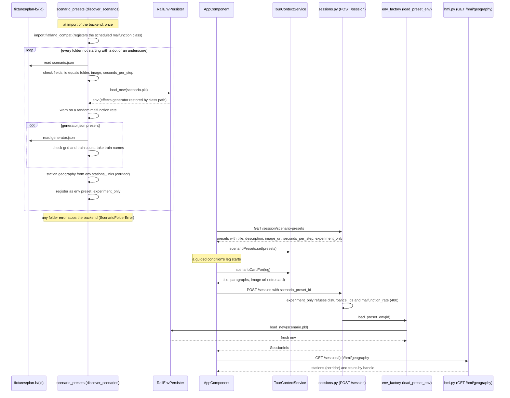
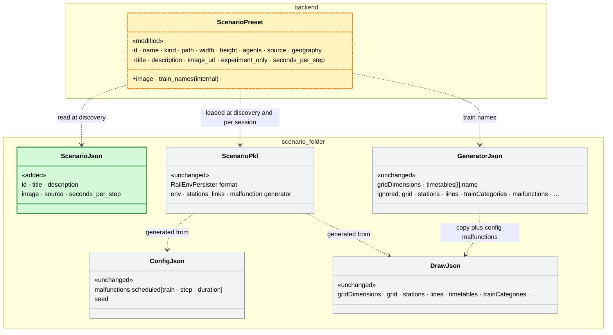

# Experiment scenarios from `.pkl` files — the Plan B scenarios on top of the experiment workflow

> **Status (2026-11-09): §8 steps 1–8 implemented, PR #164 open against
> `main` (based on 7eef0cb, head 0aae531f).** Agreed 2026-11-02; §3.7 (names)
> agreed 2026-11-03, §3.8 (seconds per step) 2026-11-04, §3.9 (ZWL corridor)
> 2026-11-05, §3.10 (final questionnaire) 2026-11-07. The scenarios are a
> tutorial plus four (not six). Open: the code review findings 1–22
> ([Code Review Findings](#code-review-findings)); findings 2–4 change
> behaviour outside the experiment scenarios and are listed under
> [Breaking changes](#breaking-changes).
> **Builds on:** #157 (`feature/129-experiment-logging`), which builds on #156
> (`feature/131-experiment-workflow-definitions`, plan
> [experiment-workflow.md](experiment-workflow.md)) and #146 (configurable UI).
> This PR targets `main` (#157 is merged).
> **Closes the gap #156 leaves open on purpose:** its §4 says "Defining the six
> networks and the ten conditions is **not part of this PR**" (Q13). This plan
> is how those six networks get in — as `.pkl` files built outside this repo —
> and the few changes the workflow needs to run them as the study wants.
> **Upstream:** flatland-rl PR `feat/scheduled-malfunction-effects-generator`
> (`ScheduledMalfunctionEffectsGenerator`); not released, see §3.6.

---

## Design principles

- **An experiment scenario is a preset, not a new kind of thing.** Each
  folder becomes an `env` preset in the existing `_PRESETS` registry, marked
  `experiment_only`; every path that runs a preset (session creation, replay,
  geography, ZWL) runs it unchanged (§3.1).
- **The `.pkl` is the whole simulation.** The backend refuses what would add
  to it (§3.2); the frontend never sends it (§3.4, the legs carry no
  disturbances).
- **The experiment stays `StudyCondition`** (§2): no second experiment model,
  no JSON experiment format.
- **Additive contracts.** Payloads only gain optional fields; a field's
  absence means today's behaviour (`seconds_per_step`, `trains`, `title`,
  `nameKey`, `policy`, `paged`). Exceptions are listed under
  [Breaking changes](#breaking-changes).
- **Gate in the frontend by data, not by flags**: the scenario card, the map
  range and the picker filter read `experiment_only`/`title` from the preset
  list; no new `InteractionMode` or mode flag (AGENTS.md guardrail).
- **Fail at startup, not during a study** (§3.1, decided 2026-11-02): a
  malformed folder stops the backend. Finding 4 asks whether that should stay
  so for an unloadable `.pkl`.

Reused concepts:

| Need | Reused concept | Instead of |
|---|---|---|
| Register a scenario | `_PRESETS` `env` preset (`scenario_presets.py`), `GET /session/scenario-presets` | a scenario registry or endpoint of its own |
| Run a scenario | `ExperimentLeg.scenarioId` → `startConditionLeg()` → `POST /session` with `scenario_preset_id` | a new session type |
| Experiment definition | `StudyCondition` with `legs` (#156) | an experiment JSON format |
| Intro before a scenario | `ModeIntroComponent` and its "Szenario starten" flow, fed a `ScenarioCard` | a new intro component or screen |
| Station names | `/hmi/geography` + `network_geography` (Olten's sidecar shape), `SessionStore.stationNameAt` | a station field on `SessionInfo` (lost in replay, §3.7) |
| Train names | `TrainIdentityService.nameByHandle`, fed from `geography.trains` | names on `AgentDTO` or in every component |
| ZWL axis | `layout: "corridor"` and `columnAxis` (Walensee) | a default section per scenario (§6 Q7) |
| Pace | the speed slider's levels (`play-speed.ts`), scaled by a base | a sixth level or a separate pace setting (§6 Q5) |
| Pinned policy | `store.setActivePolicy` + `policyControlIds` | a per-leg policy or a backend policy pin |
| No Schichtbilanz | #177's `shiftSummary: false` | the branch's own `review` flag (dropped in the rebase) |
| Final questionnaire | `SurveyConfig`/`SurveySection`, `surveyParts`, `postSessionSurvey()` | a questionnaire component of its own |
| Briefing page | `TourBriefing.opening` with `layout: 'stack'` and inline marks | a Plan B page component |
| Record of a page turn / leg end | context events (`survey_page`), `ShiftRecord.finishReason` | new record files |
| Malfunction at a fixed step | flatland-rl's `ScheduledMalfunctionEffectsGenerator` (compat copy under its future path, §3.6) | a ui-hub disturbance file on top of the `.pkl` |

---

## 1. What is asked

The Plan B study runs each participant through a tutorial and four fixed
scenarios (first planned as four of six; reduced to four on 2026-11-07),
then one questionnaire. The scenarios are drawn in the Flatland Environment
Drawing Tool and turned into a `RailEnv` `.pkl` by `flatland-scenarios`'
`scenario_generator` (tool export + `config.json`).

1. **A scenario is** a `.pkl` that holds **the whole simulation**, plus a
   title, a description and an optional image (one language for now).
2. **Nothing about the simulation changes at run time**: no random
   breakdowns, no disturbance files, no session settings on top of the `.pkl`.
   The only malfunctions are the scheduled ones inside the `.pkl`.
3. **The experiment** — briefing page, scenarios in a fixed order per
   participant, questionnaire(s) — is what #156 already builds, with three
   adjustments (§3.3–§3.5).

## 2. What #156/#157 already provide

| Need | Provided by | Where |
|---|---|---|
| Experiment = sequence of scenarios + questionnaire | `StudyCondition` with `legs: ExperimentLeg[]` | `core/demo/study-conditions.ts` |
| Experiment description page with image/video | the briefing's opening pages, `BriefingSection.media` | `core/demo/tour-briefings.ts`, `StudyCondition.briefingIds` |
| Per-scenario intro page before it starts | the intro card (`ModeIntro`), per leg via `ExperimentLeg.intro` | `features/mode-intro/`, `TourContextService.modeIntroFor` |
| Each scenario on a fresh session of its own preset | `startConditionLeg()` with `leg.scenarioId` | `app.component.ts` |
| Fixed layout + mode, UI restrictions | `StudyCondition.layoutId`, `.mode`; layout `ui` block (#146) | `study-conditions.ts`, `layout-presets.ts` |
| Questionnaire after each leg and/or at the end | `legSurveyParts`, `surveyParts` | `study-conditions.ts`, `ExperimentRunService` |
| One record per run, resume after reload | `ExperimentRunService`, run record | `core/demo/experiment-run.service.ts`, `core/interaction-log/` |

The experiment definition therefore stays **TypeScript in
`study-conditions.ts`**, like #156's — not a separate JSON format, which would
be a second experiment model next to `StudyCondition`. (This reverses the
"experiments as JSON" idea of the first draft; the scenarios remain files.)

## 3. Changes

### 3.1 Scenarios as files (backend)

One folder per scenario:

```
backend/app/fixtures/plan-b/<scenario-id>/
  scenario.pkl      # RailEnvPersister format, from scenario_generator
  scenario.json     # metadata, below
  scenario.png      # optional image (png, jpg or svg)
```

```json
{
  "id": "plan-b-s1",
  "title": "Störung am Einspurabschnitt",
  "description": "Ein Zug bleibt mitten im Einspurabschnitt stehen …",
  "image": "scenario.png",
  "source": "flatland-scenarios scenario_generator (drawing tool export + config.json)"
}
```

| Field | Required | Notes |
|---|---|---|
| `id` | yes | Equals the folder name; unique across all presets. Used as `ExperimentLeg.scenarioId`. |
| `title` | yes | Intro card heading; gallery card. |
| `description` | yes | Plain text, blank lines separate paragraphs. |
| `image` | no | File in the same folder. |
| `source` | no | Provenance for the gallery card. |
| `seconds_per_step` | no | Real seconds per simulation step at the default pace, number ≥ 0.1 (§3.8). |

`scenario_presets.py` discovers the folders at import and registers each as an
`env` preset (`path = scenario.pkl`) with `title`, `description`, `image_url`,
`experiment_only: true`. Grid size and train count are read from the env once
at discovery, not written by hand. A malformed `scenario.json` (missing field,
id ≠ folder, image file missing, duplicate id) fails startup with a message
naming the file — a study must not run with a silently dropped scenario.

`GET /session/scenario-presets` lists them (so the `/scenarios` gallery shows
them); the free Infrastructure picker leaves out `experiment_only` presets.
`GET /session/scenario-presets/{id}/image` serves the one file the JSON names.

JSON, not a spreadsheet: diffable, validated, and the form of the other
fixtures (`*.geography.json`, disturbance files).

How a new `.pkl` gets in: discovered once at backend start, then run as a
leg like any preset. The `.pkl` is loaded twice, at discovery (to validate and
read size, names and stations) and per session (a fresh env).
Notation: [UML sequence diagram in Mermaid](https://mermaid.js.org/syntax/sequenceDiagram.html).



#### Data model: the files of a scenario folder

A folder holds five files; ui-hub reads two of them besides the `.pkl`. The
other two are the scenario generator's input, kept so the `.pkl` can be
regenerated. Only `scenario.json` is a new format, ui-hub's own; the others
are flatland-rl's and flatland-scenarios' formats, unchanged. None has a
JSON schema, here or upstream: `scenario.json` is checked by hand in
`_load_scenario_folder`, `generator.json` in `_load_train_names` (a schema
for `scenario.json` is finding 21).

| File | Written by | Format defined by | Read by ui-hub | Checked at discovery |
|---|---|---|---|---|
| `scenario.pkl` | scenario generator | flatland-rl `RailEnvPersister` | **yes**: whole env, at discovery and per session | loads; random malfunction rate → warning |
| `scenario.json` | by hand | **ui-hub, new** (this section) | **yes**: every field | required fields, no unknown field, `id` = folder, image a file of an allowed type, `seconds_per_step` ≥ 0.1 |
| `generator.json` (optional) | scenario generator, copied unchanged | flatland-scenarios `scenario_generator` | **partly**: `gridDimensions.rows/cols`, `timetables[i].name` (§3.7) | grid = `.pkl`'s, one timetable per train, names non-empty and unique |
| `config.json` | by hand | flatland-scenarios `scenario_generator/model/config.py` (open PRs [#39](https://github.com/flatland-association/flatland-scenarios/pull/39), [#40](https://github.com/flatland-association/flatland-scenarios/pull/40)) | **no**: generator input only | - |
| `draw.json` | drawing tool (*Export All*) | flatland-scenarios `flatland_environment_drawing_tool.html` | **no**: generator input only | - |
| image (optional) | by hand | `.png`, `.jpg`/`.jpeg`, `.svg` | **yes**: served as is | named by `scenario.json` |

The class names stand for the files (`ScenarioJson` is `scenario.json`, …);
no code symbol models them yet. «added» is the new ui-hub format,
«unchanged» a format taken over as it is, «modified» the existing preset
entry, whose new fields are marked `+`.

Notation: [UML class diagram in Mermaid](https://mermaid.js.org/syntax/classDiagram.html).



`ScenarioPreset` is the `_PRESETS` entry (a dict, `scenario_presets.py`);
`GET /session/scenario-presets` lists it without the internal fields
(`path`, `image`, `train_names`, `geography`, …, `_INTERNAL_FIELDS`).

Examples from `uc2-1/`, shortened; `scenario.json` is shown above.

1. `config.json`, the generator input next to the drawing (malfunctions by
   train name, resolved through the timetable names):

   ```json
   {
     "malfunctions": { "scheduled": [ { "train": "S17", "step": 25, "duration": 4 } ] },
     "seed": 42
   }
   ```

2. `draw.json`, the drawing tool export (one entry per list):

   ```json
   {
     "gridDimensions": { "rows": 8, "cols": 78, "cellSize": 30 },
     "grid": [[0, 0, "…"]],
     "overpasses": [],
     "stations": [ { "id": 6, "name": "Ziegelbrücke", "city_position": [4, 5], "stopping_points": [ { "name": "Ziegelbrücke.0", "node": [2, 5] } ] } ],
     "nextStationId": 20,
     "lines": [ { "id": 1793654100428, "name": "Ziegelbrücke N - Flums N", "stationIds": [6, 19] } ],
     "timetables": [ { "name": "IC3", "lineId": 1793654100428, "trainCategory": "IC", "stops": [ { "stationId": 6, "earliestDeparture": 10 } ] } ],
     "trainCategories": { "IC": { "id": 1, "description": "High-Speed", "speed": 1 } },
     "flatlandLine": { "agent_positions": ["…"], "agent_targets": ["…"] },
     "flatlandTimetable": { "earliest_departures": ["…"], "max_episode_steps": 168 }
   }
   ```

3. `generator.json`, the generator output: the drawing plus the config's
   malfunctions. ui-hub reads only the two marked lines:

   ```diff
    {
   +  "gridDimensions": { "rows": 8, "cols": 78, "cellSize": 30 },   // read: must equal the .pkl's height and width
      "grid": "…", "stations": "…", "lines": "…",
   +  "timetables": [ { "name": "IC3" }, { "name": "ICE" }, { "name": "S17" } ],   // read: name of handle 0, 1, 2
      "trainCategories": "…", "flatlandLine": "…", "flatlandTimetable": "…",
      "malfunctions": { "scheduled": [ { "train": "S17", "step": 25, "duration": 4 } ] }
    }
   ```

   Here `+` marks what ui-hub reads, not an addition; the file is copied
   unchanged. Malfunctions come from the `.pkl` only.

Values are illustrative and shortened. Nothing in these files is changed by
this PR; the only new format is `scenario.json`.

### 3.2 Nothing on top of the `.pkl` (backend)

For an `experiment_only` preset, `POST /session` rejects `disturbance_ids` and
a `malfunction_rate > 0` (the live variant) with a 400, instead of applying
them. The existing env-preset load path (`load_preset_env`) already adds
nothing else; only `session_manager` still applies a requested
`max_episode_steps` over the `.pkl`'s horizon (finding 19). On discovery, a scenario whose env has a random malfunction
generator (rate > 0) logs a warning: the five Plan B scenarios have scheduled
malfunctions only, and a random rate would make two participants see
different runs. The leg's `seed` is still passed; with scheduled malfunctions
only it changes nothing.

### 3.3 Intro card from the scenario (frontend)

A leg without its own `intro` whose preset has a `title` gets a **scenario
card**: title, description paragraphs, optional image, and the existing
"Szenario starten" button and "⟨name⟩ (k/N)" eyebrow. No mode sections
(role, controls, watch-for, goal) — not needed for these scenarios.

- `TourContextService` gains `scenarioCardFor(leg)`, resolving the preset's
  `title`/`description`/`image_url` from the loaded preset list.
- `ModeIntroComponent` renders that card when there is no `ModeIntro` for the
  leg. Fixed labels stay i18n keys; title and description are content from
  the file, like the authored briefing text.
- `ExperimentLeg.nameKey` (the stepper's "⟨name⟩ (k/N)") becomes optional:
  without it the stepper shows the scenario's `title` (decided, §6 Q1).
  `TourContextService.legName(leg)` resolves it for the live run and the replay.
- The replay shows the same card (`ReplayService.scenarioCard`).
- The map opens on the whole network: a briefing's `mapFocusCols` belongs to
  its own network (Walensee, columns 69–126), so a leg on an experiment
  scenario does not inherit it; the leg's own `mapFocusCols` still applies.

### 3.4 Policy pinned per experiment (frontend)

`StudyCondition` gains `policy?: PolicyName`. At every leg start the run sets
it (`store.setActivePolicy`). The policy is sent with every step, so this is
what runs — independent of the layout's `policyAllowlist`, and therefore of
the #146 issue that the active policy is not recomputed when an allowlist is
applied. Plan B: `deadlock_avoidance` for now, the study's own policy later.

### 3.5 Run flow adjustments (frontend)

- **No Schichtbilanz:** #177's `StudyCondition.shiftSummary: false` (this
  branch had its own `review` flag until the rebase, §4). `nextLegOrReview()`
  then goes from the last leg straight to the final questionnaire.
- **A leg also ends when its episode ends:** today a leg ends by the toolbar's
  finish button or the guide's "Schicht beenden" (hidden in Plan B by
  `control.endShift`). An effect advances the run when the episode is done
  (all trains arrived or horizon reached) in phase `running`, with reason
  `'episodeEnd'` in the record — so a participant is never stuck.
- **Questionnaire after a single leg** (for "2 scenarios, questionnaire, 3
  scenarios, questionnaire"): `ExperimentLeg.surveyParts?` — a questionnaire
  after this leg, taking precedence over `legSurveyParts`. **Not in this PR**
  (decided, §6 Q2): Plan B does not need it.

### 3.6 The scheduled-malfunction class (both repos, temporary)

The `.pkl` stores its effects generator as a class path, which must be
importable where the `.pkl` is loaded. The class is in flatland-rl's PR but
not released, and no release is planned soon.

Until then both sides carry a compat copy **registered under flatland-rl's
future path**, `flatland.envs.malfunction_effects_generators.ScheduledMalfunctionEffectsGenerator`:

- the copy's `__module__` is set to that module, and it is attached to it with
  `setattr` — only if flatland does not have the class yet;
- ui-hub imports the compat module (`app/utils/flatland_compat.py`) from
  `app/core/scenario_presets.py`, which every `.pkl` load goes through — so
  tests and scripts that never import `app.main` get it too;
- flatland-scenarios' `malfunctions.py` does the same instead of defining its
  own class, so the `.pkl`s it writes already carry the future path.

Cleanup once ui-hub runs a flatland-rl with the class: delete both compat
copies. The `.pkl`s stay valid, nothing is regenerated.

It is a hack — two repos attach a class to a flatland module from outside —
accepted for the study (decided 2026-11-02) and marked with a `TODO` pointing
at the flatland-rl PR in both places.

### 3.7 Train and station names from the generator output (backend, one line frontend)

**Today.** Every session names its trains from one authored roster
(`TrainIdentityService.SERVICE_ROSTER`: handle 0 = `IC_703`, 1 = `ICE_42`, …),
whatever the scenario. Stations get a name only where `GET
/session/{id}/hmi/geography` names their cell (the PF–CH scenes, Olten's
sidecar); everywhere else the store labels them `S1`, `S2`, … by position. An
experiment scenario therefore shows `IC_703` for the drawn `Z-W-1-S`, and `S3`
for Ziegelbrücke.

**Where the names are.** Since the drawing tool's stations phase 2
(flatland-scenarios, 2026-11-04) **station names are in the `.pkl`**: the
generator writes `env.stations_links`, whose stations carry the name given in
the tool and their stopping points (`Ziegelbrücke.0` at a platform cell),
which `RailEnvPersister` keeps. An unnamed station is named by its tool id
("3"). **Train names are not:** Flatland agents have no name, and
`RailEnvPersister` has no slot for extra data. They live in the scenario
generator's output JSON (written next to the `.pkl`): `timetables[i].name` is
the name of handle *i* — the same rule the generator uses to resolve
`"train": "Z-W-1-S"` in `config.json`.

**Change.** The scenario folder takes the generator output as an optional
fourth file, for the train names:

```
backend/app/fixtures/plan-b/<scenario-id>/
  scenario.pkl
  scenario.json
  generator.json    # optional: the scenario generator's output .json, copied unchanged
  scenario.png
```

- **Discovery** (`_load_scenario_folder`):
  - **Stations** from the `.pkl`'s `stations_links`, when it has any: the
    preset keeps (internally) a `geography` with one entry per stopping
    point, in the shape Olten's sidecar already has (`{code, name, track,
    cell, kind: "platform"}`, `layout: "network"`, no `locations`, no
    `single_track`): `code` and `name` the station's name, `track` the
    stopping point's index + 1, `cell` its node. *§3.9 changes the layout
    to `"corridor"`.*
  - **Trains** from `generator.json` if present, checked against the `.pkl`:
    same grid size, one timetable per agent, train names unique and
    non-empty. A mismatch fails startup with the file named, like every other
    folder error — a stale `generator.json` would put the wrong name on a
    train. The preset keeps `train_names`: `[timetables[0].name, …]`, in
    handle order.
- **`GET /session/{id}/hmi/geography`** returns that geography for an
  experiment scenario (the existing `network_geography` branch, fed from the
  preset instead of a sidecar file), plus a new list `trains: [{handle,
  name}]`. Other presets return `trains: []`.
- **Stations need no frontend change:** `SessionStore.stationNameAt` already
  prefers a geography name over `S{n}`, and the map, the timetable, the
  impact panel and the ZWL all read it. A drawn station without a
  name shows its tool id ("3"). A `.pkl` without `stations_links` (built
  before phase 1) keeps `S{n}`.
- **Trains:** `TrainIdentityService.nameByHandle` uses `geography.trains`
  when the session has them, otherwise the roster as today. Every surface that
  names a train (21 components, the notification texts via
  `withTrainNames`) goes through this service, so none of them changes.
- **Replay** gets the names for free: it answers `/hmi/geography` from the
  recorded call. Records written before this change replay with the roster,
  as they were seen.

**Why the geography response, not `SessionInfo`.** It is the per-session
"names of this network" call the store already makes, and the replay serves it
from the recording; a field on `SessionInfo` would be lost in the replay, which
rebuilds the session from the record header.

**What stays as it is.**
- Built-in presets (Walensee, Olten, the generated networks) keep the roster:
  the Walensee briefings name `IC_703` in their text.
- Study data: logs and decision records reference trains by handle; a
  decision record carries the displayed order next to the handles, which is
  then the scenario's names.
- **Combined Actions** ranks "long-distance first" by roster name
  (`TRAIN_WEIGHT`); an unknown name gets the default weight, so with drawn
  names that ordering falls back to handle order. Not in the Plan B layout;
  a weight from the timetable's `trainCategory` is a later step.
- Train categories and speeds in `generator.json` are not used yet.
- The ZWL builds its axis from the rail grid
  (`core/route_axis.py`) and needs no `stations_links` links; flatland-hmi's
  does, which is why links come in a later flatland-scenarios PR.

### 3.8 Seconds per step from the scenario (backend, frontend)

**Today.** The toolbar's speed slider has five levels of steps per second
(`core/play-speed.ts`: 0.25, 0.5, 1, 3, 10; level 2, 0.5 steps/s = 2 s per
step, is the default). A leg can start on another level
(`ExperimentLeg.playSpeedLevel`). The backend's play loop takes any speed but
waits at most 10 s per step (`websockets.py`, `max(speed, 0.1)`), and a speed
change while playing (`POST /play` retunes `state.speed`) only applies after
the wait in progress.

**Change.** `scenario.json` gets an optional `seconds_per_step`: how many real
seconds one simulation step lasts at the scenario's default pace (a number
≥ 0.1, e.g. `3` or `1.5`; no upper limit: a study's value is honoured, not
clamped). 0.1 is the slider's fastest level today; the faster levels of a
quick scenario may then run as fast as the backend can step. It is the default whether or not the layout shows the slider; Plan B's
layout hides it (done elsewhere), the other layouts keep it.

| Field | Required | Notes |
|---|---|---|
| `seconds_per_step` | no | Number ≥ 0.1; without it the app's default (2). |

- **Discovery** validates it (a number, not a boolean or string, ≥ 0.1; else startup
  fails naming the file and field) and `GET /session/scenario-presets` lists
  it on the preset (`ScenarioPreset.seconds_per_step?`).
- **Backend play loop:** the 10 s floor goes (`PlayRequest.speed` must be
  > 0 instead), and the wait between steps is slept in short slices against
  the current `state.speed`, so a slider change applies at once even during a
  long step. Without that, level 1 of a 10 s scenario (20 s) would be clamped
  back to 10 s.
- **Frontend (decided, §6 Q5 a):** the slider's levels become factors of
  a per-session base pace instead of fixed speeds: `[0.5, 1, 2, 6, 20]` ×
  base, base 0.5 steps/s by default — the same five speeds as today. A session
  on a preset with `seconds_per_step` gets base `1 / seconds_per_step`, so
  level 2 ("normal") is exactly the scenario's pace and the other levels keep
  their ratio to it. The toolbar's "1 min = n s" label already derives from
  the speed. A leg's `playSpeedLevel` still picks a level, now relative to its
  scenario.
  - `SessionStore` gets `playSpeedBase` (set in `newSession` from
    `opts.secondsPerStep`); `playSpeed = base × factor(level)`.
  - The app passes `secondsPerStep` from the preset whenever it creates a
    session on one (experiment legs and the `/scenarios` gallery);
    a restart keeps it, like the preset id.
- Built-in presets have no `seconds_per_step` and run as today. The replay is
  unaffected (it plays the recorded timeline at its own `REPLAY_SPEEDS`).

### 3.9 The ZWL draws an experiment scenario as a corridor (backend)

**Today.** §3.7 gives an experiment scenario's geography `layout: "network"`,
the shape of Olten's sidecar. The ZWL (Zeit-Weg-Linie-Diagramm) only draws an axis by
itself for `layout: "corridor"` (`zwl-axis.ts` `columnAxis`); for a
network it shows "Dieses Szenario ist ein Netz, keine einzelne Strecke. Wähle
oben einen Abschnitt …" until the participant picks two stations. Nothing
picks a section by default (`SessionStore.zwlRoute` starts `null`). With
the Plan B layout opening on the ZWL (#168, PR #171), every Plan B leg on a
drawn scenario would open on that empty diagram.

**Change.** `_stations_links_geography` (`scenario_presets.py`) returns
`layout: "corridor"` instead of `"network"`. All Plan B scenarios are
corridors, so the existing column axis fits them:

- The axis runs from the station farthest left to the one farthest right:
  `columnAxis` places each station at its platform column (the leftmost
  stopping point of a station with several) and sorts by column.
- The view still opens zoomed to where the trains run, widened to the next
  station on either side ("Ganze Strecke" shows the whole axis), as on
  Walensee. A participant can still pick a section; the pickers then offer
  "whole corridor" instead of "choose".
- `locations` and `single_track` stay empty: no places between stations, no
  single-track shading on the axis. Deriving single-track sections from the
  rail grid is a later step.
- No frontend change; `isNetwork()` is false for these scenarios, so the
  corridor texts apply.

**Limit.** A future experiment scenario that is a network rather than one line
would get a misleading axis (positions by column across branches). It then
needs an explicit `"layout": "network"` in `scenario.json`, added when such a
scenario exists (§6 Q7).

### 3.10 The Plan B final questionnaire (frontend)

Source: `261105_FragebogenFinal.docx` (2026-11-05, study team), "Finaler
Fragebogen für User Study 2". Six pages, German, asked once per participant
after the last scenario (it replaces `DEFAULT_SURVEY_PARTS` on the ten
conditions). Requirements from the document: every item must be answered;
the demographics (page 6) only once, at the very end; the agreement items as a
matrix (one row per item, one radio column per scale point, the labels above
the columns, as in the document's example picture).

| Page | Items | Answer |
|---|---|---|
| 1 | 1–3 responsibility, accountability, control | 7-point agreement matrix |
| 1 | 4 own share of the result vs. the AI system | slider 0–100 % with a number box |
| 2 | 5–8 challenge, development, fit with own goals | 5-point agreement matrix |
| 3 | 9–12 task significance; 13–17 own role | 5-point matrix, two blocks |
| 4 | 18–27 trust in the system | 7-point matrix |
| 5 | 28–37 ease of use, usefulness, intention to use | 7-point matrix |
| 6 | AI use in daily life (6 options), age, gender (3 options), years as dispatcher | radio list, text, radio list, text |

Design:

- **Pages.** `SurveySection.page` and `SurveyConfig.paged`; a survey without
  `paged` renders as before (one scroll). Above the items "Seite k von 6" with
  one dot per page; below them "‹ Zurück" (from page 2 on, left) and
  "Weiter ›" (right), on the last page "Absenden". With `requireAll`, "Weiter"
  and "Absenden" stay active, but a page with open items does not advance: the
  items get a red bar, the first scrolls into view, a line says "Bitte
  beantworte alle Fragen auf dieser Seite." "Absenden" checks every page and
  opens the first with an open item. "Zurück" always works and keeps the
  answers. A page turn is logged as context event `survey_page`
  `{surveyId, page}`; the buttons carry click ids `surveyUi.back/next/submit`.
- **No close.** `closable: false`: no × and no "Abbrechen"; the questionnaire
  ends by submitting.
- **Matrix.** A section with `scale: string[]` (the column labels) renders its
  `likert` items as a matrix with real radio inputs (`name` = item id, keyboard
  and screen reader as radio groups). Narrow screens: each item stacks with its
  options below.
- **Percent slider.** New type `percent`: a number box with "%" above a
  full-width range 0–100, both bound to one value; no thumb and unanswered
  until moved or typed, so 0 % is an answer, not a default.
- **Radio list.** `radio` with `layout: 'list'` renders vertical radio inputs
  (page 6); the existing chips stay for the other surveys.
- **Numbers.** New type `number` (min, max, step, unit): age 15–99 whole
  years, years as dispatcher 0–60 in half years; outside the range counts as
  unanswered.
- **Data.** Item ids `pb_1` … `pb_37`, `pb_ai_use`, `pb_age`, `pb_gender`,
  `pb_years`; answers stored as the scale value (1..7 / 1..5), the percent as
  a number, radio answers as the option text. Config id `plan-b-final`; one
  survey part `plan-b-final` that the ten conditions name as `surveyParts`
  (not offered in Settings; `postSessionSurvey()` returns the whole
  questionnaire for it). Item numbers are not shown. Scores: none for now
  (raw answers only; the export already writes one row per item).
- **Language.** German, written as data in `survey-configs.ts` like the other
  instruments (questionnaires are not i18n keys). Divergence from AGENTS.md
  ("questionnaires stay English"): this study's instrument is German.
- **Replay.** Shows the recorded answers read-only, all pages one under the
  other (no navigation needed to review).

Decided 2026-11-07: slider empty until touched; grammar fixed (below); item
numbers hidden; age and years as number fields; gender with the document's
three options; no close or cancel.

Wording changed against the document, for the study team's review:

- Items 5, 6, 8: "Während diesen Aufgaben" → "Während dieser Aufgaben" (as
  item 7).
- Items 9, 11: "Diese Aufgaben wirkte sich" → "wirkten sich".
- Items 18–27: full stop added, as in the other items.
- Items 30, 34: comma after "Ich finde"; item 35: comma after "Angenommen".
- Page 1: "Auf einer Skala von 1–7: Inwieweit stimmst du …?"; scale ranges
  with an en dash, "5 = …" with spaces.
- Column labels in lower case throughout ("stimme …", "teils/teils").
- Page 6: "(privat und beruflich): Wie häufig …"; options in lower case
  ("nie"); "Wie viele Jahre hast du als Dispatcher*in? (in Jahren)" → "Wie
  viele Jahre arbeitest du schon als Dispatcher*in?" with the unit "Jahre".

Bundle size: the production build's initial bundle is 2.01 MB with this,
12 kB over the 2.00 MB error budget in `angular.json` (it was 1.99 MB before);
decided 2026-11-08: the error budget is raised to 2.10 MB (loading the
questionnaire lazily would not save it: its texts load with the conditions).

## 4. Plan B content

Decided 2026-11-07 (§6, Plan B):

- **Five scenario folders** (§3.1): `tutorial`, `uc2-1` … `uc2-4`, each with
  `scenario.json` (`id` = folder name, German title and description,
  `seconds_per_step`), `generator.json` and `scenario.pkl`. Built from
  `draw.json` + `config.json` in the same folder by flatland-scenarios'
  `generate_scenarios_for_ui_hub.py`, **run with this repo's backend Python**
  (`flatland-rl==4.3.0`): a `.pkl` written by a newer flatland-rl does not
  load here (`Agent.__new__() takes from 17 to 22 positional arguments but 24
  were given`). Folders starting with `_` are skipped by discovery (`_test`,
  `_example-scheduled-malfunction`).
- **Ten conditions** `plan-b-p01` … `plan-b-p10` (`study-conditions.ts`,
  `PLAN_B_CONDITIONS`), one per participant: `layoutId: 'preset-plan-b'`,
  `mode: 'co-learning'`, `policy: 'deadlock_avoidance'`, `shiftSummary: false`,
  `studyLogging: true`, no `legSurveyParts`, `surveyParts:
  [PLAN_B_FINAL_PART]` (§3.10). Five legs each: `tutorial` first, then the four UC2 scenarios in
  the participant's order. Legs are shared objects, `seed: 42`, no
  disturbances, named by the scenario's title.
- **Orders** (`PLAN_B_ORDERS`): drawn at random once,
  `random.Random(20261107).shuffle(['uc2-1', 'uc2-2', 'uc2-3', 'uc2-4'])` per
  participant, and fixed in the code:

  | Participant | Scenarios 2–5 |
  |---|---|
  | p01 | uc2-3, uc2-1, uc2-2, uc2-4 |
  | p02 | uc2-1, uc2-4, uc2-3, uc2-2 |
  | p03 | uc2-4, uc2-3, uc2-1, uc2-2 |
  | p04 | uc2-2, uc2-4, uc2-1, uc2-3 |
  | p05 | uc2-3, uc2-1, uc2-4, uc2-2 |
  | p06 | uc2-4, uc2-2, uc2-1, uc2-3 |
  | p07 | uc2-4, uc2-1, uc2-3, uc2-2 |
  | p08 | uc2-2, uc2-1, uc2-4, uc2-3 |
  | p09 | uc2-2, uc2-1, uc2-3, uc2-4 |
  | p10 | uc2-2, uc2-4, uc2-3, uc2-1 |

- **The former `plan-b-p01`** (two Walensee legs, `nasa-tlx` after each,
  Schichtbilanz) is removed; its id now names participant 01. Records made
  under the old one keep their `conditionId`, so the replay finds the *new*
  condition: the `plan-b` briefing, a five-leg stepper, and no leg intro or
  leg label (its leg ids are not in it); a persisted resume state resumes into
  the new legs (finding 3, [Breaking changes](#breaking-changes)). The scripts `docshots-experiment-*.mjs` and
  `measure-/replay-video-experiment-logging.mjs` still walk the old two
  Walensee legs and need updating before their next run.
- **Briefing** `plan-b` (`tour-briefings.ts`, German only, also served for
  `en`): the flags and six guide steps of `colearning-experiment-2x` (no
  Schichtbilanz, #174) with its own opening page, text
  from the study (2026-11-07): the sector, the map of the line
  (`frontend/public/experiments/Walensee.png`), the goal (delay only), what
  follows. No title or headings, so the opening page takes optional
  `eyebrow`/`title`/`byline` and section `heading`, a section `goal` flag,
  and inline `**bold**` / `__underlined__` in `lead`, `body` and `items`
  (`InlineMarksPipe`, rendered as elements, never as HTML).
  `colearning-experiment-2x` stays for `plan-b-uc2`.
- **Guide strip:** kept, with hints that fit every scenario, the tutorial
  included (`PLAN_B_GUIDE_HINTS`, 2026-11-08): no Walensee breakdown and no
  "Neu:"; «Entscheiden» no longer asks to take an option; «Reflexion»: "Nach
  deiner Entscheidung fragt das Tool nach deinem Grund." Dropping the strip
  for Plan B stays possible (`guide: undefined` in `PLAN_B_DE`).
- **Names:** `tours.plan-b-pNN.name` / `.description` in en/de/fr.
- **Rebased onto `main` with #177 and #178** (2026-11-08): the branch's own
  `review` flag was dropped for #177's `shiftSummary: false`
  (`hasShiftSummary`), and its pause of the last leg for #177's pause of
  every finished leg; the ZWL code uses #178's names (`zwlRoute`).

## 5. Files

### New files

| File | Adds |
|---|---|
| `backend/app/fixtures/plan-b/<id>/{scenario.pkl,scenario.json,generator.json,image}` | The five Plan B scenarios (`tutorial`, `uc2-1` … `uc2-4`, §4); `generator.json` optional (§3.7); files described in §3.1 "Data model" |
| `backend/app/fixtures/plan-b/<id>/{config.json,draw.json}` | The scenario generator's input, not read by ui-hub; kept to regenerate the `.pkl` (§3.1 "Data model") |
| `backend/app/utils/flatland_compat.py` | Compat `ScheduledMalfunctionEffectsGenerator` under flatland-rl's path (§3.6) |
| `backend/tests/test_experiment_scenarios.py` | §7 backend tests |
| `docs/reference/experiment-scenarios.md` | How to add a scenario folder and use it in a condition |
| `frontend/src/app/features/mode-intro/mode-intro.component.spec.ts` | Scenario card rendering |
| `frontend/src/app/features/tour-briefing/inline-marks.pipe.ts` (+ spec) | `**bold**` / `__underlined__` in briefing text, as elements |
| `frontend/src/app/core/survey/plan-b-final-survey.spec.ts` | The questionnaire's ids, pages, scales and types (§3.10) |
| `frontend/src/app/features/survey/survey.component.spec.ts` | Paging, required items, percent and number answers, matrix (§3.10) |
| `frontend/public/experiments/Walensee.png` | The map of the sector on the briefing page |
| `frontend/src/app/core/session-switch.spec.ts` | Leaving a playing session pauses it on the server |

### Modified files

| File | Change |
|---|---|
| `backend/app/core/scenario_presets.py` | Import `flatland_compat`; discover scenario folders (`discover_scenarios`, `ScenarioFolderError`); `experiment_only`, `title`, `description`, `image_url`; `is_experiment_only`, `preset_image`; random-malfunction warning |
| `backend/app/core/scenario_presets.py` (§3.7) | Station `geography` from the `.pkl`'s `stations_links`; read and check `generator.json` for `train_names` (both internal) |
| `backend/app/core/scenario_presets.py` (§3.8) | Validate and list `seconds_per_step` |
| `backend/app/core/scenario_presets.py` (§3.9) | `_stations_links_geography`: `layout: "corridor"` |
| `docs/reference/experiment-scenarios.md` (§3.9) | The ZWL draws the scenario left to right; scenarios must be corridors for now |
| `backend/app/api/sessions.py` | Image route; reject disturbances and live malfunctions for `experiment_only` presets |
| `backend/app/api/websockets.py` (§3.8) | `PlayRequest.speed > 0`; no 10 s floor; the wait between steps follows a speed change |
| `backend/app/api/hmi.py` | `get_geography`: an experiment scenario's station geography from the preset; new `trains: [{handle, name}]` (§3.7) |
| `backend/app/core/station_names.py` | `network_geography` also takes an in-memory geography, not only a sidecar path (§3.7) |
| `frontend/src/app/core/train-identity.service.ts` | `nameByHandle` prefers `geography.trains`, else the roster (§3.7) |
| `frontend/src/app/core/models.ts` (§3.7) | `SceneGeography.trains?: {handle, name}[]` |
| `frontend/src/app/core/models.ts` | `ScenarioPreset` gets `title?`, `description?`, `image_url?`, `experiment_only?`; `seconds_per_step?` (§3.8) |
| `frontend/src/app/core/play-speed.ts` (§3.8) | Levels as factors of a base pace; `playSpeedForLevel(level, base)` |
| `frontend/src/app/core/session.store.ts` (§3.8) | `playSpeedBase`, `newSession({ secondsPerStep })`; `playSpeed` from base and level |
| `frontend/src/app/core/demo/study-conditions.ts` | `StudyCondition.policy?`; `ExperimentLeg.nameKey` optional; the old `plan-b-p01` removed; `PLAN_B_TUTORIAL`, `PLAN_B_ORDERS` and the ten `plan-b-p01` … `p10` built from them (§4) |
| `frontend/src/app/core/demo/study-conditions.spec.ts` | A leg without `nameKey` has no disturbances; guards for the Plan B conditions (§7) |
| `frontend/src/app/core/demo/experiment-run.service.ts` | finish label without the Schichtbilanz (now #177's `hasShiftSummary`); `legName` via `TourContextService`; `LegFinishReason` |
| `frontend/src/app/core/demo/tour-context.service.ts` | `ScenarioCard`, `scenarioPresets`, `scenarioCardFor(leg)`, `scenarioCard`, `legName(leg)`; `LegFinishReason` (adds `'episodeEnd'`); `mapFocusCols` ignores the briefing's range on an experiment scenario |
| `frontend/src/app/core/replay/replay.service.ts` | `scenarioCard`; leg names via `legName` |
| `frontend/src/app/features/mode-intro/mode-intro.component.{ts,html,scss}` | Render the scenario card; `replayScenarioCard` input |
| `frontend/src/app/app.component.{ts,html}` | `secondsPerStep` from the preset for sessions on it (§3.8); `scenarioPresets` shared with `TourContextService`; `pinExperimentPolicy`, pinned policy enabled in `legSessionOpts`; (the last leg to the final questionnaire is #177's `shiftSummary: false`); `_legEndsWithEpisode`; `pickerScenarioPresets` |
| `frontend/src/app/app.component.spec.ts`, `core/demo/experiment-run.service.spec.ts` | §7 frontend tests |
| `frontend/src/app/core/demo/tour-briefings.ts` | The Plan B experiment briefing `plan-b` (German), on the six steps of `colearning-experiment-2x` with its own guide hints (`PLAN_B_GUIDE_HINTS`) |
| `frontend/src/app/features/tour-briefing/tour-briefing.component.{html,ts}` | Optional title, byline and headings; inline `**bold**` / `__underlined__` |
| `frontend/src/app/core/survey/survey.types.ts` | `page`, `scale` (matrix), `paged`, `requireAll`, `closable`; types `number`, `percent`; radio `layout` (§3.10) |
| `frontend/src/app/core/survey/survey-configs.ts` | `PLAN_B_FINAL_SURVEY` and the part `plan-b-final` (§3.10) |
| `frontend/src/app/features/survey/survey.component.{html,ts,scss}` | Pages with back/next, required items, matrix, percent, number, radio list, no close (§3.10) |
| `frontend/src/app/core/interaction-log/{interaction-log.service,session-record}.ts` | Context event `survey_page` |
| `frontend/src/app/core/replay/replay.service.spec.ts` | The two-Walensee-leg replay specs run on `plan-b-uc2` |
| `docs/experiment-logging.md` | Click id table: `surveyUi.back/next/submit` |
| `frontend/angular.json` | Initial bundle error budget 2.00 → 2.10 MB (§3.10) |
| `frontend/src/app/core/session.store.ts` | A playing session that is replaced or ended is paused on the server (§8 step 8) |
| `frontend/public/i18n/{en,de,fr}.json` | `surveyUi.*` (page, back, next, submit, missing, statement); `experimentRun.media.sectorWalenstadtAlt`; `tours.plan-b-p01` … `p10` and `plan-b-uc2` names and descriptions |

In flatland-scenarios (separate PR): `scenario_generator/flatland_integration/malfunctions.py`
switches to the compat registration (§3.6). For station names (§3.7, §6
Q3), done in the stations phase 2 (`feature/grouped-station-format`): the
drawing tool names stations, and the generator writes the names into the
`.pkl`'s `stations_links`.

## Limitations

The code keeps no list of its own; the `TODO` is in `flatland_compat.py`.

- An experiment scenario must be a corridor: a network gets a misleading ZWL
  axis (§3.9, §6 Q7).
- Scenario title and description have one language (`scenario.json`), shown
  whatever the UI language.
- Train names arrive with `/hmi/geography`, after the first state: until then
  the trains carry roster names (finding 7).
- No single-track shading and no places between stations on the ZWL axis
  (§3.9).
- Combined Actions' "long-distance first" falls back to handle order with
  drawn names (§3.7).
- The scheduled-malfunction class is a compat copy attached to flatland-rl's
  module (§3.6, `TODO` in `backend/app/utils/flatland_compat.py`, finding 12).
- One `.pkl` that does not load stops the whole backend (§3.1, finding 4).

## Assumptions

Not checked in code; they hold by construction of the scenario folders and
of the deployment:

- The scenario folders are trusted repo files: a `.pkl` is unpickled (runs
  code), and an `.svg` is served from the app's origin (finding 10).
- Every `.pkl` was written with the backend's own `flatland-rl` (4.3.0, §4);
  a newer one does not load.
- `generator.json` comes from the same generator run as its `.pkl` (checked
  only by grid size and train count).
- The folders do not change while the backend runs: discovery runs once, at
  import.
- The preset list has loaded before a guided condition starts (the auto
  start waits for it). If it fails to load, a leg runs at the default pace,
  with the mode card and its id as name.
- No study data was recorded under the former `plan-b-p01` (finding 3: to be
  confirmed by the study lead).

## New patterns

Compared with `main` (7eef0cb); the reused concepts are listed under the
[design principles](#design-principles).

| New | Reuses | Defined in |
|---|---|---|
| Presets discovered from folders at import, validated, fail-fast (`discover_scenarios`, `ScenarioFolderError`) | `_PRESETS`, `env` preset | §3.1 |
| `experiment_only` preset flag: refused add-ons, left out of the picker, whole-map opening | preset metadata fields | §3.1, §3.2, §3.3 |
| A preset image route (`GET /session/scenario-presets/{id}/image`) | `FileResponse`, the preset's own folder | §3.1 |
| Compat class registered under flatland-rl's future module path | `EffectsGenerator` state format | §3.6 |
| `trains` in `/hmi/geography` | the geography call and its replay | §3.7 |
| Pace as a per-session base for the slider levels | `play-speed.ts` levels | §3.8 |
| Scenario card in the intro | `ModeIntroComponent` | §3.3 |
| `TourContextService.scenarioPresets`: the preset list shared by the app, the run and the replay | `AppComponent.scenarioPresets` (moved) | §3.3 |
| `StudyCondition.policy` | `setActivePolicy`, `policyControlIds` | §3.4 |
| A leg ends with its episode (`finishReason: 'episodeEnd'`) | `advanceExperiment`, `ShiftRecord.finishReason` | §3.5 |
| Paged, required, non-closable surveys; matrix, `percent`, `number`, radio list | `SurveyConfig`, `SurveyComponent` | §3.10 |
| Inline `**bold**`/`__underline__` in briefing openings (`InlineMarksPipe`) | `TourBriefing.opening` | §4 |
| A session left while playing is paused on the server | `POST /pause` | §8 step 8 |

Not new on purpose: no new session type or `POST /session` field, no
experiment JSON format, no new `InteractionMode`, no new record file (one
context event, one `finishReason` value), no new dependency, no change to the
`.pkl` format or `RailEnvPersister`.

## Breaking changes

None for the request and response shapes of the existing API: payloads only
gain fields. These changes reach beyond the experiment scenarios:

| Change | Who is affected | Migration / compatibility |
|---|---|---|
| A guided condition's leg ends when its episode ends (`_legEndsWithEpisode`), for **every** condition with legs, not only experiment scenarios. | `colearning-experiment` (Walensee leg): the run moves on at the episode's end, where the shift review (`shiftReviewOpen`) used to open; a pending rationale is dropped (findings 1, 2). | Open: gate it to legs on `experiment_only` presets (finding 2), or record the change as decided. |
| The condition id `plan-b-p01` names another condition (five scenario legs, briefing `plan-b`, `plan-b-final`). | Records, a persisted resume state (`flatland_experiment_run_v1`) and the deep link `#/tour/plan-b-p01` of the former condition (finding 3). | Open: new ids for the new conditions, or confirmed that no data exists under the old one. |
| The backend starts only if every scenario folder loads. | Deployments: a `flatland-rl` change that breaks `.pkl` loading stops every session type, not only the scenarios (finding 4). | Decided fail-fast (§3.1); finding 4 asks whether a `.pkl` load error should only drop that scenario. |
| A session left while playing (`newSession`, `endSession`) is paused on the server, which also writes its trajectory. | Every session switch; one more trajectory file per session left while playing. | Deliberately not kept: the old sessions played on unseen (§8 step 8). |
| `POST /session/{id}/play`: `speed ≤ 0` is a 422 (was clamped to 0.1 steps/s); speeds below 0.1 are no longer raised to it. | API clients sending `0`; the frontend never does. | None needed (§3.8, §6 Q6). |
| `GET /session/scenario-presets` lists the five scenarios. | The `/scenarios` gallery shows them (intended); the welcome picker filters them out; other API clients see them. | Filter on `experiment_only`. |
| Record values: `finishReason: 'episodeEnd'`, context event `survey_page`. | Analyses of exported records. | Additive; `docs/experiment-logging.md` lists the click ids. |

Visible only to code: `network_geography(path)` → `network_geography(source)`,
also a dict (three positional callers, none by keyword);
`PLAY_SPEED_STEPS_PER_SECOND` → `PLAY_SPEED_FACTORS` ×
`PLAY_SPEED_DEFAULT_BASE` (no other importer); `ExperimentLeg.nameKey`
optional (read only by `TourContextService.legName`); `SurveyComponent`'s
counter counts only the configured items it accepts as answered.

## Follow-ups (not in this PR)

| Follow-up | Why not in this PR | From | Findings | Issue |
|---|---|---|---|---|
| Neutral folder name for experiment scenarios (or one folder per study) once a second study ships scenarios. | Plan B is the only study now (§6, decision 8). | §6 | - | - |
| Remove the compat class once flatland-rl ships `ScheduledMalfunctionEffectsGenerator`. | Waits for a flatland-rl release. | Limitations (TODO), §3.6 | 12 | - |
| Network scenarios: `"layout"` in `scenario.json`. | No network scenario yet. | Limitations, §6 Q7 | - | - |
| Single-track sections on the ZWL axis of a drawn scenario. | Derived from the rail grid, separate work. | Limitations, §3.9 | - | - |
| Train weights from the timetable's `trainCategory` (Combined Actions). | Not in the Plan B layout. | Limitations, §3.7 | - | - |
| Questionnaire after a single leg (`ExperimentLeg.surveyParts`). | Plan B does not need it. | §3.5, §6 Q2 | - | - |
| Update `docshots-experiment-*.mjs`, `measure-/replay-video-experiment-logging.mjs` to the new `plan-b-p01`. | Not run for this PR. | §4 | - | - |

## Code Review Findings

PR [#164](https://github.com/flatland-association/flatland-ui-hub/pull/164),
based on `main` 7eef0cb. Code review findings (1-22) were added on
2026-11-09, at 0aae531f; their line numbers refer to it. Sources: a manual
pass over the diff and a `/code-review` run, merged by ID. In Fixed, ✅ is
fixed, ⏭️ open and taken over by a follow-up, empty open. No PR review or
conversation comments yet. TODOs added in the PR: finding 12.

| Fixed | ID | Source | Category | Severity | Finding | Commit message |
|---|---|---|---|---|---|---|
|  | 1 | code review | bug | medium | `frontend/src/app/app.component.ts:1257`: `_legEndsWithEpisode` advances the leg as soon as `episodeDone` turns true, without waiting for a pending Co-Learning rationale or reflection. The next leg's `newSession` clears `pendingRationale`/`pendingStrategyReflection` (`session.store.ts:1694`), so a reason asked for just before the episode ends is lost from the study data. Suggested: wait while one is pending (advance once it is answered or dismissed). Open. | fix(experiment-run): wait for a pending rationale before a leg ends with its episode. |
|  | 2 | code review | design | medium | `frontend/src/app/app.component.ts:1253-1267`: the episode-end advance is not limited to experiment scenarios. It applies to every guided condition with legs, e.g. `colearning-experiment` on Walensee, where until now the shift review (`session.store.ts:288` `shiftReviewOpen`) opened at the episode's end. Existing behaviour changes without being listed. Suggested: gate it to legs whose preset is `experiment_only`, or record it as decided for all conditions. Open. | fix(experiment-run): end a leg with its episode only on experiment scenarios. |
|  | 3 | code review | compatibility | medium | `frontend/src/app/core/demo/study-conditions.ts:246`, `frontend/src/app/core/replay/replay.service.ts:84`: the stored condition id `plan-b-p01` now names a different condition. A record of the former one replays with the `plan-b` briefing and a five-leg stepper, without leg intros or labels (`_recordedLeg` finds no `wal-*` leg); a persisted resume state with `legIndex 1` resumes into a `uc2-*` leg. Against AGENTS.md's rule for stored ids. The plan said the opposite (§4, corrected). Suggested: new ids for the ten conditions, or confirm that no data exists under the old one. Open. | fix(study-conditions): give the Plan B participant conditions ids of their own. |
|  | 4 | code review | robustness | medium | `backend/app/core/scenario_presets.py:452`: the folders are loaded at import, and any `ScenarioFolderError` stops the backend. One `.pkl` that a `flatland-rl` change cannot load (seen with 4.2.7.dev: `Agent.__new__() takes from 17 to 20 positional arguments but 22 were given`) takes down every session type, Olten and Walensee included; every start also loads all five `.pkl`s. Fail-fast was decided (§3.1) for malformed folders; this asks whether a load error should only drop that scenario (and fail the conditions naming it). Open. | fix(scenario-presets): leave out an experiment scenario whose .pkl does not load instead of stopping the backend. |
|  | 5 | code review | bug | low | `frontend/src/app/core/session.store.ts:1771`: a session with a premade plan (`has_plan`) switches the active policy to the plan's, after `pinExperimentPolicy` (`app.component.ts:1150`) set the condition's. On `plan-b-uc2`'s Walensee legs the pinned `deadlock_avoidance` does not run, against `StudyCondition.policy`'s contract ("the policy every leg runs"). Suggested: skip the plan switch while a condition pins a policy. Open. | fix(session): keep a condition's pinned policy on a scenario with a premade plan. |
|  | 6 | code review | bug | low | `frontend/src/app/features/survey/survey.component.html:106-110`: the percent range starts at 0 while unset; clicking its left end or pressing ← fires no `input` event, so 0 % cannot be answered with the slider (only by typing). Suggested: also listen to `change`/`pointerup` and set the value when unset. Open. | fix(survey): let the percent slider answer 0 %. |
|  | 7 | code review | bug | low | `frontend/src/app/core/train-identity.service.ts:53`: the scenario's train names come with `/hmi/geography`, after the first state frames; until then the trains carry roster names (`IC_703` …) and early notifications or decision-log entries keep them. Suggested: no roster names while the geography of a preset session is pending. Open. | fix(train-identity): wait for the scenario's train names before naming trains. |
|  | 8 | code review | docs | low | `frontend/public/i18n/{en,de,fr}.json:261`: "Plan B · UC2- 01" (stray space, the code's label is "UC2-01"); `backend/app/fixtures/plan-b/uc2-1/scenario.json:4` "Aufgrund einer Verspätungen"; `uc2-4/scenario.json:4` "Die Fahrbahn wir … blockier." and no final full stop. Participants read these texts. Open. | fix(experiment-scenarios): correct typos in the Plan B scenario texts and condition name. |
|  | 9 | code review | docs | low | `docs/reference/experiment-scenarios.md:10,25`: the example folder is `_example-scheduled-malfunction/` (skipped by discovery, so copy it without the `_`), not `example-scheduled-malfunction/`; the folder listing leaves out `config.json` and `draw.json`, which every shipped folder has. Open. | docs(experiment-scenarios): fix the example folder name and list config.json and draw.json. |
|  | 10 | code review | security | low | `backend/app/api/sessions.py:361`: an `.svg` image is served from the app's origin as `image/svg+xml`; opened directly, a script in it runs with the app's origin. The files are trusted repo files (Assumptions). Suggested: a `Content-Security-Policy: default-src 'none'; style-src 'unsafe-inline'` header on this route, or no `.svg`. Open. | fix(scenario-presets): serve scenario images with a restrictive content security policy. |
|  | 11 | code review | robustness | low | `backend/app/utils/flatland_compat.py:57`: a scheduled malfunction's `handle` is not checked against the agents; a wrong one loads fine and raises `IndexError` at its step, during a study. Suggested: check the handles in `_load_scenario_folder`, with the file named. Open. | fix(scenario-presets): check scheduled malfunction handles at discovery. |
| ⏭️ | 12 | TODO | design | low | `backend/app/utils/flatland_compat.py:3`, `backend/app/core/scenario_presets.py:49`: the compat class's `TODO` refers to the flatland-rl PR, not to an issue. Open: taken over by the follow-up "Remove the compat class". | chore(flatland-compat): link the compat class's TODO to its removal issue. |
|  | 13 | code review | style | low | `backend/app/api/hmi.py:495,508`: `{**(({**geo, "layout": "corridor"}) if geo["stations"] else geo), "trains": []}` and `"trains": []` in three branches. Suggested: build `geo` per branch and add `trains` once at the end. Open. | refactor(hmi): add the geography's trains in one place. |
|  | 14 | code review | design | low | `frontend/src/app/core/demo/tour-context.service.ts:86,219,234`, `frontend/src/app/app.component.ts:1747`: `scenarioPresets().find((p) => p.id === …)` four times; `app.component.ts:1151,1157` read `activeExperiment()?.policy` twice. Suggested: a `presetById` computed map in `TourContextService`, and `legSessionOpts` taking the policy from `pinExperimentPolicy`. Open. | refactor(tour-context): look scenario presets up by id in one place. |
|  | 15 | code review | design | low | `backend/app/core/scenario_presets.py:359` (`_load_scenario_folder`, ~80 lines) and `backend/app/api/sessions.py:180` (`create_session`, grown by the experiment gate). Suggested: split `_read_scenario_meta` and `_scenario_image` out of the loader; move the gate into `scenario_presets.check_session_request(preset_id, disturbance_ids, malfunction_rate)`. Open. | refactor(scenario-presets): split the scenario folder loader and move the experiment gate out of create_session. |
|  | 16 | code review | docs | low | `frontend/src/app/core/demo/study-conditions.ts:225`: `// first example experiment` does not say what `plan-b-uc2` is for (a test run on `uc2-1` plus the two Walensee legs, with `nasa-tlx` after each). Open. | docs(study-conditions): say what the plan-b-uc2 condition is for. |
|  | 17 | code review | bug | low | `frontend/src/app/app.component.ts:1126`: resuming a run whose leg questionnaire was submitted creates the leg's session and, right after, the next leg's; `newSession` does not ignore a late response, so the store can end on the wrong leg's scenario. On `main` the resume did the same; the `.pkl` loads make the race likelier. Open. | fix(experiment-run): start only the next leg's session when resuming after a submitted questionnaire. |
|  | 18 | code review | bug | low | `frontend/src/app/features/survey/survey.component.ts:102`: answers are stored per session id, and a resume "in the questionnaire" creates a fresh session, so a half-filled questionnaire is lost; answers typed before the session exists are not stored. On `main` too; the six-page `plan-b-final` makes it likelier. Suggested: key the run's questionnaire by run and survey id. Open. | fix(survey): keep a guided run's questionnaire answers across a resume. |
|  | 19 | code review | robustness | low | `backend/app/api/sessions.py:188,291`, `backend/app/core/session_manager.py:85,117-128`: the experiment gate refuses only `disturbance_ids` and `malfunction_rate`. `POST /session` still takes `max_episode_steps` for an experiment preset, and `session_manager` sets it over the `.pkl`'s own horizon, so the "same" scenario can run with another horizon (and end with its episode at another step, §3.5). `seed` and `latest_departure_max` are accepted too but change nothing on an `env` preset. The frontend sends none of them for preset sessions (`app.component.ts:1748-1757`), so the study is not affected; the API is. Suggested: refuse `max_episode_steps` in the gate (400, like the others), or say in §3.2 and `docs/reference/experiment-scenarios.md` that it is allowed. Open. | fix(sessions): refuse max_episode_steps on an experiment scenario. |
|  | 20 | code review | design | low | `backend/app/core/scenario_presets.py:50,276-452`: everything that reads `scenario.json` and `generator.json` (`_SCENARIOS_DIR`, `_SCENARIO_FIELDS`, `_IMAGE_TYPES`, `ScenarioFolderError`, `_random_malfunction_rate`, `_stations_links_geography`, `_load_train_names`, `_load_scenario_folder`, `discover_scenarios`) and the `flatland_compat` import are appended to the existing preset registry instead of a module of their own. Downstream code only sees the normalized preset dict, so the formats are contained, but the registry module now also reads files and loads `.pkl`s, registers the compat class for every importer (built-in presets included), and removing or changing the folder format means editing a shared module. Suggested: move them into `backend/app/core/experiment_scenarios.py`; `scenario_presets.py` keeps `_PRESETS.update(discover_scenarios(built_in_ids=frozenset(_PRESETS)))`, `is_experiment_only` and `preset_image`. Goes with findings 4 and 15. Open. | refactor(experiment-scenarios): move the scenario folder loader out of the preset registry into a module of its own. |
|  | 21 | code review | design | low | `backend/app/core/scenario_presets.py:363-405`, `docs/reference/experiment-scenarios.md:28-47`: `scenario.json`, the one new file format, has no JSON schema; its rules exist only as hand-written checks in `_load_scenario_folder` and as a table in the docs, which can drift apart (e.g. a field added to the code but not to the docs, or an editor that cannot check a file before the backend starts). Suggested: a Pydantic model `ScenarioMeta` (`extra="forbid"`, `seconds_per_step: float | None = Field(ge=0.1)`, …) replaces the checks and shortens the loader (finding 15); `ScenarioMeta.model_json_schema()` is committed as `backend/app/fixtures/plan-b/scenario.schema.json`, like `frontend/public/ui-config.schema.json`, with a test that it is current; the docs link it. No schema for `generator.json`: ui-hub reads two fields of a format that is upstream's. Open. | feat(experiment-scenarios): validate scenario.json with a model and publish its JSON schema. |
|  | 22 | code review | docs | low | `docs/reference/experiment-scenarios.md:10-15,62-71`, `docs/plans/experiment-scenario-import.md` §4 ("Five scenario folders"): the docs send readers to flatland-scenarios' `scenario_generator/README.md` for `config.json` and to `python -m scenario_generator.model.config`, but `model/config.py` exists only in the open PRs [#39](https://github.com/flatland-association/flatland-scenarios/pull/39)/[#40](https://github.com/flatland-association/flatland-scenarios/pull/40), not on their `main`; §4 names `generate_scenarios_for_ui_hub.py`, which exists on no flatland-scenarios branch. Someone regenerating a `.pkl` from `main` finds neither. Suggested: name the PR branch (`feature/scheduled-malfunction-compat`) until it is merged, and replace the script name with the command actually run (or add the script upstream). Open. | docs(experiment-scenarios): point to the flatland-scenarios branch that generates the scenarios. |

Issue references: the PR closes #175; no `TODO` or comment in the diff refers
to #175.

## 6. Decisions (2026-11-02)

1. **Stepper label of a leg:** the scenario's `title`; `nameKey` stays
   possible for legs that want their own.
2. **Questionnaire after a single leg** (§3.5): later, when an experiment
   needs it; Plan B does not.

### §3.7 (2026-11-03)

3. **Station names come from the drawing tool:** a name field per station,
   exported as `stations[].name` and passed through by the generator — the
   "string names" item of the flatland-scenarios stations phase 2. Phase 2 is
   designed and done first (its scope is still being thought through); §3.7
   follows. No hand-kept `stations` map in `scenario.json`. A station without
   a name keeps `S{n}`. *Updated 2026-11-04:* phase 2 writes the names into
   the `.pkl`'s `stations_links`, so ui-hub reads stations from there and
   `generator.json` only for trains; the export always names a station, an
   unnamed one by its tool id, which ui-hub then shows instead of `S{n}`.
4. **File name** of the generator output in the folder: `generator.json`.

### §3.8 (2026-11-04)

5. **How the slider relates to the scenario's `seconds_per_step`:** the
   levels scale with it — "normal" is the scenario's pace, the others keep
   their ratios (§3.8). Not chosen: starting outside the five levels (the
   pace is lost once the slider moves), snapping to the nearest level.
6. **`seconds_per_step` is a number ≥ 0.1 with no upper limit** (an integer
   or a float), honoured rather than clamped; the play loop drops its 10 s floor and reacts to a
   speed change within a step.

### §3.9 (2026-11-05)

7. **The ZWL axis of an experiment scenario:** every experiment scenario is
   read as a corridor, stations ordered from farthest left to farthest right
   (§3.9), since all scenarios needed now have that structure. Not chosen: a
   default section in `scenario.json` (an extra field every scenario must
   carry), a section derived from the timetables. A `"layout"` field in
   `scenario.json` comes when a network scenario is needed.

### Folder name (2026-11-09)

8. **The scenario folders live under `backend/app/fixtures/plan-b/`** for now,
   not `fixtures/scenarios/`: Plan B is the only study using them, and the
   name says whose scenarios they are. `_SCENARIOS_DIR` in
   `scenario_presets.py` names it, so a later rename is one line plus the
   docs (follow-up "Neutral folder name"). Ids, preset ids and the API do not
   change with the folder.

## 7. Tests

| What | Where |
|---|---|
| Every shipped scenario folder validates, loads, steps 10 times; no random malfunction generator | `backend/tests/test_experiment_scenarios.py` |
| A `.pkl` with a scheduled malfunction loads via the compat class and breaks the train during exactly its window | same |
| Malformed `scenario.json` cases fail with file and field named | same |
| `POST /session` rejects disturbances and live malfunctions for an `experiment_only` preset | same |
| The image route serves the named file only (no path traversal) | same |
| Scenario card: title, paragraphs, image; no mode sections | `mode-intro.component.spec.ts` |
| A condition with `policy` sets it at every leg start | `experiment-run.service.spec.ts` / app spec |
| `shiftSummary: false` goes from the last leg to the final questionnaire | `experiment-run.service.spec.ts` |
| A leg advances when its episode ends | same |
| Every Plan B condition: five legs (tutorial first), known scenario ids, known survey parts | `study-conditions.spec.ts` |
| Station geography from `stations_links`: names and stopping points; a `.pkl` without it has none | `test_experiment_scenarios.py` |
| `generator.json`: train names in handle order; wrong grid size, agent count, duplicate or empty name fail with the file named; a folder without it loads as before | `test_experiment_scenarios.py` |
| `seconds_per_step`: listed on the preset; 0, 0.05, -1, `true`, `"2"` fail with file and field named; 0.1, 2.5 and 60 are accepted | same |
| Play loop: a speed below 0.1 steps/s waits its full step; a speed change during a long wait applies within a slice; `speed: 0` is rejected | `backend/tests/` (play loop) |
| Play speed: base × level factors; default base gives today's five speeds; a session on a preset with `seconds_per_step` plays level 2 at that pace | `play-speed.spec.ts`, `session.store.spec.ts` |
| `/hmi/geography` of an experiment scenario: its stations and `trains`; built-in presets unchanged, `trains: []` | same |
| `/hmi/geography` of an experiment scenario has `layout: "corridor"`; Olten keeps `"network"` (§3.9) | `test_experiment_scenarios.py` |
| A session whose geography has `trains` uses them; without, the roster | `train-identity.service.spec.ts` |
| An experiment leg opens the map whole, not on the briefing's columns | `experiment-run.service.spec.ts` |

Browser check (repo rule): Plan B participant 01 end to end, with
screenshots of the briefing, one scenario card and the questionnaire.

## 8. Order of work

1. Backend: compat class, scenario discovery, routes, rejection, tests — with
   one test `.pkl` (a small drawn scenario with one scheduled malfunction).
2. Frontend: scenario card, policy pin, `shiftSummary: false`, episode-end advance,
   tests.
3. flatland-scenarios: compat registration in `malfunctions.py` (separate
   PR); regenerate the five `.pkl`s with `flatland-rl==4.3.0`.
4. Train and station names (§3.7): backend, then the one-line frontend
   change, tests, a browser check on `uc2-1` with a regenerated `.pkl` (map,
   timetable, notifications show `Z-W-1-S` and the station names).
5. Seconds per step (§3.8): backend field and play loop, play speed base,
   tests, browser check (slider shows the scenario's pace as "normal").
6. ZWL corridor (§3.9): the layout change, test, docs, browser check (the ZWL
   tab of `uc2-1` draws its stations left to right without a picked section).
7. Plan B content (§4; folders, ten conditions and orders done 2026-11-07;
   briefing text and final questionnaire open): five scenario folders (each with `generator.json` and,
   where wanted, `seconds_per_step`), briefing, ten conditions.
8. Browser check, then the PR against `main` (#157 is merged).
   Done 2026-11-08 on `plan-b-p01` (production build, Plan B UI config,
   German, headless Chromium): start screen, briefing, the five scenarios in
   the participant's order, the six questionnaire pages (open items marked,
   back keeps answers), submit, thank-you page; no console errors. Found and
   fixed: the briefing's sections ran in three columns (now `layout:
   'stack'`), spaces around the marked text; the last scenario ran on behind
   the questionnaire (now paused; after the rebase by #177's pause of every finished leg); **every earlier leg's session
   kept playing on the server** after the next leg started, and its stream
   could show in the footer: `SessionStore.newSession()` and `endSession()`
   now pause a playing session on the server (`session-switch.spec.ts`).
   The start screen's "danach Schichtbilanz und Fragebogen" and the
   stepper's Schichtbilanz step were left for #177 and are gone after the
   rebase. The guide strip's hints came from `colearning-experiment`
   (Walensee wording, e.g. "bleibt ein Zug im Einspurabschnitt stehen") in
   every scenario, the tutorial included; reworded, §4.
   Repeated after the rebase onto `main` (2026-11-08, build of `1c2f3da7`):
   start screen "Szenarien: 5 · danach Fragebogen", the new guide hints,
   straight from the fifth scenario to the questionnaire, thank-you page; no
   console errors. Found and fixed: a number field typed fast turned "12.5"
   into "512" (the answer, written back on every keystroke, reset a
   half-typed "12." and put the caret in front; the range check refused it).
   A number field now shows the answers as of its page's opening
   (`SurveyComponent.fieldValues`). The PR's screenshots are from this run
   (`experiment-scenario-import/`).
