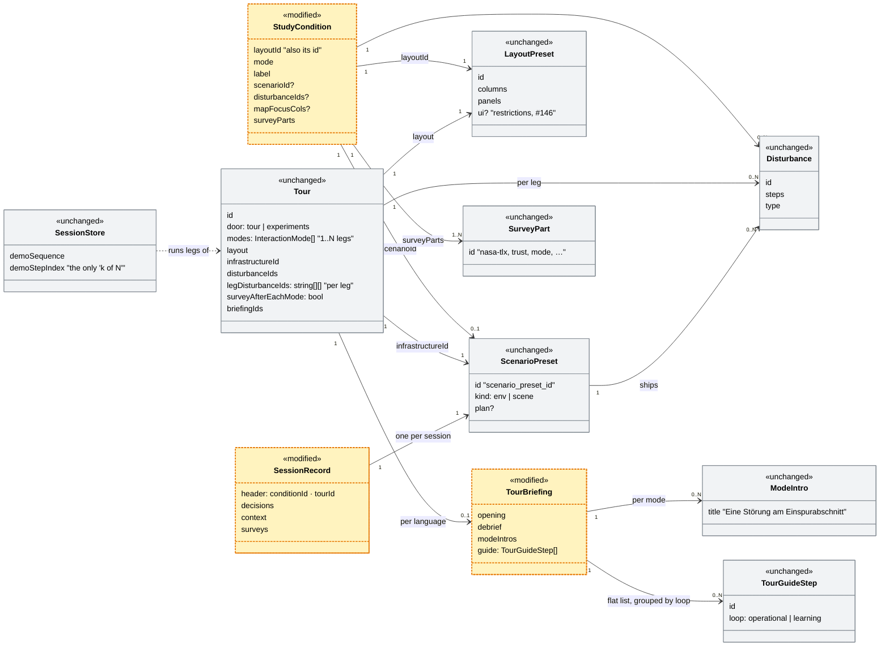
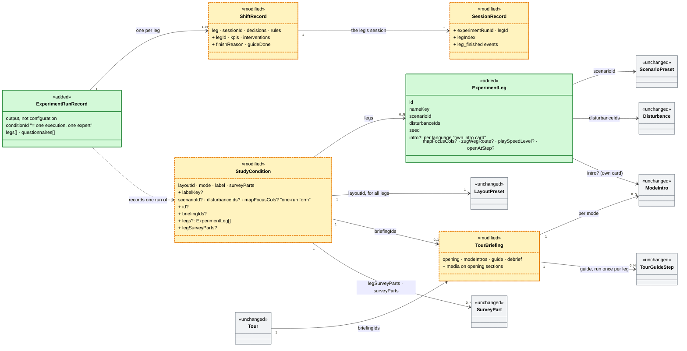
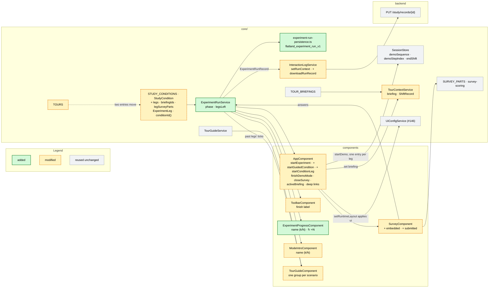

# Experiment workflow — tutorial, four scenarios, questionnaire, one record

> **Status:** Implemented 2026-10-28 (P1–P3); rebased onto #146 (at
> `05eb564`) 2026-10-30 (§7.4). Guide strip revised 2026-10-29: current leg only, drawn as the
> stepper's subtree (§5.5). Screenshots: `experiment-workflow/`, regenerated
> by `scripts/docshots-experiment-workflow.mjs`. Rewritten around the Experiment entity
> (`StudyCondition`) instead of `Tour`. Q1–Q12 and Q14–Q16 are decided; Q13 (the six networks) is content, not code. Nothing
> blocks P1, and the open questions in §9 don't either.
> **Issue:** [#131](https://github.com/flatland-association/flatland-ui-hub/issues/131)
> ("Ablauf für Experiment definieren und implementieren"). This plan covers
> only the technical part, not the briefing of the dispatchers.
> **Lands after:** [#146](https://github.com/flatland-association/flatland-ui-hub/pull/146)
> (configurable UI, Plan B). #146 merges first, and this plan is written
> against the code as it will be once #146 is in. §7.4 lists every file both
> touch and gives the rebase order.
> **Builds on:**
> - [scenario-infrastructure-gallery.md](scenario-infrastructure-gallery.md):
>   §1 (vocabulary) and §4.7 (an Experiment is not a bigger Tour, which this
>   plan follows);
> - [tours-experiments-cleanup.md](tours-experiments-cleanup.md) §3 (the
>   questionnaire);
> - [interaction-logging-plan.md](interaction-logging-plan.md) (the session
>   record);
> - [live-tours-shift-rounds.md](live-tours-shift-rounds.md) (legs);
> - `configurable-ui-plan.md` from #146 (UI restrictions that come with the
>   layout).

---

## 1. What the issue asks for

1. **Intro / tutorial**, led by the experimenter (Versuchsleiterin).
2. **Start a scenario.** The experimenter selects it by name. There are 4
   scenarios, in randomised order.
3. **Run the scenario.**
4. **"Finish scenario"** (a click) starts the next one. The button is enabled
   only after time **A**. After time **B** the next scenario starts by itself.
   This repeats until all 4 have run. *(Timers A and B were dropped on
   2026-10-28, see §5.2.)*
5. **Questionnaire** after the last scenario.
6. **Finish**, and the JSON is saved automatically.

The implementation items are:
- scenarios as objects;
- questionnaires as objects;
- the experiment as an object, made of a sequence of both plus the save step.

Optionally the experiment can be attached to a view, so nobody has to pick the
view separately.

## 2. Short answers to the three questions

**How general?** As little as #131 needs. **The experiment *is* a
`StudyCondition`,** the entity of the Experiments door. Its doc comment
already calls it "a first cut of the Experiment entity (gallery §4.7)".

What a condition already has:
- the Experiments door;
- a pinned layout (`layoutId`), and with #146 the layout's UI restrictions;
- one mode;
- a fixed scenario with its disturbances and map focus;
- fixed questionnaire parts;
- its own id in every record (`conditionId`).

What it lacks:
- a **sequence**: a condition is exactly one run;
- the **guided screens**: briefing, intro card, guide strip, Schichtbilanz.
  Today only tours have these.

The plan adds **one level, `ExperimentLeg`**, and four optional fields to
`StudyCondition`:

- `legs` is the list of legs, in the order they run. A condition with `legs`
  is a **guided condition**. **One leg is a legitimate experiment,** not a
  special case: it shows "⟨name⟩ (1/1)" and otherwise looks as today (§5.4).
- `briefingIds` references an existing `TourBriefing` per language: the
  opening pages, the intro cards, the guide and the Schichtbilanz. It is
  required with `legs`.
- `legSurveyParts` is an optional questionnaire after each leg.
- `id` is needed because the ten #131 conditions share one layout, so
  `layoutId` can no longer be the id. `conditionId(c) = c.id ?? c.layoutId`,
  so the four existing conditions keep their ids in records and deep links.

The existing `surveyParts` is the final questionnaire. **`Tour` and `TOURS`
are not changed** (except that two entries move, §2a), and neither are
`startTour()` and the tour paths.

There is no ordering logic at runtime. Counterbalancing is done by authoring
one condition per participant (§4).

**Vocabulary: leg, shift, Szenario.** The new type is named after the code's
existing word for exactly this (`legDisturbanceIds`, `legIntros`,
`startTourLeg()`, `ShiftRecord.leg`). The issue's word "Szenario" stays the
UI label. As code, "scenario" already means three other things (see below).
A code key that differs from the German label is the repo's usual pattern:
the code key `disruption` is shown as "Störungsszenario", and the panel type
`scenario` is titled "Strategien".

| Layer | Name in code | Shown in the UI as | Meaning |
|---|---|---|---|
| Configuration | `ExperimentLeg` (`StudyCondition.legs`) | "⟨name⟩ (k/N)", e.g. "Walensee Einspur (1/2)", in the stepper, intro card, footer and finish button | A planned slot in the experiment's sequence: what the participant works on next |
| Runtime | the shift: `endShift()`, `shiftEnded`, `shiftReviewOpen` | "Szenario abschliessen" ends it. The "Schichtbilanz" comes after the last leg (§2c) | The working period on one session, from the start to "Szenario abschliessen" or the episode's end |
| Record | `ShiftRecord` in `TourContextService.shiftHistory()`, extended (§6) | One row per scenario in the Schichtbilanz | What happened in one finished leg |

A leg is always played on a fresh session (§5), so one leg = one session =
one shift = one `SessionRecord`. The backend also uses "leg", in
`policies/goal_based_policies/`, for a train's route between two stops. That
is an unrelated railway meaning, and the two never meet.

**The flow is fixed** (decided 2026-10-28, §2c):

1. **Global briefing,** once: the briefing's opening pages, which may show a
   screenshot or a video.
2. **Per leg:**
   - its intro card, with static information and "Szenario starten";
   - the run;
   - "Szenario abschliessen", whenever the participant is done;
   - the leg questionnaire, if `legSurveyParts` is set.
3. **After the last leg, once:**
   - the **Schichtbilanz** over all legs;
   - the final questionnaire (`surveyParts`);
   - save, then a thank-you page.

There is no step language, no branching and no general workflow engine.

**This follows gallery §4.7, "Experiment is not a bigger Tour"** (Q10).
Experiment and Tour stay two entities: a tour is for understanding, an
experiment is for measurement. Some of what §4.7 wants the type to demand is
now in the type:
- `seed` and `nameKey` are required on `ExperimentLeg`;
- `surveyParts` is required on the condition;
- the mode sits on the condition, so the rule "one mode for all legs" (Q1)
  holds by construction.

The rest is checked by a small spec guard (§3). §4.7's full discriminated
union is not needed for #131. If a later study needs a mode order assigned per
participant, that union is the next step, and `ExperimentLeg` carries over
unchanged.

**Can Tutorial and Fragebogen map onto existing concepts?** Yes, both of them.

| Issue | Existing concept | Where | Gap |
|---|---|---|---|
| Tutorial | **Tour briefing, opening pages** (`TourBriefing.opening`) | `core/demo/tour-briefings.ts`, `features/tour-briefing/` | It becomes the global briefing before the legs. Today only tours reference a briefing, so a condition gains `briefingIds`. The pages are text only (heading, body, list); a screenshot or a video needs a media field on a section (§2c) |
| Scenario | **`StudyCondition`** (exactly one run) and the implicit **tour leg** | `study-conditions.ts`, `tours.ts` (`modes`, `legDisturbanceIds`) | A condition is one run, with no sequence and no name per run. Tour legs are counted as modes and have no identity of their own. `ExperimentLeg` adds both |
| Fragebogen | **SurveyConfig / `SURVEY_PARTS`** + `features/survey/` | `core/survey/survey-configs.ts`, `survey-scoring.ts` | A condition has one fixed questionnaire (`surveyParts`), and the survey downloads its own JSON. #131 needs a questionnaire after each leg *and* one at the end, and both must be written into the run record |
| JSON save | **SessionRecord** + `/study/records` sink | `core/interaction-log/`, `backend/app/api/study.py` | One file per *session*. Nothing groups the 4 sessions of one participant |
| "Ansicht" | **Layout preset** (`LAYOUT_PRESETS`), with #146 its `ui` restrictions | `core/layout/layout-presets.ts` | None. `StudyCondition.layoutId` already pins it, and `setRuntimeLayout()` applies its restrictions (#146) |

So the "optional" item, attaching the experiment to a view, costs nothing.

**Is there a scenario abstraction?** Partly, and the word needs clarifying.
There is no first-class scenario entity. What exists:

- `scenario_presets.py` `_PRESETS` is a hardcoded registry of
  *environments*: network, traffic and an optional plan, plus disturbance
  files and pinned session settings. Its id is `scenario_preset_id`. On a
  condition it is called `scenarioId`.
- Disturbance files are the scripted incidents. The UI calls them
  "Störungsszenario", and their code key is `disruption`.
- The `scenario` panel type, `/hmi/scenarios` and `ScenarioBuilder` are
  **policy alternatives**, a different thing altogether.
- `Tour` and `StudyCondition` pin the mode, layout, disturbances and map focus
  one level up.

In the gallery plan's vocabulary (§1), what #131 calls a **"Szenario" is a
Setup plus an intro**, played in the condition's layout and mode: one run the
participant works through. This plan names it **`ExperimentLeg`** (UI:
"Szenario"). It is a *reference* to existing entities, not a new world layer.

## 2a. Checked against today's "Geführtes Experiment"

What a facilitator runs today from the Experiments door. The door has a radio
choice (`experimentKind: 'condition' | 'tour'`):
- **"Studienbedingung"** lists `STUDY_CONDITIONS`, the four User Study 2/3
  conditions;
- **"Geführtes Experiment (mit Umfrage)"** lists the **tours** with
  `door: 'experiments'`. On `main` that is `colearning-experiment`
  ("Co-Learning-Experiment (mit Umfrage)"). #146 adds `plan-b-p01` ("Plan B ·
  participant 01"), the same run in the Plan B layout, and calls it "the
  first of ten participant tours".

A guided run goes like this:

1. The mode intro "Co-Learning · Walensee: **Eine Störung am
   Einspurabschnitt**" (`tour-briefings.ts`, `modeIntros['co-learning']`) is
   followed by the "Szenario starten" button (`dismissDemoIntro`).
2. The tour guide shows the **Betrieb** group, with "1 Konflikt erkennen",
   "2 …" and so on, then the **Lernen** group.
3. Then come the Schichtbilanz and the survey (`surveyAfterEachMode: true`).

**The ten participant runs are experiments, not tours.** #146 writes them as
tours because only tours have the guided screens today. This plan moves both
entries into `STUDY_CONDITIONS` as guided conditions, with the same ids. The
"Geführtes Experiment (mit Umfrage)" radio then lists guided conditions
instead of tours (§5.6). What #146 is about stays exactly as it is: the
layout `preset-plan-b`, its `ui` block, and "all ten name the same layout".

**"Betrieb" is not an iteration over scenarios.** It is the label of the
guide's *operational loop* (`tourUi.guide.loop.operational`,
`TourGuideStep.loop = 'operational'`): the first five guide steps *inside one
scenario*. "Lernen" (`loop = 'learning'`) is the rest. Both groups belong to a
single run. `TourGuideService` clears them on every new session id, so with
several scenarios the Betrieb/Lernen list starts again for each one. The
"Betrieb" items therefore cannot carry the "scenario k of N" information. That
needs its own indicator, the stepper (§5.4), and the guide strip shows the
current scenario's name above its groups (§5.5).

**Is there a "current scenario, k of N" concept?** Only in part, and it counts
*modes*, not scenarios:

| Existing piece | What it counts | Where shown | Limitation for N scenarios |
|---|---|---|---|
| `SessionStore.demoSequence` / `demoStepIndex` / `demoIsLast` | the legs of a tour, one per entry of `Tour.modes` | footer "`Modus 2/3`" (`footer.progressTitle`), mode intro "`Modus 1 von 3`" (`labels.stepPrefix/stepOf`) | Labelled as *mode*. Reused unchanged as the leg counter (§5) |
| `Tour.legDisturbanceIds` + `AppComponent.startTourLeg()` | one fresh session per leg, with that leg's disturbances | — | Tours only. The preset, layout and briefing are the same for every leg |
| `Tour.surveyAfterEachMode` | — | the survey button after each leg | All or nothing **per leg**. "A survey once, after the last scenario" cannot be expressed |
| `StudyCondition` | exactly one scenario | — | No sequence, no guided screens |

### Data model today (as built, with #146)



**Legend:**
- yellow, dashed border + `«modified»` = **modified by this plan**:
  - `StudyCondition` gains the optional fields;
  - `TourBriefing` gains images and videos on its opening pages;
  - `SessionRecord` gains new header fields and events.
- grey + `«unchanged»` = **unchanged.** `Tour` stays as it is; only two of its
  entries move.

Nothing in today's model is removed.

| Class | Status | What it is | Example in «Geführtes Experiment (mit Umfrage)» | Modification by this plan | Where |
|---|---|---|---|---|---|
| `StudyCondition` | **modified** | One prepared experiment run: layout, mode, optional fixed preset, disturbances, map focus, survey parts. Its `layoutId` is its id | Today the *other* radio choice in the same door: "**Studienbedingung**", e.g. "Co-Learning · User Study 3" | P1: optional `id`, `labelKey`, `briefingIds`, `legs`, `legSurveyParts`. A condition with `legs` is guided. Without them it runs exactly as today | `core/demo/study-conditions.ts` (`StudyCondition`, `STUDY_CONDITIONS`) |
| `Tour` | unchanged | A guided walk as data: modes in order (one leg each), layout, preset, disturbances per leg, survey after each leg, briefings, live variant, start-screen door | Today "**Geführtes Experiment (mit Umfrage)**" → "Co-Learning-Experiment (mit Umfrage)" (`colearning-experiment`), and with #146 also "Plan B · participant 01" | None to the type. The two entries with `door: 'experiments'` move to `STUDY_CONDITIONS` (§2a, P1) | `core/demo/tours.ts` |
| `ScenarioPreset` | unchanged | An environment: a pickled env or a scene, plus an optional plan, disturbance files and pinned session settings. Identified by `scenario_preset_id` | The Walensee stretch on the track map: "PF–CH · WN↔WAL conflict (long approach)", three trains, one single-track section | None. A leg references it by `scenarioId` | backend `scenario_presets.py`; frontend `core/models.ts` |
| `Disturbance` | unchanged | A scripted incident (`train_delay`, `area_block`, `warning`) at fixed steps | The breakdown in the single-track section at step 28: "Interview: Zug bleibt im Einspurabschnitt stehen (+12 Schritte)" | None | backend `disturbances.py`; files in `fixtures/*/disturbances*/` |
| `LayoutPreset` | unchanged | Which panels sit in which zone, and with #146 which controls are hidden. This is the "Ansicht" of the issue | The whole working screen ("Co-Learning · Interview"), or with Plan B the reduced one (`preset-plan-b`) | None. `setRuntimeLayout()` applies its `ui` block (#146) | `core/layout/layout-presets.ts` |
| `TourBriefing` | **modified** | The pages around a guided run: opening, closing, debrief, per-mode intros, the guide steps as one flat list, module badges | Everything around the run: the intro card, the guide strip, and after the shift the "**Schichtbilanz**". This briefing has no opening page | P1: a `BriefingSection` can carry an image or a video (`media`), for the global briefing (§2c) | `core/demo/tour-briefings.ts` |
| `ModeIntro` | unchanged (data) | The intro card before a leg, with the "Szenario starten" button | "Co-Learning · Walensee", "**Eine Störung am Einspurabschnitt**", "Modus 1 von 1", button "**Szenario starten**" | The data stays. Its *component* shows "⟨name⟩ (k/N)" for a guided condition (§5.4) | `core/demo/mode-intro-configs.ts`, or `TourBriefing.modeIntros` |
| `TourGuideStep` | unchanged (data) | One guide step inside one scenario, grouped by `loop`: `operational` ("Betrieb") or `learning` ("Lernen") | "**Betrieb · 1 Konflikt erkennen**" or "Lernen · 7 Schichtbilanz" | The type stays. The strip shows the current scenario's name above its groups (§5.5) | `core/demo/tour-briefings.ts` |
| `SurveyPart` | unchanged | One questionnaire block (NASA-TLX, trust, understanding, UEQ-S, mode items, open feedback) | One section of "**Post-session survey — Co-Learning**", e.g. "Workload (NASA-TLX, raw)" | None | `core/survey/survey-configs.ts` |
| `SessionStore` | unchanged | Runtime state of the session. `demoSequence`/`demoStepIndex` are today's only "k of N", and they count modes | Footer "Co-Learning-Experiment (mit Umfrage) · **Modus 1/1** · Co-Learning", "Schritt: 28 / 180" | None. A guided condition feeds `demoSequence` one entry per leg, so `demoStepIndex` is the leg index | `core/session.store.ts` |
| `SessionRecord` | **modified** | The record of one session: header, decisions, context events, surveys, outcome | What "**Sitzungsdaten exportieren**" in the footer downloads, one JSON per session | P1: the header gets `experimentRunId`, `legId`, `legIndex`; the context events get `leg_finished` | `core/interaction-log/session-record.ts` |
| *Mode* (`InteractionMode`) — not a class | unchanged | **Who decides.** A value, not an entity: `'recommendation' \| 'co-learning' \| 'director'`. It has no id, fields or file of its own, and its behaviour lives in the panels that check it (`panel-mode-matrix.md`). At runtime it is the one signal `SessionStore.interactionMode`. In data it appears only as an attribute: `StudyCondition.mode`, `Tour.modes` | "**Co-Learning**": the eyebrow "Co-Learning · Walensee", the footer "· **Co-Learning**", the violet modules, options without a ranking, "Post-session survey — **Co-Learning**" | None. It stays on the condition, so all legs share it (Q1). Repo rule: keep mode semantics in the `InteractionMode` union, with no parallel flags | `core/events/event-types.ts` |

### Data model proposed (this plan)



**Legend:** green + `«added»` = **added** · yellow, dashed border +
`«modified»` = **modified** · grey + `«unchanged»` = **reused unchanged**.
The colours are set with plain `style` lines (no `classDef`), so they render
in IDE previews too. The stereotypes repeat the status for renderers without
colour.

**One added level.** Configuration goes StudyCondition (existing) →
**ExperimentLeg (new)** → references to existing entities (preset,
disturbances, `ModeIntro`). `briefingIds` is a reference, not a level.
`ExperimentRunRecord` is output, not configuration.

| Class | Status | What it is | Example in «Geführtes Experiment (mit Umfrage)» | Modification / content | Where |
|---|---|---|---|---|---|
| `StudyCondition` | **modified** (P1) | The experiment itself: which scenarios, in which order, in which layout and mode, with which briefing and questionnaires | "**Co-Learning-Experiment (mit Umfrage)**" under "Geführtes Experiment (mit Umfrage)": after the migration with one leg ("Walensee Einspur (1/1)"), in the example with two legs before one survey | New optional `id`, `briefingIds`, `legs`, `legSurveyParts`. With `legs`, the one-run fields `scenarioId`, `disturbanceIds` and `mapFocusCols` are not set (spec guard) | `core/demo/study-conditions.ts` |
| `ExperimentLeg` | **added** (P1) | One leg, i.e. one "Szenario" as #131 means it: preset + disturbance, optionally its own intro card, with a name and a seed. Layout and mode come from the condition | Today's single run "**Eine Störung am Einspurabschnitt**" becomes "Walensee Einspur (1/2)". A second shift on the same stretch becomes "Walensee Folgezug (2/2)" | New. `id`, `nameKey`, `scenarioId`, `disturbanceIds`, `seed`, `intro?` (per language), `mapFocusCols?`, `zugWegRoute?`, `playSpeedLevel?`, `openAtStep?` | `core/demo/study-conditions.ts` (next to the condition, no new file) |
| `ExperimentRunRecord` | **added** (P2) | The output of one run of the experiment by one participant: one file wrapping the per-leg session records and the questionnaires. Not configuration | One JSON per participant run, saved automatically. Today "Sitzungsdaten exportieren" and the survey's own download produce separate files | New. `conditionId` (which identifies the execution and the expert, Q14), then per leg (in run order) its `ShiftRecord` with the session record, plus the answers and scores of the leg and final questionnaires | `core/interaction-log/experiment-run-record.ts` |
| `ShiftRecord` | **modified** (P1) | The record of one finished leg, kept in `TourContextService.shiftHistory()`. Today only multi-shift tours fill it | The rows of the Schichtbilanz after the last leg: one per scenario, plus the totals | Gains optional `legId`, `kpis`, `interventions`, `finishReason`, `startedAt`, `finishedAt`, `guideDone`. Recorded at every leg's end (§6) | `core/demo/tour-context.service.ts` |
| `SessionRecord` | **modified** (P1) | The per-session record | "**Sitzungsdaten exportieren**", now one record per scenario | New header fields and context events, as in the table above | `core/interaction-log/session-record.ts` |
| `TourBriefing` | **modified** (P1) | See the table above | The global briefing's pages, now with a screenshot or a video. The intro card and guide strip as today | `media` on opening sections (§2c). Now referenced by `StudyCondition.briefingIds` too. `legIntros` (by position) is not used by conditions; a leg carries its own `intro`, so a shared leg keeps its card at any position (§4) | `core/demo/tour-briefings.ts` |
| `Tour` | reused unchanged | See the table above | — | Unchanged. Its two Experiments-door entries are now conditions | `core/demo/tours.ts` |
| `ModeIntro` | reused unchanged (data) | See the table above | "**Eine Störung am Einspurabschnitt**", now with "Walensee Einspur (1/2)" instead of "Modus 1 von 1" | Shown before each leg: the leg's own `intro` in the UI language (English fallback), otherwise the briefing's `modeIntros[mode]`. What it says is content, as today (§2c, Q11) | `core/demo/mode-intro-configs.ts` / `TourBriefing.modeIntros` |
| `TourGuideStep` | reused unchanged | See the table above | "**1 Konflikt erkennen**", now under "Walensee Einspur (1/2)" | Unchanged. The briefing's guide runs once per leg; the strip shows the current leg's steps only (§5.5) | `core/demo/tour-briefings.ts` |
| `ScenarioPreset` | reused unchanged | See the table above | The Walensee stretch, unchanged | Referenced by `ExperimentLeg.scenarioId` | backend `scenario_presets.py` |
| `Disturbance` | reused unchanged | See the table above | "Zug bleibt im Einspurabschnitt stehen" in leg 1, "Folgezug läuft auf" in leg 2 | Referenced by `ExperimentLeg.disturbanceIds`, one per leg (Q9) | backend `disturbances.py` |
| `LayoutPreset` | reused unchanged | See the table above | The same working screen for both legs | Referenced by `StudyCondition.layoutId`. Its #146 `ui` block applies to all legs | `core/layout/layout-presets.ts` |
| `SurveyPart` | reused unchanged | See the table above | "Workload (NASA-TLX, raw)" etc.: a short set after each leg, the full set at the end | Referenced by `legSurveyParts` and `surveyParts` | `core/survey/survey-configs.ts` |
| *Mode* (`InteractionMode`) — not a class | reused unchanged | See the table above | Both legs of the example are "**Co-Learning**". The intro card says "Walensee Einspur (1/2)" and names the mode in its eyebrow | Stays on the condition (`StudyCondition.mode`), so all legs share it (Q1) | `core/events/event-types.ts` |

### Worked example: the "Geführtes Experiment" through both models

The examples follow one run of today's "Co-Learning-Experiment (mit Umfrage)".
Quoted text is what the UI shows (German UI unless marked EN), and the ids are
the real ones from the repo. The text after "·" is optional attribute detail.

**As it runs today**

| Class | Example instance | What the person sees · attribute detail |
|---|---|---|
| `Tour` | `colearning-experiment` | Experiments door ("**Experimente**"), radio "**Geführtes Experiment (mit Umfrage)**", entry "**Co-Learning-Experiment (mit Umfrage)**" (EN "Co-Learning experiment (with survey)"). · `door: 'experiments'`, `modes: ['co-learning']` (one leg), `surveyAfterEachMode: true`, `expectedMinutes: 12` |
| `StudyCondition` | `preset-colearning-study3` (not used by this run) | The other radio choice in the same door, "**Studienbedingung**", e.g. "**Co-Learning · User Study 3**". · `mode: 'co-learning'`, `scenarioId: 'pf-ch-wn-wal-long-approach'`, `surveyParts: ['nasa-tlx','trust','understanding','open']` |
| `ScenarioPreset` | `pf-ch-wn-wal-long-approach` | "**PF–CH · WN↔WAL conflict (long approach)**": the Walensee stretch Ziegelbrücke–Walenstadt with one single-track section and three trains. · `kind: scene`, ships a `plan`; `max_episode_steps: 180` |
| `Disturbance` | `interview-e1-breakdown-single-track` | "**Interview: Zug bleibt im Einspurabschnitt stehen (+12 Schritte)**". The map announces the breakdown at step 28. · `type: train_delay`, `step: 28`, `delay_steps: 12` |
| `LayoutPreset` | `preset-colearning-interview` | "**Co-Learning · Interview**": the situation on the left, track map / ZWL / timetable in the centre, all Co-Learning modules on the right (violet edge) |
| `TourBriefing` | `colearning-experiment` (DE) | No opening or closing page. It goes straight to the mode intro, and after the shift to "**Schichtbilanz**" and the survey. · `debriefSections: ['shift-summary']`, `reasonDialog: true` |
| `ModeIntro` | `modeIntros['co-learning']` of that briefing | Eyebrow "**Co-Learning · Walensee**", title "**Eine Störung am Einspurabschnitt**", button "**Szenario starten**". · step label "**Modus 1 von 1**" |
| `TourGuideStep` | `detect` … `shift-summary` (7 steps) | Group "**Betrieb**": "1 Konflikt erkennen" … "5 Umsetzen"; group "**Lernen**": "6 Reflexion", "7 Schichtbilanz" |
| `SurveyPart` | the Settings selection (the tour sets no `surveyParts`) | "**Umfrage nach der Session →**" opens "**Post-session survey — Co-Learning**" |
| `SessionStore` | the running session | Footer "**Co-Learning-Experiment (mit Umfrage) · Modus 1/1 · Co-Learning**". · `demoSequence: ['co-learning']`, `demoStepIndex: 0` |
| `SessionRecord` | `flatland-<participant>-tour-colearning-experiment-<run>-<session>.json` | "**Sitzungsdaten exportieren**". · `header.tourId: 'colearning-experiment'`, `conditionId: null` |

**The same run as a guided condition with one leg (P1, "Walensee Einspur (1/1)")**

The regression proof for N = 1. It must look as it does today, except for the
step label.

```ts
// core/demo/study-conditions.ts
{
  id: 'colearning-experiment',                  // same id as the tour it replaces
  layoutId: 'preset-colearning-interview',
  mode: 'co-learning',
  label: 'Co-Learning experiment (with survey)', // English fallback
  labelKey: 'tours.colearning-experiment.name', // the existing translated name, reused (Q15)
  briefingIds: { de: 'colearning-experiment', en: 'colearning-experiment' },
  surveyParts: DEFAULT_SURVEY_PARTS,            // pinned; today the Settings selection, by default the same (Q15)
  legs: [WAL_SINGLE_TRACK],
}
// plan-b-p01 from #146 moves the same way: layoutId 'preset-plan-b', the same briefing, its own leg
```

| Where | What the participant sees |
|---|---|
| Start screen | Under "Geführtes Experiment (mit Umfrage)" as today, now listed from `STUDY_CONDITIONS` |
| Intro card | As today, but "**Walensee Einspur (1/1)**" instead of "Modus 1 von 1" |
| Run | As today. No stepper, no leg name in the guide strip |
| After the run | Today's Schichtbilanz (over one leg it is the current one), then the questionnaire |
| Footer | "Co-Learning-Experiment (mit Umfrage) · **Walensee Einspur (1/1)** · Co-Learning", translated via `labelKey` as today |
| Record | `conditionId: 'colearning-experiment'`, `tourId: null`; file `flatland-<participant>-colearning-experiment-…` (Q15) |

**A condition with two legs, a short questionnaire after each and a full one at the end**

This shows the mechanics only. Both legs use the Walensee network, because it
is the only study-ready one (§2b); in #131 each leg is a different network.
Leg 2 reuses the second shift that `colearning-advanced` already ships
(`advanced-shift2-e1-breakdown-follower`, on the same preset). The names, the
seed, the intro text and the media file are placeholders until §9 (Q13) is
answered.

```ts
// Shared leg constants (§4): written once, referenced by every condition that uses them.
const WAL_SINGLE_TRACK: ExperimentLeg = {
  id: 'wal-single-track', nameKey: 'experimentLegs.walSingleTrack',
  scenarioId: 'pf-ch-wn-wal-long-approach', disturbanceIds: ['interview-e1-breakdown-single-track'],
  seed: 42,
};
const WAL_FOLLOWER: ExperimentLeg = {
  id: 'wal-follower', nameKey: 'experimentLegs.walFollower',
  scenarioId: 'pf-ch-wn-wal-long-approach', disturbanceIds: ['advanced-shift2-e1-breakdown-follower'],
  intro: { de: WAL_FOLLOWER_INTRO_DE, en: WAL_FOLLOWER_INTRO_EN },   // static information at the leg's start
  seed: 42,
};

{
  id: 'colearning-experiment-2x',
  layoutId: 'preset-colearning-interview',
  mode: 'co-learning',
  label: 'Co-Learning experiment, two scenarios (with survey)',
  briefingIds: { de: 'colearning-experiment-2x', en: 'colearning-experiment-2x' },  // opening with a video
  legSurveyParts: ['nasa-tlx'],
  surveyParts: ['mode', 'trust', 'ueq-s', 'open'],
  legs: [WAL_SINGLE_TRACK, WAL_FOLLOWER],
}
```

| Class | Example instance | What the person sees · attribute detail |
|---|---|---|
| `TourBriefing` | `colearning-experiment-2x` | The global briefing first: an opening page with a **video** of the working screen, then "Weiter". Stepper: "**[Briefing]** ─ Walensee Einspur (1/2) ─ Walensee Folgezug (2/2) ─ Schichtbilanz ─ Fragebogen ─ Ende" · `opening.sections[0].media: { kind: 'video', src: 'tours/colearning/intro.mp4', altKey: '…' }` |
| `StudyCondition` | `colearning-experiment-2x` | Listed under "Geführtes Experiment (mit Umfrage)". The stepper shows "**↻ ×2**" around the two legs, each with its short questionnaire inside the bracket, and "**noch 1 Szenario bis zur Schichtbilanz**" during leg 1 |
| `ExperimentLeg` | `WAL_SINGLE_TRACK` | Intro card "**Walensee Einspur (1/2)**", title "**Eine Störung am Einspurabschnitt**" (from the briefing, because the leg sets no `intro`). The guide strip shows only "Walensee Einspur (1/2)" and its steps, inside a violet box joined by dashed lines to the stepper's "Walensee Einspur (1/2)". The toolbar button reads "**Szenario abschliessen → Fragebogen**" |
| `SurveyPart` (leg) | `nasa-tlx` | After leg 1: "Workload (NASA-TLX, raw)" only, then straight on to leg 2's intro card. No Schichtbilanz in between |
| `ExperimentLeg` | `WAL_FOLLOWER` | Intro card "**Walensee Folgezug (2/2)**" with its **own static information** (`intro`). The guide strip shows only "Walensee Folgezug (2/2)" and its steps; "Walensee Einspur (1/2) ✓" appears in the stepper only. After its questionnaire the button leads to the Schichtbilanz |
| `ShiftRecord` | one per leg | The **Schichtbilanz** after leg 2: one row per scenario (arrived, delayed, total delay, breakdowns, interventions) and the totals |
| `SurveyPart` (final) | `mode`, `trust`, `ueq-s`, `open` | Once, after the Schichtbilanz: "**Post-session survey — Co-Learning**" |
| `ExperimentRunRecord` | `flatland-colearning-experiment-2x-<runId>.json` | Saved at "Ende" without a click, followed by a thank-you page · `legs` in run order, each a `ShiftRecord` with `finishReason: 'clicked'`; three questionnaires (two leg, one final) |
| `SessionRecord` | one per leg | As today, plus `header.conditionId: 'colearning-experiment-2x'`, `legId: 'wal-single-track'` / `'wal-follower'` and `legIndex: 0 / 1` |

### Services and components (this plan)

The runtime side of the same change, with the same colours. It follows the
§7 change inventory.



## 2b. Decided: four networks, each with its own disturbance (Q1)

Answered 2026-10-28. The four legs of an experiment differ in their
**network**, and each leg brings its own scripted disturbance, one per leg
(Q9). All four run in **the same mode**, the condition's. Each experiment
draws its four networks from a pool of **six** (§4). So every `ExperimentLeg`
has its own `scenarioId` and `disturbanceIds`. The worked example uses one
network twice; it shows the mechanics, not the #131 content.

**Content gap: only one network is study-ready today** (checked 2026-10-28).
An experiment leg needs two things:
- a premade plan, because otherwise runs are not reproducible. That is also
  why the Experiments door offers only presets with a plan.
- a scripted disturbance.

| Preset | Plan | Study disturbances | Tour disturbances | Episode |
|---|:-:|:-:|:-:|---|
| `pf-ch-wn-wal-conflict` (Walensee) | ✓ | ✓ | — | 140 |
| `pf-ch-wn-wal-long-approach` (Walensee) | ✓ | ✓ | ✓ | 180 |
| `olten`, `olten-dense` | — | — | ✓ | default / 700 |
| `olten-disrupted`, `olten-partially-closed` | — | — | — | default |
| `pf-ch-corridor`, `pf-ch-corridor-stops` | — | — | — | default |
| `ecml2026-scene1-level0` | — | — | — | default |
| Gotthard (fixtures exist, not registered) | — | — | — | — |

The two Walensee presets are one network in two variants. So the pool of six
needs **five more networks**, each with a plan and a disturbance, and ideally
each with a baseline run (gallery plan §6) so their difficulty can be
compared.

Defining the six networks and the ten conditions is **not part of this PR**.
It is fixture and authoring work in `backend/app/fixtures/` and
`scenario_presets.py`, and it is the critical path for running the study
(Q13). This PR builds the mechanism and ships one example condition on what
exists.

**Consequences for the model:**

- **Network-specific settings sit on the leg.** Today the tour briefing holds
  `mapFocusCols` and `zugWegRoute` (the time-distance diagram's section, as
  station codes, e.g. `ZB → WAL`). Those fit one network only. The leg has
  both, and they win over the briefing's values (§3, §7.2).
- **Each leg can have its own intro card,** because the card describes the
  network ("Strecke Pfäffikon SZ–Chur am Walensee …"). It is written per UI
  language, like a briefing (`briefingIds: { de, en }`), with English as the
  fallback. What it says is the author's choice, as today (Q11).
- **The guide stays shared.** The Betrieb/Lernen steps are the same in every
  network. Network-specific hints are not carried per leg; generic hints are
  the default.
- **Episode lengths differ** (140, 180 or 700 steps). With no timers (§5.2)
  the participant ends each leg when done, so this needs no per-leg setting.
- **One mode per experiment** holds by construction: the mode is on the
  condition, not on the leg.
- **Network difficulty stays in the data.** The ten conditions fix which
  networks each participant meets, and in which order (§4). Differences
  between the networks themselves are not balanced away, which is why the
  baselines matter.

## 2c. Decided: the flow of a guided condition (Q6, Q7)

Decided 2026-10-28. The flow is generic: the condition says how many legs it
has, and one leg is as valid as four.

| Where | What the participant sees | Defined by | Exists today? |
|---|---|---|---|
| **Global briefing**, once at the start | Pages with text and a **screenshot or a video** | `TourBriefing.opening`, via `StudyCondition.briefingIds` | ◐ text pages exist (tours only); image and video do not |
| **Leg start**, per leg | The intro card with **static information** about this leg, and "Szenario starten" | `ExperimentLeg.intro`, per language (otherwise the briefing's card for the mode) | ✓ the card exists; per-leg content is new |
| **Leg end**, per leg, optional | A short **questionnaire** | `StudyCondition.legSurveyParts` | ✗ |
| **After the last leg**, once | The **Schichtbilanz** over all legs | the briefing's debrief (`debriefSections`) | ◐ exists, but for the current session only |
| **After the Schichtbilanz**, once | The final **questionnaire** | `StudyCondition.surveyParts` | ✓ a condition's questionnaire |
| **End** | Save, then a thank-you page | behaviour (§6) | ✗ |

**What this changes in the plan:**

- **The tutorial is the global briefing** (Q7), not a practice run. The
  stepper's first entry is "Briefing".
- **What a leg's intro card says is content, not model.**
  - The card is a `ModeIntro`, and all its fields are free text: `wp`
    (eyebrow), `title`, `tagline`, `whatHappens`, `focusView`, `yourRole`,
    `whatYouCanControl`, `watchFor`, `goal`, `note`.
  - Today's card names the incident in `title` ("Eine Störung am
    Einspurabschnitt") and in part of `whatHappens`. There is no separate
    network or incident field, and no switch to hide one.
  - Decided (Q11): keep it as today. A leg may set its own card, reusable
    through the shared leg constant (§4); otherwise the briefing's card is
    shown. Whether a card names the incident is the author's choice, not a
    rule or a code change.
- **Screenshot or video in the briefing.** `BriefingSection` gains an optional
  `media: { kind: 'image' | 'video'; src: string; altKey: string }`, rendered
  by the briefing pages (`features/tour-briefing/`).
  - The files go under `frontend/public/`.
  - The alt text is an i18n key, like every other string.
  - Tours can use it too; nothing about it is experiment-specific.
- **No Schichtbilanz between legs.** When a leg ends, the participant goes to
  that leg's questionnaire, or straight to the next intro card. The
  Schichtbilanz comes once, after the last leg.
- **The Schichtbilanz covers all legs.** Today the debrief's `shift-summary`
  is built from the current session only. So each leg's `ShiftRecord` also
  keeps its **KPIs and interventions** at the leg's end (§6), and the summary
  shows one row per leg plus the totals. The debrief's existing `compare`
  section already lays shifts side by side and is the model for this.
- **The guide strip follows.** It is the current leg's subtree: the leg's
  name, then Betrieb and the Lernen step that happens during the run
  ("Reflexion"). Other legs and the "Schichtbilanz" are the stepper's and are
  not repeated in the strip, which shows only while a leg runs (§5.5).
- **N = 1 looks like today.** A one-leg condition shows "⟨name⟩ (1/1)" on the
  intro card and in the footer, where today it says "Modus 1 von 1". It has no
  stepper and no leg name in the guide strip, and its Schichtbilanz is today's. To prove
  it, P1 migrates `colearning-experiment` to a one-leg condition.
- **Questionnaires (Q6).** `legSurveyParts` after each leg (optional) and
  `surveyParts` at the end (required, as today).

## 3. Data model

```ts
// core/demo/study-conditions.ts: additions only

/** One leg of a guided condition: one "Szenario" the participant works through.
 *  Layout and mode are the condition's, so every leg shares them (Q1). */
export interface ExperimentLeg {
  id: string;                    // stable, logged, never the displayed label
  nameKey: string;               // i18n key (experimentLegs.*): shown as "⟨name⟩ (k/N)", kept in records
  scenarioId: string;            // scenario_presets.py id, as on the condition
  disturbanceIds: string[];      // one per leg in #131 (Q9)
  seed: number;                  // pinned: what makes the leg reproducible
  /** Own intro card per UI language, English as the fallback; otherwise the
   *  briefing's modeIntros[mode]. Carried by the leg, not by position, so a
   *  shared leg keeps it at any position. */
  intro?: Partial<Record<Lang, ModeIntro>>;
  mapFocusCols?: [number, number];                 // wins over the briefing's (§2b)
  zugWegRoute?: { from: string; to: string };      // time-distance section; wins over the briefing's (§2b)
  playSpeedLevel?: number;
  openAtStep?: number;
}

export interface StudyCondition {
  // … layoutId, mode, label, scenarioId?, disturbanceIds?, mapFocusCols?, surveyParts: unchanged …
  /** Needed once several conditions share a layout; records and deep links use conditionId(). */
  id?: string;
  /** i18n key for the name participants see (footer, picker); `label` stays the English fallback. */
  labelKey?: string;
  /** The briefing per language: opening pages, intro cards, guide, Schichtbilanz. Required with `legs`. */
  briefingIds?: Partial<Record<Lang, string>>;
  /** A guided condition: its legs in run order. One leg is valid ("⟨name⟩ (1/1)"). */
  legs?: ExperimentLeg[];
  /** Questionnaire after each leg; absent = none. `surveyParts` stays the final one. */
  legSurveyParts?: readonly string[];
}

/** The id records, deep links and the picker use: the four existing conditions keep their layout id. */
export function conditionId(c: StudyCondition): string { return c.id ?? c.layoutId; }

// core/demo/tour-briefings.ts: addition to BriefingSection (optional)
interface BriefingSection {
  // … heading, body, items, ordered unchanged …
  media?: { kind: 'image' | 'video'; src: string; altKey: string };   // global briefing (§2c)
}

// core/demo/tours.ts: tourBriefingId() is widened from Tour to
// Pick<Tour, 'briefingIds' | 'briefingId' | 'live'>, so a condition can pass its briefingIds.
```

- **A condition without `legs` runs exactly as today,** through the unchanged
  `startExperiment()` path. There is no normaliser, and the four User Study
  2/3 conditions are not touched.
- **Saving is behaviour, not a field.** Every guided condition writes an
  `ExperimentRunRecord` when it ends (§6). This answers the issue's question
  whether saving is part of the questionnaire object: no.
- **The spec guard** (`core/demo/study-conditions.spec.ts`, new) checks what
  the type doesn't:
  - `legs` ⇔ `briefingIds`;
  - with `legs`, the one-run fields `scenarioId`, `disturbanceIds` and
    `mapFocusCols` are unset;
  - one disturbance per leg (Q9);
  - unique `conditionId()` values;
  - every `nameKey` exists in `en.json`;
  - every `briefingIds` entry resolves to a briefing.

  Once the ten conditions exist, it also reports the design counts (§4).

## 4. Counterbalancing by authoring: one condition per participant

Decided 2026-10-28 (Q2). The experimenter picks a **condition** by name: the
"Geführtes Experiment" of that participant. There are **ten conditions, one
per participant**, and each runs a dedicated subset of **four of the six
networks** in a fixed order. Which subset and which order each one gets is
the study design. It is authored, not computed. #146 starts this series with
`plan-b-p01`. The ten conditions and the six networks themselves are not part
of this PR.

What this means for the mechanism:

- **No runtime ordering.** There is no Latin square, no shuffle, no "next"
  picker and no override. A condition's `legs` run in the order they are
  listed. That keeps runs reproducible by construction: the condition id alone
  says what a participant saw.
- **Legs are shared, conditions compose them.**
  - Each of the six networks is written once as an `ExperimentLeg` constant:
    preset, disturbance, intro, map focus, time-distance section.
  - The ten conditions reference those constants instead of repeating them.
  - So `legId` names the same network leg across all ten conditions, which is
    what an analysis groups by.
- **Layout and restrictions are shared too.** All ten name `preset-plan-b`
  (#146), so the Plan B restrictions are declared once and applied per run by
  `setRuntimeLayout()`.
- **The spec guard can check the design** once the ten conditions exist:
  - each has four legs;
  - no network appears twice in one condition;
  - how often each network and each position occurs across the ten.

  With 10 × 4 = 40 slots over 6 networks, an exactly even spread is not
  possible (6⅔ per network), so the guard reports the counts rather than
  enforcing them.
- **Selection by name** is the existing condition picker in the Experiments
  door. Handing over a participant's run is the existing deep link
  `#/experiment/<conditionId>/start`. How ten near-identical entries are
  listed and marked as used is (Q14).

## 5. The runner

`ExperimentRunService` (`core/demo/experiment-run.service.ts`) runs one guided
condition. It is a signal-based state machine:

- **State:** `condition`, `phase: 'briefing' | 'intro' | 'running' |
  'legSurvey' | 'review' | 'finalSurvey' | 'done'`, which follows the flow in
  §2c. **The leg index is `store.demoStepIndex()`,** so the service has no
  index of its own.
- **Derived:** `currentLeg`, `legCount`, `legsLeft`, `nextStepKind` (what the
  finish button leads to).
- **Finished legs:** not a list of its own. At each leg's end the service
  calls `TourContextService.recordShift()` with the extended `ShiftRecord`
  (§6), which also holds the leg's guide ticks (§5.5).

The guided screens are not tied to the `Tour` type. They are switched on by
two things: `store.demoActive()` and `tourContext.set(briefing, focus)`. So a
guided condition sets those same switches, and everything downstream works
as it does for a tour:

- **Start.** `startExperiment()` gains one branch. A condition with `legs`
  goes to the new private `startGuidedCondition()`, which does what
  `startTour()` does, from the condition instead of the tour:
  1. `setRuntimeLayout(layoutId)`, which applies the layout's `ui`
     restrictions (#146);
  2. leg 0's preset, disturbances and seed;
  3. the mode;
  4. `createSession()`;
  5. `tourContext.set(briefing, leg.mapFocusCols)`;
  6. `store.startDemo(legs.map(() => mode), false)`;
  7. the opening page.

  `activeExperiment` is set as for any condition, so the records,
  `experimentSurveyParts` and the `openSurvey()` gate already work.
  **`startTour()` is not touched.**
- **Next leg.** The new private `startConditionLeg()` mirrors
  `startTourLeg()`. It creates a fresh session with the next leg's preset,
  disturbances and seed, in the same layout, so the restrictions stay applied.
- **`activeBriefing`** becomes "the active condition's briefing if it has one,
  otherwise the selected tour's". It goes through the widened
  `tourBriefingId()`.
- **`finishDemoMode()` and `closeSurvey()`** hand over to the run service
  while a guided condition runs. It moves on to the leg questionnaire, the
  next leg (`startConditionLeg()`) or the Schichtbilanz. Tours keep their
  current behaviour in both methods.
- **Between legs no debrief opens.** Today an ended shift opens the review
  (`shiftReviewOpen`, the debrief). For every leg but the last, the run
  service records the leg and moves on instead. The debrief opens once, after
  the last leg, as the Schichtbilanz over all legs (§2c). With one leg this is
  exactly today's behaviour.

**Tour paths stay as they are.** Today there are two ways to the next leg of a
tour:
- path A: survey, then `store.reset()` on the same session;
- path B: `startTourLeg()` on a fresh session.

Tours keep both. A guided condition always works like path B: one leg = one
session = one shift = one `SessionRecord`, with the guide and `shiftStartedAt`
starting fresh. Tours have a known gap: `closeSurvey()` calls `reset()` and
never `startTourLeg()`. It does not matter here, because guided conditions
route `closeSurvey()` to the run service, and no tour combines a survey after
each leg with per-leg disturbances.

**Behaviour gated on `demoActive()` follows the run, not the type.** Several
panels change behaviour during a guided run:
- the recommendation guarantee (`recommendations-panel`,
  `recommendations-classic`);
- the impact panel engaging on a new conflict;
- auto-pause on conflict in `combined-actions`;
- the mode tabs locked in the shell.

A guided condition has these, as `colearning-experiment` has them today. A
condition without `legs` does not run as a demo, so User Study 2/3 behave
exactly as before. This is the one thing to check in review: a plain
condition must never call `startDemo()`.

### 5.1 Handover and the global briefing (the tutorial)

Decided 2026-10-28 (Q4): **one screen.** The experimenter (Versuchsleiterin)
does everything that comes before the run on the start screen. Then they hand
the screen over to the participant, a domain expert, and stay beside them.

- **Before the handover, by the experimenter:** pick the participant's
  condition under "Geführtes Experiment (mit Umfrage)" (or open its deep link
  `#/experiment/<conditionId>/start`), and press Start. This is all existing
  UI. The participant-id field is not needed: the condition id identifies the
  run (Q14).
- **After the handover, by the participant:** everything else. There is **no
  hidden experimenter UI**: no modifier key, no PIN, no second device, no
  facilitator strip.

**The tutorial is the global briefing** (Q7): the briefing's opening pages,
shown once before the first leg, with text and a screenshot or a video (§2c).
The experimenter talks the participant through it. There is no practice run
in the app.

**Leaving and resuming,** both done by the experimenter at the same screen:

- **Abort:** the existing "back to start" (`exitToStart`) ends the run. The run
  service then saves the `ExperimentRunRecord` so far, with the current leg
  marked `finishReason: 'aborted'`, so a broken-off session is not lost.
- **Resume after a reload:** the start screen offers to continue the
  interrupted run (§5.3). It is shown before any handover.

### 5.2 Ending a leg (no timers)

Decided 2026-10-28 (Q3, Q5): **the timers A and B from the issue are
dropped.** There is no minimum time before a leg can be finished, and no
automatic advance to the next leg.

- **The finish button is the toolbar's existing "finish mode" button**
  (`requestFinishDemoMode` → `finishDemoMode()`).
  - It is always enabled, and #146 does not gate it.
  - During a guided condition it reads "Szenario abschliessen" and names what
    comes next (§5.4).
- **The guide's "Schicht beenden"** (`store.endShift()`, gated by #146's
  `control.endShift`, which Plan B hides) keeps its guard and its label.
  During a guided condition the run service treats a `shiftEnded` on any leg
  as finishing that leg, so both buttons lead to the same place. The toolbar button stays under Plan B (Q16).
- **The episode may end first** (`episode_done`). Then the run stays on its
  final state, and the participant presses "Szenario abschliessen" to go on.
  There is no review between legs, so nothing else opens.
- **Logged instead of enforced:** `leg_finished{elapsedWall, elapsedSteps,
  episodeDone}` and the leg's `startedAt`/`finishedAt` in its `ShiftRecord`.
  So how long each leg took stays in the data.
- **Guardrail:** do not touch the scenario-refresh throttling or
  `_recordTrajectory`. The run service only reads `episode_done` and the step
  counter, for logging.

### 5.3 Robustness (a run must survive a reload)

The run state, including `shiftHistory()` with the finished legs' guide
ticks, goes to `localStorage` (`flatland_experiment_run_v1`) after every
transition. Every access is wrapped in try/catch.

A reload during scenario 3 offers to resume at scenario 3, on a fresh session
of that scenario. It does not replay anything, and the break is logged.
Without this, one browser refresh loses a participant.

### 5.4 Showing the iteration: "⟨name⟩ (k/N)", and how many are left

The participant and the experimenter both need to see three things:

1. that there is a loop over scenarios;
2. where in it they are;
3. how many runs are left before the Schichtbilanz.

None of today's indicators can do it (§2a). The plan adds one indicator with
three placements, driven by `demoStepIndex` and the run service:
- The label "⟨name⟩ (k/N)" is shown for every guided condition, N = 1
  included.
- The stepper and the leg name in the guide strip are shown only for N > 1, so a
  one-leg condition looks as today (§2c).

**1. Stepper.** This is the new `ExperimentProgressComponent`, a thin bar at
the top of the working screen, above the guide strip:

```
 Briefing ✓ ─ Walensee (1/4) ✓ ─ [Olten (2/4)] ─ Gotthard (3/4) ─ Korridor (4/4) ─ Schichtbilanz ─ Fragebogen ─ Ende
                                ▲ current               noch 2 Szenarien bis zur Schichtbilanz
```

(The four network names are placeholders for whatever the six legs are called, Q13.)

- The scenarios are drawn as a bracketed group with a repeat mark (↻ ×4), so
  the loop is visible as a loop and not just as a long list.
- A leg questionnaire (`legSurveyParts`) sits *inside* the bracket, after each
  scenario. The final questionnaire sits after the Schichtbilanz. A leg
  questionnaire that is not configured is not drawn.
- **Each leg is shown by its name with its position, "⟨name⟩ (k/N)"**
  (decided 2026-10-28, Q8), e.g. "Olten (2/4)".

**2. The guide strip** is the second level under the stepper: the current
scenario's "⟨name⟩ (k/N)" and its steps, nothing else (§5.5).

**3. Mode intro, footer and finish button.**

- The intro's step label "Modus 1 von 3" becomes "Olten (2/4)", at the start
  of the card. The mode is still named in the intro's eyebrow (`wp`).
- The footer's "`Modus k/N`" (`footer-demo-progress`) becomes "⟨name⟩ (k/N) ·
  ⟨mode⟩". Its name part (`activeTourName`) shows the condition's name
  (`labelKey`, falling back to `label`) while a condition runs.
- The toolbar's finish button names what comes next:
  - "Szenario abschliessen → Fragebogen" when a leg questionnaire follows;
  - otherwise "→ Gotthard (3/4)";
  - on the last leg "→ Schichtbilanz".

**Where the name is configured.** On the leg: `ExperimentLeg.nameKey` is an
i18n key, translated in `public/i18n/{en,de,fr}.json` under
`experimentLegs.*`, e.g. `"experimentLegs": { "walSingleTrack": "Walensee
Einspur" }`.
- Each network leg is written once and shared by all ten conditions (§4), so
  its name is too.
- The label itself is one key, `experimentRun.legLabel` = `"{{name}}
  ({{k}}/{{n}})"`, filled with the leg's name, `demoStepIndex + 1` and the
  number of legs.
- The spec guard checks that every `nameKey` exists.

Tours keep "Modus k von N", because their legs *are* modes.

### 5.5 The guide strip: the current scenario's steps

**How it works today** (checked 2026-10-23):

- **The two loops are hardcoded.** `GuideLoop = 'operational' | 'learning'`
  (`core/demo/tour-briefings.ts`) is a closed union. The group labels are the
  i18n keys `tourUi.guide.loop.operational` ("Betrieb") and
  `tourUi.guide.loop.learning` ("Lernen").
- **The step ids are hardcoded as well.** `GuideStepId` is a closed union of
  nine ids. What *ticks* each step is code: `TourGuideService.reached` has
  one condition per id.
  - `detect`: a malfunction or an impact.
  - `assess` and `alternatives`: an impact.
  - `decide`: a human decision.
  - `execute`: the sim has moved past that decision.
  - `reflect`: a rationale.
  - `ai-learns`: a learning card since the shift started.
  - The debrief steps are ticked by `markDone()`.
- **Which steps appear, in which order, and with which title and hint** is
  data. Each briefing has a flat `guide: TourGuideStep[]`.
- **Groups are derived, not configured.** `TourGuideComponent.groups` walks the
  flat list and starts a new group whenever `loop` changes.
- **A repeated loop within one list cannot work.** Progress is a
  `Set<GuideStepId>`, and `reached` reads session-wide signals.
- **Progress resets on every new session id.**

**What #131 needs is one more level: scenario → Betrieb/Lernen → steps.** It
comes almost for free, because every leg runs on its own session and the
briefing's guide runs once per leg. The per-session reset that is a problem
for a flat list is exactly right per leg.

**The two lines follow the data model** (revised 2026-10-29): the
condition's legs are the stepper's (§5.4), and the strip shows the children of
the stepper's current item only, i.e. one `ExperimentLeg` and its guide steps.

```
Stepper: Einführung ✓ ─ ↻×2 [ Walensee Einspur (1/2) ✓ ─ Fragebogen ✓ ─ [Walensee Folgezug (2/2)] ─ Fragebogen ] ─ Schichtbilanz ─ Fragebogen ─ Ende
Strip:   Walensee Folgezug (2/2) · Betrieb  ●1 Konflikt erkennen  2 Risiko & Auswirkung … 5 Umsetzen
                                 · Lernen    6 Reflexion
         Schritt 1 · Konflikt erkennen: <hint>                                      [Schicht beenden]
```

- `TourGuideService` stays unchanged: it tracks the current scenario's steps
  as today.
- **Only the current leg.** No past legs, no future legs, no closing group:
  they are already in the stepper, one line up. When a leg finishes,
  `ExperimentRunService` still stores its ticks in that leg's `ShiftRecord`
  (`guideDone`), for the record, not for display.
- **Steps that happen after the episode** (`afterEpisode`, i.e. the debrief's
  "Schichtbilanz") are left out of the strip. The stepper's "Schichtbilanz"
  item stands for them.
- **Only while a leg runs.** For N > 1 the strip shows in the `running` phase
  only (`ExperimentRunService.guideVisible`), not in the briefing, the leg
  questionnaire, the Schichtbilanz or the final questionnaire. The intro card
  covers the start of each leg, as before.
- The hint line stays: it is the current step's, so it belongs to the leg.
- **The hierarchy is drawn, not only listed.** While a leg runs, the strip
  repeats the current leg's box from the stepper: the same violet
  (`--app-colearning-accent`) 2px rounded outline around the whole strip. Two
  dashed lines (dashed like the stepper's leg bracket, since they show a
  relation rather than a border) join the bottom corners of the leg's box to
  the strip's top corners
  (`ExperimentProgressComponent`, measured from its own DOM). The current
  step inside the leg is in the app accent (`--app-accent`, Lyne's
  `--sbb-color-primary`), one level down from the violet. Tours keep today's
  strip.
- For N = 1, and for every tour, the strip is today's strip: there is no
  stepper, so the strip is the only level and keeps the Schichtbilanz step.
  *(Superseded 2026-10-29: the first version showed every leg in the strip,
  past ones collapsed and future ones greyed, plus a closing group. That
  repeated the stepper one line down.)*
- `GuideLoop`, `GuideStepId` and `TourGuideStep` are not changed, and neither
  is the end-shift block that #146 wraps in `control.endShift`. Hiding
  "Schicht beenden" in the strip is out of scope here: #146 does it, through
  `control.endShift` in the condition's UI config.

**Not covered:** repeated Betrieb rounds *within one* scenario, one per
conflict. Decided out of scope for #131: one disturbance per leg (§9 (Q9)).

### 5.6 The start screen

The Experiments door keeps its radio choice and its ids
(`experimentKind: 'condition' | 'tour'`, with the label keys
`welcome.experiments.kind.*`). Only the lists behind it change:

- "**Studienbedingung**" lists the conditions without `legs`: the four User
  Study 2/3 conditions, unchanged.
- "**Geführtes Experiment (mit Umfrage)**" lists the conditions with `legs`.
  Today it lists `experimentTours`. Its select keeps the same markup and
  shows the condition's name (`labelKey`, else `label`) and a meta line ("4 Szenarien").
- `setStudyCondition()`, `selectedStudyCondition()` and the hidden
  `_studyLayoutId` are keyed by `conditionId()` instead of `layoutId`.
  `selectedExperimentScenarioId()` takes leg 0's `scenarioId` for a guided
  condition.
- **Deep links:**
  - `#/experiment/<conditionId>[/start]` covers both kinds. Old
    `#/experiment/<layoutId>` links keep working, because `conditionId()`
    falls back to the layout id.
  - The tour links of the two moved entries (`#/tour/colearning-experiment`,
    `#/tour/plan-b-p01`) are redirected in `applyWelcomeDeepLink()` to the
    condition with the same id.

## 6. The record: one file per participant run

Today there is one `SessionRecord` per session, plus a separate survey
download. A guided condition adds an envelope around them.

**Per leg it builds on `ShiftRecord`,** the record that `colearning-advanced`
already keeps per shift in `TourContextService.shiftHistory()`: the leg, the
session, the run as played, decisions, confirmed rules and the applied rule.

It gains optional fields:
- `legId`: the leg's identity across conditions. `leg` stays its position in
  this run.
- `kpis` and `interventions`: snapshotted at the leg's end, for the
  Schichtbilanz over all legs (§2c).
- `finishReason`, `startedAt`, `finishedAt` and `guideDone`.

Today only the debrief calls `recordShift()`, and only for multi-shift tours.
The run service now calls it at the end of every leg, so `recordShift()`
merges by `sessionId` instead of appending twice.

```ts
// core/interaction-log/experiment-run-record.ts
interface ExperimentRunRecord {
  schema: 'flatland-experiment-run-record/1';
  experimentRunId: string; conditionId: string;   // conditionId = one execution = one expert (Q14)
  startedAt; endedAt; appVersion; backendVersion;
  legs: Array<ShiftRecord & { record: SessionRecord }>;   // run order; from shiftHistory(), extended fields required here
  questionnaires: Array<{ afterLegId: string | null; answers; scores }>;  // null = the final one; survey-scoring.ts, unchanged
}
```

- **"Save automatically" at the end:**
  - **The server gets the parts, the browser the whole.** *Changed during
    implementation (2026-10-28):* the sink (`PUT /study/records/{id}`)
    accepts only session records (`schema: flatland-session-record`, the id
    must be the header's `sessionId`), so it does not take the envelope.
    It doesn't need to. Every leg's session record is mirrored as before and
    carries `experimentRunId`, `legId` and `legIndex` in its header and the
    leg's questionnaire in its `surveys`. So the server holds the whole run,
    grouped by `experimentRunId`, and the backend stays unchanged.
  - The envelope is downloaded at the end, after the final questionnaire's
    submit click (the user gesture that lets the download through without a
    dialog). It is the one file per execution that #131 asks for.
  - The per-session records keep autosaving as they do now. Their
    `conditionId` is already set by `createSession()` from `activeExperiment`.
- The survey component gets an "embedded" mode: it hands its answers to the
  run service and does not download them itself.
- File name: `flatland-<conditionId>-<runId>.json`. The per-session records
  keep the existing `recordFileName()` unchanged.
- **Blocker inherited from the logging plan §6.3:** consent and free-text
  handling need an owner before the server sink is used with real
  participants.

## 7. Change inventory: what is added, what is modified

Paths are under `frontend/src/app/` unless marked otherwise. The phase column
refers to §8. Symbols are named rather than given line numbers, because #146
shifts the line numbers in `app.component.ts` (§7.4).

### 7.1 Added (new files and symbols)

| Phase | File | Symbol | Kind | Purpose |
|---|---|---|---|---|
| P1 | `core/demo/study-conditions.ts` (existing file) | `ExperimentLeg`, `conditionId()`, the shared leg constants | type, function, constants | The one new level (§3). Next to the condition, so no new file |
| P1 | `core/demo/study-conditions.spec.ts` | — | spec | The guard from §3; later also the design counts (§4) |
| P1 | `core/demo/experiment-run.service.ts` (+ spec) | `ExperimentRunService` | service (root) | The state machine from §5. Signals `condition`, `phase`, `currentLeg`, `legCount`, `legsLeft`, `nextStepKind`, `guideVisible` (the strip only while a leg runs, §5.5). Methods `start(condition)`, `finishLeg(reason)`, `completeQuestionnaire(answers, scores)`, `finish()`, `abort()` |
| P1 | `features/experiment-progress/experiment-progress.component.ts` (+ html/scss) | `ExperimentProgressComponent` | component | The stepper from §5.4, plus the dashed connector from the current leg's box down to the guide strip (§5.5) |
| P1 | `public/i18n/{en,de,fr}.json` | new top-level blocks `experimentRun.*` and `experimentLegs.*` | i18n keys | The finish button with its target, the label template `experimentRun.legLabel`, "noch k Szenarien bis zur Schichtbilanz", the stepper's "Briefing" and "Schichtbilanz", the guide's "Abschluss" group, the picker's meta line, the resume prompt, the alt texts of briefing media, the thank-you page, and the leg names (`nameKey`) |
| P1 | `app.component.ts` | `startGuidedCondition()`, `startConditionLeg()` (private) | methods | Start and next leg of a guided condition (§5). They mirror `startTour()`/`startTourLeg()`, which stay untouched |
| P2 | `core/interaction-log/experiment-run-record.ts` (+ spec) | `ExperimentRunRecord`, `buildExperimentRunRecord()`, `experimentRunRecordFileName()` | types + functions | The envelope from §6 |
| P2 | `core/demo/experiment-run-persistence.ts` | `saveRunState()`, `loadRunState()`, `clearRunState()`, key `flatland_experiment_run_v1` | functions + constant | Resume after a reload (§5.3) |

### 7.2 Modified (existing files and symbols)

| Phase | File | Symbol | Change |
|---|---|---|---|
| P1 | `core/demo/study-conditions.ts` | `StudyCondition`, `STUDY_CONDITIONS` | Optional `id`, `briefingIds`, `legs`, `legSurveyParts` (§3). New entries: `colearning-experiment` and `plan-b-p01` as one-leg guided conditions with the same ids (§2a), and one two-leg example on the Walensee presets. The four existing entries are unchanged |
| P1 | `core/demo/tours.ts` | `TOURS`, `tourBriefingId()` | Remove the two `door: 'experiments'` entries (`colearning-experiment`, `plan-b-p01`). Widen `tourBriefingId()`'s parameter to `Pick<Tour, 'briefingIds' \| 'briefingId' \| 'live'>`. The `Tour` type is unchanged |
| P1 | `public/i18n/{en,de,fr}.json` | `tours.colearning-experiment`, `tours.plan-b-p01` | **Kept and reused** as the two conditions' `labelKey` (`tours.<id>.name`), so the translated names stay and #146's keys are not touched (Q15). The unused `…description` keys can stay |
| P1 | `core/demo/tour-briefings.ts` | `BriefingSection` | Optional `media` for the global briefing (§2c) |
| P1 | `features/tour-briefing/tour-briefing.component.html` / `.scss` | the opening pages' sections | Render a section's image or video (with alt text, no autoplay with sound). Files under `frontend/public/` |
| P1 | `app.component.ts` | `startExperiment()` | One branch: a condition with `legs` → `startGuidedCondition()`. Otherwise unchanged |
| P1 | `app.component.ts` | `activeBriefing`, `activeTourName` | The active condition's briefing and label first, the selected tour's otherwise |
| P1 | `app.component.ts` | `finishDemoMode()`, `closeSurvey()` | Hand over to `ExperimentRunService` while a guided condition runs; tours unchanged |
| P1 | `app.component.ts` | `presetSessionOpts()` | The `offered` set also includes the active condition's leg disturbances |
| P1 | `app.component.ts` | `createSession()`, `surveyContext` | `conditionId: conditionId(experiment)` instead of `experiment.layoutId`. Also carries `experimentRunId`, `legId`, `legIndex` |
| P1 | `app.component.ts` | `experimentTours`, `setStudyCondition()`, `selectedStudyCondition`, `_studyLayoutId`, `selectedExperimentScenarioId` | The guided list comes from `STUDY_CONDITIONS` (conditions with `legs`); the selection is keyed by `conditionId()` (§5.6) |
| P1 | `app.component.ts` | `applyWelcomeDeepLink()`, `syncWelcomeDeepLink()` | `#/experiment/<conditionId>`; redirect of the two moved `#/tour/<id>` links. In `syncWelcomeDeepLink()` only the line that builds the id changes, not the `replaceState` call that #146 rewrites (§7.4) |
| P1 | `app.component.html` | the Experiments door's "tour" branch | Lists the guided conditions instead of `experimentTours`; same markup |
| P1 | `app.component.html` | `footer-demo-progress` | "⟨name⟩ (k/N) · ⟨mode⟩" during a guided condition |
| P1 | `app.component.html` | working-screen header, `<app-toolbar>` | Host `<app-experiment-progress>` above `<app-tour-guide>`, the strip gated on `guideVisible`; pass the finish label to the toolbar |
| P1 | `features/toolbar/toolbar.component.ts` / `.html` | the finish-mode button | An optional `finishLabel` input that wins over the computed `toolbar.finish*` key. #146's toolbar change (the policy select) is in a different block |
| P1 | `features/mode-intro/mode-intro.component.html` | `.intro-step` | "⟨name⟩ (k/N)" during a guided condition, otherwise `labels.stepPrefix/stepOf` as today |
| P1 | `features/tour-guide/tour-guide.component.ts` / `.html` | `groups` | For a guided condition with N > 1: the current leg's name and its steps without the `afterEpisode` ones; shown only while a leg runs (`guideVisible`, §5.5). The `tour-guide--leg` variant mirrors the leg's violet box and marks the current step in `--app-accent`. The end-shift button and #146's guard around it are not changed |
| P1 | `core/demo/tour-context.service.ts` | `ShiftRecord`, `recordShift()`, the per-leg intro lookup, the map focus / `zugWegRoute` effect | `ShiftRecord` gains the optional fields from §6; `recordShift()` merges by `sessionId`. While a guided condition runs, the intro, map focus and `zugWegRoute` come from the current leg first |
| P1 | `core/interaction-log/session-record.ts` | `SessionHeader`, `ContextEventType` | Header: add `experimentRunId`, `legId`, `legIndex`. Events: add `leg_finished` |
| P1 | `core/interaction-log/interaction-log.service.ts` | `setRunContext()` | Accept and carry the new header fields |
| P2 | `features/tour-debrief/tour-debrief.component.ts` / `.html` | `shift-summary` section | For more than one leg, one row per leg from `shiftHistory()` plus the totals (§2c); for one leg as today |
| P2 | `app.component.html` / `app.component.ts` | `<app-survey>`, `closeSurvey()` | Pass `[embedded]`, handle `(submitted)` and route it to `ExperimentRunService` |
| P2 | `features/survey/survey.component.ts` | `input`s, `submit()` | New `embedded = input(false)` and a `submitted` output (answers + scores). In embedded mode `submit()` emits instead of downloading. The localStorage autosave stays |
| P2 | `core/interaction-log/interaction-log.service.ts` | new methods `noteLegFinished()`, `recordFor(sessionId)`, `downloadRunRecord()` | The `leg_finished` event, a leg's session record for the envelope, and the envelope's download. No second sink path (§6)
| P3 | `app.component.html` / `app.component.ts` | start screen (`welcomeDoor`, `startFromWelcome()`) | The resume prompt for an interrupted run (§5.1, §5.3), shown before the handover |
| P3 | `app.component.ts` | `exitToStart()` | During a guided condition, hands over to `ExperimentRunService.abort()`, which saves the record so far with the current leg marked `aborted` |

### 7.3 Deliberately unchanged

- **`Tour`, `startTour()`, `startTourLeg()`, path A** and every other `TOURS`
  entry. Tours look and record exactly as today.
- **The four User Study 2/3 conditions** and their `startExperiment()` path,
  records and deep links.
- **`SessionStore`.** `demoSequence`/`demoStepIndex` are fed one entry per
  leg, `interactionMode` stays the only mode state, and `endShift()`,
  `shiftEnded` and `episode_done` are read, not changed.
- **`TourGuideService`, `TourGuideStep`, `GuideLoop`, `GuideStepId`** and the
  briefing's `legIntros`.
- **Everything from #146:**
  - `UiConfigService`;
  - the `ui` blocks on layout presets and `preset-plan-b` itself;
  - `setRuntimeLayout()`, the one funnel that applies them, which a guided
    condition simply calls;
  - the `control.endShift` guard;
  - the deployment files.
- **`_recordTrajectory`, the `scenario-panel` throttling and the
  `_recoverPolicyAndRetry*` fallbacks.**
- **`survey-configs.ts` / `SURVEY_PARTS` and `survey-scoring.ts`.**
- **`layout-presets.ts`.**
- **The backend** (`study.py`, `scenario_presets.py`, `sessions.py`). The sink
  already stores any JSON per id. If the envelope is ever validated
  server-side, a test goes into `backend/tests/`.

### 7.4 Overlap with #146 and the rebase order

#146 (configurable UI, Plan B) merges first. This branch must rebase onto it
without friction, so:

**This plan PR is docs only.** It touches `docs/plans/experiment-workflow.md`
and one line in `docs/README.md`. #146 touches `README.md` (the repository
root), `AGENTS.md` and its own `docs/plans/configurable-ui-plan*`, so the
two have no file in common. Rebase it as soon as #146 is in.

**Implementation starts before #146 merges** (decided 2026-10-28). The code
is built on this branch's base and rebased onto #146 once it lands. With the
rules below, that rebase is small: about half a day including the specs,
most of it the `plan-b-p01` migration and re-running tests, not untangling
conflicts. (Starting after #146 would leave nothing to rebase; it was not
chosen so that the work is not blocked.)

| File | What #146 changes | What this plan changes | Rule | Expected on rebase |
|---|---|---|---|---|
| `core/demo/tours.ts` | inserts the `plan-b-p01` entry right after `colearning-experiment` | removes `colearning-experiment` | Keep the move of `colearning-experiment` to `STUDY_CONDITIONS` in **its own, last commit**, and touch nothing else in `tours.ts` except widening `tourBriefingId()` | One conflict in that commit. Resolve by removing both entries and adding `plan-b-p01` as a condition (below) |
| `public/i18n/{en,de,fr}.json` | adds `tours.plan-b-p01` | adds the `experimentRun.*` and `experimentLegs.*` blocks; the `tours.*` keys stay (reused by `labelKey`) | Add the new namespaces as **new top-level blocks**, not inside `tours`. Leave the `tours` block untouched | None |
| `app.component.ts` | 7 small hunks: an import, the `isPanelAvailable` import, the `uiConfig` inject, `panelAvailable()`, the `replaceState` line in `syncWelcomeDeepLink()`, `onInfrastructureBuilderSession()`, `setRuntimeLayout()` | the symbols in §7.2 | Never edit `setRuntimeLayout()`, `panelAvailable()` or the `replaceState`/`pushState` lines; call them. In `syncWelcomeDeepLink()` change only the `const layoutId = …` line. New imports go at the end of the import block, the new inject next to the existing ones but not after `store = inject(…)`, and the new private methods next to `startExperiment()` | At most an import-line conflict: keep both |
| `app.component.html` | the mode-tabs guard; the colours tab in Settings | the Experiments door's tour branch, the footer, the toolbar binding, the progress host | Different blocks. Do not reformat the guarded blocks | None |
| `features/tour-guide/tour-guide.component.ts` / `.html` | an import and the `uiConfig` inject; the `control.endShift` guard around "Schicht beenden" | the current leg's name in `groups`' template, `afterEpisode` steps filtered, a `tour-guide--leg` class on the `<nav>` line and its SCSS block at the end | Leave the end-shift block as it is (§5.2). **Do not re-indent the existing markup:** render the leg name as a separate block before the existing group loop, so the old lines stay byte-identical | None, or an import-line conflict. Re-indenting would turn this into a manual merge of about 60 lines |
| `features/toolbar/toolbar.component.ts` / `.html` | an import, a field right after the inputs (l. 33), `selectablePolicies` (l. 50); the policy select (`> 1`) | a `finishLabel` input; the finish button's label | Add the input as the last input | One-line conflict next to l. 33: keep both |
| `core/demo/study-conditions.ts`, `tour-context.service.ts`, `session-record.ts`, `survey.component.ts`, `mode-intro`, `tour-debrief`, `tour-briefing` | — | as in §7.2 | No overlap | None |
| `core/layout/layout-presets.ts`, `core/session.store.ts`, `core/config/*` | the Plan B preset, `ui` blocks, the policy allowlist, `sessionInfo` | — | Not touched by this plan | None |

**Work on rebase that is not a textual conflict:**

1. **Migrate `plan-b-p01`.** It doesn't exist on this branch's base, so
   after the rebase it is still a tour. In the conflict resolution of the
   move commit, remove its tour entry and add it to `STUDY_CONDITIONS`:
   `{ id: 'plan-b-p01', layoutId: 'preset-plan-b', mode: 'co-learning',
   label: 'Plan B · participant 01', labelKey: 'tours.plan-b-p01.name',
   briefingIds: { de: 'colearning-experiment', en: 'colearning-experiment' },
   surveyParts: DEFAULT_SURVEY_PARTS, legs: [WAL_SINGLE_TRACK] }`. Move #146's
   comment along, and add one line to `configurable-ui-plan.md` pointing here.
2. **Compile against #146's names.** `isPanelAvailableInMode` becomes
   `isPanelAvailable(type, mode, uiConfig)`. New code must not call the old
   name.
3. **#146's new specs.** `tour-guide.component.spec.ts` and
   `toolbar.component.spec.ts` (#146) have to run green with our changes to
   both components. Adjust fixtures if needed, never #146's assertions.
4. **One browser run** of `plan-b-p01` as a condition: Plan B's restrictions
   apply (they come through `setRuntimeLayout()`), "Schicht beenden" is
   hidden, and the toolbar's finish button is there (Q16).
5. **The P0 check:** `git merge-tree --write-tree <merged main> <this
   branch>` after the rebase must be clean, and the four CI checks green.

**Rehearsed 2026-10-28** against #146 at `4341929`: the whole branch
cherry-picked onto it in a scratch worktree. Only the move commit conflicted,
in `tours.ts`, as predicted; `app.component.*`, the toolbar, the guide strip
and the i18n files merged without a conflict. After resolving it as in step 1
(the pointer in `configurable-ui-plan.md` goes after the `PLAN_B_UI` code
block of §5.2, not between its lead sentence and the block), the production
build, `i18n:check`, `lint:styles` and all 520 specs (#146's included) were
green, and `plan-b-p01` ran as a condition in the browser with Plan B's
restrictions applied and the toolbar's finish button present.

**Rebased 2026-10-30** onto #146 at `05eb564` (one docs commit past the
rehearsal). The same single conflict in `tours.ts`, resolved as in step 1;
production build, `i18n:check`, `lint:styles` and 521 specs green.

**When it gets more expensive:** if #146 changes before it merges, mainly in
`tours.ts`, the `tour-guide` template or the start screen. Re-check this table
against the merged #146.

**Statements in #146 that this plan supersedes:** in #146, the
`tours.ts` comment on `plan-b-p01` and `configurable-ui-plan.md` call the
participant runs "tours". After the move they are conditions; "all ten name
`preset-plan-b`" still holds. The commit that moves the entries also updates
that comment (it moves with the entry) and adds one line to
`configurable-ui-plan.md` pointing here. It doesn't rewrite that plan.

## 8. Phases

- **P0, clarify:** nothing blocks P1. The open questions in §9 are answered
  along the way. The code starts before #146 merges (§7.4); the move of
  `colearning-experiment` is kept as the last commit.
- **Rebase onto #146** once it lands, following §7.4: resolve the move
  commit (with `plan-b-p01`), then the four follow-up steps there.
- **Content, in parallel and not in this PR:**
  - the six networks, each with a plan, a disturbance and a baseline (backend
    fixtures);
  - the six `ExperimentLeg` constants and the ten conditions (§4, Q13).

  This is the critical path for the study, not for the mechanism.
- **P1: model, runner, display and migration:**
  - `ExperimentLeg`, `conditionId()`, the `StudyCondition` fields and the
    spec guard.
  - `ExperimentRunService`, `startGuidedCondition()`/`startConditionLeg()`,
    and the finish button.
  - The stepper, the guide strip reduced to the current leg, and the
    "⟨name⟩ (k/N)" labels in the intro card, footer and toolbar.
  - Images and videos in the global briefing.
  - No debrief between legs.
  - The move of `colearning-experiment` and `plan-b-p01` to one-leg
    conditions (looks as today, "Walensee Einspur (1/1)"), the start-screen
    lists and the deep-link redirects. Plus a two-leg example condition on the
    Walensee presets.
  - Unit specs: the guard, and the state machine, including an episode that
    ends before the participant finishes.
- **P2: questionnaires, Schichtbilanz, record:**
  - the leg questionnaires with the embedded survey;
  - the Schichtbilanz over all legs;
  - `ExperimentRunRecord` and the auto-save at the end.
- **P3: start screen and abort:**
  - the resume prompt after a reload;
  - the abort record;
  - how the ten conditions appear in the picker (Q14).
- **Backend:** no change is needed for P1–P3.

All new strings (the finish button, the "⟨name⟩ (k/N)" template, the
thank-you page, the leg names) are keys in `public/i18n/{en,de,fr}.json`.
A condition's participant-facing name is a key too (`labelKey`). The English
`label` and the questionnaire stay English, like every internal tool.

## 9. Open questions

✅ answered · ⚡ open and blocking P1 · 💡 open, not blocking (a proposal stands, or it gates content rather than this PR)

- ✅ **(Q1) Scenario content:** *Answered 2026-10-28:* four different networks,
  each with its own disturbance, all in the same mode (§2b). The mode sits on
  the condition.
- ✅ **(Q2) Selection by name:** *Answered 2026-10-28:* the experimenter picks
  the participant's "Geführtes Experiment". There are ten of them, one per
  participant, each with a dedicated subset of four of the six networks (§4).
  Since the rewrite they are conditions, not tours.
- ✅ **(Q3) Timers A and B:** *Decided 2026-10-28:* dropped. The participant
  ends each leg with "Szenario abschliessen" whenever they are done (§5.2).
- ✅ **(Q4) Experimenter position:** *Answered 2026-10-28:* one screen. The
  experimenter starts the run and hands the screen over to the participant
  (§5.1).
- ✅ **(Q5) Early episode end:** *Moot since the timers were dropped
  (2026-10-28):* the run stays on its final state until the participant
  presses "Szenario abschliessen" (§5.2).
- ✅ **(Q6) Questionnaire timing:** *Answered 2026-10-28:* an optional short
  questionnaire after each leg (`legSurveyParts`) and the final one
  (`surveyParts`) after the Schichtbilanz (§2c). **Still open, as content:**
  which parts each.
- ✅ **(Q7) Tutorial:** *Answered 2026-10-28:* a global briefing before the
  legs, with a screenshot or a video (§2c, §5.1). **Still open, as content:**
  image or video, and who produces it?
- ✅ **(Q8) Names in the stepper:** *Answered 2026-10-28:* names are shown, as
  "⟨name⟩ (k/N)", e.g. "Olten (2/4)". The name is `ExperimentLeg.nameKey`,
  translated under `experimentLegs.*` (§5.4).
- ✅ **(Q9) Rounds per conflict:** *Answered 2026-10-28:* one disturbance per
  leg in this PR, so one Betrieb round per scenario (§5.5). The spec guard
  checks it.
- ✅ **(Q10) Divergence from gallery §4.7:** *Resolved 2026-10-28 by the
  rewrite:* the experiment is `StudyCondition`, an entity separate from
  `Tour`, as §4.7 asks. The type carries the pinned seed, the leg name, the
  questionnaire and one mode per experiment, and a small spec guard checks
  the rest (§3). §4.7's full discriminated union is left for a study that
  needs a mode order assigned at runtime.
- ✅ **(Q11) Intro card per leg:** *Answered 2026-10-28:* keep as close as
  possible to the current setting. A leg *may* carry its own intro card
  (`ExperimentLeg.intro`, per language), and it is reusable because it sits
  on the shared leg constant (§4). Without one, the leg shows the briefing's
  `modeIntros[mode]` card, as today. There is no neutrality rule: whether a
  card names the incident stays the author's choice, as with today's card
  ("Eine Störung am Einspurabschnitt"). No model change and no spec check.
- ✅ **(Q12) Legacy shared-session legs:** *Moot since the rewrite:* tours are
  not changed, so `three-modes-original` keeps path A as it is.
- 💡 **(Q13) The six networks:** Which six, and who authors their plans,
  disturbances and baselines? Only Walensee has a plan and a study disturbance
  today, so five are missing (§2b). Candidates:
  - Olten (has tour disturbances, no plan);
  - the PF–CH corridor;
  - the ECML 2026 scene;
  - Gotthard (fixtures not registered).

  Should the six be comparable in difficulty (similar baseline delay), or is
  a spread intended? Not part of this PR, but it gates the study.
- ✅ **(Q14) Ten conditions in the picker:** *Answered 2026-10-28:*
  - **No grouping.** "Geführtes Experiment (mit Umfrage)" lists `plan-b-p01` …
    `plan-b-p10` as ten plain entries.
  - **No re-run guard.** The experimenter makes sure each condition runs once;
    the app neither marks nor locks a condition already run. A repeat would
    not overwrite anything anyway: every session record is stored under its
    own `sessionId` and every run record under its own `experimentRunId`.
  - **One condition id = one execution = one expert.** The condition id
    identifies the run and the person. The run service and the
    `ExperimentRunRecord` do not use the start screen's participant-id
    field. It stays as it is for other uses, and its value still lands in the
    session headers as today.
- ✅ **(Q15) Migration details of the two moved entries:** *Answered 2026-10-28:*
  - **Survey parts: pinned.** Both conditions pin `surveyParts:
    DEFAULT_SURVEY_PARTS`, today's default of the Settings selection, so every
    run answers the same items whatever is ticked in Settings.
  - **Name: translated, via `labelKey`.** A new optional
    `StudyCondition.labelKey` names the participant-facing name (footer,
    picker). The two moved entries reuse their existing keys
    `tours.<id>.name`, so the German "Co-Learning-Experiment (mit Umfrage)"
    stays and no i18n entry is removed. `label` stays the English fallback;
    the four User Study conditions keep showing `label`.
  - **Record ids: accept the change, no compatibility code.** The moved runs
    record `conditionId` instead of `tourId`, and their file name loses the
    `tour-` prefix. Nothing writes both ids, and nothing maps old to new in
    code: before the move there are only trial runs (no study data), and an
    analysis that needs them can map `tourId` X to `conditionId` X. The PR
    states this.
- ✅ **(Q16) Finishing a leg under Plan B:** *Decided 2026-10-28:* keep the
  toolbar's finish button for now, also under Plan B, which hides only the
  guide's "Schicht beenden" (`control.endShift`, #146). If a study later needs
  it hidden, that is a new id (`control.finishLeg`) in #146's registry, not a
  change to `control.endShift`.
