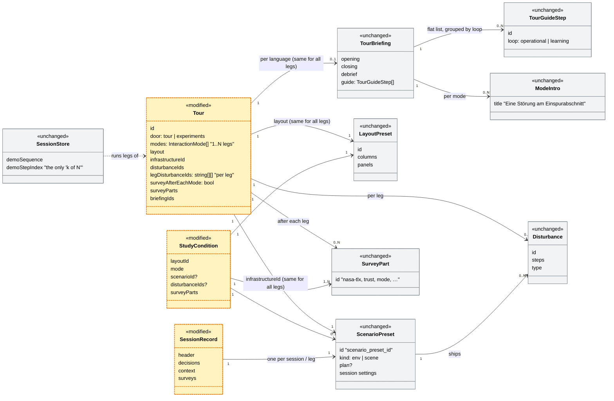
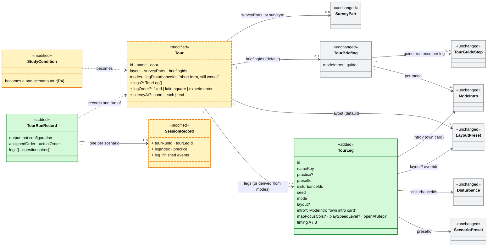
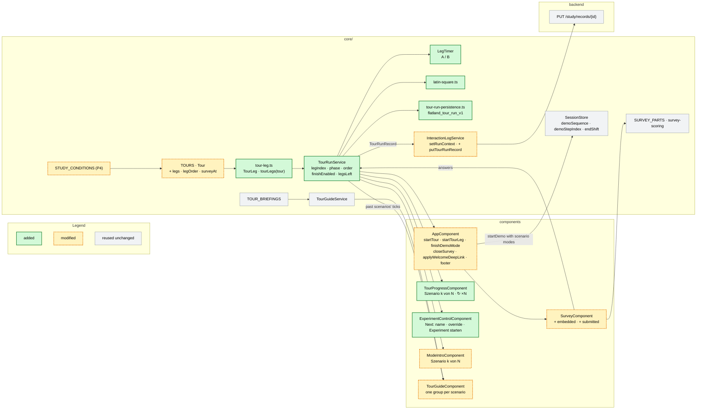

# Experiment workflow — tutorial, four scenarios, questionnaire, one record

> **Status:** Plan, 2026-10-26 (rewritten on the `TourLeg` model).
> The open questions in §9 need answers before P1.
> **Issue:** [#131](https://github.com/flatland-association/flatland-ui-hub/issues/131)
> ("Ablauf für Experiment definieren und implementieren"). This covers only the
> technical part, not the briefing of the dispatchers.
> **Builds on:** [scenario-infrastructure-gallery.md](scenario-infrastructure-gallery.md)
> §1 (vocabulary) and §4.6–4.7 (Tour and Experiment; this plan diverges from
> §4.7 on purpose, see §2);
> [tours-experiments-cleanup.md](tours-experiments-cleanup.md) §3 (questionnaire);
> [interaction-logging-plan.md](interaction-logging-plan.md) (the session record);
> [live-tours-shift-rounds.md](live-tours-shift-rounds.md) (legs).

---

## 1. What the issue asks for

1. **Intro / tutorial**, led by the experimenter (Versuchsleiterin).
2. **Start a scenario.** The experimenter selects it by name; there are 4 scenarios in randomised order.
3. **Run the scenario.**
4. **"Finish scenario"** (a click) starts the next one. The button is enabled only after time **A**. After time **B** the next scenario starts by itself. This repeats until all 4 have run.
5. **Questionnaire** after the last scenario.
6. **Finish**, and the JSON is saved automatically.

The implementation items are scenarios as objects, questionnaires as objects,
and the experiment as an object made of a sequence of both plus the save step.
Optionally the experiment can be attached to a view, so nobody has to pick the
view separately.

## 2. Short answers to the three questions

**How general?** As little as #131 needs. The experiment *is* a `Tour`. A tour
already has the Experiments door (`door: 'experiments'`), a layout, survey parts
and a fresh session per leg. What it lacks is an explicit leg: today a leg is
only position *k* in `modes` and `legDisturbanceIds`, so tours count modes, the
preset, layout and briefing are the same for every leg, and a leg has no name
and no timers. The plan adds **one entity, `TourLeg`**, between `Tour` and
`TourBriefing`, plus three optional fields on `Tour`:

- `legs` is the explicit list of legs.
- `legOrder` is `fixed`, `latin-square` or `experimenter`.
- `surveyAt` is `none`, `each` or `end`.

The tutorial is a `TourLeg` with `practice: true`, not a separate field.

**Vocabulary: leg, shift, Szenario.** The entity is named after the code's
existing word for exactly this (`legDisturbanceIds`, `legIntros`,
`startTourLeg()`, `ShiftRecord.leg`). The issue's word "Szenario" stays the
UI label. As code, "scenario" already means three other things (§2 below), and
a code key that differs from the German label is the repo's pattern (code key
`disruption` for "Störungsszenario", panel type `scenario` titled
"Strategien").

| Layer | Name in code | Shown in the UI as | Meaning |
|---|---|---|---|
| Configuration | `TourLeg` (`Tour.legs`) | "Szenario k von N" (stepper, intro card, finish button) | A planned slot in the tour's sequence: what the participant works on next |
| Runtime | the shift: `endShift()`, `shiftEnded`, `shiftReviewOpen` | "Schicht beenden", "Schichtabschluss" | The working period on one session, from start to "Schicht beenden" or the episode's end |
| Record | `ShiftRecord` in `TourContextService.shiftHistory()`, extended (§6) | "Schicht 1" in the debrief | What happened in one finished shift |

An explicit leg is always played on a fresh session (§5), so one leg = one
session = one shift = one `SessionRecord`. The backend's "leg" in
`policies/goal_based_policies/` (a train's route between two stops) is an
unrelated railway meaning and does not meet this one.

The flow is fixed: practice leg (optional) → legs → questionnaire →
save. That is exactly #131, and there is no step language, no branching and no
general workflow engine. The one variant the issue hints at, a questionnaire
after each scenario, is `surveyAt: 'each'`.

**Divergence from gallery §4.7, "Experiment is not a bigger Tour".** That
section rejects a study flag on `Tour`, because fields a study needs (pinned
seeds, timing, a participant id) could then be forgotten without anything
objecting. This plan takes the simpler model anyway, and moves the guard from
the type system into a **spec test** (`tours.spec.ts`). Every tour in the
Experiments door that has `legs` must pin a seed, timing and a name on
each scenario and must set `surveyAt`, and `latin-square` needs at least two
non-practice legs. If a later study needs a free step order, the
discriminated union from §4.7 is still the way to go, and `TourLeg`
carries over to it unchanged (§9 (Q10)).

**Can Tutorial and Fragebogen map onto existing concepts?** Yes, both of them.

| Issue | Existing concept | Where | Gap |
|---|---|---|---|
| Tutorial | **Tour leg** with a briefing and the guide strip | `core/demo/tours.ts`, `tour-briefings.ts`, `TourGuideService` | It runs self-paced. As a `practice` scenario it ends only when the experimenter presses "Experiment starten" (§5.1) |
| Scenario | **Tour leg** (implicit) and **StudyCondition** | `tours.ts` (`modes`, `legDisturbanceIds`), `study-conditions.ts` | Legs are counted as modes and have no name, no own preset or layout, no identity that survives reordering (`legIntros` is by position), and no timers. That is what `TourLeg` adds |
| Fragebogen | **SurveyConfig / `SURVEY_PARTS`** + `features/survey/` | `core/survey/survey-configs.ts`, `survey-scoring.ts` | Only "after each leg" exists (`surveyAfterEachMode`), and the survey downloads its own JSON. It needs `surveyAt: 'end'` and must write into the run record |
| JSON save | **SessionRecord** + `/study/records` sink | `core/interaction-log/`, `backend/app/api/study.py` | One file per *session*. Nothing groups the 4 sessions of one participant |
| "Ansicht" | **Layout preset** (`LAYOUT_PRESETS`) | `core/layout/layout-presets.ts` | None. `Tour.layout` already pins it, and a scenario can override it |

The "optional" item (attach the experiment to a view) therefore costs nothing.

**Is there a scenario abstraction?** Partly, and the word needs clarifying.
There is no first-class scenario entity. What exists:

- `scenario_presets.py` `_PRESETS` is a hardcoded registry of
  *environments*: network + traffic + optional plan, disturbance files and
  pinned session settings. Its id is `scenario_preset_id`.
- Disturbance files are the scripted incidents. The UI calls them
  "Störungsszenario", and their code key is `disruption`.
- The `scenario` panel type, `/hmi/scenarios` and `ScenarioBuilder` are
  **policy alternatives**, a different thing altogether.
- `Tour` and `StudyCondition` pin mode, layout, disturbances and map focus one
  level up.

In the gallery plan's vocabulary (§1), what #131 calls a **"Szenario" is a
Setup plus a Layout, a Mode and an intro**: one run the participant works
through. This plan names it **`TourLeg`** (UI: "Szenario"). It is a
*reference* to existing entities and not a new world layer. §9 (Q1) asks what
actually varies between the four.

## 2a. Checked against today's "Geführtes Experiment"

What a facilitator runs today from the Experiments door: the "Geführtes
Experiment (mit Umfrage)" entry is the **Tour** `colearning-experiment`
(`door: 'experiments'`, `core/demo/tours.ts`). It runs like this:

1. The mode intro "Co-Learning · Walensee: **Eine Störung am
   Einspurabschnitt**" (`tour-briefings.ts`, `modeIntros['co-learning']`) is
   followed by the "Szenario starten" button (`dismissDemoIntro`).
2. The tour guide shows the **Betrieb** group, with "1 Konflikt erkennen",
   "2 …" and so on, then the **Lernen** group.
3. Then comes "Umfrage nach der Session →" (because of `surveyAfterEachMode: true`).

**"Betrieb" is not an iteration over scenarios.** It is the label of the
guide's *operational loop* (`tourUi.guide.loop.operational`, `TourGuideStep.loop
= 'operational'`), the first five guide steps *inside one scenario*. "Lernen"
(`loop = 'learning'`) is the rest. Both groups belong to a single run.
`TourGuideService` clears them on every new session id, so with several
scenarios the Betrieb/Lernen list starts again for each one. The "Betrieb"
items therefore cannot carry the "scenario 1 of N" information. It needs its
own indicator (§5.4), and the guide strip needs an outer level, one group per
scenario (§5.5).

**Is there a "current scenario, k of N" concept?** Only in part, and it counts
*modes*, not scenarios:

| Existing piece | What it counts | Where shown | Limitation for N scenarios |
|---|---|---|---|
| `SessionStore.demoSequence` / `demoStepIndex` / `demoIsLast` | legs of a tour, one per entry of `Tour.modes` | footer "`Modus 2/3`" (`footer.progressTitle`), mode intro "`Modus 1 von 3`" (`labels.stepPrefix/stepOf`) | Labelled as *mode*. A leg is "a mode", not "a scenario" |
| `Tour.legDisturbanceIds` + `AppComponent.startTourLeg()` | one fresh session per leg, with that leg's disturbances | — | Same preset, layout, briefing for every leg. Only the disturbances vary |
| `Tour.surveyAfterEachMode` | — | the survey button after each leg | It is all or nothing **per leg**. "Survey once, after the last scenario" cannot be expressed |
| `StudyCondition` | exactly one scenario | — | No sequence at all |

The closest thing that works today is a hack that `colearning-advanced`
already uses for two shifts: `modes: ['co-learning', 'co-learning']` with one
`legDisturbanceIds` entry per shift. It gives N scenarios of the same network,
but the footer says "Modus 2/2", the survey comes after every leg or never,
and there are no A/B timers and no names. The concept is there **implicitly as
"leg"**. `TourLeg` makes it explicit, and mode becomes a property of each
scenario rather than the thing being counted.

### Data model today (as built)



**Legend:** yellow, dashed border + `«modified»` = **modified by this plan**
(`Tour` gets the three optional fields, `StudyCondition` becomes a
one-scenario tour in P4, `SessionRecord` gets new header fields and events) ·
grey + `«unchanged»` = **unchanged**. Nothing in today's model is removed.

| Class | Status | What it is | Example in «Geführtes Experiment (mit Umfrage)» | Modification by this plan | Where |
|---|---|---|---|---|---|
| `Tour` | **modified** | A guided walk as data: modes in order (one leg each), layout, preset, disturbances per leg, survey after each leg, briefings, live variant, start-screen door | Start screen, door "**Experimente**": the entry "**Geführtes Experiment (mit Umfrage)**" → "Co-Learning experiment (with survey)" (`colearning-experiment`) | P1: optional `legs`, `legOrder`, `surveyAt`. Without `legs` a tour is read as one `TourLeg` per entry in `modes`, so every existing tour runs unchanged | `core/demo/tours.ts` (`Tour`, `TOURS`) |
| `StudyCondition` | **modified** | One prepared experiment run: layout, mode, optional fixed preset, disturbances, map focus, survey parts | Not used by this run. It is the other kind of entry in the same door: "**Studienbedingung**", e.g. "Co-Learning · User Study 3" | P4: each condition becomes a one-scenario tour in the Experiments door. `#/experiment/...` deep links keep resolving | `core/demo/study-conditions.ts` (`StudyCondition`, `STUDY_CONDITIONS`) |
| `ScenarioPreset` | unchanged | An environment: pickled env or scene, plus optional plan, disturbance files and pinned session settings. Identified by `scenario_preset_id` | The Walensee stretch on the track map: "PF–CH · WN↔WAL conflict (long approach)", three trains, one single-track section | None. A `TourLeg` references it by `presetId` | backend `scenario_presets.py` (`_PRESETS`, `list_presets()`); frontend `core/models.ts` (`ScenarioPreset`) |
| `Disturbance` | unchanged | A scripted incident (`train_delay`, `area_block`, `warning`) at fixed steps. The UI calls it "Störungsszenario" and its code key is `disruption` | The breakdown in the single-track section at step 28: "Interview: Zug bleibt im Einspurabschnitt stehen (+12 Schritte)" | None | backend `disturbances.py` (`parse_disturbance`, `DisturbanceScheduler`); files in `fixtures/*/disturbances*/` |
| `LayoutPreset` | unchanged | Which panels sit in which zone. This is the "Ansicht" of the issue | The whole working screen: situation on the left, track map / ZWL / timetable in the centre, Co-Learning modules with a violet edge on the right ("Co-Learning · Interview") | None. Tours and scenarios reference preset ids | `core/layout/layout-presets.ts` (`LAYOUT_PRESETS`) |
| `TourBriefing` | unchanged | The pages around a tour: opening, closing, debrief, per-mode intros, the guide steps as one flat list, module badges | Everything around the run: the intro card, the guide strip, and after the shift the "**Schichtbilanz**". This tour has no opening or closing page | None. A `TourLeg` can point to its own briefing | `core/demo/tour-briefings.ts` (`TourBriefing`, `TOUR_BRIEFINGS`) |
| `ModeIntro` | unchanged (data) | The intro card before a leg, with the "Szenario starten" button | The card before the run: "Co-Learning · Walensee", "**Eine Störung am Einspurabschnitt**", "Modus 1 von 1", button "**Szenario starten**" | The data stays. Its *component* shows "Szenario k von N" for a tour with explicit legs (§5.4) | `core/demo/mode-intro-configs.ts` (`ModeIntro`, `MODE_INTROS`), or `TourBriefing.modeIntros` |
| `TourGuideStep` | unchanged (data) | One guide step inside one scenario, grouped by `loop`: `operational` ("Betrieb") or `learning` ("Lernen") | One item in the guide strip, e.g. "**Betrieb · 1 Konflikt erkennen**" or "Lernen · 7 Schichtbilanz" | The type stays. The strip gains an outer level, one group per scenario (§5.5) | `core/demo/tour-briefings.ts` (`TourGuideStep`, `GuideLoop`) |
| `SurveyPart` | unchanged | One questionnaire block (NASA-TLX, trust, understanding, UEQ-S, mode items, open feedback) | One section of "**Post-session survey — Co-Learning**", e.g. "Workload (NASA-TLX, raw)" | None. `Tour.surveyParts` references part ids | `core/survey/survey-configs.ts` (`SurveyPart`, `SURVEY_PARTS`) |
| `SessionStore` | unchanged | Runtime state of the session. `demoSequence`/`demoStepIndex` are today's only "k of N", and they count modes | The footer "Co-Learning experiment (with survey) · **Modus 1/1** · Co-Learning" and "Schritt: 28 / 180" | None. `demoSequence` is fed with the scenarios' modes, so `demoStepIndex` is the scenario index. No new mode flags | `core/session.store.ts` (`demoSequence`, `demoStepIndex`, `endShift`) |
| `SessionRecord` | **modified** | The record of one session: header, decisions, context events, surveys, outcome | What "**Sitzungsdaten exportieren**" in the footer downloads, one JSON per run | P1: header gets `tourRunId`, `tourLegId`, `legIndex`, `practice`. Context events get `leg_finish_enabled`, `leg_finished`, `order_override` | `core/interaction-log/session-record.ts` (`SessionHeader`, `ContextEventType`, `SessionRecord`) |
| *Mode* (`InteractionMode`) — not a class | unchanged | **Who decides.** A value, not an entity: `'recommendation' \| 'co-learning' \| 'director'` (Recommendation: the AI recommends and the human decides; Co-Learning: the AI offers neutral options, the human decides and reflects; Director: the AI acts on directives and the human supervises). It has no id, fields or file of its own, and its behaviour lives in the panels that check it (`panel-mode-matrix.md`). At runtime it is the one signal `SessionStore.interactionMode`. In data it appears only as an attribute: `Tour.modes` (one leg per entry), `StudyCondition.mode` | "**Co-Learning**": eyebrow "Co-Learning · Walensee" on the intro card, footer "Modus 1/1 · **Co-Learning**", the violet Co-Learning modules, options without ranking or «empfohlen», and the survey title "Post-session survey — **Co-Learning**" | None. The repo rule "keep mode semantics in the `InteractionMode` union, no parallel flags" applies | `core/events/event-types.ts` (`InteractionMode`); `core/session.store.ts` (`interactionMode`, `setInteractionMode`) |

### Data model proposed (this plan)



**Legend:** green + `«added»` = **added** · yellow, dashed border +
`«modified»` = **modified** · grey + `«unchanged»` = **reused unchanged**.
Colours are set with plain `style` lines (no `classDef`), so they render in
IDE previews too. The stereotypes repeat the status for renderers without
colour.

| Class | Status | What it is | Example in «Geführtes Experiment (mit Umfrage)» | Modification / content | Where |
|---|---|---|---|---|---|
| `Tour` | **modified** (P1) | The experiment itself: which scenarios, in which order, with which questionnaire, behind which start-screen door | "**Geführtes Experiment (mit Umfrage)**" in the "Experimente" door, now running two scenarios before one survey | New optional `legs`, `legOrder`, `surveyAt`. `layout` and `briefingIds` become defaults for the scenarios. `modes` and `legDisturbanceIds` stay as the short form | `core/demo/tours.ts` |
| `TourLeg` | **added** (P1) | One explicit leg, i.e. one "Szenario" as #131 means it: preset + disturbances + mode, optionally its own layout and intro card, with a name, a seed and timers A/B. A `practice` leg is the tutorial | Today's single run "**Eine Störung am Einspurabschnitt**" becomes "Szenario 1 von 2"; a second shift on the same stretch becomes "Szenario 2 von 2" | New. `id`, `nameKey`, `practice?`, `presetId`, `disturbanceIds`, `seed`, `mode`, `layout?`, `intro?`, `mapFocusCols?`, `playSpeedLevel?`, `openAtStep?`, `timing` | `core/demo/tour-leg.ts` |
| `TourRunRecord` | **added** (P2) | The output of one run of the tour by one participant: one file wrapping the per-scenario session records and the questionnaire. Not configuration | One JSON per participant run, saved automatically. Today "Sitzungsdaten exportieren" and the survey's own download give separate files | New. `tourId`, `participantId`, `latinSquareRow`, `assignedOrder`, `actualOrder`, per scenario the finish reason, timings and session record, plus the questionnaire answers and scores | `core/interaction-log/tour-run-record.ts` |
| `StudyCondition` | **modified** (P4) | Today's single-run experiment condition | "**Studienbedingung**" entries such as "Co-Learning · User Study 3" in the same door | Becomes a one-scenario tour. The interface stays as an alias for the deep links and the picker | `core/demo/study-conditions.ts` |
| `SessionRecord` | **modified** (P1) | The per-session record | "**Sitzungsdaten exportieren**", now one record per scenario | New header fields and context events as in the table above | `core/interaction-log/session-record.ts` |
| `TourBriefing` | reused unchanged | See the table above | The same intro card and guide strip as today, for every leg | Referenced by `Tour.briefingIds` only. Its `legIntros` (by position) are read into derived legs; explicit legs carry their own `intro` instead, so it travels with the leg when the Latin square reorders them | `core/demo/tour-briefings.ts` |
| `ModeIntro` | reused unchanged (data) | See the table above | "**Eine Störung am Einspurabschnitt**", now with "Szenario 1 von 2" instead of "Modus 1 von 1" | Shown before each leg: the leg's own `intro`, else the briefing's `modeIntros[mode]` | `core/demo/mode-intro-configs.ts` / `TourBriefing.modeIntros` |
| `TourGuideStep` | reused unchanged | See the table above | "**1 Konflikt erkennen**", now inside the group "Szenario 1 von 2" | Unchanged. The tour briefing's guide runs once per leg and forms that leg's group in the strip (§5.5) | `core/demo/tour-briefings.ts` |
| `ScenarioPreset` | reused unchanged | See the table above | The Walensee stretch on the track map, unchanged | Referenced by `TourLeg.presetId` | backend `scenario_presets.py` |
| `Disturbance` | reused unchanged | See the table above | "Zug bleibt im Einspurabschnitt stehen" in scenario 1, "Folgezug läuft auf" in scenario 2 | Referenced by `TourLeg.disturbanceIds` | backend `disturbances.py` |
| `LayoutPreset` | reused unchanged | See the table above | The same working screen ("Co-Learning · Interview") for both scenarios | Referenced by `Tour.layout` and the optional `TourLeg.layout` | `core/layout/layout-presets.ts` |
| `SurveyPart` | reused unchanged | See the table above | "Workload (NASA-TLX, raw)" and the other sections, now asked once at the end | Referenced by `Tour.surveyParts` | `core/survey/survey-configs.ts` |
| *Mode* (`InteractionMode`) — not a class | reused unchanged | See the table above: who decides, as a value and not an entity | Both scenarios of the example are "**Co-Learning**". The intro card says "Szenario 1 von 2" and names the mode in its eyebrow. If the mode varied (§9 (Q1)), the footer would read "Szenario 2/4 · Recommendation" | Now an attribute of each scenario (`TourLeg.mode`), no longer the thing being counted | `core/events/event-types.ts` (`InteractionMode`) |

### Worked example: the "Geführtes Experiment" through both models

The examples follow one run of today's "Geführtes Experiment (mit Umfrage)".
Quoted text is what the UI shows (German UI unless marked EN), and the ids are
the real ones from the repo. The text after "·" is optional attribute detail.

**As it runs today**

| Class | Example instance | What the person sees · attribute detail |
|---|---|---|
| `Tour` | `colearning-experiment` | Experiments door ("**Experimente**"), listed as "**Geführtes Experiment (mit Umfrage)**", named "**Co-Learning experiment (with survey)**". · `door: 'experiments'`, `modes: ['co-learning']` (one leg), `surveyAfterEachMode: true`, `expectedMinutes: 12` |
| `StudyCondition` | `preset-colearning-study3` (not used by this run) | The *other* kind of entry in the same door, "**Studienbedingung**", e.g. "**Co-Learning · User Study 3**". · `mode: 'co-learning'`, `scenarioId: 'pf-ch-wn-wal-long-approach'`, `surveyParts: ['nasa-tlx','trust','understanding','open']` |
| `ScenarioPreset` | `pf-ch-wn-wal-long-approach` | "**PF–CH · WN↔WAL conflict (long approach)**": the Walensee stretch Ziegelbrücke–Walenstadt with one single-track section, three trains. · `kind: scene`, ships a `plan`, so the trains follow the plan from step 1; `max_episode_steps: 180` |
| `Disturbance` | `interview-e1-breakdown-single-track` | "**Interview: Zug bleibt im Einspurabschnitt stehen (+12 Schritte)**". The map announces the breakdown at step 28. · `type: train_delay`, `step: 28`, `delay_steps: 12`, `agent_handle: 0`; file in `disturbances_tour_long_approach/` |
| `LayoutPreset` | `preset-colearning-interview` | "**Co-Learning · Interview**": situation on the left, track map / ZWL / timetable in the centre, all Co-Learning modules on the right (violet edge) |
| `TourBriefing` | `colearning-experiment` (DE) | No opening or closing page. It goes straight to the mode intro, and after the shift to "**Schichtbilanz**" and the survey. · `debriefSections: ['shift-summary']`, `reasonDialog: true`, `autoStart: true` |
| `ModeIntro` | `modeIntros['co-learning']` of that briefing | Eyebrow "**Co-Learning · Walensee**", title "**Eine Störung am Einspurabschnitt**", tagline "Die KI zeigt Auswirkungen und Optionen. Du entscheidest und lernst daraus.", button "**Szenario starten**". · step label "**Modus 1 von 1**" (`labels.stepPrefix`/`stepOf`) |
| `TourGuideStep` | `detect` … `shift-summary` (7 steps) | Guide bar with the group "**Betrieb**": "1 Konflikt erkennen", "2 Risiko & Auswirkung", "3 Alternativen", "4 Entscheiden", "5 Umsetzen"; the group "**Lernen**": "6 Reflexion", "7 Schichtbilanz". · `loop: 'operational'` / `'learning'`. Event-Simulation and KI lernt are filtered out for this tour |
| `SurveyPart` | `mode`, `nasa-tlx`, `trust`, … (the Settings selection; the tour sets no `surveyParts`) | Footer button "**Umfrage nach der Session →**" (EN "Post-session survey →") opens "**Post-session survey — Co-Learning**", with sections such as "Workload (NASA-TLX, raw)" and "Trust in the system (Jian)" |
| `SessionStore` | the running session | Footer "**Co-Learning experiment (with survey) · Modus 1/1 · Co-Learning**" and "Schritt: 28 / 180". · `demoSequence: ['co-learning']`, `demoStepIndex: 0`, `interactionMode: 'co-learning'` |
| `SessionRecord` | `flatland-<participant>-<condition>-<run>-<session>.json` | Footer "**Sitzungsdaten exportieren**" and the badge "Auf dem Server gespeichert" when the sink is on. · `header.tourId: 'colearning-experiment'`, `scenarioId: 'pf-ch-wn-wal-long-approach'`, `disturbanceIds: ['interview-e1-breakdown-single-track']` |

**The same tour with two explicit legs before one survey**

Scenario 2 reuses the second shift that `colearning-advanced` already ships
(`advanced-shift2-e1-breakdown-follower`, on the same preset). The scenario
names, the seed and the timer values are placeholders until §9 (Q1) and (Q3) are
answered.

```ts
{
  id: 'colearning-experiment-2x',
  door: 'experiments',
  name: 'Co-Learning experiment, two shifts (with survey)',
  layout: 'preset-colearning-interview',
  briefingIds: { de: 'colearning-experiment', en: 'colearning-experiment' },
  surveyAt: 'end',
  surveyParts: ['mode', 'nasa-tlx', 'ueq-s'],
  legOrder: 'fixed',
  legs: [
    { id: 'wal-single-track', nameKey: 'tourLegs.walSingleTrack', mode: 'co-learning',
      presetId: 'pf-ch-wn-wal-long-approach', disturbanceIds: ['interview-e1-breakdown-single-track'],
      seed: 42, timing: { finishEnabledAfter: { wallSeconds: 300 }, autoAdvanceAfter: { wallSeconds: 480 } } },
    { id: 'wal-follower', nameKey: 'tourLegs.walFollower', mode: 'co-learning',
      presetId: 'pf-ch-wn-wal-long-approach', disturbanceIds: ['advanced-shift2-e1-breakdown-follower'],
      seed: 42, timing: { finishEnabledAfter: { wallSeconds: 300 }, autoAdvanceAfter: { wallSeconds: 480 } } },
  ],
  // not needed: modes, infrastructureId, legDisturbanceIds, surveyAfterEachMode
}
```

| Class | Example instance | What the person sees · attribute detail |
|---|---|---|
| `Tour` | `colearning-experiment-2x` | Experiments door, listed like today's "Geführtes Experiment (mit Umfrage)". Stepper (§5.4): "**[Szenario 1] ─ Szenario 2 ─ Fragebogen ─ Ende**", with "**↻ ×2**" around the scenarios and "**noch 1 Szenario bis zum Fragebogen**" during scenario 1 · `surveyAt: 'end'`, `legOrder: 'fixed'` |
| `TourLeg` | `wal-single-track` | Mode intro "**Szenario 1 von 2**" (instead of "Modus 1 von 1"), title "**Eine Störung am Einspurabschnitt**". The guide strip shows "Szenario 1 von 2" expanded with its Betrieb/Lernen steps, and "Szenario 2" greyed. The button reads "**Szenario abschliessen → Szenario 2**", disabled with a countdown until A · `timing` A = 5 min, B = 8 min (placeholder) |
| `TourLeg` | `wal-follower` | "**Szenario 2 von 2**". The strip shows "Szenario 1 ✓" collapsed and "Szenario 2" expanded at "1 Konflikt erkennen". The button reads "**Szenario abschliessen → Fragebogen**" · `disturbanceIds: ['advanced-shift2-e1-breakdown-follower']` ("Vertiefte Tour, Schicht 2: Zug steht im Einspurabschnitt, Folgezug läuft auf (+20 Schritte)") |
| `TourLeg` (practice) | *(none in this example)*; for #131 e.g. `{ id: 'practice', practice: true, … }` | The stepper starts with "**Einführung**", not counted in "k von N". It ends when the experimenter presses "**Experiment starten**" |
| `ModeIntro` | the briefing's `modeIntros['co-learning']`, shown twice | Same card before each scenario; only the step label changes ("Szenario 1 von 2", "Szenario 2 von 2"). The title stays "Eine Störung am Einspurabschnitt" because neither leg sets its own `intro`; a leg with its own `intro` would get its own title |
| `TourGuideStep` | `detect` … `shift-summary`, once per scenario | Ticked separately in each scenario, because each runs on its own session |
| `SurveyPart` | `mode`, `nasa-tlx`, `ueq-s` | Once, after scenario 2: "**Post-session survey — Co-Learning**" with "Mode-specific questions", "Workload (NASA-TLX, raw)" and "User experience (UEQ-S)" |
| `TourRunRecord` | `flatland-<participant>-colearning-experiment-2x-<runId>.json` | Saved at "Ende" without a click, followed by a thank-you page · `assignedOrder: ['wal-single-track','wal-follower']`, two scenarios with `finishReason: 'clicked' \| 'timeout'`, one questionnaire |
| `SessionRecord` | one per scenario | As today, plus `header.tourLegId: 'wal-single-track'` / `'wal-follower'` and `legIndex: 0 / 1` |
| `ScenarioPreset`, `Disturbance`, `LayoutPreset`, `TourBriefing` | as in the table above | Unchanged. Both legs use the tour's layout and briefing |

### Services and components (this plan)

The runtime side of the same change, with the same colours. It follows the
§7 change inventory.



## 3. Data model

```ts
// core/demo/tour-leg.ts

/** One explicit leg of a tour: one "Szenario" the participant works through. */
export interface TourLeg {
  id: string;                    // stable, logged, never the displayed label
  nameKey: string;               // i18n key (tourLegs.*): what the experimenter selects by
  /** The tutorial: run first, not counted in "k von N", ended by the experimenter (§5.1). */
  practice?: boolean;
  presetId: string;              // scenario_presets.py id
  disturbanceIds: string[];
  seed?: number;                 // required in the Experiments door (spec guard)
  mode: InteractionMode;         // stays in the union, no parallel flag
  layout?: 'system' | string;    // falls back to Tour.layout
  /** Own intro card; else the tour briefing's modeIntros[mode]. Carried by the leg, not by
   *  position, so it survives reordering (the derived form fills it from legIntros[k]). */
  intro?: ModeIntro;
  mapFocusCols?: [number, number];
  playSpeedLevel?: number;
  openAtStep?: number;
  timing?: LegTiming;       // required in the Experiments door (spec guard)
}

export interface LegTiming {
  /** A: "Szenario abschliessen" is disabled until then. */
  finishEnabledAfter: Duration;
  /** B: the next scenario (or the questionnaire) starts by itself. Must be ≥ A. */
  autoAdvanceAfter: Duration;
}
export type Duration = { wallSeconds: number } | { simSteps: number };   // §9 (Q3)

/**
 * The one place that reads a tour's legs. A tour with `legs` returns them;
 * a tour without returns one leg per entry of `modes`, built from
 * `modes[k]`, `legDisturbanceIds[k] ?? disturbanceIds`, `infrastructureId`,
 * `layout` and the briefing's `legIntros[k]`. Legacy legs without
 * `legDisturbanceIds` keep sharing one session, as today (an internal flag of
 * the derived form, not a field anyone authors; see §5, path A).
 */
export function tourLegs(tour: Tour): TourLeg[];

// core/demo/tours.ts: additions to Tour (all optional)
interface Tour {
  // … all existing fields unchanged …
  legs?: TourLeg[];
  legOrder?: 'fixed' | 'latin-square' | 'experimenter';   // default 'fixed', §4
  /** Replaces surveyAfterEachMode when set: true → 'each', false → 'none'. */
  surveyAt?: 'none' | 'each' | 'end';
}
```

- **Saving is behaviour, not a field.** Every tour run from the Experiments
  door writes a `TourRunRecord` when it ends (§6), with or without a
  questionnaire. This answers the issue's question whether saving is part of
  the questionnaire object: no.
- **The fixed flow** is practice legs → the other legs in the chosen
  order → questionnaire (`end`) → save. With `each`, the questionnaire runs
  after every non-practice leg.
- **The spec guard** (`tours.spec.ts`, as in §2) replaces the type-level
  safety of gallery §4.7.

## 4. Randomisation and selection by name

The issue says the experimenter selects the scenario *by name* and that the
four scenarios are *randomised*. These two only fit together if the system
proposes the order and the experimenter confirms or overrides it:

- **`latin-square`** is the recommended order for #131: a balanced 4×4 Latin
  square, with the row chosen by participant number. It is deterministic,
  reproducible and counterbalanced. A random shuffle is none of these at
  n≈12–20. It is the `modeAssignment` idea from gallery §4.7, applied to
  scenarios. Practice scenarios are not part of the square.
- The experimenter strip between scenarios shows **"Next: ⟨name⟩"** with the
  remaining scenarios as a picker. A deviation from the proposed order is
  allowed and is logged as `order_override`.
- `experimenter` order (pure manual choice) and `fixed` exist for pilots.
  `fixed` is the default, so existing tours keep their order.

The assigned order, the participant row and every override go into the
`TourRunRecord`.

## 5. The runner

`TourRunService` (`core/demo/tour-run.service.ts`) runs one tour with
explicit legs. It is a signal-based state machine:

- **State:** `tour`, `legs` (resolved and ordered), `legIndex`,
  `phase: 'intro' | 'running' | 'finishing' | 'questionnaire' | 'done'`.
- **Derived:** `finishEnabled`, `remainingToAutoAdvance`, `legCount`,
  `legsLeft`, `nextStepKind`.
- **Finished legs:** not a list of its own. At each leg's end the service
  calls `TourContextService.recordShift()` with the extended `ShiftRecord`
  (§6), which also holds the leg's guide ticks (§5.5).

It drives the **existing** paths rather than duplicating them:

- `startDemo()` on the `SessionStore` gets the legs' modes. So
  `demoSequence`/`demoStepIndex`, and everything that already reads them,
  keep working, and `demoStepIndex` is the leg index (the position).
- `AppComponent.startTourLeg()` already creates a fresh session per leg. It
  now reads its preset, disturbances, layout, mode, map focus, play speed and
  open step from the current `TourLeg`.
- `finishDemoMode()` moves to the next leg or to the questionnaire via
  the run service.

Ordinary tours without `legs` take the same path through
`tourLegs()` and behave as today. They have no timers, no stepper, and
nothing saved beyond the session record.

**Two ways to the next leg exist today, and explicit legs always take the
second** (checked 2026-10-26):

| Path | When | Same session? | Kept from the previous leg |
|---|---|---|---|
| **A: survey, then reset** | `surveyAfterEachMode: true`: `closeSurvey()` → `advanceDemo()` + `store.reset()`. Only `three-modes-original` has several legs on this path | **yes**, the episode is replayed from step 0 | Everything keyed on the session id: the guide ticks (`TourGuideService`), `shiftStartedAt` (so "KI lernt" counts earlier legs' cards), and the session record (all legs in **one** `SessionRecord`, told apart only by `mode_change`). Reset: env, overrides, notifications, decision log, impact, contentions, co-learning feedback, `shiftEnded` |
| **B: fresh session** | no survey and `legDisturbanceIds`: `finishDemoMode()` → `advanceDemo()` + `startTourLeg()` → `createSession()`. `colearning-advanced` | **no** | Nothing implicit. Continuity is explicit through `shiftHistory()` (`ShiftRecord`) and the browser-wide learning cards and operator profile |

- **Rule: an explicit leg always starts on path B,** so that one leg = one
  session = one shift = one `SessionRecord`, with the guide and
  `shiftStartedAt` starting fresh. Legacy tours keep path A (§9 (Q12)).
- **Gap to close:** `closeSurvey()` calls `reset()` and never `startTourLeg()`.
  A tour with a survey after each leg *and* per-leg disturbances would replay
  leg 1's incident instead of starting leg 2's. No tour combines the two today,
  which is why it has not shown, but `surveyAt: 'each'` would hit it. During a
  run, `closeSurvey()` therefore hands over to `TourRunService`, which starts
  the next leg through `startTourLeg()` (§7.2).

### 5.1 Experimenter-led tutorial (practice leg)

A `TourLeg` with `practice: true`. Differences from the other scenarios:

- **No auto-ticking ends it, and neither does a timer.** The guide strip
  still highlights steps, but only the experimenter's "Experiment starten"
  (`ExperimentControlComponent`) moves on. That control is not offered to the
  participant (§9 (Q4): same screen or second device).
- Its session is logged with `practice: true`. It is not counted in "k von N"
  and stays out of the Latin square, so analysis can drop it.

### 5.2 Timers A and B

- The timer starts when the session becomes interactive. That is after the mode
  intro (`dismissDemoIntro`), not at `createSession`, because the backend
  start takes several seconds on the corridor.
- **Before A**, "Szenario abschliessen" is shown but disabled, with a
  countdown (i18n key). **Between A and B** it is enabled. **At B** the runner
  calls the same finish path as the click, with `reason: 'timeout'` instead of
  `'clicked'`.
- **The episode ends before A** (`episode_done`): proposal: the shift review
  stays up and the button enables at once, since nothing is left to do. §9 (Q5).
- **Pause:** wall-clock time keeps running while the simulation is paused
  (proposal, §9 (Q3)). Otherwise B never fires on a paused run.
- **Logged:** `leg_finish_enabled` and
  `leg_finished{reason, elapsedWall, elapsedSteps}`.
- **Guardrail:** do not touch the scenario-refresh throttling or
  `_recordTrajectory`. The timer only reads `episode_done` and the step
  counter.

### 5.3 Robustness (a run must survive a reload)

The run state, including `shiftHistory()` with the finished legs' guide
ticks, goes to `localStorage` (`flatland_tour_run_v1`) after every transition. Every access is
wrapped in try/catch. A reload during scenario 3 offers to resume at scenario
3 on a fresh session of the same scenario. It does not replay, and the break is
logged. Without this, one browser refresh loses a participant.

### 5.4 Showing the iteration: "Szenario k von N", and how many are left

The participant and the experimenter both need to see three things:

1. that there is a loop over scenarios,
2. where in it they are,
3. how many runs are left before the questionnaire.

None of today's indicators can do it (§2a). The plan adds one indicator with
three placements. All of them are shown for a tour with explicit `legs`
and driven by `TourRunService.legIndex`.

**1. Stepper.** This is the new `TourProgressComponent`, a thin bar at the top
of the working screen, above the guide strip:

```
 Einführung ✓ ─ Szenario 1 ✓ ─ [Szenario 2] ─ Szenario 3 ─ Szenario 4 ─ Fragebogen ─ Ende
                              ▲ current            noch 2 Szenarien bis zum Fragebogen
```

- The scenarios are drawn as a bracketed group with a repeat mark (↻ ×4), so
  the loop is visible as a loop and not just as a long list.
- With `surveyAt: 'end'` the questionnaire sits *after* the bracket; with
  `each` it sits inside it. The bracket shows the difference.
- Participants see numbers, not scenario names, because names could prime
  them (§9 (Q8)). The experimenter strip shows the names.

**2. The guide strip** shows one group per scenario (§5.5), so it repeats the
"k of N" at step level.

**3. Mode intro, footer and finish button.**

- The intro's "Modus 1 von 3" becomes "Szenario 2 von 4". The mode is still
  named in the intro's eyebrow (`wp`), which matters when it changes between
  scenarios.
- The footer's "`Modus k/N`" (`footer-demo-progress`) becomes "Szenario k/N ·
  ⟨mode⟩".
- The finish button names what comes next: "Szenario abschliessen → Szenario
  3", and on the last one "Szenario abschliessen → Fragebogen".

Tours without explicit `legs` keep "Modus k von N", because their legs
*are* modes.

### 5.5 The guide strip: one group per scenario

**How it works today** (checked 2026-10-23):

- **The two loops are hardcoded.** `GuideLoop = 'operational' | 'learning'`
  (`core/demo/tour-briefings.ts`) is a closed union. The group labels are the
  i18n keys `tourUi.guide.loop.operational` ("Betrieb") and
  `tourUi.guide.loop.learning` ("Lernen").
- **The step ids are hardcoded as well.** `GuideStepId` is a closed union of
  nine ids (`detect`, `assess`, `alternatives`, `decide`, `execute`, `reflect`,
  `shift-summary`, `event-simulation`, `ai-learns`). What *ticks* each step is
  code: `TourGuideService.reached` has one condition per id.
  - `detect`: a malfunction or an impact.
  - `assess` and `alternatives`: an impact.
  - `decide`: a human decision.
  - `execute`: the sim has moved past that decision.
  - `reflect`: a rationale.
  - `ai-learns`: a learning card since the shift started.
  - The debrief steps are ticked by `markDone()`.
- **Which steps appear, in which order, and with which title and hint** is
  data. Each briefing has a flat `guide: TourGuideStep[]`. A briefing can
  filter it (the Geführtes Experiment drops `event-simulation` and
  `ai-learns`) or override hints.
- **Groups are derived, not configured.** `TourGuideComponent.groups` walks the
  flat list and starts a new group whenever `loop` changes. Interleaving
  therefore *renders* (operational, learning, operational would give "Betrieb ·
  Lernen · Betrieb"), and numbering runs on across groups (`n = i + 1`).
- **A repeated loop within one list cannot work.** Progress is a
  `Set<GuideStepId>`, and `reached` reads session-wide signals. A second
  "Konflikt erkennen" would share the id `detect` with the first, so it would be
  ticked the moment the first one is. `current` is "the first step in list
  order not yet done", so the order is a display order, not an enforced
  sequence.
- **Progress resets on every new session id.**

**What #131 needs is one more level: scenario → Betrieb/Lernen → steps.** It
comes almost for free from `TourLeg`, because every explicit leg runs on its
own session and the briefing's guide is run once per leg. The per-session
reset that is a problem for a flat list is exactly right per leg.

```
Szenario 1 ✓  (collapsed)
Szenario 2 von 4 · Betrieb  ●1 Konflikt erkennen  2 Risiko & Auswirkung … 5 Umsetzen
                 · Lernen    6 Reflexion  7 Schichtbilanz
Szenario 3   Szenario 4  (greyed)
```

- `TourGuideService` stays unchanged: it tracks the current scenario's steps
  as today.
- When a leg finishes, `TourRunService` stores its ticks in that leg's
  `ShiftRecord` (`guideDone`), so the finished legs can show "✓" (or how far
  they got).
- `TourGuideComponent` renders the outer level: past scenarios collapsed,
  the current one expanded with today's groups, and future ones greyed.
- `GuideLoop`, `GuideStepId`, `TourGuideStep` and `TourBriefing` are not
  changed.

**Not covered:** repeated Betrieb rounds *within one* scenario, one per
conflict (Olten has several). That would need progress keyed per round and
`reached` relative to a round start. It is §9 (Q9), and not needed for #131.

## 6. The record: one file per participant run

Today there is one `SessionRecord` per session, plus a separate survey
download. A tour run from the Experiments door adds an envelope around them.

**Per leg it builds on `ShiftRecord`,** the record that `colearning-advanced`
already keeps per shift in `TourContextService.shiftHistory()` (leg, session,
the run as played, decisions, confirmed rules, applied rule). It gains
optional fields: `tourLegId` (the leg's identity; `leg` stays the position,
which differs once the Latin square reorders), `practice`, `finishReason`,
`enabledAt`, `finishedAt` and `guideDone`. Today only the debrief calls
`recordShift()`, and only for multi-shift tours. The run service now calls it
at the end of every leg, so `recordShift()` merges by `sessionId` instead of
appending twice.

```ts
// core/interaction-log/tour-run-record.ts
interface TourRunRecord {
  schema: 'flatland-tour-run-record/1';
  tourRunId: string; tourId: string; participantId: string; latinSquareRow: number | null;
  assignedOrder: string[]; actualOrder: string[];   // TourLeg ids, practice excluded
  startedAt; endedAt; appVersion; backendVersion;
  legs: Array<ShiftRecord & { record: SessionRecord }>;   // from shiftHistory(), extended fields required here
  questionnaires: Array<{ afterLegId: string | null; answers; scores }>;  // survey-scoring.ts, unchanged
}
```

- **"Save automatically" at the end:** the main path writes to the backend
  sink (`PUT /study/records/{tourRunId}`, already atomic and one file per id) if
  `study_sink_enabled` is on. A browser download of the same JSON is the
  fallback and the safety copy. The survey's submit click is the user gesture
  that lets the download through without a dialog. The per-session records
  keep autosaving as they do now.
- The survey component gets an "embedded" mode: it hands its answers to the
  run service and does not download them itself.
- File name: `flatland-<participant>-<tour>-<runId>.json`, in line with the
  existing pattern.
- **Blocker inherited from the logging plan §6.3:** consent and free-text
  handling need an owner before the server sink is used with real
  participants.

## 7. Change inventory: what is added, what is modified

Paths are under `frontend/src/app/` unless marked otherwise. The phase
column refers to §8.

### 7.1 Added (new files and symbols)

| Phase | File | Symbol | Kind | Purpose |
|---|---|---|---|---|
| P1 | `core/demo/tour-leg.ts` (+ spec) | `TourLeg`, `LegTiming`, `Duration`, `tourLegs()` | types + function | The one new entity (§3), and the single place that reads a tour's legs, explicit or derived from `modes` |
| P1 | `core/demo/tour-run.service.ts` (+ spec) | `TourRunService` | service (root) | The state machine from §5. Signals `tour`, `legs`, `legIndex`, `phase`, `finishEnabled`, `remainingToAutoAdvance`, `legCount`, `legsLeft`, `nextStepKind`. Methods `start(tour, participantId)`, `startLeg()`, `finishLeg(reason)`, `completeQuestionnaire(answers, scores)`, `finish()`, `abort()`, `overrideNext(id)` |
| P1 | `core/demo/leg-timer.ts` (+ spec) | `LegTimer` | class (pure, injectable clock) | Timers A/B from §5.2, apart from the run service so they can be tested with a fake clock (episode done before A, pause, B = A) |
| P1 | `features/tour-progress/tour-progress.component.ts` (+ html/scss) | `TourProgressComponent` | component | The stepper from §5.4 |
| P1 | `public/i18n/{en,de,fr}.json` | keys under `tourRun.*`; scenario names under `tourLegs.*` | i18n keys | Finish button with its target, countdown, auto-advance notice, "Szenario k von N", "noch k Szenarien bis zum Fragebogen", "Next: ⟨name⟩", "Experiment starten", thank-you page, the scenario names (`nameKey`). A separate namespace, because `tours.*` is keyed by tour id |
| P2 | `core/interaction-log/tour-run-record.ts` (+ spec) | `TourRunRecord`, `buildTourRunRecord()`, `tourRunRecordFileName()` | types + functions | The envelope from §6 |
| P2 | `core/demo/tour-run-persistence.ts` | `saveRunState()`, `loadRunState()`, `clearRunState()`, key `flatland_tour_run_v1` | functions + constant | Resume after a reload (§5.3) |
| P3 | `core/demo/latin-square.ts` (+ spec) | `balancedLatinSquare(n)`, `orderFor(row, legIds)` | functions | The counterbalanced order from §4 |
| P3 | `features/experiment-control/experiment-control.component.ts` (+ html/scss) | `ExperimentControlComponent` | component | The experimenter strip: "Next: ⟨name⟩" with an override picker, "Experiment starten" after the practice scenario, and a resume prompt |

### 7.2 Modified (existing files and symbols)

| Phase | File | Symbol | Change |
|---|---|---|---|
| P1 | `core/demo/tours.ts` | `Tour`, `TOURS` | Optional `legs`, `legOrder`, `surveyAt` (§3). A new entry for #131 once §9 (Q1) is answered |
| P1 | `core/demo/tours.spec.ts` | — | The Experiments-door guard from §2: each tour with `legs` pins `seed`, `timing` and `nameKey` per leg, sets `surveyAt`, and has ≥ 2 non-practice legs for `latin-square` |
| P1 | `app.component.ts` | `startTour()` | Starts `TourRunService` and calls `store.startDemo()` with the legs' modes |
| P1 | `app.component.ts` | `startTourLeg()` | Reads preset, disturbances, layout, mode, map focus, play speed and open step from the current `TourLeg` (via `tourLegs()`), not from the tour |
| P1 | `app.component.ts` | `finishDemoMode()` | Next leg or questionnaire via `TourRunService` for a tour with explicit legs. Legacy tours unchanged |
| P1 | `app.component.html` | `footer-demo-progress` (~l. 1025), finish button | "Szenario k/N · ⟨mode⟩" for explicit legs. The finish button is disabled until A, with a countdown and its target ("→ Szenario 3" / "→ Fragebogen"). Tours without `legs` unchanged |
| P1 | `app.component.html` | working-screen header | Host `<app-tour-progress>` above `<app-tour-guide>` for a tour with explicit legs |
| P1 | `features/mode-intro/mode-intro.component.html` | `.intro-step` (l. 3) | "Szenario k von N" for explicit legs, otherwise `labels.stepPrefix/stepOf` as today |
| P1 | `features/tour-guide/tour-guide.component.ts` / `.html` | `groups` | Outer level per scenario (§5.5): past ones collapsed with their ticks from `TourRunService`, the current one expanded with today's groups, future ones greyed |
| P1 | `core/demo/tour-context.service.ts` | `ShiftRecord`, `recordShift()`, the per-leg intro lookup (~l. 173) | `ShiftRecord` gains optional `tourLegId`, `practice`, `finishReason`, `enabledAt`, `finishedAt`, `guideDone` (§6). `recordShift()` merges by `sessionId`. The intro lookup reads the current leg's `intro` (from `tourLegs()`) instead of `legIntros[demoStepIndex]`, so a reordered leg keeps its card |
| P1 | `features/tour-debrief/tour-debrief.component.ts` | `currentShift`, the `recordShift()` call | Unchanged behaviour; it keeps recording multi-shift tours, and the merge in `recordShift()` keeps it from duplicating the run service's entry |
| P1 | `core/interaction-log/session-record.ts` | `SessionHeader`, `ContextEventType` | Header: add `tourRunId`, `tourLegId`, `legIndex`, `practice`. Events: add `leg_finish_enabled`, `leg_finished`, `order_override` |
| P1 | `core/interaction-log/interaction-log.service.ts` | `setRunContext()` | Accept and carry the new header fields |
| P2 | `app.component.html` / `app.component.ts` | `<app-survey>` (~l. 1015), `closeSurvey()`, `surveyContext` | Pass `[embedded]`, handle `(submitted)` and route the close to `TourRunService` for a tour with explicit legs, which starts the next leg through `startTourLeg()` instead of `store.reset()` (closes the gap in §5). Add `tourRunId` to the context |
| P2 | `features/survey/survey.component.ts` | `input`s, `submit()`, `download()` | New `embedded = input(false)` and `@Output() submitted` (answers + scores). In embedded mode `submit()` emits instead of calling `download()`. The localStorage autosave stays |
| P2 | `core/interaction-log/interaction-log.service.ts` | new method `putTourRunRecord(record)` | Reuses the existing `PUT /study/records/{id}` mirror code path, with the run id as the record id |
| P3 | `app.component.ts` | `applyWelcomeDeepLink()` | `#/tour/<id>/p/<participant>[/start]` sets the participant and therefore the Latin-square row. Existing `#/tour/...` and `#/experiment/...` links keep working |
| P4 | `core/demo/study-conditions.ts` | `STUDY_CONDITIONS`, `StudyCondition` | Each condition becomes a one-scenario tour in the Experiments door. The interface stays as an alias for the picker and the deep links |

### 7.3 Deliberately unchanged

- **Backend** (`backend/app/api/study.py`, `scenario_presets.py`,
  `sessions.py`) stays as it is. The sink already stores any JSON per id. If
  the envelope is ever validated server-side, a test goes into
  `backend/tests/`.
- **`SessionStore`** is not changed. `demoSequence`/`demoStepIndex` are fed
  with the legs' modes, `interactionMode` stays the only mode state, and
  `endShift()`, `shiftEnded` and `episode_done` are read, not changed.
- **`TourGuideService`, `TourBriefing` (including `legIntros`), `TourGuideStep`,
  `GuideLoop`, `GuideStepId`** are not changed (§5.5).
- **Path A** (survey, then `store.reset()` on the same session) stays as it is
  for legacy tours such as `three-modes-original` (§5, §9 (Q12)).
- **`_recordTrajectory`, the `scenario-panel` throttling and the
  `_recoverPolicyAndRetry*` fallbacks** are not touched.
- **`survey-configs.ts` / `SURVEY_PARTS` and `survey-scoring.ts`** are reused
  as they are.
- **`layout-presets.ts`** is not changed. Tours and scenarios reference
  existing preset ids.
- **Existing `TOURS` entries** are not edited. They run through
  `tourLegs()` with the same result as today.

## 8. Phases

- **P0, clarify (this doc):** answer §9. Write the four scenarios as data with
  their names, and set A and B.
- **P1, model, run service, timers and display:**
  - `TourLeg` + `tourLegs()`, the `Tour` fields and the spec guard.
  - `TourRunService` with `fixed` order, the timers A/B and the finish button.
  - The stepper, the per-scenario guide strip, and the scenario labels in the
    mode intro and the footer.
  - The #131 tour as a `TOURS` entry.
  - Unit specs: the normaliser (an explicit tour, and a legacy tour giving
    today's legs), the state machine, and the timer edge cases.
- **P2, questionnaire + record:** `surveyAt: 'end'` with the embedded survey,
  `TourRunRecord`, auto-save at the end, the resume after reload.
- **P3, experimenter controls:** the practice leg's "Experiment
  starten", the Latin square, the "Next: ⟨name⟩" picker with override, the
  deep link with participant.
- **P4, migration:** `STUDY_CONDITIONS` as one-scenario tours, with the old
  deep links kept.
- **Backend:** no change is needed for P1–P3. The sink accepts any JSON per
  id. If the envelope is validated server-side, add a test in
  `backend/tests/`.

All new strings (finish button, countdown, "Next: ⟨name⟩", "Szenario k von N",
"Experiment starten", the thank-you page, the scenario names) are keys in
`public/i18n/{en,de,fr}.json`. The questionnaire stays English, like every
internal tool.

## 9. Open questions (needed before P1)

- **(Q1) Scenario content:** What differs between the four scenarios? The same network with four
  different incidents (cheap: one preset, four disturbance sets, as in the
  worked example)? Four networks? Does the mode stay the same across all four,
  or is the mode the factor? If the mode varies, this is a within-subject mode
  comparison, and the Latin square is over modes as well.
- **(Q2) Selection by name:** "Auswahl durch Versuchsleiterin nach Namen": does the experimenter pick
  the *experiment* (the tour) by name, after which the order is randomised, or
  pick each *scenario* by name from a randomised list? The plan assumes the
  system proposes and the experimenter confirms (§4).
- **(Q3) Timer semantics:** Are A and B wall-clock time or simulation steps? Does B keep counting
  while paused? What values (the worked example uses A = 5 min, B = 8 min as
  placeholders)?
- **(Q4) Experimenter position:** Where does the experimenter sit? At the same screen, so the controls are
  behind a modifier or PIN, or on a second device, which would need a
  facilitator view and a channel through the backend. Same screen is much
  cheaper and is the proposal for now.
- **(Q5) Early episode end:** If the episode ends before A, enable "Szenario abschliessen" at once, or
  hold the participant on the shift review until A?
- **(Q6) Questionnaire timing:** Only one at the end (`surveyAt: 'end'`), as the issue
  says, or a short one after each scenario as well? `each` asks the full set
  each time. A short set per scenario plus a full one at the end would need
  one more field on `Tour`.
- **(Q7) Tutorial:** Which tutorial? A practice leg on the same network (risk of a
  learning effect on the four test scenarios), or on a different one, e.g. the
  generated demo environment? Does it need its own intro card, or opening
  pages in the tour briefing?
- **(Q8) Names in the stepper:** Do participants see scenario names in the stepper, or only "Szenario
  k von N"? The proposal is numbers only, with names shown to the
  experimenter.
- **(Q9) Rounds per conflict:** Several Betrieb rounds within one scenario, one per conflict (e.g.
  Olten)? Not needed for #131 and not in this plan (§5.5).
- **(Q10) Divergence from §4.7:** Is a spec guard instead of a separate
  `Experiment` type (gallery §4.7) accepted for #131? If a later study needs a free step
  order, §4.7's discriminated union is the next step, and `TourLeg`
  carries over.
- **(Q11) Intro card per leg:** Does each leg get its own intro card that
  names its incident (e.g. "Eine Störung am Einspurabschnitt"), or one
  neutral card for all four? A title per leg tells the participant what is
  coming, which conflicts with numbers-only in the stepper (Q8) and may prime
  them. The model allows both: with `intro` unset, every leg shows the tour
  briefing's card.
- **(Q12) Legacy shared-session legs:** Keep path A (one session replayed per
  leg) for `three-modes-original`, or move it to fresh sessions too? Moving it
  would give it one `SessionRecord` per leg and a correct `shiftStartedAt`, but
  it changes its records for anyone comparing with earlier runs. Proposal:
  keep it, out of scope for #131.
