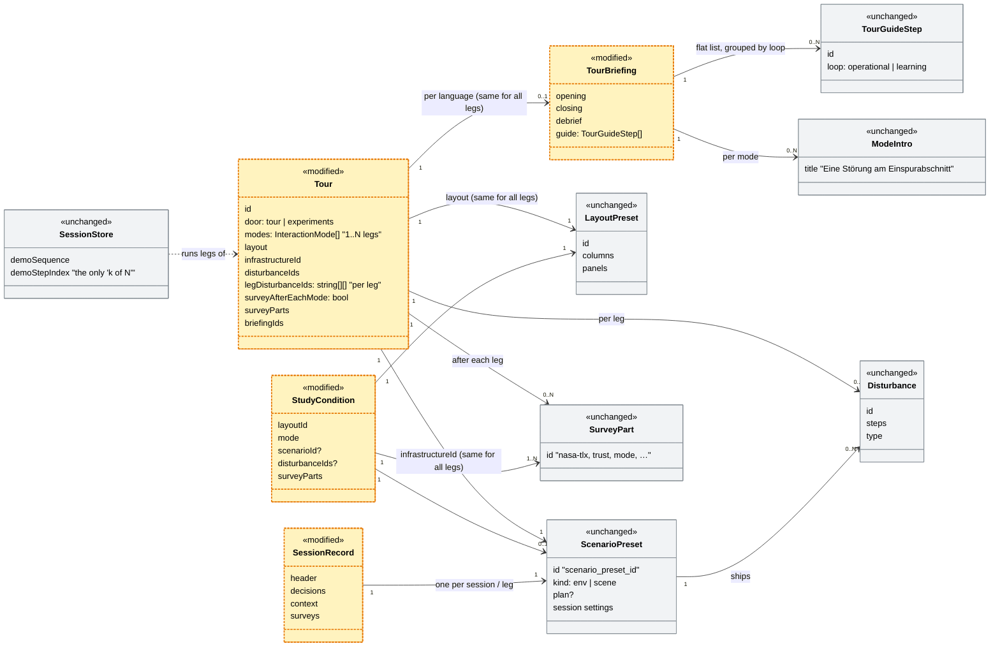
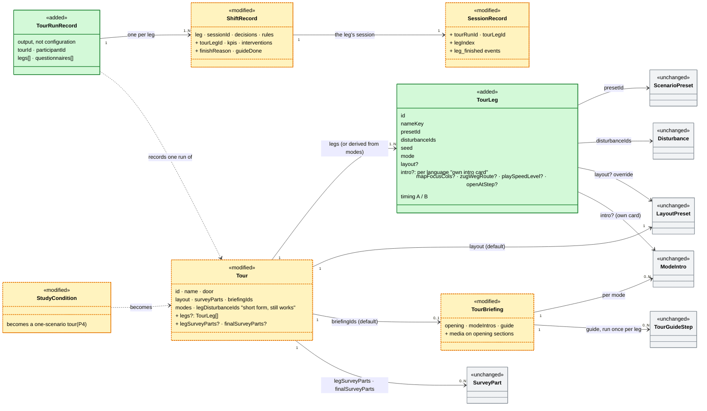
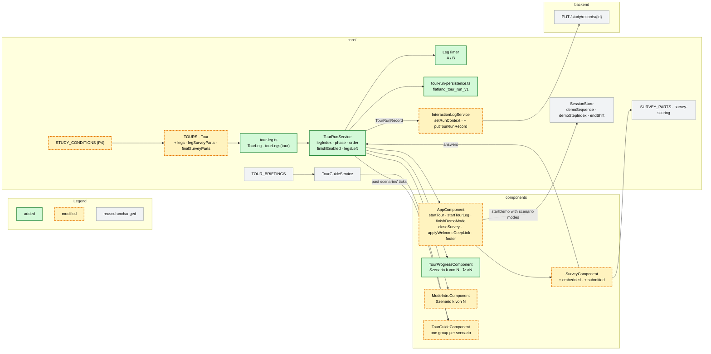

# Experiment workflow — tutorial, four scenarios, questionnaire, one record

> **Status:** Plan, 2026-10-28. Q1, Q2, Q4, Q6 and Q7 decided (§2b, §2c, §4, §5.1).
> Only (Q3) blocks P1; the other open questions in §9 do not.
> **Issue:** [#131](https://github.com/flatland-association/flatland-ui-hub/issues/131)
> ("Ablauf für Experiment definieren und implementieren"). This covers only the
> technical part, not the briefing of the dispatchers.
> **Builds on:** [scenario-infrastructure-gallery.md](scenario-infrastructure-gallery.md)
> §1 (vocabulary) and §4.6–4.7 (Tour and Experiment; this plan diverges from
> §4.7 on purpose, see §2);
> [tours-experiments-cleanup.md](tours-experiments-cleanup.md) §3 (questionnaire);
> [interaction-logging-plan.md](interaction-logging-plan.md) (the session record);
> [live-tours-shift-rounds.md](live-tours-shift-rounds.md) (legs).

---

## 1. What the issue asks for

1. **Intro / tutorial**, led by the experimenter (Versuchsleiterin).
2. **Start a scenario.** The experimenter selects it by name; there are 4 scenarios in randomised order.
3. **Run the scenario.**
4. **"Finish scenario"** (a click) starts the next one. The button is enabled only after time **A**. After time **B** the next scenario starts by itself. This repeats until all 4 have run.
5. **Questionnaire** after the last scenario.
6. **Finish**, and the JSON is saved automatically.

The implementation items are scenarios as objects, questionnaires as objects,
and the experiment as an object made of a sequence of both plus the save step.
Optionally the experiment can be attached to a view, so nobody has to pick the
view separately.

## 2. Short answers to the three questions

**How general?** As little as #131 needs. The experiment *is* a `Tour`. A tour
already has the Experiments door (`door: 'experiments'`), a layout, survey parts
and a fresh session per leg. What it lacks is an explicit leg: today a leg is
only position *k* in `modes` and `legDisturbanceIds`, so tours count modes, the
preset, layout and briefing are the same for every leg, and a leg has no name
and no timers. The plan adds **one entity, `TourLeg`**, between `Tour` and
`TourBriefing`, plus three optional fields on `Tour`:

- `legs` is the explicit list of legs, in the order they run. **One leg is a
  legitimate tour,** not a special case: it shows "Szenario 1 von 1" and
  otherwise looks as today (§5.4).
- `legSurveyParts` is an optional questionnaire after each leg.
- `finalSurveyParts` is an optional questionnaire after all legs.

There is no ordering logic at runtime. Counterbalancing is done by authoring
one tour per participant (§4).

**Vocabulary: leg, shift, Szenario.** The entity is named after the code's
existing word for exactly this (`legDisturbanceIds`, `legIntros`,
`startTourLeg()`, `ShiftRecord.leg`). The issue's word "Szenario" stays the
UI label. As code, "scenario" already means three other things (§2 below), and
a code key that differs from the German label is the repo's pattern (code key
`disruption` for "Störungsszenario", panel type `scenario` titled
"Strategien").

| Layer | Name in code | Shown in the UI as | Meaning |
|---|---|---|---|
| Configuration | `TourLeg` (`Tour.legs`) | "Szenario k von N" (stepper, intro card, finish button) | A planned slot in the tour's sequence: what the participant works on next |
| Runtime | the shift: `endShift()`, `shiftEnded`, `shiftReviewOpen` | "Szenario abschliessen" ends it; the "Schichtbilanz" comes after the last leg (§2c) | The working period on one session, from start to "Schicht beenden" or the episode's end |
| Record | `ShiftRecord` in `TourContextService.shiftHistory()`, extended (§6) | "Schicht 1" in the debrief | What happened in one finished shift |

An explicit leg is always played on a fresh session (§5), so one leg = one
session = one shift = one `SessionRecord`. The backend's "leg" in
`policies/goal_based_policies/` (a train's route between two stops) is an
unrelated railway meaning and does not meet this one.

**The flow is fixed** (decided 2026-10-28, §2c):

1. **Global briefing,** once: the tour briefing's opening pages, which may
   show a screenshot or a video.
2. **Per leg:** its intro card with static information and "Szenario
   starten" → the run (timers A/B) → "Szenario abschliessen" → the leg
   questionnaire, if `legSurveyParts` is set.
3. **After the last leg, once:** the **Schichtbilanz** over all legs → the
   final questionnaire, if `finalSurveyParts` is set → save and thank-you
   page.

There is no step language, no branching and no general workflow engine.

**Divergence from gallery §4.7, "Experiment is not a bigger Tour".** That
section rejects a study flag on `Tour`, because fields a study needs (pinned
seeds, timing, a participant id) could then be forgotten without anything
objecting. This plan takes the simpler model anyway, and moves the guard from
the type system into a **spec test** (`tours.spec.ts`). Every tour in the
Experiments door that has `legs` must pin a seed, timing and a name on
each leg and runs all its legs in one mode (Q1). If a later study needs a free step order, the
discriminated union from §4.7 is still the way to go, and `TourLeg`
carries over to it unchanged (§9 (Q10)).

**Can Tutorial and Fragebogen map onto existing concepts?** Yes, both of them.

| Issue | Existing concept | Where | Gap |
|---|---|---|---|
| Tutorial | **Tour briefing, opening pages** (`TourBriefing.opening`) | `core/demo/tour-briefings.ts`, `features/tour-briefing/` | The global briefing before the legs. The pages are text only today (heading, body, list); a screenshot or a video needs a media field on a section (§2c) |
| Scenario | **Tour leg** (implicit) and **StudyCondition** | `tours.ts` (`modes`, `legDisturbanceIds`), `study-conditions.ts` | Legs are counted as modes and have no name, no own preset or layout, no identity of their own (`legIntros` is by position, so one network leg cannot sit at different positions in different tours), and no timers. That is what `TourLeg` adds |
| Fragebogen | **SurveyConfig / `SURVEY_PARTS`** + `features/survey/` | `core/survey/survey-configs.ts`, `survey-scoring.ts` | Only "after each leg" exists (`surveyAfterEachMode`), and the survey downloads its own JSON. It needs a questionnaire after each leg *and* one at the end, with their own parts, and must write into the run record |
| JSON save | **SessionRecord** + `/study/records` sink | `core/interaction-log/`, `backend/app/api/study.py` | One file per *session*. Nothing groups the 4 sessions of one participant |
| "Ansicht" | **Layout preset** (`LAYOUT_PRESETS`) | `core/layout/layout-presets.ts` | None. `Tour.layout` already pins it, and a scenario can override it |

The "optional" item (attach the experiment to a view) therefore costs nothing.

**Is there a scenario abstraction?** Partly, and the word needs clarifying.
There is no first-class scenario entity. What exists:

- `scenario_presets.py` `_PRESETS` is a hardcoded registry of
  *environments*: network + traffic + optional plan, disturbance files and
  pinned session settings. Its id is `scenario_preset_id`.
- Disturbance files are the scripted incidents. The UI calls them
  "Störungsszenario", and their code key is `disruption`.
- The `scenario` panel type, `/hmi/scenarios` and `ScenarioBuilder` are
  **policy alternatives**, a different thing altogether.
- `Tour` and `StudyCondition` pin mode, layout, disturbances and map focus one
  level up.

In the gallery plan's vocabulary (§1), what #131 calls a **"Szenario" is a
Setup plus a Layout, a Mode and an intro**: one run the participant works
through. This plan names it **`TourLeg`** (UI: "Szenario"). It is a
*reference* to existing entities and not a new world layer. §9 (Q1) asks what
actually varies between the four.

## 2a. Checked against today's "Geführtes Experiment"

What a facilitator runs today from the Experiments door: the "Geführtes
Experiment (mit Umfrage)" entry is the **Tour** `colearning-experiment`
(`door: 'experiments'`, `core/demo/tours.ts`). It runs like this:

1. The mode intro "Co-Learning · Walensee: **Eine Störung am
   Einspurabschnitt**" (`tour-briefings.ts`, `modeIntros['co-learning']`) is
   followed by the "Szenario starten" button (`dismissDemoIntro`).
2. The tour guide shows the **Betrieb** group, with "1 Konflikt erkennen",
   "2 …" and so on, then the **Lernen** group.
3. Then comes "Umfrage nach der Session →" (because of `surveyAfterEachMode: true`).

**"Betrieb" is not an iteration over scenarios.** It is the label of the
guide's *operational loop* (`tourUi.guide.loop.operational`, `TourGuideStep.loop
= 'operational'`), the first five guide steps *inside one scenario*. "Lernen"
(`loop = 'learning'`) is the rest. Both groups belong to a single run.
`TourGuideService` clears them on every new session id, so with several
scenarios the Betrieb/Lernen list starts again for each one. The "Betrieb"
items therefore cannot carry the "scenario 1 of N" information. It needs its
own indicator (§5.4), and the guide strip needs an outer level, one group per
scenario (§5.5).

**Is there a "current scenario, k of N" concept?** Only in part, and it counts
*modes*, not scenarios:

| Existing piece | What it counts | Where shown | Limitation for N scenarios |
|---|---|---|---|
| `SessionStore.demoSequence` / `demoStepIndex` / `demoIsLast` | legs of a tour, one per entry of `Tour.modes` | footer "`Modus 2/3`" (`footer.progressTitle`), mode intro "`Modus 1 von 3`" (`labels.stepPrefix/stepOf`) | Labelled as *mode*. A leg is "a mode", not "a scenario" |
| `Tour.legDisturbanceIds` + `AppComponent.startTourLeg()` | one fresh session per leg, with that leg's disturbances | — | Same preset, layout, briefing for every leg. Only the disturbances vary |
| `Tour.surveyAfterEachMode` | — | the survey button after each leg | It is all or nothing **per leg**. "Survey once, after the last scenario" cannot be expressed |
| `StudyCondition` | exactly one scenario | — | No sequence at all |

The closest thing that works today is a hack that `colearning-advanced`
already uses for two shifts: `modes: ['co-learning', 'co-learning']` with one
`legDisturbanceIds` entry per shift. It gives N scenarios of the same network,
but the footer says "Modus 2/2", the survey comes after every leg or never,
and there are no A/B timers and no names. The concept is there **implicitly as
"leg"**. `TourLeg` makes it explicit, and mode becomes a property of each
scenario rather than the thing being counted.

### Data model today (as built)



**Legend:** yellow, dashed border + `«modified»` = **modified by this plan**
(`Tour` gets the three optional fields, `TourBriefing` gets images and
videos on its opening pages, `StudyCondition` becomes a one-scenario tour in
P4, `SessionRecord` gets new header fields and events) ·
grey + `«unchanged»` = **unchanged**. Nothing in today's model is removed.

| Class | Status | What it is | Example in «Geführtes Experiment (mit Umfrage)» | Modification by this plan | Where |
|---|---|---|---|---|---|
| `Tour` | **modified** | A guided walk as data: modes in order (one leg each), layout, preset, disturbances per leg, survey after each leg, briefings, live variant, start-screen door | Start screen, door "**Experimente**": the entry "**Geführtes Experiment (mit Umfrage)**" → "Co-Learning experiment (with survey)" (`colearning-experiment`) | P1: optional `legs`, `legSurveyParts`, `finalSurveyParts`. Without `legs` a tour is read as one `TourLeg` per entry in `modes`, so every existing tour runs unchanged | `core/demo/tours.ts` (`Tour`, `TOURS`) |
| `StudyCondition` | **modified** | One prepared experiment run: layout, mode, optional fixed preset, disturbances, map focus, survey parts | Not used by this run. It is the other kind of entry in the same door: "**Studienbedingung**", e.g. "Co-Learning · User Study 3" | P4: each condition becomes a one-scenario tour in the Experiments door. `#/experiment/...` deep links keep resolving | `core/demo/study-conditions.ts` (`StudyCondition`, `STUDY_CONDITIONS`) |
| `ScenarioPreset` | unchanged | An environment: pickled env or scene, plus optional plan, disturbance files and pinned session settings. Identified by `scenario_preset_id` | The Walensee stretch on the track map: "PF–CH · WN↔WAL conflict (long approach)", three trains, one single-track section | None. A `TourLeg` references it by `presetId` | backend `scenario_presets.py` (`_PRESETS`, `list_presets()`); frontend `core/models.ts` (`ScenarioPreset`) |
| `Disturbance` | unchanged | A scripted incident (`train_delay`, `area_block`, `warning`) at fixed steps. The UI calls it "Störungsszenario" and its code key is `disruption` | The breakdown in the single-track section at step 28: "Interview: Zug bleibt im Einspurabschnitt stehen (+12 Schritte)" | None | backend `disturbances.py` (`parse_disturbance`, `DisturbanceScheduler`); files in `fixtures/*/disturbances*/` |
| `LayoutPreset` | unchanged | Which panels sit in which zone. This is the "Ansicht" of the issue | The whole working screen: situation on the left, track map / ZWL / timetable in the centre, Co-Learning modules with a violet edge on the right ("Co-Learning · Interview") | None. Tours and scenarios reference preset ids | `core/layout/layout-presets.ts` (`LAYOUT_PRESETS`) |
| `TourBriefing` | **modified** | The pages around a tour: opening, closing, debrief, per-mode intros, the guide steps as one flat list, module badges | Everything around the run: the intro card, the guide strip, and after the shift the "**Schichtbilanz**". This tour has no opening or closing page | P1: a `BriefingSection` can carry an image or a video (`media`), for the global briefing (§2c). Its opening pages become the tutorial | `core/demo/tour-briefings.ts` (`TourBriefing`, `TOUR_BRIEFINGS`) |
| `ModeIntro` | unchanged (data) | The intro card before a leg, with the "Szenario starten" button | The card before the run: "Co-Learning · Walensee", "**Eine Störung am Einspurabschnitt**", "Modus 1 von 1", button "**Szenario starten**" | The data stays. Its *component* shows "Szenario k von N" for a tour with explicit legs (§5.4) | `core/demo/mode-intro-configs.ts` (`ModeIntro`, `MODE_INTROS`), or `TourBriefing.modeIntros` |
| `TourGuideStep` | unchanged (data) | One guide step inside one scenario, grouped by `loop`: `operational` ("Betrieb") or `learning` ("Lernen") | One item in the guide strip, e.g. "**Betrieb · 1 Konflikt erkennen**" or "Lernen · 7 Schichtbilanz" | The type stays. The strip gains an outer level, one group per scenario (§5.5) | `core/demo/tour-briefings.ts` (`TourGuideStep`, `GuideLoop`) |
| `SurveyPart` | unchanged | One questionnaire block (NASA-TLX, trust, understanding, UEQ-S, mode items, open feedback) | One section of "**Post-session survey — Co-Learning**", e.g. "Workload (NASA-TLX, raw)" | None. `Tour.surveyParts` references part ids | `core/survey/survey-configs.ts` (`SurveyPart`, `SURVEY_PARTS`) |
| `SessionStore` | unchanged | Runtime state of the session. `demoSequence`/`demoStepIndex` are today's only "k of N", and they count modes | The footer "Co-Learning experiment (with survey) · **Modus 1/1** · Co-Learning" and "Schritt: 28 / 180" | None. `demoSequence` is fed with the scenarios' modes, so `demoStepIndex` is the scenario index. No new mode flags | `core/session.store.ts` (`demoSequence`, `demoStepIndex`, `endShift`) |
| `SessionRecord` | **modified** | The record of one session: header, decisions, context events, surveys, outcome | What "**Sitzungsdaten exportieren**" in the footer downloads, one JSON per run | P1: header gets `tourRunId`, `tourLegId`, `legIndex`. Context events get `leg_finish_enabled`, `leg_finished` | `core/interaction-log/session-record.ts` (`SessionHeader`, `ContextEventType`, `SessionRecord`) |
| *Mode* (`InteractionMode`) — not a class | unchanged | **Who decides.** A value, not an entity: `'recommendation' \| 'co-learning' \| 'director'` (Recommendation: the AI recommends and the human decides; Co-Learning: the AI offers neutral options, the human decides and reflects; Director: the AI acts on directives and the human supervises). It has no id, fields or file of its own, and its behaviour lives in the panels that check it (`panel-mode-matrix.md`). At runtime it is the one signal `SessionStore.interactionMode`. In data it appears only as an attribute: `Tour.modes` (one leg per entry), `StudyCondition.mode` | "**Co-Learning**": eyebrow "Co-Learning · Walensee" on the intro card, footer "Modus 1/1 · **Co-Learning**", the violet Co-Learning modules, options without ranking or «empfohlen», and the survey title "Post-session survey — **Co-Learning**" | None. The repo rule "keep mode semantics in the `InteractionMode` union, no parallel flags" applies | `core/events/event-types.ts` (`InteractionMode`); `core/session.store.ts` (`interactionMode`, `setInteractionMode`) |

### Data model proposed (this plan)



**Legend:** green + `«added»` = **added** · yellow, dashed border +
`«modified»` = **modified** · grey + `«unchanged»` = **reused unchanged**.
Colours are set with plain `style` lines (no `classDef`), so they render in
IDE previews too. The stereotypes repeat the status for renderers without
colour.

| Class | Status | What it is | Example in «Geführtes Experiment (mit Umfrage)» | Modification / content | Where |
|---|---|---|---|---|---|
| `Tour` | **modified** (P1) | The experiment itself: which scenarios, in which order, with which questionnaire, behind which start-screen door | "**Geführtes Experiment (mit Umfrage)**" in the "Experimente" door: today with one leg ("Szenario 1 von 1"), in the example with two before one survey | New optional `legs`, `legSurveyParts`, `finalSurveyParts`. `layout` and `briefingIds` become defaults for the scenarios. `modes` and `legDisturbanceIds` stay as the short form | `core/demo/tours.ts` |
| `TourLeg` | **added** (P1) | One explicit leg, i.e. one "Szenario" as #131 means it: preset + disturbances + mode, optionally its own layout and intro card, with a name, a seed and timers A/B | Today's single run "**Eine Störung am Einspurabschnitt**" becomes "Szenario 1 von 2"; a second shift on the same stretch becomes "Szenario 2 von 2" | New. `id`, `nameKey`, `presetId`, `disturbanceIds`, `seed`, `mode`, `layout?`, `intro?` (per language), `mapFocusCols?`, `zugWegRoute?`, `playSpeedLevel?`, `openAtStep?`, `timing` | `core/demo/tour-leg.ts` |
| `TourRunRecord` | **added** (P2) | The output of one run of the tour by one participant: one file wrapping the per-scenario session records and the questionnaire. Not configuration | One JSON per participant run, saved automatically. Today "Sitzungsdaten exportieren" and the survey's own download give separate files | New. `tourId`, `participantId`, per leg (in run order) its `ShiftRecord` with the session record, plus the leg and final questionnaires' answers and scores | `core/interaction-log/tour-run-record.ts` |
| `ShiftRecord` | **modified** (P1) | The record of one finished leg, kept in `TourContextService.shiftHistory()`; today only multi-shift tours fill it | The rows of the Schichtbilanz after the last leg: one per "Szenario", plus the totals | Gains optional `tourLegId`, `kpis`, `interventions`, `finishReason`, `enabledAt`, `finishedAt`, `guideDone`. Recorded at every leg's end (§6) | `core/demo/tour-context.service.ts` |
| `StudyCondition` | **modified** (P4) | Today's single-run experiment condition | "**Studienbedingung**" entries such as "Co-Learning · User Study 3" in the same door | Becomes a one-scenario tour. The interface stays as an alias for the deep links and the picker | `core/demo/study-conditions.ts` |
| `SessionRecord` | **modified** (P1) | The per-session record | "**Sitzungsdaten exportieren**", now one record per scenario | New header fields and context events as in the table above | `core/interaction-log/session-record.ts` |
| `TourBriefing` | **modified** (P1) | See the table above | The global briefing's pages, now with a screenshot or a video; the intro card and guide strip as today | `media` on opening sections (§2c). Referenced by `Tour.briefingIds` only. Its `legIntros` (by position) are read into derived legs; explicit legs carry their own `intro` instead, so a shared leg brings its card to whatever position a tour puts it in (§4) | `core/demo/tour-briefings.ts` |
| `ModeIntro` | reused unchanged (data) | See the table above | "**Eine Störung am Einspurabschnitt**", now with "Szenario 1 von 2" instead of "Modus 1 von 1" | Shown before each leg: the leg's own `intro` in the UI language (English fallback), else the briefing's `modeIntros[mode]`. Whether it names the incident is an authoring rule (§2c, Q11) | `core/demo/mode-intro-configs.ts` / `TourBriefing.modeIntros` |
| `TourGuideStep` | reused unchanged | See the table above | "**1 Konflikt erkennen**", now inside the group "Szenario 1 von 2" | Unchanged. The tour briefing's guide runs once per leg and forms that leg's group in the strip (§5.5) | `core/demo/tour-briefings.ts` |
| `ScenarioPreset` | reused unchanged | See the table above | The Walensee stretch on the track map, unchanged | Referenced by `TourLeg.presetId` | backend `scenario_presets.py` |
| `Disturbance` | reused unchanged | See the table above | "Zug bleibt im Einspurabschnitt stehen" in scenario 1, "Folgezug läuft auf" in scenario 2 | Referenced by `TourLeg.disturbanceIds` | backend `disturbances.py` |
| `LayoutPreset` | reused unchanged | See the table above | The same working screen ("Co-Learning · Interview") for both scenarios | Referenced by `Tour.layout` and the optional `TourLeg.layout` | `core/layout/layout-presets.ts` |
| `SurveyPart` | reused unchanged | See the table above | "Workload (NASA-TLX, raw)" and the other sections: a short set after each leg, the full set at the end | Referenced by `Tour.legSurveyParts` and `Tour.finalSurveyParts` | `core/survey/survey-configs.ts` |
| *Mode* (`InteractionMode`) — not a class | reused unchanged | See the table above: who decides, as a value and not an entity | Both scenarios of the example are "**Co-Learning**". The intro card says "Szenario 1 von 2" and names the mode in its eyebrow. If the mode varied (§9 (Q1)), the footer would read "Szenario 2/4 · Recommendation" | Now an attribute of each scenario (`TourLeg.mode`), no longer the thing being counted | `core/events/event-types.ts` (`InteractionMode`) |

### Worked example: the "Geführtes Experiment" through both models

The examples follow one run of today's "Geführtes Experiment (mit Umfrage)".
Quoted text is what the UI shows (German UI unless marked EN), and the ids are
the real ones from the repo. The text after "·" is optional attribute detail.

**As it runs today**

| Class | Example instance | What the person sees · attribute detail |
|---|---|---|
| `Tour` | `colearning-experiment` | Experiments door ("**Experimente**"), listed as "**Geführtes Experiment (mit Umfrage)**", named "**Co-Learning experiment (with survey)**". · `door: 'experiments'`, `modes: ['co-learning']` (one leg), `surveyAfterEachMode: true`, `expectedMinutes: 12` |
| `StudyCondition` | `preset-colearning-study3` (not used by this run) | The *other* kind of entry in the same door, "**Studienbedingung**", e.g. "**Co-Learning · User Study 3**". · `mode: 'co-learning'`, `scenarioId: 'pf-ch-wn-wal-long-approach'`, `surveyParts: ['nasa-tlx','trust','understanding','open']` |
| `ScenarioPreset` | `pf-ch-wn-wal-long-approach` | "**PF–CH · WN↔WAL conflict (long approach)**": the Walensee stretch Ziegelbrücke–Walenstadt with one single-track section, three trains. · `kind: scene`, ships a `plan`, so the trains follow the plan from step 1; `max_episode_steps: 180` |
| `Disturbance` | `interview-e1-breakdown-single-track` | "**Interview: Zug bleibt im Einspurabschnitt stehen (+12 Schritte)**". The map announces the breakdown at step 28. · `type: train_delay`, `step: 28`, `delay_steps: 12`, `agent_handle: 0`; file in `disturbances_tour_long_approach/` |
| `LayoutPreset` | `preset-colearning-interview` | "**Co-Learning · Interview**": situation on the left, track map / ZWL / timetable in the centre, all Co-Learning modules on the right (violet edge) |
| `TourBriefing` | `colearning-experiment` (DE) | No opening or closing page. It goes straight to the mode intro, and after the shift to "**Schichtbilanz**" and the survey. · `debriefSections: ['shift-summary']`, `reasonDialog: true`, `autoStart: true` |
| `ModeIntro` | `modeIntros['co-learning']` of that briefing | Eyebrow "**Co-Learning · Walensee**", title "**Eine Störung am Einspurabschnitt**", tagline "Die KI zeigt Auswirkungen und Optionen. Du entscheidest und lernst daraus.", button "**Szenario starten**". · step label "**Modus 1 von 1**" (`labels.stepPrefix`/`stepOf`) |
| `TourGuideStep` | `detect` … `shift-summary` (7 steps) | Guide bar with the group "**Betrieb**": "1 Konflikt erkennen", "2 Risiko & Auswirkung", "3 Alternativen", "4 Entscheiden", "5 Umsetzen"; the group "**Lernen**": "6 Reflexion", "7 Schichtbilanz". · `loop: 'operational'` / `'learning'`. Event-Simulation and KI lernt are filtered out for this tour |
| `SurveyPart` | `mode`, `nasa-tlx`, `trust`, … (the Settings selection; the tour sets no `surveyParts`) | Footer button "**Umfrage nach der Session →**" (EN "Post-session survey →") opens "**Post-session survey — Co-Learning**", with sections such as "Workload (NASA-TLX, raw)" and "Trust in the system (Jian)" |
| `SessionStore` | the running session | Footer "**Co-Learning experiment (with survey) · Modus 1/1 · Co-Learning**" and "Schritt: 28 / 180". · `demoSequence: ['co-learning']`, `demoStepIndex: 0`, `interactionMode: 'co-learning'` |
| `SessionRecord` | `flatland-<participant>-<condition>-<run>-<session>.json` | Footer "**Sitzungsdaten exportieren**" and the badge "Auf dem Server gespeichert" when the sink is on. · `header.tourId: 'colearning-experiment'`, `scenarioId: 'pf-ch-wn-wal-long-approach'`, `disturbanceIds: ['interview-e1-breakdown-single-track']` |

**Today's tour as one explicit leg (P1, "Szenario 1 von 1")**

The regression proof for N = 1: the same tour, written with `legs`. It must
look as it does today, except for the step label.

```ts
{
  id: 'colearning-experiment',
  door: 'experiments',
  name: 'Co-Learning experiment (with survey)',
  layout: 'preset-colearning-interview',
  briefingIds: { de: 'colearning-experiment', en: 'colearning-experiment' },
  finalSurveyParts: ['mode', 'nasa-tlx', 'ueq-s'],   // today: the Settings selection
  legs: [WAL_SINGLE_TRACK],
}
```

| Where | What the participant sees |
|---|---|
| Intro card | As today, but "**Szenario 1 von 1**" instead of "Modus 1 von 1" |
| Run | As today. No stepper bracket, no outer guide level |
| After the run | Today's Schichtbilanz (over one leg it is the current one), then the questionnaire |
| Footer | "Co-Learning experiment (with survey) · **Szenario 1/1** · Co-Learning" |

**A tour with two legs, a short questionnaire after each and a full one at the end**

The mechanics only: both legs use the Walensee network, because it is the only
study-ready one (§2b). In #131 each leg is a different network. Leg 2 reuses
the second shift that `colearning-advanced` already ships
(`advanced-shift2-e1-breakdown-follower`, on the same preset). The names, the
seed, the intro text, the media file and the timer values are placeholders
until §9 (Q3) and (Q13) are answered.

```ts
// Shared leg constants (§4): written once, referenced by every tour that uses them.
const WAL_SINGLE_TRACK: TourLeg = {
  id: 'wal-single-track', nameKey: 'tourLegs.walSingleTrack', mode: 'co-learning',
  presetId: 'pf-ch-wn-wal-long-approach', disturbanceIds: ['interview-e1-breakdown-single-track'],
  seed: 42, timing: { finishEnabledAfter: { wallSeconds: 300 }, autoAdvanceAfter: { wallSeconds: 480 } },
};
const WAL_FOLLOWER: TourLeg = {
  id: 'wal-follower', nameKey: 'tourLegs.walFollower', mode: 'co-learning',
  presetId: 'pf-ch-wn-wal-long-approach', disturbanceIds: ['advanced-shift2-e1-breakdown-follower'],
  intro: { de: WAL_FOLLOWER_INTRO_DE, en: WAL_FOLLOWER_INTRO_EN },   // static information at the leg's start
  seed: 42, timing: { finishEnabledAfter: { wallSeconds: 300 }, autoAdvanceAfter: { wallSeconds: 480 } },
};

{
  id: 'colearning-experiment-2x',
  door: 'experiments',
  name: 'Co-Learning experiment, two shifts (with survey)',
  layout: 'preset-colearning-interview',
  briefingIds: { de: 'colearning-experiment-2x', en: 'colearning-experiment-2x' },  // opening with a video
  legSurveyParts: ['nasa-tlx'],
  finalSurveyParts: ['mode', 'trust', 'ueq-s', 'open'],
  legs: [WAL_SINGLE_TRACK, WAL_FOLLOWER],
  // not needed: modes, infrastructureId, legDisturbanceIds, surveyAfterEachMode, surveyParts
}
```

| Class | Example instance | What the person sees · attribute detail |
|---|---|---|
| `TourBriefing` | `colearning-experiment-2x` | Global briefing first: an opening page with a section showing a **video** of the working screen, then "Weiter". Stepper: "**[Briefing]** ─ Szenario 1 ─ Szenario 2 ─ Schichtbilanz ─ Fragebogen ─ Ende" · `opening.sections[0].media: { kind: 'video', src: 'tours/colearning/intro.mp4', altKey: '…' }` |
| `Tour` | `colearning-experiment-2x` | Experiments door, listed like today's "Geführtes Experiment (mit Umfrage)". The stepper shows "**↻ ×2**" around the two legs, each with its short questionnaire inside the bracket, and "**noch 1 Szenario bis zur Schichtbilanz**" during leg 1 · `legSurveyParts`, `finalSurveyParts` |
| `TourLeg` | `WAL_SINGLE_TRACK` | Intro card "**Szenario 1 von 2**", title "**Eine Störung am Einspurabschnitt**" (from the briefing, since the leg sets no `intro`). The guide strip shows "Szenario 1 von 2" expanded with Betrieb and "Reflexion", "Szenario 2" greyed, and a closing group "Schichtbilanz". The button reads "**Szenario abschliessen → Fragebogen**" (the leg questionnaire), disabled with a countdown until A · A = 5 min, B = 8 min (placeholders) |
| `SurveyPart` (leg) | `nasa-tlx` | After leg 1: "Workload (NASA-TLX, raw)" only, then straight on to leg 2's intro card. No Schichtabschluss in between |
| `TourLeg` | `WAL_FOLLOWER` | Intro card "**Szenario 2 von 2**" with its **own static information** (`intro`). The strip shows "Szenario 1 ✓" collapsed and "Szenario 2" expanded at "1 Konflikt erkennen". After its questionnaire, the button leads to the Schichtbilanz · `disturbanceIds: ['advanced-shift2-e1-breakdown-follower']` ("Vertiefte Tour, Schicht 2: Zug steht im Einspurabschnitt, Folgezug läuft auf (+20 Schritte)") |
| `ShiftRecord` | one per leg | The **Schichtbilanz** after leg 2: one row per "Szenario" (arrived, delayed, total delay, breakdowns, interventions) and the totals |
| `SurveyPart` (final) | `mode`, `trust`, `ueq-s`, `open` | Once, after the Schichtbilanz: "**Post-session survey — Co-Learning**" with "Mode-specific questions", "Trust in the system (Jian)", "User experience (UEQ-S)" and "Open feedback" |
| `TourRunRecord` | `flatland-<participant>-colearning-experiment-2x-<runId>.json` | Saved at "Ende" without a click, followed by a thank-you page · `legs` in run order, each a `ShiftRecord` with `finishReason: 'clicked' \| 'timeout'`; three questionnaires (two leg, one final) |
| `SessionRecord` | one per leg | As today, plus `header.tourLegId: 'wal-single-track'` / `'wal-follower'` and `legIndex: 0 / 1` |
| `ScenarioPreset`, `Disturbance`, `LayoutPreset`, `ModeIntro`, `TourGuideStep` | as in the table above | Unchanged. Both legs use the tour's layout |

### Services and components (this plan)

The runtime side of the same change, with the same colours. It follows the
§7 change inventory.



## 2b. Decided: four networks, each with its own disturbance (Q1)

Answered 2026-10-28. The four legs of a tour differ in their **network**, and
each leg brings its own scripted disturbance. All four run in **the same
mode**. Each tour draws its four networks from a pool of **six** (§4). So every
`TourLeg` has its own `presetId` and `disturbanceIds`, which the model already
allows. The worked example below uses one network twice; it shows the
mechanics, not the #131 content.

**Content gap: only one network is study-ready today** (checked 2026-10-28).
An experiment leg needs a premade plan (otherwise runs are not reproducible;
the Experiments door offers only presets with a plan for this reason) and a
scripted disturbance.

| Preset | Plan | Study disturbances | Tour disturbances | Episode |
|---|:-:|:-:|:-:|---|
| `pf-ch-wn-wal-conflict` (Walensee) | ✓ | ✓ | — | 140 |
| `pf-ch-wn-wal-long-approach` (Walensee) | ✓ | ✓ | ✓ | 180 |
| `olten`, `olten-dense` | — | — | ✓ | default / 700 |
| `olten-disrupted`, `olten-partially-closed` | — | — | — | default |
| `pf-ch-corridor`, `pf-ch-corridor-stops` | — | — | — | default |
| `ecml2026-scene1-level0` | — | — | — | default |
| Gotthard (fixtures exist, not registered) | — | — | — | — |

The two Walensee presets are one network in two variants. So the pool of six
needs **five more networks** with a plan and a disturbance each, ideally each
with a baseline run (gallery plan §6) so their difficulty can be compared.
Defining the six networks and the ten tours is **not part of this PR**: it is
fixture and authoring work in `backend/app/fixtures/` and
`scenario_presets.py`, and it is the critical path for running the study
(Q13). This PR builds the mechanism and ships one example tour on what exists.

**Consequences for the model:**

- **Network-specific settings move to the leg.** Today the tour briefing
  holds `mapFocusCols` and `zugWegRoute` (the time-distance diagram's section,
  as station codes, e.g. `ZB → WAL`). Those fit one network only. `TourLeg`
  already has `mapFocusCols`; it gains **`zugWegRoute?`**, and both win over
  the briefing's values (§3, §7.2).
- **Each leg needs its own intro card,** because the card describes the
  network ("Strecke Pfäffikon SZ–Chur am Walensee …"). It is written per UI
  language, like a tour's briefing (`briefingIds: { de, en }`), with English as
  the fallback. Whether it also names the incident stays (Q11).
- **The guide stays shared.** The Betrieb/Lernen steps are the same in every
  network. Network-specific hints (one briefing overrides the `detect` hint for
  its network) are not carried per leg; generic hints are the default.
- **Timers per leg matter now.** Episodes differ (140, 180 or 700 steps), so A
  and B are set per leg, as the model already does.
- **One mode per tour.** With the mode the same in all four legs, nothing has
  to be crossed with the network. The spec guard checks that the legs of an
  Experiments-door tour share one mode.
- **Network difficulty stays in the data.** Which networks each participant
  meets, and in which order, is fixed by the ten tours (§4). Differences
  between the networks themselves are not balanced away, which is why the
  baselines matter.

## 2c. Decided: the flow of a tour with legs (Q6, Q7)

Decided 2026-10-28. The flow is generic: the tour says how many legs it has,
and one leg is as valid as four.

| Where | What the participant sees | Defined by | Exists today? |
|---|---|---|---|
| **Global briefing**, once at the start | Pages with text and a **screenshot or a video** | `TourBriefing.opening` (tour level) | ◐ text pages exist; image and video do not |
| **Leg start**, per leg | The intro card with **static information** about this leg and "Szenario starten" | `TourLeg.intro`, per language (else the briefing's card for the mode) | ✓ the card exists; per-leg content is new |
| **Leg end**, per leg, optional | A short **questionnaire** | `Tour.legSurveyParts` | ◐ "after each leg" exists, tied to `surveyAfterEachMode` |
| **After the last leg**, once | The **Schichtbilanz** over all legs | the tour debrief (`debriefSections`) | ◐ exists, but for the current session only |
| **After the Schichtbilanz**, once, optional | The final **questionnaire** | `Tour.finalSurveyParts` | ✗ |
| **End** | Save, then a thank-you page | behaviour (§6) | ✗ |

**What this changes in the plan:**

- **The tutorial is the global briefing** (Q7), not a practice run. The
  stepper's first entry is "Briefing".
- **What a leg's intro card says is content, not model.** The card is a
  `ModeIntro`, and all its fields are free text: `wp` (eyebrow), `title`,
  `tagline`, `whatHappens`, `focusView`, `yourRole`, `whatYouCanControl`,
  `watchFor`, `goal`, `note`. Today's card names the incident in `title`
  ("Eine Störung am Einspurabschnitt") and in part of `whatHappens` ("Nach
  kurzer Zeit bleibt ein Zug mitten im Einspurabschnitt stehen …"). There is
  no separate network or incident field and no switch to hide one. Whether the
  cards name the incident (Q11) is therefore an **authoring rule** for the six
  leg constants (§4), checked when they are reviewed, not a code change. A
  structural split (separate `network` and `incident` fields plus a switch)
  would only pay off if the same legs were reused across studies with
  different rules, and it would change `ModeIntro` for every existing tour; it
  is not planned.
- **Screenshot or video in the briefing.** `BriefingSection` gains an optional
  `media: { kind: 'image' | 'video'; src: string; altKey: string }`, rendered
  by the briefing pages (`features/tour-briefing/`). Files go under
  `frontend/public/`. The alt text is an i18n key, like every other string.
- **No Schichtabschluss between legs.** When a leg ends, the participant goes
  to that leg's questionnaire or straight to the next intro card. The
  Schichtbilanz comes once, after the last leg.
- **The Schichtbilanz covers all legs.** Today the debrief's `shift-summary`
  is built from the current session only (KPIs, interventions, decisions). So
  each leg's `ShiftRecord` also keeps its **KPIs and interventions** at the
  leg's end (§6), and the summary shows one row per leg plus the totals. The
  debrief's existing `compare` section already lays shifts side by side and is
  the model for this.
- **The guide strip follows.** Per leg it shows Betrieb and the Lernen step
  that happens during the run ("Reflexion"). The "Schichtbilanz" step moves
  into a closing group after all legs (§5.5).
- **N = 1 looks like today.** A one-leg tour shows "Szenario 1 von 1" on the
  intro card and in the footer, where today it says "Modus 1 von 1". It shows
  no stepper bracket and no outer guide level, and its Schichtbilanz is
  today's, because the summary over one leg is the current one. To prove it,
  P1 converts today's `colearning-experiment` ("Geführtes Experiment (mit
  Umfrage)") to one explicit leg.
- **Questionnaires (Q6).** `legSurveyParts` after each leg and
  `finalSurveyParts` at the end. Either may be absent. For legacy tours, `surveyAfterEachMode` and `surveyParts`
  keep their meaning.

## 3. Data model

```ts
// core/demo/tour-leg.ts

/** One explicit leg of a tour: one "Szenario" the participant works through. */
export interface TourLeg {
  id: string;                    // stable, logged, never the displayed label
  nameKey: string;               // i18n key (tourLegs.*): the leg's name in data and records
  presetId: string;              // scenario_presets.py id
  disturbanceIds: string[];
  seed?: number;                 // required in the Experiments door (spec guard)
  mode: InteractionMode;         // stays in the union, no parallel flag
  layout?: 'system' | string;    // falls back to Tour.layout
  /** Own intro card per UI language, English as the fallback (like Tour.briefingIds);
   *  else the tour briefing's modeIntros[mode]. Carried by the leg, not by position, so a
   *  shared leg keeps it at any position (the derived form fills it from legIntros[k]). */
  intro?: Partial<Record<Lang, ModeIntro>>;
  mapFocusCols?: [number, number];                 // wins over the briefing's (§2b)
  zugWegRoute?: { from: string; to: string };      // time-distance section; wins over the briefing's (§2b)
  playSpeedLevel?: number;
  openAtStep?: number;
  timing?: LegTiming;       // required in the Experiments door (spec guard)
}

export interface LegTiming {
  /** A: "Szenario abschliessen" is disabled until then. */
  finishEnabledAfter: Duration;
  /** B: the next scenario (or the questionnaire) starts by itself. Must be ≥ A. */
  autoAdvanceAfter: Duration;
}
export type Duration = { wallSeconds: number } | { simSteps: number };   // §9 (Q3)

/**
 * The one place that reads a tour's legs. A tour with `legs` returns them;
 * a tour without returns one leg per entry of `modes`, built from
 * `modes[k]`, `legDisturbanceIds[k] ?? disturbanceIds`, `infrastructureId`,
 * `layout` and the briefing's `legIntros[k]`. Legacy legs without
 * `legDisturbanceIds` keep sharing one session, as today (an internal flag of
 * the derived form, not a field anyone authors; see §5, path A).
 */
export function tourLegs(tour: Tour): TourLeg[];

// core/demo/tours.ts: additions to Tour (all optional)
interface Tour {
  // … all existing fields unchanged …
  legs?: TourLeg[];                     // one leg is a valid tour ("Szenario 1 von 1")
  legSurveyParts?: readonly string[];   // questionnaire after each leg; absent = none
  finalSurveyParts?: readonly string[]; // questionnaire after the Schichtbilanz; absent = none
}

// core/demo/tour-briefings.ts: addition to BriefingSection (optional)
interface BriefingSection {
  // … heading, body, items, ordered unchanged …
  media?: { kind: 'image' | 'video'; src: string; altKey: string };   // global briefing (§2c)
}
```

For a tour with `legs`, `surveyAfterEachMode` and `surveyParts` are not read.
For a tour without, they keep their meaning.

- **Saving is behaviour, not a field.** Every tour run from the Experiments
  door writes a `TourRunRecord` when it ends (§6), with or without a
  questionnaire. This answers the issue's question whether saving is part of
  the questionnaire object: no.
- **The fixed flow** is the one in §2 and §2c: global briefing → per leg
  intro card, run, leg questionnaire → Schichtbilanz → final questionnaire →
  save.
- **The spec guard** (`tours.spec.ts`, as in §2) replaces the type-level
  safety of gallery §4.7.

## 4. Counterbalancing by authoring: one tour per participant

Decided 2026-10-28 (Q2). The experimenter picks a **tour** by name, the
"Geführtes Experiment" of that participant. There are **ten tours, one per
participant**, and each runs a dedicated subset of **four of six networks** in
a fixed order. Which subset and which order each tour gets is the study
design, and it is authored, not computed. The definition of the ten tours and
the six networks is not part of this PR.

What this means for the mechanism:

- **No runtime ordering.** There is no Latin square, no shuffle, no "next"
  picker and no override. A tour's `legs` run in the order they are listed.
  That keeps runs reproducible by construction: the tour id alone says what a
  participant saw.
- **Legs are shared, tours compose them.** Each of the six networks is written
  once as a `TourLeg` constant (preset, disturbance, intro, map focus,
  time-distance section, timers). The ten tours reference those constants
  instead of repeating them. `tourLegId` therefore names the same network leg
  across all tours, which is what an analysis groups by.
- **The spec guard can also check the design** once the ten tours exist: each
  tour has four legs, no network twice in a tour, and how often
  each network and each position occurs across the ten. With 10 × 4 = 40 slots
  over 6 networks, an exactly even spread is not possible (6⅔ per network), so
  the guard reports the counts rather than enforcing them.
- **Selection by name** is the existing tour picker in the Experiments door,
  and handing over a participant's run is the existing deep link
  `#/tour/<id>/start`. How ten near-identical entries are listed and marked as
  used is (Q14).

## 5. The runner

`TourRunService` (`core/demo/tour-run.service.ts`) runs one tour with
explicit legs. It is a signal-based state machine:

- **State:** `tour`, `legs` (resolved, in run order), `legIndex`, and
  `phase: 'briefing' | 'intro' | 'running' | 'legSurvey' | 'review' |
  'finalSurvey' | 'done'`, which follows the flow in §2c.
- **Derived:** `finishEnabled`, `remainingToAutoAdvance`, `legCount`,
  `legsLeft`, `nextStepKind`.
- **Finished legs:** not a list of its own. At each leg's end the service
  calls `TourContextService.recordShift()` with the extended `ShiftRecord`
  (§6), which also holds the leg's guide ticks (§5.5).

It drives the **existing** paths rather than duplicating them:

- `startDemo()` on the `SessionStore` gets the legs' modes. So
  `demoSequence`/`demoStepIndex`, and everything that already reads them,
  keep working, and `demoStepIndex` is the leg index (the position).
- `AppComponent.startTourLeg()` already creates a fresh session per leg. It
  now reads its preset, disturbances, layout, mode, map focus, play speed and
  open step from the current `TourLeg`.
- `finishDemoMode()` moves to the leg questionnaire, the next leg or the
  Schichtbilanz via the run service.
- **Between legs no debrief opens.** Today an ended shift opens the review
  (`shiftReviewOpen`, the tour debrief). For every leg but the last, the run
  service records the leg and moves on instead. The debrief opens once, after
  the last leg, as the Schichtbilanz over all legs (§2c). With one leg this is
  exactly today's behaviour.

Ordinary tours without `legs` take the same path through
`tourLegs()` and behave as today. They have no timers, no stepper, and
nothing saved beyond the session record.

**Two ways to the next leg exist today, and explicit legs always take the
second** (checked 2026-10-26):

| Path | When | Same session? | Kept from the previous leg |
|---|---|---|---|
| **A: survey, then reset** | `surveyAfterEachMode: true`: `closeSurvey()` → `advanceDemo()` + `store.reset()`. Only `three-modes-original` has several legs on this path | **yes**, the episode is replayed from step 0 | Everything keyed on the session id: the guide ticks (`TourGuideService`), `shiftStartedAt` (so "KI lernt" counts earlier legs' cards), and the session record (all legs in **one** `SessionRecord`, told apart only by `mode_change`). Reset: env, overrides, notifications, decision log, impact, contentions, co-learning feedback, `shiftEnded` |
| **B: fresh session** | no survey and `legDisturbanceIds`: `finishDemoMode()` → `advanceDemo()` + `startTourLeg()` → `createSession()`. `colearning-advanced` | **no** | Nothing implicit. Continuity is explicit through `shiftHistory()` (`ShiftRecord`) and the browser-wide learning cards and operator profile |

- **Rule: an explicit leg always starts on path B,** so that one leg = one
  session = one shift = one `SessionRecord`, with the guide and
  `shiftStartedAt` starting fresh. Legacy tours keep path A (§9 (Q12)).
- **Gap to close:** `closeSurvey()` calls `reset()` and never `startTourLeg()`.
  A tour with a survey after each leg *and* per-leg disturbances would replay
  leg 1's incident instead of starting leg 2's. No tour combines the two today,
  which is why it has not shown, but `legSurveyParts` would hit it. During a
  run, `closeSurvey()` therefore hands over to `TourRunService`, which starts
  the next leg through `startTourLeg()` (§7.2).

### 5.1 Handover and the global briefing (the tutorial)

Decided 2026-10-28 (Q4): **one screen.** The experimenter (Versuchsleiterin)
does everything that comes before the run on the start screen, then hands the
screen over to the participant, a domain expert, and stays beside them.

- **Before the handover, by the experimenter:** enter the participant id,
  pick the participant's tour in the Experiments door (or open its deep link
  `#/tour/<id>/start`), and press Start. This is all existing UI.
- **After the handover, by the participant:** everything else. There is **no
  hidden experimenter UI**: no modifier key, no PIN, no second device, no
  facilitator strip. Whatever the experimenter needs to do during the run,
  they ask the participant to do, or do it themselves at the same screen.

**The tutorial is the global briefing** (Q7): the tour briefing's opening
pages, shown once before the first leg, with text and a screenshot or a video
(§2c). The experimenter talks the participant through it. There is no
practice run in the app; the issue names the step only ("Intro / Tutorial
(Geleitet durch Versuchsleiterin)"), and the dispatchers' briefing itself is
out of the issue's scope.

**Leaving and resuming,** both done by the experimenter at the same screen:

- **Abort:** the existing "back to start" (`exitToStart`) ends the run. The run
  service then saves the `TourRunRecord` so far, with the current leg marked
  `finishReason: 'aborted'`, so a broken-off session is not lost.
- **Resume after a reload:** the start screen offers to continue the
  interrupted run (§5.3). It is shown on the start screen, before any handover,
  because only the experimenter sees that screen.

### 5.2 Timers A and B

**What A and B are** (from the issue, step 4): two durations per leg, both
counted from the start of the leg.

- **A, the minimum:** "Szenario abschliessen" is disabled until A has passed.
  It stops a participant from clicking through a leg before working on it.
- **B, the maximum:** when B has passed, the next leg (or, after the last
  one, the questionnaire) starts by itself. It caps how long a leg can take,
  so a session fits its time slot.
- Between A and B the participant decides when the leg is done. A ≤ B; A = B
  means a fixed duration with no choice.

```
leg start            A                         B
   │── button disabled ──│── button enabled ──────│→ next leg starts by itself
   │   countdown to A    │   participant may end  │   (reason: 'timeout')
```

**How the clock relates to the simulation.** One simulation step is one
minute of railway time. At the default tempo (level 2, 0.5 steps/s,
`core/play-speed.ts`) one step takes 2 s of wall-clock time, and the
participant can change the tempo (0.25–10 steps/s) or pause. So the same
episode takes very different wall-clock times:

| Episode | Steps | Wall-clock at level 1 (0.25 /s) | at level 2, default (0.5 /s) | at level 3 (1 /s) |
|---|---|---|---|---|
| Walensee conflict | 140 | 9 min 20 s | 4 min 40 s | 2 min 20 s |
| Walensee long approach | 180 | 12 min | 6 min | 3 min |
| Olten dense | 700 | 46 min 40 s | 23 min 20 s | 11 min 40 s |

This is why the clock is an open question (Q3). With the placeholder
A = 5 min, the 140-step episode at the default tempo is over before A (Q5).

- The timer starts when the session becomes interactive. That is after the mode
  intro (`dismissDemoIntro`), not at `createSession`, because the backend
  start takes several seconds on the corridor.
- **Before A**, "Szenario abschliessen" is shown but disabled, with a
  countdown (i18n key). **Between A and B** it is enabled. **At B** the runner
  calls the same finish path as the click, with `reason: 'timeout'` instead of
  `'clicked'`.
- **The episode ends before A** (`episode_done`): proposal: the shift review
  stays up and the button enables at once, since nothing is left to do. §9 (Q5).
- **Pause:** a wall-clock timer keeps running while the simulation is paused;
  a step timer stops. Which unit A and B use is §9 (Q3).
- **Logged:** `leg_finish_enabled` and
  `leg_finished{reason, elapsedWall, elapsedSteps}`.
- **Guardrail:** do not touch the scenario-refresh throttling or
  `_recordTrajectory`. The timer only reads `episode_done` and the step
  counter.

### 5.3 Robustness (a run must survive a reload)

The run state, including `shiftHistory()` with the finished legs' guide
ticks, goes to `localStorage` (`flatland_tour_run_v1`) after every transition. Every access is
wrapped in try/catch. A reload during scenario 3 offers to resume at scenario
3 on a fresh session of the same scenario. It does not replay, and the break is
logged. Without this, one browser refresh loses a participant.

### 5.4 Showing the iteration: "Szenario k von N", and how many are left

The participant and the experimenter both need to see three things:

1. that there is a loop over scenarios,
2. where in it they are,
3. how many runs are left before the Schichtbilanz.

None of today's indicators can do it (§2a). The plan adds one indicator with
three placements, driven by `TourRunService.legIndex`. The label "Szenario k
von N" is shown for every tour with explicit `legs`, N = 1 included. The
stepper and the outer guide level are shown only for N > 1, so a one-leg tour
looks as today (§2c).

**1. Stepper.** This is the new `TourProgressComponent`, a thin bar at the top
of the working screen, above the guide strip:

```
 Briefing ✓ ─ Szenario 1 ✓ ─ [Szenario 2] ─ Szenario 3 ─ Szenario 4 ─ Schichtbilanz ─ Fragebogen ─ Ende
                            ▲ current             noch 2 Szenarien bis zur Schichtbilanz
```

- The scenarios are drawn as a bracketed group with a repeat mark (↻ ×4), so
  the loop is visible as a loop and not just as a long list.
- A leg questionnaire (`legSurveyParts`) sits *inside* the bracket, after
  each scenario. The final questionnaire (`finalSurveyParts`) sits after the
  Schichtbilanz. Entries for absent questionnaires are not drawn.
- Participants see numbers, not scenario names, because names could prime
  them (§9 (Q8)). The experimenter knows the names from the tour's definition.

**2. The guide strip** shows one group per scenario (§5.5), so it repeats the
"k of N" at step level.

**3. Mode intro, footer and finish button.**

- The intro's "Modus 1 von 3" becomes "Szenario 2 von 4". The mode is still
  named in the intro's eyebrow (`wp`), which matters when it changes between
  scenarios.
- The footer's "`Modus k/N`" (`footer-demo-progress`) becomes "Szenario k/N ·
  ⟨mode⟩".
- The finish button names what comes next: "Szenario abschliessen →
  Fragebogen" when a leg questionnaire follows, otherwise "→ Szenario 3", and
  on the last leg "→ Schichtbilanz".
- **One finish button per leg.** Today the guide strip also offers "Schicht
  beenden" (`tourUi.guide.endShift`). For a tour with explicit legs it becomes
  the same gated "Szenario abschliessen", so there are not two buttons that
  end a leg.

Tours without explicit `legs` keep "Modus k von N", because their legs
*are* modes.

### 5.5 The guide strip: one group per scenario

**How it works today** (checked 2026-10-23):

- **The two loops are hardcoded.** `GuideLoop = 'operational' | 'learning'`
  (`core/demo/tour-briefings.ts`) is a closed union. The group labels are the
  i18n keys `tourUi.guide.loop.operational` ("Betrieb") and
  `tourUi.guide.loop.learning` ("Lernen").
- **The step ids are hardcoded as well.** `GuideStepId` is a closed union of
  nine ids (`detect`, `assess`, `alternatives`, `decide`, `execute`, `reflect`,
  `shift-summary`, `event-simulation`, `ai-learns`). What *ticks* each step is
  code: `TourGuideService.reached` has one condition per id.
  - `detect`: a malfunction or an impact.
  - `assess` and `alternatives`: an impact.
  - `decide`: a human decision.
  - `execute`: the sim has moved past that decision.
  - `reflect`: a rationale.
  - `ai-learns`: a learning card since the shift started.
  - The debrief steps are ticked by `markDone()`.
- **Which steps appear, in which order, and with which title and hint** is
  data. Each briefing has a flat `guide: TourGuideStep[]`. A briefing can
  filter it (the Geführtes Experiment drops `event-simulation` and
  `ai-learns`) or override hints.
- **Groups are derived, not configured.** `TourGuideComponent.groups` walks the
  flat list and starts a new group whenever `loop` changes. Interleaving
  therefore *renders* (operational, learning, operational would give "Betrieb ·
  Lernen · Betrieb"), and numbering runs on across groups (`n = i + 1`).
- **A repeated loop within one list cannot work.** Progress is a
  `Set<GuideStepId>`, and `reached` reads session-wide signals. A second
  "Konflikt erkennen" would share the id `detect` with the first, so it would be
  ticked the moment the first one is. `current` is "the first step in list
  order not yet done", so the order is a display order, not an enforced
  sequence.
- **Progress resets on every new session id.**

**What #131 needs is one more level: scenario → Betrieb/Lernen → steps.** It
comes almost for free from `TourLeg`, because every explicit leg runs on its
own session and the briefing's guide is run once per leg. The per-session
reset that is a problem for a flat list is exactly right per leg.

```
Szenario 1 ✓  (collapsed)
Szenario 2 von 4 · Betrieb  ●1 Konflikt erkennen  2 Risiko & Auswirkung … 5 Umsetzen
                 · Lernen    6 Reflexion
Szenario 3   Szenario 4  (greyed)
Abschluss · Schichtbilanz   (after the last leg)
```

- `TourGuideService` stays unchanged: it tracks the current scenario's steps
  as today.
- When a leg finishes, `TourRunService` stores its ticks in that leg's
  `ShiftRecord` (`guideDone`), so the finished legs can show "✓" (or how far
  they got).
- `TourGuideComponent` renders the outer level: past scenarios collapsed,
  the current one expanded with today's groups, and future ones greyed.
- **Steps that happen after the episode** (`afterEpisode`, i.e. the debrief's
  "Schichtbilanz") are taken out of the per-leg groups and shown once, in a
  closing group after the last leg, because the Schichtbilanz now comes only
  there (§2c). `TourGuideService` already keeps them out of the run until the
  review opens, so it needs no change for this.
- For N = 1 the strip is today's strip: no outer level, and "Schichtbilanz"
  stays the last step.
- `GuideLoop`, `GuideStepId` and `TourGuideStep` are not changed.

**Not covered:** repeated Betrieb rounds *within one* scenario, one per
conflict (Olten has several). That would need progress keyed per round and
`reached` relative to a round start. It is §9 (Q9), and not needed for #131.

## 6. The record: one file per participant run

Today there is one `SessionRecord` per session, plus a separate survey
download. A tour run from the Experiments door adds an envelope around them.

**Per leg it builds on `ShiftRecord`,** the record that `colearning-advanced`
already keeps per shift in `TourContextService.shiftHistory()` (leg, session,
the run as played, decisions, confirmed rules, applied rule). It gains
optional fields: `tourLegId` (the leg's identity across tours; `leg` stays
its position in this tour), `kpis` and `interventions` (snapshotted at the
leg's end, for the Schichtbilanz over all legs, §2c), `finishReason`,
`enabledAt`, `finishedAt` and `guideDone`. Today only the debrief calls
`recordShift()`, and only for multi-shift tours. The run service now calls it
at the end of every leg, so `recordShift()` merges by `sessionId` instead of
appending twice.

```ts
// core/interaction-log/tour-run-record.ts
interface TourRunRecord {
  schema: 'flatland-tour-run-record/1';
  tourRunId: string; tourId: string; participantId: string;
  startedAt; endedAt; appVersion; backendVersion;
  legs: Array<ShiftRecord & { record: SessionRecord }>;   // run order; from shiftHistory(), extended fields required here
  questionnaires: Array<{ afterLegId: string | null; answers; scores }>;  // null = the final one; survey-scoring.ts, unchanged
}
```

- **"Save automatically" at the end:** the main path writes to the backend
  sink (`PUT /study/records/{tourRunId}`, already atomic and one file per id) if
  `study_sink_enabled` is on. A browser download of the same JSON is the
  fallback and the safety copy. The survey's submit click is the user gesture
  that lets the download through without a dialog. The per-session records
  keep autosaving as they do now.
- The survey component gets an "embedded" mode: it hands its answers to the
  run service and does not download them itself.
- File name: `flatland-<participant>-<tour>-<runId>.json`, in line with the
  existing pattern.
- **Blocker inherited from the logging plan §6.3:** consent and free-text
  handling need an owner before the server sink is used with real
  participants.

## 7. Change inventory: what is added, what is modified

Paths are under `frontend/src/app/` unless marked otherwise. The phase
column refers to §8.

### 7.1 Added (new files and symbols)

| Phase | File | Symbol | Kind | Purpose |
|---|---|---|---|---|
| P1 | `core/demo/tour-leg.ts` (+ spec) | `TourLeg`, `LegTiming`, `Duration`, `tourLegs()` | types + function | The one new entity (§3), and the single place that reads a tour's legs, explicit or derived from `modes` |
| P1 | `core/demo/tour-run.service.ts` (+ spec) | `TourRunService` | service (root) | The state machine from §5. Signals `tour`, `legs`, `legIndex`, `phase`, `finishEnabled`, `remainingToAutoAdvance`, `legCount`, `legsLeft`, `nextStepKind`. Methods `start(tour, participantId)`, `startLeg()`, `finishLeg(reason)`, `completeQuestionnaire(answers, scores)`, `finish()`, `abort()` |
| P1 | `core/demo/leg-timer.ts` (+ spec) | `LegTimer` | class (pure, injectable clock) | Timers A/B from §5.2, apart from the run service so they can be tested with a fake clock (episode done before A, pause, B = A) |
| P1 | `features/tour-progress/tour-progress.component.ts` (+ html/scss) | `TourProgressComponent` | component | The stepper from §5.4 |
| P1 | `public/i18n/{en,de,fr}.json` | keys under `tourRun.*`; scenario names under `tourLegs.*` | i18n keys | Finish button with its target, countdown, auto-advance notice, "Szenario k von N", "noch k Szenarien bis zur Schichtbilanz", the stepper's "Briefing" and "Schichtbilanz", the guide's "Abschluss" group, the resume prompt, the alt texts of briefing media, thank-you page, the scenario names (`nameKey`). A separate namespace, because `tours.*` is keyed by tour id |
| P2 | `core/interaction-log/tour-run-record.ts` (+ spec) | `TourRunRecord`, `buildTourRunRecord()`, `tourRunRecordFileName()` | types + functions | The envelope from §6 |
| P2 | `core/demo/tour-run-persistence.ts` | `saveRunState()`, `loadRunState()`, `clearRunState()`, key `flatland_tour_run_v1` | functions + constant | Resume after a reload (§5.3) |

### 7.2 Modified (existing files and symbols)

| Phase | File | Symbol | Change |
|---|---|---|---|
| P1 | `core/demo/tours.ts` | `Tour`, `TOURS` | Optional `legs`, `legSurveyParts`, `finalSurveyParts` (§3). `colearning-experiment` converted to one explicit leg (the N = 1 regression proof, §2c), and one two-leg example tour on the existing Walensee presets; the ten study tours and their shared leg constants follow with the content (§4) |
| P1 | `core/demo/tours.spec.ts` | — | The Experiments-door guard from §2: each tour with `legs` pins `seed`, `timing` and `nameKey` per leg and runs its legs in one mode. Once the ten tours exist: four legs per tour, no network twice, and a report of network and position counts (§4) |
| P1 | `app.component.ts` | `startTour()` | Starts `TourRunService` and calls `store.startDemo()` with the legs' modes |
| P1 | `app.component.ts` | `startTourLeg()` | Reads preset, disturbances, layout, mode, map focus, play speed and open step from the current `TourLeg` (via `tourLegs()`), not from the tour |
| P1 | `app.component.ts` | `finishDemoMode()` | Next leg or questionnaire via `TourRunService` for a tour with explicit legs. Legacy tours unchanged |
| P1 | `app.component.html` | `footer-demo-progress` (~l. 1025), finish button | "Szenario k/N · ⟨mode⟩" for explicit legs. The finish button is disabled until A, with a countdown and its target ("→ Szenario 3" / "→ Fragebogen"). Tours without `legs` unchanged |
| P1 | `app.component.html` | working-screen header | Host `<app-tour-progress>` above `<app-tour-guide>` for a tour with explicit legs |
| P1 | `features/mode-intro/mode-intro.component.html` | `.intro-step` (l. 3) | "Szenario k von N" for explicit legs, otherwise `labels.stepPrefix/stepOf` as today |
| P1 | `features/tour-guide/tour-guide.component.ts` / `.html` | `groups` | Outer level per scenario (§5.5): past ones collapsed with their ticks from `TourRunService`, the current one expanded with today's groups, future ones greyed. The closing group holds the `afterEpisode` steps ("Schichtbilanz") after the last leg. The "Schicht beenden" button becomes the gated "Szenario abschliessen" for explicit legs (§5.4) |
| P1 | `core/demo/tour-context.service.ts` | `ShiftRecord`, `recordShift()`, the per-leg intro lookup (~l. 173) | `ShiftRecord` gains optional `tourLegId`, `kpis`, `interventions`, `finishReason`, `enabledAt`, `finishedAt`, `guideDone` (§6). `recordShift()` merges by `sessionId`. The intro lookup reads the current leg's `intro` in the UI language (English fallback, from `tourLegs()`) instead of `legIntros[demoStepIndex]`; the derived form fills that from the already language-selected briefing's `legIntros[k]`, so a shared leg keeps its card at any position. The map focus and the `zugWegRoute` effect (~l. 81) take the current leg's values before the briefing's (§2b) |
| P2 | `features/tour-debrief/tour-debrief.component.ts` / `.html` | `shift-summary` section, `kpis`, `interventions`, the `recordShift()` call | For a tour with more than one leg, the Schichtbilanz shows one row per leg from `shiftHistory()` plus the totals (§2c); for one leg it stays as today. It keeps recording multi-shift tours, and the merge in `recordShift()` keeps it from duplicating the run service's entry |
| P1 | `core/demo/tour-briefings.ts` | `BriefingSection` | Optional `media: { kind: 'image' \| 'video'; src; altKey }` for the global briefing (§2c) |
| P1 | `features/tour-briefing/tour-briefing.component.html` / `.scss` | the opening pages' sections | Render a section's image or video (with alt text, no autoplay with sound). Files under `frontend/public/` |
| P1 | `app.component.ts` | the shift-review / debrief opening after a leg | For a tour with explicit legs, no debrief between legs: the run service records the leg and moves on. The debrief opens after the last leg only (§5) |
| P1 | `core/interaction-log/session-record.ts` | `SessionHeader`, `ContextEventType` | Header: add `tourRunId`, `tourLegId`, `legIndex`. Events: add `leg_finish_enabled`, `leg_finished` |
| P1 | `core/interaction-log/interaction-log.service.ts` | `setRunContext()` | Accept and carry the new header fields |
| P2 | `app.component.html` / `app.component.ts` | `<app-survey>` (~l. 1015), `closeSurvey()`, `surveyContext` | Pass `[embedded]`, handle `(submitted)` and route the close to `TourRunService` for a tour with explicit legs, which starts the next leg through `startTourLeg()` instead of `store.reset()` (closes the gap in §5). Add `tourRunId` to the context |
| P2 | `features/survey/survey.component.ts` | `input`s, `submit()`, `download()` | New `embedded = input(false)` and `@Output() submitted` (answers + scores). In embedded mode `submit()` emits instead of calling `download()`. The localStorage autosave stays |
| P3 | `app.component.html` / `app.component.ts` | start screen (`welcomeDoor`, `startFromWelcome()`) | The resume prompt for an interrupted run (§5.1, §5.3), shown before the handover |
| P3 | `app.component.ts` | `exitToStart()` | During a run with explicit legs, hands over to `TourRunService.abort()`, which saves the `TourRunRecord` so far with the current leg marked `aborted` |
| P2 | `core/interaction-log/interaction-log.service.ts` | new method `putTourRunRecord(record)` | Reuses the existing `PUT /study/records/{id}` mirror code path, with the run id as the record id |
| P4 | `core/demo/study-conditions.ts` | `STUDY_CONDITIONS`, `StudyCondition` | Each condition becomes a one-scenario tour in the Experiments door. The interface stays as an alias for the picker and the deep links |

### 7.3 Deliberately unchanged

- **Backend** (`backend/app/api/study.py`, `scenario_presets.py`,
  `sessions.py`) stays as it is. The sink already stores any JSON per id. If
  the envelope is ever validated server-side, a test goes into
  `backend/tests/`.
- **`SessionStore`** is not changed. `demoSequence`/`demoStepIndex` are fed
  with the legs' modes, `interactionMode` stays the only mode state, and
  `endShift()`, `shiftEnded` and `episode_done` are read, not changed.
- **`TourGuideService`, `TourGuideStep`, `GuideLoop`, `GuideStepId`** and the
  briefing's `legIntros` are not changed (§5.5).
- **Path A** (survey, then `store.reset()` on the same session) stays as it is
  for legacy tours such as `three-modes-original` (§5, §9 (Q12)).
- **`_recordTrajectory`, the `scenario-panel` throttling and the
  `_recoverPolicyAndRetry*` fallbacks** are not touched.
- **`survey-configs.ts` / `SURVEY_PARTS` and `survey-scoring.ts`** are reused
  as they are.
- **`layout-presets.ts`** is not changed. Tours and scenarios reference
  existing preset ids.
- **Existing `TOURS` entries** are not edited. They run through
  `tourLegs()` with the same result as today.

## 8. Phases

- **P0, clarify:** answer the rest of §9 and set A and B.
- **Content, in parallel and not in this PR:** the six networks with plan,
  disturbance and baseline (backend fixtures), the six `TourLeg` constants and
  the ten tours (§4, Q13). It is the critical path for the study, not for the
  mechanism.
- **P1, model, run service, timers and display:**
  - `TourLeg` + `tourLegs()`, the `Tour` fields and the spec guard.
  - `TourRunService` with `fixed` order, the timers A/B and the finish button.
  - The stepper, the per-leg guide strip with its closing group, and the
    "Szenario k von N" labels in the intro card and the footer.
  - Images and videos in the global briefing.
  - No debrief between legs.
  - `colearning-experiment` as one explicit leg (looks as today, "Szenario 1
    von 1"), and a two-leg example tour on the Walensee presets.
  - Unit specs: the normaliser (an explicit tour, and a legacy tour giving
    today's legs), the state machine, and the timer edge cases.
- **P2, questionnaires, Schichtbilanz, record:** the leg and final
  questionnaires with the embedded survey, the Schichtbilanz over all legs,
  `TourRunRecord`, auto-save at the end, the resume after reload.
- **P3, start screen and abort:** the resume prompt after a reload, the abort record, and
  how the ten tours appear in the picker (Q14).
- **P4, migration:** `STUDY_CONDITIONS` as one-scenario tours, with the old
  deep links kept.
- **Backend:** no change is needed for P1–P3. The sink accepts any JSON per
  id. If the envelope is validated server-side, add a test in
  `backend/tests/`.

All new strings (finish button, countdown, "Szenario k von N",
"Experiment starten", the thank-you page, the scenario names) are keys in
`public/i18n/{en,de,fr}.json`. The questionnaire stays English, like every
internal tool.

## 9. Open questions

✅ answered · ⚡ open and blocking P1 · 💡 open, not blocking (a proposal stands, or it gates content rather than this PR)

- ✅ **(Q1) Scenario content:** *Answered 2026-10-28:* four different networks,
  each with its own disturbance, all in the same mode (§2b).
- ✅ **(Q2) Selection by name:** *Answered 2026-10-28:* the experimenter picks a
  tour, the participant's "Geführtes Experiment". Ten tours, one per
  participant, each with a dedicated subset of four of six networks (§4).
- ⚡ **(Q3) Timers A and B:** A is the minimum time before "Szenario
  abschliessen" can be clicked, B the maximum after which the next leg starts
  by itself (§5.2). To be decided:
  - **Clock:** wall-clock time, simulation steps, or both?
    - *Wall-clock* fits a session's time slot and keeps B firing while paused.
      But how much of the incident a participant has seen at A depends on the
      tempo they chose.
    - *Simulation steps* (railway minutes) tie A and B to the situation: "A =
      after the incident at step 28 plus 20 steps". But a paused or slowed run
      never reaches B, so B no longer caps the session.
    - Proposal: A in simulation steps (the participant has seen the incident
      and its consequence), B in wall-clock time (the session ends on time).
      The model allows a different unit for each.
  - **Start:** when the leg becomes interactive (after "Szenario starten" on
    the intro card), not when its session is created. Agreed?
  - **Pause and tempo:** may the participant pause and change the tempo in an
    experiment leg? If the tempo is pinned (e.g. level 2) and pausing is
    allowed, the two clocks stay close except for pauses.
  - **Values:** per network or the same for all six? The episodes differ
    (140–700 steps, table in §5.2), so one value for all is unlikely to fit.
    The worked example's A = 5 min and B = 8 min are placeholders.
  - **Visibility:** does the participant see a countdown to A (proposal: yes,
    on the disabled button) and to B (proposal: a notice only in the last
    minute, e.g. "Das nächste Szenario startet in 0:59")?
  - **What B interrupts:** if B falls while the reason dialog of step 6
    "Reflexion" is open, does B wait until it is closed, or cut it off? (There
    is no Schichtabschluss between legs any more, §2c, so B goes straight to
    the leg questionnaire or the next intro card.)
- ✅ **(Q4) Experimenter position:** *Answered 2026-10-28:* one screen. The
  experimenter starts the "Geführtes Experiment" and hands the screen over to
  the participant (§5.1). No hidden experimenter controls.
- 💡 **(Q5) Early episode end:** If the episode ends before A, enable "Szenario
  abschliessen" at once, or keep the participant on the ended run until A?
  Between legs there is no shift review to wait on (§2c), so holding means a
  frozen screen.
- ✅ **(Q6) Questionnaire timing:** *Answered 2026-10-28:* an optional short
  questionnaire after each leg (`legSurveyParts`) and an optional one at the
  end (`finalSurveyParts`), after the Schichtbilanz (§2c). **Still open:**
  which parts each, and does the final one come before or after the
  Schichtbilanz? The plan assumes after, as in today's tour.
- ✅ **(Q7) Tutorial:** *Answered 2026-10-28:* a global briefing before the legs,
  with a screenshot or a video (§2c, §5.1). No practice run. **Still open:**
  image or video, and who produces it?
- 💡 **(Q8) Names in the stepper:** Do participants see scenario names in the stepper, or only "Szenario
  k von N"? The proposal is numbers only. With one shared screen there is no
  separate place to show names to the experimenter only.
- 💡 **(Q9) Rounds per conflict:** Several Betrieb rounds within one scenario, one per conflict (e.g.
  Olten)? Not needed for #131 and not in this plan (§5.5).
- 💡 **(Q10) Divergence from §4.7:** Is a spec guard instead of a separate
  `Experiment` type (gallery §4.7) accepted for #131? The answers to Q1 and
  Q2 make the case stronger: no runtime ordering and one mode leave little for
  a separate type to protect. If a later study needs a free step
  order, §4.7's discriminated union is the next step, and `TourLeg`
  carries over.
- 💡 **(Q11) Intro card per leg:** *Partly answered 2026-10-28:* the card shows
  static information at the leg's start (§2c), so with four networks each leg
  has its own, written per language. **Still open, as content:** should the
  cards name the incident (e.g. "Eine Störung am Einspurabschnitt")? That
  tells the participant what is coming, which conflicts with numbers-only in
  the stepper (Q8) and may prime them. The alternative is cards that describe
  only the network and the participant's role. It needs no model change: it is
  an authoring rule for the six leg constants (§2c, §4), decided together with
  (Q13).
- 💡 **(Q12) Legacy shared-session legs:** Keep path A (one session replayed per
  leg) for `three-modes-original`, or move it to fresh sessions too? Moving it
  would give it one `SessionRecord` per leg and a correct `shiftStartedAt`, but
  it changes its records for anyone comparing with earlier runs. Proposal:
  keep it, out of scope for #131.
- 💡 **(Q13) The six networks:** Which six, and who authors their plans,
  disturbances and baselines? Only Walensee has a plan and a study disturbance
  today, so five are missing (§2b). Candidates: Olten (has tour disturbances,
  no plan), the PF–CH corridor, the ECML 2026 scene, Gotthard (fixtures not
  registered). Should the six be comparable in difficulty (similar baseline
  delay), or is a spread intended? Not part of this PR, but it gates the study.
- 💡 **(Q14) Ten tours in the picker:** The Experiments door would list ten
  near-identical entries next to the study conditions and the other
  experiment tours. Should they be grouped (e.g. one entry "Studie #131" with
  a participant slot 1–10), and should a tour that has already been run in
  this browser be marked, since running it twice would contaminate that
  participant's data? The experimenter types the participant id before the
  handover (§5.1); should the tour (slot) also be the participant id, or are
  they kept separate?
