# Flash ahead: every train's next steps on the Streckenspiegel (#199, first bullet)

> **Status:** plan of 2026-11-16, draft. Based on `main` fd0c70cb. Issue
> [#199](https://github.com/flatland-association/flatland-ui-hub/issues/199) ("Experimental: flash ahead for
> "eingestellter Fahrweg" in "Streckenspiegel"", label "plan b"), first bullet only. Branch
> `feature/199-flash-ahead-set-path`, no PR yet. Open questions: §9.1.
>
> **Why:** in the Plan B user studies, dispatchers see where each train is now, but not the route that is already set
> ahead of it. A slider shows the next N steps of every train on the Streckenspiegel, so the operator can read the
> coming moves before they happen. #199 may replace #193 and #194.

## 1. Introduction and goals

*What the change is for: the requirements, the qualities that matter, who has a stake, and what it leaves out.*

### 1.1 Requirements overview (functional requirements)

*The issue's text and the numbered requirements the rest of the plan refers to.*

> Possible replacment of #193 and #194
>
> - [ ] slider how far 0 = show nothing, 20 = 20 steps ahead, for all trains, no subset
> - [ ] show same for recommendation - how UI?
> - [ ] display how long a recommendation makes sense (until point of divergence between set path (aka "eingestellter
>   Fahrweg") and the recommendation plan) -> maybe separate issue?
> - [ ] possible extension: Fahrweg einstellen Knoten-Knoten-Knoten

This plan covers the first bullet. The other three are follow-ups (§1.4).

Requirements:

- **REQ-1** A slider sets how far ahead the Streckenspiegel shows the trains' set path: 0 shows nothing, N shows the
  next N steps (up to 20).
- **REQ-2** The set path is shown for all trains at once, not for a selected subset.
- **REQ-3** The shown path stays current while the simulation plays, steps or is paused.
- **REQ-4** Each train's path has its own colour, and while the slider is above 0 the train's symbol takes the same
  colour (added by chenkins, 2026-11-16).

### 1.2 Quality goals (non-functional requirements)

*The few qualities the design must reach, each with a concrete scenario.*

| ID | Priority | Quality goal | Scenario |
|---|---|---|---|
| NFR-1 | 1 | Honest | The drawn path is the one the driving policy will take (as forecast), not a shortest-path guess that the policy may not follow. |
| NFR-2 | 2 | Cheap during play | With the slider above 0, a playing session sends at most one forecast request every 3 steps. Polls inside one step are answered from the backend's cache. |
| NFR-3 | 3 | Readable | With 9 trains and N = 20 on the Olten experiment scenario, each train's path can be told apart by its colour, and matched to its train by the symbol's colour. The blinking stops when the OS asks for reduced motion. |

### 1.3 Stakeholders

*Who asks for the change, decides on it, reviews it or works with the result, and what they expect.*

| Role | Name | Expectations |
|---|---|---|
| Issue author, maintainer | chenkins | The first bullet as a small experimental feature, reusing what exists. |
| Plan B study leads (FHNW, SBB) | label "plan b" | A setting they can switch per study condition. They decide on the wording and the default. |
| Dispatchers in the studies | - | The route set ahead of each train, read like in the field. |

### 1.4 Follow-ups (not in this PR)

*What this PR leaves out, why, and where it goes later.*

| Follow-up | Why not in this PR | From | Findings | Issue |
|---|---|---|---|---|
| The same look-ahead for a recommendation ("how UI?"): show where the trains would go if the operator took the AI's proposal (a recommended policy switch, or the KI variant of Plan / KI / Mensch), next to the set path. The data exists (each alternative's `trajectories`, §3.4); open is how two courses share the map: §4.6. | The UI is not decided yet. | #199, bullet 2 | - | [#199](https://github.com/flatland-association/flatland-ui-hub/issues/199) |
| How long a recommendation holds: the step where it departs from the set path. | Needs the recommendation's path, from bullet 2. The issue suggests a separate issue. | #199, bullet 3 | - | - |
| Setting a route node by node ("Fahrweg einstellen Knoten-Knoten-Knoten"). | An extension; operator reroutes exist today as a whole route (`REROUTE_ACTION`). | #199, bullet 4 | - | - |
| A committed "hold until clear" that ends: released when the block clears, as its forecast does, or kept manual with a reminder in the prioritised event feed (options in #204). | A bug in the override flow, not in the flash (Q-5). | Limitations, Q-5 | - | [#204](https://github.com/flatland-association/flatland-ui-hub/issues/204) |
| A policy interface for the set path, as upstream's `SetPathPolicy`, with the forecast as fallback. | Only Director, `PlanPolicy` and operator reroutes hold a real route today. The DLA port and PR #196's ROAM policy hold none (§3.2, Q-1). | Q-1 | - | - |
| Port upstream DLA (`SetPathPolicy`, set paths kept between steps, intermediate stops). | Changes the default policy's behaviour; its own PR. | §3.2 | - | - |

## 2. Constraints

*What limits the design from outside: platform, organisation and conventions.*

| ID | Constraint | Kind | Explanation |
|---|---|---|---|
| C-1 | Angular standalone + signals + Lyne; no hard-coded colours; every string in `en/de/fr.json`. | Convention | Repo `AGENTS.md`. Train colours come from `AgentColorService`. |
| C-2 | Branch off `main`, PR against `main`. | Organisation | Asked for this issue; Plan B runs on `main`. |
| C-3 | No change to the policies or the forecast engine. | Technical | PR #196 (UC2 ROAM) is open and touches `registry.py` and the learned policies. |

### 2.1 Limitations

*What the built code gets wrong or ignores, each with the TODO or issue that tracks it.*

- The path is the forecast of the driving policy, not a route that a policy has locked. For DLA and ROAM no locked
  route exists (§3.2). Follow-up "policy interface" in §1.4.
- A live "hold until clear" is never released by itself (§3.4, Q-5,
  [#204](https://github.com/flatland-association/flatland-ui-hub/issues/204)): the flash shows the train without a
  path until the operator releases it.
- Malfunctions that are not yet known at the current step are not in the forecast, so a path can turn out wrong.

### 2.2 Assumptions

Not checked in code; they hold by construction of the contentions forecast (`/hmi/contentions`).

- The forecast is deterministic for a given step, so one run per step is enough (the backend memo relies on this
  already).
- The forecast horizon (`_CONTENTION_MAX_STEPS = 50`) stays above the slider's maximum (20) plus the refresh
  interval (3).

## 3. Context and scope (checked 2026-11-16 on `main` fd0c70cb)

*The code on the base branch that the change works in, as it is before the change, and where the change stops.*

### 3.1 What the Streckenspiegel and the ZWL show today

- The Streckenspiegel is `FlatlandMapComponent` (`frontend/src/app/features/flatland-map/`, i18n `"map":
  "Streckenspiegel"`).
- It already draws future routes as dashed lines (`directorPlanLines`, `_planLinesFrom`, `_buildForecastPathCells`),
  in the per-train plan colour (`AgentColorService.getPlanColor`). Their sources: the Director plan
  (`directorPlanPaths`, layer `allPlannedRoutes`), a strategy look-ahead (`directorPreviewPaths`) and a divergence
  overlay. All three exist only for Director (`goal_directed`) sessions.
- The ZWL already shows every train's forecast as dashed lines. It reads `SessionStore.contentionForecast`, filled
  by `refreshContentions(true)` from `GET /hmi/contentions?trajectories=true`. The ZWL refreshes it every 3 steps
  during play (`zwl.component.ts:301`, `CONTENTION_REFRESH_STEPS = 3`).
- The forecast (`backend/app/api/hmi.py:667`) forks the env and runs the policy that drives the session
  (`_rollout_baseline`) for 50 steps (`TrajectoryBranchRunner.run_branch`), memoised per (session, step)
  (`contention_cache`). It returns `{"<handle>": [{step, row, col, dir}, ...]}`. It works for every policy, including
  the Director's plan replay and, once merged, PR #196's.
- The layer panel is `LayerVisibilityComponent`: the row of chips labelled "Layers" in the map controls above the
  Streckenspiegel (`app.component.html:268`, next to the view toggle): Grid, Decisions, Trajectory, Cell info,
  Switches, Signals, Stations, Contentions, All routes, and a Legend popover. Each chip toggles one layer and emits
  `LAYER_VISIBILITY_CHANGED` on the event bus (logged in the interaction log); the defaults per mode are in
  `layer-mode-defaults.ts`.
- Train colours: a train's symbol is coloured by its train type (`AgentColorService.getColorSolid`, six types
  round-robin by handle, two of them grey), so several trains share a colour. Route overlays use
  `getPlanColor(handle)`, a distinct hue per train.

### 3.2 Which policies hold a set path

*Holding a route* here means: the policy keeps each train's route ahead (a list of cells or waypoints) between steps
and drives along it. The other policies only compute the next action each step (DLA from a fresh shortest-path walk,
ROAM from a network); their route ahead exists only by running them forward, i.e. in a forecast (§3.3).

| Policy | Path held ahead | Source |
|---|---|---|
| DLA upstream (flatland-baselines `main`) | Yes: `SetPathPolicy._set_paths[h]`, the whole route to the target, computed once, trimmed as the train moves. `DeadLockAvoidancePolicy(SetPathPolicy)` is its only subclass. | `flatland_baselines/deadlock_avoidance_heuristic/policy/set_path_policy.py:20` |
| DLA here (`app/policies/deadlock_avoidance_policy.py`) | No. A port of the older walker-based DLA: it walks the shortest path again every step (`_walk_all_agents`) into a cell mask, not an ordered route, and keeps only the next move. flatland-baselines is not a dependency. | `deadlock_avoidance_policy.py:118-158` |
| Director (`goal_directed`) | Yes: `SchedulePlayer.future_path(handle)`, served as `paths`. | `policies/goal_based_policies/schedule.py:376` |
| `PlanPolicy` (premade plan) | Yes: `trainruns`, the whole timed plan. | `policies/plan_policy.py:71` |
| Operator reroute | Yes: the whole route, fixed when it is set. | `core/route_overrides.py:129` |
| UC2 ROAM (PR #196, open) | No. One action per step; the joint check certifies only the next step (`JointRoamCheck.last_predictions`). The completion proof is an unordered set of cells, not a route. | PR #196 head 778e37cd, `roam_joint_check.py:63-117`, `roam_check.py:112-139` |

How the three sources with a real route work:

- **Director** (`goal_directed`): a search planner (`GoalDirectedPolicy`) plans every train's schedule over the
  decision-point graph on the first step, under the operator's three dials (punctuality, connections, stability).
  `SchedulePlayer` then drives it. A fresh malfunction or a weight change starts a re-plan in the background, which
  is spliced in when it scores better. The plan's route ahead is `plan_paths(env)`, served by the `/director`
  endpoints and drawn by the map when the Director Weights widget is hovered or the `allPlannedRoutes` layer is on
  (§6.2).
- **Premade plan** (`plan`): a scenario can ship a plan file. The env factory loads it into `env._trainrun_plan`, the
  session starts on `PlanPolicy`, and that policy finds each train's position in its trainrun every step. A PP
  re-plan accepted in Combined Actions installs a new trainrun the same way (`install_trainrun_plan`). The frontend
  sees only the baseline timetable (`GET /hmi/plan`, the ZWL's Soll), not the plan the trains drive now (§6.3).
- **Operator reroute** (override value `REROUTE_ACTION` = 5): the operator commits a whole route around standing
  trains (`commit_route`), kept in `env._route_overrides`. `OverridePolicy` turns it into the route's move every
  step. No endpoint serves the route to the frontend (§6.4).

### 3.3 The forecasts that exist today

*Which forecasts there are, what runs behind each, how far, when, in which mode and how they show on screen.*

A forecast runs a policy ahead on a copy of the live env and returns every train's positions per step; the live
session is not touched. All but the Director what-if use one runner, `TrajectoryBranchRunner.run_branch`, which
forks the env (carrying committed routes and the plan along), wraps the policy in `OverridePolicy` with the given
overrides and steps it. They differ in which policies they run, how far, with which overrides, and when.

| Forecast (endpoint) | Driving policy from | Alternatives run | Runner | How far | Operator overrides | Cache | When | Mode | On screen |
|---|---|---|---|---|---|---|---|---|---|
| contentions forecast (`GET /hmi/contentions`, `trajectories=true` for positions) | `_rollout_baseline` (`hmi.py`) | none | `TrajectoryBranchRunner` | 50 steps (`_CONTENTION_MAX_STEPS`), or until all trains are done | none, by design (Q-4 b adds them) | per (session, step) | after an action; with positions every 3 steps while the ZWL is shown (planned: also while the flash slider is above 0) | all | ZWL dashed forecast lines, Combined Actions contentions, the map's "Conflicts ahead" veil; planned: the flash (first N ≤ 20 steps) |
| scenarios forecast (`GET /hmi/scenarios`, also behind `/hmi/recommendations`, `/hmi/marey-data`) | `_rollout_baseline` | each enabled scenario policy (`ScenarioBuilder`) | `TrajectoryBranchRunner` | the rest of the episode, at least 50 steps (`horizon` 10-2000 on request) | the committed ones | per (session, step, horizon, overrides, KPI weights) | after an action (`refreshForecasts`), not during Play | all | the selected train's "Trajectory" line, the Recommendation preview and scores, Marey chart |
| Plan / KI / Mensch (`GET /proposals?handle=`) | `_policy_factory_for_session` (`overrides.py`) | the proposal agent's PP plans, each run by `PlanPolicy`; the operator's option on the driving policy | `TrajectoryBranchRunner` (`_branch_run`) | the rest of the episode, at most 250 steps | `plan` and `human`: the committed ones; `ai`: none | none | when a train is chosen, and after an option | Co-Learning (panel), map popover | the panel's three courses; the map's yellow (AI or plan) and blue (operator) lines |
| what-if (`POST /what-if-override`) | `_policy_factory_for_session` | the driving policy with the proposed overrides | `TrajectoryBranchRunner` (`_branch_run`) | the rest of the episode, at most 250 steps | committed + proposed | none | on request | Co-Learning | What-if Compare |
| override risk check (inside `POST /agent/{h}/override`) | `_policy_factory_for_session` | before and after the new override | `TrajectoryBranchRunner` | the rest of the episode, at most 250 steps | before / after | none | on every committed override | all | a warning notification if deadlocks rise or arrivals drop |
| contention strategies (`GET /hmi/contention-strategies`) | `_rollout_baseline` ("keep") | one alternative policy; PP over the priority orders of the contending trains (`replan_from_state` directly, not the proposal agent), only the best order run, by `PlanPolicy`; `pp-human` for the operator's order | `TrajectoryBranchRunner` | 100 steps (`HORIZON_STEPS`) | keep and policy: the committed ones; PP: none | per key, in the module | when Combined Actions asks | all with Combined Actions | the strategy comparison |
| Director what-if (`POST /director/whatif`) | the committed Director plan | a re-plan under candidate weights | its own: `copy.deepcopy` of the env and `SchedulePlayer.simulate_forward` | to the episode's end | - | none | on request | Director | Director what-if |
| *not a forecast:* Director's paths (`GET /director` and friends, `paths`) | the committed plan, read from `SchedulePlayer.future_path` | per strategy tile a re-plan (`/director/strategies`) | none | the whole rest of the plan, to each target | - | step-0 plan cache | polled every 2 s by Director Weights; after weights, re-plan, strategies | Director | dashed route lines, branch and wait marks in plan colours (§6.5) |

**Same rule, two copies:** `_rollout_baseline` (`hmi.py`) and `_policy_factory_for_session` (`overrides.py`) choose
the driving policy's factory the same way: the Director plan replay for `goal_directed`, `plan_branch_factory`
(`PlanPolicy` on the session's trainruns) for `plan`, else the policy itself. They are two functions, not one.

**Where the proposal agent and `PlanPolicy` come in:**
- **Proposal agent** (`app/core/proposal_agents`, `active_proposal_agent()`, today `PPReplanAgent`): produces the
  "KI-Vorschlag". `propose(env)` returns PP plans (trainruns) for several priority orders (`replan_orders`);
  `resolve(env, priority)` re-solves one (`replan_from_state`). Used only by Plan / KI / Mensch: `GET /proposals`
  runs each proposal and ranks it, `POST /proposals/apply` with `ai` resolves the chosen order and installs it.
  The contention strategies call the same PP planner (`replan_from_state`) directly, not through the agent.
- **`PlanPolicy`**: the executor of every trainrun plan, live and in forecasts:
  - live: a scenario's premade plan, and a PP or KI plan once taken over (`install_trainrun_plan`, session policy
    `plan`);
  - in forecasts: the driving policy when the session runs a plan (`plan_branch_factory`), each KI proposal in
    `/proposals`, the PP strategies in `/hmi/contention-strategies`.

### 3.4 Alternatives and holds

- **Plan / KI / Mensch** (`GET /session/{id}/proposals?handle=`, `ProposalCompareComponent`, "KI-Vorschlag"): for one
  train, each variant is a forked run to the same horizon (the rest of the episode, at most 250 steps), with
  `trajectories` per train:
  - `plan`: the driving policy with the committed overrides, the course if nobody steps in;
  - `ai`, `ai-2`, …: the active proposal agent's PP plans, run with `PlanPolicy`, ranked by delay;
  - `human`: the driving policy with the operator's option (hold, hold until clear, proceed, reroute).
  `POST /proposals/apply` commits one: `plan` clears the train's override, `ai` installs the PP plan as the plan the
  session runs (§6.3), `human` commits the option as an override.
- **What a hold is:** "Halten" commits override action 4 (`STOP_MOVING`) for the train (`POST /agent/{h}/override`).
  `OverridePolicy` applies it at the train's next switch or merge (`classify_cell_at`: `SWITCH`, `MERGING`), so the
  train runs on to there, stops, and gets STOP every step until the override is cleared ("Freigeben",
  `DELETE /agent/{h}/override`, or "Plan behalten" in Plan / KI / Mensch).
- **How a released train continues:** the driving policy takes over from where the train stands, with its delay:
  - DLA: walks its shortest path again from there every step, so it simply goes on, if the deadlock check lets it;
  - `PlanPolicy`: finds the train's cell in its trainrun (`_locate`), so a train held on its planned route stays on
    the plan, delayed, and the planned order at each cell still holds; a train that left its route (a reroute) is
    "off plan" and drives with DLA for the rest of the episode;
  - Director: `SchedulePlayer` also follows the route by position, so the train keeps its planned route, delayed.
    A hold does not trigger a re-plan by itself (only malfunctions and weight changes do).
- **"Hold until clear"** ("hält, bis Zug X frei ist"): the Mensch forecast releases it at the step the block clears
  (`release_at`), but `POST /proposals/apply` commits it as a plain hold and drops the release step
  (`overrides.py:497`, `_release` unused). I found no code that releases it later, so in the live run it holds until
  the operator releases it (Q-5).

### 3.5 How Director mode plugs in

- **Not a wrapper.** Director is an interaction mode (`InteractionMode` `'director'`). Entering it switches the
  session's policy to `goal_directed` (`SessionStore`, `session.store.ts:1202`, `POST /session/{id}/policy`); leaving
  it restores the policy before, unless the operator picked another one meanwhile.
- **A policy like any other.** `GoalDirectedPolicy` is a registry entry. Every `/step` builds the policy fresh and
  wraps it in `OverridePolicy` (`sessions.py:148`, `_build_policy`), the only wrapper, which lets the operator's
  overrides win; so holds and reroutes work under the Director too.
- **State outside the policy.** Because the policy is rebuilt every step, the plan lives in module dicts keyed by the
  env (`_PLAYERS`, `_SCHEDULES`, `_PLAN_INFO` in `goal_directed_policy.py`); `GoalDirectedPolicy.reset` plans once
  and later steps reuse the `SchedulePlayer`.
- **Forecasts replay, not re-plan.** On a forked env the Director's course is `DirectorPlanReplayPolicy`, which
  restores a snapshot of the live player (`director_replay_factory`). `_rollout_baseline` and
  `_policy_factory_for_session` pick it for `goal_directed`, `plan_branch_factory` for `plan`, and the policy itself
  otherwise. This is why the contentions forecast already follows the Director's route.
- **What only Director mode adds on top:** the dials and strategy tiles (`/director/*`), their `paths`, and the
  plan-colour overlays of §6.5. These are Director-only UI; the forecast underneath is the same for every mode.

### 3.6 Two courses on the map today, per mode

Two courses meet on the map whenever an alternative is shown next to what drives the session: a recommendation, a
Plan / KI / Mensch or What-if choice, or a Director strategy tile. Each mode does it differently today:

| Mode | The alternative comes from | When it is shown | What the map shows | Colours | Which trains | Screenshot |
|---|---|---|---|---|---|---|
| all modes, no alternative | the "Trajectory" layer: the driving policy's future from `/hmi/scenarios`' baseline (`selectedTrajectoryFutureSegments`) | while a train is selected or hovered (map, tables, notifications) and the "Trajectory" layer is on; refreshed after an action, not during Play | one line ahead of the train, the past dashed | train-type colour (`getColorSolid`, repeats) | the selected or hovered train | 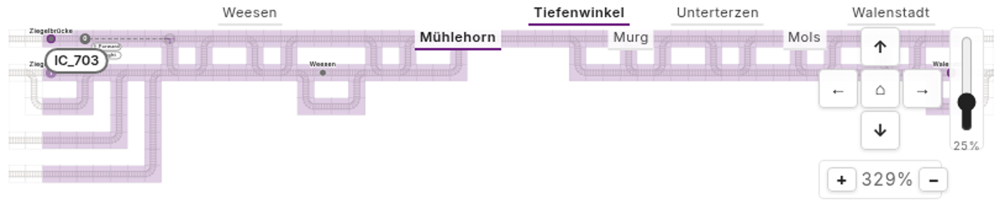 (IC_703 at step 4) |
| Recommendation | a recommendation card (`previewScenarioId`, the recommended policy's `/hmi/scenarios` run) | while the mouse is on a card, or the card is pinned ("Pin preview"); drawn through the "Trajectory" layer, so only with it on | the recommended course *replaces* the driver's line | train-type colour, half opacity | every train the recommendation moves | 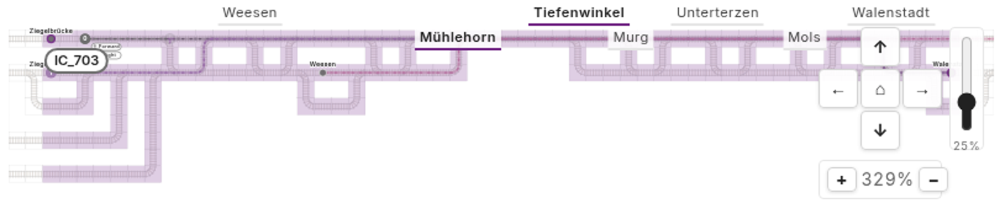 ("Switch to DLA" hovered) |
| Co-Learning | Plan / KI / Mensch or What-if Compare (`whatIfPreview`, `/proposals` or `/what-if-override`) | after a train is selected and its comparison computed (AI against plan), and again after an option is chosen (operator against AI); cleared on commit or when leaving | two dashed lines on top of each other | fixed: AI or plan yellow (`--app-whatif-ai`), operator blue (`--app-whatif-human`) | only the train in question | 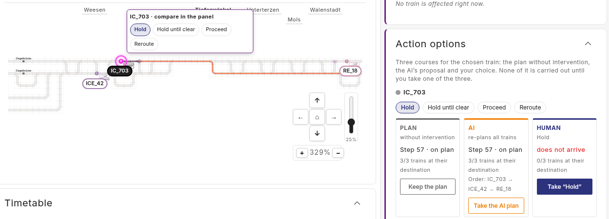 (IC_703, "Hold") |
| Director | a strategy tile (`directorPreviewPaths`, `directorPreviewDivergence`), or the committed plan (`directorPlanPaths`) | a tile's "Preview" on (or a committed option), branch mark hovered for the route; the committed plan while Director Weights is hovered or "All routes" is on | branch marks where a train departs, wait marks, the route on hover; the option strip A/B/C | plan colour per train (`getPlanColor`) | every train the option changes; all with "All routes" | 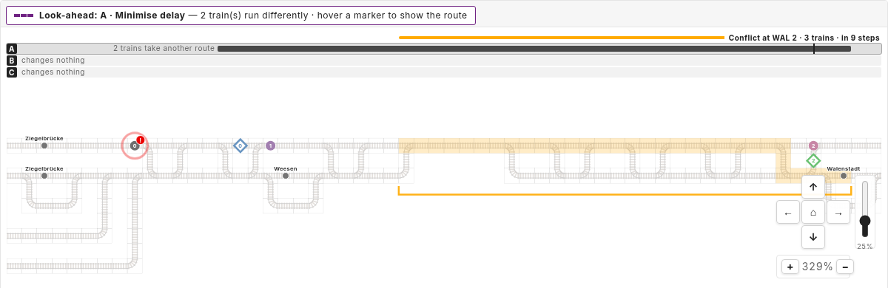 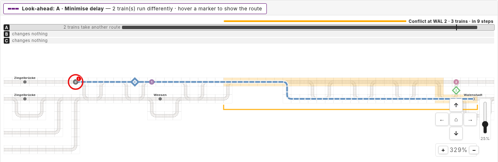 |

What the other modes lack compared with the Director:
- **No set path for all trains:** outside Director, only the selected or hovered train shows its course ahead.
- **No departure point:** the Recommendation preview replaces the course and Co-Learning overlays two full lines; only
  the Director marks where an alternative starts to differ (#199 bullet 3).
- **Three colour languages:** train-type colours (which repeat), yellow and blue for one train, and plan colours.
- **No refresh during play** for the Recommendation and Co-Learning lines: `/hmi/scenarios` and `/proposals` run
  after an action, not every few steps.

Screenshots: Walensee long approach (`pf-ch-wn-wal-long-approach`), sandbox build, 2026-11-16.

- Recommendation: on hover, thin lines in the trains' type colours (half opacity) appear along the recommended course
  of every train it moves; before, only IC_703's dashed past. Hard to tell apart from the track.
- Co-Learning: the AI course of IC_703 in the What-if yellow (`--app-whatif-ai`, orange-yellow on screen) to Walenstadt;
  the operator's "Hold" course (blue, `--app-whatif-human`) ends at the next switch, so it is barely visible; the
  panel says "does not arrive".
- Director: branch marks for the two trains option A moves, each in its plan colour, and the hovered train's route.

Scope: the change reads the existing forecast and draws it on the map. It changes no policy and no endpoint
(Q-4 may add a query flag).

## 4. Solution strategy

*The fundamental choices and why, the rules the design follows, how it is verified, and the design of each part.*

| Quality goal | Scenario | Solution approach | Details |
|---|---|---|---|
| NFR-1 Honest | The drawn path is the one the policy drives. | Draw the forecast of the driving policy, the same run the ZWL and Combined Actions use. | Q-1, §4.3 |
| NFR-2 Cheap | One request every 3 steps. | One throttled refresh in the store, shared by the ZWL and the map; backend memo per step. | §4.4 |
| NFR-3 Readable | Paths told apart. | The existing per-train plan colours and line style. | Q-3 |

### 4.1 Design principles

- **DP-1 The set path is the forecast of the driving policy.** Every policy has one, and it is what the train will
  do if nothing changes. (Q-1)
- **DP-2 No new endpoint.** The map reads the contentions forecast, which the ZWL already loads; Q-4 b adds only a
  query flag. (Q-1, Q-4)
- **DP-3 One refresh owner.** The store keeps the forecast current while a view needs it; the ZWL and the map only
  say that they need it. (§4.4)
- **DP-4 Draw like the existing route lines.** The map's dashed per-train route lines and plan colours, cut to the
  next N steps; only the blinking and the symbol's colour are new. (Q-3)
- **DP-5 The drawing does not know where the path comes from.** `flashAheadLines` takes a trajectories map
  (`{"<handle>": [{step, row, col}]}`), the shape every forked run returns, so #199's bullet 2 can feed an
  alternative's course. (Q-1)

Reused concepts:

| Need | Reused concept | Instead of |
|---|---|---|
| The path ahead of every train | `GET /hmi/contentions?trajectories=true`, `SessionStore.contentionForecast` | a new set-path endpoint, or a policy interface (follow-up) |
| Keeping it current during play | the ZWL's throttled refresh, moved into the store | a second timer in the map |
| Drawing a route per train | `_planLinesFrom` / `directorPlanLines`, `AgentColorService.getPlanColor` | a new overlay style |
| Turning it on and off, logging | `LayerVisibilityComponent`, the `LAYER_VISIBILITY_CHANGED` event pattern | a new panel |

Not new on purpose: no backend endpoint, payload field, policy method or forecast horizon changes.

### 4.2 Verification

Screenshots: Olten experiment scenario, Recommendation mode, English, before on `main` fd0c70cb, after on this
branch, by hand in the running app (`./start-demo.sh`).

| ID | Requirement | Test or check | Result | Screenshots |
|---|---|---|---|---|
| REQ-1 | Slider 0–20, 0 shows nothing | Spec for the cut of the forecast to the next N steps; in the app: 0, 5, 20 | | `flash-ahead-set-path/0-off.png`, `flash-ahead-set-path/20-ahead.png` |
| REQ-2 | All trains | In the app: every train on the map with a path | | as above |
| REQ-4 | Own colour per train, symbol in that colour | Spec: symbol colour switches at slider 0 ↔ 1; in the app: path and symbol match | | `flash-ahead-set-path/20-ahead.png` |
| REQ-3 | Current during play | In the app: play 30 steps, the paths move with the trains | | - |
| NFR-2 | At most one request per 3 steps | Store spec: the refresh is throttled and shared | | - |
| - | CI | lint:styles, i18n:check, production build, backend pytest | | - |

### 4.3 The slider and the drawing (REQ-1, REQ-2; Q-1, Q-2, Q-3, Q-4)

- `SessionStore.flashAheadSteps`: a signal 0–20, default 0 (Q-2).
- `LayerVisibilityComponent` gets a slider below its layer toggles. Changing it emits `FLASH_AHEAD_CHANGED` with the
  value, for the interaction log.
- `FlatlandMapComponent.flashAheadLines`: for each train, the forecast points with `now <= step <= now + N`, drawn
  with the existing route-line geometry (`_planLinesFrom`) in `getPlanColor(handle)`, blinking (Q-3). How held and
  rerouted trains show: Q-4.
- While `flashAheadSteps > 0`, `agentColor(handle)` returns `getPlanColor(handle)`, so the symbol matches its path
  (REQ-4). The selected train keeps the selection colour.
- Blinking: a CSS `@keyframes` animation on the line's opacity (no colour in it, so the stylelint gate is not
  touched), switched off under `prefers-reduced-motion: reduce`.
- Mockup (static, not the app; the blinking shows only in `mockup.html`):

  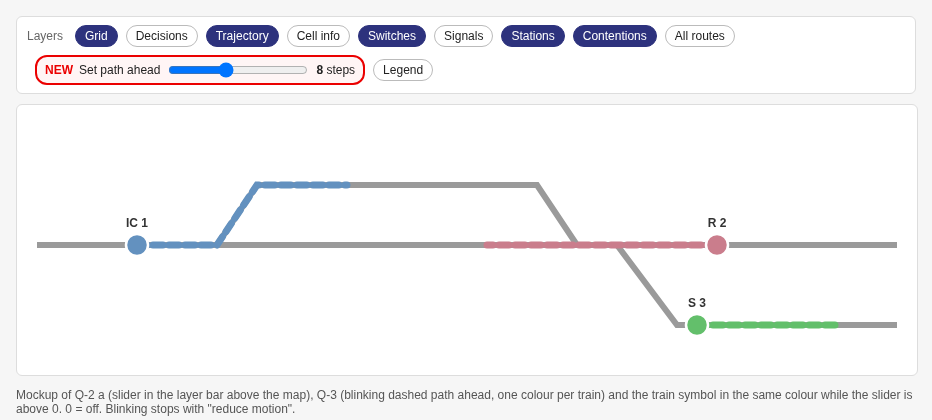

- In line with the Director overlays (§6.5): the same per-train plan colour (`getPlanColor`), the same dashed route
  line (`_planLinesFrom`), the selected train in the selection colour. What differs: the flash shows only the next N
  steps, for every train at once, blinks, and colours the train symbol too; the Director overlays show the whole
  route, and only for trains an option changes, or for one hovered train.

  | Existing: Director branch marks (option A on the map) | Existing: Director route line (branch mark hovered) | Planned: flash ahead (mockup) |
  |---|---|---|
  |  |  |  |

  In a Director session with the slider on, the flash lines run along the same route as the Director route line of
  that train (both come from the committed plan, §3.5), in the same colour.

### 4.4 Keeping the forecast current (REQ-3)

- The ZWL's refresh effect moves into the store as `keepContentionForecast(now)`: refresh when 3 steps have passed or
  time went back. The ZWL calls it as today; the map calls it while `flashAheadSteps > 0`. Both share the throttle,
  so two views send one request.

### 4.5 Integration with the interaction modes (REQ-1, REQ-2; Q-1)

- The flash is mode-independent: it shows the forecast of whatever drives the session (§3.5), in Recommendation,
  Co-Learning and Director alike. In Director mode that is the committed plan, so it agrees with the Director
  overlays; in the other modes it is DLA, the premade plan or the policy the operator picked.
- The slider is session-wide (Q-2 a), not per mode; a per-mode default (as `layer-mode-defaults.ts` has for the
  layers) can follow with the study setting.
- Nothing in the flash depends on `InteractionMode`, so no mode semantics change (AGENTS.md guardrail).

### 4.6 Later: the look-ahead of an alternative (#199 bullets 2 and 3, not in this PR)

- **Which alternative:** in Recommendation mode the AI recommends a policy switch (`/hmi/recommendations`, scored
  from the `/hmi/scenarios` runs, each with `trajectories`); in Plan / KI / Mensch the KI variant
  (`/proposals`, `variants[].trajectories`); in Director mode a strategy tile (`paths`).
- **The data is there:** each is a forked run with every train's positions; DP-5 lets the flash draw any of them.
- **Open: how two courses share the map ("how UI?")**, options for the follow-up:
  - a) the Director's pattern (§6.5): the set path as the flash, the alternative only as branch marks where a train
    departs from it, its route on hover. Already built for the Director tours.
  - b) both courses as lines: the set path solid-blinking, the alternative dashed in the same colour.
  - c) a switch "Fahrweg / Empfehlung" that shows one course at a time.
  Proposal for the follow-up: a, because it reuses the Director overlays and answers bullet 3 on the way: the branch
  mark sits at the first step where the alternative departs from the set path, which is how long the recommendation
  and the set path agree.

## 5. Building block view

### 5.1 Streckenspiegel and its forecast source

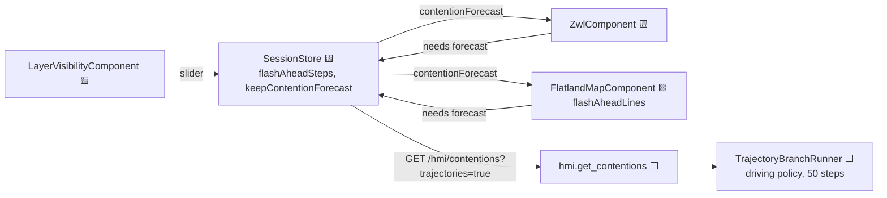

Notation: [flowchart in Mermaid](https://mermaid.js.org/syntax/flowchart.html); 🟩 added, 🟨 modified, ⬜ unchanged.

**Motivation:** the forecast already exists and serves the ZWL (DP-2); the store owns its refresh (DP-3); the map
only draws (DP-4).

**Contained building blocks:**

| Component | Responsibility | Change |
|---|---|---|
| `SessionStore` | Holds the session's state and the forecasts the views read. Not for drawing. | 🟨 modified: knows how far ahead to show, and keeps the forecast current for every view that needs it. |
| `LayerVisibilityComponent` | Lets the operator choose what the map shows. Not for the map's data. | 🟨 modified: a slider for how many steps ahead to show. |
| `FlatlandMapComponent` (Streckenspiegel) | Draws the network, the trains and their overlays. Not for computing routes. | 🟨 modified: shows every train's next N steps, blinking, each train and its path in its own colour. |
| `ZwlComponent` | Draws the time-distance diagram. | 🟨 modified: asks the store for the forecast instead of refreshing it itself; nothing visible changes. |
| `hmi.get_contentions`, `TrajectoryBranchRunner` | Forecast the driving policy from the current step. | ⬜ unchanged |

### 5.2 Forecasts and plans (context, unchanged)

*The building blocks that already produce a train's path ahead, and their interfaces.*

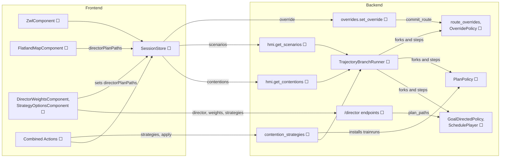

Notation: [flowchart in Mermaid](https://mermaid.js.org/syntax/flowchart.html); ⬜ unchanged.

**Motivation:** shown for context only. A route ahead exists in three policies (Director, premade plan, reroute),
but only the Director's reaches the frontend; every policy's path ahead reaches it through the forecasts (§3.3).
That is why Q-1 proposes the forecast.

**Contained building blocks:**

| Component | Responsibility | Change |
|---|---|---|
| `TrajectoryBranchRunner` | Forks the live env and steps a fresh policy on the fork, with given overrides, to a horizon; returns snapshots, conflicts and KPIs. Not for the live run. | ⬜ unchanged |
| `hmi.get_contentions` | The driving policy's course for the next 50 steps and the contentions on it, cached per step. Not for operator overrides (Q-4). | ⬜ unchanged (🟨 with Q-4 b: an `overrides` flag) |
| `hmi.get_scenarios` | The driving policy and each alternative to the episode's end, with the committed overrides, scored by KPI. Not refreshed during play. | ⬜ unchanged |
| `contention_strategies` | Keep, switch policy or PP re-plan for the most urgent contention, simulated alike; `apply` makes one drive the session. | ⬜ unchanged |
| `/director` endpoints | The Director's dials, plan info and `paths`; re-plan, verify, what-if, strategies. | ⬜ unchanged |
| `GoalDirectedPolicy`, `SchedulePlayer` | Plans every train's schedule under the dials and drives it; re-plans on malfunctions and weight changes. | ⬜ unchanged |
| `PlanPolicy` | Drives the trains along a trainrun (premade, or PP installed), by position and by order at each cell; trains off the plan fall to DLA. | ⬜ unchanged |
| `overrides.set_override`, `route_overrides`, `OverridePolicy` | Commit an operator's action for a train; for a reroute, fix the whole route and drive it each step. | ⬜ unchanged |
| `GET /hmi/plan` | The baseline timetable cell by cell, the ZWL's Soll. Not the plan the trains drive now. | ⬜ unchanged |

**Important interfaces:** the endpoints and payloads in §3.3.

## 6. Runtime view

*How the components work together at runtime: the flows and modes the change adds or changes, when it changes behaviour.*

### 6.1 Forecast during play (REQ-3; Q-1, Q-4)

*How the Streckenspiegel and the ZWL get every train's course ahead; the flow the change uses.*

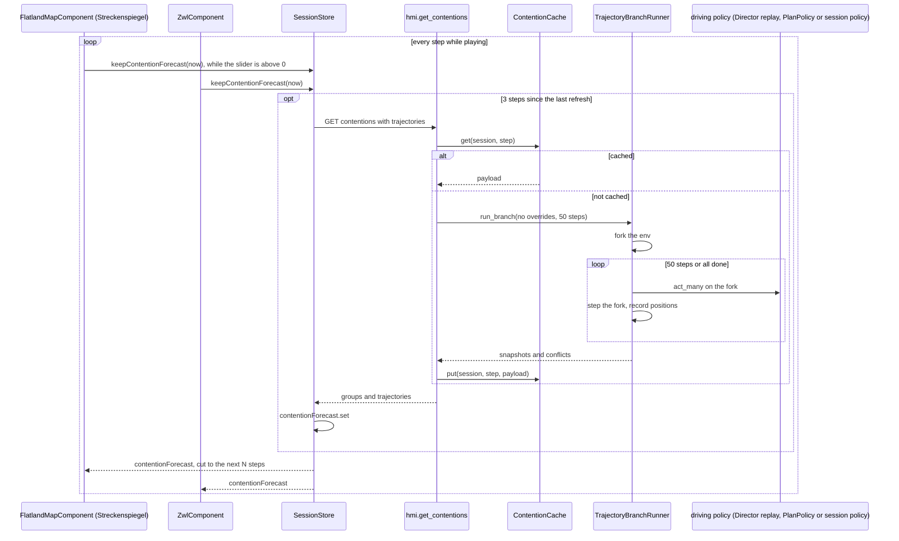

Notation: [UML sequence diagram in Mermaid](https://mermaid.js.org/syntax/sequenceDiagram.html). Today only the ZWL
does this, with its own throttle; S-2 moves the throttle into the store.

### 6.2 Director plan: planned, re-planned and drawn

*How the Director's plan is made and how the map gets its route ahead (context).*

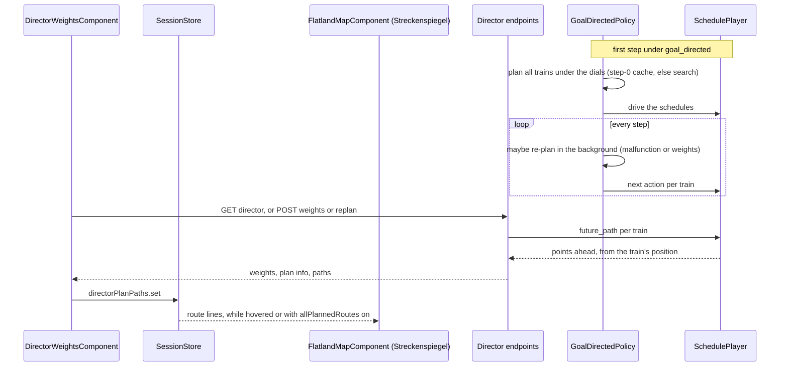

Notation: [UML sequence diagram in Mermaid](https://mermaid.js.org/syntax/sequenceDiagram.html). The strategy tiles
(`GET /director/strategies`) plan each focus on a fork and set `directorPreviewPaths` the same way.

### 6.3 Premade plan and PP re-plan

*How a plan comes into a session and what the frontend sees of it (context).*

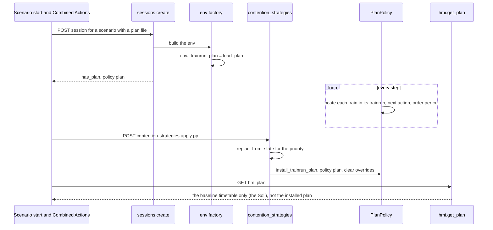

Notation: [UML sequence diagram in Mermaid](https://mermaid.js.org/syntax/sequenceDiagram.html). The plan the trains
drive now reaches the frontend only through the forecasts, which run `PlanPolicy` on the fork.

### 6.4 Operator reroute and hold

*How an operator's override is committed and driven, and what the forecasts make of it (context).*

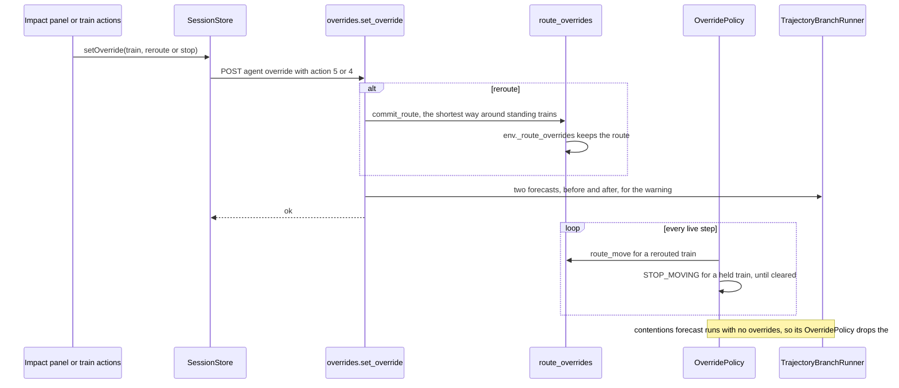

Notation: [UML sequence diagram in Mermaid](https://mermaid.js.org/syntax/sequenceDiagram.html). No endpoint serves
the committed route itself.

### 6.5 Director overlays in plan colour on the Streckenspiegel

*How the three overlays that use the plan colour today reach the map (context for REQ-4).*

The plan colour (`AgentColorService.getPlanColor`, one hue per train) is used only by the map's
`_planColorForHandle`, which gives the selected train the selection colour instead, for three Director overlays:
route lines (`directorPlanLines`), branch marks (`directorBranchMarks`) and wait marks (`directorHoldMarks`).

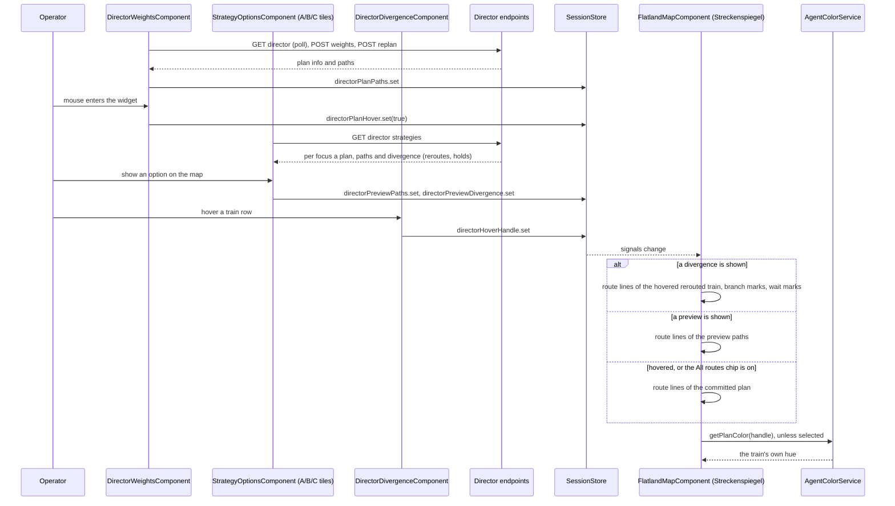

Screenshots (Director tour "Director only", Walensee long approach, step 20, option A "Minimise delay" shown on the
map): the branch marks of the two rerouted trains, each in its plan colour, and the route line of train 0 while its
mark is hovered. What else is on the pictures:

- **Dashed line** (`.director-plan-line`, plan colour): train 0's route under option A, from where it stands to its
  target.
- **Orange veil** (`.contention-window__cell`, layer "Conflicts ahead", token `--layer-color-contentions` at 22 %
  opacity): the track the contentions forecast has trains contending for.
- **Orange line below the track** (`.contention-bracket`, same layer): the bracket over that stretch, labelled above
  the map ("Conflict at WAL 2 · 3 trains · in 9 steps"); the long orange bar at the top is the same stretch on the
  option strip.
- **Red ring at train 0**: the train's malfunction (status bar: "1 malfunction(s)").
- **Strip A/B/C**: per option, which part of the line it changes ("2 trains take another route"; B and C "change
  nothing").

Notation: [UML sequence diagram in Mermaid](https://mermaid.js.org/syntax/sequenceDiagram.html). Hovering a branch
mark on the map also sets `directorHoverHandle`. Applying a tile (`POST /director/weights`) sets both
`directorPlanPaths` and the preview.

### 6.6 Existing: how Director mode drives a session and its forecasts

*How entering Director mode makes the Director plan drive the trains, and how forecasts follow it (context, §3.5).*

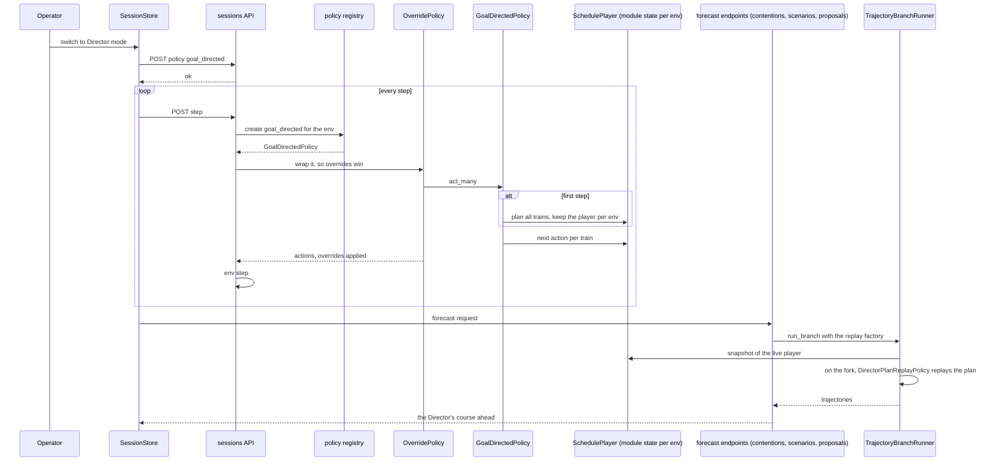

Notation: [UML sequence diagram in Mermaid](https://mermaid.js.org/syntax/sequenceDiagram.html). When the forecast
requests are sent today:

| Request | Trigger | Kind |
|---|---|---|
| `refreshForecasts()`: `/hmi/scenarios`, `/hmi/recommendations`, `/hmi/impact`, `/hmi/contentions` without trajectories | after a step sequence ends (step buttons, the opening step, episode end), an override set or cleared, a policy or KPI change, a Combined Actions strategy applied | event-based; not during Play |
| `refreshContentions(true)`: `/hmi/contentions` with trajectories | the ZWL, every 3 simulation steps while it is shown (`CONTENTION_REFRESH_STEPS`) | step-based |
| `GET /director` (plan info and `paths`, no rollout) | the Director Weights widget, every 2 s while it exists | time-based |
| `GET /director/strategies` | "Compute options" / "Recompute", and on entering Director; progress polled every 1 s while planning | on demand |

In the other modes the same flow runs with another policy from the registry; only the replay factory is Director-specific (for `plan`
it is `plan_branch_factory`).

### 6.7 Planned: flash ahead in every mode, and later an alternative

*How the flash gets its course in any mode (this PR), and where an alternative would come in (#199 bullet 2).*

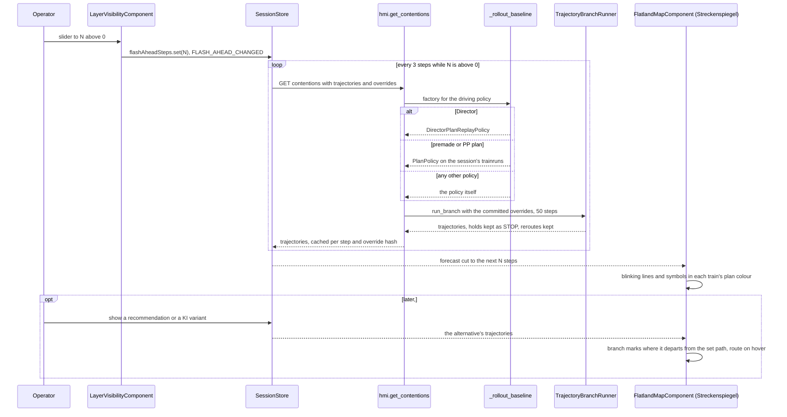

Notation: [UML sequence diagram in Mermaid](https://mermaid.js.org/syntax/sequenceDiagram.html). The `opt` block is
not in this PR (§4.6).

## 8. Crosscutting concepts

### 8.1 New patterns

Compared with `main`. What is reused, and what is not new on purpose, is in §4.1.

| ID | New | Defined in |
|---|---|---|
| PAT-1 | A numeric map setting next to the layer toggles (the slider), with its own bus event. | §4.3, Q-2 |

### 8.2 Breaking changes

None. No payload, endpoint or stored ID changes. `CONTENTION_REFRESH_STEPS` moves from the ZWL to the store, with
the same value.

## 9. Decisions

### 9.1 Open questions

💡 **(Q-1) Where does the set path come from?** Tentatively a) (chenkins, 2026-11-16).
- a) The forecast of the driving policy (`/hmi/contentions?trajectories=true`, 50 steps). Works for every policy,
  including PR #196's, with no backend change. It is the predicted course, not a locked route.
- b) A policy interface, as upstream's `SetPathPolicy`: `set_path(handle) -> [(cell, direction), ...]`. Real for
  Director, `PlanPolicy` and reroutes; our DLA port and PR #196's ROAM keep no route, so they would return a
  shortest-path guess that they may not follow (against NFR-1).
- c) b where a policy has a route, a otherwise.

How a) relates to the alternatives ("KI-Vorschlag", Plan / KI / Mensch, §3.4): the set path is the driver's
course, the same course `GET /proposals` returns as its `plan` variant. Each alternative is another forked run of the
same `TrajectoryBranchRunner`, with its own `trajectories`: the KI variants run `PlanPolicy` on a PP plan, the Mensch
variant the driver with the operator's choice, the strategy tiles A/B/C a Director re-plan per focus. So the alternatives need no
second mechanism: #199's bullet 2 draws an alternative's `trajectories` with the same flash lines, and bullet 3's
"how long the recommendation holds" is the first step where the alternative's position departs from the driver's.
To keep that open, `flashAheadLines` takes a trajectories map, not the forecast signal directly (DP-5).

*Proposal:* a now. b/c as a follow-up, once the DLA port follows upstream's `SetPathPolicy`; not in PR #196 (§3.2,
C-3).

✅ ~~**(Q-2) Where does the slider live, and is it a study setting?**~~ **Decided 2026-11-16:** a) in the layer
panel ("Layers" chips above the Streckenspiegel, §3.1, mockup in §4.3), after the chips, session-only, default 0.
Options were: a) the layer panel, b) a UI config item for study conditions, c) both. b stays a follow-up for the study
leads.

✅ ~~**(Q-3) What does "flash" look like?**~~ **Decided 2026-11-16:** blinking dashed lines, one colour per train
(`getPlanColor`), and the train's symbol in the same colour while the slider is above 0 (REQ-4). The blinking is a CSS
animation and stops under "reduce motion". Options were: a) steady dashed lines, b) blinking lines, c) highlighted
cells fading with distance. `allPlannedRoutes` is drawn under the flash lines, not hidden.

✅ ~~**(Q-4) What does a train with an operator override show?**~~ **Decided 2026-11-16:** b). An override is the operator's own action for one
train, which wins over the policy's until it is cleared (`OverridePolicy`). Two kinds matter here:
a **hold** ("Halten", action 4 `STOP_MOVING`): the train runs on to its next switch or merge and waits there, step after step, until the operator
releases it ("Freigeben") or a timed hold ends ("hält, bis Zug X frei ist"); and a **reroute** ("Umleiten", action 5):
the train drives a whole route around standing trains that the operator committed (§3.2). The contentions forecast
drops both (§3.3): for a held train it draws the path the policy would drive if released, for a rerouted train the
policy's own route.
- a) Hide the path of a train with a STOP override in the frontend. Reroutes stay wrong.
- b) A query flag `GET /hmi/contentions?trajectories=true&overrides=true`: the same run with the session's committed
  overrides (as `/hmi/scenarios` does), cached per (session, step, override hash). One more run per step while the
  slider is on; Combined Actions keeps its override-free forecast.
- c) Read the baseline of `/hmi/scenarios`, which already honours overrides. It runs to the episode's end with every
  alternative policy, and is not refreshed during play: too heavy (NFR-2).
- d) Accept the mismatch, as a limitation.

Chosen b: the only option that shows held and rerouted trains honestly (NFR-1); it reuses the contentions run and
its cache, and adds S-6.

✅ ~~**(Q-5) How does a held train continue once it is released, and what does the flash show?**~~ **Decided 2026-11-16:** a), follow-up [#204](https://github.com/flatland-association/flatland-ui-hub/issues/204). Answered from the
code in §3.4: the driving policy takes over from where the train stands. With Q-4 b the forecast keeps a hold as STOP
up to the horizon, so a held train shows no path ahead until it is released; on the next refresh after the release
its path appears. The open part is the live "hold until clear" ("hält, bis Zug X frei ist"): it is committed as a
plain hold and never released by itself (§3.4), while its hint and its Mensch forecast release it.
- a) A follow-up issue: release a committed "hold until clear" at its release step in the live run.
- b) Fix it in this PR.
- c) Leave it; the operator releases by hand.

Chosen a: it is a bug in the override flow, not in the flash; the flash shows it honestly (no path while held).

💡 **(Q-6) In Director mode, where does the flash get its course: the forecast or the Director's `paths`?** The
Director already serves `paths` (`plan_paths`, `SchedulePlayer.future_path`): every cell ahead with an estimated step,
from the train's position, malfunctions and planned waits included, without a rollout. The flash as planned asks the
contentions forecast, which for the Director replays the same plan on a copy (`DirectorPlanReplayPolicy`) for 50
steps.
- a) The forecast in every mode (DP-1). One rule; it includes the other trains and the operator's overrides (Q-4 b).
  Cost: one replay rollout per 3 steps, cached per step and shared with the ZWL; with no override committed the
  override hash is empty and the ZWL's run is reused, so nothing runs twice.
- b) In Director mode the `paths`; elsewhere the forecast. No rollout, but two sources: `future_path` knows neither the
  other trains' effect on timing nor the operator's holds, and the steps are the plan's estimate.
- c) The forecast, and in Director mode check it against `paths` (a debug overlay or a test), to see whether they
  agree.

*Proposal:* a. The duplicate is only the cheap replay; the flash then means the same in every mode. The only real
second run is when overrides are committed and the ZWL is shown at the same time (the ZWL asks without overrides);
S-2 can let the ZWL ask with overrides too while the slider is on.

### 9.2 Decision log

| Date | Decision | Why | Consequences |
|---|---|---|---|
| 2026-11-16 | ✅ Only the first bullet of #199 in this plan. | Asked by the maintainer. | Bullets 2-4 are follow-ups (§1.4). |
| 2026-11-16 | ✅ Branch off `main`. | Plan B runs on `main`. | C-2. |
| 2026-11-16 | ✅ The slider in the layer panel, session-only, default 0 (Q-2). | Next to the other map layers; study conditions can come later. A UI config item was not taken yet. | S-3; follow-up for a study setting. |
| 2026-11-16 | ✅ Forecast with the session's overrides on request (Q-4 b). | Held and rerouted trains must show what they will do (NFR-1). Hiding only held trains, the heavy scenarios run and accepting the mismatch were not taken. | S-6: a query flag and a cache key on `/hmi/contentions`; one more run per step while the slider is on. |
| 2026-11-16 | ✅ "Hold until clear" not released live: a follow-up issue (Q-5 a). | A bug in the override flow; fixing it here would widen the PR. | [#204](https://github.com/flatland-association/flatland-ui-hub/issues/204); the flash shows no path while held. |
| 2026-11-16 | 💡 Set path from the forecast of the driving policy, tentatively (Q-1 a). | Works for every policy without a backend change; a policy interface would be a guess for DLA and ROAM. | S-4; the policy interface is a follow-up. |
| 2026-11-16 | ✅ Blinking path, a colour per train, symbol in that colour while the slider is on (Q-3, REQ-4). | Asked by chenkins: the train must be matched to its path at a glance; train-type colours repeat. Steady lines and fading cells were not taken. | A CSS animation with a reduced-motion fallback; `agentColor` depends on the slider; S-4. |

### 9.3 Code Review Findings

No review yet.

### 9.4 Questions answered while planning

*Questions asked during the planning session of 2026-11-16 that are not decisions, with the answer and where the plan
holds the details.*

| Question | Answer | Details |
|---|---|---|
| Do policies hold a set path ("eingestellter Fahrweg")? | Upstream DLA does (`SetPathPolicy._set_paths`, the whole route); our DLA port does not (it walks the shortest path again every step). Director, `PlanPolicy` and operator reroutes hold a route; DLA and ROAM only compute the next action. | §3.2 |
| Does PR #196 (UC2 ROAM) plan ahead, and could a `SetPathPolicy` interface go into it? | No: one action per step, its check certifies only the next step. An interface there would return a guess; not in #196, a follow-up instead. | §3.2, Q-1, §1.4 |
| Can the set path be derived anyway? | Yes, from the forecast of the driving policy, which works for every policy. | §3.3, Q-1 |
| How do Director plans, premade plans and operator reroutes work, and how are their routes asked for? | Director plans under dials and serves `paths`; a premade plan is loaded into the env and driven by `PlanPolicy`; a reroute is a whole route kept on the env. Only the Director's route reaches the frontend directly. | §3.2, §5.2, §6.2-§6.4 |
| What are the interfaces of the existing forecasts? | One runner (`TrajectoryBranchRunner`) behind six endpoints, differing in policy, horizon, overrides and cache. | §3.3, §6.1, §6.6 |
| What is the layer panel? | The "Layers" chips above the Streckenspiegel (`LayerVisibilityComponent`). | §3.1, Q-2 |
| Can it blink, and do trains have their own colours? | Blinking by a CSS animation, off under "reduce motion". Train symbols use six repeating type colours; only route overlays have a colour per train (`getPlanColor`), which the flash uses for the line and the symbol. | Q-3, REQ-4 |
| What is a train the operator holds? | An override "Halten": the train stops at its next switch or merge and waits until released. | §3.4, glossary |
| How does a held train continue once released? | The driving policy takes over from where it stands, with its delay (DLA: shortest path; `PlanPolicy`: stays on its plan; Director: keeps its route). | §3.4, Q-5 |
| Does "hold until clear" release itself? | Not in the live run (the release step is dropped on commit); follow-up #204, with an event-feed reminder (Arbeitsvorrat) as option d. | §3.4, Q-5, #204 |
| Where is the plan colour used? | Only on the map, only for the Director overlays: route lines, branch marks, wait marks. | §6.5 |
| What do the dashed line, the orange veil and the orange line in the Director screenshot mean? | The train's route under the option; the track the contentions forecast has trains contending for; the bracket over that stretch. | §6.5 |
| How does the set path relate to the AI proposals ("KI-Vorschläge")? | Same mechanism: each alternative is another forked run with `trajectories`; the drawing takes any of them (DP-5). | Q-1, §3.4, §4.6 |
| Is "driving policy" the policy that drives the session? What are the "Director tiles"? | Yes, `session.policy`. The tiles are the strategy tiles A/B/C of Director mode. | glossary |
| How does Director mode plug in: a wrapper? | No: entering the mode switches the session's policy to `goal_directed`; the only wrapper is `OverridePolicy`, around every policy. Forecasts replay the plan. | §3.5, §6.6 |
| How does it integrate with the other modes? | The flash does not depend on the mode; it shows whatever drives the session. | §4.5, §6.7 |
| What does "the same look-ahead for a recommendation (how UI?)" mean? | Showing the AI proposal's course next to the set path; the data exists, the UI is open (Director pattern proposed). | §1.4, §4.6 |
| When must two courses share the map, how does Director mode show it, and what lacks elsewhere? | Whenever an alternative is shown; per mode differently. Elsewhere: no set path for all trains, no departure point, three colour schemes, no refresh during Play. | §3.6 |
| Is the forecast request event- or time-based, and is there duplicate work in Director mode? | Mostly event-based; the ZWL's is step-based, `/director` time-based. The Director replay is cheap and cached; a second run only with overrides and the ZWL at once. | §6.6, Q-6 |
| What are overrides, and what is the contentions forecast compared with a forecast? | An operator's per-train action that wins over the policy; the contentions forecast is the cheap per-step forecast of the driving policy, one of several forecasts. | glossary |
| How large will the diffs be? | About +390 / -15 lines in about 14 files, without the plan. | §12.3 |

## 10. Glossary

- **Streckenspiegel** (`FlatlandMapComponent`, i18n `map`): the track diagram with the trains on it. Not the ZWL.
- **ZWL** (`ZwlComponent`): the time-distance diagram.
- **Eingestellter Fahrweg, set path**: the route already set ahead of a train. In the field, the route locked by
  the interlocking up to the next signal. Here, the next N steps of the forecast (Q-1). Not the train's whole
  timetable route, and not a recommendation.
- **Forecast**: any run of a policy ahead on a copy of the live env (`TrajectoryBranchRunner.run_branch`), returning
  every train's positions per step, conflicts and KPIs; the live session is not touched. Not a guarantee: future
  malfunctions are unknown (the copy draws none). The kinds, with what runs behind them, how far, when, in which
  mode and how they show on screen: the table in §3.3.
- **Contentions forecast** (`GET /hmi/contentions`, `contentionForecast` in the store): the forecast of the driving
  policy the Combined Actions panel and the ZWL use, 50 steps ahead (`_CONTENTION_MAX_STEPS`) or until all trains are
  done, cached per step, cheap enough to refresh during Play. It returns the contention groups (trains that will
  compete for the same track) and, with `trajectories=true`, every train's positions per step. It runs without
  operator overrides by design (a coordinated action answers the coming contention, not a past stop); Q-4 b adds
  `overrides=true`. In Director mode it replays the committed plan (`DirectorPlanReplayPolicy`). The flash reads its
  first N steps (N ≤ 20). Not the scenarios forecast, which runs every policy to the episode's end and is refreshed
  only after an action.
- **Director's paths** (`plan_paths(env)`, `SchedulePlayer.future_path`, served as `paths` by `GET /director`,
  `POST /director/weights`, `POST /director/replan`; per tile by `GET /director/strategies`): the committed plan's
  cells still ahead of each train, from its position to its target (the whole rest of the plan, no horizon), each
  with the step it is expected there, malfunctions and planned waits included. Not a forecast: no run on a copy, so
  it knows neither delays from other trains nor the operator's holds. When: polled every 2 s by the Director Weights
  widget, and returned after a weight change, a re-plan or a strategy computation. Mode: Director only
  (`goal_directed`). On screen: the dashed route lines in plan colours (`directorPlanLines`): all trains with
  "All routes" or while Director Weights is hovered; a tile's preview as branch and wait marks with the route on
  hover (§6.5). Empty for a train that is done or off its plan.
- **Override** (`override_manager`, `AgentDTO.override_action`): an operator's action for one train that wins over
  the driving policy (`OverridePolicy`, which wraps every policy each step). Kept per session and train in memory,
  as an action number:
  - 1-3 (left, forward, right): applied once at the train's next switch or merge, then cleared;
  - 4 (`STOP_MOVING`, "Halten"): applied at the next switch or merge, then kept until cleared (see Hold);
  - 5 (`REROUTE_ACTION`, "Umleiten"): a whole route, fixed when committed (see Reroute).

  Set by `POST /agent/{h}/override`, through `TrainActionService` from the map's train popover, the ZWL and Marey
  decision pills, the agents table, the Impact panel, What-if Compare and Plan / KI / Mensch ("Mensch"); the Impact
  panel's localized blocking also holds affected trains as the system (`systemHold`, logged as owner "system").
  Cleared by `DELETE /agent/{h}/override` ("Freigeben"), when the train is done, and all at once when an AI or PP plan
  is taken over. Not a change of the plan or the policy.
- **Driving policy** (`session.policy`, the toolbar's "Policy"): the policy that drives the session, e.g. DLA,
  "Director Planner" (`goal_directed`) or the premade plan (`plan`). Forecasts run it on a copy of the env
  (`_rollout_baseline` in `hmi.py`, `_policy_factory_for_session` in `overrides.py`, the same rule): for the Director
  its committed plan, for `plan` the session's trainruns. Not an alternative.
- **Strategy tiles A/B/C** (`StrategyOptionsComponent`, "Choose a strategy"): in Director mode, three plans of the
  episode's remainder, one per focus ("Minimise delay", "Keep connections", "Maximise stability"), each with
  "Preview" on the map and "Commit". Not the Plan / KI / Mensch comparison.
- **Hold** ("Halten", override action 4 `STOP_MOVING`): the operator stops a train at its next switch or merge until
  it is released. Not a stop in the timetable.
- **Reroute** ("Umleiten", override action 5 `REROUTE_ACTION`): a whole route around standing trains, committed by
  the operator. Not a switch at the next decision.
- **Layer panel** (`LayerVisibilityComponent`): the "Layers" chips above the Streckenspiegel.
- **Flash ahead** (`flashAheadSteps`): how many steps of the set path the Streckenspiegel shows; 0 = off.
- **`SetPathPolicy`**: flatland-baselines' base class of DLA that keeps each train's route between steps. Not in this
  repo.

## 11. Execution plan and status

### 11.1 Steps

| ID | Findings | Step | Category | Severity | Commit message | Commit(s) | Needs | Blocked by |
|---|---|---|---|---|---|---|---|---|
| 💡 S-1 | - | The plan | docs | low | docs(plans): plan for the flash-ahead slider on the Streckenspiegel (#199). |  | - | - |
| 💡 S-2 | - | Move the ZWL's throttled forecast refresh into the store, with a spec | refactor | low | refactor(store): keep the contentions forecast current from the store, for every view that needs it. |  | S-1 | - |
| 💡 S-3 | - | `flashAheadSteps`, the slider, `FLASH_AHEAD_CHANGED`, i18n en/de/fr | feat | medium | feat(map): slider for how many steps ahead the Streckenspiegel shows. |  | S-2 | - |
| 💡 S-4 | - | `flashAheadLines` on the map (blinking, plan colour), the symbol in the plan colour while on, spec for the cut and the colour | feat | medium | feat(map): show every train's set path for the next steps on the Streckenspiegel. |  | S-3, S-6 | Q-1 |
| 💡 S-6 | - | `overrides=true` on `/hmi/contentions`, its own cache entry per override hash, a backend test | feat | medium | feat(hmi): forecast the contentions with the session's overrides on request. |  | S-1 | - |
| 💡 S-5 | - | Screenshots and the user doc | docs | low | docs(map): the flash-ahead slider, with screenshots. |  | S-4 | - |

## 12. Change inventory

### 12.1 New files

| File | Adds |
|---|---|
| `docs/plans/flash-ahead-set-path.md` | This plan. |
| `docs/plans/flash-ahead-set-path/mockup.{html,png}` | The mockup of the slider and the blinking paths. |
| `docs/plans/flash-ahead-set-path/*.png` | Before and after screenshots. |

### 12.2 Modified files

| File | Changes |
|---|---|
| `frontend/src/app/core/session.store.ts` | `flashAheadSteps`, `keepContentionForecast(now)`, `CONTENTION_REFRESH_STEPS`. |
| `frontend/src/app/core/events/event-types.ts` | `FLASH_AHEAD_CHANGED`. |
| `frontend/src/app/features/zwl/zwl.component.ts` | Calls `keepContentionForecast` instead of its own effect. |
| `frontend/src/app/features/layer-visibility/layer-visibility.component.{ts,html}` | The slider. |
| `frontend/src/app/features/flatland-map/flatland-map.component.{ts,html,scss}` | `flashAheadLines`, drawn with the route lines; the blink animation; `agentColor` in the plan colour while the slider is on. |
| `frontend/public/i18n/{en,de,fr}.json` | The slider's label and value text. |
| `backend/app/api/hmi.py`, `backend/app/core/contention_cache.py`, `backend/tests/` | Q-4 b: the `overrides` flag on `get_contentions`, the override hash in the cache key, a test. |

Unchanged on purpose: the policies, `TrajectoryBranchRunner`, the forecast horizon, the stored IDs.

### 12.3 Size estimate

Estimated lines added / removed per step, before writing the code (code, tests, i18n; without the plan and binaries):

| Step | Files | Code | Tests | Total |
|---|---|---|---|---|
| S-2 refresh into the store | `session.store.ts`, `zwl.component.ts`, store spec | +20 / -15 | +40 | ~ +60 / -15 |
| S-3 slider | `session.store.ts`, `event-types.ts`, `layer-visibility.component.{ts,html,scss}`, `i18n/{en,de,fr}.json` | +65 | +20 | ~ +85 |
| S-4 flash lines and symbol colour | `flatland-map.component.{ts,html,scss}` | +85 | +60 | ~ +145 |
| S-6 forecast with overrides | `hmi.py`, `contention_cache.py`, `test_hmi_contentions.py` | +20 | +50 | ~ +70 |
| S-5 user doc | a reference doc section, 2 screenshots | +30 | - | ~ +30 |
| **Sum** | about 14 files | ~ +220 / -15 | ~ +170 | **~ +390 / -15** |

Plus the plan itself (S-1, ~860 lines) and its material (`mockup.{html,png}`, 2 screenshots). The largest file
touched, `flatland-map.component.ts` (2365 lines), grows by about 50 lines: `flashAheadLines` reuses
`_planLinesFrom`, and `agentColor` gets one branch.
