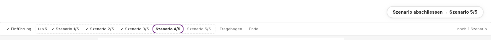
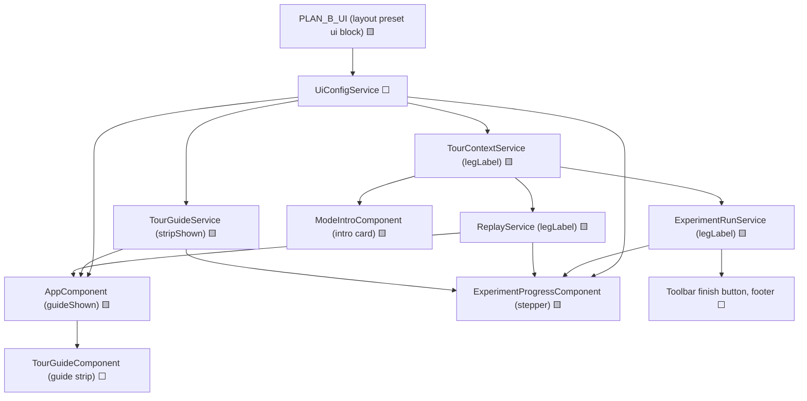

# Plan B without the guide strip and without scenario names (#198)

> **Status:** plan of 2026-11-16; phase 1 built 2026-11-16 (S-0 to S-5), phase 2 (the review findings F-1–F-10,
> S-6 to S-15) built 2026-11-16. Based on `main` fd0c70cb (#164 merged). Issue
> [#198](https://github.com/flatland-association/flatland-ui-hub/issues/198) ("Szenario-Balken ausblenden", label
> `plan b`). Branch `feature/198-hide-scenario-bar`, off `main` (on request; contributors usually branch off
> `explore_db`), PR not opened yet. Q-1 to Q-4 decided 2026-11-16 (§9.2).
>
> **Why:** in the Plan B study the participant should see only where they are in the experiment, not which scenario
> comes next, and should work without the step-by-step guide strip. Finishing a scenario («Szenario abschliessen»)
> must stay possible.

## 1. Introduction and goals

*What the change is for: the requirements, the qualities that matter, who has a stake, and what it leaves out.*

### 1.1 Requirements overview (functional requirements)

*The issue's text and the numbered requirements the rest of the plan refers to.*

> - [ ] Experiment Balken: Szenarien-Namen entfernen (nur Ablauf)
> - [ ] Szenario Balken ausblenden, keep "Szenario abschliessen".

The issue's two screenshots sit one bullet off: under the first bullet is the guide strip ("Verschobene Kreuzung an
der Einspur (4/5) · Betrieb 1 Konflikt erkennen … Lernen 6 Reflexion"), under the second the experiment stepper
("Einführung · ↻ ×5 · Tutorial (1/5) · Türstörung (2/5) … Fragebogen · Ende · noch 1 Szenario"). This plan reads
"Experiment-Balken" as the stepper and "Szenario-Balken" as the guide strip, as the bullets' words say.

Requirements:

- **REQ-1** The experiment stepper ("Experiment-Balken", `app-experiment-progress`) shows the run's course (briefing,
  scenarios, questionnaire, end, how many scenarios are left) without the scenarios' names.
- **REQ-2** The guide strip ("Szenario-Balken", `app-tour-guide`) is not shown.
- **REQ-3** The participant can still finish a scenario: the toolbar's «Szenario abschliessen → …» button stays.
- **REQ-4** Only Plan B changes (label `plan b`); other experiments and tours keep both bars as they are (Q-1).
- **REQ-5** The finish button names the next scenario by its number only: «Szenario abschliessen → Szenario 2/5»
  (added by the maintainer on 2026-11-16, after the walk-through; Q-2 revisited).
- **REQ-6** No other place names the scenario either: the footer reads "Plan B · Teilnehmer:in 01 · Szenario 4/5",
  the intro card's step "Szenario 4/5", and the card leaves out the scenario's title (added by the maintainer on
  2026-11-16, after S-3; Q-2 revisited again).

### 1.2 Quality goals (non-functional requirements)

*The few qualities the design must reach, each with a concrete scenario.*

| ID | Priority | Quality goal | Scenario |
|---|---|---|---|
| NFR-1 | 1 | Study data stay comparable | A Plan B run logs the same ids, events and record fields as before (`legId`, guide ticks, `data-log` click ids); only what is drawn changes. |
| NFR-2 | 2 | A replay shows what the participant saw | A Plan B record made before this PR replays with the guide strip and the scenario names; one made after, without them (F-2, added 2026-11-16). |

### 1.3 Stakeholders

*Who asks for the change, decides on it, reviews it or works with the result, and what they expect.*

| Role | Name | Expectations |
|---|---|---|
| Study lead Plan B (FHNW & SBB), issue author | (issue author) | Participants see the course of the experiment in the stepper without scenario names, and no guide strip. |
| Participants | Plan B study | Can finish each scenario without the guide. |
| Maintainer | flatland-association | Small, configurable change; other conditions unchanged. |

### 1.4 Follow-ups (not in this PR)

*What this PR leaves out, why, and where it goes later.*

| Follow-up | Why not in this PR | From | Findings | Issue |
|---|---|---|---|---|
| The intro card's description (`scenarioCard.paragraphs`, from the scenario's `scenario.json`) may name the scenario in its text. | Authored text, not a label; the study lead decides whether the texts change. | §2.1 | - | - |
| The hints of the Plan B guide (`PLAN_B_GUIDE_HINTS`) are no longer seen. | Requested by REQ-2; the strings stay for other uses (replay of older runs, a later decision to show the strip again). | §2.1 | - | - |

## 2. Constraints

*What limits the design from outside: platform, organisation and conventions.*

| ID | Constraint | Kind | Explanation |
|---|---|---|---|
| C-1 | Keep stored and logged ids | Convention | `AGENTS.md`: leg ids, `data-log` ids and UI-config ids must not change; the label is display only (`runContext()` records `legId`, not the label). |
| C-2 | No inline user-facing text | Convention | The unnamed label is a new key in `frontend/public/i18n/{en,de,fr}.json`; `npm run i18n:check` passes. |
| C-3 | UI restrictions of a condition travel with its layout | Technical | `UiConfigService.apply()` is called from `AppComponent.setRuntimeLayout()` with `LayoutPreset.ui` (`docs/plans/configurable-ui-plan.md` §4.1). |
| C-4 | The UI-config ids are listed in `ui-config.schema.json` | Technical | `ui-config-items.spec.ts` checks that the schema's `enum` matches `UI_CONFIG_ITEMS`. |

### 2.1 Limitations

*What the built code gets wrong or ignores, each with the TODO or issue that tracks it.*

- The intro card's description is authored text and is left as it is; if it names the scenario, the name is still
  seen there (§1.4). Checked 2026-11-16: only the tutorial's does («Das Tutorial-Szenario läuft langsam ab …»), the
  four UC2 descriptions don't.
- A replay applies the UI restrictions in the record's header only: a change during the session
  (`ui_state {key: 'uiRestrictions'}`, only when the layout changes mid-session, which no condition does) is not
  replayed, and records without `uiRestrictions` (before #146) get the layout's current block, as on `main` (§4.5).
- Without the strip, the step hints and the closing hint ("Alle Schritte während der Fahrt sind abgeschlossen …")
  are not seen; the strip's «Reflexion öffnen» is gone, the decision log's «Reflexion nachtragen» stays (§4.4).

### 2.2 Assumptions

*What must hold for the design to be correct, but is not checked in code.*

Not checked in code; they hold by construction of `PLAN_B_UI` and `STUDY_CONDITIONS`.

- Every Plan B condition (`plan-b-p01` … `plan-b-p10`, and the test run `plan-b-uc2`) uses the layout
  `preset-plan-b`, so `PLAN_B_UI` reaches all of them and no other condition.
- A record's `uiRestrictions` are what the participant had on screen: the interaction log takes them from
  `UiConfigService.snapshot()` at session start (`interaction-log.service.ts:108`), after the layout was applied.
  (Until S-7, a replay applied the layout's *current* `ui` block instead, F-2; §4.5.)
- The `TourGuideService` keeps ticking the steps while the strip is hidden, so what it logs does not change (NFR-1).

## 3. Context and scope (checked 2026-11-16 on `main` fd0c70cb)

*The code on the base branch that the change works in, as it is before the change, and where the change stops.*

Context:

- **Stepper** `frontend/src/app/features/experiment-progress/`: shown for a run with more than one leg
  (`app.component.html:156`, `multiLeg()`). Each leg's box shows `ExperimentRunService.legLabel(i)` (live) or
  `ReplayService.legLabel(i)` (replay). While a leg runs and the guide is active, two lines join the current leg's box
  to the guide strip below (`connected()`, `measure()`).
- **Leg label** "⟨name⟩ (k/N)" (`experimentRun.legLabel`), built in three places from
  `TourContextService.legName(leg)`: `ExperimentRunService.legLabel()` (`experiment-run.service.ts:113`),
  `ReplayService` (`replay.service.ts:114` and `:149`). It is shown in the stepper, the guide strip's leg title,
  the toolbar's finish button («Szenario abschliessen → ⟨label⟩», `finishLabel`, `toLeg`), the footer
  (`app.component.html:1089`), the intro card (`mode-intro.component.html:7`) and the Schichtbilanz
  (`tour-debrief.component.ts:108`, not in Plan B, which has none).
- **Guide strip** `frontend/src/app/features/tour-guide/`: shown when `AppComponent.guideShown()` (guide active, and
  in a multi-leg run only while a leg runs). The toolbar moves under it (`toolbarUnderGuide()`, #167). Its buttons:
  «Reflexion öffnen» (`canReflect()`) and «Schicht beenden» (only with a Schichtbilanz, so never in Plan B).
- **«Szenario abschliessen»** is the toolbar's finish button (`toolbar.component.html:105-110`,
  `[finishLabel]="experimentRun.finishLabel()"`), not part of either bar.
- **UI restrictions:** `UiConfigService.isHidden(id)` with ids from `UI_CONFIG_ITEMS` (`ui-config-items.ts`), the
  schema `frontend/public/ui-config.schema.json`, and Plan B's block `PLAN_B_UI` in `layout-presets.ts:696`.

Before (`plan-b-p01`, de, scenario 4 running): the stepper, the guide strip joined to it by two lines, then the
toolbar with «Szenario abschliessen». Every stage of the run: §4.2.

Scope: the change gates what the stepper, the leg label and the guide strip draw. It does not change the run's
flow, the guide's ticking, the records or the logs.

## 4. Solution strategy

*The fundamental choices and why, the rules the design follows, how it is verified, and the design of each part.*

| Quality goal | Scenario | Solution approach | Details |
|---|---|---|---|
| NFR-1 | Same ids, events, records | Gate only the presentation, through the existing UI restrictions; the guide service, the leg ids and the run phases are untouched. | §4.3, §4.4 |

### 4.1 Design principles

*The rules the design follows, each with its decision, the concepts it reuses instead of building new ones, and what
is not new on purpose.*

- **DP-1 What a condition removes from the screen is a UI restriction of its layout.** Two new `hidden` ids in
  `PLAN_B_UI`, not a `StudyCondition` field: the run's flow does not change, only what is drawn (Q-1).
- **DP-2 One place builds the leg label.** `TourContextService.legLabel()` decides between "⟨name⟩ (k/N)" and
  "Szenario k/N", for live runs and replays, so the stepper, the finish button, the footer, the intro card and the
  Schichtbilanz agree (Q-2, revisited twice).
- **DP-3 Gate presentation, not behaviour.** The guide service keeps running and logging; only `app-tour-guide` and
  its connector lines are not drawn (NFR-1, `AGENTS.md` "Gate presentation in the frontend").

Reused concepts:

| Need | Reused concept | Instead of |
|---|---|---|
| Plan B turns a bar off | `UiConfig.hidden` + `UI_CONFIG_ITEMS` + `PLAN_B_UI` | A new `StudyCondition` flag (like `shiftSummary`) or a briefing flag |
| A label without the name | The existing `experimentRun.legLabel` pattern, as a sibling key, built where `legName()` already is | Hiding the stepper's leg boxes, or one gate per place that shows a leg |
| A route to an open reflection without the strip | The decision log's «Reflexion nachtragen» (`reopenReflection()`) | A new button elsewhere |
| Finish a scenario | The toolbar's finish button (`finishLabel`) | A new button |

Not new on purpose: no new endpoint, record field, log event, setting or condition field; `TourGuideService`,
`ExperimentRunService`'s phases and `runContext()` stay as they are.

### 4.2 Verification

*How each requirement and quality goal is shown to work: tests, CI checks, before and after screenshots.*

Screenshots: Plan B `plan-b-p01` with `ui-configs/plan-b.json`, German, 1600×1000, production build served by the
backend; before on `main` fd0c70cb, after on this branch at f4f59f8e (S-4), both by
[`scripts/docshots-hide-scenario-bar.mjs`](../../scripts/docshots-hide-scenario-bar.mjs) (`before`, and `after` with
`PREVIEW=0`). The proposal shots of the plan (the same run with the change previewed in the page) were replaced by
these; they matched.

| ID | Requirement | Test or check | Result | Screenshots |
|---|---|---|---|---|
| REQ-1 | Stepper without names | `experiment-progress.component.spec.ts`: with `control.legNames` hidden the legs read "Scenario k/N" (en); a replay applies the recorded layout (§2.2) | ✅ "Szenario 1/5 … 5/5" in all five scenarios | 03c–07c below |
| REQ-2 | Guide strip hidden | `app.component.spec.ts`: with `control.guide` hidden `guideShown()` is false and the toolbar stays at the top; `experiment-progress.component.spec.ts`: no connector | ✅ no strip, no lines, toolbar at the top | 03b–07b below |
| REQ-3 | «Szenario abschliessen» stays | Running app: the toolbar shows «Szenario abschliessen → …» and leads to the next scenario | ✅ the walk-through finishes every scenario with it | 03c–07c below |
| REQ-5 | Finish button by number | `experiment-run.service.spec.ts`: with `control.legNames` hidden `finishLabel` reads «Finish scenario → Scenario 2/2» (en)| ✅ «Szenario abschliessen → Szenario 2/5 … 5/5», then «→ Fragebogen» | 03c–07c below |
| REQ-6 | Footer and intro card by number | `experiment-run.service.spec.ts`: `currentLegLabel` reads "Scenario 1/2"; `mode-intro.component.spec.ts`: no title; `replay.service.spec.ts`: a replay numbers too | ✅ footer "… · Szenario 4/5 · Co-Learning", intro card "SZENARIO 4/5" without title; except the tutorial's own description, which says «Das Tutorial-Szenario …» (§1.4) | 03a–07a below |
| REQ-4 | Only Plan B | `ui-config.service.spec.ts`: `preset-plan-b` hides both ids, no other layout does | ✅ | - |
| NFR-2 | Replay shows what was seen | `replay.service.spec.ts`: `uiRestrictions` from the header, null without; `app.component.spec.ts`: a record from before this PR replays with the strip and the names, one without `uiRestrictions` with today's block (S-7) | ✅ | - |
| NFR-1 | Same study data | Full suite green; `app.component.spec.ts`: the guide stays active (ticks and logs) with the strip hidden; leg ids and records untouched | ✅ | - |

Walk-through of every Plan B stage (scenario order of `plan-b-p01`): before
[`before-walkthrough.gif`](hide-scenario-bar/before-walkthrough.gif), after
[`after-walkthrough.gif`](hide-scenario-bar/after-walkthrough.gif) (full screens, 1.8 s per stage).

| Stage | What | Before | After |
|---|---|---|---|
| 01 | Start screen (unchanged) | [before](hide-scenario-bar/before-01-picker.png) | [after](hide-scenario-bar/after-01-picker.png) |
| 02 | Briefing (unchanged) | [before](hide-scenario-bar/before-02-briefing.png) | [after](hide-scenario-bar/after-02-briefing.png) |
| 03a | Scenario 1/5 (Tutorial): intro card | [before](hide-scenario-bar/before-03a-intro.png) | [after](hide-scenario-bar/after-03a-intro.png) |
| 03b | Scenario 1/5: working screen | [before](hide-scenario-bar/before-03b-running.png) | [after](hide-scenario-bar/after-03b-running.png) |
| 03c | Scenario 1/5: the bars above the map | [before](hide-scenario-bar/before-03c-bars.png) | [after](hide-scenario-bar/after-03c-bars.png) |
| 04a | Scenario 2/5 (Verschobene Kreuzung an der Einspur): intro card | [before](hide-scenario-bar/before-04a-intro.png) | [after](hide-scenario-bar/after-04a-intro.png) |
| 04b | Scenario 2/5: working screen | [before](hide-scenario-bar/before-04b-running.png) | [after](hide-scenario-bar/after-04b-running.png) |
| 04c | Scenario 2/5: the bars above the map | [before](hide-scenario-bar/before-04c-bars.png) | [after](hide-scenario-bar/after-04c-bars.png) |
| 05a | Scenario 3/5 (Mühlehorn - Tiefenwinkel): intro card | [before](hide-scenario-bar/before-05a-intro.png) | [after](hide-scenario-bar/after-05a-intro.png) |
| 05b | Scenario 3/5: working screen | [before](hide-scenario-bar/before-05b-running.png) | [after](hide-scenario-bar/after-05b-running.png) |
| 05c | Scenario 3/5: the bars above the map | [before](hide-scenario-bar/before-05c-bars.png) | [after](hide-scenario-bar/after-05c-bars.png) |
| 06a | Scenario 4/5 (Türstörung): intro card | [before](hide-scenario-bar/before-06a-intro.png) | [after](hide-scenario-bar/after-06a-intro.png) |
| 06b | Scenario 4/5: working screen | [before](hide-scenario-bar/before-06b-running.png) | [after](hide-scenario-bar/after-06b-running.png) |
| 06c | Scenario 4/5: the bars above the map | [before](hide-scenario-bar/before-06c-bars.png) | [after](hide-scenario-bar/after-06c-bars.png) |
| 07a | Scenario 5/5 (Blockierte Fahrbahn): intro card | [before](hide-scenario-bar/before-07a-intro.png) | [after](hide-scenario-bar/after-07a-intro.png) |
| 07b | Scenario 5/5: working screen | [before](hide-scenario-bar/before-07b-running.png) | [after](hide-scenario-bar/after-07b-running.png) |
| 07c | Scenario 5/5: the bars above the map | [before](hide-scenario-bar/before-07c-bars.png) | [after](hide-scenario-bar/after-07c-bars.png) |
| 08 | Final questionnaire (unchanged) | [before](hide-scenario-bar/before-08-final-survey.png) | [after](hide-scenario-bar/after-08-final-survey.png) |
| 09 | End (unchanged) | [before](hide-scenario-bar/before-09-end.png) | [after](hide-scenario-bar/after-09-end.png) |

Scenario 4 (`06c`), before and after:

Read from the page:

| Where | Before | After |
|---|---|---|
| Stepper, scenario 4 running | ✓ Tutorial (1/5) · ✓ Verschobene Kreuzung an der Einspur (2/5) · ✓ Mühlehorn - Tiefenwinkel (3/5) · **Türstörung (4/5)** · Blockierte Fahrbahn (5/5) | ✓ Szenario 1/5 · ✓ Szenario 2/5 · ✓ Szenario 3/5 · **Szenario 4/5** · Szenario 5/5 |
| Guide strip | shown, under the stepper | hidden |
| Finish button, scenario 4 | «Szenario abschliessen → Blockierte Fahrbahn (5/5)» | «Szenario abschliessen → Szenario 5/5» |
| Finish button, scenario 5 | «Szenario abschliessen → Fragebogen» | the same |
| Intro card | step "Türstörung (4/5)", title "Türstörung" | step "Szenario 4/5", no title |
| Footer | "Plan B · Teilnehmer:in 01 · Türstörung (4/5) · Co-Learning" | "Plan B · Teilnehmer:in 01 · Szenario 4/5 · Co-Learning" |

### 4.3 Scenario names (REQ-1, REQ-5, REQ-6; Q-2, Q-3)

- New UI-config id `control.legNames` ("Scenario names of an experiment: stepper, finish button, footer, intro card;
  numbered only").
- New i18n key `experimentRun.legUnnamed` ("Szenario {{k}}/{{n}}", en "Scenario {{k}}/{{n}}", fr
  "Scénario {{k}}/{{n}}", Q-3), the sibling of `experimentRun.legLabel`.
- New `TourContextService.legLabel(leg, index, count)`: with the id hidden `experimentRun.legUnnamed`, else
  `experimentRun.legLabel` with `legName(leg)` as before. `ExperimentRunService.legLabel()` and `ReplayService`
  (`legLabel()`, `introStep`) call it instead of building the label themselves, so every place that shows a leg
  follows: the stepper, the finish button («Szenario abschliessen → Szenario k/N»), the footer and the intro card's
  step (`currentLegLabel`), the guide strip's title and the Schichtbilanz rows (neither shown in Plan B).
  `TourContextService` gets `UiConfigService` injected (no cycle: `UiConfigService` depends only on `HttpClient` and
  `ui-config-items`).
- The intro card's title is the scenario's title, which is its name: `ModeIntroComponent` leaves it out where
  `TourContextService.legNamesHidden()`, and the image's alt text is empty then (the step above counts it).

### 4.4 Guide strip (REQ-2, REQ-3; Q-4)

- New UI-config id `control.guide` ("Guide strip: steps and hints of the running scenario").
- `AppComponent.guideShown()` adds `&& !uiConfig.isHidden('control.guide')`; with it `toolbarUnderGuide()` is false
  and the toolbar stays at the top, where it is in a run without a guide (Q-4).
- `ExperimentProgressComponent.connected()` adds the same check, so no connector lines point at a missing strip.
- The toolbar's finish button stays (REQ-3); only its text changes (§4.3). «Schicht beenden» is not shown in Plan B anyway (no
  Schichtbilanz). «Reflexion öffnen» goes with the strip; the decision log's «Reflexion nachtragen» stays the route
  (Plan B does not hide the decision log, `PLAN_B_UI`'s comment).

### 4.5 Phase 2: Review findings (F-1–F-10; NFR-2)

The findings of the code review of 2026-11-16 (§9.3), one step each, fixes first. The ones that need design:

- **F-2, a replay shows the recorded restrictions** (S-7). `ReplayService` gets `uiRestrictions`: the header's
  `uiRestrictions` of the leg on screen (`hidden`, `collapsedByDefault`, `policyAllowlist`), null for a record
  without them. The replay effect in `AppComponent` (`app.component.ts:1672-1684`) applies them with
  `UiConfigService.apply()` right after `setRuntimeLayout()`, and again when the leg on screen changes; leaving the
  replay restores the layout chosen before, as today. A record without them keeps today's behaviour (the layout's
  current block). The merge rule of `UiConfigService` stays: the deployment file still wins over the record, which
  is right for a deployment that hides more, and the record already contains what the deployment hid then. This
  changes every replay, not only Plan B's (decided 2026-11-16, §9.2).
- **F-3, hide the strip only where nothing depends on it** (S-8). As `control.playback` does: a comment on the item,
  and a `study-conditions.spec.ts` guard that every condition whose layout hides `control.guide` has
  `shiftSummary: false` (no «Schicht beenden» needed) and does not hide `widget.decision-log` («Reflexion
  nachtragen» stays). A deployment `ui-config.json` is not checked, as for `control.playback`.
- **F-7, one place decides whether the strip is drawn** (S-12). `TourGuideService.stripShown`: the guide is active
  and `control.guide` is not hidden. `AppComponent.guideShown()` and `ExperimentProgressComponent.connected()` read
  it instead of `active()` and their own check.
- The others are local: F-4 the image's alt text is the step label (S-9); F-5 drop `ExperimentRunService.legName()`
  (S-10); F-6 `legLabel()` reads `legNamesHidden()` (S-11); F-1 comments name the plan, not #198 (S-6); F-9 the
  README sentence (S-13); F-10 the script counts the legs and shows the `after` run (S-14); F-8 the REQ-6 result
  names the exception (S-15, fixed in this revision).

## 5. Building block view

*The components the change adds or changes: an overview, why the system is split this way, what each is responsible
for, the important interfaces, and the planned data model.*

### 5.1 Plan B working screen

*One white box: its building blocks, why it is split this way, and the interfaces between them.*

Notation: [flowchart in Mermaid](https://mermaid.js.org/syntax/flowchart.html); 🟩 added, 🟨 modified, ⬜ unchanged;
an arrow reads "is used by".

**Motivation:** the restriction is declared once, on the layout (DP-1); the leg label is decided once, where the
leg's name is looked up (DP-2); the strip itself stays as it is and is just not placed (DP-3).

**Contained building blocks:**

| Component | Responsibility | Change |
|---|---|---|
| `PLAN_B_UI` | What the Plan B study removes from the screen. Not the run's flow (that is the `StudyCondition`). | 🟨 modified: Plan B participants see no guide strip and no scenario names. |
| `UI_CONFIG_ITEMS` / `ui-config.schema.json` | The ids a layout or deployment may hide. Not where they are applied. | 🟨 modified: two new ids, `control.guide` and `control.legNames`. |
| `AppComponent` | Places the working screen's bars, and which layout a replay shows. Not what the bars show. | 🟨 modified: leaves the guide strip out where it is hidden; a replay shows the restrictions it was recorded with (F-2). |
| `TourContextService` | The running tour's or leg's texts and scenario data, and how a leg is labelled. Not the run's phases (`ExperimentRunService`). | 🟨 modified: names a leg "Szenario k/N" where names are hidden. |
| `ExperimentProgressComponent` | The stepper of a multi-leg run. Not the steps inside a leg. | 🟨 modified: draws no lines to a hidden guide strip. |
| `ExperimentRunService` / `ReplayService` | The run's legs and phases, live or recorded. Not how a leg is labelled. | 🟨 modified: take the leg label from `TourContextService`, so the stepper, finish button and footer number the scenarios; a replay also hands over the UI restrictions it was recorded with (F-2). |
| `TourGuideService` | The guide's steps and which are done, live or recorded. Not where the strip sits on screen. | 🟨 modified: says whether the strip is drawn, for the strip and the stepper's lines alike (F-7). |
| `ModeIntroComponent` | The intro card before a scenario. Not the scenario's text. | 🟨 modified: no scenario title where names are hidden. |
| `TourGuideComponent` | The steps and hints of the running leg. | ⬜ unchanged |
| Toolbar finish button | Finishes the scenario; shows `finishLabel`. | ⬜ unchanged |

## 8. Crosscutting concepts

*What the change introduces that other code will follow, and what it changes for existing callers.*

### 8.1 New patterns

*What is new compared with the base branch.*

Compared with `main` fd0c70cb. What is reused, and what is not new on purpose, is in §4.1.

| ID | New | Defined in |
|---|---|---|
| PAT-1 | A UI-config id that changes a text instead of removing an element (`control.legNames`: the label loses its name, the box stays). | §4.3, Q-2 |
| PAT-2 | A replay shows a run with the UI restrictions recorded in its header (`uiRestrictions`), not with the current `ui` block of its layout; records without them keep the old behaviour. | §4.5, F-2 |

### 8.2 Breaking changes

*What breaks for whom, and the migration path.*

None for callers: no signature changes, and without the new ids nothing is drawn differently. A `ui-config.json` that lists the new ids needs this version (the schema rejects unknown
ids before).

Changed behaviour, not breaking: every replay of a record that has `uiRestrictions` shows those, not the layout's
current block (PAT-2, S-7). Who sees it: whoever replays records whose layout block changed since (Plan B records
from before #167, #168 and this PR). Records without the field replay as before; nothing is migrated.

## 9. Decisions

*The decisions behind the plan: the questions still open, the decisions taken, and how each review finding was settled.*

### 9.1 Open questions

*Choices not made yet, each with its options and a proposal.*

All decided 2026-11-16 by the maintainer; the options stay for the record.

~~**(Q-1) Where does the change apply?**~~ **Decided 2026-11-16:** a), Plan B only.
- a) Plan B only, through `PLAN_B_UI` (the ten participant conditions and the test run `plan-b-uc2`); other
  experiments and tours unchanged.
- b) Every guided condition with several legs (a `StudyCondition` field or a code default).
- c) Everywhere, the guide strip removed for good.

*Proposal:* a): the issue is labelled `plan b`, and `PLAN_B_UI` is where Plan B's other removals already live (#145,
#167, #168).

~~**(Q-2) Where are the scenario names dropped?**~~ **Decided 2026-11-16:** b), only in the stepper. **Revisited
2026-11-16** after the walk-through: the stepper and the finish button («Szenario abschliessen → Szenario 2/5», REQ-5).
**Revisited again 2026-11-16** after S-3: everywhere, a) (REQ-6).
- a) Everywhere the leg label "⟨name⟩ (k/N)" shows: stepper, finish button («Szenario abschliessen → Szenario 3/5»),
  footer, intro card (and the hidden strip's title).
- b) Only in the stepper, as the issue's first bullet says; the finish button still names the next scenario
  («Szenario abschliessen → Blockierte Fahrbahn (3/5)»).

*Proposal:* a): with b) the next scenario's name is still one click away on the button, which defeats "nur Ablauf".

~~**(Q-3) What does a leg without its name read?**~~ **Decided 2026-11-16:** a), "Szenario 2/5".
- a) "Szenario 2/5" (en "Scenario 2/5", fr "Scénario 2/5"), the tutorial included.
- b) Only "2/5".
- c) The tutorial keeps its name ("Tutorial (1/5)"), the others read "Szenario k/N".

*Proposal:* a): reads well in the finish button and the footer; c) needs a per-leg flag for one leg.

~~**(Q-4) Where does the toolbar go without the guide strip?**~~ **Decided 2026-11-16:** a), at the top.
- a) At the top, above the stepper, as in a run without a guide (no code).
- b) Under the stepper, where it sits under the strip today (#167).

*Proposal:* a) for this PR; check in the running app (S-2) and switch to b) if the stepper then reads detached from
the map.

### 9.2 Decision log

*Every decision by date, with why it was taken and what follows from it.*

| Date | Decision | Why | Consequences |
|---|---|---|---|
| 2026-11-16 | ✅ Branch off `main`, not `explore_db`. | Asked for with the plan. | The PR targets `main`. |
| 2026-11-16 | ✅ Plan B only, through `PLAN_B_UI` (Q-1, §4.1). | The issue is labelled `plan b`; Plan B's other removals live there (#145, #167, #168). Not a `StudyCondition` field: the flow doesn't change. | Two new UI-config ids; other conditions unchanged (REQ-4). |
| 2026-11-16 | ~~✅ Names dropped in the stepper only (Q-2, §4.3).~~ Replaced by the decision below of the same day. | As the issue's bullet says. | - |
| 2026-11-16 | ✅ "Szenario 2/5", the tutorial included (Q-3, §4.3). | Reads as a course step; "2/5" alone is terse, a named tutorial needs a per-leg flag. | One new i18n key in en, de, fr. |
| 2026-11-16 | ✅ Toolbar at the top without the strip (Q-4, §4.4). | Where it is in any run without a guide; no code. | Checked in the running app in S-2. |
| 2026-11-16 | ~~✅ (Q-2) revisited: names dropped in the stepper and the finish button (REQ-5, §4.3).~~ Replaced by the decision below of the same day. | The walk-through showed «Szenario abschliessen → Blockierte Fahrbahn (5/5)» naming the next scenario, which the stepper no longer does. The footer and the intro card were not asked for. | One id covers both (`control.legNames`); a second gate point in `ExperimentRunService.finishLabel`; footer and intro card stay a follow-up (§1.4). |
| 2026-11-16 | ✅ (Q-2) revisited again: no place names the scenario (REQ-6, §4.3). | After S-3 the footer and the intro card were the last places with the name; the maintainer asked to close that follow-up. `control.legNames` was not pushed yet, so it was widened instead of adding a second id. | The gate moved into one place, `TourContextService.legLabel()`, replacing S-1's two gate points; the intro card leaves out the scenario's title. |
| 2026-11-16 | ✅ The review findings F-1–F-10 are steps of this PR (phase 2), F-2 included (§4.5). | The maintainer's choice after the code review. F-2 as a follow-up was not taken: this PR is what makes older Plan B replays wrong. | Steps S-6–S-15; PAT-2; F-2 changes every replay, not only Plan B's (§8.2). |

### 9.3 Code Review Findings

*Findings from code reviews, PR comments and TODOs, with their status and the commits that fix them.*

No PR open yet; branch based on `main` fd0c70cb, checked 2026-11-16 at 9144c28f. F-1 comes from the issue-reference
check of the `main..HEAD` diff; there are no review comments and no TODOs added. Code review findings (F-2–F-10)
were added on 2026-11-16, at 9144c28f; their line numbers refer to it. In Fixed, ✅ marks a fixed finding and
⏭️ one taken over by a follow-up (§1.4); "resolved" in Source marks threads resolved and checkboxes ticked on GitHub;
⚠️ marks a comment resolved on GitHub without a code change and without a reason; ❌ next to ✅ marks a finding fixed
in the code whose PR comment is not resolved on GitHub yet.

| Fixed | ID | Source | Category | Severity | Finding | Commit message |
|---|---|---|---|---|---|---|
| ✅ | F-1 | code review | docs | low | The code refers to the issue this PR closes, #198, in 16 comments and spec names: `app.component.ts:681`, `app.component.spec.ts:59`, `ui-config-items.ts:40,45`, `ui-config.service.spec.ts:85`, `experiment-run.service.ts:112`, `experiment-run.service.spec.ts:163`, `tour-context.service.ts:255`, `layout-presets.ts:706,707`, `replay.service.spec.ts:290`, `experiment-progress.component.spec.ts:64,75`, `mode-intro.component.html:7,14`, `mode-intro.component.spec.ts:41`. Once #198 is closed they point at a closed issue; most already name the plan (`docs/plans/hide-scenario-bar.md` §4.3, §4.4), which is enough. Fixed in cb2bae3d (S-6): the comments and spec names point at the plan section. | docs(experiment-run): point the comments of the Plan B bars at the plan, not at the closed issue. |
| ✅ | F-2 | code review | bug | medium | `app.component.ts:1682`, `replay.service.ts` (no use of the header's `uiRestrictions`): a replay applies the *current* `ui` block of the recorded layout id, not the restrictions stored in the record (`session-record.ts:98`). A Plan B record made before this PR now replays without the guide strip and with "Szenario k/N", which the participant did not see; the §2.2 assumption says the opposite. On `main` the replay applied the current block as well (#167 and #168 changed `PLAN_B_UI` too), but #198 makes it visible in every older Plan B replay. Fix: in a replay, apply the record's `uiRestrictions` (`hidden`, `collapsedByDefault`, `policyAllowlist`), falling back to the layout's block for records without it. Fixed in 2f4e4579 (S-7). | fix(replay): show a run with the UI restrictions it was recorded with, not today's layout block. |
| ✅ | F-3 | code review | robustness | medium | `ui-config-items.ts:42`: `control.guide` can be hidden by any layout or by the deployment's `ui-config.json`. With the strip go its «Schicht beenden» (the only route to the Schichtbilanz outside the Director bar) and «Reflexion öffnen». A tour with a Schichtbilanz that hides the strip strands the participant before the Schichtbilanz. Fix as for `control.playback`: say it on the item, and a `study-conditions.spec.ts` guard that every condition whose layout hides `control.guide` has `shiftSummary: false` and keeps the decision log. Fixed in 4ecd8844 (S-8). | test(study-conditions): hide the guide strip only where the run has no Schichtbilanz and keeps the decision log. |
| ✅ | F-4 | code review | accessibility | low | `mode-intro.component.html:26`: with names hidden the scenario image gets `alt=""`, so screen readers skip it although it shows the scenario's map. Fix: use the step label ("Szenario 4/5") as alt text. Fixed in 7929e5d2 (S-9). | fix(mode-intro): describe the scenario image by its number where names are hidden. |
| ✅ | F-5 | code review | dead-code | low | `experiment-run.service.ts:108`: `ExperimentRunService.legName()` has no callers since S-4 (its `legLabel()` delegates to `TourContextService.legLabel()`). A later caller could show a raw name past the `control.legNames` gate (DP-2). Fix: remove it. Fixed in a7a1e35d (S-10). | refactor(experiment-run): drop the unused legName() now that the leg label is built in one place. |
| ✅ | F-6 | code review | simplification | low | `tour-context.service.ts:258,263`: `legLabel()` checks `isHidden('control.legNames')` itself, next to the `legNamesHidden` computed for the same gate. Fix: `legLabel()` reads `this.legNamesHidden()`. Fixed in a17a9d26 (S-11). | refactor(tour-context): read the leg-names gate from one signal. |
| ✅ | F-7 | code review | design | low | `app.component.ts:684`, `experiment-progress.component.ts:67`: whether the guide strip is drawn is decided twice, each with its own `isHidden('control.guide')` and different other conditions; a later gate added to one leaves connector lines to nothing, or none under a strip. Fix: one `TourGuideService.stripShown` signal (guide active, not hidden), read by both. Fixed in cb9501c3 (S-12). | refactor(tour-guide): decide in one place whether the guide strip is drawn. |
| ✅ | F-8 | code review | docs | low | `docs/plans/hide-scenario-bar.md` §4.2 (REQ-6 row): marked ✅ although the tutorial's description still names it («Das Tutorial-Szenario läuft langsam ab …»), which §2.1 and §1.4 record. Fix: the result says "✅ except the tutorial's own description (§1.4)". Fixed in 1e12066c (S-15). | docs(plans): note the tutorial's description as the exception to REQ-6. |
| ✅ | F-9 | code review | docs | low | `README.md:255-257`: "the scenario status line and the Menü's \"Bereiche\" links and the guide strip" has two "and"s, and the lines are no longer wrapped like the paragraph. Fix: "…, the Menü's \"Bereiche\" links and the guide strip, numbers …", rewrapped. Fixed in 7156bdbf (S-13). | docs(readme): list the guide strip among Plan B's removals in one sentence. |
| ✅ | F-10 | code review | docs | low | `scripts/docshots-hide-scenario-bar.mjs:118`, header lines 19-21: the scenario count is hardcoded (`const legs = 5`), and the Run section shows `before` and `proposal` but not `after` with `PREVIEW=0`, which made the committed shots. Fix: count the legs from the stepper; add the `after` line. Fixed in a223d972 (S-14). | docs(scripts): count Plan B's scenarios from the stepper and show how the after shots are taken. |

Issue references: the PR is to close #198 (no PR open yet, so no closing keyword exists). Since cb2bae3d (S-6) the
code no longer references #198.

## 10. Glossary

*The domain and technical words the plan uses, with their code symbols.*

- **Experiment-Balken, stepper** (`app-experiment-progress`, `ExperimentProgressComponent`): the course of a guided
  run with several legs. Not the guide strip.
- **Szenario-Balken, guide strip** (`app-tour-guide`, `TourGuideComponent`, `TourBriefing.guide`): the numbered
  steps and the hint of the running leg. Not the toolbar.
- **Leg, Szenario** (`ExperimentLeg`): one scenario of a guided condition; logged by its `id`, shown by its label
  "⟨name⟩ (k/N)" (`experimentRun.legLabel`).
- **Leg name** (`TourContextService.legName()`): the leg's `nameKey` text, else the scenario's title. Not its id.
- **UI restriction** (`UiConfig.hidden`, `UiConfigService.isHidden()`): an id a layout or deployment removes from the
  screen. Not a setting the participant changes.
- **«Szenario abschliessen»** (`ExperimentRunService.finishLabel`, toolbar finish button): ends the running leg.

## 11. Execution plan and status

*The commits that build the change, in order, and which of them are done: the source of the PR's status.*

### 11.1 Steps

*One row per commit: what it does, the findings it fixes, its message, and its SHAs once committed.*

#### Phase 1: Hide the bars and the names ✅

| ID | Findings | Step | Category | Severity | Commit message | Commit(s) | Needs | Blocked by |
|---|---|---|---|---|---|---|---|---|
| ✅ S-0 | - | This plan, with before and proposal screenshots and the walk-through script | docs | low | docs(plans): plan for #198, Plan B without the guide strip and the scenario names. | 561b9a82 | - | - |
| ✅ S-1 | - | `control.legNames`: id, schema, `ExperimentProgressComponent.legs()`, `ExperimentRunService.finishLabel`, i18n key (en, de, fr), `PLAN_B_UI`, README, specs (§4.3) | feature | medium | feat(experiment-run): let a condition number its scenarios in the stepper and the finish button, without their names. | 751caa98 | S-0 | - |
| ✅ S-2 | - | `control.guide`: id, schema, `guideShown()`, `connected()`, `PLAN_B_UI`, README, specs; check the replay (§2.2) and the toolbar's place (Q-4) | feature | medium | feat(tour-guide): let a condition hide the guide strip and keep «Szenario abschliessen». | bd1fbfb2 | S-0 | - |
| ✅ S-3 | - | After screenshots (`PREVIEW=0`) in place of the proposal ones, and results in §4.2 | docs | low | docs(plans): screenshots of Plan B without the guide strip and the scenario names for #198. | 5b3c2782 | S-1, S-2 | - |
| ✅ S-4 | - | `TourContextService.legLabel()` as the one gate (replacing S-1's two), `ReplayService`, the intro card's title, specs, README; the `control.guide` entry moved above `control.legNames`' comment (S-2 put it in between) (§4.3) | feature | medium | feat(experiment-run): name no scenario in the footer and the intro card either where a condition hides the names. | f4f59f8e | S-3 | - |
| ✅ S-5 | - | After screenshots retaken, results for REQ-6 in §4.2 | docs | low | docs(plans): screenshots of the footer and the intro card without scenario names for #198. | 9144c28f | S-4 | - |

#### Phase 2: Review findings ✅

Design in §4.5. Fixes first, then refactorings, then docs; S-6 keeps its ID from before the phase.

| ID | Findings | Step | Category | Severity | Commit message | Commit(s) | Needs | Blocked by |
|---|---|---|---|---|---|---|---|---|
| ✅ S-7 | F-2 | `ReplayService.uiRestrictions` from the leg's header; the replay effect applies them after the layout; specs for an older and a newer Plan B record (NFR-2) | bug | medium | fix(replay): show a run with the UI restrictions it was recorded with, not today's layout block. | 2f4e4579 | S-5 | - |
| ✅ S-8 | F-3 | Comment on `control.guide`; `study-conditions.spec.ts` guard: a layout hiding it has no Schichtbilanz and keeps the decision log | robustness | medium | test(study-conditions): hide the guide strip only where the run has no Schichtbilanz and keeps the decision log. | 4ecd8844 | S-5 | - |
| ✅ S-9 | F-4 | The intro image's alt text is the step label where names are hidden; spec | accessibility | low | fix(mode-intro): describe the scenario image by its number where names are hidden. | 7929e5d2 | S-5 | - |
| ✅ S-10 | F-5 | Remove `ExperimentRunService.legName()` | dead-code | low | refactor(experiment-run): drop the unused legName() now that the leg label is built in one place. | a7a1e35d | S-5 | - |
| ✅ S-11 | F-6 | `TourContextService.legLabel()` reads `legNamesHidden()` | simplification | low | refactor(tour-context): read the leg-names gate from one signal. | a17a9d26 | S-5 | - |
| ✅ S-12 | F-7 | `TourGuideService.stripShown`, read by `guideShown()` and `connected()`; specs move to it | design | low | refactor(tour-guide): decide in one place whether the guide strip is drawn. | cb9501c3 | S-5 | - |
| ✅ S-6 | F-1 | Comments and spec names name the plan section instead of #198, after S-7–S-12 so their new comments follow it too | docs | low | docs(experiment-run): point the comments of the Plan B bars at the plan, not at the closed issue. | cb2bae3d | S-12 | - |
| ✅ S-13 | F-9 | The README's Plan B sentence: one list, rewrapped | docs | low | docs(readme): list the guide strip among Plan B's removals in one sentence. | 7156bdbf | S-5 | - |
| ✅ S-14 | F-10 | The walk-through counts the legs from the stepper; its header shows the `after` run | docs | low | docs(scripts): count Plan B's scenarios from the stepper and show how the after shots are taken. | a223d972 | S-5 | - |
| ✅ S-15 | F-8 | This revision (phase 2 planned, REQ-6's exception, NFR-2, PAT-2) and the commits of phase 2 | docs | low | docs(plans): plan the review findings of #198 and note the tutorial's description as the exception to REQ-6. | 1e12066c | - | - |

## 12. Change inventory

*Every file the change adds, modifies, renames or removes, and what stays unchanged on purpose.*

### 12.1 New files

*The files the change adds, and what each adds.*

| File | Adds |
|---|---|
| `docs/plans/hide-scenario-bar.md` | This plan. |
| `docs/plans/hide-scenario-bar/*.png`, `*.gif` | Before and after screenshots and walk-throughs of every Plan B stage (§4.2). |
| `scripts/docshots-hide-scenario-bar.mjs` | The walk-through: every stage of `plan-b-p01`, `before`, `proposal` (CSS preview) or `after`. |

### 12.2 Modified files

*The files the change modifies, and what changes in each.*

| File | Changes |
|---|---|
| `frontend/src/app/core/config/ui-config-items.ts` | `CONTROL_IDS`: `control.guide`, `control.legNames`. |
| `frontend/public/ui-config.schema.json` | The two ids in `hidden`'s `enum`. |
| `frontend/src/app/core/layout/layout-presets.ts` | `PLAN_B_UI.hidden`: the two ids, with the issue. |
| `frontend/src/app/app.component.ts` | `guideShown()` checks `control.guide` (reads `TourGuideService.stripShown` from S-12); the replay effect applies the record's `uiRestrictions` (S-7). |
| `frontend/src/app/core/demo/tour-context.service.ts` | `legLabel(leg, index, count)` and `legNamesHidden`, gated by `control.legNames` (one signal from S-11); injects `UiConfigService`. |
| `frontend/src/app/core/demo/experiment-run.service.ts` | `legLabel()` calls `TourContextService.legLabel()`; `legName()` removed (S-10). |
| `frontend/src/app/core/replay/replay.service.ts` | `legLabel()` and `introStep` call `TourContextService.legLabel()`; `uiRestrictions` of the leg on screen (S-7). |
| `frontend/src/app/features/mode-intro/mode-intro.component.{ts,html}` | No scenario title where names are hidden; the image's alt text is the step label then (S-9). |
| `frontend/src/app/features/experiment-progress/experiment-progress.component.ts` | `connected()` checks `control.guide` (reads `TourGuideService.stripShown` from S-12). |
| `frontend/public/i18n/{en,de,fr}.json` | `experimentRun.legUnnamed`. |
| `README.md` | The Plan B list of what is hidden: the two new ids (and drop "starts the Decision Log collapsed", which `PLAN_B_UI` no longer does); one list in one sentence (S-13). |
| `frontend/src/app/core/demo/tour-guide.service.ts` | `stripShown`: active and `control.guide` not hidden (S-12). |
| `frontend/src/app/core/demo/study-conditions.spec.ts` | Guard for `control.guide` (S-8). |
| `scripts/docshots-hide-scenario-bar.mjs` | Leg count from the stepper; the `after` run in its header (S-14). |
| Files of F-1 (`app.component.ts`, `ui-config-items.ts`, `tour-context.service.ts`, `layout-presets.ts`, `mode-intro.component.html`, `experiment-run.service.ts` and the specs) | Comments name the plan section, not #198 (S-6). |
| `experiment-progress.component.spec.ts`, `experiment-run.service.spec.ts`, `replay.service.spec.ts`, `mode-intro.component.spec.ts`, `app.component.spec.ts`, `ui-config.service.spec.ts` | The checks of §4.2. |

Unchanged on purpose: `TourGuideComponent`, `TourContextService.legName()`, `UiConfigService` and its merge rule,
the record format (`uiRestrictions` exists since #146), the toolbar, `StudyCondition`, records, logs, the
backend.
