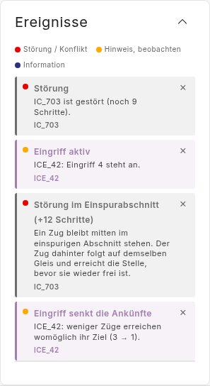
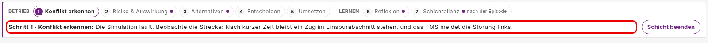
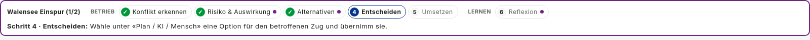
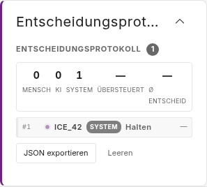
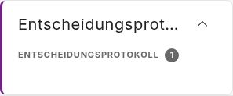
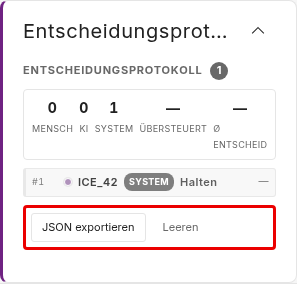

# Plan B information display: event titles, Prozessleiste, decision log (#150)

> **Status:** in progress, 2026-11-04. Based on `main` 0ec3516. S1-S4 and S6 are built; S5 waits for Q3.
> Q1, Q2, Q4 and Q5 are decided; Q3 waits for stakeholder feedback (§8).
> Issue [#150](https://github.com/flatland-association/flatland-ui-hub/issues/150)
> ("Anpassung Informationsdarstellung", @SamiraAPS, label `plan b`) and its
> comment of 2026-11-03 ("something broken in Entscheidungsprotokoll?").
> Branch `feature/150-information-display`, off `main` (on request;
> contributors usually branch off `explore_db`).
>
> **Why:** the Plan B study should show only what the task needs. Two of the
> issue's items are done, one is covered by #168; this plan covers the rest,
> and the decision-log defect the comment found.

### Status

| ID | Commit message | SHA |
|---|---|---|
| S0 | docs(plans): plan for #150, the Plan B information display. | c224439 |
| S1 | fix(decision-log): let the participant open a log that starts collapsed. | 0449635 |
| S2 | feat(ui-config): hide the decision log's export and clear buttons under Plan B. | bf483ff |
| S3 | fix(notifications): name the stop override instead of its action number. | fd1711b |
| S4 | feat(notifications): put the train in the event title. | aad4442 |
| S5 | feat(ui-config): hide the Prozessleiste under Plan B (only if Q3 says so). | |
| S6 | docs(plans): screenshots of the #150 changes on Plan B. | |

### Terms

- **Ereignisse:** the panel `notifications` (`NotificationsPanelComponent`,
  `features/notifications-panel/`), title key `panels.notifications`. Lists
  the backend's notifications, one card each: coloured dot (kind), title,
  message, and a line naming the related train. Not the triaged event feed
  (`triaged-events`), which Plan B does not place.

  

  The yellow "Eingriff aktiv" card is the system holding the affected train
  (the Co-Learning hold), not a decision of the participant.
- **Notification:** `AppNotification` from the backend (`hmi_mock.py`), with a
  `kind` (`error` red, `warning` yellow, `info` blue), a `code` such as
  `train.overridePending`, `params` and a `relatedElement` (the train). The
  wording comes from `notifications.<code>.title|message` through
  `NotificationWordingService`.
- **Prozessleiste:** the issue's word for the guide strip (`TourGuideComponent`,
  `app-tour-guide`): "Betrieb 1 Konflikt erkennen … Lernen 6 Reflexion" and
  the hint line "Schritt n · …". Described with pictures in
  `docs/plans/toolbar-under-guide.md` (Terms). Not the scenario stepper above
  it (`app-experiment-progress`).

  It has two parts: the **step list** (top row) and the **hint line**
  (bottom row). At step 1 the hint line reads "Die Simulation läuft.
  Beobachte die Strecke: …" (outlined in red), the guidance Q3 a) and c)
  would take away:

  

  At step 4, after the conflict:

  
- **Entscheidungsprotokoll (decision log):** the panel `decision-log`
  (`DecisionLogPanelComponent`, `features/decision-log/`). A head with the
  entry count, a summary row, the entries, and two buttons, "JSON exportieren"
  and "Leeren". Its entries are `store.decisionLog()`, the same list the
  leg's shift record, the Schichtbilanz and the guide's progress read. The
  entry below is the system's hold of ICE_42.

  
- **Collapsed by default:** the UiConfig verb `collapsedByDefault`; for
  `widget.decision-log` it starts the panel's own `collapsed` signal true:
  head and count visible, entries hidden. Not the panel shell's collapse.
  Under Plan B (below) only the shell title and the head with the count are
  left, and nothing opens the entries (§2).

  
- **Plan B, UiConfig id:** as in `docs/plans/zwl-default.md` (Terms).

### Components

| Component | Responsibility | Change |
|---|---|---|
| `DecisionLogPanelComponent` | Lists the decisions of the run with who took them. Not the study record, which is written elsewhere. | 🟨 modified: a log that starts collapsed can be opened; its buttons can be hidden. |
| `NotificationsPanelComponent` | Shows the run's events as cards. Not for deciding anything; decisions are taken in "Plan / KI / Mensch". | 🟨 modified: a card about a train is titled with the train, in every condition. |
| `NotificationWordingService` | Words a notification in the viewer's language. Not for which notifications exist. | 🟨 modified: a wording without the train, for cards that name it in the title. |
| `hmi_mock.py` notifications | Builds the backend's notifications. Not their wording on screen. | 🟨 modified: the stop override gets a direction name. |
| `UI_CONFIG_ITEMS` / `PLAN_B_UI` / `PLAN_B` | What a condition may hide, and what Plan B hides and sets. | 🟨 modified: the decision log's buttons (and, if Q3 says so, the Prozessleiste). |

## 1. What the issue asks for

| # | Item | State |
|---|---|---|
| 1 | Ereignisse: the relevant trains in the card title instead of «Eingriff aktiv»; the colour already says what kind it is | this plan (§4.3), in every condition (Q1) |
| 2a | Remove the contrast setting | done before (ticked) |
| 2b | Remove the title «Streckenspiegel/ZWL» | #168, [PR #171](https://github.com/flatland-association/flatland-ui-hub/pull/171) |
| 2c | Remove the Prozessleiste (@CleverManu to revise with @SamiraAPS) | open decision (Q3, §4.4) |
| 2d | Remove the buttons in the Entscheidungsprotokoll | this plan (§4.2) |
| 2e | Remove experiment and debug elements | done before (ticked) |
| C | Comment: "something broken in Entscheidungsprotokoll?" | defect, this plan (§4.1) |

### 1.1 Assumptions and exclusions

- **Assumptions:**
  - Every train notification relates to exactly one train (`relatedElement`).
    True for all three `train.*` codes and both `override.*` codes today.
  - #167 ([PR #169](https://github.com/flatland-association/flatland-ui-hub/pull/169))
    and #168 (PR #171) merge before or independently of this branch; nothing
    here edits their files except where §4.4 says.
- **Exclusions:**
  - The triaged event feed keeps its titles; Plan B does not use it.
  - Other conditions keep today's decision-log buttons (Q4).
  - The Schichtbilanz text about "one incident" (#170) is not touched.

### 1.2 Design changes and new patterns

| What is new | Reuses | Defined in |
|---|---|---|
| Short notification messages without the train, `notifications.<code>.short` | the existing `notifications.<code>.*` keys and their fallback | §4.3 |
| UiConfig id `widget.decision-log.actions` | the sub-panel ids `widget.proposal-compare.axis.*` | §4.2 |
| UiConfig id `control.guideStrip` (only with Q3 = a) | `control.*` ids | §4.4 |

Not new on purpose: no new verb, no new event type, no change to the study
record; the restrictions land in the existing `uiRestrictions` snapshot.

### 1.3 Breaking changes

None in an API, payload or file format. Behaviour:

- Plan B: the decision log can be opened again (as `configurable-ui-plan.md`
  §1 item 2 intended); new click ids `log.showEntries` / `log.hideEntries`.
- Every condition: "Eingriff 4 steht an" becomes "Eingriff STOPP steht an"
  (S3), the backend sends `direction: "stop"` for action 4.
- Every condition: a card about a train is titled with the train's name; the
  kind is left to the dot's colour and the message (S4, Q1). The notification
  codes, their `.title` keys and the backend payload stay, so other readers
  (the triaged event feed, the record) are unchanged.

## 2. Today (checked 2026-11-04 on `main`, `0ec3516`)

- **Event title.** The card shows `notifications.<code>.title` ("Eingriff
  aktiv"), then the message ("ICE_42: Eingriff 4 steht an."), then the
  related train ("ICE_42") — the train twice, its kind once in words and once
  as the dot's colour (`notifications-panel.component.html:58-66`).
- **"Eingriff 4".** `hmi_mock.py:119-120` maps actions 1, 2, 3, 5 to a
  direction; 4 (`STOP_MOVING`) falls through as `"4"`, which has no
  `notifications.direction.4` key, so the screen shows the number.
- **Decision log, collapsed.** Plan B lists `widget.decision-log` under
  `collapsedByDefault`. The panel starts `collapsed` true
  (`decision-log-panel.component.ts:123`) and hides summary, entries and
  buttons; `toggleCollapsed()` exists, but no template calls it — only a spec
  does. So a Plan B participant sees the shell title "Entscheidungsprotokoll",
  a second head "ENTSCHEIDUNGSPROTOKOLL 2", and can never open the entries.
  That is the comment's picture. `configurable-ui-plan.md:136` says "participant
  can expand"; the code never let them. The defect came with
  [#146](https://github.com/flatland-association/flatland-ui-hub/pull/146)
  (4635f1eb, "seed collapsed from the deployment config"): before it,
  `collapsed` was hardcoded `false`, so the missing toggle didn't matter.
  No template has ever called `toggleCollapsed()`.
- **Decision log buttons.** Inside the collapsed part, so a Plan B participant
  does not see them today — but only because of the defect above. "Leeren"
  calls `store.clearDecisionLog()`, which empties the list the leg's shift
  record (`experiment-run.service.ts:200-213`), the Schichtbilanz and the
  guide's progress read: one click in a study run deletes that leg's
  decisions from what the run reports.
- **Prozessleiste.** Shown in every run whose briefing has guide steps
  (`app.component.html:154-156`); `control.endShift` already hides its
  "Schicht beenden" button. No id hides the strip.

The issue's and the comment's pictures:

## 3. Decisions

Decided 2026-11-04 (D1-D4); D5 stays until Q3 is answered (§8).

| ID | Decision | Why |
|---|---|---|
| D1 | The collapsed decision log gets a toggle in its head, "Einträge anzeigen (n)" / "Einträge ausblenden", instead of the second title (decided 2026-11-04, Q5 a) | Fixes the defect the way `configurable-ui-plan.md` meant it, and removes the doubled title |
| D2 | The buttons are hidden by a new id, `widget.decision-log.actions`, listed in `PLAN_B_UI`; other conditions keep them (decided 2026-11-04, Q4 a) | Plan B's removals live in `PLAN_B_UI` and land in the session record |
| D3 | The stop override gets the direction `stop`, in the backend mapping and the three languages | A bug, visible in the issue's own picture; one line plus keys |
| D4 | The Ereignisse panel titles every card about a train with the train, in every condition; the message drops the train, and the related-train line goes (decided 2026-11-04, Q1 b, Q2). Scripted disturbances keep their authored label (§4.3) | The issue's reasoning holds everywhere: the title repeats the train line and the kind is in the colour; one code path |
| D5 | The Prozessleiste is not removed until @CleverManu and @SamiraAPS decide (Q3) | The issue asks them to revise it; it also carries the guide steps the study's instructions refer to, and #167 places the toolbar under it |

## 4. Design

### 4.1 Decision log: open a collapsed log (comment)

- `decision-log-panel.component.html`: in the embedded head, the title text
  becomes a button that calls `toggleCollapsed()`, with `aria-expanded`, the
  count, and the label `log.showEntries` / `log.hideEntries` (new keys in
  en/de/fr, also its `data-log` id). Outside a shell (`embedded` false) the
  Lyne header already carries the title; the same button sits under it.
- Applies wherever the log starts collapsed; a log that starts open shows the
  button as "Einträge ausblenden". Today only Plan B starts collapsed.
- The `panel.decision-log.collapsed` UI state is recorded as today, so a
  replay shows the participant opening it.

### 4.2 Decision log buttons (item 2d)

- `UI_CONFIG_ITEMS`: `widget.decision-log.actions` ("Decision log: export and
  clear buttons", `supports: ['hidden']`), schema entry.
- `decision-log-panel.component.html`: the `.dl-actions` row renders only
  when the id is not hidden. `PLAN_B_UI.hidden` lists it.

### 4.3 Event title (item 1)

- `NotificationsPanelComponent.cardOf(n)`, in every condition, when the
  notification relates to a train and its code has a short wording:
  - title: the train's name (`relatedLabel`, i.e. `identity.nameFor`);
  - message: `NotificationWordingService.shortMessageOf(n)`, which reads
    `notifications.<code>.short` ("Eingriff {{direction}} steht an.");
  - no related-train line.
  Other cards are as today: without a train (e.g. "Episode beendet"), and
  scripted disturbances (`disturbance.event`, e.g. "Störung im
  Einspurabschnitt"), whose authored label names the situation, not the
  train; they keep it as title and the train line below.
- Short wordings that lose the title's kind word keep it at the front:
  "Störung, noch 9 Schritte.", "Entscheidung: …", "Eingriff: Blockaden können
  zunehmen (…)": the two `override.*` cards share the yellow dot.
- New keys `notifications.train.{malfunction,overridePending,decisionPending}.short`
  and `notifications.override.{riskIncrease,fewerArrivals}.short`, en/de/fr.
- S3 first: `hmi_mock.py` maps 4 → `stop` ("STOP"), keys
  `notifications.direction.stop` ("STOPP" / "STOP" / "ARRÊT", upper case like the other directions); a backend test
  for the mapping.

### 4.4 Prozessleiste (item 2c, only if Q3 = a)

- `control.guideStrip` in `CONTROL_IDS`; `app.component.html` renders
  `app-tour-guide` only when it is not hidden; `PLAN_B_UI.hidden` lists it.
- Interaction with #167: there the toolbar sits under the strip while
  `guideShown()`; with the strip hidden, `guideShown()` must be false so the
  toolbar goes back to the top. That is a one-line change on top of PR #169,
  so S5 waits for it.
- The guide keeps running unseen: it still drives the reason dialog and the
  learning cards; only the strip is not drawn.

## 5. Files

### New files

| File | What it adds |
|---|---|
| `docs/plans/information-display/*.png` | Terms pictures (S0), before/after screenshots (S6) |
| `frontend/src/app/features/notifications-panel/notifications-panel.component.spec.ts` | the card wording (S4) |
| `scripts/docshots-information-display.mjs` | the before/after screenshots (S6) |

### Modified files

| File | What changes |
|---|---|
| `frontend/src/app/features/decision-log/decision-log-panel.component.{html,ts,scss,spec.ts}` | toggle in the head (S1); actions gated (S2) |
| `frontend/src/app/features/notifications-panel/notifications-panel.component.{html,ts}` | `cardOf`: train as card title (S4) |
| `frontend/src/app/core/notification-wording.service.ts` | `shortMessageOf` (S4) |
| `frontend/src/app/core/config/ui-config-items.ts`, `frontend/public/ui-config.schema.json` | `widget.decision-log.actions` (S2), `control.guideStrip` (S5) |
| `frontend/src/app/core/layout/layout-presets.ts` | `PLAN_B_UI.hidden` |
| `frontend/public/i18n/{en,de,fr}.json` | `log.showEntries/hideEntries`, `notifications.*.short`, `notifications.direction.stop` |
| `backend/app/core/hmi_mock.py`, `backend/tests/…` | stop direction (S3) |
| `docs/plans/configurable-ui-plan.md` | §1 item 2: how the participant expands; the new ids |
| `frontend/src/app/app.component.html` (S5 only) | `control.guideStrip` gate |

## 6. Verification

- Specs per step; the four CI checks.
- Running app, Plan B: open and close the decision log, no buttons; an
  override shows "ICE_42" as title and "Eingriff STOPP steht an." as message;
  a non-Plan B tour shows the same cards, and today's decision-log buttons. Before/after
  screenshots as for #168.

## 7. Steps

| ID | Step | Needs |
|---|---|---|
| S1 | Decision log toggle | - |
| S2 | `widget.decision-log.actions`, hidden in Plan B | - |
| S3 | Stop direction (backend + keys + test) | - |
| S4 | Train as card title and short messages, every condition | S3 |
| S5 | `control.guideStrip`, hidden in Plan B | Q3 = a, PR #169 |
| S6 | Screenshots | S1-S4 (S5) |

## 8. Open questions

- ✅ ~~**(Q1) Train as event title: Plan B only, or everywhere?**~~
  **Decided 2026-11-04:** b), everywhere (D4). No layout setting.
- ✅ ~~**(Q2) What else goes in the title for a malfunction?**~~ **Decided
  2026-11-04:** nothing; a malfunction card reads "IC_703 / Störung, noch 9
  Schritte.", the kind in the message and the red dot (D4).
- 💡 **(Q3) Prozessleiste: remove under Plan B?** For @CleverManu and
  @SamiraAPS. Kept open on 2026-11-04, awaiting their feedback; S1-S4 don't
  depend on it.
  - a) Hide it under Plan B (§4.4). The participant loses the step list and
    the hint line ("Beobachte die Strecke …", picture in Terms); the briefing must then carry
    that guidance.
  - b) Keep it.
  - c) Keep the step list, drop the hint line (a second id).
  - *Proposal:* decide with the study lead; build S5 only for a) or c).
- ✅ ~~**(Q4) Hide the buttons only under Plan B?**~~ **Decided 2026-11-04:**
  a), Plan B only (D2); disabling "Leeren" in every experiment run is a
  follow-up issue. "Leeren" deletes a leg's
  decisions from the shift record and the Schichtbilanz in any experiment
  run, not only Plan B.

  

- ✅ ~~**(Q5) How does a participant open the collapsed log?**~~ **Decided
  2026-11-04:** a), a toggle in the head, "Einträge anzeigen (n)" /
  "Einträge ausblenden" (D1): the condition was designed as "collapsed, can
  expand".
