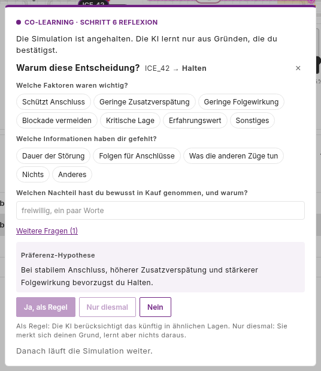
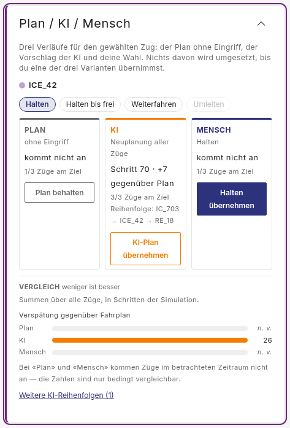

# Plan B control group: `plan-b-control-group-p01` … `p10`, one experiment per participant with a Recommendation and a Co-Learning setting (#134)

> **Status:** plan, 2026-11-05, revised 2026-11-16 against `main` fd0c70cb
> (the branch is rebased onto it, §7.1). Open questions in §8: Q-7 (for the
> study leads, does not block). Q-1–Q-6 decided. Implementation waits for
> the final matrix of [#179](https://github.com/flatland-association/flatland-ui-hub/issues/179)
> (decided 2026-11-16).
> Issue [#134](https://github.com/flatland-association/flatland-ui-hub/issues/134)
> ("Darstellung Experiment für Kontrollgruppe definieren"), with the
> deviations listed by @SamiraAPS, annotated by @chenkins, and the run order of
> @CleverManu (2026-11-12) with the assignment matrix
> [#179](https://github.com/flatland-association/flatland-ui-hub/issues/179)
> (tbd). Related: [#149](https://github.com/flatland-association/flatland-ui-hub/issues/149)
> (impact analysis: lateness is the one figure), #145 (Plan B), #160
> (reflection inline), #164 (experiment scenarios, `plan-b-p01` … `p10`).
> Branch `feature/134-control-group`, off `main` (on request; contributors
> usually branch off `explore_db`), PR
> [#201](https://github.com/flatland-association/flatland-ui-hub/pull/201).
>
> **Why:** the user study (FHNW & SBB; formative round 1 on 2026-11-23,
> experiments on 2026-12-03/04) compares Co-Learning with a
> recommendation-based AI. Every participant works in both settings, two
> scenarios each, in an order counterbalanced over the participants (#179).
> The Recommendation setting is Plan B without the parts the study is about:
> no reflection after a decision, no impact analysis, and the AI's options
> with a recommendation instead of neutral options and the human's own
> course.

### Terms

- **Setting** ("Bedingung" in #179): Co-Learning (C) or Recommendation (R),
  one `InteractionMode` with its briefing. A participant works through both,
  one after the other, in one experiment.
- **Plan B experiments:** `plan-b-p01` … `plan-b-p10` ("Plan B · participant
  01" …), layout `preset-plan-b` (`PLAN_B`, `PLAN_B_UI` in
  `core/layout/layout-presets.ts`), mode `co-learning`, briefing `plan-b`
  (`PLAN_B_DE`), legs `PLAN_B_TUTORIAL` and the four UC2 scenarios in the
  participant's order (`PLAN_B_ORDERS`), final questionnaire `plan-b-final`
  (`core/demo/study-conditions.ts`). Unchanged by this plan.
- **Control-group experiments:** the new conditions
  `plan-b-control-group-p01` … `p10` (Q-5): the tutorial and two scenarios in
  setting 1, a questionnaire, two scenarios in setting 2, a questionnaire.
  The name is the issue's; each participant is in both settings.
- **Reflection module:** the reflection asked under each decision in the
  "Entscheidungsprotokoll" (since #160 inline, while the run goes on; the
  briefing flag `reasonDialog`, a name from when it was a dialog), its guide
  step `reflect` ("Reflexion"), and the "open reflections" refusal of
  "Szenario abschliessen" (`TourContextService.refuseFinish`). Not the
  `co-learning-reflection` panel, which no Plan B layout places.
- **Impact analysis:** the "VERGLEICH · weniger ist besser" section at the
  bottom of "Plan / KI / Mensch" (`proposal-compare`, `comparison()`), the
  bars per course. Not the "Lage: Risiko & Auswirkung" panel (`impact`).
- **Option chips:** the buttons Halten / Halten bis frei / Weiterfahren /
  Umleiten in "Plan / KI / Mensch" (`pc-options`), which compute the
  **Mensch** course, and their twin on the map, the strip "⟨Zug⟩ · im Panel
  vergleichen" (`trainOptions()` in `FlatlandMapComponent`).
- **Take buttons:** "Plan behalten", "KI übernehmen", "⟨Option⟩ übernehmen"
  under each course (`data-log` `proposals.keepPlan`, `proposals.takeAi`,
  `proposals.takeHuman`).
- **Decision moment:** how a new conflict engages the human,
  `ImpactPanelComponent.modeBehavior()`: `hold` in Co-Learning (affected
  trains held, the world runs on), `countdown` in Recommendation (global
  pause, then the top option is applied when the countdown expires).

### Components

| Component | Responsibility | Change |
|---|---|---|
| `ExperimentLeg` | One scenario of an experiment: which scenario, seed, card. Not the experiment's order or its questionnaire at the end. | 🟨 modified: a scenario can run in another mode, with another briefing, and be followed by its own questionnaire, so one experiment holds both settings. |
| `STUDY_CONDITIONS` | Lists the experiments the Experiments door offers, with layout, mode, briefing, legs and questionnaires. Not the layout or the briefing themselves. | 🟨 modified: ten new experiments, `plan-b-control-group-p01` … `p10`. |
| `ExperimentRunService` | Runs an experiment: which leg, which phase, what comes next, the record. Not for UI. | 🟨 modified: asks a scenario's own questionnaire after it (the end of setting 1). |
| `TourContextService` | Holds the briefing of the running tour or experiment. Not the run's progress. | 🟨 modified: the briefing can change at a scenario without resetting the run. |
| `AppComponent` | Starts sessions and opens screens on the run's behalf. | 🟨 modified: each scenario starts in its own mode and briefing. |
| `TourBriefing` `plan-b-control-group` | What the Recommendation setting reads and is guided through: mode intro, guide steps. Not the scenarios. | 🟩 new: `plan-b` without the reflection and the Co-Learning wording, with the decision moment of Plan B. |
| `PANEL_MODE_AVAILABILITY` | Which panel types a mode offers. Not how a panel behaves in a mode (the panel does). | 🟨 modified: `proposal-compare` also in `recommendation`. |
| `ProposalCompareComponent` | Shows the courses for the selected train and takes the one the human commits. Not the conflict assessment (`impact`). | 🟨 modified: in Recommendation, no option chips, no Mensch course and no comparison; the KI course is marked as the recommendation. |
| `FlatlandMapComponent` (`trainOptions`) | The option strip at the selected train. | 🟨 modified: only where the panel has option chips, i.e. in Co-Learning. |
| `ImpactPanelComponent` (`modeBehavior`) | How a new conflict engages the human, per mode. | 🟨 modified: a briefing can ask for Plan B's `hold` in Recommendation, so the settings differ only where the issue says. |

## 1. What the issue asks for

| # | Requirement | Source |
|---|---|---|
| 1 | Experiments `plan-b-control-group-pNN` on the Plan B setup (screen, scenarios, logging); the Plan B experiments stay as they are | request, issue title; names decided 2026-11-16 (Q-5) |
| 2 | Recommendation setting: no reflection module, no reflection asked after a decision | comment 1, picture "Reflection Module" |
| 3 | Recommendation setting: no impact analysis, no comparison of Plan / KI / Mensch | comment 1, "Impact Analyse: tbd", #149 |
| 4 | Recommendation setting: the AI's options shown, one marked as the recommendation | comment 1 |
| 5 | Recommendation setting: in "Plan / KI / Mensch" only PLAN and KI, without the option chips | comment "Recommendation based", first picture |
| 6 | Recommendation setting: no option strip on the map ("⟨Zug⟩ · im Panel vergleichen") | comment "Recommendation based", second picture; decided 2026-11-05 (Q-2) |
| 7 | Run order: tutorial, scenario 1 and 2 in setting 1, questionnaire, scenario 3 and 4 in setting 2, questionnaire; as one experiment (Q-1) | comment of 2026-11-12; decided 2026-11-16 |
| 8 | Which setting comes first and the scenario order per participant, counterbalanced as in #179 | #179; derived from Plan B until #179 is final (Q-6) |

### 1.1 Assumptions and exclusions

- **Assumptions** (checked at setup, not enforced in code):
  - Participant `pNN` runs the four UC2 scenarios in the order of
    `plan-b-pNN` (`PLAN_B_ORDERS[NN-1]`): the first two in setting 1, the
    last two in setting 2. Odd `pNN` start with Recommendation, even with
    Co-Learning, as #179 alternates (Q-6). Replaced by #179's table once it
    is final (§1.4).
  - The tutorial runs in setting 1, with setting 1's briefing.
  - One experiment per participant, started by the experimenter.
  - "Recommendation-based" is the `recommendation` mode of the brief
    (`docs/reference/interaction-modes-brief.md`, WP 3.1): the AI suggests
    with a recommendation, the human decides (Q-1).
  - Both questionnaires are `plan-b-final` (Q-7). It asks about the human's
    share against the KI and their role, not about reflection or learning
    (checked 2026-11-16), so it fits both settings. The record tells the two
    apart by the leg after which each was answered.
- **Exclusions:**
  - The Plan B experiments (`plan-b-p01` … `p10`, `PLAN_B`, the briefing
    `plan-b`) and the test run `plan-b-uc2` do not change: none of their legs
    sets the new leg fields.
  - The `recommendations` panel (WP 3.1's own surface, with confidence
    stripe) is not placed: both settings keep the Plan B screen and differ
    only where §1 says.
  - English texts for the new briefing: `plan-b` is German only, like the
    study; so is the control briefing. New i18n keys get `en` and a French
    draft.

### 1.2 Design changes and new patterns

| What is new | Reuses | Defined in |
|---|---|---|
| A leg can override the experiment's mode, briefing and leg questionnaire (`ExperimentLeg.mode`, `.briefingIds`, `.surveyParts`) | the demo sequence's mode per step (`store.startDemo(modes)`, `advanceDemo()`); the leg's own `intro` and `zwlRoute`, which already win over the briefing's | §4.1 |
| The briefing changes within a run (`TourContextService.useBriefing`) | the guide's reset on a new briefing (`tour-guide.service.ts:76-78`) | §4.1 |
| `proposal-compare` in Recommendation mode, with a recommendation tag on the KI course and no comparison | the per-mode behaviour inside a panel (`PANEL_MODE_AVAILABILITY` comment) | §4.3 |
| A briefing flag for the decision moment (`decisionMoment: 'hold'`) | tour-level switches such as `assessmentOnly` | §4.3 (Q-3) |
| A briefing derived from another without the reflection | `PLAN_B_DE`'s own derivation from `CO_LEARNING_EXPERIMENT_2X_DE` | §4.2 |

Not new on purpose: no new layout (both settings use `preset-plan-b`; the
comparison goes by mode, since a layout's `ui` block cannot change within a
run), no new UiConfig id, no new mode, no new phase of the run (the leg
questionnaire is the existing `legSurvey`), no new scenario order
(`PLAN_B_ORDERS` is shared), no new questionnaire, no flag "control group"
anywhere.

### 1.3 Breaking changes

None in an API, payload, file format or config: the new leg fields and the
briefing flag are optional and absent everywhere today, and records gain no
field. Behaviour outside the new experiments:

- `proposal-compare` placed in a Recommendation-mode layout now renders (as
  Plan + KI, without the comparison) instead of nothing. No preset does that
  today; a designer-made layout may.
- The map's option strip disappears in Recommendation mode for tours with
  `assessmentOnly`. None runs in Recommendation today.

### 1.4 Limitations and follow-ups

- **Limitations:**
  - The stepper and the intro cards count five scenarios ("⟨Name⟩ (k/5)");
    nothing on screen marks the change of setting, apart from the
    questionnaire and the new intro card.
  - The store still opens a reflection after a Recommendation decision that
    deviates from an AI suggestion (`pendingRationale`); without
    `reasonDialog` nothing shows or waits for it (§4.2).
- **Follow-ups (not in this PR):**

  | Follow-up | Why not in this PR | From | Findings | Issue |
  |---|---|---|---|---|
  | The participant schedules from the final #179 matrix (pseudonyms, number of participants, orders). | #179 is tbd (6 scenarios, 17 participants against 4 scenarios today). | Q-6 | - | [#179](https://github.com/flatland-association/flatland-ui-hub/issues/179) |
  | A visible setting boundary in the stepper ("Teil 1 / Teil 2"). | Not asked; the questionnaire marks it. | Limitations | - | - |

## 2. Today (checked 2026-11-16 on `main`, fd0c70cb)

- `plan-b-p01` … `plan-b-p10` (`PLAN_B_CONDITIONS`): layout `preset-plan-b`,
  mode `co-learning`, `studyLogging: true`, briefing `plan-b` (de, en point
  to the same German briefing), `policy: 'deadlock_avoidance'`,
  `shiftSummary: false`, no `legSurveyParts`, `surveyParts:
  [PLAN_B_FINAL_PART]`, legs `[PLAN_B_TUTORIAL, ...PLAN_B_ORDERS[i]]`
  (`study-conditions.ts:163-196`). The legs come from the experiment
  scenarios (`scenarioLeg`, #164) and carry no intro of their own, so the
  briefing's `modeIntros[mode]` card shows before each.
- **One mode and one briefing per experiment:** `StudyCondition.mode` and
  `.briefingIds`. The run starts the demo with `startDemo(legs.map(() =>
  condition.mode))` (`app.component.ts:1124`); the store already sets each
  step's mode on `advanceDemo()` (`session.store.ts:1143-1160`), a leftover of
  the tours that switched modes. `TourContextService.set()` sets the briefing
  once and resets the run's shift history.
- **Leg questionnaire:** `legSurveyParts` on the condition, after every leg or
  none (`ExperimentRunService.hasLegSurvey`, `surveyParts`); the phase
  `legSurvey` in `advanceExperiment`.
- `PLAN_B_UI` hides `control.mapNavigation`, `control.endShift`,
  `control.playback`, `widget.proposal-compare.axis.time`,
  `control.sessionInfo`, `control.modeTabs`, `widget.view-tabs.title`,
  `widget.decision-log.actions`; allows only `deadlock_avoidance`; the
  decision log starts open for the inline reflections
  (`layout-presets.ts:696-718`).
- **Reflection:** `plan-b` inherits `reasonDialog: true` and the `reflect`
  guide step from `colearning-experiment` via `colearning-experiment-2x`
  (`tour-briefings.ts:485-600`). Since #160 the decision log asks for the
  reason under each decision while the run goes on, and "Szenario
  abschliessen" waits until all are answered (`refuseFinish`).
- **Guide hints:** `PLAN_B_GUIDE_HINTS` says "Die KI bietet Optionen an, ohne
  eine zu empfehlen" (`alternatives`) and describes the reflection
  (`reflect`), `tour-briefings.ts:559-566`. The guide resets its done steps on
  a new session or briefing (`tour-guide.service.ts:76-78`).
- **Impact analysis:** `comparison()` builds one axis per id not hidden and
  returns `null` without any (`proposal-compare.component.ts:395-432`).
- **Plan / KI / Mensch** is offered only in Co-Learning
  (`panel-mode-availability.ts:31`). It has no mode branch of its own; the KI
  course carries no recommendation mark.
- **Map strip:** shown when the briefing sets `assessmentOnly` and a train is
  selected (`flatland-map.component.ts:238-250`), in every mode.
- **Decision moment:** `recommendation` → `countdown` (global pause, the top
  option auto-applied after `decisionCountdownSeconds`, default 10 s);
  `co-learning` → `hold` (`impact-panel.component.ts:191-196`).

### 2.1 Before (`plan-b-p01`)

Taken on 2026-11-05 by `scripts/docshots-plan-b-control.mjs` on `main`
333013c, when `plan-b-p01` still ran the two Walensee legs and the
reflection was a dialog. Both changed since (#164, #160), so S-5 retakes the
before pictures on fd0c70cb on a UC2 scenario, with the reflection under the
decision-log entry, and the after pictures on the same moment of a
Recommendation scenario of `plan-b-control-group-p01`.

| Read from the page (2026-11-05) | Value |
|---|---|
| Option chips | Halten, Halten bis frei, Weiterfahren, Umleiten |
| Courses | Plan, KI, Mensch |
| Comparison ("Vergleich") | shown, one axis: Verspätung gegenüber Fahrplan |
| Map strip at the selected train | shown |
| Guide step 6 "Reflexion" | shown |

| # | What changes in the Recommendation setting | Before |
|---|---|---|
| 2 | Guide step 6 "Reflexion" goes |  |
| 2 | The reflection after "übernehmen" goes (picture: the old dialog; retaken in S-5) |  |
| 3, 5 | "Plan / KI / Mensch": chips, Mensch and "Vergleich" go; KI tagged "Empfehlung" |  |
| 6 | The option strip at the selected train goes |  |
| 1 | The working screen at the decision |  |

## 3. Decisions

| ID | Decision | Why |
|---|---|---|
| ~~D-1~~ | ~~A new condition `plan-b-control-p01` and a new layout `preset-plan-b-control`, copied from `plan-b-p01` and `PLAN_B`~~ Replaced 2026-11-16 by D-10 and D-11 (Q-1, Q-5) | - |
| ~~D-2~~ | ~~`PLAN_B_CONTROL_UI = { ...PLAN_B_UI, hidden: [..., 'widget.proposal-compare.axis.lateness'] }`~~ Dropped 2026-11-16: both settings share one layout within one run, so the comparison goes by mode (D-5) | - |
| D-3 | The Recommendation setting runs in mode `recommendation` | The issue names it; the mode is the brief's switch for "AI suggests with a recommendation", so no parallel flag |
| D-4 | No reflection through the setting's briefing without `reasonDialog` and without the `reflect` step, not through a UiConfig id | The reflection is a briefing flag; the decision log shows it only where the briefing asks |
| D-5 | `proposal-compare` offered in Recommendation; there it hides the option chips, the Mensch course and the comparison, and tags the KI course "Empfehlung"; take buttons for Plan and KI stay (Q-2) | Requirements 3, 5; behaviour per mode lives in the panel. The human still decides, by taking one of the two |
| D-6 | The map strip shows only where the panel has option chips, i.e. not in Recommendation | Without the chips the strip would ask a panel that cannot answer |
| D-7 | The Recommendation setting holds the affected trains like Plan B (`hold`), through the briefing flag `decisionMoment: 'hold'` (Q-3) | The settings differ only where §1 says; Recommendation's countdown would auto-apply the AI's option, a confound |
| ~~D-8~~ | ~~Leg 2 of the control group is `WAL_FOLLOWER` spread with its own German card~~ Dropped 2026-11-16: Plan B no longer runs the Walensee legs (#164) | - |
| D-9 | The experiments are built from `PLAN_B_ORDERS` by one helper, so a control participant's scenarios and order can only differ from `plan-b-pNN` in the split into settings (Q-6) | One list of orders and one shape |
| D-10 | One experiment per participant: a leg can override the experiment's `mode`, `briefingIds` and leg questionnaire (`surveyParts`) (Q-1) | The issue's preferred form ("konzeptuell sauberer"): one run id, one sitting. The store already switches the mode per step; the briefing carries reflection, guide, badges and intro card, so one override per leg covers them all. Not taken: two experiments per participant |
| D-11 | Names: `plan-b-control-group-p01` … `p10`, briefing `plan-b-control-group`; no own layout (Q-5) | The issue's term; ids are stored in records and never renamed (AGENTS.md), so they are fixed now |
| D-12 | The Recommendation setting's briefing drops the violet module badges and has its own guide hints; the Co-Learning setting keeps `plan-b` (Q-4) | Each setting reads what fits it; the per-leg briefing makes this free |

### 3.1 Code Review Findings

PR [#201](https://github.com/flatland-association/flatland-ui-hub/pull/201);
branch rebased onto `main` fd0c70cb on 2026-11-16 (was 333013c), checked at
ce940ee. No code review yet, no PR comments, no TODOs added. In Fixed, ✅
marks a fixed finding, ⏭️ one taken over by a follow-up, — a dropped one,
⚠️ a comment resolved on GitHub without a code change and without a reason;
❌ next to ✅ marks a finding fixed in the code whose PR comment is not
resolved yet. "resolved" in Source marks threads resolved and checkboxes
ticked on GitHub.

| Fixed | ID | Source | Category | Severity | Finding | Commit message |
|---|---|---|---|---|---|---|

**Issue references:** the PR is to close #134. No TODO or comment in the
code references it.

## 4. Design

### 4.1 A setting per leg (requirement 7; D-10)

- `study-conditions.ts`, `ExperimentLeg` gains three optional fields:
  ```ts
  /** This leg's mode, if it differs from the experiment's (#134: two settings in one run). */
  mode?: InteractionMode;
  /** This leg's briefing (reflection, guide, badges, intro card), if it differs from the experiment's. */
  briefingIds?: Partial<Record<Lang, string>>;
  /** Questionnaire after this leg, e.g. at the end of setting 1. Wins over the experiment's `legSurveyParts`. */
  surveyParts?: readonly string[];
  ```
  Absent everywhere today, so every existing experiment runs as before.
- `app.component.ts`:
  - `startDemo(legs.map((l) => l.mode ?? condition.mode), false)` at the run's
    start and on resume; the store switches the mode at every
    `advanceDemo()` as before.
  - The first leg's and every next leg's start (`startGuidedCondition`,
    `startConditionLeg`, the resume path) calls
    `tourContext.useBriefing(legBriefing(leg))`: the leg's briefing in the
    UI language, else the experiment's (`tourBriefingId`).
- `tour-context.service.ts`: `useBriefing(b)` sets only the briefing; `set()`
  stays for a run's start, which also resets the shift history. The guide
  resets its steps on the new briefing by itself.
- `experiment-run.service.ts`: `legSurveyPartsNow = computed(() =>
  currentLeg()?.surveyParts ?? condition()?.legSurveyParts ?? null)`;
  `hasLegSurvey` and `surveyParts` (phase `legSurvey`) read it.
  `advanceExperiment`, `finishLabel` ("Szenario abschliessen → Fragebogen"
  only after the last leg of setting 1) and the resume into a questionnaire
  already go through them.
- Records: each leg's session record already names its `mode`; the
  questionnaire's record names the leg after which it was answered.

### 4.2 The experiments and the Recommendation briefing (requirements 1, 2, 8; D-9, D-11, D-12)

- `study-conditions.ts`: `planBControlGroupConditions()` maps
  `PLAN_B_ORDERS` to ten experiments; for `p01` (odd: Recommendation first):
  ```ts
  {
    id: 'plan-b-control-group-p01',
    layoutId: 'preset-plan-b',
    mode: 'recommendation',                                   // setting 1, and the tutorial
    label: 'Plan B control group · participant 01',
    labelKey: 'tours.plan-b-control-group-p01.name',
    studyLogging: true,
    briefingIds: { de: 'plan-b-control-group', en: 'plan-b-control-group' },
    policy: 'deadlock_avoidance',
    shiftSummary: false,
    surveyParts: [PLAN_B_FINAL_PART],                         // after setting 2
    legs: [
      PLAN_B_TUTORIAL,
      UC2_LEGS['uc2-3'],
      { ...UC2_LEGS['uc2-1'], surveyParts: [PLAN_B_FINAL_PART] },              // end of setting 1
      { ...UC2_LEGS['uc2-2'], mode: 'co-learning', briefingIds: { de: 'plan-b', en: 'plan-b' } },
      { ...UC2_LEGS['uc2-4'], mode: 'co-learning', briefingIds: { de: 'plan-b', en: 'plan-b' } },
    ],
  }
  ```
  Even `pNN` the other way round. Same legs as `plan-b-pNN`, so `legId` names
  the same scenario in both. Added after `...PLAN_B_CONDITIONS` in
  `STUDY_CONDITIONS`.
- `tour-briefings.ts`: `PLAN_B_CONTROL_GROUP_DE` (id `plan-b-control-group`),
  derived from `PLAN_B_DE` as `PLAN_B_DE` is from
  `CO_LEARNING_EXPERIMENT_2X_DE`:
  - `reasonDialog: false`; `decisionMoment: 'hold'` (§4.3); `assessmentOnly`,
    `mapTrainLabels`, `autoStart`, `freshOperatorProfile`, `language`,
    `opening` as in `plan-b` (the opening names the sector and the goal,
    nothing Co-Learning; it shows only before the first leg, so only when
    Recommendation comes first).
  - `guide`: without `reflect`; own hints for `alternatives` ("Die KI
    empfiehlt unter «Handlungsoptionen» einen Verlauf …") and `decide`
    ("Behalte den Plan oder übernimm die Empfehlung der KI.").
  - `moduleBadges`: none.
  - `modeIntros.recommendation`: `plan-b`'s Co-Learning card without
    "Co-Learning" and with five steps instead of six.
- When Co-Learning comes first, `plan-b`'s opening shows before the tutorial;
  when Recommendation comes first, the control briefing's (the same text).
- The store still opens a reflection after a Recommendation decision that
  deviates from an AI suggestion; without `reasonDialog` the decision log
  neither shows it nor makes "Szenario abschliessen" wait for it.

### 4.3 Plan / KI and the decision moment in Recommendation (requirements 3–6; D-5–D-7)

- `panel-mode-availability.ts`: `'proposal-compare': ['co-learning',
  'recommendation']`, with a comment: neutral options in Co-Learning, the
  AI's course as a recommendation in Recommendation (#134). The same line
  in `docs/reference/panel-mode-matrix.md`.
- `ProposalCompareComponent`: `recommending = computed(() =>
  store.interactionMode() === 'recommendation')`. When true:
  - no `pc-options` group and no Mensch section (neither the course nor its
    placeholder); `choose()` is not reachable, and the effect does not ask
    for a human course;
  - `comparison()` returns `null`;
  - the KI course gets a tag "Empfehlung" (`proposals.recommended`) in its
    header, styled with the existing KI accent token, and the note above
    reads `proposals.noteRecommendation` ("Zwei Verläufe für den gewählten
    Zug: der Plan ohne Eingriff und die Empfehlung der KI. …");
  - "Plan behalten" and "KI übernehmen" stay, with their `data-log` ids;
  - the alternatives ("weitere Reihenfolgen") stay: they are the AI's other
    options (Q-2).
- `FlatlandMapComponent.trainOptions()`: also `null` in Recommendation (D-6).
- `TourBriefing.decisionMoment?: 'hold'` and
  `TourContextService.decisionMoment`; `ImpactPanelComponent.modeBehavior()`
  returns `hold` for Recommendation when it is set (D-7). The countdown stays
  Recommendation's default everywhere else.

### 4.4 Record and replay

- Records name `conditionId: 'plan-b-control-group-pNN'`; each leg's session
  record names its mode, so the setting of every scenario is in the data.
- Replay rebuilds the layout and the mode from the record; no change.

## 5. Files

### New files

| File | What it adds |
|---|---|
| `scripts/docshots-plan-b-control.mjs` | Screenshots of both settings for the PR, as `scripts/docshots-zwl-default.mjs` (added with S-0; S-5 moves it to a UC2 scenario and to the inline reflection) |
| `docs/plans/plan-b-control-group/*.png` | Before (S-0, retaken in S-5) and after (S-5) screenshots |

### Modified files

| File | What changes |
|---|---|
| `frontend/src/app/core/demo/study-conditions.ts` | `ExperimentLeg.mode`, `.briefingIds`, `.surveyParts`; `planBControlGroupConditions()` in `STUDY_CONDITIONS` |
| `frontend/src/app/core/demo/study-conditions.spec.ts` | `plan-b-p01` … `p10` unchanged; each `plan-b-control-group-pNN` has `plan-b-pNN`'s scenarios in its order, split 2 + 2, the first setting alternating, both questionnaires |
| `frontend/src/app/core/demo/experiment-run.service.ts` / `.spec.ts` | `legSurveyPartsNow`; a leg's questionnaire only after that leg; the finish label |
| `frontend/src/app/core/demo/tour-context.service.ts` | `useBriefing()`, `decisionMoment` |
| `frontend/src/app/app.component.ts` / `.spec.ts` | the mode per leg in `startDemo`; the briefing per leg at every leg start and on resume |
| `frontend/src/app/core/demo/tour-briefings.ts` | `TourBriefing.decisionMoment`; `plan-b-control-group` (`PLAN_B_CONTROL_GROUP_DE`) and its guide hints |
| `frontend/src/app/features/impact-panel/impact-panel.component.ts` / `.spec.ts` | `modeBehavior()` honours `decisionMoment` |
| `frontend/src/app/core/layout/panel-mode-availability.ts` | `proposal-compare` in `recommendation` |
| `frontend/src/app/features/proposal-compare/proposal-compare.component.ts` / `.html` / `.scss` | `recommending()`, no chips, no Mensch course, no comparison, the recommendation tag |
| `frontend/src/app/features/proposal-compare/proposal-compare.component.spec.ts` | Recommendation hides chips, Mensch and comparison, tags KI; Co-Learning unchanged |
| `frontend/src/app/features/flatland-map/flatland-map.component.ts` | `trainOptions()` off in Recommendation |
| `frontend/public/i18n/{en,de,fr}.json` | `tours.plan-b-control-group-p01.name` … `p10`, `proposals.recommended`, `proposals.noteRecommendation` |
| `docs/reference/panel-mode-matrix.md` | `proposal-compare` in Recommendation |
| `docs/plans/experiment-scenario-import.md` | the control-group experiments next to `plan-b-p01` … `p10` |
| `docs/plans/experiment-workflow.md` | a leg's own mode, briefing and questionnaire |

## 6. Verification

- Specs as in §5; the four CI checks (`lint:styles`, `i18n:check`,
  production build, `pytest -q`).
- In the running app (production build, Plan B deployment config), on
  `plan-b-control-group-p01` (Recommendation first) and `-p02` (Co-Learning
  first): the tutorial and setting 1 in the first mode, the questionnaire,
  setting 2 in the other mode with its intro card, the questionnaire, the
  saved record.
  - Recommendation scenarios: no reflection in the decision log, "Szenario
    abschliessen" does not wait for one, no Reflexion step; "Plan / KI /
    Mensch" shows Plan and KI, the KI tagged "Empfehlung", no chips, no
    Mensch, no "Vergleich"; no strip on the map; affected trains held, no
    countdown.
  - Co-Learning scenarios: as in `plan-b-p01`.
  - A reload in setting 2 resumes in setting 2's mode and briefing.
- `plan-b-p01` unchanged: chips, Mensch, Vergleich (lateness), inline
  reflection, map strip, no questionnaire between scenarios.

## 7. Steps

| ID | Findings | Step | Category | Severity | Commit message | Commit(s) | Needs | Blocked by |
|---|---|---|---|---|---|---|---|---|
| ✅ S-0 | - | Plan, before screenshots and their script (rebased: 69577a3, ce940ee) | — | — | docs(plans): plan for #134, the Plan B control group, with before screenshots. | 69577a3, ce940ee | - | - |
| 💡 S-1 | - | `proposal-compare` in Recommendation: availability, `recommending()`, no comparison, tag, map strip, specs, matrix doc | — | — | feat(proposal-compare): offer the panel in Recommendation, with Plan and KI only and the KI course tagged as the recommendation. |  | - | - |
| 💡 S-2 | - | `decisionMoment` briefing flag, read by `modeBehavior()`, specs | — | — | feat(tours): let a briefing hold the affected trains in Recommendation instead of the countdown. |  | - | - |
| 💡 S-3 | - | A leg's own `mode`, `briefingIds` and `surveyParts`: `ExperimentLeg`, `useBriefing()`, app start, next leg and resume, run service, specs, experiment-workflow doc | — | — | feat(experiment-run): let a leg run in its own mode and briefing and ask its own questionnaire. |  | - | - |
| 💡 S-4 | - | `plan-b-control-group` briefing; experiments `plan-b-control-group-p01` … `p10`; i18n; specs; plan docs | — | — | feat(study): add the Plan B control-group experiments plan-b-control-group-p01 to p10. |  | S-1, S-2, S-3 | #179 |
| 💡 S-5 | - | Before (retaken on the new base) and after screenshots of both settings, script, plan status | — | — | docs(plans): before and after screenshots of the Plan B control group for #134. |  | S-4 | - |

Each step passes the CI checks on its own.

### 7.1 Rebase

Done on 2026-11-16: the two plan commits (0d61fb5, 4c8c61a on `main`
333013c) are rebased onto `main` fd0c70cb as 69577a3, ce940ee, without
conflicts. The PR branch needs a force-push by the maintainer.

## 8. Open questions

- ✅ ~~**(Q-1) Mode of the control group, and how is it run?**~~ **Decided
  2026-11-16:** as in the issue's comment of 2026-11-12, each participant
  works in both settings, two scenarios each, with a questionnaire after
  each setting, as one experiment (D-10). Replaces the proposal of
  2026-11-05 (one Recommendation-only condition).
- ✅ ~~**(Q-2) What stays in "Plan / KI" under Recommendation?**~~
  **Decided 2026-11-05:** only the Plan and KI courses; the option chips
  (Halten, Halten bis frei, Weiterfahren, Umleiten) go, and with them the
  Mensch course, and no "⟨Zug⟩ · im Panel vergleichen" strip on the map at
  the selected train (D-5, D-6). The take buttons of Plan and KI stay.
- ✅ ~~**(Q-3) Decision moment in the Recommendation setting?**~~ **Decided
  2026-11-16:** `hold`, as in Co-Learning, through the briefing flag
  `decisionMoment: 'hold'` (D-7).
- ✅ ~~**(Q-4) Co-Learning wording outside the panels?**~~ **Decided
  2026-11-16** with Q-1: the Recommendation setting's briefing drops the
  badges and has its own guide hints; the Co-Learning setting keeps
  `plan-b` (D-12).
- ✅ ~~**(Q-5) Names?**~~ **Decided 2026-11-16:** new experiments named
  `plan-b-control-group`: `plan-b-control-group-p01` … `p10`, briefing
  `plan-b-control-group`. The Plan B experiments stay as they are (D-11).
- ✅ ~~**(Q-6) Participant schedule until #179 is final?**~~ **Decided
  2026-11-16:** derived from Plan B: `pNN` takes `plan-b-pNN`'s order, the
  first two scenarios in setting 1, the last two in setting 2; odd `pNN`
  start with Recommendation (D-9). Replaced by #179's table later (§1.4).
- 💡 **(Q-7) The same questionnaire after both settings?** For the study
  leads. a) `plan-b-final` both times (assumed in §1.1; the record tells
  them apart by the leg). b) A short one after setting 1 and `plan-b-final`
  at the end. *Proposal:* a) until the study leads say otherwise; changing it
  is a one-line change of the leg's `surveyParts`.
