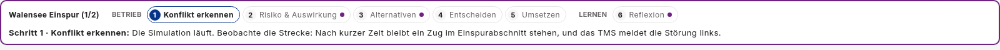
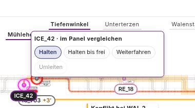
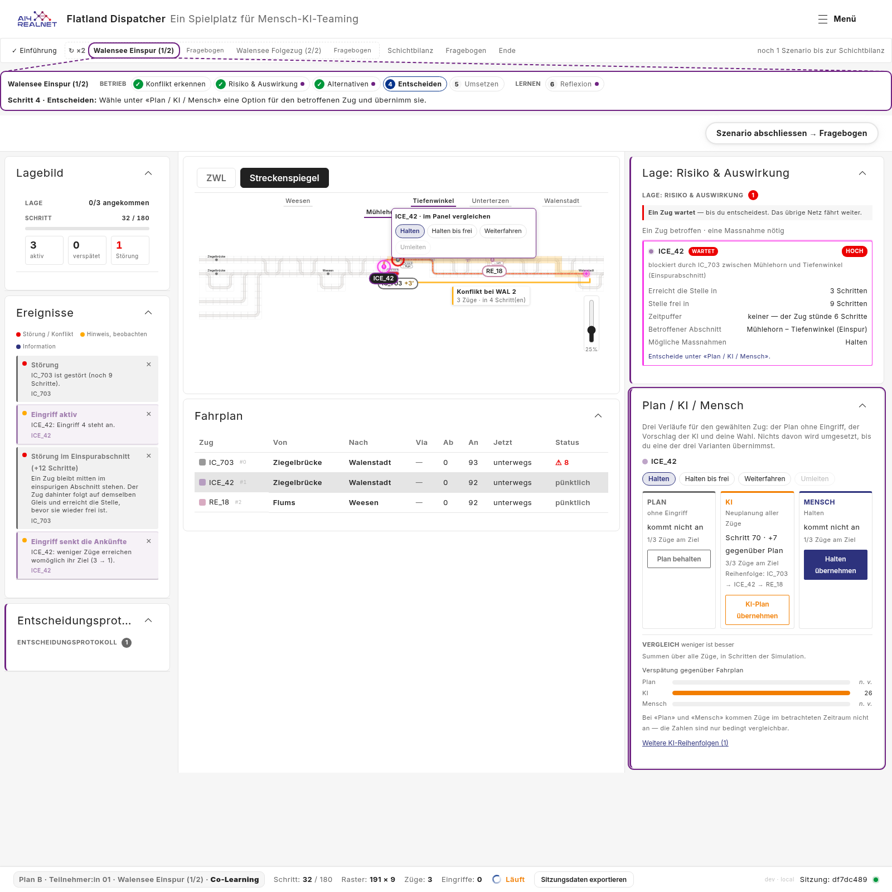

# Plan B control group: a copy of `plan-b-p01` without the Co-Learning modules (#134)

> **Status:** plan, 2026-11-05. Based on `main` 333013c. Open questions in
> §8 (Q1, Q3, Q4); Q1 and Q3 block S3. Q2 decided 2026-11-05.
> Before screenshots in §2.1.
> Issue [#134](https://github.com/flatland-association/flatland-ui-hub/issues/134)
> ("Darstellung Experiment für Kontrollgruppe definieren"), with the
> deviations listed by @SamiraAPS and annotated by @chenkins in the comments.
> Related: [#149](https://github.com/flatland-association/flatland-ui-hub/issues/149)
> (impact analysis: lateness is the one figure), #145 (Plan B), #168 (ZWL
> default). Branch `feature/134-control-group`, off `main` (on request;
> contributors usually branch off `explore_db`).
>
> **Why:** the user study (FHNW & SBB; formative round 1 on 2026-11-23)
> compares the Co-Learning condition with a control group. The control group
> sees the same screen, scenarios and questionnaires, without the parts the
> study is about: no reflection after a decision, no impact analysis, and the
> AI's options with a recommendation instead of neutral options and the
> human's own course.

### Status

| ID | Commit message | SHA |
|---|---|---|
| S0 | docs(plans): plan for #134, the Plan B control group, with before screenshots. | - |

### Terms

- **Experimental group:** the condition `plan-b-p01` ("Plan B · participant
  01"), layout `preset-plan-b` (`PLAN_B`, `PLAN_B_UI` in
  `core/layout/layout-presets.ts`), mode `co-learning`, briefing
  `colearning-experiment-2x`, legs `WAL_SINGLE_TRACK` and `WAL_FOLLOWER`
  (`core/demo/study-conditions.ts`). "Plan B experimenter 1" in the request.
- **Control group:** the new condition this plan adds, `plan-b-control-p01`.
- **Reflection module:** the "Warum diese Entscheidung?" dialog that pauses
  the run after a decision (`TourReasonDialogComponent`, opened by the
  briefing flag `reasonDialog`), and its guide step `reflect` ("Schritt 6
  Reflexion"). Not the `co-learning-reflection` panel, which no Plan B
  layout places.
- **Impact analysis:** the "VERGLEICH · weniger ist besser" section at the
  bottom of "Plan / KI / Mensch" (`proposal-compare`, `comparison()`), the
  bars per course. Since #149 it has one axis under Plan B, "Verspätung
  gegenüber Fahrplan" (`axis.lateness`; `axis.time` is hidden by
  `PLAN_B_UI`). Not the "Lage: Risiko & Auswirkung" panel (`impact`).
- **Option chips:** the buttons Halten / Halten bis frei / Weiterfahren /
  Umleiten in "Plan / KI / Mensch" (`pc-options`), which compute the
  **Mensch** course, and their twin on the map, the strip "⟨Zug⟩ · im Panel
  vergleichen" (`trainOptions()` in `FlatlandMapComponent`).
- **Take buttons:** "Plan behalten", "KI übernehmen", "⟨Option⟩ übernehmen"
  under each course (`data-log` `proposals.keepPlan`, `proposals.takeAi`,
  `proposals.takeHuman`).
- **Decision moment:** how a new conflict engages the human,
  `ImpactPanelComponent.modeBehavior()`: `hold` in Co-Learning (affected
  trains held, the world runs on), `countdown` in Recommendation (global
  pause, then the top option is applied when the countdown expires).

### Components

| Component | Responsibility | Change |
|---|---|---|
| `STUDY_CONDITIONS` | Lists the experiment conditions the Experiments door offers, with layout, mode, briefing, legs and questionnaires. Not the layout or the briefing themselves. | 🟨 modified: one new condition, `plan-b-control-p01`. |
| `PLAN_B_CONTROL` / `PLAN_B_CONTROL_UI` | The control group's layout and what it removes. Not shared with other presets. | 🟩 new: a copy of `PLAN_B`; its `ui` block is `PLAN_B_UI` plus the impact analysis. |
| `TourBriefing` `recommendation-experiment-2x` (de, en) | What the control group reads and is guided through: opening page, mode intro, guide steps. Not the scenarios (the legs). | 🟩 new: `colearning-experiment-2x` without the reflection dialog, the `reflect` step and the Co-Learning wording. |
| `PANEL_MODE_AVAILABILITY` | Which panel types a mode offers. Not how a panel behaves in a mode (the panel does). | 🟨 modified: `proposal-compare` also in `recommendation`. |
| `ProposalCompareComponent` | Shows the courses for the selected train and takes the one the human commits. Not the conflict assessment (`impact`). | 🟨 modified: in Recommendation, no option chips and no Mensch course; the KI course is marked as the recommendation. |
| `FlatlandMapComponent` (`trainOptions`) | The option strip at the selected train. | 🟨 modified: only where the panel has option chips, i.e. in Co-Learning. |

## 1. What the issue asks for

| # | Requirement | Source |
|---|---|---|
| 1 | A control-group condition with the experimental group's setup: a copy of `plan-b-p01` (layout, scenarios, questionnaires, logging) | request, issue title |
| 2 | No reflection module: no reflection dialog after a decision | comment 1, picture "Reflection Module" |
| 3 | No impact analysis: no comparison of Plan / KI / Mensch | comment 1, "Impact Analyse: tbd", #149 |
| 4 | Recommendation-based: the AI's options are shown, one of them marked as the recommendation | comment 1 |
| 5 | In "Plan / KI / Mensch" only PLAN and KI, without the option chips | comment "Recommendation based", first picture |
| 6 | No option strip on the map ("⟨Zug⟩ · im Panel vergleichen") | comment "Recommendation based", second picture; decided 2026-11-05 (Q2) |

### 1.1 Assumptions and exclusions

- **Assumptions** (checked at setup, not enforced in code):
  - The control group runs the same two legs, in the same order, as the
    experimental group. Their order is authored per condition
    (`study-conditions.ts`), so a counterbalanced order is a new condition,
    not a setting.
  - One condition per participant, as for Plan B (`plan-b-p01` is "the first
    of ten"): this plan adds the control group's first; the others follow
    the same way, naming the same layout.
  - "Recommendation-based" is the `recommendation` mode of the brief
    (`docs/reference/interaction-modes-brief.md`, WP 3.1): the AI suggests
    with a recommendation, the human decides (Q1).
- **Exclusions:**
  - The experimental group (`plan-b-p01`, `PLAN_B`, its briefing) does not
    change.
  - The `recommendations` panel (WP 3.1's own surface, with confidence
    stripe) is not placed: the control group keeps the experimental group's
    screen and differs only where §1 says.
  - No new questionnaire: both groups answer `nasa-tlx` after each leg and
    `DEFAULT_SURVEY_PARTS` at the end. Items that ask about the reflection
    or the AI learning are for the PO to drop (Q4).
  - French texts for the new briefing: the study runs in German; the English
    twin is for showing it. The new i18n keys get a French draft.

### 1.2 Design changes and new patterns

| What is new | Reuses | Defined in |
|---|---|---|
| A second study layout whose `ui` block extends another's (`{ ...PLAN_B_UI, hidden: [...] }`) | `PLAN_B_UI` | §4.1 |
| `proposal-compare` in Recommendation mode, with a recommendation tag on the KI course | the per-mode behaviour inside a panel (`PANEL_MODE_AVAILABILITY` comment) | §4.3 |
| A briefing derived from another without the reflection | `withoutInterview()`-style derivation in `tour-briefings.ts` | §4.2 |

Not new on purpose: no new UiConfig id (the impact analysis goes with the
existing `widget.proposal-compare.axis.lateness`), no new mode, no flag
"control group" anywhere: what differs is the mode and the layout's `ui`
block, both already recorded per run.

### 1.3 Breaking changes

None in an API, payload, file format or config. Behaviour outside the new
condition:

- `proposal-compare` placed in a Recommendation-mode layout now renders (as
  Plan + KI) instead of nothing. No preset does that today besides the new
  one; a designer-made layout may.
- The map's option strip disappears in Recommendation mode for tours with
  `assessmentOnly`. None runs in Recommendation today.

## 2. Today (checked 2026-11-05 on `main`, 333013c)

- `plan-b-p01`: layout `preset-plan-b`, mode `co-learning`, `studyLogging:
  true`, briefing `colearning-experiment-2x` (de, en), `legSurveyParts:
  ['nasa-tlx']`, `surveyParts: DEFAULT_SURVEY_PARTS`, legs
  `[WAL_SINGLE_TRACK, WAL_FOLLOWER]` (`study-conditions.ts`).
- `PLAN_B_UI` hides `control.mapNavigation`, `control.endShift`,
  `control.playback`, `widget.proposal-compare.axis.time`,
  `control.sessionInfo`, `control.modeTabs`, `widget.view-tabs.title`;
  collapses `widget.decision-log`; allows only `deadlock_avoidance`
  (`layout-presets.ts:695-720`).
- **Reflection:** `colearning-experiment-2x` inherits `reasonDialog: true`
  from `colearning-experiment` (`tour-briefings.ts:467-490`). The dialog
  opens whenever `store.pendingRationale()` is set and the mode is not
  Director (`tour-reason-dialog.component.ts:29-33`); the store sets it after
  every human decision in Co-Learning, and in Recommendation only when an
  AI suggestion existed (`session.store.ts:2133`). The guide lists the step
  `reflect`.
- **Impact analysis:** `comparison()` builds one axis per id not hidden and
  returns `null` without any (`proposal-compare.component.ts:351-387`), so
  hiding `axis.lateness` next to `axis.time` removes the whole section.
- **Plan / KI / Mensch** is offered only in Co-Learning
  (`panel-mode-availability.ts:31`): in a Recommendation run the Plan B
  right column would show only "Lage: Risiko & Auswirkung". It has no mode
  branch of its own; the KI course carries no recommendation mark.
- **Map strip:** shown when the briefing sets `assessmentOnly` and a train is
  selected (`flatland-map.component.ts:238-250`), in every mode.
- **Decision moment:** `recommendation` → `countdown` (global pause, the top
  option auto-applied after `decisionCountdownSeconds`, default 10 s);
  `co-learning` → `hold` (`impact-panel.component.ts:191-196`). Not gated by
  `assessmentOnly`.

### 2.1 Before (`plan-b-p01`, `main` 333013c)

Taken by `scripts/docshots-plan-b-control.mjs` on leg 1 with the Plan B
deployment config, after the breakdown: ICE_42 selected in "Lage: Risiko &
Auswirkung", "Halten" picked, then "Halten übernehmen". The same script with
`after plan-b-control-p01` takes the after pictures (S4).

| Read from the page | Value |
|---|---|
| Option chips | Halten, Halten bis frei, Weiterfahren, Umleiten |
| Courses | Plan, KI, Mensch |
| Comparison ("Vergleich") | shown, one axis: Verspätung gegenüber Fahrplan |
| Map strip at the selected train | shown |
| Guide step 6 "Reflexion" | shown |

| # | What changes | Before |
|---|---|---|
| 2 | Guide step 6 "Reflexion" goes |  |
| 2 | The reflection dialog after "übernehmen" goes |  |
| 3, 5 | "Plan / KI / Mensch": chips, Mensch and "Vergleich" go; KI tagged "Empfehlung" |  |
| 6 | The option strip at the selected train goes |  |
| 1 | The working screen at the decision |  |

## 3. Decisions

Proposed; Q1 and Q3 to confirm, Q2 decided 2026-11-05.

| ID | Decision | Why |
|---|---|---|
| D1 | A new condition `plan-b-control-p01` and a new layout `preset-plan-b-control`, copied from `plan-b-p01` and `PLAN_B` | A study layout is reviewable on its own (`PLAN_B`'s comment); the experimental group stays untouched |
| D2 | `PLAN_B_CONTROL_UI = { ...PLAN_B_UI, hidden: [...PLAN_B_UI.hidden, 'widget.proposal-compare.axis.lateness'] }` | A later Plan B restriction reaches both groups, so they cannot drift apart except where §1 says |
| D3 | The control group runs in mode `recommendation` (Q1) | The issue names it; the mode is the brief's switch for "AI suggests with a recommendation", so no parallel flag |
| D4 | No reflection through a new briefing without `reasonDialog` and without the `reflect` step, not through a UiConfig id | The reflection is a briefing flag today; the dialog is not a panel |
| D5 | `proposal-compare` offered in Recommendation; there it hides the option chips and the Mensch course and tags the KI course "Empfehlung"; take buttons for Plan and KI stay (decided 2026-11-05, Q2) | Requirement 5; behaviour per mode lives in the panel. The human still decides, by taking one of the two |
| D6 | The map strip shows only where the panel has option chips, i.e. not in Recommendation | Without the chips the strip would ask a panel that cannot answer |
| D7 | The decision moment of the control group: see Q3 | Recommendation's countdown auto-applies the AI's option; the issue does not list it as a deviation |
| D8 | Leg 2 of the control group is `WAL_FOLLOWER` spread with its own German card | The leg's card replaces the briefing's whole (§4.1); spreading keeps `id`, scenario and seed identical |

## 4. Design

### 4.1 Condition and layout (requirements 1, 3)

- `study-conditions.ts`, after `plan-b-p01`:
  ```ts
  {
    id: 'plan-b-control-p01',
    layoutId: 'preset-plan-b-control',
    mode: 'recommendation',
    label: 'Plan B control · participant 01',
    labelKey: 'tours.plan-b-control-p01.name',
    studyLogging: true,
    briefingIds: { de: 'recommendation-experiment-2x', en: 'recommendation-experiment-2x' },
    legSurveyParts: ['nasa-tlx'],
    surveyParts: DEFAULT_SURVEY_PARTS,
    legs: [WAL_SINGLE_TRACK, WAL_FOLLOWER_RECOMMENDATION],
  }
  ```
  Same scenarios, so `legId` names the same scenario in both groups'
  records. A leg's own card wins whole over the briefing's, whatever the
  mode (`TourContextService.modeIntroFor()`), and `WAL_FOLLOWER.intro.de` is
  Co-Learning's card with a new situation text. So leg 2 is
  `WAL_FOLLOWER_RECOMMENDATION = { ...WAL_FOLLOWER, intro: { de:
  WAL_FOLLOWER_INTRO_REC_DE } }`: same `id`, scenario, disturbance and seed
  (spread, so they cannot drift), the card built on the control briefing's
  `modeIntros.recommendation` with the same title and situation text (D8).
- `layout-presets.ts`: `PLAN_B_CONTROL_UI` (D2) and `PLAN_B_CONTROL`, a copy
  of `PLAN_B` with ids `preset-pbc-*`, `name: 'Plan B · Kontrollgruppe'`,
  the right column named `Empfehlung` instead of `Co-Learning`. Same panels,
  same order, same sizes, same centre-panel settings (#168). Added to
  `LAYOUT_PRESETS` after `PLAN_B`.

### 4.2 Briefing without reflection (requirement 2)

- `tour-briefings.ts`: `RECOMMENDATION_EXPERIMENT_2X_DE` (and `_EN`), derived
  from `CO_LEARNING_EXPERIMENT_2X_DE`:
  - `reasonDialog: false`; `assessmentOnly`, `mapTrainLabels`, `autoStart`,
    `debrief`, `debriefSections: ['shift-summary']`, `language`,
    `mapFocusCols` as there.
  - `guide`: without `reflect`; the `alternatives` and `decide` hints say
    that the KI recommends one course and the human takes Plan or KI.
  - `moduleBadges`: without the Co-Learning violet marks (Q4).
  - `modeIntros.recommendation`: the Co-Learning intro's situation text,
    without "Co-Learning" and with the step count of the shorter guide.
  - `opening`: the same pages, with "rechts die Empfehlung der KI" instead
    of "die Co-Learning-Module". The working-screen picture
    (`experiments/arbeitsansicht.png`) shows the Mensch course; a control
    picture is taken in S4.
- `freshOperatorProfile: true` stays: nothing is learned, but a fresh id keeps
  the records of two participants apart as in the experimental group.
- The store still sets `pendingRationale` after a decision that deviates
  from an AI suggestion; without the dialog and the reflection panel nobody
  shows it. Nothing is recorded as a reason, which is the point.

### 4.3 Plan / KI in Recommendation (requirements 4, 5, 6)

- `panel-mode-availability.ts`: `'proposal-compare': ['co-learning',
  'recommendation']`, with a comment: neutral options in Co-Learning, the
  AI's course as a recommendation in Recommendation (#134). The same line
  in `docs/reference/panel-mode-matrix.md`.
- `ProposalCompareComponent`: `recommending = computed(() =>
  store.interactionMode() === 'recommendation')`. When true:
  - no `pc-options` group and no Mensch section (neither the course nor its
    placeholder); `choose()` is not reachable, and the effect does not ask
    for a human course;
  - the KI course gets a tag "Empfehlung" (`proposals.recommended`) in its
    header, styled with the existing KI accent token, and the note above
    reads `proposals.noteRecommendation` ("Zwei Verläufe für den gewählten
    Zug: der Plan ohne Eingriff und die Empfehlung der KI. …");
  - "Plan behalten" and "KI übernehmen" stay, with their `data-log` ids;
  - the alternatives ("weitere Reihenfolgen") stay: they are the AI's other
    options (Q2).
- `FlatlandMapComponent.trainOptions()`: also `null` in Recommendation (D6).
- The comparison section needs no code: `PLAN_B_CONTROL_UI` hides its last
  axis (§2).

### 4.4 Record and replay

- Records name `conditionId: 'plan-b-control-p01'` and `mode:
  'recommendation'`; the `uiRestrictions` snapshot lists
  `widget.proposal-compare.axis.lateness` in addition. Analyses tell the
  groups apart by `conditionId`.
- Replay rebuilds the layout and the mode from the record; no change.

## 5. Files

### New files

| File | What it adds |
|---|---|
| `scripts/docshots-plan-b-control.mjs` | Screenshots of both groups on leg 1 for the PR, as `scripts/docshots-zwl-default.mjs` (added with S0) |
| `docs/plans/plan-b-control-group/*.png` | Before (S0, §2.1) and after (S4) screenshots |

### Modified files

| File | What changes |
|---|---|
| `frontend/src/app/core/demo/study-conditions.ts` | the condition `plan-b-control-p01`; `WAL_FOLLOWER_RECOMMENDATION` and its card |
| `frontend/src/app/core/demo/study-conditions.spec.ts` | the control group shares leg ids, scenarios, seeds, surveys and logging with `plan-b-p01`; its layout hides `axis.lateness`; its briefing has no `reasonDialog` |
| `frontend/src/app/core/layout/layout-presets.ts` | `PLAN_B_CONTROL_UI`, `PLAN_B_CONTROL`, entry in `LAYOUT_PRESETS` |
| `frontend/src/app/core/config/ui-config.service.spec.ts` | `PLAN_B_CONTROL_UI` contains every `PLAN_B_UI` id |
| `frontend/src/app/core/demo/tour-briefings.ts` | `recommendation-experiment-2x` (de, en) |
| `frontend/src/app/core/layout/panel-mode-availability.ts` | `proposal-compare` in `recommendation` |
| `frontend/src/app/features/proposal-compare/proposal-compare.component.ts` / `.html` / `.scss` | `recommending()`, no chips and no Mensch course, the recommendation tag |
| `frontend/src/app/features/proposal-compare/proposal-compare.component.spec.ts` | new or extended: Recommendation hides chips and Mensch, tags KI; Co-Learning unchanged |
| `frontend/src/app/features/flatland-map/flatland-map.component.ts` | `trainOptions()` off in Recommendation |
| `frontend/public/i18n/{en,de,fr}.json` | `tours.plan-b-control-p01.name`, `proposals.recommended`, `proposals.noteRecommendation` |
| `docs/reference/panel-mode-matrix.md` | `proposal-compare` in Recommendation |
| `docs/plans/configurable-ui-plan.md` | §5.2: the control layout's block next to Plan B's |
| `docs/plans/experiment-workflow.md` | the control condition in the condition list |

## 6. Verification

- Specs as in §5; the four CI checks (`lint:styles`, `i18n:check`,
  production build, `pytest -q`).
- In the running app (production build, Plan B deployment config), on
  `plan-b-control-p01`, legs 1 and 2: after taking a course no dialog
  opens and the guide has no Reflexion step; "Plan / KI / Mensch" shows
  Plan and KI, the KI tagged "Empfehlung", no chips, no Mensch, no
  "Vergleich"; no strip on the map at the selected train; the decision
  moment as decided in Q3; Schichtbilanz and questionnaires as in
  `plan-b-p01`; the saved record names the condition.
- `plan-b-p01` unchanged: chips, Mensch, Vergleich (lateness), reflection
  dialog, map strip.

## 7. Steps

| ID | Step | Needs |
|---|---|---|
| S1 | `proposal-compare` in Recommendation: availability, `recommending()`, tag, map strip, specs, matrix doc | - |
| S2 | `recommendation-experiment-2x` briefing (de, en) | Q4 |
| S3 | `PLAN_B_CONTROL_UI`, `PLAN_B_CONTROL`, condition `plan-b-control-p01`, i18n, specs, plan docs | S1, S2, Q1, Q3 |
| S4 | Screenshots of both groups, script, plan status | S3 |

Each step passes the CI checks on its own.

## 8. Open questions

- **(Q1) Mode of the control group: `recommendation`, or `co-learning` with
  more hidden parts?** Recommended: `recommendation` (D3). It is what the
  issue names, and the brief's mode for "AI suggests with a recommendation".
  The alternative keeps `co-learning` and hides chips, Mensch and the strip
  through new UiConfig ids; the recommendation tag would then be a
  condition flag beside the mode, which the guardrails rule out.
- ✅ ~~**(Q2) What stays in "Plan / KI" under Recommendation?**~~
  **Decided 2026-11-05:** only the Plan and KI courses; the option chips
  (Halten, Halten bis frei, Weiterfahren, Umleiten) go, and with them the
  Mensch course, and no "⟨Zug⟩ · im Panel vergleichen" strip on the map at
  the selected train (D5, D6). The take buttons of Plan and KI stay.
- **(Q3) Decision moment in the control group?** Recommendation's
  `countdown` pauses the whole run on a new conflict and applies the AI's
  option after 10 s unless the human acts. The experimental group holds the
  affected trains and lets the world run (`hold`). The issue does not list
  this as a deviation, so as-is it would be a confound.
  a) Keep `countdown`: Recommendation as specified (brief §330), no code.
  b) `hold` as in the experimental group, through a briefing flag
     `decisionMoment: 'hold'` read by `ImpactPanelComponent.modeBehavior()`,
     the same kind of tour-level switch as `assessmentOnly`.
  Recommended: b), so the groups differ only where §1 says. For the study
  leads.
- **(Q4) Co-Learning wording outside the panels?** The violet module badges,
  the guide's "Neu: …" module hints and questionnaire items about learning
  or reflection (in `DEFAULT_SURVEY_PARTS`) all name Co-Learning. Proposed:
  the control briefing drops the badges and rewrites the hints; the
  questionnaire stays identical in both groups so the answers compare, and
  the study leads decide whether items that ask about the reflection are
  skipped for the control group.
