# Plan B summative experiments: `plan-b-summative-colearning-p01` with a reflection summary (#209), the Recommendation setting for the control group designed for later (#134)

> **Status:** plan, 2026-11-05, revised 2026-11-16, 2026-11-23 against
> `main` 85e36e5c (the branch is rebased onto it, §7.1), and 2026-11-25
> for #134's new run order: one setting per participant, two scenarios,
> the Schichtauswertung, the questionnaire ((Q-1) revisited, decided
> 2026-11-25). This PR adds one summative experiment,
> `plan-b-summative-colearning-p01`, as the template of the eight Co-Learning
> ones, with the reflection summary of #209 and its feedback of 2026-11-25.
> The Recommendation setting (§4.3) and the experiments `p02` … `p08` of both
> settings come in a later PR (§1.4). All questions are decided. Built
> 2026-11-25: S-9, S-11, S-4, S-7; after screenshots in §6.1 (S-5). Findings: F-2–F-4 fixed in
> S-6, F-1 dropped (§3.1). Issue
> [#209](https://github.com/flatland-association/flatland-ui-hub/issues/209)
> ("Reflexion: am Ende eine Zusammenfassung anzeigen", @CleverManu, label
> `plan b`, "Umsetzen für Runde 2") added 2026-11-23 (§4.5).
> Issue [#134](https://github.com/flatland-association/flatland-ui-hub/issues/134)
> ("Darstellung Experiment für Kontrollgruppe definieren"), with the
> deviations listed by @SamiraAPS, annotated by @chenkins, and the run order of
> @CleverManu (2026-11-12, edited 2026-11-25 to one setting per
> participant; the assignment matrix
> [#179](https://github.com/flatland-association/flatland-ui-hub/issues/179)
> struck out). Related: [#149](https://github.com/flatland-association/flatland-ui-hub/issues/149)
> (impact analysis: lateness is the one figure), #145 (Plan B), #160
> (reflection inline), #164 (experiment scenarios, `plan-b-p01` … `p10`).
> Branch `feature/134-control-group`, off `main` (on request; contributors
> usually branch off `explore_db`), PR
> [#201](https://github.com/flatland-association/flatland-ui-hub/pull/201).
>
> **Why:** the user study (FHNW & SBB; formative round on 2026-11-23 with
> `plan-b-p01` … `p10`, summative experiments on 2026-12-03/04) compares
> Co-Learning with a recommendation-based AI. Each participant of the
> summative experiments works in one setting, two scenarios, eight
> participants per setting (#134, 2026-11-25). The Recommendation setting is
> Plan B without the parts the study is about: no reflection after a
> decision, no impact analysis, and the AI's options with a recommendation
> instead of neutral options and the human's own course. After the two
> scenarios the Co-Learning participant sees their reflections again, in
> the Schichtbilanz (#209).

### Terms

- **Setting** ("Bedingung" in #179): Co-Learning (C) or Recommendation (R),
  one `InteractionMode` with its briefing. A participant of the summative
  experiments works in one of them.
- **Formative experiments** (November): the Plan B experiments
  `plan-b-p01` … `plan-b-p10` ("Plan B · participant
  01" …), layout `preset-plan-b` (`PLAN_B`, `PLAN_B_UI` in
  `core/layout/layout-presets.ts`), mode `co-learning`, briefing `plan-b`
  (`PLAN_B_DE`), legs `PLAN_B_TUTORIAL` and the four UC2 scenarios in the
  participant's order (`PLAN_B_ORDERS`), final questionnaire `plan-b-final`
  (`core/demo/study-conditions.ts`), the KI course from the trained UC2
  model (`proposalAgent: 'uc2_rl'`). Their ids stay as they are, and so does
  their behaviour: this plan does not touch them (D-19).
- **Summative experiments** (December): `plan-b-summative-colearning-pNN`
  and `plan-b-summative-recommendation-pNN`, `NN` = 01–08 ((Q-1)
  revisited, D-16): two UC2 scenarios in one setting, the Schichtbilanz,
  `plan-b-final`; no tutorial (Q-13). This PR adds
  `plan-b-summative-colearning-p01`. The Recommendation ones are the
  control group of #134.
- **Reflection module:** the reflection asked under each decision in the
  "Entscheidungsprotokoll" (since #160 inline, while the run goes on; the
  briefing flag `reasonDialog`, a name from when it was a dialog), its guide
  step `reflect` ("Reflexion"), and the "open reflections" refusal of
  "Szenario abschliessen" (`TourContextService.refuseFinish`). The guide
  step is ticked and logged, but not shown: Plan B hides the guide strip
  (`control.guide`, #198). Not the
  `co-learning-reflection` panel, which no Plan B layout places.
- **Impact analysis:** the "VERGLEICH" section at the bottom of "Plan / KI / Mensch" (`proposal-compare`, `comparison()`), the
  bars per course. Not the "Lage: Risiko & Auswirkung" panel (`impact`).
- **Option chips:** the buttons Halten / Halten bis frei / Weiterfahren /
  Umleiten in "Plan / KI / Mensch" (`pc-options`), which compute the
  **Mensch** course, and their twin on the map, the strip "⟨Zug⟩ · im Panel
  vergleichen" (`trainOptions()` in `FlatlandMapComponent`).
- **Take buttons:** "Plan behalten", "KI übernehmen", "⟨Option⟩ übernehmen"
  under each course (`data-log` `proposals.keepPlan`, `proposals.takeAi`,
  `proposals.takeHuman`).
- **Decision moment:** how a new conflict engages the human,
  `ImpactPanelComponent.modeBehavior()`: `hold` in Co-Learning (affected
  trains held, the world runs on), `countdown` in Recommendation (global
  pause, then the top option is applied when the countdown expires).
- **Schichtbilanz** ("Schichtauswertung" in #134, #174 and #209): the screen after
  the last leg of a guided condition, in the phase `review`: the briefing's
  debrief (`TourDebriefComponent`) cut to its `shift-summary` section, with
  a KPI row per scenario and the last scenario's decisions with their
  reflections. The formative experiments turn it off (`shiftSummary: false`, #174);
  the summative ones keep it.
- **Reflection summary** (#209): the Schichtbilanz brought back with an
  overview Szenario | Ereignisse | Entscheidungen | Reflexion over the
  scenarios of a summative Co-Learning run (§4.5). Not the inline reflection
  under a decision, and not the questionnaire.

### Components

| Component | Responsibility | Change |
|---|---|---|
| `STUDY_CONDITIONS` | Lists the experiments the Experiments door offers, with layout, mode, briefing, legs and questionnaires. Not the layout or the briefing themselves. | 🟨 modified: one new experiment, `plan-b-summative-colearning-p01`, two scenarios with the Schichtbilanz; the formative ones unchanged. |
| `TourBriefing` `plan-b-summative` | What a summative Co-Learning participant reads before the first scenario. Not the scenarios. | 🟩 new: `plan-b` with an opening that announces the first of two scenarios instead of the tutorial (Q-15, D-20). |
| `ExperimentRunService` | Runs an experiment: which leg, which phase, what comes next, the record. Not for UI. | 🟨 modified: keeps each scenario's decisions with their reflections for the summary. |
| `AppComponent` | Starts sessions and opens screens on the run's behalf. | 🟨 modified: the footer no longer names the mode where the layout hides the mode strip (D-14). |
| `TourDebriefComponent` (`shift-summary`) | The Schichtbilanz of a tour or experiment. Not the questionnaire, not the Director's shift review. | 🟨 modified: in an experiment, shows each scenario's events, decisions and reflections in one overview (#209), without the parts #209's feedback drops, and leads on with "Weiter zum Fragebogen" (D-15, D-18). Tours unchanged. |
| `ReplayShiftSummaryComponent` | The Schichtbilanz in a replay, from the record. Not the live one. | 🟨 modified: the same overview, from the recorded legs. |

## 1. What the issue asks for

| # | Requirement | Source |
|---|---|---|
| 1 | Summative experiments on the Plan B setup (screen, scenarios, logging), `plan-b-summative-{colearning,recommendation}-pNN`; this PR adds `plan-b-summative-colearning-p01` as the template; the formative ones stay as they are | request, issue title; names decided 2026-11-25 ((Q-1) revisited, D-16, D-19) |
| 2 | Recommendation setting: no reflection module, no reflection asked after a decision | comment 1, picture "Reflection Module"; later PR (§4.3) |
| 3 | Recommendation setting: no impact analysis, no comparison of Plan / KI / Mensch | comment 1, "Impact Analyse: tbd", #149; later PR |
| 4 | Recommendation setting: the AI's options shown, one marked as the recommendation | comment 1; later PR |
| 5 | Recommendation setting: in "Plan / KI / Mensch" only PLAN and KI, without the option chips | comment "Recommendation based", first picture; later PR |
| 6 | Recommendation setting: no option strip on the map ("⟨Zug⟩ · im Panel vergleichen") | comment "Recommendation based", second picture; decided 2026-11-05 (Q-2); later PR |
| 7 | Run order: scenario 1 and 2 in one setting, the Schichtauswertung, the questionnaire; eight participants per setting; no tutorial ((Q-1) revisited, Q-13) | comment of 2026-11-12, edited 2026-11-25 (both settings in one run until then) |
| 8 | Which two scenarios each participant runs, and in which order, by a Latin square; `p01` of this PR: two drawn at random and fixed, `uc2-1` then `uc2-2` ((Q-6) revisited, D-17) | #179 struck out in #134 on 2026-11-25; "Latin Square" in #209, 2026-11-25 |
| 9 | A summary of the reflections at the end: the Schichtauswertung again, as an overview Szenario \| Ereignisse \| Entscheidungen \| Reflexion | #209, @CleverManu 2026-11-18 ("Wiedereinführen der Schichtauswertung"); what "Ereignisse" holds: Q-9 |
| 10 | Shown after the 2 scenarios of a summative experiment; ~~and after 4 in the formative evaluation (`plan-b-pNN`)~~ dropped 2026-11-25: the formative round is over and its experiments stay as they are (D-19) | #209, @SamiraAPS 2026-11-18 |
| 11 | The Schichtbilanz drops the note "Darunter das letzte Szenario im Detail." and the last scenario's KPI chips, which repeat its row of the table; its list "Deine Eingriffe" (decisions with reflections) gives way to the overview of requirement 9 (S-7) | #209, feedback of @SamiraAPS, 2026-11-25 ("das hat ja nicht mehr Details als oben?") |
| 12 | The Schichtbilanz drops the note "Im Endausbau fasst die Schichtbilanz …" | #209, 2026-11-25 |
| 13 | The Schichtbilanz drops the button "← Zurück zur laufenden Schicht" | #209, 2026-11-25 |
| 14 | The button "Zur Übersicht" at the bottom of the Schichtbilanz reads "Schicht beenden" or "Zum Fragebogen" (Q-14) | #209, 2026-11-25 |

### 1.1 Assumptions and exclusions

- **Assumptions** (checked at setup, not enforced in code):
  - One experiment per participant, started by the experimenter, who
    picks the participant's condition.
  - "Recommendation-based" is the `recommendation` mode of the brief
    (`docs/reference/interaction-modes-brief.md`, WP 3.1): the AI suggests
    with a recommendation, the human decides (Q-1).
  - `plan-b-final` fits both settings: it asks about the human's share
    against the KI and their role, not about reflection or learning
    (checked 2026-11-23, after #222 updated its items).
  - The participants know the Plan B screen well enough without the
    tutorial (Q-13); the experimenter explains it before the run.
- **Exclusions:**
  - The formative experiments (`plan-b-p01` … `p10`, `PLAN_B`, the briefing
    `plan-b`) and the test run `plan-b-uc2` do not change (D-19).
  - The Recommendation setting and the experiments `p02` … `p08` of both
    settings: a later PR (§1.4).
  - English texts for the new briefing: `plan-b` is German only, like the
    study; so is `plan-b-summative`. New i18n keys get `en` and a French
    draft.

### 1.2 Design changes and new patterns

| What is new | Reuses | Defined in |
|---|---|---|
| A summative experiment with two scenarios, the Schichtbilanz and the final questionnaire | the formative condition's fields (`PLAN_B_CONDITIONS`), `shiftSummary` left at its default | §4.2 |
| A briefing derived from `plan-b` with another opening | `PLAN_B_DE`'s own derivation from `CO_LEARNING_EXPERIMENT_2X_DE` | §4.2 (Q-15) |
| A leg's decisions with their reflections and the disturbance messages open at each (`DecisionLogEntry.events`, `ShiftRecord.decisions[].reflection`, `.reason`, `.events`) kept at the leg's end | the snapshot of `kpis` and `interventions` per leg for the Schichtbilanz over all legs (`ExperimentRunService.finishLeg`) | §4.5 |
| The reflection overview in the Schichtbilanz, and its trimmed form in an experiment | its `shift-summary` section and the per-leg table (`legRows()`), the reflection lines (`reflectionLines()`); the gate on the running experiment that `sections()` already has | §4.5 (Q-9, D-15) |

Not new on purpose: no new layout (`preset-plan-b`), no new UiConfig id, no
new mode, no new phase of the run, no new questionnaire (`plan-b-final`), no
new screen for the summary (it is the Schichtbilanz, phase `review`), no
new key for the Schichtbilanz's last button (`experimentRun.finish.toFinalSurvey`,
D-18), no leg fields for a second setting in one run ((Q-1) revisited).

### 1.3 Breaking changes

None in an API, payload, file format or config. The run record's
`legs` gain optional fields per decision (`reflection`, `reason`,
`events`, §4.5), and so does the decision log entry (`events`); older
records lack them, and readers treat them as absent.
Behaviour outside the new experiment:

- The Schichtbilanz of the one other guided condition that shows it,
  `colearning-experiment`, loses the concept note and "← Zurück zur
  laufenden Schicht", and its last button reads "Weiter zum Fragebogen"
  (D-15, D-18): the gate is the running experiment, not the condition.
  Tours keep all three.
- The footer of every layout that hides the mode strip leaves out the
  mode name (D-14): `preset-plan-b`, so also the formative experiments'
  replays.

### 1.4 Limitations and follow-ups

- **Limitations:**
  - The reflection summary shows the decisions the participant made by
    hand; the AI's own holds are not listed. In a tour they are counted
    (`systemHolds`), as in the Schichtbilanz today; in an experiment not
    even counted, since the decision log holds only the last scenario's
    (F-6).
  - The disturbance messages kept with a decision are those of
    `notifications()` at that moment, which is polled every 2 s
    (`NotificationPollingService`): a decision within 2 s after a breakdown
    can miss it, one within 2 s after its end can still list it (F-15).
  - Trains of an earlier scenario are named from its preset's
    `train_names` (`TrainIdentityService.nameIn()`); a scenario without
    names falls back to the session's names (F-5).
- **Follow-ups (not in this PR):**

  | Follow-up | Why not in this PR | From | Findings | Issue |
  |---|---|---|---|---|
  | The Recommendation setting: Plan / KI without chips, Mensch and comparison, the KI tagged "Empfehlung", no map strip, `hold` instead of the countdown, the briefing `plan-b-control-group` without reflection; then `plan-b-summative-recommendation-p01` … `p08` (§4.3, D-3–D-7, D-12, Q-4 revisited, Q-12). | This PR adds only the Co-Learning template (D-16). | (Q-1) revisited | - | - |
  | `plan-b-summative-colearning-p02` … `p08`, with the scenarios of the Latin square. | The study leads' table is not there yet; `p01` is the template ((Q-6) revisited). | (Q-6) revisited | - | - |
  | ~~The participant schedules from the final #179 matrix.~~ Replaced 2026-11-25 by the Latin square; #134 struck out #179. | - | Q-6 | - | [#179](https://github.com/flatland-association/flatland-ui-hub/issues/179) |
  | Both settings in one run (a leg's own mode, briefing and questionnaire, §4.1). | Not needed since #134's run order of 2026-11-25. | (Q-1) revisited | F-1 | untracked |

## 2. Today (checked 2026-11-23 on `main`, 85e36e5c)

- `plan-b-p01` … `plan-b-p10` (`PLAN_B_CONDITIONS`): layout `preset-plan-b`,
  mode `co-learning`, `studyLogging: true`, briefing `plan-b` (de, en point
  to the same German briefing), `policy: 'deadlock_avoidance'`,
  `proposalAgent: 'uc2_rl'`, `shiftSummary: false`, no `finishConfirm` (so
  "Aktuelles Szenario abschliessen?" is asked, #180), no `legSurveyParts`,
  `surveyParts: [PLAN_B_FINAL_PART]`, legs `[PLAN_B_TUTORIAL,
  ...PLAN_B_ORDERS[i]]` (`study-conditions.ts:194-212`). `ExperimentLeg`'s
  docstring says "Layout and mode are the condition's, so every leg shares
  them" (`study-conditions.ts:65-66`). The legs come from the experiment
  scenarios (`scenarioLeg`, #164) and carry no intro of their own, so the
  briefing's `modeIntros[mode]` card shows before each.
- **One mode and one briefing per experiment:** `StudyCondition.mode` and
  `.briefingIds`. The run starts the demo with `startDemo(legs.map(() =>
  condition.mode))` (`app.component.ts:1136`); the store already sets each
  step's mode on `advanceDemo()` (`session.store.ts:1191-1210`), a leftover of
  the tours that switched modes. `TourContextService.set()` sets the briefing
  once and resets the run's shift history.
- **Leg questionnaire:** `legSurveyParts` on the condition, after every leg or
  none (`ExperimentRunService.hasLegSurvey`, `surveyParts`); the phase
  `legSurvey` in `advanceExperiment`. The progress bar reads the run's
  `hasLegSurvey()` live, but the condition's `legSurveyParts` in a replay
  (`experiment-progress.component.ts:55-57`).
- **Questionnaires** (#210): `postSessionSurvey()` returns a fixed
  questionnaire (`FIXED_QUESTIONNAIRES`, `plan-b-final`) before it looks at
  `afterLeg`, so a leg questionnaire and the final one look the same. The
  replay shows each by its recorded `surveyId`, without the condition.
- `PLAN_B_UI` hides `control.mapPan`, `control.mapOpacity`,
  `control.endShift`, `control.playback`,
  `widget.proposal-compare.axis.time`, `control.sessionInfo`,
  `control.modeTabs`, `widget.view-tabs.title`,
  `widget.decision-log.actions`, `control.guide` (the guide strip) and
  `control.legNames` ("Szenario k/N" instead of the names, #198); allows
  only `deadlock_avoidance`; the decision log starts open for the inline
  reflections (`layout-presets.ts:706-731`).
- **Reflection:** `plan-b` inherits `reasonDialog: true` and the `reflect`
  guide step from `colearning-experiment` via `colearning-experiment-2x`
  (`tour-briefings.ts:485-600`). Since #160 the decision log asks for the
  reason under each decision while the run goes on, and "Szenario
  abschliessen" waits until all are answered (`refuseFinish`).
- **Guide hints:** `PLAN_B_GUIDE_HINTS` says "Die KI bietet Optionen an, ohne
  eine zu empfehlen" (`alternatives`) and describes the reflection
  (`reflect`), `tour-briefings.ts:559-566`. The hints show only in the guide
  strip, which Plan B hides (`TourGuideService.stripShown`); the guide still
  ticks and logs its steps. It resets its done steps on a new session or
  briefing (`tour-guide.service.ts:80-85`). The module badges
  (`moduleBadges`) show on the panels.
- **Impact analysis:** `comparison()` builds one axis per id not hidden and
  returns `null` without any (`proposal-compare.component.ts:468-510`). Its
  head reads "VERGLEICH" since #222 removed "weniger ist besser".
- **Plan / KI / Mensch** is offered only in Co-Learning
  (`panel-mode-availability.ts:31`). It has no mode branch of its own; the KI
  course carries no recommendation mark.
- **Map strip:** shown when the briefing sets `assessmentOnly` and a train is
  selected, until its × closes it (`flatland-map.component.ts:232-256`), in
  every mode.
- **Decision moment:** `recommendation` → `countdown` (global pause, the top
  option auto-applied after `decisionCountdownSeconds`, default 10 s);
  `co-learning` → `hold` (`impact-panel.component.ts:191-196`).
- **Schichtbilanz:** only after the last leg (`nextLegOrReview()`,
  `app.component.ts:1229-1246`): `isLast()` and `hasShiftSummary()` → phase
  `review` and `store.endShift()`, which opens the shift screen; else
  straight to `finalSurvey`. `plan-b` sets `debrief: true`,
  `debriefSections: ['shift-summary']` (inherited,
  `tour-briefings.ts:487-488`). The section shows a table per leg
  (Szenario, angekommen, verspätet, Gesamtverspätung, Störungen, Eingriffe;
  `tour-debrief.component.html:37-72`) from the snapshots in `ShiftRecord`
  (`kpis`, `interventions`, `experiment-run.service.ts:252-268`), then the
  current session's decisions with their reflection lines
  (`interventionsFrom(store.decisionLog())`, `reflectionLines()`): only the
  last scenario's. `ShiftRecord.decisions` keeps `handle`, `action`,
  `simStep`, `decisionTimeMs`, no reflection. The replay has its own copy
  of the table (`ReplayShiftSummaryComponent`).
- **Events:** the TMS messages are `AppNotification`s (`kind`, `code`,
  `relatedElement` with the train), kept per session in
  `store.notifications`; a decision entry does not name the event it
  answered (`DecisionLogEntry`, `core/decision-log.ts`).

### 2.1 Before (`plan-b-p01`)

Taken on 2026-11-23 on `main` 85e36e5c (the branch's code), production
build with the Plan B deployment config (`frontend/public/ui-configs/plan-b.json`),
German, 1600 × 1000, by `scripts/docshots-plan-b-control.mjs … before
plan-b-p01`: the tutorial finished at once, then the first UC2 scenario
(`uc2-3`, "Szenario 2/5"), train G4 picked in the Fahrplan, "Halten"
chosen, the Mensch course taken. The reflection picture is cut to the
decision log's visible part. S-5 takes the after pictures of `plan-b-summative-colearning-p01`: its
progress bar and its Schichtbilanz. The 2026-11-05 pictures (Walensee legs, reflection
dialog, guide strip) are replaced; the guide picture is dropped, as Plan B
hides the guide strip since #198.

| Read from the page (2026-11-23) | Value |
|---|---|
| Intro card before the scenario | "Szenario 2/5" and the goal line only; no mode name, no steps |
| Progress bar | Einführung, ↻ ×5, Szenario 1/5 … 5/5, Fragebogen, Ende (one questionnaire, no Schichtbilanz) |
| Option chips | Halten, Halten bis frei, Weiterfahren, Fahrweg ändern |
| Courses | Plan, KI, Mensch; no recommendation mark on KI |
| Comparison ("Vergleich") | shown, one axis: Verspätung gegenüber Fahrplan |
| Map strip at the selected train | shown ("G4 · im Panel vergleichen") |
| Reflection | under the decision in the "Entscheidungsprotokoll", badge "Co-Learning · Schritt 6 Reflexion", "1 offen" |
| Footer | "Plan B · Teilnehmer:in 01 · Szenario 2/5 · Co-Learning": it names the mode (Q-11) |

| Requirement | What changes | Before |
|---|---|---|
| 1 | The working screen at the decision (badges, footer); the Recommendation setting differs only where §1 says |  |
| 2 | The reflection under the decision and "1 offen" go in Recommendation |  |
| 3, 4, 5 | "Plan / KI / Mensch": chips, Mensch and "Vergleich" go; KI tagged "Empfehlung" |  |
| 6 | The option strip at the selected train goes |  |
| 7 | The progress bar: two scenarios, no tutorial, the Schichtbilanz before the questionnaire | 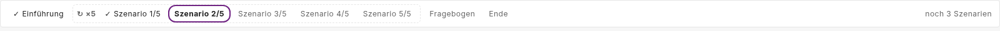 |
| 7 | The intro card of a scenario, unchanged | 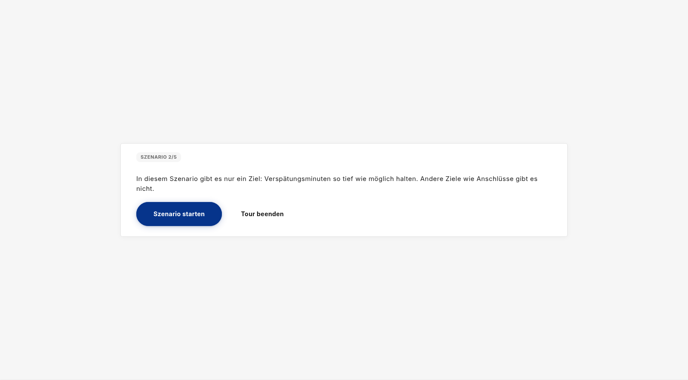 |
| 9–14 | No Schichtbilanz in Plan B today: after the last scenario, straight to the questionnaire. The summative experiment brings it back as it was before #174 (picture from 2026-11-05, `docs/plans/remove-shift-summary.md` §6.1), with the reflection overview below the KPI table (Q-10) and #209's feedback | 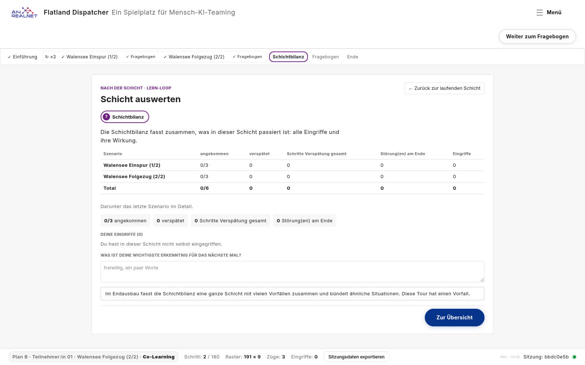 |
| 8 | No visible change (the order per participant) | - |

## 3. Decisions

| ID | Decision | Why |
|---|---|---|
| ~~D-1~~ | ~~A new condition `plan-b-control-p01` and a new layout `preset-plan-b-control`, copied from `plan-b-p01` and `PLAN_B`~~ Replaced 2026-11-16 by D-10 and D-11 (Q-1, Q-5) | - |
| ~~D-2~~ | ~~`PLAN_B_CONTROL_UI = { ...PLAN_B_UI, hidden: [..., 'widget.proposal-compare.axis.lateness'] }`~~ Dropped 2026-11-16: both settings share one layout within one run, so the comparison goes by mode (D-5) | - |
| D-3 | For the later PR (§1.4). The Recommendation setting runs in mode `recommendation` | The issue names it; the mode is the brief's switch for "AI suggests with a recommendation", so no parallel flag |
| D-4 | For the later PR (§1.4). No reflection through the setting's briefing without `reasonDialog` and without the `reflect` step, not through a UiConfig id | The reflection is a briefing flag; the decision log shows it only where the briefing asks |
| D-5 | For the later PR (§1.4). `proposal-compare` offered in Recommendation; there it hides the option chips, the Mensch course and the comparison, and tags the KI course "Empfehlung"; take buttons for Plan and KI stay (Q-2) | Requirements 3, 5; behaviour per mode lives in the panel. The human still decides, by taking one of the two |
| D-6 | For the later PR (§1.4). The map strip shows only where the panel has option chips, i.e. not in Recommendation | Without the chips the strip would ask a panel that cannot answer |
| D-7 | For the later PR (§1.4). The Recommendation setting holds the affected trains like Plan B (`hold`), through the briefing flag `decisionMoment: 'hold'` (Q-3) | The settings differ only where §1 says; Recommendation's countdown would auto-apply the AI's option, a confound |
| ~~D-8~~ | ~~Leg 2 of the control group is `WAL_FOLLOWER` spread with its own German card~~ Dropped 2026-11-16: Plan B no longer runs the Walensee legs (#164) | - |
| ~~D-9~~ | Replaced 2026-11-25 by D-17 ((Q-6) revisited). ~~The experiments are built from `PLAN_B_ORDERS` by one helper, so a control participant's scenarios and order can only differ from `plan-b-pNN` in the split into settings (Q-6)~~ | - |
| ~~D-10~~ | Replaced 2026-11-25 by D-16 ((Q-1) revisited): its premise, both settings in one run, is gone. ~~One experiment per participant: a leg can override the experiment's `mode`, `briefingIds` and leg questionnaire (`surveyParts`) (Q-1)~~ | The issue's preferred form ("konzeptuell sauberer"): one run id, one sitting. The store already switches the mode per step; the briefing carries reflection, guide, badges and intro card, so one override per leg covers them all. Not taken: two experiments per participant |
| ~~D-11~~ | Replaced 2026-11-25 by D-16. ~~Names: `plan-b-control-group-p01` … `p10`, briefing `plan-b-control-group`; no own layout (Q-5)~~ | - |
| D-12 | For the later PR (§1.4). The Recommendation setting's briefing drops the violet module badges; ~~and has its own guide hints~~ it takes `plan-b`'s guide hints without `reflect` (Q-4; Q-4 revisited decided 2026-11-25); the Co-Learning setting keeps `plan-b` | Each setting reads what fits it. No own hints: Plan B hides the guide strip, the only place they show, so `plan-b`'s "ohne eine zu empfehlen" stays in the code, unseen |
| D-13 | The Schichtbilanz keeps its KPI table (one row per scenario, the totals) above the reflection summary (Q-10); its column "Störung(en) am Ende" is renamed "bei Abschluss noch gestört" (wording only, key `tourUi.debrief.kpi.malfunctions` kept; S-9), since it counts the trains still disrupted when the leg ends, not the disturbances during it | Decided 2026-11-25 after looking at the KPI table in `plan-b-p01` with the Schichtbilanz switched on for the purpose; the table exists and costs nothing |
| D-14 | The footer leaves out the mode name where the layout hides the mode strip (`control.modeTabs`) (Q-11) | Plan B hides the mode everywhere else; the experimenter reads the setting from the progress bar and the record |
| D-15 | In an experiment (a guided condition), the Schichtbilanz shows neither the note "Darunter …" with the last scenario's KPI chips (with several scenarios, where the table has their row), nor the concept note, nor "← Zurück zur laufenden Schicht"; tours keep them. "Deine Eingriffe" stays until S-7's overview replaces it, as it is the only place with the reflections (requirements 11–13, S-11) | #209's feedback; tours such as the interview walk-through still use them, so the gate is the running experiment (`ExperimentRunService.active()`), as `sections()` already does for the comparison |
| D-16 | One setting per participant: summative experiments `plan-b-summative-colearning-pNN` and `plan-b-summative-recommendation-pNN`, `NN` = 01–08, each with one mode and briefing; this PR adds only `plan-b-summative-colearning-p01`, as the template ((Q-1) revisited) | #134's run order of 2026-11-25; one mode per run needs no leg fields (§4.1 dropped). "summative" tells them from the November round. Not taken: keeping the leg fields for a later study |
| D-17 | `plan-b-summative-colearning-p01` runs `uc2-1`, then `uc2-2`, drawn at random (`random.Random(20261125).sample(['uc2-1', 'uc2-2', 'uc2-3', 'uc2-4'], 2)`) and fixed; `p02` … `p08` follow the study leads' Latin square ((Q-6) revisited) | The template needs real scenarios before the table exists; a fixed draw keeps it reproducible |
| D-18 | In an experiment, the Schichtbilanz's last button reads "Weiter zum Fragebogen" (`experimentRun.finish.toFinalSurvey`); tours keep "Zur Übersicht" (Q-14) | The questionnaire follows; the toolbar says the same at that moment, so no new key. Not taken: "Schicht beenden", the label of ending a live shift |
| D-19 | The formative experiments `plan-b-p01` … `p10` stay as they are: ids, symbols, labels and behaviour (no Schichtbilanz) | The November round is over; its records name these ids (AGENTS.md: stored ids are never renamed). "formative" is only the plan's word for them |
| D-20 | `plan-b-summative`'s opening ends "Wenn du nun auf «Weiter» klickst, beginnt das erste von zwei Szenarien." instead of announcing the technical introduction (Q-15) | No tutorial (Q-13); the sentence still says what comes. `plan-b` keeps its text (D-19) |
| D-21 | The column "Ereignisse" holds, per decision, the disturbance messages open at that moment (`train.malfunction`, scripted disturbances), for any train, the decided train's own first; recorded with the decision (Q-9 a), refined) | A TMS message exists only for the train that is itself disrupted (`generate_notifications`, `core/hmi_mock.py:50`); the decided train is mostly one held behind it, so "the message about the decided train" would mostly be empty. Conflicts ("Konflikt bei …") are no TMS messages and stay out. Not taken: b) a count per scenario, not recorded; c) the scenario's description, the same text for all four |
| D-22 | For the later PR (§1.4). The Recommendation set's Schichtbilanz shows the KPI table and the overview Szenario \| Ereignisse \| Entscheidungen, without "Reflexion" (Q-12) | The same screen in both settings except for what the setting leaves out; the Recommendation setting asks no reflection (D-4). Not taken: the KPI table only; an empty "Reflexion" column |

### 3.1 Code Review Findings

PR [#201](https://github.com/flatland-association/flatland-ui-hub/pull/201);
branch rebased onto `main` 85e36e5c (was fd0c70cb, before that 333013c),
checked at b87130ab, again at cf85c7e3 on 2026-11-25 (no new comments). No
code review yet. PR review comments (F-1 to F-3) were added on 2026-11-23;
line numbers refer to b87130ab. Code review findings (F-5–F-17) were added on 2026-11-25, at 20050677
(base `main` 85e36e5c; the local `main` was stale at fd0c70cb); their line
numbers refer to it. No TODOs added.
F-4 comes from the issue-reference check below. In Fixed, ✅ marks a fixed
finding, ⏭️ one taken over by a follow-up, — a dropped one, ⚠️ a comment
resolved on GitHub without a code change and without a reason; ❌ next to ✅
marks a finding fixed in the code whose PR comment is not resolved yet.
"resolved" in Source marks threads resolved and checkboxes ticked on GitHub.

| Fixed | ID | Source | Category | Severity | Finding | Commit message |
|---|---|---|---|---|---|---|
| — | F-1 | [PR comment](https://github.com/flatland-association/flatland-ui-hub/pull/201#discussion_r4612119081) | correctness | medium | `docs/plans/plan-b-control-group.md:296` (§4.1): the replay's progress bar reads the condition's `legSurveyParts`, not the leg's (`experiment-progress.component.ts:55-57`; during a run it goes through `run.hasLegSurvey()`, which `legSurveyPartsNow` covers). With the questionnaire set on one leg, a replay shows no questionnaire step after that leg. Proposal: one helper next to `ExperimentLeg`, `legSurveyParts(condition, leg)` = `leg.surveyParts ?? condition.legSurveyParts ?? null`, used by `ExperimentRunService` and the progress bar; S-3 adds the progress bar to the change inventory (§5) and a spec. Plan text done in S-6 (6f0f2932). Dropped 2026-11-25 with S-3: no leg has its own questionnaire since (Q-1) revisited; taken over by the follow-up "both settings in one run". | docs(plans): read a leg's own questionnaire through one helper, also in the replay's progress bar. |
| ✅ ❌ | F-2 | [PR comment](https://github.com/flatland-association/flatland-ui-hub/pull/201#discussion_r4612119426) | docs | low | `docs/plans/plan-b-control-group.md:381` (§4.4): the replay shows each questionnaire by its recorded `surveyId`, without the condition (#210). §4.4 should say so, and that the plan depends on #210, so a replay of a control-group run shows both `plan-b-final` questionnaires. #210 is in `main` 85e36e5c, the branch's base. Fixed in S-6 (§4.4). | docs(plans): say that a replay shows both questionnaires by their recorded surveyId, since #210. |
| ✅ ❌ | F-3 | [PR comment](https://github.com/flatland-association/flatland-ui-hub/pull/201#discussion_r4612120026) | docs | low | `docs/plans/plan-b-control-group.md:106` (§1.1, Q-7): `postSessionSurvey()` returns a fixed questionnaire before it looks at `afterLeg`, so the questionnaire after setting 1 has the same title ("Fragebogen") and wording as the final one. The data tells them apart (`after` = `leg`/`final`, `leg_id` in the export), the participant does not. "After this setting" wording would be a second entry in `FIXED_QUESTIONNAIRES` (#210) with its own part and id. Q-7 should note this. Fixed in S-6 (Q-7). | docs(plans): note in Q-7 that both questionnaires look the same to the participant. |
| ✅ | F-4 | code review | style | low | `scripts/docshots-plan-b-control.mjs:1` names the issue the PR closes ("Screenshots for #134"), and §4.1 and §4.3 plan code comments that name it too (`(#134: two settings in one run)`, `(#134)`). A PR that closes an issue leaves no reference to it in the code: name the plan or the behaviour instead. Fixed in S-6 (plan text and script). | docs(scripts): point the control-group screenshot script at its plan, not at the issue. |
| ✅ | F-5 | code review | bug | medium | `frontend/src/app/features/reflection-overview/reflection-overview.component.ts:55,87,95`, `core/train-identity.service.ts:49`: the overview names trains (and words the event messages) through `TrainIdentityService`, which takes the names of the session open *now*. In `plan-b-summative-colearning-p01` the Schichtbilanz opens on `uc2-2`'s session, so the `uc2-1` rows show `uc2-2`'s name for each handle: the participant reflects on a train that wasn't in that scenario. Same in the replay overview. Suggested: resolve the train name and the event texts at the leg's end (`finishLeg()`, while that leg's session is open) and keep them in `ShiftRecord.decisions[]` (`trainName`, `eventTexts`); in the replay, word them per leg or fall back to the handle. Fixed in 083016fe: the overview names trains and words events through `TrainIdentityService.nameIn()`, from the leg's scenario preset's `train_names` (falling back to the session's names). | fix(debrief): name each scenario's trains in the reflection overview as that scenario named them. |
| ✅ | F-6 | code review | bug | medium | `frontend/src/app/features/tour-debrief/tour-debrief.component.html:93-95`, `tour-debrief.component.ts:220`: under the overview of all scenarios, the note "n Halte des Systems" counts only the last session's decision log. 3 system holds in scenario 1 and none in scenario 2 show no note; the other way round the note reads as if for the whole run. Suggested: drop the note in an experiment (the overview lists the participant's decisions only, §1.4 limitation), or keep a per-leg count in `ShiftRecord`. Fixed in 83a198ec: the system-holds note is left out under the overview in an experiment. | fix(debrief): leave the last scenario's system-hold count out of an experiment's overview. |
| ✅ | F-7 | code review | design | medium | `frontend/src/app/features/replay/replay-shift-summary.component.ts:75-82`: the replay shows the overview for every replayed run with decisions, also for tours (`replay.screen()` is `shiftSummary` on `shift_review` and an ended shift, `replay.service.ts:75`), while the live Schichtbilanz shows it only in an experiment (`inExperiment()`, D-15). A tour's replay then looks different from what was seen. Suggested: show it only for a guided condition's record (`header.shiftSummary` is set only there). Fixed in 2fb05692: the replay shows the overview only for a guided condition's record (a leg with `legId`). | fix(replay): show the reflection overview only in the replay of an experiment, as live. |
| ✅ | F-8 | code review | robustness | low | `frontend/src/app/features/tour-debrief/tour-debrief.component.ts:112,127`: `legRows` and `overviewLegs` take the *first* `ShiftRecord` with the leg's id and index. A leg aborted and resumed on a new session is recorded twice (`recordShift` keys by `sessionId`), so the overview and the table show the aborted attempt. `legRows` had this before; `overviewLegs` copied it. Suggested: one helper `legShift(i)` with the last match (`findLast`), used by both. Fixed in 70e92f0f: one helper `legShift(i)` takes the last matching record, used by `legRows` and `overviewLegs`. | fix(debrief): read each scenario's last record in the Schichtbilanz, not an aborted attempt. |
| ✅ | F-9 | code review | naming | low | `frontend/src/app/core/demo/tour-context.service.ts:50`, `experiment-run.service.ts:249`, `tour-debrief.component.ts:131`: `ShiftRecord.decisions[].rationale` holds the *stated reason* (`statedReason()`, i.e. `ShiftIntervention.reason`), not the raw `DecisionLogEntry.rationale`; the value is renamed `reason → rationale → reason` on its way to the overview. Not released yet, so the record field can still change. Suggested: call it `reason` (and in `docs/experiment-logging.md`). Fixed in 08ca89d8: the field is `reason`, also in `docs/experiment-logging.md`. | refactor(experiment-run): name a leg decision's stated reason reason, as ShiftIntervention does. |
| ✅ | F-10 | code review | style | low | `frontend/src/app/core/demo/study-conditions.ts:215,217`, `features/reflection-overview/reflection-overview.component.ts:10`, `features/replay/replay-shift-summary.component.ts:73`, `features/tour-debrief/tour-debrief.component.ts:100,118`, `tour-debrief.component.html:90`, `tour-debrief.component.spec.ts:21`, `scripts/docshots-plan-b-summative.mjs:8`: new comments name #134 and #209, the issues the PR is to close; a closed issue should leave no reference in the code (as F-4). Suggested: name the plan (`docs/plans/plan-b-control-group.md`) or the behaviour instead. Fixed in dce2775e: the comments name the plan. | docs(debrief): point the summative and reflection-overview comments at the plan, not at the issues. |
| ✅ | F-11 | code review | docs | low | PR #201 body: "Closes #134", but since 2026-11-25 the PR is to close #209 and only refer to #134, whose Recommendation setting follows in a later PR (§3.1 issue references, §1.4). Merging would close #134 too early. Suggested: "Closes #209", "Refs #134" (`/flatland-association:suggest-pr-diff-and-post`). Fixed: the PR body says "Closes #209" and "Refs #134" (edited on GitHub, no commit). | docs(pr): close #209 and refer to #134 in the PR description. |
| ✅ | F-12 | code review | dead-code | low | `frontend/src/app/features/tour-debrief/tour-debrief.component.html:73-75`, `public/i18n/{en,de,fr}.json` (`experimentRun.review.lastLeg`): the note sits inside `@if (legRows().length)`, which needs `run.multiLeg()`, i.e. a running experiment, and S-11 hides it there: it can never show. Suggested: remove the note and its key. Fixed in cd4f1f54: the note and its key are removed. | refactor(debrief): drop the Schichtbilanz note that can no longer show. |
| ✅ | F-13 | code review | consistency | low | `frontend/src/app/app.component.html:1091`: D-14 hides the mode name where the layout hides the mode strip, but only in the experiment branch of the footer; the tour branch still shows it under the same layout. Suggested: the same `@if` in both branches. Fixed in 03030cbb: the tour branch hides the mode name under the same layout. | fix(footer): leave out the mode name in a tour too where the mode strip is hidden. |
| ✅ | F-14 | code review | test-coverage | low | `frontend/src/app/features/replay/replay-shift-summary.component.ts:75-82`, `features/reflection-overview/reflection-overview.component.ts`: the replay overview has no spec, and the overview component none of its own (only through `tour-debrief.component.spec.ts`: no spec for a worded event, a decision without reason or reflection, the rowspan). Suggested: a spec per component. Fixed in 3e13ea91: specs for `ReflectionOverviewComponent` and `ReplayShiftSummaryComponent`. | test(debrief): cover the reflection overview and its replay copy. |
| ✅ | F-15 | code review | robustness | low | `frontend/src/app/core/session.store.ts:739`: the events kept with a decision come from `notifications()`, which `NotificationPollingService` refreshes every 2 s (`notification-polling.service.ts:43`). A decision within 2 s of a breakdown misses it ("–"); one just after it ended still lists it. The study data inherits the lag. Suggested: accept and list it as a limitation (§1.4), or refresh the notifications at the decision. Fixed in the plan: listed as a limitation (§1.4). | docs(plans): list the up-to-2-s lag of a decision's events as a limitation. |
| ✅ | F-16 | code review | performance | low | `frontend/src/app/features/reflection-overview/reflection-overview.component.ts:60,63`: `lines(d.reflection)` runs twice per row on every change detection, translating each line again. Suggested: `@let lines = lines(d.reflection);` once per row, or precompute in the `OverviewLeg`. Fixed in d1ed9921: `@let reflection = lines(d.reflection);` once per row. | perf(debrief): word each decision's reflection once per row in the overview. |
|  | F-17 | code review | design | low | `frontend/src/app/core/demo/experiment-run.service.ts:236-285` (`finishLeg`, ~50 lines), `features/tour-debrief/tour-debrief.component.ts:162-178` (`currentShift`): both map `interventionsFrom(decisionLog)` to `ShiftRecord` decisions with the same `decisionLog().find((e) => e.seq === i.seq)` per decision (quadratic). Suggested refactoring: one `shiftDecisionsFrom(decisionLog)` in `shift-review.ts` (a `seq → entry` map once), used by both; `finishLeg` then shrinks to the record and the log. Open. | refactor(experiment-run): build a leg's decisions in one place for the run and the debrief. |
| — | F-18 | code review | consistency | low | `frontend/src/app/features/replay/replay-shift-summary.component.ts:78`: the replay labels the overview's scenarios "Scenario n/total" (`replay.leg`), live they read `run.legLabel(i)`. Dropped: the replay's own KPI table above uses the same `replay.leg` labels since before this PR, and in Plan B both read "Szenario n/N" (`control.legNames` hidden). | - |
| — | F-19 | code review | design | low | `frontend/src/app/core/decision-log.ts:136`: each event keeps the server's English `title` and `message`, copied into the decision log, `ShiftRecord` and the run record. Dropped: they are the fallback for codes without a translation (`NotificationWordingService`), kept on purpose (D-21); a few short strings per decision. | - |

**Issue references:** the PR is to close #209 and to refer to #134, whose Recommendation setting follows in a later PR (since 2026-11-25; until then it was to close both) (#209 added to the
plan 2026-11-23; the PR description does not name it yet). The screenshot script
references it (`scripts/docshots-plan-b-control.mjs:1`), and §4.1 and §4.3
plan two code comments that would: F-4 (both changed in the working tree,
for S-6).

## 4. Design

### 4.1 A setting per leg (dropped 2026-11-25)

Dropped with D-10 by (Q-1) revisited: since #134's run order of
2026-11-25 every run has one setting, so `ExperimentLeg` gets no own mode,
briefing or questionnaire, `TourContextService` no `useBriefing()`, and the
progress bar no leg questionnaire (F-1). Kept as a follow-up for a later
study with both settings in one run (§1.4). Only the footer of the former S-3
stays (D-14, now in S-4).

### 4.2 The summative template `plan-b-summative-colearning-p01` (requirements 1, 7, 8; D-16, D-17, D-19)

- `study-conditions.ts`: one condition, after `...PLAN_B_CONDITIONS` in
  `STUDY_CONDITIONS`; the formative ones and `PLAN_B_ORDERS` untouched
  (D-19):
  ```ts
  /** `plan-b-summative-colearning-p01`: the template of the eight summative
   *  Co-Learning experiments (docs/plans/plan-b-control-group.md): two
   *  scenarios, no tutorial, the Schichtbilanz, the final questionnaire.
   *  Scenarios drawn at random and fixed (D-17); p02 … p08 follow the
   *  study leads' Latin square. */
  const PLAN_B_SUMMATIVE_COLEARNING: StudyCondition[] = [{
    id: 'plan-b-summative-colearning-p01',
    layoutId: 'preset-plan-b',
    mode: 'co-learning',
    label: 'Plan B summative · Co-Learning · participant 01',
    labelKey: 'tours.plan-b-summative-colearning-p01.name',
    studyLogging: true,
    briefingIds: { de: 'plan-b-summative', en: 'plan-b-summative' },
    policy: 'deadlock_avoidance',
    proposalAgent: 'uc2_rl',
    // shiftSummary left out: the Schichtbilanz comes after the last scenario (#209).
    surveyParts: [PLAN_B_FINAL_PART],
    legs: [UC2_LEGS['uc2-1'], UC2_LEGS['uc2-2']],
  }];
  ```
  The progress bar then reads "Einführung, ↻ ×2, Szenario 1/2, Szenario
  2/2, Schichtbilanz, Fragebogen, Ende".
- `tour-briefings.ts`: `PLAN_B_SUMMATIVE_DE` (id `plan-b-summative`) =
  `{ ...PLAN_B_DE, id: 'plan-b-summative', opening: <plan-b's opening with
  "Wenn du nun auf «Weiter» klickst, beginnt das erste von zwei Szenarien."
  in place of the sentence on the tutorial, D-20> }`. Everything else as in
  `plan-b`: reflection inline, `debrief: true`, `debriefSections:
  ['shift-summary']`, the guide hidden by the layout. Registered next to
  `plan-b` in the briefings list.
- i18n: `tours.plan-b-summative-colearning-p01.name` in en, de, fr ("Plan B
  summativ · Co-Learning · Teilnehmer:in 01").
- The footer (D-14): `currentModeLabel()` is left out of the footer where
  `uiConfig.isHidden('control.modeTabs')`.

### 4.3 The Recommendation setting (requirements 2–6; D-3–D-7, D-12; later PR)

Designed here, built in the later PR with
`plan-b-summative-recommendation-p01` … `p08` (§1.4). Its experiments are
built like §4.2, with `mode: 'recommendation'` and the briefing below.

- `tour-briefings.ts`: `PLAN_B_CONTROL_GROUP_DE` (id `plan-b-control-group`),
  derived from `PLAN_B_SUMMATIVE_DE`: `reasonDialog: false`,
  `decisionMoment: 'hold'`; `guide` without `reflect`; no `moduleBadges`;
  `plan-b`'s guide hints (Q-4 revisited a)); `modeIntros.recommendation`
  = `plan-b`'s Co-Learning card (in Plan B only the scenario number and the
  goal line). The store still opens a reflection after a decision that
  deviates from an AI suggestion (`pendingRationale`); without
  `reasonDialog` nothing shows or waits for it.
- The Schichtbilanz (§4.5) leaves out the column "Reflexion" where the
  briefing has no `reasonDialog` (D-22).

- `panel-mode-availability.ts`: `'proposal-compare': ['co-learning',
  'recommendation']`, with a comment: neutral options in Co-Learning, the
  AI's course as a recommendation in Recommendation (this plan). The same line
  in `docs/reference/panel-mode-matrix.md`.
- `ProposalCompareComponent`: `recommending = computed(() =>
  store.interactionMode() === 'recommendation')`. When true:
  - no `pc-options` group and no Mensch section (neither the course nor its
    placeholder); `choose()` is not reachable, and the effect does not ask
    for a human course;
  - `comparison()` returns `null`;
  - the KI course gets a tag "Empfehlung" (`proposals.recommended`) in its
    header, styled with the existing KI accent token, and the note above
    reads `proposals.noteRecommendation` ("Zwei Verläufe für den gewählten
    Zug: der Plan ohne Eingriff und die Empfehlung der KI. …");
  - "Plan behalten" and "KI übernehmen" stay, with their `data-log` ids;
  - the alternatives ("weitere Reihenfolgen") stay: they are the AI's other
    options (Q-2).
- `FlatlandMapComponent.trainOptions()`: also `null` in Recommendation (D-6).
- `TourBriefing.decisionMoment?: 'hold'` and
  `TourContextService.decisionMoment`; `ImpactPanelComponent.modeBehavior()`
  returns `hold` for Recommendation when it is set (D-7). The countdown stays
  Recommendation's default everywhere else.

### 4.4 Record and replay

- Records name `conditionId: 'plan-b-summative-colearning-p01'`; replay
  rebuilds the layout and the mode from the record, no change.
- The reflection summary in a replay reads the recorded legs' decisions
  (§4.5); a record from before this plan shows the table without them.

### 4.5 Reflection summary (requirements 9–14; #209)

Draft; Q-9 decides the column "Ereignisse" (Q-10 decided: the KPI table
stays).

- **Data:** `finishLeg()` already snapshots each leg into `ShiftRecord`.
  Its `decisions` entries gain `reason` and `reflection` from the
  decision log (the same source as `interventionsFrom()`). The reflection
  is complete at the leg's end: "Szenario abschliessen" waits for open
  reflections (`refuseFinish`). Each decision entry also gains the
  disturbance messages open at the decision (D-21): the entries of
  `store.notifications` with `code` `train.malfunction` (`core/hmi_mock.py`,
  derived from the train's state) or a scripted disturbance's code
  (`core/disturbances.py`), as `{ code, params, relatedElement }`, the
  decided train's own first. Kept with the decision log entry when it is
  written, as the list changes every step.
- **Screen:** the Schichtbilanz's `shift-summary` section shows, for a
  guided condition, one block per scenario: the scenario
  ("Szenario k", names hidden as in Plan B), per decision the step and its
  disturbance messages in the UI language (as the TMS panel words them;
  "–" when none was open, D-21), and each
  decision (train · action) with its reflection lines
  (`reflectionLines()`). The KPI table stays above it, one row per scenario
  and the totals, as it is today (`legRows()`, Q-10, D-13).
- **When:** after the last scenario of a summative experiment, before
  `plan-b-final` (`shiftSummary` at its default). The formative experiments
  keep `shiftSummary: false` (D-19).
- **Trimmed in an experiment** (`run.active()`, D-15, S-11): no note
  "Darunter das letzte Szenario im Detail." and no KPI chips under the
  table (with several scenarios), no concept note, no "← Zurück zur
  laufenden Schicht"; the last button reads "Weiter zum Fragebogen" (D-18).
- **Replaces** the list "Deine Eingriffe" (the last scenario's decisions)
  in an experiment (requirement 11); tours keep it.
- **i18n:** new keys for the column heads (`experimentRun.review.events`,
  `.decisions`, `.reflection`) in en, de, fr; the lead text keeps
  `tourUi.debrief.summaryLead` unless the study leads want other words.
- **Logging:** the section's controls keep their `data-log` ids; a new
  control gets a new id in `docs/experiment-logging.md`.

## 5. Files

### New files

| File | What it adds |
|---|---|
| `scripts/docshots-plan-b-summative.mjs` | The after screenshots of the summative template (§6.1, S-5) |
| `frontend/src/app/features/reflection-overview/reflection-overview.component.ts` / `.scss` | The overview Szenario \| Ereignisse \| Entscheidungen \| Reflexion, shared by the live and the replay Schichtbilanz (S-7) |
| `frontend/src/app/features/tour-debrief/tour-debrief.component.spec.ts` | The first spec of the debrief: the trimmed Schichtbilanz in an experiment, the overview (S-11, S-7) |
| `scripts/docshots-plan-b-control.mjs` | Screenshots of both settings for the PR, as `scripts/docshots-zwl-default.mjs` (added with S-0; on 2026-11-23 moved to the first UC2 scenario, the inline reflection, the intro card and the progress bar, without the guide picture, and naming the plan instead of #134 in its header, F-4) |
| `docs/plans/plan-b-control-group/*.png` | Before (S-0, retaken 2026-11-23 in S-6), mockups of open questions (S-10) and after (S-5) screenshots |

### Modified files

| File | What changes |
|---|---|
| `frontend/src/app/core/demo/study-conditions.ts` | `plan-b-summative-colearning-p01` in `STUDY_CONDITIONS` |
| `frontend/src/app/core/demo/study-conditions.spec.ts` | `plan-b-p01` … `p10` unchanged; `plan-b-summative-colearning-p01`: two legs `uc2-1`, `uc2-2`, no tutorial, the Schichtbilanz, `plan-b-final`, briefing `plan-b-summative` |
| `frontend/src/app/core/demo/tour-briefings.ts` / `.spec.ts` | `plan-b-summative` (`PLAN_B_SUMMATIVE_DE`), `plan-b`'s opening with the sentence of D-20 |
| `frontend/src/app/core/demo/experiment-run.service.ts` / `.spec.ts` | `finishLeg()` keeps each decision's reflection, reason and events |
| `frontend/src/app/core/decision-log.ts`, `core/session.store.ts` / `.spec.ts` | `DecisionLogEntry.events?`, filled from `notifications()` in `_appendDecision()`, the one place entries are written (D-21) |
| `frontend/src/app/core/demo/tour-context.service.ts` | `ShiftRecord.decisions[].reason`, `.reflection`, `.events` (D-21) |
| `frontend/src/app/app.component.html` / `.spec.ts` | no mode name in the footer where `control.modeTabs` is hidden (D-14) |
| `frontend/src/app/features/tour-debrief/tour-debrief.component.ts` / `.html` / `.scss` / `.spec.ts` | the reflection overview in `shift-summary`; in an experiment, the trimmed Schichtbilanz and "Weiter zum Fragebogen" (D-15, D-18) |
| `frontend/src/app/features/replay/replay-shift-summary.component.ts` / `.spec.ts` | the same overview from the recorded legs |
| `frontend/public/i18n/{en,de,fr}.json` | `tours.plan-b-summative-colearning-p01.name`/`.description`, `experimentRun.review.overviewTitle`, `.events`, `.decisions`, `.reflection`, `.noDecisions`; the wording of `tourUi.debrief.kpi.malfunctions` (S-9) |
| `docs/plans/experiment-scenario-import.md` | the summative template next to `plan-b-p01` … `p10` |
| `docs/experiment-logging.md` | the new fields of a leg's decisions in the record |

Unchanged on purpose: `ExperimentLeg`, `TourContextService.set()`, the
progress bar, `PLAN_B_ORDERS`, the formative conditions, and everything of
the Recommendation setting (§4.3).

## 6. Verification

- Specs as in §5; the four CI checks (`lint:styles`, `i18n:check`,
  production build, `pytest -q`).
- In the running app (production build, Plan B deployment config), on
  `plan-b-summative-colearning-p01`: the briefing's opening (D-20), no
  tutorial, `uc2-1` and `uc2-2` as "Szenario 1/2" and "2/2", decisions with
  inline reflections, the Schichtbilanz with the KPI table and the
  reflection overview of both scenarios, without the parts #209's feedback
  drops, "Weiter zum Fragebogen", `plan-b-final`, the saved record; the
  footer without the mode name.
- The replay of that run shows the same Schichtbilanz.
- `plan-b-p01` unchanged: no Schichtbilanz, tutorial first, five scenarios.

### 6.1 After (`plan-b-summative-colearning-p01`)

Taken on 2026-11-25 on cc399513, production build with the Plan B
deployment config, German, 1600 × 1000 (the Schichtbilanz 1600 × 1400), by
`scripts/docshots-plan-b-summative.mjs … after`: in scenario 1 a train
picked in the Fahrplan, "Halten" chosen, the Mensch course taken and its
reflection answered (the script picks the first chip of each question and
types the trade-off); scenario 2 finished at once.

| Requirement | Result | After |
|---|---|---|
| 1, 7, D-20 | The opening announces "das erste von zwei Szenarien"; no tutorial | 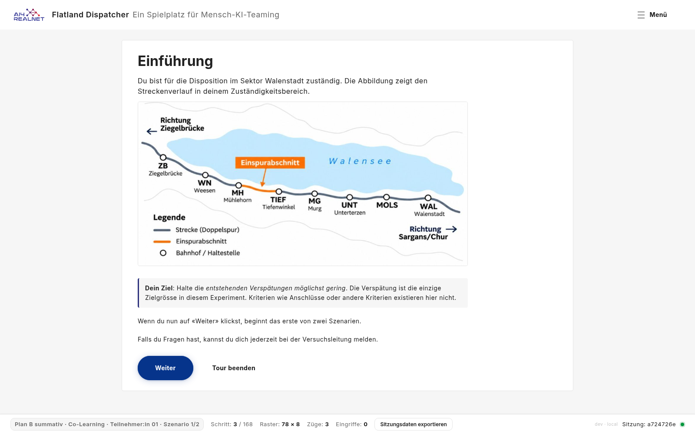 |
| 7, 8 | Progress bar: Einführung, ↻ ×2, Szenario 1/2, Szenario 2/2, Schichtbilanz, Fragebogen, Ende | 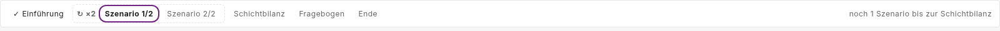 |
| D-14 | Footer without the mode name; the experiment's name itself says "Co-Learning" | 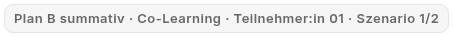 |
| 9–14, D-21 | The KPI table ("bei Abschluss noch gestört"), then the overview: scenario 1 with its decision, reason and reflection, scenario 2 "Keine Eingriffe"; no note "Darunter …", no KPI chips, no concept note, no "← Zurück zur laufenden Schicht"; "Weiter zum Fragebogen". "Ereignisse" shows "–": no disturbance was open at the decision (step 12) | 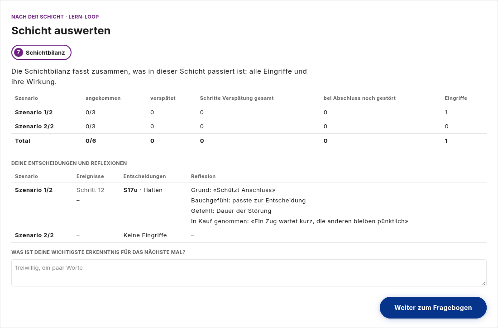 |

| Read from the page (2026-11-25) | Value |
|---|---|
| Overview, scenario 1 | "Schritt 12 – S17u · Halten Grund: «Schützt Anschluss» Bauchgefühl: passte zur Entscheidung Gefehlt: Dauer der Störung In Kauf genommen: «…»" |
| Last button of the Schichtbilanz | "Weiter zum Fragebogen" |

Not checked in the running app: a decision during an open disturbance (the
event line; covered by specs), the replay of the run, `plan-b-final` and
the saved record after the Schichtbilanz, `plan-b-p01` (covered by specs).
The frontend specs log 152 "NG0101: ApplicationRef.tick is called
recursively" errors from `decision-log`, `flatland-map`, `toolbar`,
`view-tabs` and `zwl`; the same count on b237cdd3, before S-7, so not from
this PR.

## 7. Steps

| ID | Findings | Step | Category | Severity | Commit message | Commit(s) | Needs | Blocked by |
|---|---|---|---|---|---|---|---|---|
| ✅ S-0 | - | Plan, before screenshots and their script (rebased: d88be0ef, b62ffec1) | — | — | docs(plans): plan for #134, the Plan B control group, with before screenshots. | d88be0ef, b62ffec1 | - | - |
| ✅ S-6 | F-1, F-2, F-3, F-4 | Plan text for the PR review comments: the leg questionnaire through one helper, also in the replay's progress bar, in §4.1 and §5 (F-1); the replay's questionnaires by `surveyId` since #210 in §4.4 (F-2); the same-looking questionnaires in Q-7 (F-3); the planned code comments and the screenshot script name the plan, not #134 (F-4); the before screenshots retaken on 85e36e5c with the updated script (§2.1) | docs | low | docs(plans): add #209 to the #134 plan, take in the PR review comments and retake the before screenshots on main 85e36e5c. | 6f0f2932 | - | - |
| ✅ S-10 | - | Mockups of the options of Q-4, Q-8 and Q-9 (§8); Q-10 and Q-11 decided; Q-9 b) corrected (`kpis.malfunctions` is no count of disturbances); S-9 | docs | low | docs(plans): add mockups for Q-4, Q-8 and Q-9, decide Q-10 and Q-11, correct Q-9 b) and add S-9 in the #134 plan. | cf85c7e3 | - | - |
| ✅ S-12 | - | This revision: #134's run order of 2026-11-25 ((Q-1), (Q-6) revisited, Q-12, Q-13): one summative Co-Learning template in this PR, the Recommendation setting for a later one; #209's feedback (requirements 11–14, D-15, D-18, S-11); S-6's findings | docs | low | docs(plans): replan #134 for one setting per participant with a summative Co-Learning template, and take in the Schichtbilanz feedback of #209. | 4261adbc, 1053a265 | - | - |
| — S-1 | - | Moved 2026-11-25 to the later PR (§1.4). `proposal-compare` in Recommendation: availability, `recommending()`, no comparison, tag, map strip, specs, matrix doc | — | — | feat(proposal-compare): offer the panel in Recommendation, with Plan and KI only and the KI course tagged as the recommendation. |  | - | - |
| — S-2 | - | Moved 2026-11-25 to the later PR (§1.4). `decisionMoment` briefing flag, read by `modeBehavior()`, specs | — | — | feat(tours): let a briefing hold the affected trains in Recommendation instead of the countdown. |  | - | - |
| — S-3 | F-1 | Dropped 2026-11-25 with §4.1 ((Q-1) revisited); the footer moved to S-4. A leg's own `mode`, `briefingIds` and `surveyParts`: `ExperimentLeg`, `useBriefing()`, app start, next leg and resume, run service, the replay's progress bar through one helper (F-1, after S-6); the footer leaves out the mode name where the mode strip is hidden (Q-11, D-14); specs, experiment-workflow doc | correctness | medium | feat(experiment-run): let a leg run in its own mode and briefing and ask its own questionnaire. |  | - | - |
| ✅ S-4 | - | `plan-b-summative` briefing (D-20); `plan-b-summative-colearning-p01` with `uc2-1`, `uc2-2`, no tutorial, the Schichtbilanz; the footer without the mode name where the mode strip is hidden (D-14); i18n; specs; experiment-scenario-import doc | — | — | feat(study): add plan-b-summative-colearning-p01, the template of the summative Co-Learning experiments. | b237cdd3 | - | - |
| ✅ S-7 | - | Reflection summary: each leg's decisions with their reflections in `ShiftRecord`; the overview in the Schichtbilanz (in place of "Deine Eingriffe" in an experiment) and its replay copy; i18n; specs; experiment-logging doc | — | — | feat(debrief): show each scenario's events, decisions and reflections in the Schichtbilanz. | cc399513 | - | - |
| — S-8 | - | Dropped 2026-11-25: the formative experiments stay without the Schichtbilanz (D-19), and the summative one has it from S-4 on. | — | — | - |  | - | - |
| ✅ S-9 | - | Rename the Schichtbilanz column "Störung(en) am Ende" to "bei Abschluss noch gestört" (en "still disrupted at the finish", fr "encore perturbé(s) à la clôture"): wording only, key `tourUi.debrief.kpi.malfunctions` kept; it counts the trains still disrupted when the scenario ends, not the disturbances during it (D-13, Q-9) | correctness | low | fix(debrief): name the Schichtbilanz column after what it counts, the trains still disrupted when the scenario ends. | 3efa0a54 | - | - |
| ✅ S-11 | - | Schichtbilanz in an experiment (`run.active()`): no "Darunter das letzte Szenario im Detail." and no KPI chips under the table (with several scenarios), no concept note, no "← Zurück zur laufenden Schicht"; the last button leads to the questionnaire with the label of Q-14; tours unchanged; specs (requirements 11–14, D-15) | — | low | fix(debrief): trim the Schichtbilanz of an experiment to its overview and lead its button to the questionnaire. | 16ae5e60 | - | - |
| 💡 S-5 | - | After screenshots of `plan-b-summative-colearning-p01` and their script `scripts/docshots-plan-b-summative.mjs` (§6.1): the opening, the progress bar, the footer, the Schichtbilanz with the reflection overview; plan status | — | — | docs(plans): after screenshots of the summative Co-Learning template and its Schichtbilanz. |  | S-4, S-7, S-11 | - |

Each step passes the CI checks on its own.

### 7.1 Rebase

Done twice, without conflicts: on 2026-11-16 the two plan commits went from
`main` 333013c onto fd0c70cb, with the revision on top; by 2026-11-23 the
three are on `main` 85e36e5c as d88be0ef, b62ffec1, b87130ab, pushed.

## 8. Open questions

- ✅ ~~**(Q-1) Mode of the control group, and how is it run?**~~ **Decided
  2026-11-16:** as in the issue's comment of 2026-11-12, each participant
  works in both settings, two scenarios each, with a questionnaire after
  each setting, as one experiment (D-10). Replaces the proposal of
  2026-11-05 (one Recommendation-only condition).
- ✅ ~~**(Q-1) revisited: one setting per participant.**~~ **Decided 2026-11-25:** a), with the ids `plan-b-summative-colearning-pNN` and `plan-b-summative-recommendation-pNN`; this PR adds only `plan-b-summative-colearning-p01`, as the template; the formative experiments stay untouched (D-16, D-19). #134's run order,
  edited 2026-11-25: "Szenario 1 (Setting X aus 1,2), Szenario 2 (Setting
  X aus 1,2), Schichtauswertung, Fragebogen", "8 Experiment Setting 1, 8
  Experiment Setting 2". Each participant works in one setting only. This
  removes the premise of D-10: a leg's own mode, briefing and
  questionnaire exist only to hold both settings in one run. For the
  maintainer.
  - a) Two sets of single-mode experiments, one per setting, each with two
    UC2 scenarios, the Schichtbilanz and `plan-b-final`: the Recommendation
    set on the control briefing (§4.2, without the leg fields), the
    Co-Learning set on `plan-b`, with two scenarios instead of the formative
    `plan-b-pNN`'s four. No leg fields: §4.1 and most of S-3 go (the footer,
    D-14, moves to S-4), F-1 is dropped, Q-7 and Q-8 lose their premise (one
    questionnaire and one Schichtbilanz per run, both at the end).
  - b) Keep the leg fields anyway, for a later study with both settings in
    one run. More code and specs for nothing the experiments need now.
  - *Proposal:* a). The ids are stored in records and never renamed, so
    they are fixed before S-4: Recommendation `plan-b-control-group-pNN`
    as in D-11, Co-Learning e.g. `plan-b-experiment-group-pNN`, `NN` = 01–08
    each. `plan-b-p01` … `p10` stay for the formative evaluation.
- ✅ ~~**(Q-2) What stays in "Plan / KI" under Recommendation?**~~
  **Decided 2026-11-05:** only the Plan and KI courses; the option chips
  (Halten, Halten bis frei, Weiterfahren, Umleiten) go, and with them the
  Mensch course, and no "⟨Zug⟩ · im Panel vergleichen" strip on the map at
  the selected train (D-5, D-6). The take buttons of Plan and KI stay.
- ✅ ~~**(Q-3) Decision moment in the Recommendation setting?**~~ **Decided
  2026-11-16:** `hold`, as in Co-Learning, through the briefing flag
  `decisionMoment: 'hold'` (D-7).
- ✅ ~~**(Q-4) Co-Learning wording outside the panels?**~~ **Decided
  2026-11-16** with Q-1: the Recommendation setting's briefing drops the
  badges and has its own guide hints; the Co-Learning setting keeps
  `plan-b` (D-12).
- ✅ ~~**(Q-4) revisited: own guide hints for the Recommendation setting?**~~ **Decided 2026-11-25:** a), no own hints: the control briefing takes `plan-b`'s guide without `reflect`; the badges part of D-12 stays. For the later PR (§1.4).
  Since #198 (in `main` 85e36e5c) Plan B hides the guide strip
  (`control.guide`), the only place the hints show; the guide still ticks
  and logs its steps. D-12's own hints for `alternatives` and `decide`
  would never be seen. a) Drop them: the control briefing takes `plan-b`'s
  guide without `reflect`; `plan-b`'s hint "Die KI bietet Optionen an, ohne
  eine zu empfehlen" stays in the code, unseen. b) Keep them as decided, in
  case a later layout shows the strip. *Proposal:* a); the badges part of
  D-12 stays. For the maintainer; blocks S-4.

  Mockups (2026-11-25, the strip of `colearning-experiment` with the
  control briefing's steps and no badges). In Plan B neither shows: the
  strip is hidden (`before-5-screen.png`), so the participant sees the same
  under a) and b). The draft hints for b) are new wording, not decided:

  | Step | a) `plan-b`'s hints | b) own hints (draft) |
  |---|---|---|
  | 3 Alternativen | 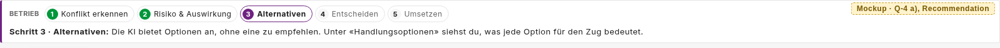 | 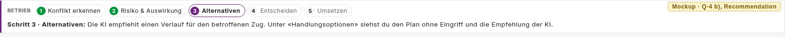 |
  | 4 Entscheiden | 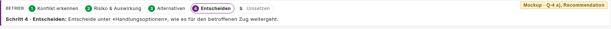 |  |
- ✅ ~~**(Q-5) Names?**~~ **Decided 2026-11-16:** new experiments named
  `plan-b-control-group`: `plan-b-control-group-p01` … `p10`, briefing
  `plan-b-control-group`. The Plan B experiments stay as they are (D-11).
  Replaced 2026-11-25 by the summative ids of (Q-1) revisited (D-16); the
  briefing id `plan-b-control-group` stays for the later PR.
- ✅ ~~**(Q-6) Participant schedule until #179 is final?**~~ **Decided
  2026-11-16:** derived from Plan B: `pNN` takes `plan-b-pNN`'s order, the
  first two scenarios in setting 1, the last two in setting 2; odd `pNN`
  start with Recommendation (D-9). Replaced by #179's table later (§1.4).
- ✅ ~~**(Q-6) revisited: which two scenarios per participant?**~~ **Decided 2026-11-25 for `p01`:** two of the four drawn at random and fixed, `uc2-1` then `uc2-2` (D-17); `p02` … `p08` follow the study leads' table, a) or b) below, in the later PR. #134 struck
  out the #179 matrix on 2026-11-25, and #209 names a Latin square for the
  experiments on 2026-12-03/04. With one setting and two of the four UC2
  scenarios per participant, D-9's split of `PLAN_B_ORDERS` no longer
  applies. For the study leads (@CleverManu, @SamiraAPS).
  - a) A balanced 4 × 4 Latin square over `uc2-1` … `uc2-4`, rows
    (1, 2, 4, 3), (2, 3, 1, 4), (3, 4, 2, 1), (4, 1, 3, 2); a participant runs
    the first two of a row, so the pairs are 1→2, 2→3, 3→4, 4→1. Each row
    twice per setting: every scenario four times per setting, twice first
    and twice second; the same table for both settings, so both meet the
    same scenarios. 1 and 3, 2 and 4 never meet in one run.
  - b) The study leads' own table, written into the plan and the code as it
    is.
  - *Proposal:* b) as soon as they give it; a) as the default until then. A
    new list `PLAN_B_EXPERIMENT_ORDERS` next to `PLAN_B_ORDERS`, which stays
    for `plan-b-pNN`.
- ✅ ~~**(Q-7) The same questionnaire after both settings?**~~ **Moot since 2026-11-25** ((Q-1) revisited): one questionnaire per run. For the study
  leads. a) `plan-b-final` both times (assumed in §1.1; the record tells
  them apart by the leg). b) A short one after setting 1 and `plan-b-final`
  at the end. *Proposal:* a) until the study leads say otherwise.
  Under a) the participant sees the same title ("Fragebogen") and wording
  twice, and answers the closing items (KI use in daily life, age, gender,
  years as dispatcher) twice too (`postSessionSurvey()` returns the fixed
  questionnaire before it looks at `afterLeg`). The data tells them apart
  (`after` = `leg`/`final`, `leg_id` in the export). b), or "after this
  setting" wording, is a second entry in `FIXED_QUESTIONNAIRES` (#210) with
  its own part and id, set on the leg's `surveyParts`; the export and the
  replay pick it up without further changes (F-3). Moot under (Q-1)
  revisited a): one questionnaire per run.
- ✅ ~~**(Q-8) Where does the reflection summary show in the control group?**~~ **Moot since 2026-11-25** ((Q-1) revisited): every summative run ends in its Schichtbilanz.
  For the study leads (@SamiraAPS, @CleverManu). #209 says "after 2
  scenarios". a) After the Co-Learning setting, before its questionnaire,
  also when it is setting 1 (a leg asks for the Schichtbilanz after it; the
  run's phase `review` is no longer only at the end). b) At the end of the
  run only, over the two Co-Learning scenarios: for participants who start
  with Co-Learning, it comes after the Recommendation setting. c) After each
  setting; the Recommendation one has no reflections. *Proposal:* a), as
  the comment says; b) if a) does not make round 2 (it is the larger
  change, in S-8). The mockups below show this superseded design.

  Mockups of the progress bar (2026-11-25; the setting is the small text
  after each scenario). Under a) and b) alike, `p01` (Recommendation first)
  has the Schichtbilanz at the end:

  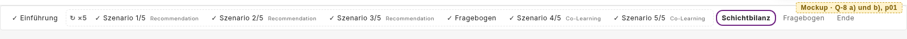

  The options differ for `p02` (Co-Learning first):

  | a) after the Co-Learning setting | b) at the end of the run |
  |---|---|
  | 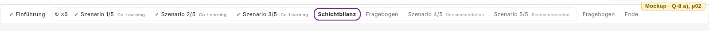 | 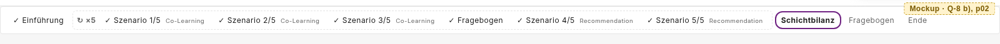 |

  Under b), `p02`'s Schichtbilanz comes two Recommendation scenarios and a
  questionnaire after the Co-Learning scenarios it summarises.
- ✅ ~~**(Q-9) What does the "Ereignisse" column hold?**~~ **Decided 2026-11-25:** a), refined: the disturbance messages open at the decision, for any train, not only the decided one (D-21). For the study
  leads. a) Per decision: the TMS message about the decided train that was
  open at the decision (recorded with the decision from now on). b) Per
  scenario: the number of disturbances during the scenario. Not recorded
  today: `kpis.malfunctions` is no such count, it is the number of trains
  still disrupted at the moment the leg ends (`shiftKpis()`,
  `core/shift-review.ts:46`), usually 0 when a scenario runs to its end.
  b) needs a new count per leg: each time a train turns malfunctioning in
  the agent stream (`SessionStore.isMalfunctioning()` going from false to
  true), kept in the leg's `ShiftRecord` by `finishLeg()`.
  c) Per scenario: the scenario's own description of its event.
  *Proposal:* a): it pairs each decision and its reflection with what it
  answered.

  Mockups (2026-11-25; their progress bar shows the superseded run with
  both settings, the overview holds as it is): the Schichtbilanz of `p02` under Q-8 a), after
  its two Co-Learning UC2 scenarios (the tutorial left out), with the KPI
  table (Q-10) and below it the overview of #209. Made-up numbers,
  messages and reflections:

  | a) the TMS message per decision | b) disturbances per scenario | c) the scenario's description |
  |---|---|---|
  | 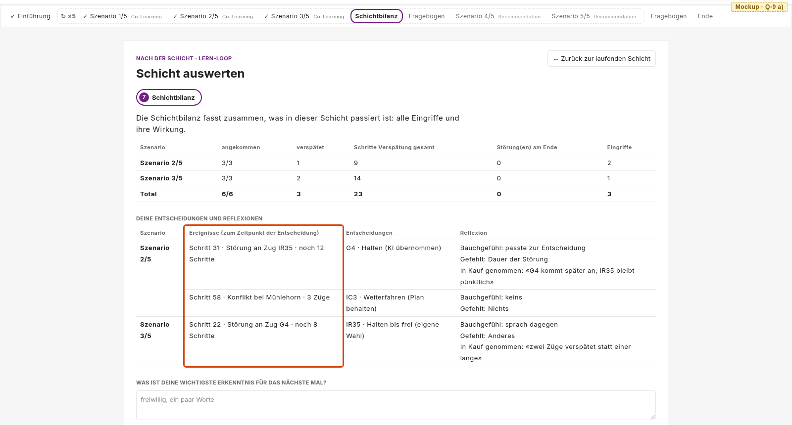 | 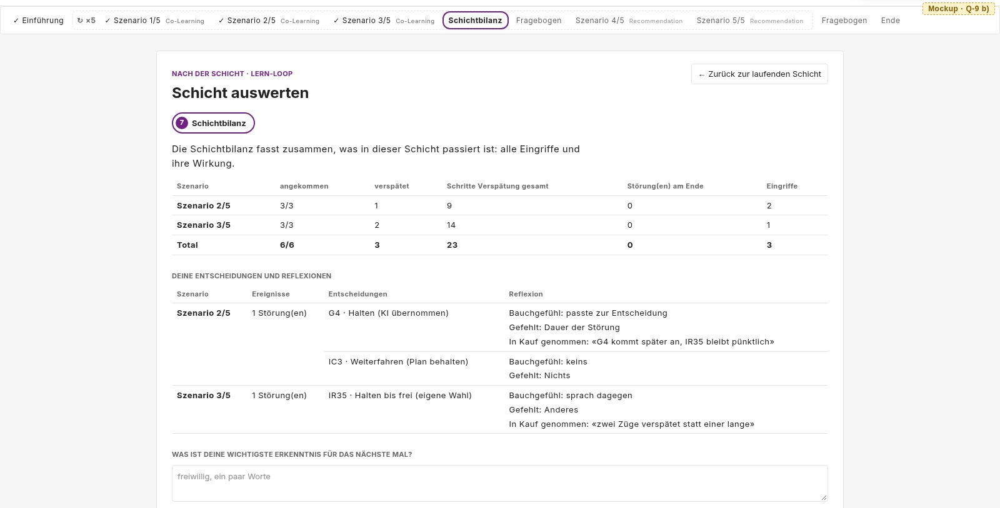 | 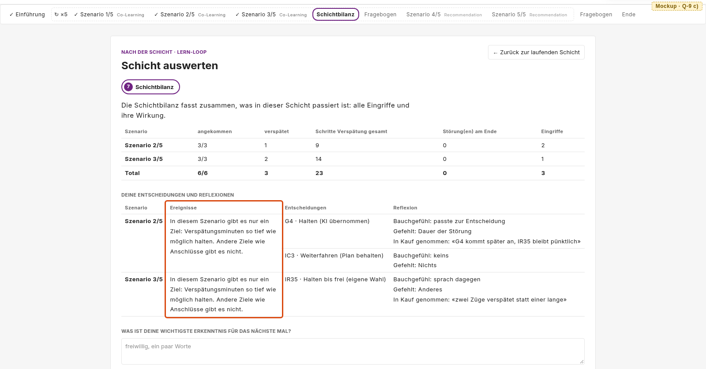 |

  c) shows today's `scenario.json` descriptions: the four UC2 scenarios
  share one text (the goal line), so the column says the same everywhere
  until each scenario gets its own event description. b) says little in
  UC2, where every scenario has one disturbance; its "1 Störung(en)" in the
  mockup is made up, the app does not count it yet (see above). The frame
  marks the column the options differ in. a)'s "Konflikt bei Mühlehorn"
  is no TMS message and would not appear (D-21).
- ✅ ~~**(Q-10) Does the KPI table stay in the Schichtbilanz?**~~ **Decided
  2026-11-25:** b) yes, above the summary, as it is today: one row per
  scenario, all of them, and the totals (D-13). Looked at in `plan-b-p01`
  with the Schichtbilanz switched on for the purpose. Not taken: a), only
  the reflection summary.
- ✅ ~~**(Q-11) Does the footer name the setting?**~~ **Decided 2026-11-25:** b), hide the mode name in the footer where the mode strip is hidden, in S-4 (D-14). For the study leads.
  The footer of an experiment reads "Plan B · Teilnehmer:in 01 · Szenario
  2/5 · Co-Learning" (`currentModeLabel()`, `app.component.html:1089`), so
  in the Recommendation setting it would read "· Recommendation". Plan B
  already hides the mode strip (`control.modeTabs`). a) Keep it: the
  experimenter sees the setting at a glance. b) Hide the mode name in
  the footer where the mode strip is hidden. *Proposal:* b), as Plan B
  hides the mode elsewhere; a one-line gate in the footer, in S-4. Found
  in the before pictures (§2.1).
- ✅ ~~**(Q-12) What does the Recommendation set's Schichtauswertung show?**~~ **Decided 2026-11-25:** a), the KPI table and the overview without the column "Reflexion" (D-22). For the later PR (§1.4).
  #134's run order of 2026-11-25 has the Schichtauswertung in both
  settings, but the Recommendation setting asks no reflection. For the
  study leads.
  - a) The KPI table and the overview without the column "Reflexion"
    (Szenario | Ereignisse | Entscheidungen).
  - b) The KPI table only.
  - c) The same overview as in Co-Learning, with an empty "Reflexion".
  - *Proposal:* a): the same screen in both settings except for what the
    setting leaves out, as everywhere else in this plan.
- ✅ ~~**(Q-13) A tutorial before the two scenarios?**~~ **Decided 2026-11-25:** b), no tutorial: two scenarios only (assumption in §1.1). The run order of
  2026-11-25 lists none; the struck-out one of 2026-11-16 began with it.
  For the study leads.
  - a) `PLAN_B_TUTORIAL` first, in the participant's setting, as in Plan B:
    three scenarios on the progress bar ("Szenario 1/3" is the tutorial).
  - b) No tutorial: two scenarios only.
  - *Proposal:* a): the participants meet the Plan B screen for the first
    time, and the formative round had the tutorial.
- ✅ ~~**(Q-14) What does the button at the bottom of the Schichtbilanz say in
  an experiment?**~~ **Decided 2026-11-25:** a), "Weiter zum Fragebogen" (D-18). Today "Zur Übersicht" (`tourUi.debrief.toOverview`),
  though the questionnaire follows. #209's feedback offers "Schicht
  beenden" or "Zum Fragebogen". For the study leads.
  - a) "Weiter zum Fragebogen", the toolbar's label at the same moment
    (`experimentRun.finish.toFinalSurvey`): no new key.
  - b) "Schicht beenden": the label of ending a live shift (the guide
    strip's button); here the shift is already over, so it would read as
    that action.
  - *Proposal:* a). Tours keep "Zur Übersicht".
- ✅ ~~**(Q-15) What does the summative briefing's opening say instead of the
  tutorial?**~~ **Decided 2026-11-25:** a), "Wenn du nun auf «Weiter»
  klickst, beginnt das erste von zwei Szenarien." (D-20). `plan-b`'s opening ends with "Wenn du nun auf «Weiter»
  klickst, beginnt die technische Einführung, bevor du anschliessend mit
  der Aufgabe startest." (`tour-briefings.ts:597`), but the summative
  experiments have no tutorial (Q-13). For the study leads; blocks S-4.
  - a) "Wenn du nun auf «Weiter» klickst, beginnt das erste von zwei
    Szenarien."
  - b) Leave the sentence out.
  - *Proposal:* a): it says what comes, as the sentence does today.
