# Fix the Plan B log findings: AI courses computed a step ahead, and the logging bugs (#230)

> **Status:** plan of 2026-11-27, written after the code (built by 2026-11-25). Based on `main` 85e36e5c. Issue
> [#230](https://github.com/flatland-association/flatland-ui-hub/issues/230) ("Findings Logging", chenkins). Branch
> `gereon/fix-230` at 56a971a8 (code at dab7403c, then this plan), PR [#231](https://github.com/flatland-association/flatland-ui-hub/pull/231)
> (umbra99). Steps S-1–S-18 are done; F-1–F-15 are fixed (1751b5f0, 757675c5, 3a780e8b, 12473dee, 301b06aa, 608cc97e, b3b49329, c820e19d, dce10453, a288ba3b, 19cf2356, d6c01ab4); S-14–S-17 complete the call log (Q-2) in dc7cfa9c, f1e6cf1b, 4957d85f and 13d8fb4a. Open questions:
> none (Q-1–Q-5 decided on 2026-11-27).
>
> **Why:** in the Plan B study runs, «KI-Plan übernehmen» failed 18 times out of 20 with 409 ("proposal preview is
> stale"), because the simulation runs on between loading the proposals and the click. The held train meanwhile
> stands. The same log review found four logging bugs that make the study data harder to read.

## 1. Introduction and goals

*What the change is for: the requirements, the qualities that matter, who has a stake, and what it leaves out.*

### 1.1 Requirements overview (functional requirements)

*The issue's text and the numbered requirements the rest of the plan refers to.*

> Eindeutige Fehler
>
> - «KI-Plan übernehmen» schlägt fehl. 18 von 20 Versuchen enden mit Fehler 409 («proposal preview is stale»), weil
>   die Simulation zwischen Laden und Klick weiterläuft. Erfolgreich waren nur die zwei Versuche mit 0 Schritten
>   Abstand.
> - Vorschläge laden zu langsam. In 17 % der Fälle dauert es über 3 s, also länger als ein Simulationsschritt
>   (Maximum 8,3 s). Das verschärft Punkt 1.
> - Stoppuhr decisionTimeMs wird beim Szenariowechsel nicht zurückgesetzt. Bei p04 und p05 stehen 645 s und 664 s
>   statt 161 s und 268 s. (ist eigentlich egal - kann man sich ja herleiten)
> - KPI malfunctions ist immer 0, obwohl jedes Szenario eine Störung enthält. (Dieses KPI ist für uns nicht wichtig;
>   aber falls für jemand anderes müsste man das anschauen)
> - Eingriffe im letzten Schritt werden angenommen. […] (dies haben wir heute bereits angeschaut; wir lassen das
>   einfach so und werden die Leute entsprechend instruieren).
>
> Fehler im Logging
>
> - Systemhalt steht in der Entscheidungsliste. Der automatische Halt von Zug 1 ist dort als «hold» eingetragen, und
>   die Meldung dazu lautet «operator override STOP pending», als hätte die Person ihn gesetzt.
> - Letzter Zustand ist leer. Im letzten Zustandseintrag der vier Szenarien fehlt die Zugliste. Den Endzustand muss
>   man aus dem vorletzten Eintrag lesen.
> - Antworten fehlen teilweise. Bei 9 Aufrufen ist die Serverantwort nicht mitgeloggt (7 der 409-Fehler, 2 Eingriffe
>   von p03)

Requirements:

- **REQ-1** Taking the AI course («KI-Plan übernehmen») works while the simulation plays, also when the participant
  needs a few seconds to read it.
- **REQ-2** Loading proposals slower than a simulation step does not make REQ-1 fail. Making the computation faster
  is not part of this PR (Q-3).
- **REQ-3** `decisionTimeMs` starts from zero in each leg (scenario), not from a decision window of the previous leg.
- **REQ-4** The leg's KPI `malfunctions` counts the trains that broke down during the leg.
- **REQ-5** ~~Interventions in the last step are refused.~~ Dropped by decision in the issue (2026-11-25): kept as
  is, participants are instructed instead.
- **REQ-6** The automatic hold of an affected train reads as the system's, not as an operator override, in the
  notifications. The decision log already tags it `accountableOwner: 'system'` on `main`.
- **REQ-7** The last state frame of a leg is not empty. State frames list only the trains that changed (deltas);
  the step answer and the WebSocket both deliver each state, so every step got a second, empty frame, the last one
  included.
- **REQ-8** Every logged call has its server response. 16 calls (the issue's 9 plus 7 pauses) carry
  `response_same_as: <seq>`, a reference to an earlier identical response. They are different requests with the same uninformative answer; the root causes are
  in Q-2. Commands are logged in full, their answers say what they did or why they failed, and a leg end sends one
  pause (Q-2 a).

Issue bullets checked against the raw exports of the five study runs (p01–p05, 25 legs) on 2026-11-27:

| Bullet | REQ | What the logs show | Covered by |
|---|---|---|---|
| «KI-Plan übernehmen» fails | REQ-1 | 20 AI accepts: 18 × 409, 2 × 200, as the issue says. | S-1 |
| Proposals load slowly | REQ-2 | 311 proposal requests: 52 (17 %) over 3 s, maximum 8.27 s. | S-1 (lead includes the computing time); speed-up Q-3 |
| `decisionTimeMs` not reset | REQ-3 | p04 uc2-4 645 s in a leg of 522 s; p05 uc2-2 664 s in a leg of 615 s. In both, the leg before had a system hold of train 1 with no decision for it, so its decision window stayed open into the next leg. | S-2 |
| KPI `malfunctions` always 0 | REQ-4 | 0 in all 25 legs; the state frames show exactly one broken-down train in every leg. | S-2 (counts 1 per leg) |
| Interventions in the last step | REQ-5 | - | dropped by decision |
| System hold in the decision list | REQ-6 | The automatic holds (train 1 at step 20 or 23) are logged with `accountableOwner: "system"` already; only the notification said "operator override". | S-2 (notification); decision entry kept by decision (2026-11-27) |
| Last state empty | REQ-7 | uc2 legs: frames come in pairs per step (`(128, 3 trains)`, `(128, 0 trains)`), the last one empty. Tutorial legs have no pairs. | S-2 |
| Responses missing | REQ-8 | 16 POST calls without a body, all with `response_same_as` pointing into the same leg: the 7 × 409, p03's 2 interventions (same train, same action as before), 7 pause calls. | S-14–S-17 (Q-2 a) |

### 1.2 Quality goals (non-functional requirements)

*The few qualities the design must reach, each with a concrete scenario.*

| ID | Priority | Quality goal | Scenario |
|---|---|---|---|
| NFR-1 | 1 | An accepted AI course does what its preview showed. | A course taken before its step is installed only if the live run is where the forecast put it, or if a replay from the live state is at least as good as the preview promised. |
| NFR-2 | 2 | Paused runs behave as before. | Paused, the lead is 0 and the exact same-step rule of `exact_course` applies unchanged. |
| NFR-3 | 3 | The step loop never breaks over a suggestion. | An exception while activating a pending course logs it and drops the course as `rejected`. |

### 1.3 Stakeholders

*Who asks for the change, decides on it, reviews it or works with the result, and what they expect.*

| Role | Name | Expectations |
|---|---|---|
| Issue author, maintainer | chenkins | The Plan B runs give usable AI acceptances and clean logs. |
| PR author | umbra99 | The lead-time approach is reviewed and merged. |
| Plan B study lead | - | Reads the logs and KPIs; may ask for another reaction allowance (Q-1 c, §1.4). |
| Participants | - | «KI-Plan übernehmen» works without errors; the panel says when the course takes over. |

### 1.4 Follow-ups (not in this PR)

*What this PR leaves out, why, and where it goes later.*

| Follow-up | Why not in this PR | From | Findings | Issue |
|---|---|---|---|---|
| Refuse interventions in the last step. | Dropped by decision in the issue: participants are instructed instead. | REQ-5 | - | untracked |
| A reaction allowance per experiment (UI config) instead of the fixed 10 s. | 10 s works for Plan B (Q-1 a); only if the study wants other values. | Q-1 | - | untracked |
| Compute proposals faster (17 % over 3 s, up to 8.3 s). | The lead absorbs the computing time; a speed-up is separate work (Q-3). | REQ-2 | - | [#236](https://github.com/flatland-association/flatland-ui-hub/issues/236) |
| The lead forecast works with expected breakdown durations instead of exact ones, as the driver and the proposals should ("no divine mode"); `matches_forecast` then compares no malfunction counter. | Changes what the forecasts and the HMI know, across the HMI (the exact remaining duration shows in seven places, the timetable after S-12 among them; listed for #225); #237 (forecast the live run's random breakdowns exactly) went the opposite way and is closed in favour of it. | §2.1 | - | [#225](https://github.com/flatland-association/flatland-ui-hub/issues/225) |

## 2. Constraints

*What limits the design from outside: platform, organisation and conventions.*

| ID | Constraint | Kind | Explanation |
|---|---|---|---|
| C-1 | `flatland-rl==4.3.0` | technical | `EnvAgent` has no `position`/`direction`; read them through `app/utils/agent_compat.py`. |
| C-2 | Policy is global per session. | conventions | `AGENTS.md`, brief §4.4: the AI course replaces the session's policy (`PLAN_POLICY_ID`), no per-agent policy. |
| C-3 | No inline user-facing text, en/de/fr keys. | conventions | `AGENTS.md`: the new texts are keys in `frontend/public/i18n/*.json`; German Swiss spelling and *du*. |
| C-4 | Don't rename logged ids. | conventions | The `data-log` ids (`proposals.takeAi`) and the notification codes stay; the new hold gets a new code. |
| C-5 | Leave `_recoverPolicyAndRetry*`, trajectory compression and the scenario-refresh throttling alone. | conventions | `AGENTS.md` do-not-touch list. |
| C-6 | Proposals are evaluated off the command lock. | technical | `/proposals` captures under `command_lock` and evaluates in `run_preview_work`; the live state may move on meanwhile. |

### 2.1 Limitations

*What the built code gets wrong or ignores, each with the TODO or issue that tracks it.*

The code keeps no list of its own; the PR adds no `TODO`.

- Random breakdowns of live runs (`_live_seed`) are not forecast, by decision: #237 asked for it and was closed in
  favour of #225, which wants less knowledge in forecasts, not more. A new breakdown inside the lead shows up as a
  divergence and goes through the re-check. A running breakdown's remaining duration is known exactly until
  [#225](https://github.com/flatland-association/flatland-ui-hub/issues/225) brings expected durations (§1.4).
- During the lead the course changes nothing: at 0.5 s per step and 10 s reaction allowance the lead is about 26
  steps (Q-1).
- The lead uses the last request's computing time (3 s before the first). A slower request delivers the course
  after its step; taking it then goes through the re-check.
- `course_activation` keeps only the last outcome. A client that misses the state broadcast between two activations
  misses the earlier one.
- Proposals are still as slow as before (REQ-2, §1.4).
- The countdowns (S-13) assume the nominal pace: when the server steps more slowly than planned, they stand still at
  the value of the next step until it arrives (never ahead of the run, picture 14a), so the real wait is longer than
  shown (Q-5).
- `kpis.malfunctions` counts trains, not breakdowns: a train that breaks down twice in a leg counts once (REQ-4).

### 2.2 Assumptions

*What must hold for the design to be correct, but is not checked in code.*

Not checked in code; they hold by construction of the single-process backend and the Plan B scenarios.

- One backend process holds the session: the pending course lives on the session object (`_pending_course`).
- The forecast is deterministic: a deep copy of the env, stepped with the session's policy and the standing
  overrides, does what the live run does. True for `deadlock_avoidance` and the scenario file's scheduled
  breakdowns; not for random live breakdowns (§2.1), nor for session-scheduled disturbances until S-7 (F-6).
- `SessionStore.playSpeed()` is steps per second, so `lead = ceil((compute + reaction) × playSpeed)` is in steps.
- A system hold is set only through `SessionStore.systemHold`, which sends `source: 'system'`.

## 3. Context and scope (checked 2026-11-27 on `main` 85e36e5c)

*The code on the base branch that the change works in, as it is before the change, and where the change stops.*

Context:

- **Proposals** (`backend/app/api/overrides.py`): `GET /session/{id}/proposals` captures the live state under
  `command_lock` (`_capture_proposal_source`), evaluates the plan, the AI courses (`agent.propose_for`) and the
  human's option off the lock (`_evaluate_proposals_unchecked`), and gives each AI course a `preview_token`
  (`proposal_preview.remember_course`).
- **Accepting** (`POST /session/{id}/proposals/apply`, `apply_proposal`): `proposal_preview.exact_course` accepts a
  token only if the live state's digest (`source_state`) is the one the course was computed from, i.e. the same
  step. Otherwise 409 "stale". Installing makes the course the session's plan (`accept_trainrun_plan`,
  `session.policy = PLAN_POLICY_ID`) and clears or keeps the overrides depending on `respects_overrides`.
- **Step loop**: `step_env` (`backend/app/core/env_step.py`), called by `/step` (`sessions.py`) and the WebSocket
  play loop (`websockets.py`); the state payload is `serialize_env` plus `episode_done`.
- **Overrides** (`override_manager.py`): one action per train and session, no origin.
  `hmi_mock.generate_notifications` words every override as "operator override … pending"
  (`train.overridePending`).
- **Frontend**: `proposal-compare` loads proposals for the selected train and takes a variant; on 409 it shows
  `proposals.previewExpired`. `SessionStore.systemHold` sets the automatic hold (decision log entry with
  `accountableOwner: 'system'`) through `ApiService.setOverride`. `StateLogService` writes a frame per state
  received; `ExperimentRunService` writes the leg result with `shiftKpis(agents)` at the end of the leg.
- **`PlanPolicy`**: on the last planned cell of a run it returns `DO_NOTHING`, assuming Flatland ends the run at the
  target.

Scope: the change adds the lead to proposals and accepting, the pending course to the step loop and the state
payload, the system flag to overrides, fixes the frontend logging bugs, narrows the call log's deduplication (browser
and backend), makes the 409 and override answers say what happened, and fixes the units and singulars in the
timetable, agents table and train list. It only reads the scenario runner (`TrajectoryBranchRunner`) and the proposal
agents.

## 4. Solution strategy

*The fundamental choices and why, the rules the design follows, how it is verified, and the design of each part.*

| Quality goal | Scenario | Solution approach | Details |
|---|---|---|---|
| NFR-1 | A course taken before its step does what its preview showed. | Compute the course for the step it can still be taken at (forecast), accept it as pending, install it at that step after a fingerprint check, else re-check from the live state. | §4.3 |
| NFR-2 | Paused: unchanged. | `lead_steps = 0` keeps the exact path (`exact_course`). | §4.3 |
| NFR-3 | The step loop survives. | `activate_pending_course` catches everything and records `rejected`. | §4.3 |

### 4.1 Design principles

*The rules the design follows, each with its decision, the concepts it reuses instead of building new ones, and what
is not new on purpose.*

- **DP-1 The course is computed for the step it can still be taken at.** Not "accept a stale course anyway": the
  adviser proposes from the forecast state, so what is shown is what runs.
- **DP-2 Until the activation step, the trains run as they do now.** Each course is simulated from now with the
  session's driver until that step and the course from then on, so plan, AI and human columns stay comparable from
  the same step.
- **DP-3 Exact when possible, re-checked otherwise, never silently worse.** Installed without a check only if the
  live fingerprint and the overrides match the forecast; otherwise replayed and installed only if it brings at least
  as many trains home with no more deadlocks than the preview promised.
- **DP-4 The backend decides, the frontend shows.** The step loop installs the course; the panel reads
  `pending_course` and `course_activation` from the state.
- **DP-5 Any other accepted decision for the train cancels a pending course.** A new override, another course or a
  reset, and only once that decision is accepted (S-5); the state reports the cancellation (S-9).
- **DP-6 Logging fixes stay in the services that write the log** (browser and backend call log, state frames, leg
  results), with no new log format.
- **DP-7 Answers only gain fields and text that nothing in the app reads** (Q-2): the panel reacts to the status, the
  log gets the detail.
- **DP-8 Deadlines in seconds, durations in steps** (Q-5, S-12): the AI countdowns count real seconds; breakdowns,
  delays and departures count steps, with their unit, the same in every panel until #225.
- **DP-9 Every state broadcast carries the same course state** (S-11): one payload builder for `/state`, `/step`,
  `/reset` and the WebSocket.

Reused concepts:

| Need | Reused concept | Instead of |
|---|---|---|
| Simulate a course from now | `_branch_run` with `release_at` (as the human column) | A second rollout loop |
| Forecast the next steps | `TrajectoryBranchRunner._make_override_policy` on a deep copy of the env | The runner's fork, which drops the breakdown generator's state |
| Install an accepted course | `_install_ai_course`, extracted from `apply_proposal` | A second install path |
| Validate a token | `PreviewCourse` in `proposal_preview`, extended | A new token store |
| Tell the client | The state payload (`/state`, WebSocket `state`) | A new event type or endpoint |
| Override origin | `OverrideManager.set(..., system=True)` | A parallel store of system holds |
| Train position in the fingerprint (S-3) | `agent_compat.agent_position`/`agent_direction` (C-1) | Reading `EnvAgent` fields directly |
| Episode generation (S-4) | `env.num_resets` | A new session counter |
| Disturbances in the forecast (S-7) | A copy of `session.disturbance_scheduler` | A second scheduler type |
| Singular for one step (S-12) | The repo's `…One` key convention (`heldOne`, `summaryOne`) | ICU plural syntax |
| Greying the old course (S-13) | App tokens in `styles.scss` | New colours |
| Call log deduplication (S-14) | `call_log._Dedup` and `call-log.interceptor`, narrowed to GET | A new log format; `replay-timeline.ts` already reads both forms |

Not new on purpose: no new endpoint (only the optional `lead_steps` query parameter and the optional `source` field),
no new log frame type, no new interaction-mode flag, the `exact_course` path for lead 0.

### 4.2 Verification

*How each requirement and quality goal is shown to work: tests, CI checks, before and after screenshots.*

Screenshots: annotated, from the running app at dab7403c (Plan B p04, scenario 2/5, uc2-2, co-learning, German; the
clock driven by a script at 3 s per step, a computation counted as 3 s; t counts from the system hold of IR35). Solid
red: changed by this PR, with its step; solid purple: mockup of a planned step (the DOM changed for the picture);
dashed blue: technical background; yellow: UML-style notes, joined by dashed lines. They sit where they explain a
decision or a finding:

| Picture | Shows | In |
|---|---|---|
| [1](plan-b-log-findings/1-q1a-deadline.png), [2](plan-b-log-findings/2-q1a-pending.png), [3](plan-b-log-findings/3-q1a-takeover.png) | Q-1 a): deadline, pending course, takeover and the driver after it (3 also in §10.1) | Q-1 |
| [4a](plan-b-log-findings/4a-q1b-zero.png), [4b](plan-b-log-findings/4b-q1b-recompute-mockup.png) | Q-1 b): the course runs out under a slow reader; F-13 and its mockup (4b also in §4.5) | Q-1 |
| [5](plan-b-log-findings/5-f11-timetable-mockup.png) | F-11: the timetable's ⚠ with its unit (mockup) | §4.5 |
| [6](plan-b-log-findings/6-req6-system-hold.png) | REQ-6: system hold worded as the system's, kept in the decision list | §4.4 |
| [7](plan-b-log-findings/7-q5-countdown.png) | Q-5: the countdown per second, today and ticking (mockup) | Q-5 |
| [8a](plan-b-log-findings/8a-s5-refused-route-drops-course.png), [8b](plan-b-log-findings/8b-s5-nothing-takes-over.png) | F-4 before S-5: a refused route drops the pending course, and at its step nothing takes over (reproduced at dab7403c) | §4.3 |
| [9](plan-b-log-findings/9-s7-scheduled-disturbance-mockup.png) | F-6 before S-7: a scheduled disturbance missing from the forecast (mockup: Plan B schedules none) | §4.3 |
| [10](plan-b-log-findings/10-s8-held-next-to-target-mockup.png) | F-7 before S-8: a train held next to its target stays there (mockup: Plan B holds no train there) | §4.3 |

| [11a](plan-b-log-findings/11a-s9-cancelled-before.png), [11b](plan-b-log-findings/11b-s9-cancelled-after.png) | F-8 and S-9: a waiting AI course dropped by a new hold; before, the panel waits for ever; after, it loads new courses | §4.5 |
| [12](plan-b-log-findings/12-s10-pending.png) | S-10: while the course waits, only "Bis dahin fahren die Züge wie jetzt." (before: picture 2) | §4.5 |
| [13](plan-b-log-findings/13-s12-timetable.png) | S-12: "⚠ Störung, noch N Schritte" in the timetable; the column fits (before: picture 5) | §4.5 |
| [14a](plan-b-log-findings/14a-s13-countdown.png), [14b](plan-b-log-findings/14b-s13-zero.png), [15](plan-b-log-findings/15-s13-recompute.png) | S-13: the deadline per second, the button off at 0 s, the greyed course while recomputing (before: pictures 7, 4a, 4b) | §4.5 |

Pictures 11b–15 come from the code at d6c01ab4 (S-9–S-18; preview backend with the production build, same scripted run
as above; 14b and 15 with 5 s reading time and a 12 s reader, as picture 4a), 11a from dab7403c. The call log steps
(S-11, S-14–S-17) don't show on screen: §4.4 has excerpts of the backend call logs of the same runs.

F-2 (S-4) and F-3 (S-6) don't show on screen: the sequence diagrams in §6.3 and §6.4 show them, before and after the
fix.

| ID | Requirement | Test or check | Result | Screenshots |
|---|---|---|---|---|
| REQ-1 | AI course taken while playing | `test_proposal_lead.py::test_a_course_accepted_before_its_step_takes_over_exactly_at_it`, `test_a_late_accept_is_rechecked_from_the_live_state`; `proposal-compare.component.spec.ts` (409 reloads) | ✅ CI green at dab7403c; fingerprints with real positions since 1751b5f0 (NFR-1) | [1](plan-b-log-findings/1-q1a-deadline.png), [2](plan-b-log-findings/2-q1a-pending.png), [3](plan-b-log-findings/3-q1a-takeover.png) |
| REQ-2 | Slow loading doesn't break REQ-1 | The lead includes the last computing time (`leadSteps()`) | ✅ by design, not measured | - |
| REQ-3 | `decisionTimeMs` per leg | `session.store.spec.ts` "decision time across legs" | ✅ | - |
| REQ-4 | KPI `malfunctions` | `experiment-run.service.spec.ts` (counting across a leg, no carry-over) | ✅ | - |
| REQ-5 | Last-step interventions | - | dropped by decision | - |
| REQ-6 | System hold worded apart | `test_system_hold_notification.py::test_system_and_operator_holds_are_worded_apart` | ✅ | [6](plan-b-log-findings/6-req6-system-hold.png) |
| REQ-7 | Last state frame not empty | `state-log.service.spec.ts` (duplicates skipped, distinct steps kept) | ✅ | - |
| REQ-8 | Responses logged | `test_call_log.py` and `call-log.interceptor.spec.ts` (a repeated command keeps its response); `test_proposal_lead.py` (a test per 409 reason); `test_override_answer.py` (override echo); `session.store.spec.ts` (one pause at a leg end) | open: S-14–S-17 | - |
| NFR-1 | Course does what the preview showed | `test_fingerprints_tell_trains_on_different_cells_apart`, `test_forecast_fingerprints_match_the_live_run_through_a_breakdown`, `test_a_pending_course_that_fails_its_recheck_is_rejected_not_installed` | ✅ since 1751b5f0 (S-3): fingerprints compare real positions | - |
| NFR-2 | Paused unchanged | `test_without_a_lead_the_exact_same_step_rule_is_unchanged` | ✅ | - |
| NFR-3 | Step loop survives | `activate_pending_course`'s `except` | ✅ by inspection | - |

The review fixes S-12 and S-13 have no requirement of their own: their specs (`timetable.component.spec.ts`,
`proposal-compare.component.spec.ts`) and the mockups [4b](plan-b-log-findings/4b-q1b-recompute-mockup.png),
[5](plan-b-log-findings/5-f11-timetable-mockup.png) and [7](plan-b-log-findings/7-q5-countdown.png) show them.

### 4.3 AI courses computed a step ahead (REQ-1, REQ-2)

- **Lead.** While the run plays (and not in a replay), the panel asks `/proposals` with
  `lead_steps = ceil((last compute seconds + proposalReactionSeconds) × playSpeed)`; the backend caps it at
  `MAX_LEAD_STEPS = 60`. `proposalReactionSeconds` is 10 s by default (Q-1). Paused, the lead is 0.
- **Forecast.** `_roll_forward` steps a deep copy of the env `lead` steps with the session's driver and the standing
  overrides, and keeps each step's `fingerprint` (position, direction, state, malfunction counter per train).
- **Course.** The adviser proposes from the forecast state. Each course is scored with
  `SwitchAtStepPolicy(plan_factory(), PlanPolicy(course), activation)` from now, the overrides the acceptance drops
  released at the activation step. The result carries `ai_activation_step`; each AI variant its `activation_step`.
- **Accept.** `lead_course` finds the token's course. Before its step and on the forecast: stored as pending
  (`set_pending`), reply `pending: true`. At its step and on the forecast: installed. Otherwise: re-checked
  (`_course_still_works`), installed or 409.
- **Activate.** `step_env` calls `activate_pending_course` after each step; at the activation step the course is
  installed (`installed`), re-checked (`rechecked`) or dropped (`rejected`), and the outcome goes into
  `course_activation`. `/step` rebuilds its driver when the plan changed during the step.
- **Panel.** The KI column shows how long the course can still be taken (`proposals.aiValidFor`) and asks again by
  itself once the step passed. After a pending accept the frame stays open with `proposals.aiPending` (or
  `aiPendingPaused`) and closes when `course_activation` arrives; a `rejected` outcome shows
  `proposals.courseRejected` and reloads. A 409 on accept reloads and shows `proposals.aiRefreshed`.
- **Cancel.** `set_override`, `clear_override` for the same train, any `apply_proposal` and a reset drop the
  pending course (DP-5), since S-5 only once the replacing decision is accepted (F-4, F-5); F-8 is open (S-9).
- **Released hold at the end of a run.** `PlanPolicy._drop_exhausted_course` hands every train to the fallback once
  a free train stands at the end of a run cut short by a hold (measured on uc2-4: all three trains arrive instead of
  one). Since S-8 also for a train held next to its target (F-7). `test_plan_policy_released_hold.py`.
- **Review fixes** (Phase 2): the fingerprint reads positions through `agent_compat` (S-3, F-1); lead courses and
  previews carry the episode generation and are refused after a reset (S-4, F-2); the switch policy forwards
  overrides to the active policy only and resets the plan state at the switch (S-6, F-3); the forecast ticks a
  private copy of the disturbance scheduler (S-7, F-6); every `sessions.py` broadcast carries the course state
  (S-11, F-10).

Before S-5 (F-4), a refused route dropped the pending course, and at its step nothing took over; reproduced at
dab7403c:

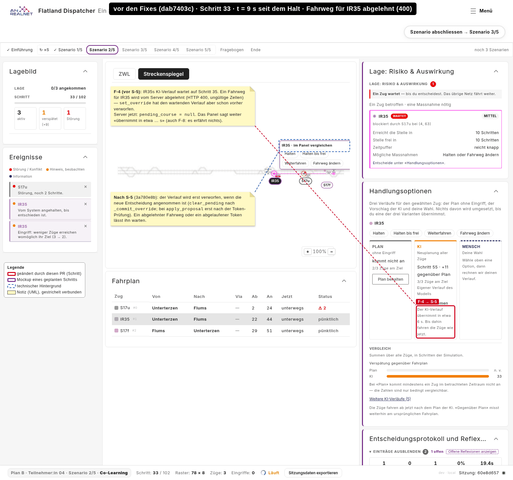 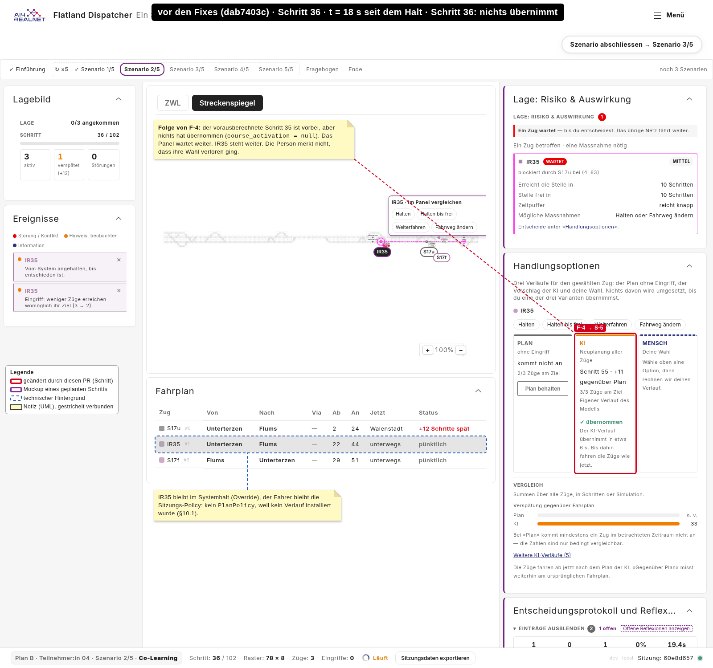

Before S-7 (F-6), a disturbance scheduled inside the lead was missing from the forecast, so the course failed its
check at the activation step; before S-8 (F-7), a train held next to its target stayed there after the release.
Mockups, since Plan B schedules no disturbances and holds no train next to its target:

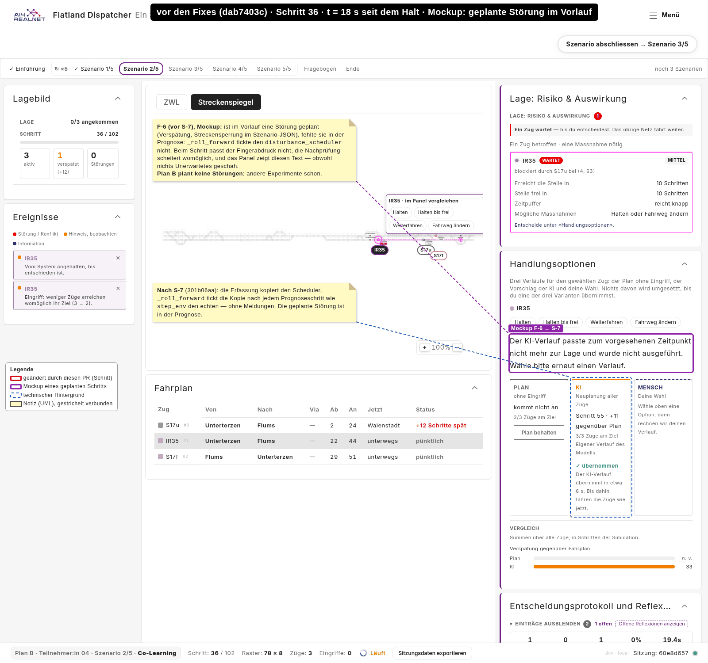 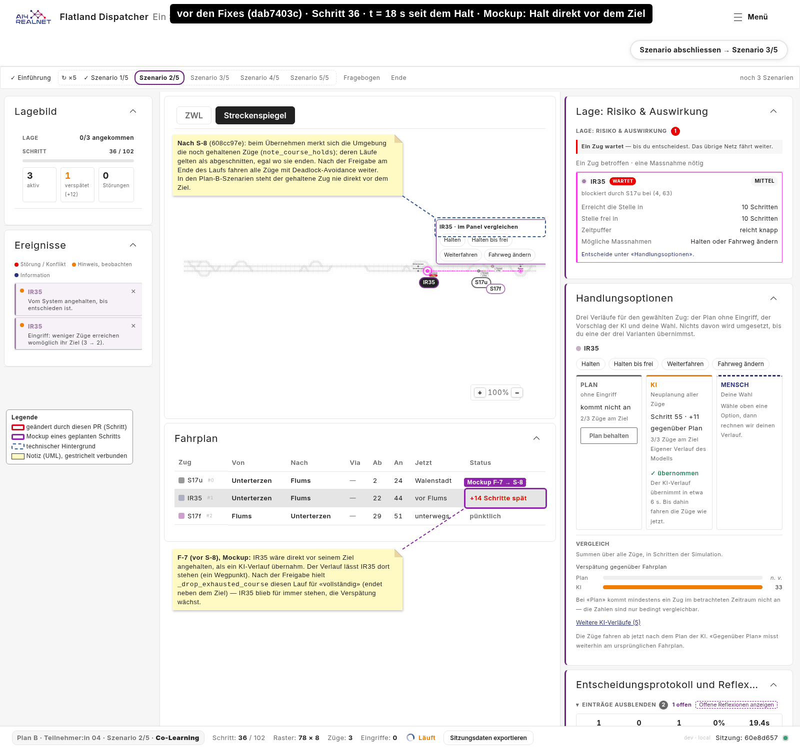

### 4.4 Logging fixes (REQ-3, REQ-4, REQ-6, REQ-7, REQ-8)

- **REQ-3** `SessionStore.clearDecisionLog` also clears `_decisionWindowStart`, so an open window of the previous leg
  does not time the next leg's decision for the same train.
- **REQ-4** `ExperimentRunService` watches the agents per session and counts every train seen broken down; the leg
  result's `kpis.malfunctions` is that count (§8.2).
- **REQ-6** `SessionStore.systemHold` sends `source: 'system'`; the backend marks the override as the system's
  (`OverrideManager.is_system`) and `generate_notifications` words it as "Held by the system"
  (`train.systemHold`, new i18n keys).
- **REQ-7** `StateLogService` skips a frame that repeats the previous step with no change (the step answer and the
  WebSocket both send it); before, every other frame was empty, the last one included.
- **REQ-8** (Q-2 a) The call log, browser and backend, replaces only repeated GET answers (polling) by
  `response_same_as`; commands keep their response. The AI-course 409 names the failed check and the steps compared,
  in the same English text (the panel reads only the status). The override answer echoes `via`, `start` and the step.
  `_stopPlayingOnServer` skips a pause already in flight, so a leg end sends one pause.

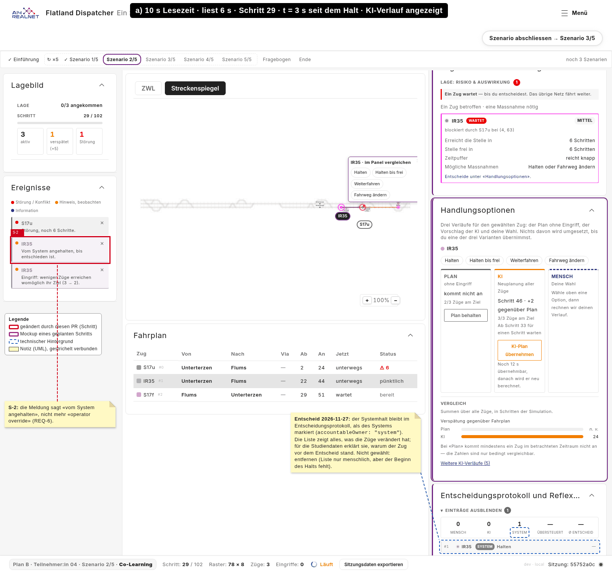

The call log steps, before (dab7403c) and after (S-9–S-18), from the backend call logs (`backend-calls.jsonl`) of the
runs of §4.2, shortened:

- **S-14** A repeated command answer was stored as a reference: the second hold for IR35 lost its response, and so
  did the second pause at the leg end. After S-14 only GET answers are references
  (`test_a_repeated_post_keeps_its_response`); in the run after S-9–S-18 no command answer repeats any more (S-16
  adds the step, S-17 drops the second pause).

  ```text
  before  298 POST /agent/1/override 200 {"session_id": "5486b18c", "handle": 1, "action": 4}
          332 POST /agent/1/override 200 response_same_as=298
  ```
- **S-15** The 409 of an AI course taken a step late:

  ```text
  before  360 POST /proposals/apply 409 {"detail": "This proposal preview is stale or no longer matches; load proposals again"}
  after   570 POST /proposals/apply 409 {"detail": "This proposal preview is stale or no longer matches (computed at step 37, now step 38); load proposals again"}
  ```
- **S-16** The override answer:

  ```text
  before  298 POST /agent/1/override 200 {"session_id": "5486b18c", "handle": 1, "action": 4}
  after   515 POST /agent/1/override 200 {"session_id": "95bfca9c", "handle": 1, "action": 4, "via": [], "start": null, "step": 33}
  ```
- **S-17** The leg end (the episode ends while the run plays):

  ```text
  before  577 POST /pause 200 {"session_id": "2ee270b8", "playing": false}
          578 POST /pause 200 response_same_as=577
  after   793 POST /pause 200 {"session_id": "cc0eb7ee", "playing": false}
  ```
- **S-11** At dab7403c, `sessions.py`'s `_build_state_payload` sent no `pending_course`/`course_activation`, so the
  state message of a manual `/step` didn't say that the course took over (the preview backend of the "before"
  pictures already carried that patch, so its log shows no difference). After S-11, the message of the `/step` that
  reaches the course's step:

  ```json
  {"elapsed_steps": 37, "pending_course": null,
   "course_activation": {"handle": 1, "step": 37, "activation_step": 37, "outcome": "installed"}}
  ```

### 4.5 Panel and timetable fixes (S-9, S-10, S-12, S-13)

*The review fixes participants see: mockups from before they were built, then screenshots as built.*

- **S-12 (F-11, F-15)** The timetable's status says what the number is and in which unit: "⚠ Störung, noch 6 Schritte"
  instead of "⚠ 6", as its other statuses and the events do. The KI deadline counts seconds; with the unit the two no
  longer read as one countdown. It keeps the exact remaining duration, as the other panels do, until #225 switches
  them all to an expected value (decision 2026-11-27). One step reads in the singular ("ab in 1 Schritt", "+1 Schritt spät", and in the
  events "Störung, noch 1 Schritt."), as the repo's other `…One` keys do.
- **S-13 (F-12, F-13)** The KI deadline and the pending text tick every second (Q-5). At 0 s «KI-Plan übernehmen» is
  disabled; while the panel recomputes, the course that ran out is greyed out and the text says a new one is computed.
- **S-9 (F-8)** A course cancelled by another decision or a reset ends the panel's waiting state; the state reports
  it as `course_activation.outcome = "cancelled"`, the panel reloads without a message of its own (the participant
  made the other decision).
- **S-10 (F-9)** "Die Züge fahren ab jetzt nach dem Plan der KI." only once the course has taken over (picture 2 in
  Q-1 shows the contradiction).

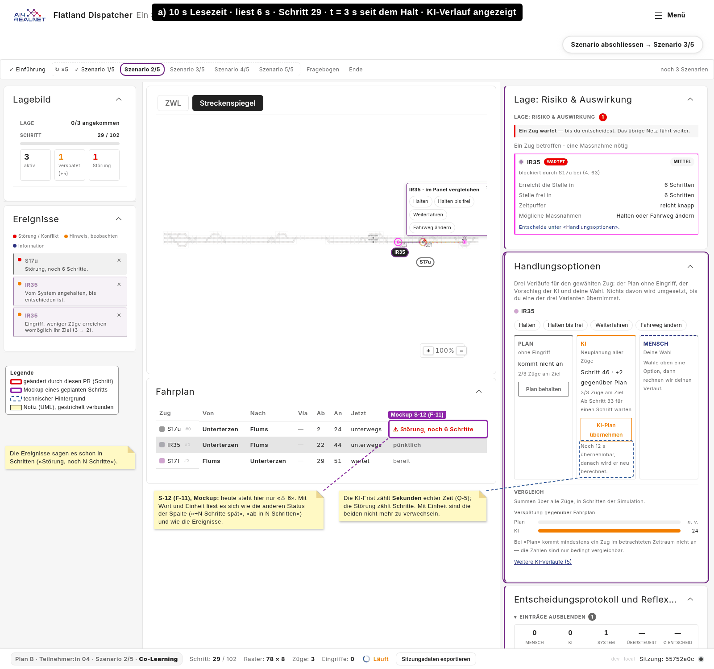 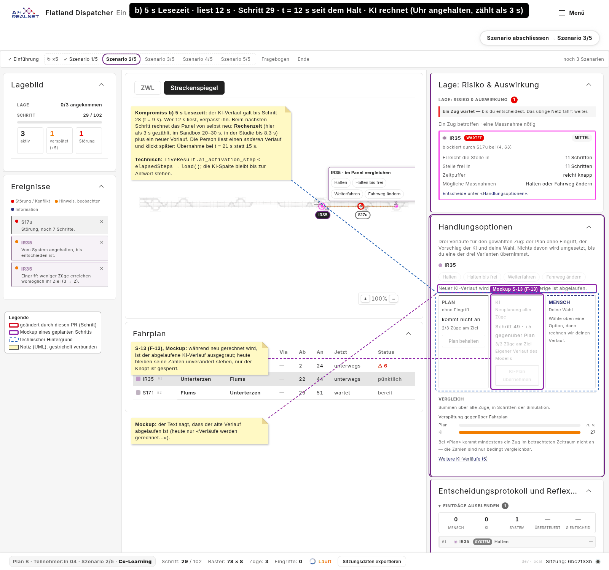

As built (d6c01ab4), S-9 before and after, then S-10, S-12 and S-13:

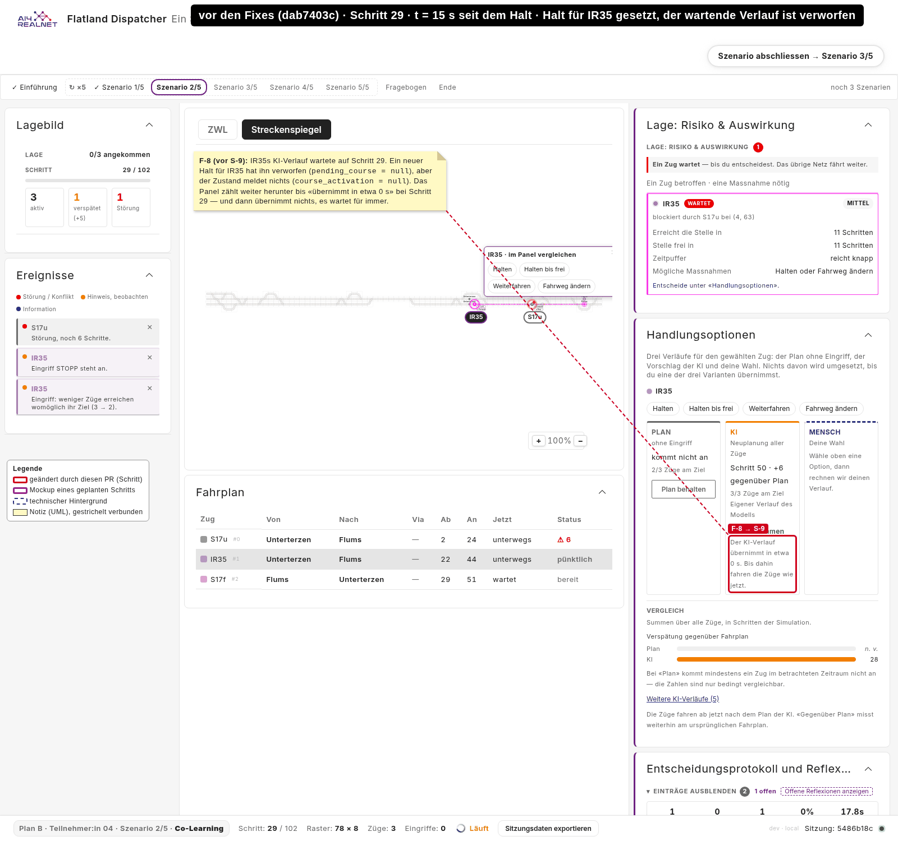 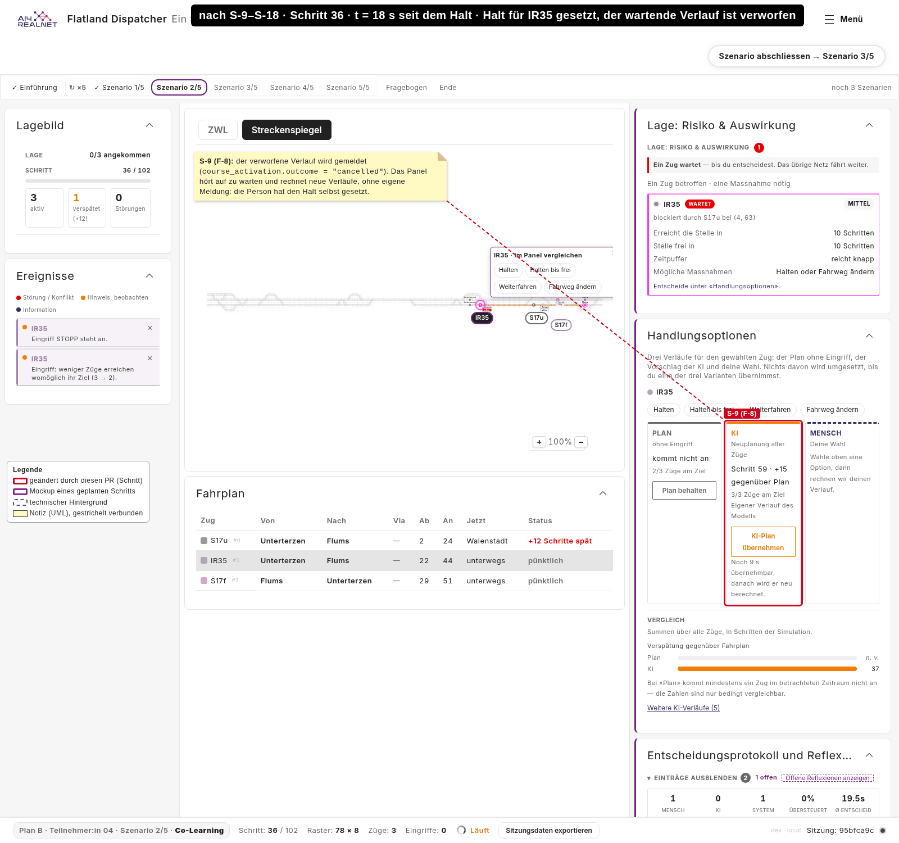

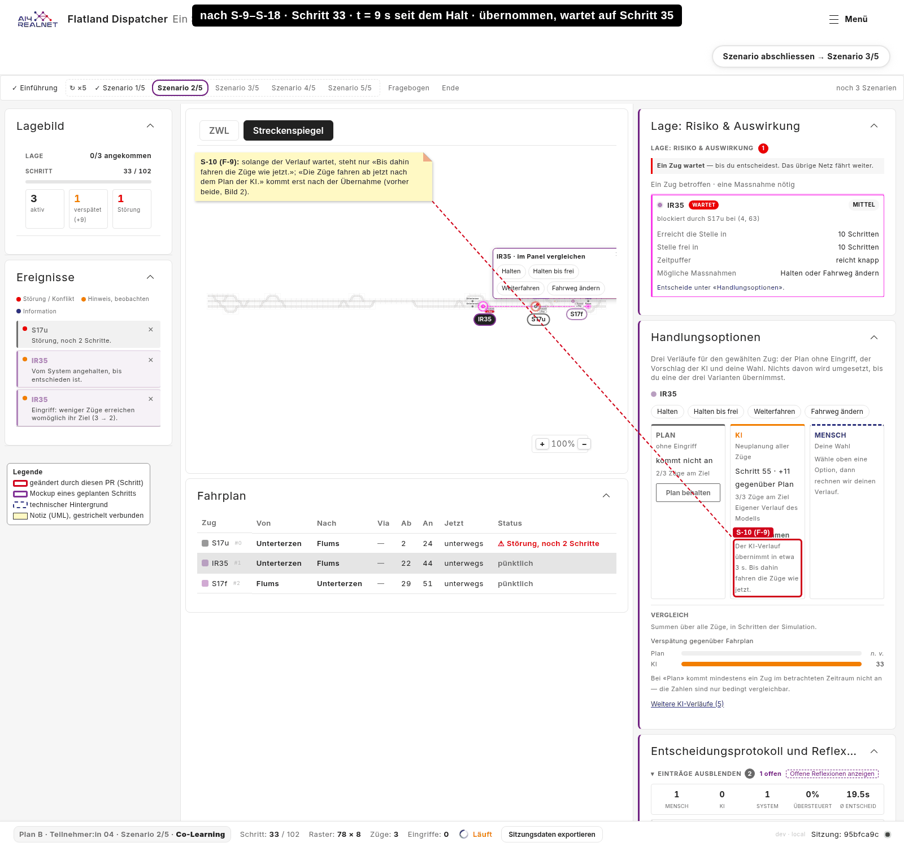 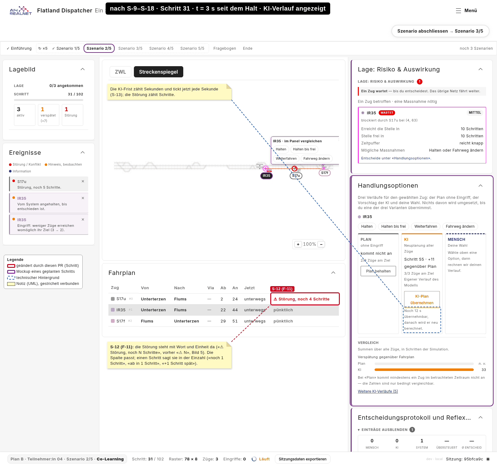

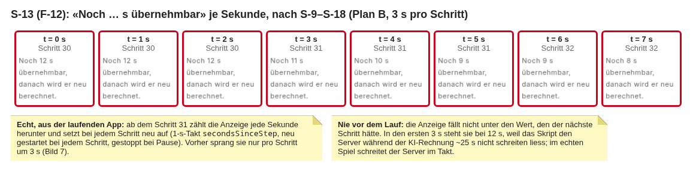

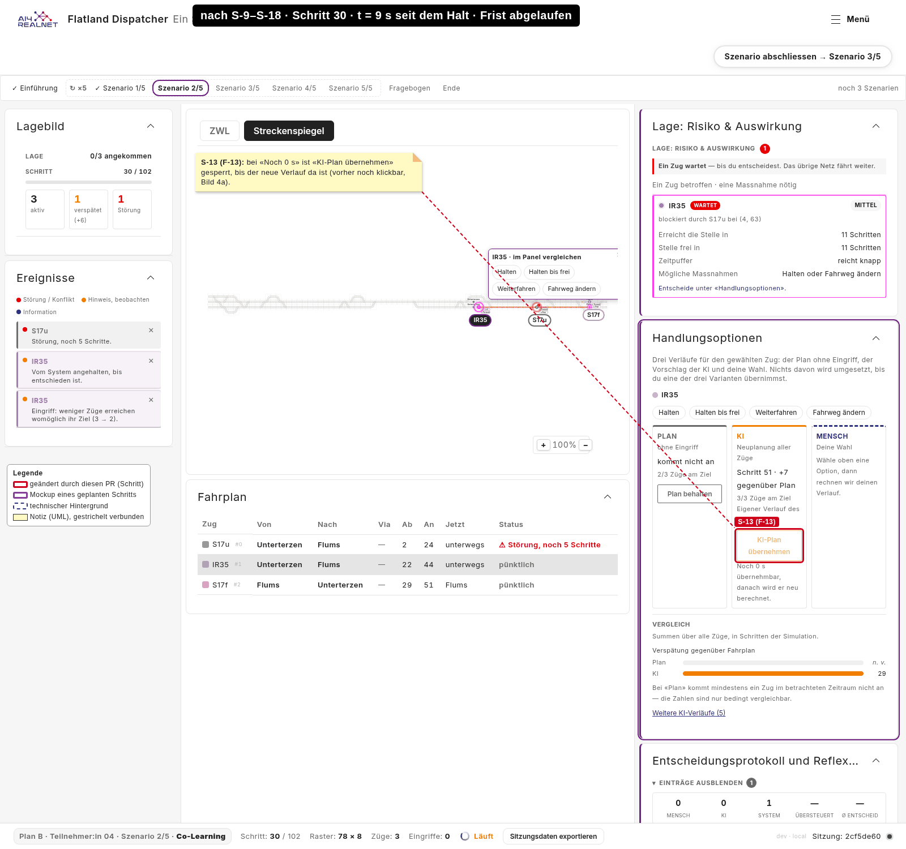 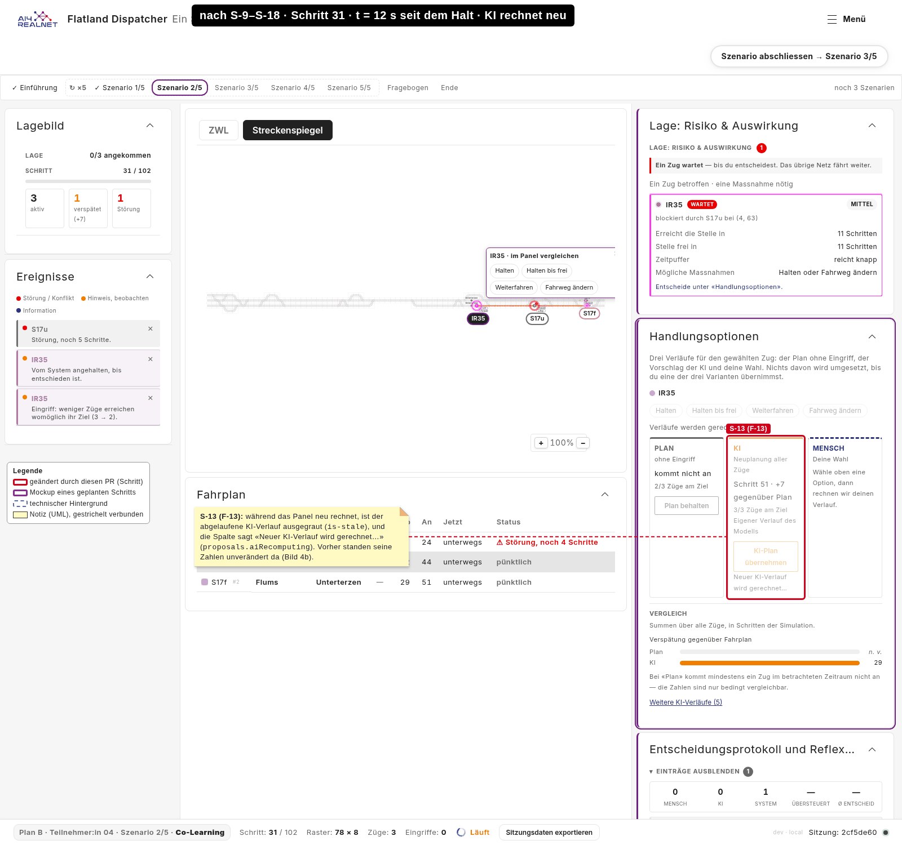

## 5. Building block view

*The components the change adds or changes: an overview, why the system is split this way, what each is responsible
for, the important interfaces, and the planned data model.*

### 5.1 Proposals, accepting and the step loop

*One white box: its building blocks, why it is split this way, and the interfaces between them.*

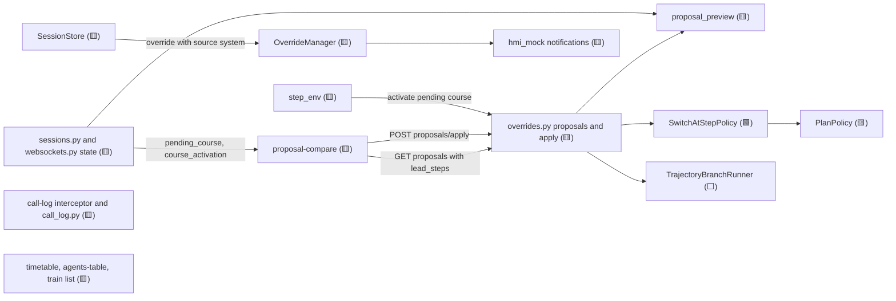

Notation: [flowchart in Mermaid](https://mermaid.js.org/syntax/flowchart.html); 🟩 added, 🟨 modified, ⬜ unchanged.

**Motivation:** the pending course belongs to the preview store (`proposal_preview`), which already validates tokens
(DP-3); installing stays in `overrides.py`, which owns accepting; the step loop only triggers it (DP-4). The switch
of drivers is a policy, so the branch runner needs no change (§4.1 reused concepts).

**Contained building blocks:**

| Component | Responsibility | Change |
|---|---|---|
| `proposal-compare` | Shows plan, AI and human courses for the selected train and takes one. Not for deciding when a course runs. | 🟨 modified: the AI course can be taken while the run plays; the panel counts down every second how long it can be taken and when it takes over, stops offering a course that ran out, and notices a cancelled one. |
| `SessionStore` | Holds the session's client state, the decision log and the settings. Not for computing courses. | 🟨 modified: the reaction allowance; system holds are sent as such; decision windows end with the leg; a leg end sends one pause. |
| `ApiService` | Calls the backend. | 🟨 modified: sends the lead and the hold's source. |
| `StateLogService` | Writes the state frames of the study log. | 🟨 modified: no empty duplicate frames, so the last frame has the trains. |
| `ExperimentRunService` | Runs the experiment's legs and writes their results. | 🟨 modified: `malfunctions` counts the trains that broke down during the leg. |
| `overrides.py` proposals and apply | Computes the courses and accepts one. Not for stepping the run. | 🟨 modified: courses are computed for a step ahead and can be accepted before it; a refusal says why; the override answer says what was set. |
| `proposal_preview` | Remembers the courses shown and validates a token. Not for installing. | 🟨 modified: keeps the forecast of a course and the course waiting for its step; forgets courses from before a reset. |
| `SwitchAtStepPolicy` | Drives with one policy until a step and another from it, for previews. Not for the live run. | 🟩 added: a course is scored as it will run, from now. |
| `PlanPolicy` | Drives the trains along an accepted course. | 🟨 modified: a released train at the end of a run cut short no longer stands for good. |
| `step_env` | Steps the live env and fires disturbances. | 🟨 modified: installs a pending course at its step. |
| `sessions.py` and `websockets.py` state | Send the live state to the client. | 🟨 modified: every state message says which course waits and how the last one went. |
| `OverrideManager` | Keeps each train's standing override. | 🟨 modified: knows which overrides the system set. |
| `hmi_mock` notifications | Words the notifications. | 🟨 modified: a system hold reads as the system's. |
| Call log (`call-log` interceptor, `call_log.py`) | Records every call and its answer for the study log. Not for replaying. | 🟨 modified: commands keep their answer; only repeated polled answers become references. |
| `timetable`, `agents-table`, train list | Show each train's status. | 🟨 modified: the breakdown says what the number is; one step reads in the singular. |

**Important interfaces:**

- `GET /session/{id}/proposals?lead_steps=<n>` (optional, default 0, capped at 60); reply adds `ai_activation_step`
  and per AI variant `activation_step`.
- `POST /session/{id}/proposals/apply`: reply adds `pending` and `activation_step`.
- `POST /session/{id}/agent/{handle}/override`: body adds optional `source: "system"`.
- State payload (`/state`, `/step`, `/reset` and WebSocket `state`): adds `pending_course` and `course_activation`.
- `POST /session/{id}/agent/{handle}/override`: reply adds `via`, `start` and `step` (S-16).

#### Data model: planned

Current: `SessionState`, `ProposalsResult`, `ProposalVariant` in `frontend/src/app/core/models.ts` and
`events/event-types.ts`; `PreviewCourse` and `OverrideRequest` in the backend. Only the touched fields are shown.

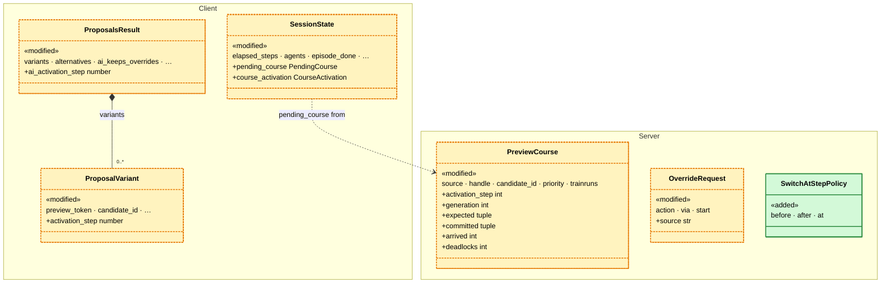

Notation: [UML class diagram in Mermaid](https://mermaid.js.org/syntax/classDiagram.html). Legend: green «added»,
yellow «modified» (new fields with `+`), grey «unchanged».

State payload, values illustrative:

```diff
 {
   "elapsed_steps": 24,
   "episode_done": false,
+  "pending_course": {"handle": 0, "activation_step": 27},                                       // added
+  "course_activation": {"handle": 0, "step": 21, "activation_step": 21, "outcome": "installed"}  // added
 }
```

Nothing is removed. `outcome` is `installed`, `rechecked`, `rejected` or, after S-9, `cancelled`. `generation`
(S-4) is the env's `num_resets` when the course was computed.

What changes, and why:

| | Change | Why |
|---|---|---|
| 🟨 | The AI course carries the step it takes over at. | The panel shows how long it can be taken. |
| 🟨 | The state says which AI course waits and how the last one went. | The panel closes or says it no longer fitted. |
| 🟨 | An override can be marked as the system's. | The notification says who held the train. |
| 🟩 | A policy that switches at a step. | Courses are scored as they will run. |

Kept small on purpose: no new log frame or event type (the state payload carries the outcome); no history of
activations (only the last, §2.1); no per-train pending courses (one per session, as the policy is global, C-2).

## 6. Runtime view

*How the components work together at runtime: the flows and modes the change adds or changes, when it changes behaviour.*

### 6.1 Taking an AI course while the run plays (REQ-1; NFR-1)

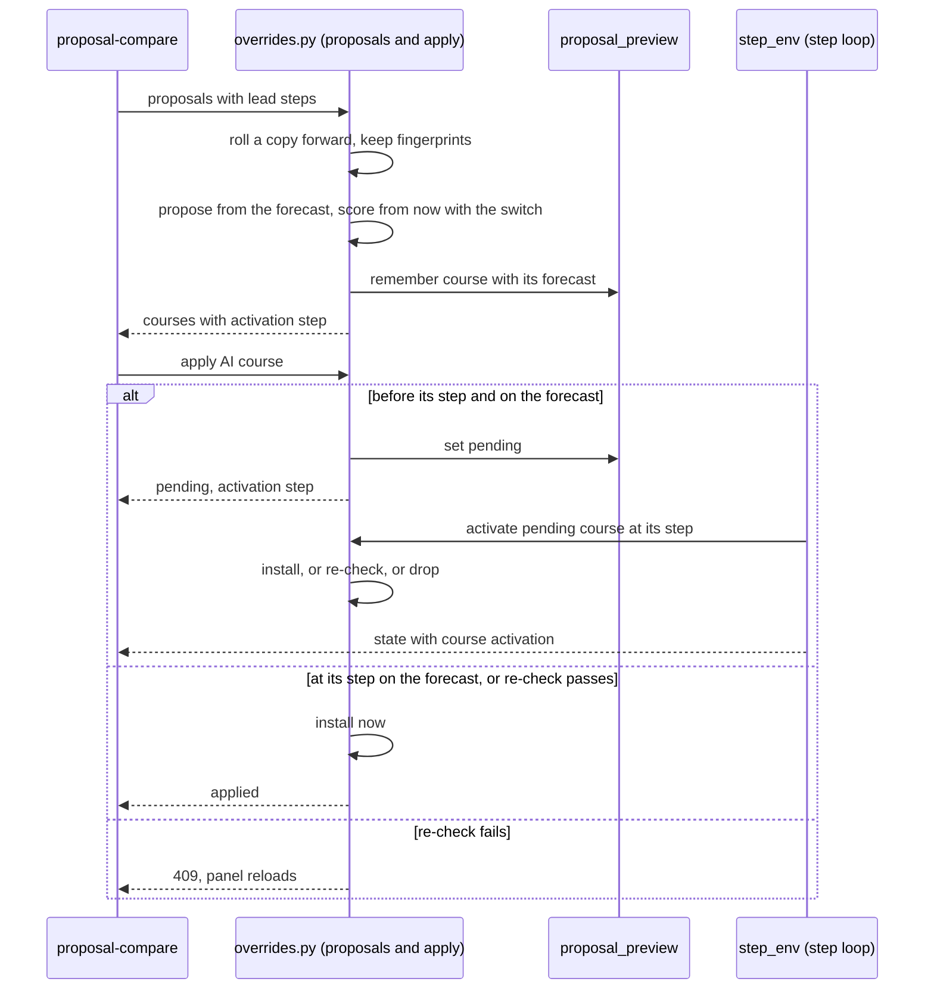

Notation: [sequence diagram in Mermaid](https://mermaid.js.org/syntax/sequenceDiagram.html).

### 6.2 The pending course (REQ-1; DP-5)

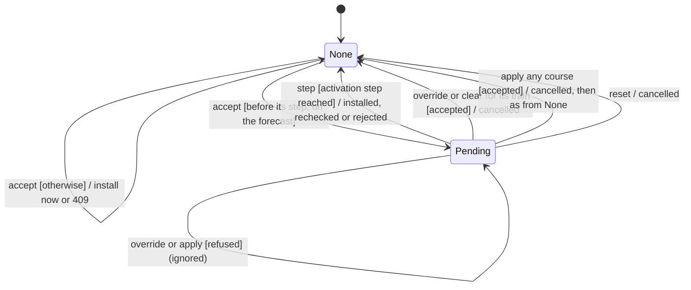

Notation: [state diagram in Mermaid](https://mermaid.js.org/syntax/stateDiagram.html).

### 6.3 A course from before a reset (F-2, S-4)

The participant loads AI courses, the session is reset (or the next scenario starts on the same env), and the old
token is used in the new episode. `id(env)` stays the same and the step count starts over, so before S-4 the token
looked current.

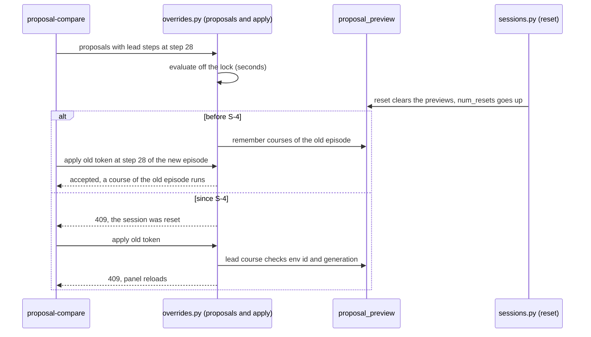

Notation: [sequence diagram in Mermaid](https://mermaid.js.org/syntax/sequenceDiagram.html). Not visible in a
screenshot: the panel looks the same; only which course runs differs.

### 6.4 Scoring a course with a switch (F-3, S-6)

How the preview drives a course taken over at step `at`: the session's driver until then, the course from then on.
Both policies can share the env's plan state (`_plan_off_plan`).

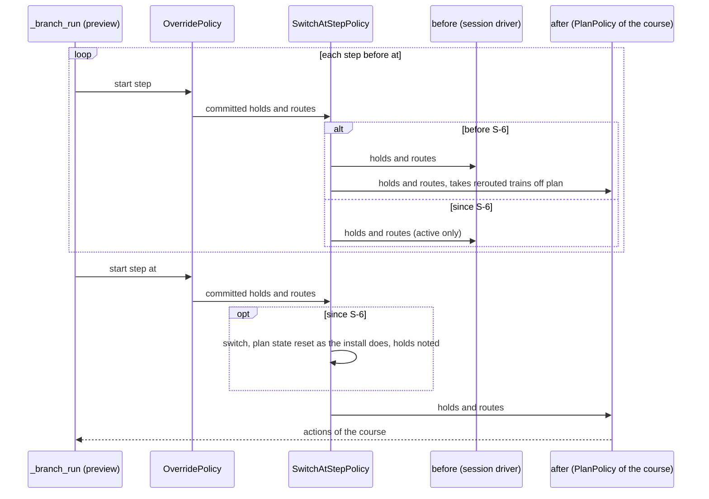

Notation: [sequence diagram in Mermaid](https://mermaid.js.org/syntax/sequenceDiagram.html). Before S-6 the course
could start with trains already off plan, so the preview ranked fallback driving instead of the course; only the KI
column's numbers showed it.

## 8. Crosscutting concepts

*What the change introduces that other code will follow, and what it changes for existing callers.*

### 8.1 New patterns

*What is new compared with the base branch.*

Compared with `main` 85e36e5c. What is reused, and what is not new on purpose, is in §4.1.

| ID | New | Defined in |
|---|---|---|
| PAT-1 | Proposals computed for a step ahead and accepted as a pending course, installed by the step loop. | §4.3, §6.1 |
| PAT-2 | `SwitchAtStepPolicy`: one policy until a step, another from it, for previews. | §4.3, §5.1 |
| PAT-3 | Overrides with an origin (`system=True`) and the notification code `train.systemHold`. | §4.4 |
| PAT-4 | The state payload carries the pending course and the last activation outcome, a cancellation included. | §5.1, §4.5 |
| PAT-5 | Lead courses and previews carry the episode generation, checked before publishing and on accept. | §4.3 |
| PAT-6 | Forecasts tick a private copy of the disturbance scheduler, without notifications. | §4.3 |
| PAT-7 | The call log deduplicates only GET answers; commands are logged in full. | §4.4 |
| PAT-8 | 409 texts name the failed check and the steps compared. | §4.4 |
| PAT-9 | A countdown in a panel ticks every second, restarted on each step and stopped while paused. | §4.5, Q-5 |

### 8.2 Breaking changes

*What breaks for whom, and the migration path.*

None for callers: `lead_steps` defaults to 0, `source` to none; the new reply and state fields, the `cancelled`
outcome and the broadcasts of S-11 are optional additions.

- **KPI `malfunctions` in leg results** (stored study data): before, the trains broken down at the end of the leg
  (almost always 0); now, the trains that broke down during the leg. Records written before the PR keep the old
  meaning; analyses that mix both should take the old value as unreliable. No migration.
- **409 on accepting an AI course**: the panel no longer shows `proposals.previewExpired`, it reloads and shows
  `proposals.aiRefreshed`. The key stays in the i18n files (unused in `src/`).
- **409 texts of the AI course** name the reason (e.g. "(step: computed at 27, now 32)"); nothing in the app reads
  the text, only the status. **Override answer**: `via`, `start`, `step` added. **Call log**: commands keep their
  response instead of `response_same_as`; readers already handle both (`replay-timeline.ts`).
- **`decisionTimeMs`** (stored study data): no longer carried across legs. Old records with a carried-over window
  (p04, p05) are too long; don't mix them with new ones unreadjusted.
- **State frames** (study log): no second, empty frame per step. Analyses that count frames, or read the
  second-to-last frame as the final state, change.
- **Notification code** of system holds: `train.systemHold` instead of `train.overridePending`. Filters on the old
  code miss them.
- **Behaviour**: a token from before a reset gets 409 (S-4); «KI-Plan übernehmen» is disabled at 0 s (S-13).
- Private: `_capture_proposal_source` returns one more element (`lead_steps`); only `_evaluate_proposals_unchecked`
  reads it.

## 9. Decisions

*The decisions behind the plan: the questions still open, the decisions taken, and how each review finding was settled.*

### 9.1 Open questions

*Choices not made yet, each with its options and a proposal.*

✅ **(Q-1) What reaction allowance should the lead use?**
- a) Keep 10 s (`proposalReactionSeconds`). At 0.5 s per step that is a lead of about 26 steps in which the course
  changes nothing.
- b) Lower it, e.g. to 5 s: courses act sooner, but slow readers hit the deadline more often (the panel then reloads
  by itself).
- c) Make it a UI-config setting per experiment.

Measured on 2026-11-27 in uc2-2 (Plan B p04, scenario 2/5, 3 s per step, IR35 held by the system), at dab7403c.
The clock is driven by a script, one step per 3 s; each computation counts as 3 s. `t` is the time since the hold;
the course appears at t = 3 s.

| Option | Participant reads 6 s | Participant reads 12 s |
|---|---|---|
| a) 10 s (lead 5 steps) | click at t = 9 s, waits, takes over at t = 15 s | click at t = 15 s, at its step: taken at once, t = 15 s |
| b) 5 s (lead 3 steps) | click at t = 9 s, at its step: taken at once, t = 9 s | deadline passes while reading, recomputed; click at t = 15 s, takes over at t = 21 s |
| c) per experiment, e.g. 2 s (lead 2 steps) | deadline passes while reading, recomputed; click at t = 12 s, takes over at t = 15 s | - |

A lead that is too long costs the fast reader time; one that is too short makes the course change under the reader
and costs a recomputation.

a) 10 s, the reader clicks after 6 s: the deadline when the course appears (1), the pending course waiting for its
step with IR35 still held (2), the takeover and the driver after it (3).

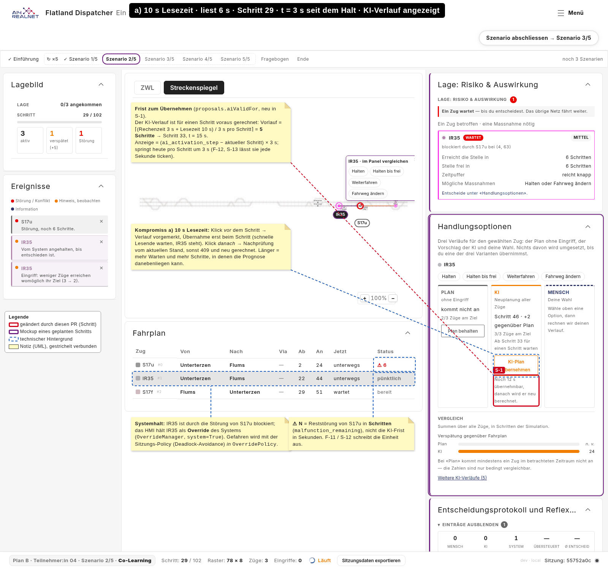 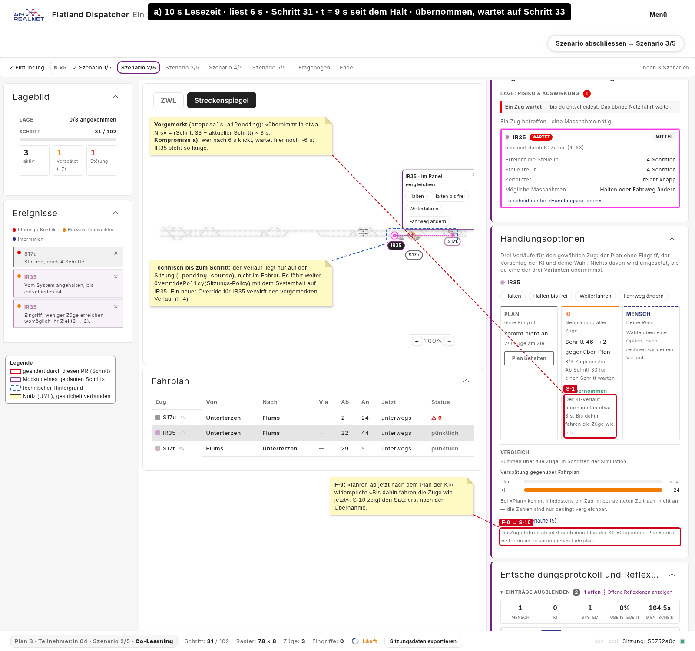 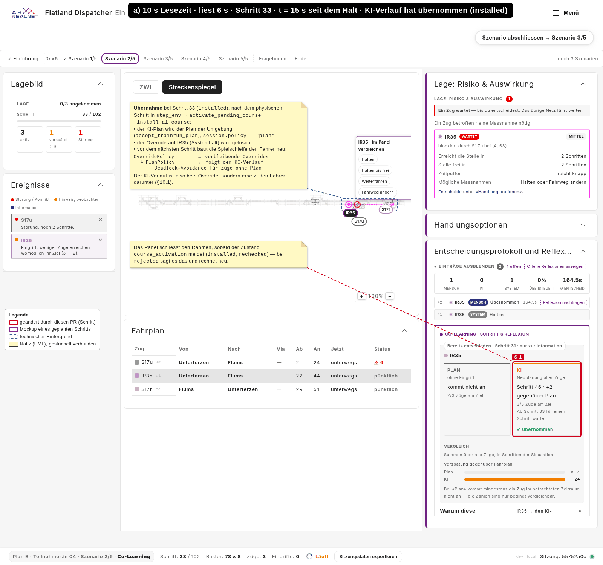

b) 5 s, the reader needs 12 s: "Noch 0 s" with the button still enabled (4a, F-13), then the recomputation that starts
on the next step (4b, with the S-13 mockup).

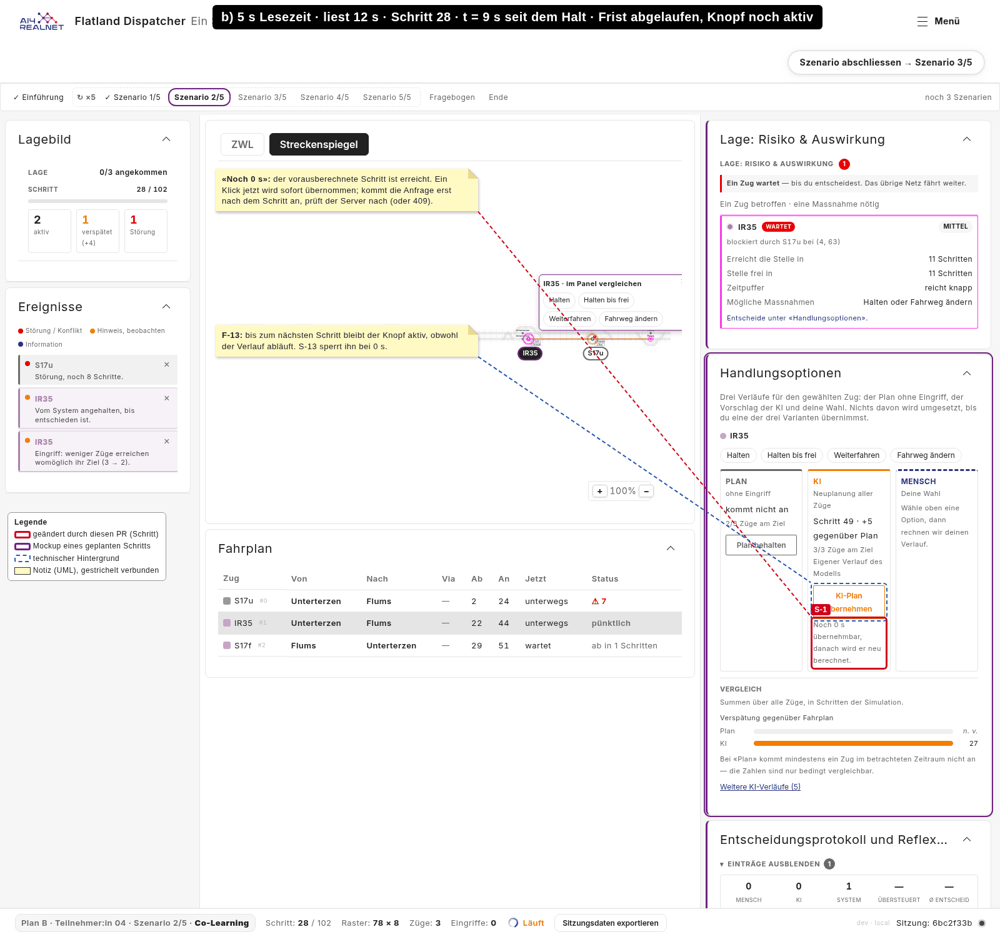 

*Decision (2026-11-27):* a) for this PR; c) if the study later wants other values.

✅ **(Q-2) Missing server responses in the log (REQ-8): what to fix?** Checked in the study's raw exports on
2026-11-27. All 16 calls (the issue's 9 and 7 pauses) carry `"response_same_as": <seq>`, and the referenced entry is in the same leg. Every entry
has its own client time (`t`) and `simStep`; only the response body is replaced. Three causes:
1. **The responses carry no context.** The apply and override calls are not repeats: they are different requests
   (other train, token, drawn route), 16 s to 5 minutes apart, with byte-identical answers.
   - `exact_course` (`backend/app/core/proposal_preview.py:84`) answers six different failures with one text:
     unknown or evicted token, other step, train, candidate, priority, or changed state. The 409 doesn't say which
     one, or the steps compared. In the logs only the request's `source_step` and the entry's `simStep` show it,
     e.g. p05 uc2-4 seq 4330: computed at step 27, taken at step 32.
   - `set_override` answers `{session_id, handle, action}`: two different reroutes of the same train (p03 uc2-3,
     seq 1517 and 1567, other `via`) get the same answer.
2. **The deduplication is too broad.** `call-log.interceptor.ts:104` (and the backend's `call_log._Dedup`) is meant
   for repeated polled answers, but applies to every method. Its key ignores the request body. So a command's answer
   can point to another train's command 5 minutes earlier (p05 uc2-4 seq 4613 → 4274).
3. **Pause really is sent twice.** The 7 pauses are true duplicates, 2–5 ms apart, at the end of every leg.
   `advanceExperiment` calls `finishLeg`, which sends `store.pause()`, then `nextLegOrReview` starts the next
   session, whose `_stopPlayingOnServer()` sends a second pause. `pause()` sets `playing` to false only when the
   answer arrives, so the second check still sees it playing. Harmless (pause is idempotent), but a double command.

Options:
- a) In this PR: log commands (POST, PUT, DELETE) in full and deduplicate only GET; a 409 names its reason and the
  steps compared; the override answer echoes `via`, `start` and the step; no second pause.
- b) Only the logging (deduplicate GET only) in this PR; the rest as a follow-up issue.
- c) All as a follow-up issue; this PR leaves the logging as it is.

*Decision (2026-11-27):* a), after the estimate: four small commits (S-14–S-17); the answers only gain text and
fields that nothing in the app reads.

✅ **(Q-3) Slow proposals (REQ-2): is the lead enough?**
- a) Yes for this PR: the lead includes the computing time; a speed-up is a follow-up.
- b) Also speed up the computation in this PR.

*Decision (2026-11-27):* a); the speed-up is [#236](https://github.com/flatland-association/flatland-ui-hub/issues/236).

✅ **(Q-4) Does the PR close #230, and where do the code comments point?** The PR says "should fix the problems
for #230" without a closing keyword; the code refers to `#230` on 23 added lines in 18 files; the cleanup commit
replaced the links to the removed plan with it in 11 of them.
- a) The PR closes #230 ("Closes #230" in its body); the comments point to this plan
  instead (`docs/plans/plan-b-log-findings.md`), as a PR that closes an issue leaves no reference to it in the code.
- b) The PR doesn't close #230; the references stay.

*Decision (2026-11-27):* a), with the plan committed on the branch (S-18, F-14). None of #230's eight boxes is
ticked yet (checked 2026-11-27); they are ticked when the PR is merged, REQ-5's and REQ-6's with the decision kept.

✅ **(Q-5) How does the AI countdown read between steps (F-12)?** `aiSecondsLeft` and `pendingSecondsLeft` convert
the steps left at the nominal pace, `round((activation_step − elapsedSteps) / playSpeed)`. In Plan B (3 s per step)
"Noch 6 s übernehmbar" and "übernimmt in etwa 3 s" jump 6 → 3 → 0 and stand still for 3 s in between.
- a) Tick every second: a 1 s clock signal counts down from the last step's value and restarts on each new step;
  the deadline stays in seconds, the unit the reaction allowance (Q-1) and the participant think in.
- b) Count in steps ("noch 2 Schritte übernehmbar", "übernimmt in 1 Schritt"): no clock, the same unit as the
  timetable (F-11), the Lage panel and the Ereignisse, but participants must know how long a step takes.

*Decision (2026-11-27):* a). It stays approximate when the server steps more slowly than planned (no correction, as now).

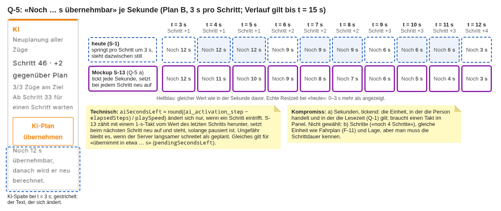

### 9.2 Decision log

*Every decision by date, with why it was taken and what follows from it.*

| Date | Decision | Why | Consequences |
|---|---|---|---|
| 2026-11-25 | ✅ Interventions in the last step stay accepted (REQ-5). | Discussed in the team; instructing the participants is enough. | Follow-up row in §1.4, untracked. |
| 2026-11-25 | ✅ Compute AI courses for a step ahead instead of relaxing the same-step check (§4.3). | Accepting a course computed for an older state would run something other than what was shown (NFR-1). | Forecast, pending course and re-check (S-1); findings F-1–F-6, F-8–F-10 on that machinery. |
| 2026-11-27 | ✅ The reaction allowance stays 10 s (Q-1 a). | Measured with the movies (Q-1 table): a longer allowance makes fast readers wait with the held train standing, and the forecast spans more steps, so an unforeseen breakdown sends the course through the re-check more often; a shorter one makes slow readers miss the step, so the course is recomputed under them and they wait longer (21 s instead of 15 s at 5 s). 10 s gets the 12 s reader through without a recomputation. Not taken: 5 s (b), a setting per experiment (c) for now. | No change to the code; c) if the study wants other values. At 0.5 s per step the lead is about 26 steps (§2.1). |
| 2026-11-27 | ✅ The lead is enough for slow proposals; no speed-up in this PR (Q-3 a). | The lead adds the last computing time, so a slow computation no longer makes the click fail; it only moves the course's step further out (longer wait, more forecast steps). A speed-up lives in the proposal agents and is outside #230. Not taken: b) speed up in this PR. | Follow-up [#236](https://github.com/flatland-association/flatland-ui-hub/issues/236). |
| 2026-11-27 | ✅ S-12 shows the exact remaining duration with its unit ("⚠ Störung, noch 6 Schritte"), not only "⚠ Störung". | Today the timetable is the only panel with a bare number; with the unit it reads like the events, the train list and the map. Not taken: anticipating #225 (no duration), which would set the timetable apart until #225 changes all panels. | S-12 as planned; the places that show the exact duration are listed for #225. |
| 2026-11-27 | ✅ The timetable unit, the smooth countdown and the singulars are fixed in this PR (F-11, F-12, F-15), not as follow-ups. | They are small, in files the PR touches or next to them, and seen in the study screens. Not taken: follow-ups. | S-12, S-13. |
| 2026-11-27 | ✅ #237 (forecast the live run's random breakdowns exactly) closed in favour of [#225](https://github.com/flatland-association/flatland-ui-hub/issues/225). | #225 wants forecasts with expected values, not more knowledge. | §2.1 limitation stays; the seven places that show the exact duration are listed on #225. |
| 2026-11-27 | ✅ The PR closes #230; the code comments point to this plan (Q-4 a). | A merged PR that closes an issue should leave no references to it in the code; the reasoning lives in the plan. Not taken: b) keep the references and close #230 by hand, which leaves 23 comments pointing at a closed issue. | S-18 (F-14); "Closes #230" in the PR body; the plan is committed on the branch; #230's boxes ticked on merge. |
| 2026-11-27 | ✅ The system hold stays in the decision list, tagged as the system's (REQ-6). | The list then shows everything that changed the trains, and `accountableOwner` tells human from system; for the study data it explains why the train stood before the participant decided. Not taken: removing it, which would make the list human-only but lose the moment the hold started. The issue's complaint, the "operator override" wording, is fixed by S-2. | No step; #230's REQ-6 box ticked as resolved by the wording and this decision. |
| 2026-11-27 | ✅ Fix all three causes of the missing responses in this PR (Q-2, REQ-8). | Size about a day (four commits). Logging commands in full makes the log slightly bigger (16 responses in the five study runs); polled GETs stay deduplicated. The answers only gain text and fields that nothing in the app reads. Not taken: b) logging only, which leaves 409s without a reason and the double pause; c) all as a follow-up, which keeps the next study runs' logs incomplete. | S-14–S-17; 409 text and override answer change (§8.2). |
| 2026-11-27 | ✅ The AI deadline and the takeover countdown tick every second between steps, in seconds (Q-5, F-12). | Participants act in real time and the reading time (Q-1) is in seconds. A ticking countdown needs a 1 s timer in the panel and stays approximate if the server steps slower than planned. Not taken: b) counting in steps, which would match the timetable (F-11) but needs the participant to know how long a step takes. | S-13; still approximate when the server steps slower than planned. |

### 9.3 Code Review Findings

*Findings from code reviews, PR comments and TODOs, with their status and the commits that fix them.*

PR [#231](https://github.com/flatland-association/flatland-ui-hub/pull/231), based on `main` 85e36e5c. The review
was done at dab7403c; line numbers refer to it. PR review comments (F-1–F-8) are Copilot's review of 2026-11-25,
added on 2026-11-27. Code review findings (F-9, F-10) come from the screenshots of 2026-11-27 (Plan B tutorial `plan-b-p01`, German, at dab7403c), F-11 and F-12 from the Q-1 movies of 2026-11-27 (Plan B p04, at dab7403c), F-13 from reading the panel's template at dab7403c (2026-11-27), F-14 from the issue references (Q-4), F-15 from picture 4a. The PR adds no TODOs. Fixed: ✅ fixed, ⏭️ open and taken over by a follow-up (§1.4), `—`
dropped, ⚠️ resolved on GitHub without a code change and without a reason, empty open. ❌ next to ✅: fixed in the
code, but the PR comment is not resolved on GitHub yet. "resolved" in Source: thread resolved on GitHub.

| Fixed | ID | Source | Category | Severity | Finding | Commit message |
|---|---|---|---|---|---|---|
| ✅ | F-1 | [PR comment](https://github.com/flatland-association/flatland-ui-hub/pull/231#discussion_r4698945461), resolved | bug | high | `backend/app/core/proposal_preview.py:59`: `fingerprint` reads `agent.position`/`agent.direction`, which flatland-rl 4.3 removed (C-1), so both are always `None`. Trains on different cells or headings get the same fingerprint, and `matches_forecast` can install a diverged course as exact without the re-check. `test_forecast_fingerprints_match_the_live_run_through_a_breakdown` passes for the same reason. Fixed in 1751b5f0 (S-3): read through `agent_position`/`agent_direction`; `test_fingerprints_tell_trains_on_different_cells_apart` fails on the old code, and the breakdown test now matches with real positions. | fix(proposals): read train position and direction through agent_compat in the forecast fingerprint. |
| ✅ | F-2 | [PR comment](https://github.com/flatland-association/flatland-ui-hub/pull/231#discussion_r4698945505), resolved | bug | high | `backend/app/core/proposal_preview.py:130`: `lead_course` checks only the env's identity and the step, not the digest `exact_course` uses. A reset reuses the env object, so a lead token of the old episode passes, and a preview worker that started before the reset publishes into the cleared cache afterwards. Fixed in 757675c5 (S-4): `PreviewSource.generation` (`num_resets`), checked by `lead_course` and before `_publish_proposals` remembers courses computed across a reset. | fix(proposals): reject lead courses and previews from before a session reset. |
| ✅ | F-3 | [PR comment](https://github.com/flatland-association/flatland-ui-hub/pull/231#discussion_r4698945549), resolved | correctness | high | `backend/app/policies/switch_policy.py:63`: `set_committed_overrides` goes to both policies, which share `env._plan_off_plan`; the inactive policy can change the active one's plan state, and it survives the switch. The preview also skips the plan-state reset and route registration that `_install_ai_course` does, so it may rank fallback driving instead of the course. Fixed in 12473dee (S-6): only the active policy hears the overrides; the switch resets the plan state as `_install_ai_course` does. | fix(proposals): forward committed overrides only to the active policy when previewing a switch. |
| ✅ | F-4 | [PR comment](https://github.com/flatland-association/flatland-ui-hub/pull/231#discussion_r4698945639), resolved | bug | medium | `backend/app/api/overrides.py:292`: `set_override` drops the train's pending course before `_parse_via`, `_parse_start` and `_commit_override`; a rejected reroute still cancels the accepted course. Fixed in 3a780e8b (S-5): cleared after `_commit_override` succeeds. | fix(proposals): cancel a pending AI course only after the replacing decision is accepted. |
| ✅ | F-5 | [PR comment](https://github.com/flatland-association/flatland-ui-hub/pull/231#discussion_r4698945690), resolved | bug | medium | `backend/app/api/overrides.py:622`: `apply_proposal` drops the pending course before `lead_course`/`exact_course` validate the token; an expired token's 409 still cancels the accepted course. Fixed in 3a780e8b (S-5): the early clear is gone; `_finish_apply` and the pending path replace it after validation. | fix(proposals): cancel a pending AI course only after the replacing decision is accepted. |
| ✅ | F-6 | [PR comment](https://github.com/flatland-association/flatland-ui-hub/pull/231#discussion_r4698945734), resolved | correctness | medium | `backend/app/api/overrides.py:833`: `_roll_forward` steps the copy with `future.step()`, which does not tick `session.disturbance_scheduler` as `step_env` does; a scheduled delay or area closure inside the lead is missing from the forecast, so the course goes through the re-check or is rejected. Fixed in 301b06aa (S-7): `_roll_forward` ticks a private copy of the scheduler captured with the proposal, without notifications. | fix(proposals): tick a private disturbance scheduler during the lead forecast. |
| ✅ | F-7 | [PR comment](https://github.com/flatland-association/flatland-ui-hub/pull/231#discussion_r4698945779), resolved | bug | medium | `backend/app/policies/plan_policy.py:216`: `_drop_exhausted_course` takes a run ending next to the target as complete. A one-waypoint run of a train held next to its target passes too; once released, `_plan_action` keeps returning `DO_NOTHING` and the train stands. Fixed in 608cc97e (S-8): the trains held at takeover are recorded (`note_course_holds`); their runs count as cut short wherever they end. | fix(plan-policy): tell completed runs from runs cut short at a hold. |
| ✅ | F-8 | [PR comment](https://github.com/flatland-association/flatland-ui-hub/pull/231#discussion_r4698945849), resolved | bug | medium | `frontend/src/app/features/proposal-compare/proposal-compare.component.ts:221`: an override from outside the panel or a reset in the same session drops `pending_course` without a `course_activation`; the panel stays "taken, waiting" and doesn't reload. Report the cancellation in the state (with an id of the course) and clear the panel's waiting state on it. Fixed in b3b49329 (S-9): the state reports a dropped course as `outcome: "cancelled"`; the panel stops waiting and loads new courses. | fix(proposal-compare): clear the waiting state when a pending AI course is cancelled. |
| ✅ | F-9 | code review | bug | medium | `frontend/src/app/features/proposal-compare/proposal-compare.component.html:214`: while an AI course is pending, the comparison still shows `proposals.aiTakenCaveat` ("Die Züge fahren ab jetzt nach dem Plan der KI."), next to `proposals.aiPending` ("Bis dahin fahren die Züge wie jetzt."). The two texts contradict each other until the activation step. Show the caveat only once the course is installed. Fixed in c820e19d (S-10): the caveat shows only once no course is pending. | fix(proposal-compare): show the AI-taken caveat only once the course has taken over. |
| ✅ | F-10 | code review | robustness | low | `backend/app/api/sessions.py:138`: `/step`, `/reset` and the other endpoints of `sessions.py` broadcast the state through their own `_build_state_payload`, which lacks `course_state`; only `/state` and the WebSocket play loop carry it. A pending course activated by a manual step (paused after accepting, then «Schritt») leaves the panel at "übernimmt in etwa 0 s" until the next play-loop broadcast. Add `course_state` there too, or share one payload builder. Fixed in dce10453 (S-11): `sessions.py`'s state broadcast carries `course_state`, as the play loop's does. | fix(sessions): send the pending course state with every state broadcast. |
| ✅ | F-11 | code review | usability | low | `frontend/src/app/features/timetable/timetable.component.ts:74`: the status column of a broken-down train shows a bare `⚠ <malfunction_remaining>`, a count of steps without a unit. The other statuses of the column name their unit (`train.late` "+N Schritte spät", `timetable.status.depIn` "ab in N Schritten"), and the Lage panel and the Ereignisse count the breakdown in steps too. In the movies, "⚠ 4" of another train (S17u) stood next to "Noch 6 s übernehmbar" in Handlungsoptionen and read as the same countdown. Show it as "⚠ Störung, noch 4 Schritte" through a translation key, as the other statuses. Was a follow-up; taken into this PR by the user's decision (2026-11-27). Fixed in a288ba3b (S-12): "⚠ Störung, noch N Schritte" through `timetable.status.disruption`. | fix(timetable): name the breakdown and its unit, and say one step in the singular. |
| ✅ | F-12 | code review | usability | low | `frontend/src/app/features/proposal-compare/proposal-compare.component.ts:148`: `aiSecondsLeft` and `pendingSecondsLeft` change only when a step arrives; in Plan B "Noch 6 s übernehmbar" and "übernimmt in etwa 3 s" jump by 3 s and stand still in between, so the real time left is anywhere from 0 to 3 s more than shown. Make both texts tick every second (Q-5). Was offered as a follow-up; taken into this PR by the user's decision (2026-11-27). Fixed in 19cf2356 (S-13): both texts tick every second from a 1 s clock restarted on each step, never ahead of the run. | fix(proposal-compare): count the AI deadline down every second and stop offering a course that has run out. |
| ✅ | F-13 | code review | usability | low | `frontend/src/app/features/proposal-compare/proposal-compare.component.html:104`: an AI course that has run out is still offered. From its activation step until the next step, «KI-Plan übernehmen» stays enabled under "Noch 0 s übernehmbar"; a click whose request arrives after the step goes through the re-check or a 409. While the panel recomputes (`load()` keeps the AI column), the old course's numbers stay visible under a disabled button, with only "Verläufe werden gerechnet…" above the columns and nothing saying the course ran out. Disable the button at 0 s, and while recomputing grey out the old course and say that a new one is computed. Fixed in 19cf2356 (S-13): the button is disabled at 0 s; while recomputing, the old course is greyed with `proposals.aiRecomputing`. | fix(proposal-compare): count the AI deadline down every second and stop offering a course that has run out. |
| ✅ | F-14 | code review | docs | low | 23 added lines in 18 files refer to `#230` (listed in the note below the table), but the PR is to close #230 (Q-4 a), which leaves no reference to it in the code. Point them to `docs/plans/plan-b-log-findings.md` (the section where it helps) or drop them where the code says enough; test names lose the number. Fixed in d6c01ab4 (S-18): the comments point to this plan; no `#230` is left outside `docs/plans/`. | docs: point the code comments to the plan instead of the closed issue. |
| ✅ | F-15 | code review | i18n | low | `frontend/src/app/features/timetable/timetable.component.ts:81`: for one step the status column reads "ab in 1 Schritten" (`timetable.status.depIn`, seen in picture 4a); `train.late` gives "+1 Schritte spät" the same way (timetable line 85, also `agents-table.component.ts:264` and `left-sidebar.component.ts:244`). Already on `main`. The repo writes plurals as a second key with `One` (`heldOne`, `summaryOne`, `disturbanceOne`): add `timetable.status.depInOne` and `train.lateOne` in en, de and fr and pick them for 1 at the three call sites; the new `timetable.status.disruption` of S-12 gets `disruptionOne` from the start. The events card has the same bug ("Störung, noch 1 Schritte.", seen in the screenshots of 2026-11-27): `NotificationWordingService` words the backend's `train.malfunction` notification through `notifications.train.malfunction.message`/`short`, plural only; for `steps` 1 it takes `messageOne`/`shortOne` when they exist. Taken into this PR by the user's decision (2026-11-27). Fixed in a288ba3b (S-12): `…One` keys for one step in the timetable, the trains table, the left sidebar and the events. | fix(timetable): name the breakdown and its unit, and say one step in the singular. |

Issue references: the PR closes #230 (Q-4 a; "Closes #230" in the PR body). Since d6c01ab4 (S-18, F-14) no line of
the PR outside `docs/plans/` refers to `#230` (`git grep -n '#230' -- ':!docs/plans'` finds none).

## 10. Glossary

*The domain and technical words the plan uses, with their code symbols.*

| Term (code) | Meaning, and what it is not |
|---|---|
| Lead (`lead_steps`) | How many steps ahead of now the AI courses are computed. Not the forecast horizon of the scoring (`forecast_horizon`). |
| Activation step (`activation_step`, `ai_activation_step`) | The step an AI course takes over at; the last step at which accepting it is exact. |
| Forecast (`_roll_forward`, `expected`) | The live state rolled forward on a copy with the session's driver, with a fingerprint per step. Not the scenario forecasts (`_invalidate_scenario_forecasts`). |
| Fingerprint (`fingerprint`) | Per train: position, direction, state, malfunction counter at one step. |
| Pending course (`_pending_course`, `pending_course`) | An AI course accepted before its activation step, waiting for the step loop. One per session. |
| Re-check (`_course_still_works`) | Replaying a course from the live state; accepted if it brings at least as many trains home with no more deadlocks than the preview promised. |
| Activation outcome (`course_activation.outcome`) | `installed` (exact), `rechecked` (passed the re-check), `rejected` (dropped), `cancelled` (replaced by another decision or a reset, S-9). |
| System hold (`systemHold`, `system=True`, `train.systemHold`) | The automatic hold of a train affected by a breakdown, set by the HMI. Not an operator override. |
| Leg | One scenario of an experiment run, with its own session and leg result. |
| Call log (`call-log.interceptor`, `call_log.py`, `response_same_as`) | The study log of every call and its answer, in the browser and the backend; a repeated answer is stored as a reference to the earlier entry. Not the state frames. |
| Episode generation (`num_resets`) | Counts the env's resets; a course or preview of an older generation is refused (S-4). |
| AI deadline (`aiSecondsLeft`, `pendingSecondsLeft`) | Seconds until the AI course can no longer be taken, or until a pending one takes over; counted from steps at the nominal pace. |
| Reaction allowance (`proposalReactionSeconds`) | Seconds a participant gets to read and take an AI course; part of the lead. |
| KI-Plan / AI course (`trainruns`, token) | A plan for all trains computed by the proposal agent for the selected train's question («KI-Plan übernehmen»), see §10.1. Not an override and not a policy that decides live. |
| Override (`OverrideManager`, `OverridePolicy`) | One train's decision (action, hold, drawn route) on top of whatever drives the trains, see §10.1. |
| Driver (`create_driving_policy`, `session.policy`) | The policy that chooses the trains' actions each step, inside `OverridePolicy`. After an AI course is installed, `PlanPolicy` with the course. |

### 10.1 AI course and override

*How an AI course differs from an override, and what taking it over changes.*

| | Override | AI course |
|---|---|---|
| What it is | One train's decision: an action, a hold or a drawn route | A plan for all trains: each train's route and the order of passing (`trainruns`) |
| Kept in | `OverrideManager` (per session and train), drawn routes in `env._route_overrides` | `env._trainrun_plan` (`accept_trainrun_plan`) and `session.trainrun_plan`; before its step only on the session (`_pending_course`) |
| Applied by | `OverridePolicy`, which wraps every driver and replaces the driver's action for the trains it holds | The driver underneath: `session.policy = "plan"`, so the play loop and `/step` build `PlanPolicy(trainruns)` before the next step |
| Logged as | The operator's or the system's decision (`accountableOwner`) | `apply_proposal` with variant `ai` |

After the takeover the layers are, from top to bottom:

```
OverridePolicy            ← the overrides still there (operator holds, other trains' routes)
  └─ PlanPolicy           ← follows the AI course by position and order
       └─ requested policy (e.g. deadlock avoidance) for trains not on the plan
```

Before it, `OverridePolicy` wraps the session's policy directly, and the system hold of the selected train is an
override. Taking the course over (`_install_ai_course`) changes both layers: the driver becomes `PlanPolicy`, the
selected train's override and drawn route are cleared, and the other trains' overrides are kept if the proposal
agent respects them (the course was simulated with them), else all are cleared. `driving_policy_id` keeps the plan
when the client pins its policy on later requests; RL drivers never follow it. A pending course is in neither layer,
so a new override for the train cancels it (F-4). Picture 3 in Q-1 shows the takeover with the layers.

## 11. Execution plan and status

*The commits that build the change, in order, and which of them are done: the source of the PR's status.*

### 11.1 Steps

*One row per commit: what it does, the findings it fixes, its message, and its SHAs once committed.*

#### Phase 1: Fix the issue's findings ✅

| ID | Findings | Step | Category | Severity | Commit message | Commit(s) | Needs | Blocked by |
|---|---|---|---|---|---|---|---|---|
| ✅ S-1 | - | AI courses computed a step ahead: lead, forecast, `SwitchAtStepPolicy`, pending course, activation in the step loop, panel deadline and reload, tests (§4.3). The cleanup commit replaced the links to the removed plan by `#230`. | feat | high | feat: implement KI course suggestions computed for a step ahead. | 6c589b86, dab7403c | - | - |
| ✅ S-2 | - | Logging fixes (§4.4), system hold notifications, `PlanPolicy` fallback for released holds, tests. The cleanup commit removed files committed by mistake (diagnostic script, data, another plan). | fix | medium | feat: Add DLA label sources and diagnostic script for takeover states. | f34a5bed, dab7403c | S-1 | - |

#### Phase 2: Review fixes ✅

| ID | Findings | Step | Category | Severity | Commit message | Commit(s) | Needs | Blocked by |
|---|---|---|---|---|---|---|---|---|
| ✅ S-3 | F-1 | Fingerprint through `agent_position`/`agent_direction`; a test that two trains on different cells differ. | bug | high | fix(proposals): read train position and direction through agent_compat in the forecast fingerprint. | 1751b5f0 | S-1 | - |
| ✅ S-4 | F-2 | Episode generation in the lead course and before publishing; test: a token from before a reset gets 409. | bug | high | fix(proposals): reject lead courses and previews from before a session reset. | 757675c5 | S-1 | - |
| ✅ S-5 | F-4, F-5 | Clear the pending course only after `_commit_override` succeeds and after the token is validated; tests for a rejected reroute and an expired token. | bug | medium | fix(proposals): cancel a pending AI course only after the replacing decision is accepted. | 3a780e8b | S-1 | - |
| ✅ S-6 | F-3 | `SwitchAtStepPolicy` forwards overrides to the active policy only and repeats the install's plan-state reset at the switch; test that the inactive policy leaves the plan state alone. | correctness | high | fix(proposals): forward committed overrides only to the active policy when previewing a switch. | 12473dee | S-1 | - |
| ✅ S-7 | F-6 | Tick a private copy of the disturbance scheduler in `_roll_forward`, without notifications; test with a delay scheduled inside the lead. | correctness | medium | fix(proposals): tick a private disturbance scheduler during the lead forecast. | 301b06aa | S-3 | - |
| ✅ S-8 | F-7 | Tell complete runs from runs cut short by a hold in `_drop_exhausted_course`; test for a train held next to its target. | bug | medium | fix(plan-policy): tell completed runs from runs cut short at a hold. | 608cc97e | S-2 | - |
| ✅ S-9 | F-8 | Report a cancelled pending course in the state (`outcome: "cancelled"`); the panel clears its waiting state and reloads, no new text; backend test and spec. | bug | medium | fix(proposal-compare): clear the waiting state when a pending AI course is cancelled. | b3b49329 | S-5, S-11 | - |
| ✅ S-10 | F-9 | Show `proposals.aiTakenCaveat` only when no course is pending; spec. | bug | medium | fix(proposal-compare): show the AI-taken caveat only once the course has taken over. | c820e19d | S-1 | - |
| ✅ S-11 | F-10 | `course_state` in `sessions.py`'s state broadcast (or one shared builder with `websockets.py`); test that `/step` sends `course_activation`. | robustness | low | fix(sessions): send the pending course state with every state broadcast. | dce10453 | S-1 | - |
| ✅ S-12 | F-11, F-15 | `timetable.status.disruption` ("⚠ Störung, noch {{n}} Schritte" / "⚠ disruption, {{n}} steps left" / "⚠ perturbation, encore {{n}} pas") instead of the bare number, with `disruptionOne` ("⚠ Störung, noch 1 Schritt" / "⚠ disruption, 1 step left" / "⚠ perturbation, encore 1 pas"); `timetable.status.depInOne` ("ab in 1 Schritt" / "dep in 1 step" / "départ dans 1 pas") and `train.lateOne` ("+1 Schritt spät" / "+1 step late" / "+1 pas de retard") picked for 1 in the timetable, `agents-table` and `left-sidebar`; in the events, `NotificationWordingService` takes a `…One` variant of the notification key for `steps` 1 (`notifications.train.malfunction.messageOne`, `shortOne`); `timetable.component.spec.ts` and `notification-wording.service.spec.ts` for 1 and N; check in the running app that the column still fits. | usability | low | fix(timetable): name the breakdown and its unit, and say one step in the singular. | a288ba3b | - | - |
| ✅ S-13 | F-12, F-13 | Countdown of `aiSecondsLeft` and `pendingSecondsLeft` ticking every second (Q-5): a 1 s clock signal, restarted on each step, stopped while paused. «KI-Plan übernehmen» disabled at 0 s; while recomputing, the old AI course greyed out (app tokens) with `proposals.aiRecomputing` ("Neuer KI-Verlauf wird gerechnet…" / "Computing a new AI course…" / "Nouveau parcours IA en cours de calcul…"). Spec with fake timers for both texts, the button at 0 s and the recomputing state. | usability | low | fix(proposal-compare): count the AI deadline down every second and stop offering a course that has run out. | 19cf2356 | S-10 | - |

#### Phase 3: Complete the call log (REQ-8) and close #230 ✅

| ID | Findings | Step | Category | Severity | Commit message | Commit(s) | Needs | Blocked by |
|---|---|---|---|---|---|---|---|---|
| ✅ S-14 | - | Deduplicate only GET in `call-log.interceptor.ts` and `call_log.py`; tests that a repeated POST keeps its response; `docs/experiment-logging.md`. | fix | medium | fix(call-log): log the response of every command, deduplicate only polled GET answers. | dc7cfa9c | - | - |
| ✅ S-15 | - | `exact_course` and the lead path name the failed check and the steps compared in the 409 text; a test per reason. | fix | medium | fix(proposals): say why an AI course is refused and which steps were compared. | f1e6cf1b | S-4 | - |
| ✅ S-16 | - | `set_override` answers with `via`, `start` and the step; `test_override_answer.py`. | fix | low | fix(overrides): echo the route and step in the override answer. | 4957d85f | - | - |
| ✅ S-17 | - | `_stopPlayingOnServer` skips a pause in flight; spec for a leg end. | fix | low | fix(session-store): send one pause at the end of a leg. | 13d8fb4a | - | - |
| ✅ S-18 | F-14 | Replace the `#230` references in code, docstrings and test names by references to this plan or drop them; `git grep -n '#230' -- ':!docs/plans'` finds none of the PR's lines. | docs | low | docs: point the code comments to the plan instead of the closed issue. | d6c01ab4 | S-3–S-17 | - |

## 12. Change inventory

*Every file the change adds, modifies, renames or removes, and what stays unchanged on purpose.*

### 12.1 New files

*The files the change adds, and what each adds.*

| File | Adds |
|---|---|
| `backend/app/policies/switch_policy.py` | `SwitchAtStepPolicy` |
| `backend/tests/test_proposal_lead.py` | Lead forecast, pending activation, re-check, cancelling, reset, lead 0 unchanged |
| `backend/tests/test_plan_policy_released_hold.py` | Released train at the end of a run cut short; held train keeps the course |
| `backend/tests/test_system_hold_notification.py` | System and operator holds worded apart |
| `frontend/src/app/features/timetable/timetable.component.spec.ts` | Breakdown status with unit, singular for one step (S-12) |
| `frontend/src/app/core/notification-wording.service.spec.ts` | A breakdown notification of one step in the singular (S-12) |
| `backend/tests/test_switch_policy.py` | Only the active policy hears the overrides; plan state reset once at the switch (S-6) |
| `backend/tests/test_override_answer.py` | The override answer echoes `via`, `start` and the step (S-16) |
| `docs/plans/plan-b-log-findings.md` | This plan |
| `docs/plans/plan-b-log-findings/*.png` | Annotated screenshots and mockups (§4.2) |

### 12.2 Modified files

*The files the change modifies, and what changes in each.*

| File | Changes |
|---|---|
| `backend/app/api/overrides.py` | `OverrideRequest.source`; `lead_steps` on `/proposals` (`MAX_LEAD_STEPS`); `_roll_forward`; scoring with `SwitchAtStepPolicy`; `_accept_lead_course`, `_course_still_works`, `activate_pending_course`; `_install_ai_course` and `_finish_apply` extracted; set/clear override and apply drop the pending course only once accepted (S-5); private scheduler copy in `_roll_forward` (S-7); generation check on accept (S-4); 409 reasons on the lead path (S-15); override answer echoes `via`, `start`, step (S-16) |
| `backend/app/core/proposal_preview.py` | `PreviewCourse` forecast fields; `fingerprint`, `committed_snapshot`, `lead_course`, `matches_forecast`, `pending_course`/`set_pending`/`clear_pending`, `course_state`; `clear_previews` drops the pending course; `fingerprint` through `agent_compat` (S-3); `generation` on `PreviewCourse`, checked before publishing (S-4); `course_state` reports `cancelled` (S-9); `exact_course` names the failed check (S-15) |
| `backend/app/core/env_step.py` | `step_env` calls `activate_pending_course` |
| `backend/app/policies/switch_policy.py` | Overrides to the active policy only, plan-state reset at the switch (S-6) |
| `backend/tests/test_proposal_lead.py` | Fingerprints, reset, cancel only once accepted, scheduler in the forecast, cancellation, 409 reasons (S-3–S-9, S-15) |
| `backend/app/api/sessions.py` | `/state` adds `course_state`, and with S-11 every broadcast (`_build_state_payload`); `/step` rebuilds its driver after an activation; reset clears previews and `_course_activation` |
| `backend/app/api/websockets.py` | State payload adds `course_state` |
| `backend/app/core/override_manager.py` | `set(..., system=)`, `is_system`; clear drops the flag |
| `backend/app/core/hmi_mock.py` | `train.systemHold` notification |
| `backend/app/policies/plan_policy.py` | `_holds`, `_drop_exhausted_course` |
| `frontend/src/app/core/api.service.ts` | `setOverride(..., source)`, `getProposals(..., leadSteps)`, apply reply fields |
| `frontend/src/app/core/models.ts` | `SessionState.pending_course`, `course_activation` (outcome `cancelled`, S-9) |
| `frontend/src/app/core/events/event-types.ts` | `ProposalVariant.activation_step`, `ProposalsResult.ai_activation_step` |
| `frontend/src/app/core/session.store.ts` | `proposalReactionSeconds`; `clearDecisionLog` clears decision windows; `systemHold` sends `'system'`; one pause at a leg end |
| `frontend/src/app/core/interaction-log/call-log.interceptor.ts` (+ spec) | Deduplicate only GET |
| `backend/app/core/call_log.py`, `backend/tests/test_call_log.py` | Deduplicate only GET |
| `docs/experiment-logging.md` | `response_same_as` only for GET |
| `frontend/src/app/core/session.store.spec.ts` | Decision time across legs; one pause at a leg end |
| `frontend/src/app/core/interaction-log/state-log.service.ts` (+ spec) | Skip duplicate frames |
| `frontend/src/app/core/demo/experiment-run.service.ts` (+ spec) | Breakdowns counted per session for `kpis.malfunctions` |
| `frontend/src/app/features/proposal-compare/proposal-compare.component.{ts,html,spec.ts}` | Lead request, deadline, pending text, reload on deadline, 409 and `rejected`; deadline and pending countdown between steps (Q-5); no taking at 0 s, old course greyed while recomputing |
| `frontend/src/app/features/timetable/timetable.component.ts` | Breakdown status through `timetable.status.disruption`; singular keys for one step |
| `frontend/src/app/features/agents-table/agents-table.component.ts`, `frontend/src/app/features/left-sidebar/left-sidebar.component.ts` | `train.lateOne` for one step |
| `frontend/src/app/core/notification-wording.service.ts` | A notification counting one step takes the key's `…One` variant when it exists (S-12) |
| `frontend/public/i18n/{en,de,fr}.json` | `notifications…systemHold.*`; `proposals.aiValidFor`, `aiPending`, `aiPendingPaused`, `aiRefreshed`, `courseRejected`, `aiRecomputing`; `timetable.status.disruption`, `disruptionOne`, `depInOne`; `train.lateOne`; `notifications.train.malfunction.messageOne`, `shortOne` |

S-18 also touches the comments, docstrings and test names that refer to `#230` in the files above and their specs.

Unchanged on purpose: `TrajectoryBranchRunner`, the proposal agents, the `exact_course` path (lead 0), the
`data-log` ids, `proposals.previewExpired` in the i18n files, the log frame format.
