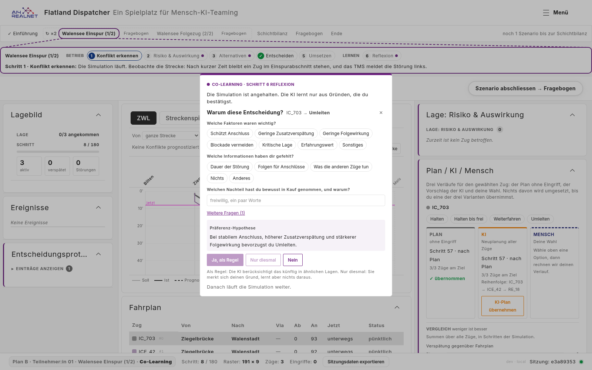
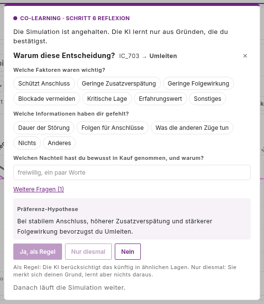
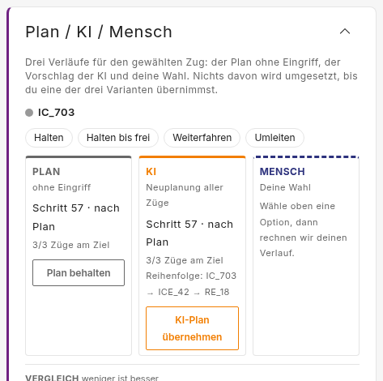
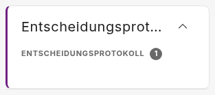
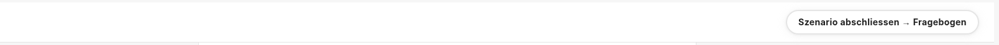
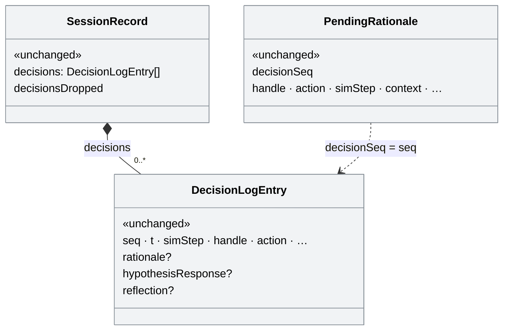
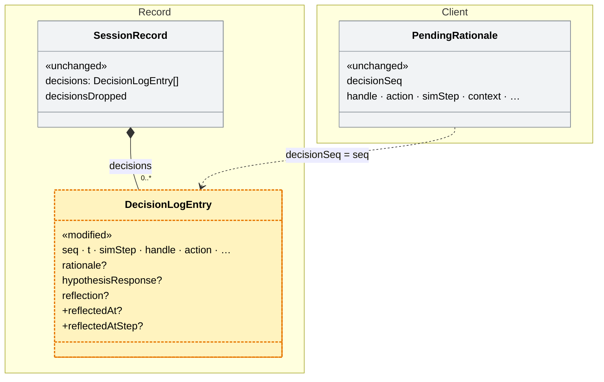

# Reflection in the decision panel, without pausing the run (#160)

> **Status:** plan, 2026-11-05; not built yet. Based on `main` 1e33088,
> which has #150 ([PR #172](https://github.com/flatland-association/flatland-ui-hub/pull/172)):
> its decision log toggle covers what this plan first designed for opening
> the log (D4).
> Q1-Q5 decided 2026-11-05; no open questions (§8).
> Issue [#160](https://github.com/flatland-association/flatland-ui-hub/issues/160)
> ("Reflexions Overlay soll Szenario nicht pausieren", @CleverManu), with the
> requirements as edited on 2026-11-05 ("Beschreibung oben angepasst"). Branch
> `feature/160-reflection-non-blocking`, off `main`, like #167 and #168.
> Not only for Plan B: the issue asks for it in general, so the change applies
> to every tour that asks for a reason (`TourBriefing.reasonDialog`).
>
> **Why:** the reflection dialog stops the simulation, so a participant who
> reflects carefully is given extra time to think about the situation, and the
> run they see is not the run the clock would have played. In the panel where the
> decision was taken, the reflection is part of the work instead of an
> interruption. It may then be answered later, so the scenario can only be
> finished once every decision has its reflection.

### Status

| ID | Commit message | SHA |
|---|---|---|
| S0 | docs(plans): plan for #160, the reflection in the decision panel without pausing. | ac675dc |
| - | docs(plans): align the #160 plan with the decision log toggle from #150. | 0880e8d |

### Design principles

- The run never waits for a reflection; the participant answers it while the
  run goes on, now or later (requirement 1, D2).
- The store owns which decisions still need a reflection; panels only show
  that state and call the store (D3). The tour decides whether reflections
  are required (`reasonDialog`), so the store does not read the tour (§4.4).
- One rule for every `reasonDialog` tour, experiment run or not (Q4, D13).
- A reflection being typed is never replaced by a newer decision; the newer
  one waits (D3).
- The participant keeps control of the layout: nothing expands or moves a
  panel on its own (Q3, D10).
- Plan B removes things through `PLAN_B_UI`; this plan adds nothing to it.
  The log is opened with #150's toggle; this plan only adds the open count
  next to it (Q1, D4).

Reused concepts:

| Need | Reused concept | Instead of |
|---|---|---|
| The reflection's questions | `ReflectionPromptComponent`, unchanged in its questions | a new inline form |
| Which decision a reflection belongs to | `PendingRationale.decisionSeq` = `DecisionLogEntry.seq` | a new reflection id |
| Showing that a reflection is missing | the toolbar's `role="alert"` pattern of `store.runError()` | a toast or a new notification type |
| Opening the log's entries under Plan B | #150's toggle in the log's head, "Einträge anzeigen (n)" / "Einträge ausblenden" (`log.showEntries` / `log.hideEntries`) | a toggle of our own in the head |
| Recording that the log was opened | the existing `ui_state` key `panel.decision-log.collapsed` (`UiStateRegistry`) | a new interaction event |
| Recording when a reflection was answered | optional fields on `DecisionLogEntry`, which `mergeDecisions` carries into the session record as they are | a new event type |
| Which tours require reflections | the existing `TourBriefing.reasonDialog` flag | a new flag or a UiConfig id |

### Terms

- **Reflection:** the "Warum diese Entscheidung?" questions after a decision
  (`ReflectionPromptComponent`, `features/reflection-prompt/`): reason chips,
  up to three guided questions, and the preference hypothesis with "Ja, als
  Regel / Nur diesmal / Nein". It is not `app-rationale-capture`, the
  shorter "why?" that the Recommendation panel and the Co-Learning reflection
  panel show; those stay as they are.
- **Reflection dialog:** `TourReasonDialogComponent`
  (`features/tour-reason-dialog/`), a modal over the whole screen that holds
  the reflection, shown when the tour sets `reasonDialog`. Removed by this plan.
- **Decision panel:** the `proposal-compare` panel (`ProposalCompareComponent`),
  titled «Plan / KI / Mensch» today and «Handlungsvergleich» after this plan.
  It is where a Plan B participant decides.
- **Open reflection:** a decision that asks for a reflection
  (`SessionStore.pendingRationale` is set for it) and has none yet. Today the
  store keeps at most two (the shown one and one closed unanswered); after this
  plan it keeps all of them.
- **Answered:** `submitRationale` was called for the decision, with any of the
  three responses. «Nein» counts also without a reason chip (Q2, D12).
- **Finish:** the toolbar's «Szenario abschliessen → …» (`finishDemoMode` →
  `advanceExperiment`), and the guide's «Schicht beenden» where a condition
  shows it. Plan B hides the latter (`control.endShift`).

### Components

| Component | Responsibility | Change |
|---|---|---|
| `SessionStore` (rationale part) | Holds the decisions that wait for a reason and records the reason on the decision. Not where the reason is asked. | 🟨 modified: keeps every open reflection, not one; reopens one by decision; stamps when it was answered. |
| `ProposalCompareComponent` | Compares plan, AI and own choice for a train and applies one. Not where past decisions are listed (the decision log). | 🟨 modified: new title; shows the open reflection at its top in a tour that asks for reasons. |
| `ReflectionPromptComponent` | Asks the reflection for the shown decision. Not where it is placed. | 🟨 modified: names the course actually taken (§2, related bug). |
| `DecisionLogPanelComponent` | Lists the run's decisions. Not where a reflection is answered. | 🟨 modified: open reflections are marked, counted next to the toggle, and can be reopened; highlighted when finishing is refused. |
| `TourReasonDialogComponent` | The modal reflection that pauses the run. | 🟥 removed. |
| `TourGuideComponent` | Leads through the tour's steps. Not where a scenario is finished in an experiment run (the toolbar). | 🟨 modified: «Reflexion öffnen» reopens the newest open reflection, now in the panel; «Schicht beenden» is refused while reflections are open. |
| `AppComponent.finishDemoMode` / `ToolbarComponent` | Finishes a scenario or tour leg from the toolbar. Not where the reflection is asked. | 🟨 modified: refuses while reflections are open, and says so under the button. |

## 1. What the issue asks for

| # | Requirement | Source |
|---|---|---|
| 1 | The reflection opens in the widget where the decision is taken («Plan / KI / Mensch»), and the simulation is no longer stopped | issue, item 1 |
| 2 | «Plan / KI / Mensch» is renamed «Handlungsvergleich» | issue, item 2 |
| 3 | Past decisions can be opened from the decision log and their reflection filled in later | issue, item 3 |
| 4 | When finishing a scenario, all reflections must be filled in: report an error and highlight the open ones in the decision log | issue, item 4 |
| 5 | The first paragraph ("Die Simulation ist angehalten. Die KI lernt …") goes | issue, item 5 |
| 6 | The last sentence ("Danach läuft die Simulation weiter.") goes | issue, item 6 |
| 7 | All of this in general, not only for Plan B | issue, lead |

### 1.1 Limitations

The code keeps no list of its own; these become comments at the places named.

- Switching the shown reflection on purpose («Reflexion nachtragen» for
  another decision) drops what was typed and not sent for the shown one:
  `ReflectionPromptComponent` resets on a new `decisionSeq`. A `TODO` there.
- A replay shows neither the inline reflection nor the open marks: open
  reflections are not recorded, only `reflectedAt` on the answered decisions
  (§4.6). Replay does not read the rationale state today either.
- The French title and texts are drafts until a native reviewer has read them
  (D11).
- «Nein» without a reason chip counts as answered (Q2, D12), so requirement 4
  can be met without giving a reason. The record shows it:
  `hypothesisResponse: 'no'` and an empty `rationale`.

### 1.2 Assumptions

Not checked in code; they hold by construction of the `reasonDialog` tours and
the study setup.

- Every layout a `reasonDialog` tour runs has a decision panel and a decision
  log. True today: `preset-plan-b` and `preset-colearning-interview` are the
  only two (§2).
- `reasonDialog` tours run in Co-Learning only (`modes: ['co-learning']`, study
  conditions `mode: 'co-learning'`), so no open reflection is left behind in a
  mode without a decision panel.
- No Plan B data recorded before this change has to be compared with data
  recorded after it on decision or reflection timing. Before, the clock stood
  while a participant reflected; after, it runs (§1.5).

### 1.3 Follow-ups (not in this PR)

| Follow-up | Why not in this PR | From | Findings | Issue |
|---|---|---|---|---|
| Keep a typed but unsent reflection when switching to another one | Rare in a run, and the decision stays open | Limitations (TODO) | - | - |
| Require a reason chip for «Nein» too | Decided against for now: «Nein» stays as it is in every tour (Q2) | Limitations | - | - |
| Show open reflections in a replay | Needs recording the open list; no analysis asks for it yet | Limitations | - | - |
| Other Plan B items of the decision log (its buttons) | Part of #150 | issue #150 | - | [#150](https://github.com/flatland-association/flatland-ui-hub/issues/150) |

Unchanged on purpose: `app-rationale-capture` (Recommendation panel,
Co-Learning reflection panel) and the Director's strategy reflection; the
automatic pause on a new conflict («Auto-Pause»); which decisions ask for a
reflection (a human intervention in Co-Learning, a human override of an AI
suggestion, a choice in the decision panel).

### 1.4 New patterns

Compared with `main` 1e33088; the reused concepts are listed under the design principles.

| New | Reuses | Defined in |
|---|---|---|
| A list of open reflections, in decision order, instead of one slot | `PendingRationale`, unchanged | §4.1 |
| A panel that shows the reflection inline | the existing `app-reflection-prompt`, unchanged in its questions | §4.2 |
| Finishing a scenario can be refused | the existing `finishDemoMode` entry point and the guide's «Schicht beenden» | §4.4 |
| `DecisionLogEntry.reflectedAt` / `reflectedAtStep` | the optional fields `rationale`, `reflection` next to them | §4.1 |

Not new on purpose: no new panel, no new UiConfig id, no change to the
reflection's questions, no change to the payload sent to the backend.

### 1.5 Breaking changes

None for callers: no API, payload or file format changes; the decision log
gains two optional fields, which older readers ignore. Behaviour:

- A `reasonDialog` tour no longer pauses after a decision. Intended. Decision
  times and the number of decisions per run are not comparable with runs
  recorded before.
- A scenario with an unanswered reflection can no longer be finished.
  Intended (requirement 4). Aborting a run (closing, leaving) is not blocked.
- `SessionStore.canReopenRationale` and `reopenRationale()` keep their names;
  `reopenRationale` gains an optional `seq`. `_dismissedRationale` (private)
  goes. Only `TourGuideComponent` calls them.
- «Plan / KI / Mensch» reads «Handlungsvergleich» everywhere. The click id
  `panels.planAiHuman` stays; only the wording changes (AGENTS.md, click ids).

## 2. Today (checked 2026-11-05 on `main`, 1e33088)

- `TourReasonDialogComponent` opens when the tour sets `reasonDialog`, the
  mode is not Director and `pendingRationale` is set
  (`tour-reason-dialog.component.ts:29-34`). An effect pauses a playing run
  on open and resumes it on close, unless the shift review is open (`:39-54`).
  Measured on `plan-b-p01`, leg 1: the footer stays at «Schritt: 8 / 180»
  while the dialog is open.
- `reasonDialog` is set by three briefings: `co-learning-cost-benefit` (and
  its English twin), `colearning-experiment`, and `colearning-experiment-2x`,
  which Plan B uses (`tour-briefings.ts:186, 473, 498`). Their layouts are
  `preset-colearning-interview` and `preset-plan-b`, both with a decision
  panel and a decision log.
- The dialog wraps `app-reflection-prompt` between `tourUi.reason.lead` ("Die
  Simulation ist angehalten. Die KI lernt nur aus Gründen, die du
  bestätigst.") and `tourUi.reason.note` ("Danach läuft die Simulation
  weiter."), under the eyebrow «Co-Learning · Schritt 6 Reflexion».
- **One open reflection at a time.** `pendingRationale` is one signal; a new
  decision overwrites it (`session.store.ts:697, 2134`). Closing the prompt
  moves it to `_dismissedRationale`, again one slot, which the guide's
  «Reflexion öffnen» brings back (`:1335-1355`). The pause hides this: while
  the dialog is open, no second decision can be taken. Without the pause it
  can, so one slot would lose reflections.
- **The decision log under Plan B** starts collapsed (`PLAN_B_UI`,
  `collapsedByDefault: ['widget.decision-log']`). Since #150 its head is a
  toggle, «▸ Einträge anzeigen (n)» / «▾ Einträge ausblenden»
  (`dl-toggle`, click ids `log.showEntries` / `log.hideEntries`), which opens
  every entry (`docs/plans/information-display.md` D1). #150 also hides the
  log's «JSON exportieren» and «Leeren» under Plan B
  (`widget.decision-log.actions`), so a participant cannot clear the decisions
  that carry the reflections (picture 4).
- Log entries show no reflection state; `DecisionLogEntry` holds `rationale`,
  `preferenceHypothesis`, `hypothesisResponse`, `reflection` once answered.
- Finishing does not look at reflections. The toolbar's button and the
  debrief call `finishDemoMode()` (`app.component.ts:1282`), which goes to
  `advanceExperiment` in an experiment run and to the next leg or the survey in
  a tour. The guide's «Schicht beenden» calls `store.endShift()`, which pauses
  the run; in an experiment run an effect then calls
  `advanceExperiment('endShift')` (`app.component.ts:1204-1211`). The end of the
  episode itself opens the shift review (`shiftReviewOpen`) but finishes
  nothing.
- «Plan / KI / Mensch» is the wording of `panels.planAiHuman` (de, en "Plan /
  AI / human", fr "Plan / IA / humain"), and appears in text in
  `de.json` (`handoff`, `compareTitle`), in four texts of
  `tour-briefings.ts` (hints and briefing lines), and in comments and internal
  labels elsewhere.
- **Related bug:** after «Plan behalten» the reflection's header and
  hypothesis say "Umleiten". `ReflectionPromptComponent.strategyLabel()` and
  `hypothesis` call `strategyLabelForAction(p.action, t)` without the logged
  choice; `recordProposalChoice` passes action 2, which reads as "Reroute".
  `submitRationale` passes it and stores the right label, so only what the
  participant sees is wrong (picture 2).

### Pictures (before, `plan-b-p01`, leg 1, Plan B deployment config)

Taken with `scripts/docshots-reflection-inline.mjs` on a production build of
`main` 1e33088: the first train in the Fahrplan, «Plan behalten». Retaken
after the rebase onto #150; picture 4 changed with it.

| # | Element | Before |
|---|---|---|
| 1 | Working screen with the reflection dialog; run paused at step 8 |  |
| 2 | The dialog: the first paragraph and the last sentence that go (requirements 5, 6), and "Umleiten" for a kept plan |  |
| 3 | The decision panel and its title (requirements 1, 2) |  |
| 4 | The decision log after one decision, opened with #150's toggle: no mark for the missing reflection (requirements 3, 4) |  |
| 5 | The guide after closing the reflection: «Reflexion öffnen» |  |
| 6 | The finish button, with the reflection unanswered: it finishes (requirement 4) |  |

## 3. Decisions

All decisions are ✅: D4, D5 and D10-D13 from the answers to Q1-Q5, the others confirmed on 2026-11-05.

| ID | Decision | Why |
|---|---|---|
| D1 | ✅ The dialog is removed for every `reasonDialog` tour; the reflection shows at the top of the decision panel instead. The flag keeps its name and now means "this tour asks for a reason after each decision, in the decision panel, and before finishing" (confirmed 2026-11-05) | Requirement 7; renaming the flag touches every briefing for no behaviour |
| D2 | ✅ Nothing pauses or resumes the run for a reflection (confirmed 2026-11-05) | Requirement 1 |
| D3 | ✅ The store keeps every open reflection, keyed by `decisionSeq`, in decision order. A new decision is shown at once if no reflection is shown; otherwise it waits and is shown when the shown one is answered (confirmed 2026-11-05) | Without the pause, decisions overlap (§2); replacing the shown reflection would drop what the participant is typing |
| D4 | ✅ The log stays collapsed by default under Plan B and is opened with #150's toggle, which shows all entries; this plan adds the count of open reflections next to the toggle (decided 2026-11-05, Q1; the toggle came with #150) | Requirement 3 needs the entries, not only the open ones |
| D5 | ✅ An entry with an open reflection carries «Reflexion nachtragen», which shows it in the decision panel; an answered one a ✓ (decided 2026-11-05 with Q1) | Requirement 3 |
| D6 | ✅ Finishing with open reflections is refused: the run goes on, a message under the finish button names the count, and the log opens with the open entries highlighted (confirmed 2026-11-05) | Requirement 4 |
| D7 | ✅ `reflectedAt` (clock time) and `reflectedAtStep` (sim step) are stamped on the decision when its reflection is answered (confirmed 2026-11-05) | Without the pause a reflection can come at once or just before finishing, and the analysis has to tell them apart; the decision only records when it was taken. Not the click log (`ClickLogService`): the reflection's buttons have no click id and no link to their decision, and the click log is only written with study logging on, while the decision log is in every export. The time sits next to the answers it describes; older readers ignore the fields |
| D8 | ✅ The reflection names the course actually taken: the prompt reads the logged choice from the decision log, as `submitRationale` already does, so «Plan behalten» reads "Weiterfahren" and the AI plan "den KI-Vorschlag" instead of "Umleiten" (confirmed 2026-11-05) | A panel choice stores the placeholder action 2 ("Umleiten") and puts the real choice on the log entry; the saved learning record is right, only what the participant sees is wrong (§2). In S3 rather than a separate fix: S3 moves the prompt next to the choice, where a contradicting label invites wrong answers, and the fix is two lines in code S3 touches. The participant's own choice («Mensch») goes through the override path and is already right |
| D9 | ✅ `tourUi.reason.lead` and `.note` are deleted in de/en/fr; `tourUi.reason.eyebrow` («Co-Learning · Schritt 6 Reflexion») stays as the heading of the reflection in the panel (confirmed 2026-11-05) | Requirements 5, 6. Only the removed dialog uses the two keys, and they are paragraph text, not click ids, so AGENTS.md allows deleting them; kept, they would be dead text that `i18n:check` never flags. The heading links the reflection to step 6 of the guide |
| D10 | ✅ A collapsed decision panel stays collapsed when a reflection arrives. A button «Offene Reflexionen anzeigen» next to the open count opens the log's entries and highlights the open ones, the same view D6 shows when finishing is refused; built in S4 (decided 2026-11-05, Q3) | The participant keeps control of the layout; the open count says that one is waiting |
| D11 | ✅ Titles: de «Handlungsvergleich», en «Action comparison», fr «Comparaison des actions» (decided 2026-11-05, Q5); the French one still goes to a native reviewer | Requirement 2 |
| D12 | ✅ «Nein» counts as an answered reflection, with or without a reason chip; the prompt is unchanged (decided 2026-11-05, Q2 a) | Keeps the reflection the same in every tour; the record tells a bare «Nein» apart (§1.1) |
| D13 | ✅ Every `reasonDialog` tour refuses to finish with open reflections, the interview tour included (decided 2026-11-05, Q4 a) | One rule (requirement 7); the interviewer can answer for the interviewee |

## 4. Design

### 4.1 Store: open reflections (D3, D7)

- `SessionStore`:
  - `openReflections = signal<PendingRationale[]>([])`, in decision order,
    replacing `_dismissedRationale`. The two places that ask for a reflection
    (`recordProposalChoice`, the override path in `setOverride`) append the
    decision, and set `pendingRationale` to it only when none is shown.
  - `pendingRationale` stays the reflection *shown*, so `rationale-capture`
    and the reflection prompt keep reading it.
  - `submitRationale` removes the decision from the list, stamps
    `reflectedAt = Date.now()`, `reflectedAtStep = elapsedSteps()` on its
    `DecisionLogEntry`, and shows the oldest decision that arrived while it
    was shown, if any.
  - `dismissRationale` only clears `pendingRationale`; the decision stays
    open.
  - `reopenRationale(seq?)` shows the given open decision, or the newest one.
    `canReopenRationale` = list not empty and nothing shown.
  - `openReflectionSeqs` (computed set of `decisionSeq`) for the log.
  - `reflectionsMissing = signal<number>(0)` and
    `refuseFinishForOpenReflections(): boolean`: sets it to the open count and
    returns `true` when the list is not empty. The caller decides whether
    reflections are required (§4.4); an effect sets it back to 0 once the
    list is empty.
  - `newSession`, `endSession` and `reset` (`:1688, 1930, 1959`), which clear
    `pendingRationale` today, clear the list and `reflectionsMissing` too: a
    new leg starts without open reflections.
- `DecisionLogEntry` (`core/decision-log.ts`): optional `reflectedAt`,
  `reflectedAtStep`. The session record carries the log as it is
  (`mergeDecisions` replaces an archived entry by the patched one), so the
  fields reach the export without a schema change (§4.6).

### 4.2 The reflection in the decision panel (requirements 1, 5, 6; D1, D2, D8, D9)

- `ProposalCompareComponent`: when `tour.reasonDialog()`, the mode is not
  Director and `pendingRationale()` is set, the panel's content starts with a
  section: the eyebrow «Co-Learning · Schritt 6 Reflexion» and
  `<app-reflection-prompt />`. Below it the panel as today. The reflection
  names its train, so a decision taken for another train (on the map) is
  still clear.
- `ReflectionPromptComponent`: its `role="dialog"` becomes `role="region"`
  (it no longer is one); `strategyLabel()` and `hypothesis` pass the logged
  action from `decisionLog()` like `submitRationale`.
- `TourReasonDialogComponent` and its tag in `app.component.html:1077` are
  removed, with the pause effect.
- When a reflection is shown, the panel scrolls it into view; when the panel
  is collapsed, it stays collapsed (D10).

### 4.3 Decision log (requirement 3; D4, D5)

- The entries are opened with #150's toggle (`dl-toggle` in the embedded
  head), unchanged. The open badge and the button below sit next to
  it in `.dl-panel-head--embedded`, not inside it (no button in a button).
- In `reasonDialog` tours, each entry whose `seq` is open shows a small button
  «Reflexion nachtragen» (click id `log.reflectionOpen`) calling
  `store.reopenRationale(e.seq)`; answered entries show ✓ with the title
  «Reflexion erfasst». The header's count gets a second badge for the open
  ones («2 offen»), so the open reflections are visible while the entries are
  collapsed.
- Next to that badge, while reflections are open, «Offene Reflexionen
  anzeigen» (click id `log.showOpenReflections`; en «Show open reflections»,
  fr «Afficher les réflexions ouvertes») opens the entries and highlights the
  open ones (D10, built in S4).
- One highlight for both ways in: the panel's `highlightOpen` is true after a
  click on that button or while `store.reflectionsMissing() > 0` (§4.4). An
  effect then sets `collapsed` to false, and open entries get the class
  `dl-entry--missing` (colour from an `--app-*` token). It ends when no
  reflection is open. The button does not show the toolbar's message; only a
  refused finish does.

### 4.4 Finishing (requirement 4; D6)

- Two gates, both only when `tour.reasonDialog()` is set:
  - `AppComponent.finishDemoMode()`, first thing: if
    `store.refuseFinishForOpenReflections()`, return. Covers the toolbar's
    button in experiment runs and tours, and the debrief's finish.
  - `TourGuideComponent`'s «Schicht beenden»: the same check before
    `store.endShift()`, so the run is neither paused nor the shift ended. The
    `advanceExperiment('endShift')` effect then never fires with open
    reflections.
- `store.reflectionsMissing() > 0`:
  - shows under the finish button, in the toolbar, `role="alert"` like
    `toolbar.runError`: «Noch {{n}} Entscheidung(en) ohne Reflexion. Sie sind
    im Entscheidungsprotokoll markiert.» (key `toolbar.reflectionsMissing`);
  - opens the decision log's entries and highlights the open entries, with
    the same highlight as the log's button (§4.3).
- Not gated: `'aborted'`, `finishExperiment()` and `nextLegOrReview()`, which
  only run after the leg is finished, and the Director's own «Schicht
  beenden». The end of the episode finishes nothing (§2), so it needs no gate.

### 4.5 Rename (requirement 2)

- `panels.planAiHuman`: de «Handlungsvergleich», en «Action comparison», fr
  «Comparaison des actions» (needs the native review AGENTS.md asks for).
- The texts that quote the title: `de.json` (`handoff`, `compareTitle`; en and
  fr likewise), the hints in `tour-briefings.ts`, `widget-catalog.ts`'s name.
  Code comments and the preset `title:` strings stay: the latter are lookup
  keys for `panel-titles.ts`, not shown text.

### 4.6 Data model

Current: `DecisionLogEntry` in `core/decision-log.ts`, `PendingRationale` and
the rationale state in `core/session.store.ts`, the session record in
`core/interaction-log/session-record.ts`.



Planned: two optional fields on the decision; the open list stays in the
client and is not recorded.



Legend: grey «unchanged», yellow «modified» with new fields marked `+`.

One decision in the session record's `decisions`, answered 37 steps after it
was taken (values illustrative):

```diff
 {
   "seq": 3,
   "t": 1793872031512,
   "simStep": 7,
   "handle": 0,
   "accountableOwner": "human",
   "action": "proceed",
   "origin": "proposals",
   "rationale": "Schützt Anschluss",
   "hypothesisResponse": "once",
   "reflection": { "gut": "fit" },
+  "reflectedAt": 1793872093240,   // added
+  "reflectedAtStep": 44           // added
 }
```

Nothing is removed from the record.

## 5. Files

### New files

| File | What it adds |
|---|---|
| `frontend/src/app/features/proposal-compare/proposal-compare.component.spec.ts` | The reflection shows in a `reasonDialog` tour after a decision, not otherwise; the new title |
| `scripts/docshots-reflection-inline.mjs` | Before/after screenshots (§2, §6) |
| `docs/plans/reflection-inline/*.png` | Before pictures (§2), after pictures |

### Modified files

| File | What changes |
|---|---|
| `frontend/src/app/core/session.store.ts` | `openReflections`, `reopenRationale(seq?)`, `reflectionsMissing`, `refuseFinishForOpenReflections()`, the stamps, the resets |
| `frontend/src/app/core/decision-log.ts` | `reflectedAt`, `reflectedAtStep` |
| `frontend/src/app/features/proposal-compare/proposal-compare.component.ts` / `.html` / `.scss` | the reflection section |
| `frontend/src/app/features/reflection-prompt/reflection-prompt.component.ts` / `.html` | logged label; `role` |
| `frontend/src/app/features/reflection-prompt/reflection-prompt.component.spec.ts` | label after «Plan behalten» |
| `frontend/src/app/features/decision-log/decision-log-panel.component.ts` / `.html` / `.scss` / `.spec.ts` | open/answered marks, open count next to the toggle, «Offene Reflexionen anzeigen», `highlightOpen` and its specs |
| `frontend/src/app/features/tour-guide/tour-guide.component.ts` / `.html` / `.spec.ts` | `canReflect` from the list; «Schicht beenden» gated |
| `frontend/src/app/features/toolbar/toolbar.component.html` / `.scss` / `.spec.ts` | the refusal message |
| `frontend/src/app/app.component.ts` / `.html` | the gate in `finishDemoMode()`; the dialog removed |
| `frontend/src/app/core/demo/tour-briefings.ts` | `reasonDialog` doc comment; hints with the new title |
| `frontend/src/app/core/widgets/widget-catalog.ts` | the panel's name |
| `frontend/public/i18n/{de,en,fr}.json` | new title; new keys `log.reflectionOpen`, `log.reflectionDone`, `log.openCount`, `toolbar.reflectionsMissing`, `log.showOpenReflections`; `tourUi.reason.lead`/`.note` deleted |
| `frontend/src/app/core/session.store.spec.ts` | a second decision waits while one is shown; dismiss keeps it open; submit stamps and shows the next; the refusal; the resets |
| `docs/reference/interaction-modes-brief.md`, `docs/reference/panel-mode-matrix.md` | where the Co-Learning reflection is asked |

### Removed files

| File | Why |
|---|---|
| `frontend/src/app/features/tour-reason-dialog/tour-reason-dialog.component.{ts,html,scss}` | D1 |

## 6. Verification

- Specs as in §5; the four CI checks (`lint:styles`, `i18n:check`, production
  build, `pytest -q`).
- In the running app (production build, Plan B deployment config), on
  `plan-b-p01`, leg 1: a decision in «Handlungsvergleich» shows the reflection
  at its top and the footer step keeps counting; a second decision before
  answering leaves the first open in the log; «Reflexion nachtragen» brings it
  back; «Szenario abschliessen» with one open is refused with the message and
  the highlight; after answering it, also with a bare «Nein», it finishes. The exported session record has
  `reflectedAt`/`reflectedAtStep` on the answered decision.
- `colearning-experiment` and the interview tour: the same, in their layout, including the guide's «Schicht beenden».
- A Recommendation tour: `rationale-capture` in its panel as today.
- After pictures with the script, prefix `after`, next to the before ones.

## 7. Steps

| ID | Step | Needs |
|---|---|---|
| S1 | Store: open reflections, reopen by decision, stamps, refusal state, with specs | - |
| S2 | Decision log: open/answered marks, open count, reopen | S1 |
| S3 | Decision panel: inline reflection, dialog removed, logged label fix, texts | S1 |
| S4 | Finish gates (toolbar, guide), message, highlight; «Offene Reflexionen anzeigen» in the log | S1, S2 |
| S5 | Rename to «Handlungsvergleich» (de, en, fr, briefings, catalog) | - |
| S6 | Docs and after screenshots | S2-S5 |

Each step passes the CI checks on its own.

## 8. Open questions

- ✅ ~~**(Q2) Does «Nein» count as a reflection?**~~ **Decided 2026-11-05:**
  a), «Nein» counts as it is now, with or without a reason chip (D12). A
  participant can therefore clear an open reflection without a reason; the
  record shows it (§1.1).
- ✅ ~~**(Q4) Does the interview tour (`co-learning-cost-benefit`) also refuse
  to finish?**~~ **Decided 2026-11-05:** a), yes, like every `reasonDialog`
  tour (D13). It is a tour, not an experiment run, so the gate sits in
  `finishDemoMode()` and the guide (§4.4).
- ✅ ~~**(Q1) Plan B's decision log: open or collapsed by default?**~~
  **Decided 2026-11-05:** collapsed by default with all entries reachable, a
  header that opens them and a count of open reflections (D4). The header
  toggle came with #150; the count is this plan's.
- ✅ ~~**(Q3) What if the decision panel is collapsed when a reflection
  arrives?**~~ **Decided 2026-11-05:** it stays collapsed, and a button
  «Offene Reflexionen anzeigen» next to the log's open count opens the
  entries and highlights the open ones, built in S4 (D10, §4.3).
- ✅ ~~**(Q5) English and French title.**~~ **Decided 2026-11-05:** «Action
  comparison» / «Comparaison des actions», French to a native reviewer (D11).
