# Reflection in the decision panel, without pausing the run (#160)

> **Status:** plan, 2026-11-05; S1-S6 built the same day,
> committed together with S7 in 15a13ca, with findings 1, 2, 4 and 13 fixed;
> 3, 5-12 and 18 open (§9). Based on `main` 1e33088,
> which has #150 ([PR #172](https://github.com/flatland-association/flatland-ui-hub/pull/172)):
> its decision log toggle covers what this plan first designed for opening
> the log (D4).
> Q1-Q5 decided 2026-11-05. Requirement 8 (a tour can still ask for the
> pause) added on 2026-11-06 by the maintainer, Q6-Q8 on it decided the same
> day; no open questions (§8).
> Issue [#160](https://github.com/flatland-association/flatland-ui-hub/issues/160)
> ("Reflexions Overlay soll Szenario nicht pausieren", @CleverManu), with the
> requirements as edited on 2026-11-05 ("Beschreibung oben angepasst"). Branch
> `feature/160-reflection-non-blocking`, off `main`, like #167 and #168.
> Not only for Plan B: the issue asks for it in general, so the change applies
> to every tour that asks for a reason (`TourBriefing.reasonDialog`).
>
> **Why:** the reflection dialog stops the simulation, so a participant who
> reflects carefully is given extra time to think about the situation, and the
> run they see is not the run the clock would have played. In the panel where the
> decision was taken, the reflection is part of the work instead of an
> interruption. It may then be answered later, so the scenario can only be
> finished once every decision has its reflection.

### Status

| ID | Commit message | SHA |
|---|---|---|
| S0 | docs(plans): plan for #160, the reflection in the decision panel without pausing. | ac675dc |
| - | docs(plans): align the #160 plan with the decision log toggle from #150. | 0880e8d |
| - | docs(plans): record the decisions on Q2, Q3 and Q4 for #160. | 8e4b449 |
| S1 | feat(reflection): keep every open reflection, not one. | 15a13ca |
| S2 | feat(decision-log): mark open reflections and let them be filled in later. | 15a13ca |
| S3 | feat(proposal-compare): ask the reflection in the decision panel without pausing the run. | 15a13ca |
| S4 | feat(experiment): finish a scenario only once every decision has its reflection. | 15a13ca |
| S5 | feat(i18n): rename the decision panel to «Handlungsvergleich». | 15a13ca |
| S6 | docs(plans): screenshots of the reflection in the decision panel for #160. | the docs commit after 15a13ca |
| S7 | feat(tour): let a tour pause the run while a reflection is shown. | 15a13ca |

### Design principles

- The run does not wait for a reflection; the participant answers it while
  the run goes on, now or later (requirement 1, D2). A tour can ask for the
  old pause with its own flag, off by default (requirement 8, D14).
- The store owns which decisions still need a reflection; panels only show
  that state and call the store (D3). The tour decides whether reflections
  are required (`reasonDialog`), so the store does not read the tour (§4.4).
- One rule for every `reasonDialog` tour, experiment run or not (Q4, D13).
- A reflection being typed is never replaced by a newer decision; the newer
  one waits (D3).
- The participant keeps control of the layout: nothing expands or moves a
  panel on its own (Q3, D10).
- Plan B removes things through `PLAN_B_UI`; this plan adds nothing to it.
  The log is opened with #150's toggle; this plan only adds the open count
  next to it (Q1, D4).

Reused concepts:

| Need | Reused concept | Instead of |
|---|---|---|
| The reflection's questions | `ReflectionPromptComponent`, unchanged in its questions | a new inline form |
| Which decision a reflection belongs to | `PendingRationale.decisionSeq` = `DecisionLogEntry.seq` | a new reflection id |
| Showing that a reflection is missing | the toolbar's `role="alert"` pattern of `store.runError()` | a toast or a new notification type |
| Opening the log's entries under Plan B | #150's toggle in the log's head, "Einträge anzeigen (n)" / "Einträge ausblenden" (`log.showEntries` / `log.hideEntries`) | a toggle of our own in the head |
| Recording that the log was opened | the existing `ui_state` key `panel.decision-log.collapsed` (`UiStateRegistry`) | a new interaction event |
| Recording when a reflection was answered | optional fields on `DecisionLogEntry`, which `mergeDecisions` carries into the session record as they are | a new event type |
| Which tours require reflections | the existing `TourBriefing.reasonDialog` flag | a new flag or a UiConfig id |
| Which tours pause for a reflection | a `TourBriefing` flag next to `reasonDialog`, read by `AppComponent` like `queueReflections` | a UiConfig id (deployment-wide, not per tour), or a Settings switch like `autoPauseOnConflict` (per browser, not set by a tour) |
| Pausing and resuming for a reflection | the removed dialog's effect: pause on show, resume on close only if it was playing and the shift review is not open | a new pause rule |

### Terms

- **Reflection:** the "Warum diese Entscheidung?" questions after a decision
  (`ReflectionPromptComponent`, `features/reflection-prompt/`): reason chips,
  up to three guided questions, and the preference hypothesis with "Ja, als
  Regel / Nur diesmal / Nein". It is not `app-rationale-capture`, the
  shorter "why?" that the Recommendation panel and the Co-Learning reflection
  panel show; those stay as they are.
- **Reflection dialog:** `TourReasonDialogComponent`
  (`features/tour-reason-dialog/`), a modal over the whole screen that holds
  the reflection, shown when the tour sets `reasonDialog`. Removed by this plan.
- **Decision panel:** the `proposal-compare` panel (`ProposalCompareComponent`),
  titled «Plan / KI / Mensch» today and «Handlungsvergleich» after this plan.
  It is where a Plan B participant decides.
- **Open reflection:** a decision that asks for a reflection
  (`SessionStore.pendingRationale` is set for it) and has none yet. Today the
  store keeps at most two (the shown one and one closed unanswered); after this
  plan it keeps all of them.
- **Answered:** `submitRationale` was called for the decision, with any of the
  three responses. «Nein» counts also without a reason chip (Q2, D12).
- **Reflection pause:** the run paused because a reflection is shown
  (`TourBriefing.pauseOnReflection`, §4.7). Not the conflict auto-pause
  (`autoPauseOnConflict`), which stops the run at a new conflict, before any
  decision.
- **Finish:** the toolbar's «Szenario abschliessen → …» (`finishDemoMode` →
  `advanceExperiment`), and the guide's «Schicht beenden» where a condition
  shows it. Plan B hides the latter (`control.endShift`).

### Components

| Component | Responsibility | Change | Before (`main` 1e33088) | After (this branch) |
|---|---|---|---|---|
| `SessionStore` (rationale part) | Holds the decisions that wait for a reason and records the reason on the decision. Not where the reason is asked. | 🟨 modified: keeps every open reflection, not one; reopens one by decision; stamps when it was answered. | – | – |
| `ProposalCompareComponent` | Compares plan, AI and own choice for a train and applies one. Not where past decisions are listed (the decision log). | 🟨 modified: new title; shows the open reflection at its top in a tour that asks for reasons. |  | 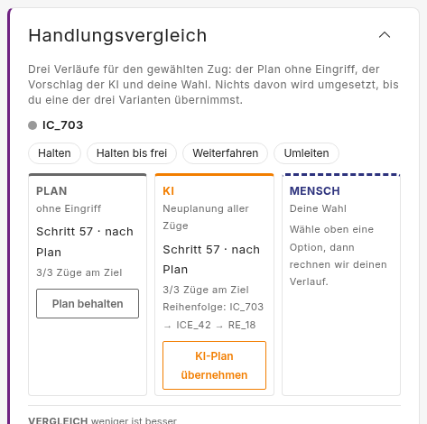 |
| `ReflectionPromptComponent` | Asks the reflection for the shown decision. Not where it is placed. | 🟨 modified: names the course actually taken (§2, related bug). |  (in the dialog) | 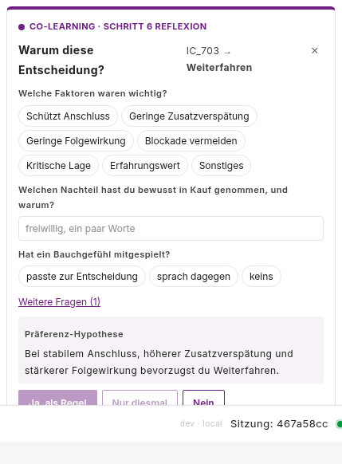 (in the decision panel) |
| `DecisionLogPanelComponent` | Lists the run's decisions. Not where a reflection is answered. | 🟨 modified: open reflections are marked, counted next to the toggle, and can be reopened; highlighted when finishing is refused. |  | 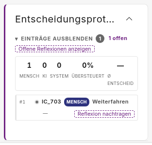 |
| `TourReasonDialogComponent` | The modal reflection that pauses the run. | 🟥 removed. |  | – (removed) |
| `TourGuideComponent` | Leads through the tour's steps. Not where a scenario is finished in an experiment run (the toolbar). | 🟨 modified: «Reflexion öffnen» reopens the newest open reflection, now in the panel; «Schicht beenden» is refused while reflections are open. |  | 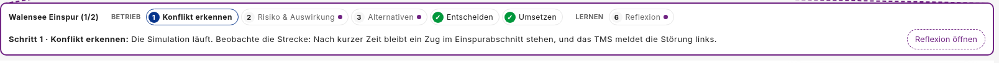 |
| `AppComponent.finishDemoMode` / `ToolbarComponent` | Finishes a scenario or tour leg from the toolbar. Not where the reflection is asked. | 🟨 modified: refuses while reflections are open, and says so next to the button. |  | 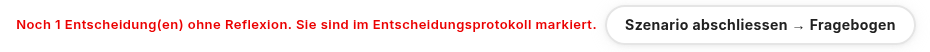 (finish refused) |
| `TourBriefing` / `TourContextService` | Describe a tour and answer what it asks for (reasons, debrief, sandbox, …). Not where the run is paused (`AppComponent`). | 🟨 modified: a tour can ask for the run to pause while a reflection is shown (§4.7). | – | – |
| `RationaleCaptureComponent` | The short "why?" prompt with reason chips, in the Recommendation panel and the Co-Learning reflection panel, for sessions that are not a reason tour. Not the reflection of a reason tour (`ReflectionPromptComponent`). | ⬜ unchanged: it asks about the latest decision as on `main` (finding 4). It shows the same wrong label after «Plan behalten» that D8 fixes in the reflection (finding 12). | 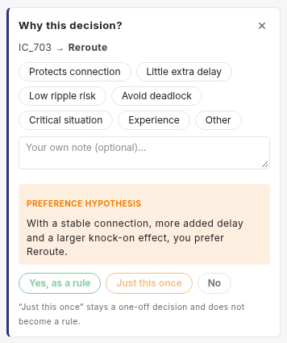 |  |

Pictures from `plan-b-p01`, leg 1, Plan B deployment config, except
`RationaleCaptureComponent`: `preset-colearning-study3` (English), after
«Plan behalten»; it is unchanged, and both show the wrong label of finding 12.

## 1. What the issue asks for

| # | Requirement | Source |
|---|---|---|
| 1 | The reflection opens in the widget where the decision is taken («Plan / KI / Mensch»), and the simulation is no longer stopped | issue, item 1 |
| 2 | «Plan / KI / Mensch» is renamed «Handlungsvergleich» | issue, item 2 |
| 3 | Past decisions can be opened from the decision log and their reflection filled in later | issue, item 3 |
| 4 | When finishing a scenario, all reflections must be filled in: report an error and highlight the open ones in the decision log | issue, item 4 |
| 5 | The first paragraph ("Die Simulation ist angehalten. Die KI lernt …") goes | issue, item 5 |
| 6 | The last sentence ("Danach läuft die Simulation weiter.") goes | issue, item 6 |
| 7 | All of this in general, not only for Plan B | issue, lead |
| 8 | A tour can still turn the pause for a reflection on, by a flag of its own; off unless set | maintainer, 2026-11-06 |

### 1.1 Limitations

The code keeps no list of its own; these become comments at the places named.

- Switching the shown reflection on purpose («Reflexion nachtragen» for
  another decision) drops what was typed and not sent for the shown one:
  `ReflectionPromptComponent` resets on a new `decisionSeq`. The `TODO` is not
  in the code yet (finding 8).
- A replay shows neither the inline reflection nor the open marks: open
  reflections are not recorded, only `reflectedAt` on the answered decisions
  (§4.6). Replay does not read the rationale state today either.
- The French title and texts are drafts until a native reviewer has read them
  (D11).
- The guide's step «Reflexion» says the run keeps going, in every reason tour
  (finding 13). A tour that sets `pauseOnReflection` needs its own hint
  (§4.7, Q7).
- «Nein» without a reason chip counts as answered (Q2, D12), so requirement 4
  can be met without giving a reason. The record shows it:
  `hypothesisResponse: 'no'` and an empty `rationale`.

### 1.2 Assumptions

Not checked in code; they hold by construction of the `reasonDialog` tours and
the study setup.

- Every layout a `reasonDialog` tour runs has a decision panel and a decision
  log. True today: `preset-plan-b` and `preset-colearning-interview` are the
  only two (§2).
- `reasonDialog` tours run in Co-Learning only (`modes: ['co-learning']`, study
  conditions `mode: 'co-learning'`), so no open reflection is left behind in a
  mode without a decision panel.
- No Plan B data recorded before this change has to be compared with data
  recorded after it on decision or reflection timing. Before, the clock stood
  while a participant reflected; after, it runs (§1.5).

### 1.3 Follow-ups (not in this PR)

| Follow-up | Why not in this PR | From | Findings | Issue |
|---|---|---|---|---|
| Keep a typed but unsent reflection when switching to another one | Rare in a run, and the decision stays open | Limitations (TODO) | - | - |
| Require a reason chip for «Nein» too | Decided against for now: «Nein» stays as it is in every tour (Q2) | Limitations | - | - |
| Show open reflections in a replay | Needs recording the open list; no analysis asks for it yet | Limitations | - | - |
| Other Plan B items of the decision log (its buttons) | Part of #150 | issue #150 | - | [#150](https://github.com/flatland-association/flatland-ui-hub/issues/150) |

Unchanged on purpose: `app-rationale-capture` (Recommendation panel,
Co-Learning reflection panel) and the Director's strategy reflection; the
automatic pause on a new conflict («Auto-Pause»); which decisions ask for a
reflection (a human intervention in Co-Learning, a human override of an AI
suggestion, a choice in the decision panel).

### 1.4 New patterns

Compared with `main` 1e33088; the reused concepts are listed under the design principles.

| New | Reuses | Defined in |
|---|---|---|
| A list of open reflections, in decision order, instead of one slot | `PendingRationale`, unchanged | §4.1 |
| A panel that shows the reflection inline | the existing `app-reflection-prompt`, unchanged in its questions | §4.2 |
| Finishing a scenario can be refused | the existing `finishDemoMode` entry point and the guide's «Schicht beenden» | §4.4 |
| `DecisionLogEntry.reflectedAt` / `reflectedAtStep` | the optional fields `rationale`, `reflection` next to them | §4.1 |
| `TourBriefing.pauseOnReflection`, off by default | the `reasonDialog` flag and the removed dialog's pause effect | §4.7 |

Not new on purpose: no new panel, no new UiConfig id, no change to the
reflection's questions, no change to the payload sent to the backend.

### 1.5 Breaking changes

None for callers: no API, payload or file format changes; the decision log
gains two optional fields, which older readers ignore. Behaviour:

- A `reasonDialog` tour no longer pauses after a decision. Intended. Decision
  times and the number of decisions per run are not comparable with runs
  recorded before. A tour that needs the old behaviour sets
  `pauseOnReflection` (S7, §4.7).
- A scenario with an unanswered reflection can no longer be finished.
  Intended (requirement 4). Aborting a run (closing, leaving) is not blocked.
- `SessionStore.canReopenRationale` and `reopenRationale()` keep their names;
  `reopenRationale` gains an optional `seq`. `_dismissedRationale` (private)
  goes. Only `TourGuideComponent` calls them.
- `SessionStore.pendingRationale` becomes read-only (a `computed`, finding 1).
  Every reader keeps working; nothing outside the store wrote it (grepped
  2026-11-06), and the tests only read it.
- «Plan / KI / Mensch» reads «Handlungsvergleich» everywhere. The click id
  `panels.planAiHuman` stays; only the wording changes (AGENTS.md, click ids).

## 2. Today (checked 2026-11-05 on `main`, 1e33088)

- `TourReasonDialogComponent` opens when the tour sets `reasonDialog`, the
  mode is not Director and `pendingRationale` is set
  (`tour-reason-dialog.component.ts:29-34`). An effect pauses a playing run
  on open and resumes it on close, unless the shift review is open (`:39-54`).
  Measured on `plan-b-p01`, leg 1: the footer stays at «Schritt: 8 / 180»
  while the dialog is open.
- `reasonDialog` is set on two briefings (`tour-briefings.ts:193, 480`) and
  inherited by six more built from them: eight briefings, four tours, two
  layouts (`preset-colearning-interview`, `preset-plan-b`), each with a
  decision panel and a decision log. All eight show the guide step
  `reflect` («Reflexion», step 6), whose hint said that the run pauses after
  a decision (finding 13). Table in §4.7.
- No other pause waits for a reflection. The conflict auto-pause is set per
  mode and by a per-browser Settings switch, never by a tour (§4.7).
- The dialog wraps `app-reflection-prompt` between `tourUi.reason.lead` ("Die
  Simulation ist angehalten. Die KI lernt nur aus Gründen, die du
  bestätigst.") and `tourUi.reason.note` ("Danach läuft die Simulation
  weiter."), under the eyebrow «Co-Learning · Schritt 6 Reflexion».
- **One open reflection at a time.** `pendingRationale` is one signal; a new
  decision overwrites it (`session.store.ts:697, 2134`). Closing the prompt
  moves it to `_dismissedRationale`, again one slot, which the guide's
  «Reflexion öffnen» brings back (`:1335-1355`). The pause hides this: while
  the dialog is open, no second decision can be taken. Without the pause it
  can, so one slot would lose reflections.
- **The decision log under Plan B** starts collapsed (`PLAN_B_UI`,
  `collapsedByDefault: ['widget.decision-log']`). Since #150 its head is a
  toggle, «▸ Einträge anzeigen (n)» / «▾ Einträge ausblenden»
  (`dl-toggle`, click ids `log.showEntries` / `log.hideEntries`), which opens
  every entry (`docs/plans/information-display.md` D1). #150 also hides the
  log's «JSON exportieren» and «Leeren» under Plan B
  (`widget.decision-log.actions`), so a participant cannot clear the decisions
  that carry the reflections (picture 4).
- Log entries show no reflection state; `DecisionLogEntry` holds `rationale`,
  `preferenceHypothesis`, `hypothesisResponse`, `reflection` once answered.
- Finishing does not look at reflections. The toolbar's button and the
  debrief call `finishDemoMode()` (`app.component.ts:1282`), which goes to
  `advanceExperiment` in an experiment run and to the next leg or the survey in
  a tour. The guide's «Schicht beenden» calls `store.endShift()`, which pauses
  the run; in an experiment run an effect then calls
  `advanceExperiment('endShift')` (`app.component.ts:1204-1211`). The end of the
  episode itself opens the shift review (`shiftReviewOpen`) but finishes
  nothing.
- «Plan / KI / Mensch» is the wording of `panels.planAiHuman` (de, en "Plan /
  AI / human", fr "Plan / IA / humain"), and appears in text in
  `de.json` (`handoff`, `compareTitle`), in four texts of
  `tour-briefings.ts` (hints and briefing lines), and in comments and internal
  labels elsewhere.
- **Related bug:** after «Plan behalten» the reflection's header and
  hypothesis say "Umleiten". `ReflectionPromptComponent.strategyLabel()` and
  `hypothesis` call `strategyLabelForAction(p.action, t)` without the logged
  choice; `recordProposalChoice` passes action 2, which reads as "Reroute".
  `submitRationale` passes it and stores the right label, so only what the
  participant sees is wrong (picture 2).

### Pictures (before, `plan-b-p01`, leg 1, Plan B deployment config)

Taken with `scripts/docshots-reflection-inline.mjs` on a production build of
`main` 1e33088: the first train in the Fahrplan, «Plan behalten». Retaken
after the rebase onto #150; picture 4 changed with it.

| # | Element | Before |
|---|---|---|
| 1 | Working screen with the reflection dialog; run paused at step 8 |  |
| 2 | The dialog: the first paragraph and the last sentence that go (requirements 5, 6), and "Umleiten" for a kept plan |  |
| 3 | The decision panel and its title (requirements 1, 2) |  |
| 4 | The decision log after one decision, opened with #150's toggle: no mark for the missing reflection (requirements 3, 4) |  |
| 5 | The guide after closing the reflection: «Reflexion öffnen» |  |
| 6 | The finish button, with the reflection unanswered: it finishes (requirement 4) |  |

## 3. Decisions

All decisions are ✅: D4, D5 and D10-D13 from the answers to Q1-Q5, the others confirmed on 2026-11-05; D14 with Q6-Q8 on 2026-11-06.

| ID | Decision | Why |
|---|---|---|
| D1 | ✅ The dialog is removed for every `reasonDialog` tour; the reflection shows at the top of the decision panel instead. The flag keeps its name and now means "this tour asks for a reason after each decision, in the decision panel, and before finishing" (confirmed 2026-11-05) | Requirement 7; renaming the flag touches every briefing for no behaviour |
| D2 | ✅ Nothing pauses or resumes the run for a reflection (confirmed 2026-11-05). Revisited 2026-11-06 by requirement 8: holds for every tour that does not set `pauseOnReflection` (D14) | Requirement 1 |
| D3 | ✅ The store keeps every open reflection, keyed by `decisionSeq`, in decision order. A new decision is shown at once if no reflection is shown; otherwise it waits and is shown when the shown one is answered (confirmed 2026-11-05) | Without the pause, decisions overlap (§2); replacing the shown reflection would drop what the participant is typing |
| D4 | ✅ The log stays collapsed by default under Plan B and is opened with #150's toggle, which shows all entries; this plan adds the count of open reflections next to the toggle (decided 2026-11-05, Q1; the toggle came with #150) | Requirement 3 needs the entries, not only the open ones |
| D5 | ✅ An entry with an open reflection carries «Reflexion nachtragen», which shows it in the decision panel; an answered one a ✓ (decided 2026-11-05 with Q1) | Requirement 3 |
| D6 | ✅ Finishing with open reflections is refused: the run goes on, a message under the finish button names the count, and the log opens with the open entries highlighted (confirmed 2026-11-05) | Requirement 4 |
| D7 | ✅ `reflectedAt` (clock time) and `reflectedAtStep` (sim step) are stamped on the decision when its reflection is answered (confirmed 2026-11-05) | Without the pause a reflection can come at once or just before finishing, and the analysis has to tell them apart; the decision only records when it was taken. Not the click log (`ClickLogService`): the reflection's buttons have no click id and no link to their decision, and the click log is only written with study logging on, while the decision log is in every export. The time sits next to the answers it describes; older readers ignore the fields |
| D8 | ✅ The reflection names the course actually taken: the prompt reads the logged choice from the decision log, as `submitRationale` already does, so «Plan behalten» reads "Weiterfahren" and the AI plan "den KI-Vorschlag" instead of "Umleiten" (confirmed 2026-11-05) | A panel choice stores the placeholder action 2 ("Umleiten") and puts the real choice on the log entry; the saved learning record is right, only what the participant sees is wrong (§2). In S3 rather than a separate fix: S3 moves the prompt next to the choice, where a contradicting label invites wrong answers, and the fix is two lines in code S3 touches. The participant's own choice («Mensch») goes through the override path and is already right |
| D9 | ✅ `tourUi.reason.lead` and `.note` are deleted in de/en/fr; `tourUi.reason.eyebrow` («Co-Learning · Schritt 6 Reflexion») stays as the heading of the reflection in the panel (confirmed 2026-11-05) | Requirements 5, 6. Only the removed dialog uses the two keys, and they are paragraph text, not click ids, so AGENTS.md allows deleting them; kept, they would be dead text that `i18n:check` never flags. The heading links the reflection to step 6 of the guide |
| D10 | ✅ A collapsed decision panel stays collapsed when a reflection arrives. A button «Offene Reflexionen anzeigen» next to the open count opens the log's entries and highlights the open ones, the same view D6 shows when finishing is refused; built in S4 (decided 2026-11-05, Q3) | The participant keeps control of the layout; the open count says that one is waiting |
| D11 | ✅ Titles: de «Handlungsvergleich», en «Action comparison», fr «Comparaison des actions» (decided 2026-11-05, Q5); the French one still goes to a native reviewer | Requirement 2 |
| D12 | ✅ «Nein» counts as an answered reflection, with or without a reason chip; the prompt is unchanged (decided 2026-11-05, Q2 a) | Keeps the reflection the same in every tour; the record tells a bare «Nein» apart (§1.1) |
| D13 | ✅ Every `reasonDialog` tour refuses to finish with open reflections, the interview tour included (decided 2026-11-05, Q4 a) | One rule (requirement 7); the interviewer can answer for the interviewee |
| D14 | ✅ A new `TourBriefing.pauseOnReflection` flag, off by default, pauses the run while a reflection is shown and resumes it as the removed dialog did (decided 2026-11-06, requirement 8). It pauses while a reflection is shown, not while any is open (Q6 a); no tour sets it yet (Q7 a); it has effect only together with `reasonDialog` (Q8 a) | Keeps the old behaviour available per tour without bringing back the dialog |

## 4. Design

### 4.1 Store: open reflections (D3, D7)

- `SessionStore`:
  - `openReflections = signal<PendingRationale[]>([])`, in decision order,
    replacing `_dismissedRationale`. The two places that ask for a reflection
    (`recordProposalChoice`, the override path in `setOverride`) append the
    decision, and show it only when none is shown. In a session without
    `queueReflections` (no reason tour) a new decision replaces the list and
    × drops it, as on `main` (finding 4).
  - `pendingRationale` stays the reflection *shown*, so `rationale-capture`
    and the reflection prompt keep reading it. It is derived (a `computed`
    from the list and a private `_shownSeq`), so an answered or cleared
    reflection cannot stay shown (finding 1).
  - `submitRationale` removes the decision from the list, stamps
    `reflectedAt = Date.now()`, `reflectedAtStep = elapsedSteps()` on its
    `DecisionLogEntry`, and shows the next waiting one: the oldest open
    decision the operator has not closed.
  - `dismissRationale` keeps the decision open, remembers it as closed (so it
    is not shown again on its own), and shows the next waiting one, if any.
  - `reopenRationale(seq?)` shows the given open decision, or the newest one.
    `canReopenRationale` = list not empty and nothing shown.
  - `openReflectionSeqs` (computed set of `decisionSeq`) for the log.
  - `reflectionsMissing = signal<number>(0)` and
    `refuseFinishForOpenReflections(): boolean`: sets it to the open count and
    returns `true` when the list is not empty. The caller decides whether
    reflections are required (§4.4); an effect sets it back to 0 once the
    list is empty.
  - `clearDecisionLog()` clears the list, the closed set, `pendingRationale`
    and `reflectionsMissing`: a reflection patches its decision, so with the
    decisions gone nothing is left to ask. `newSession`, `endSession` and
    `reset` all call it, so a new leg starts without open reflections; so
    does the log's «Leeren», where a condition shows it.
- `DecisionLogEntry` (`core/decision-log.ts`): optional `reflectedAt`,
  `reflectedAtStep`. The session record carries the log as it is
  (`mergeDecisions` replaces an archived entry by the patched one), so the
  fields reach the export without a schema change (§4.6).

### 4.2 The reflection in the decision panel (requirements 1, 5, 6; D1, D2, D8, D9)

- `ProposalCompareComponent`: when `tour.reasonDialog()`, the mode is not
  Director and `pendingRationale()` is set, the panel's content starts with a
  section: the eyebrow «Co-Learning · Schritt 6 Reflexion» and
  `<app-reflection-prompt />`. Below it the panel as today. The reflection
  names its train, so a decision taken for another train (on the map) is
  still clear.
- `ReflectionPromptComponent`: its `role="dialog"` becomes `role="region"`
  (it no longer is one); `strategyLabel()` and `hypothesis` pass the logged
  action from `decisionLog()` like `submitRationale`.
- `TourReasonDialogComponent` and its tag in `app.component.html:1077` are
  removed, with the pause effect; S7 brings the effect back behind a tour
  flag (§4.7).
- When a reflection is shown, the panel scrolls it into view; when the panel
  is collapsed, it stays collapsed (D10).

### 4.3 Decision log (requirement 3; D4, D5)

- The entries are opened with #150's toggle (`dl-toggle` in the embedded
  head), unchanged. The open badge and the button below sit next to
  it in `.dl-panel-head--embedded`, not inside it (no button in a button).
- In `reasonDialog` tours, each entry whose `seq` is open shows a small button
  «Reflexion nachtragen» (click id `log.reflectionOpen`) calling
  `store.reopenRationale(e.seq)`; answered entries show ✓ with the title
  «Reflexion erfasst». The header's count gets a second badge for the open
  ones («2 offen»), so the open reflections are visible while the entries are
  collapsed.
- Next to that badge, while reflections are open, «Offene Reflexionen
  anzeigen» (click id `log.showOpenReflections`; en «Show open reflections»,
  fr «Afficher les réflexions ouvertes») opens the entries and highlights the
  open ones (D10, built in S4).
- One highlight for both ways in: the panel's `highlightOpen` is true after a
  click on that button or while `store.reflectionsMissing() > 0` (§4.4). An
  effect then sets `collapsed` to false, and open entries get the class
  `dl-entry--missing` (colour from an `--app-*` token). It ends when no
  reflection is open. The button does not show the toolbar's message; only a
  refused finish does.

### 4.4 Finishing (requirement 4; D6)

- Two gates, both only when `tour.reasonDialog()` is set:
  - `AppComponent.finishDemoMode()`, first thing: if
    `store.refuseFinishForOpenReflections()`, return. Covers the toolbar's
    button in experiment runs and tours, and the debrief's finish.
  - `TourGuideComponent`'s «Schicht beenden»: the same check before
    `store.endShift()`, so the run is neither paused nor the shift ended. The
    `advanceExperiment('endShift')` effect then never fires with open
    reflections.
- `store.reflectionsMissing() > 0`:
  - shows left of the finish button, in the toolbar, `role="alert"` like
    `toolbar.runError`: «Noch {{n}} Entscheidung(en) ohne Reflexion. Sie sind
    im Entscheidungsprotokoll markiert.» (key `toolbar.reflectionsMissing`);
  - opens the decision log's entries and highlights the open entries, with
    the same highlight as the log's button (§4.3).
- Not gated: `'aborted'`, `finishExperiment()` and `nextLegOrReview()`, which
  only run after the leg is finished, and the Director's own «Schicht
  beenden». The end of the episode finishes nothing (§2), so it needs no gate.

### 4.5 Rename (requirement 2)

- `panels.planAiHuman`: de «Handlungsvergleich», en «Action comparison», fr
  «Comparaison des actions» (needs the native review AGENTS.md asks for).
- The texts that quote the title: `de.json` (`handoff`, `compareTitle`; en and
  fr likewise), the hints in `tour-briefings.ts`, `widget-catalog.ts`'s name.
  Code comments and the preset `title:` strings stay: the latter are lookup
  keys for `panel-titles.ts`, not shown text. `STOCK_PANEL_TITLES` maps the
  new name to the same key too, so a panel added from the catalog under
  «Handlungsvergleich» is translated as well.

### 4.6 Data model

Current: `DecisionLogEntry` in `core/decision-log.ts`, `PendingRationale` and
the rationale state in `core/session.store.ts`, the session record in
`core/interaction-log/session-record.ts`.

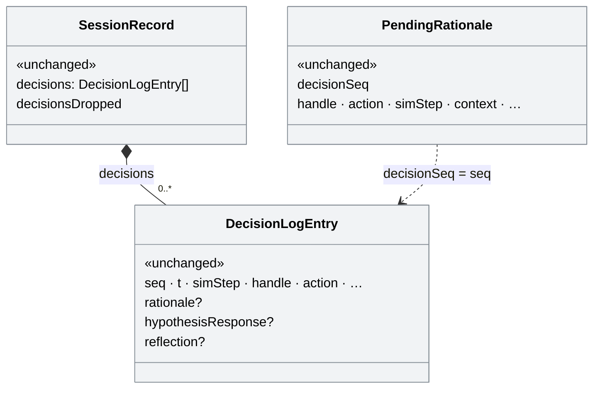

Planned: two optional fields on the decision; the open list stays in the
client and is not recorded.


Legend: grey «unchanged», yellow «modified» with new fields marked `+`.

One decision in the session record's `decisions`, answered 37 steps after it
was taken (values illustrative):

```diff
 {
   "seq": 3,
   "t": 1793872031512,
   "simStep": 7,
   "handle": 0,
   "accountableOwner": "human",
   "action": "proceed",
   "origin": "proposals",
   "rationale": "Schützt Anschluss",
   "hypothesisResponse": "once",
   "reflection": { "gut": "fit" },
+  "reflectedAt": 1793872093240,   // added
+  "reflectedAtStep": 44           // added
 }
```

Nothing is removed from the record.

### 4.7 When the run pauses (requirement 8; D2, D14)

**Tours that ask for reasons** (`reasonDialog`, checked 2026-11-06). All eight
briefings show the guide step `reflect`.

| Tour | Briefings | Layout | `pauseOnReflection` |
|---|---|---|---|
| Interview (`colearning-interview`) | `co-learning-cost-benefit`, `-en` | `preset-colearning-interview` | no (Q7) |
| Plan B experiment | `colearning-experiment`, `colearning-experiment-2x` | `preset-plan-b` | no (Q7) |
| Walkthrough with survey | `colearning-walkthrough-survey`, `-en` (via `withoutInterview`) | `preset-colearning-interview` | no (Q7) |
| Advanced Co-Learning | `colearning-advanced`, `-en` (via `withoutInterview`) | `preset-colearning-interview` | no (Q7) |

**Pause for a reflection:**

| Setup | `main` 1e33088 | This branch | This branch, tour sets `pauseOnReflection` |
|---|---|---|---|
| Reason tour, not Director | Pauses (modal dialog); no second decision while it is open | Runs; the shown reflection stays, a new one waits (D3) | Pauses while a reflection is shown (Q6) |
| Reason tour, Director | Runs (the dialog skipped Director) | Runs | Runs |
| Any other tour, the sandbox | Runs; a new decision replaces the shown prompt | Same as `main` (finding 4) | Runs: the flag needs `reasonDialog` (Q8) |

**Other pauses**, none waiting for a reflection, none changed by this plan:

| Pause | Where | When | Set by |
|---|---|---|---|
| Conflict auto-pause, impact panel | `impact-panel.component.ts:282` | A new conflict, in a tour, while playing, Co-Learning or Recommendation | The mode, and the Settings switch `autoPauseOnConflict` (per browser, saved locally) |
| Conflict auto-pause, combined actions | `combined-actions.component.ts:170` | A new forecast contention, once per session, not Director | The same |
| End of the shift | `session.store.ts:292` (`endShift`) | «Schicht beenden» | - |
| Leaving Director | `session.store.ts:1138` | A mode switch away from Director | - |
| Replay | `replay.service.ts:226, 264, 285` | Seeking, the end of the replay | - |

No tour or experiment sets the conflict auto-pause; making it per tour is not
asked for.

**The flag (S7):**

- `TourBriefing.pauseOnReflection?: boolean`, documented next to
  `reasonDialog`; `TourContextService.pauseOnReflection` is true only when
  the briefing sets both (Q8). Off unless a briefing sets it; none does
  (Q7).
- `AppComponent` gets back the effect the removed dialog had
  (`tour-reason-dialog.component.ts:39-54` on 1e33088), next to
  `_queueReflections`, as the computed `reflectionPauses` (the flag is set,
  the mode is not Director, `store.pendingRationale()` is set) and the method
  `syncReflectionPause(shown)` that the effect calls (the spec calls it
  directly: rendering the whole app in a spec runs every other effect too):
  - not shown → shown: remember whether the run was playing, and pause it;
  - shown → not shown: play again with `activePolicy() || defaultPolicy()` at
    `playSpeed()`, only if the effect paused it and `shiftReviewOpen()` is
    false.
- With the queue (D3), answering one reflection shows the next waiting one,
  so the run stays paused until none is shown. Closing with × resumes;
  «Reflexion nachtragen» pauses again.
- Inline, the participant can press play while a reflection is shown (the
  dialog was modal). The effect does not pause again until the next
  reflection is shown.
- The store does not read the tour (design principles); the app reads the
  flag, as it does for `queueReflections`.
- Pausing and resuming call `store.pause()` / `store.play()`, as the conflict
  auto-pause does; no new event.
- The guide's `reflect` hint says the run keeps going (finding 13). A tour
  that sets the flag later gets its own hint then (Q7, §1.1).

## 5. Files

### New files

| File | What it adds |
|---|---|
| `frontend/src/app/features/proposal-compare/proposal-compare.component.spec.ts` | The reflection shows in a `reasonDialog` tour after a decision, not otherwise; the new title |
| `scripts/docshots-reflection-inline.mjs` | Before/after screenshots (§2, §6) |
| `docs/plans/reflection-inline/*.png` | Before pictures (§2), after pictures |

### Modified files

| File | What changes |
|---|---|
| `frontend/src/app/core/session.store.ts` | `openReflections`, `reopenRationale(seq?)`, `reflectionsMissing`, `refuseFinishForOpenReflections()`, the stamps, the resets |
| `frontend/src/app/core/decision-log.ts` | `reflectedAt`, `reflectedAtStep` |
| `frontend/src/app/features/proposal-compare/proposal-compare.component.ts` / `.html` / `.scss` | the reflection section |
| `frontend/src/app/features/reflection-prompt/reflection-prompt.component.ts` / `.html` | logged label; `role` |
| `frontend/src/app/features/reflection-prompt/reflection-prompt.component.spec.ts` | label after «Plan behalten» |
| `frontend/src/app/features/decision-log/decision-log-panel.component.ts` / `.html` / `.scss` / `.spec.ts` | open/answered marks, open count next to the toggle, «Offene Reflexionen anzeigen», `highlightOpen` and its specs |
| `frontend/src/app/features/tour-guide/tour-guide.component.ts` / `.html` / `.spec.ts` | `canReflect` from the list; «Schicht beenden» gated (`endShift()`) |
| `frontend/src/app/features/toolbar/toolbar.component.html` / `.scss` / `.spec.ts` | the refusal message |
| `frontend/src/app/app.component.ts` / `.html` | the gate in `finishDemoMode()`; the dialog removed; the reflection pause effect (S7) |
| `frontend/src/app/core/demo/tour-briefings.ts` | `reasonDialog` doc comment; hints with the new title; the `reflect` hint without the pause (finding 13); `pauseOnReflection` (S7) |
| `frontend/src/app/core/demo/tour-context.service.ts` | `pauseOnReflection` (S7) |
| `frontend/src/app/app.component.spec.ts` | the reflection pause: pauses on show, resumes on close only if it paused, not in Director, not after the shift review (S7) |
| `frontend/src/app/core/widgets/widget-catalog.ts` | the panel's name |
| `frontend/src/app/core/i18n/panel-titles.ts` | «Handlungsvergleich» → `panels.planAiHuman`, next to the old title |
| `frontend/src/app/core/layout/layout-presets.ts` | the interview preset's comment: the reason is asked in the decision panel |
| `frontend/public/i18n/{de,en,fr}.json` | new title; new keys `log.reflectionOpen`, `log.reflectionDone`, `log.openCount`, `toolbar.reflectionsMissing`, `log.showOpenReflections`; `tourUi.reason.lead`/`.note` deleted |
| `frontend/src/app/core/session.store.spec.ts` | a second decision waits while one is shown; dismiss keeps it open; submit stamps and shows the next; the refusal; the resets |
| `docs/experiment-logging.md` | the click id table, regenerated with `node frontend/scripts/data-log-ids.mjs`: `log.reflectionOpen`, `log.showOpenReflections` |

### Removed files

| File | Why |
|---|---|
| `frontend/src/app/features/tour-reason-dialog/tour-reason-dialog.component.{ts,html,scss}` | D1 |

## 6. Verification

- Specs as in §5; the four CI checks (`lint:styles`, `i18n:check`, production
  build, `pytest -q`).
- In the running app (production build, Plan B deployment config), on
  `plan-b-p01`, leg 1: a decision in «Handlungsvergleich» shows the reflection
  at its top and the footer step keeps counting; a second decision before
  answering leaves the first open in the log; «Reflexion nachtragen» brings it
  back; «Szenario abschliessen» with one open is refused with the message and
  the highlight; after answering it, also with a bare «Nein», it finishes. The exported session record has
  `reflectedAt`/`reflectedAtStep` on the answered decision.
- `colearning-experiment` and the interview tour: the same, in their layout, including the guide's «Schicht beenden».
- A Recommendation tour: `rationale-capture` in its panel as today.
- S7: a briefing with `pauseOnReflection` set: the footer step stands while
  the reflection is shown and counts on after answering or ×; without the
  flag it counts on (picture 1).
- After pictures with the script, prefix `after`, next to the before ones.

**Results (2026-11-05).** `i18n:check` (43 click ids, all keys), `lint:styles`
and the production build pass; the build's two warnings (the survey
component's `??`, the bundle budget) come from code this plan does not touch.
The frontend suite passes: 661 specs, 1 skipped. `pytest -q` was not run: no
backend change. In the running app, `plan-b-p01`, leg 1, with
`scripts/docshots-reflection-inline.mjs` on a production build of the working
tree:

| | Before (`main` 1e33088) | After (this branch) |
|---|---|---|
| Where the reflection is | dialog over the screen | top of «Handlungsvergleich» |
| Run while it is open | paused (step 8 → 8) | runs (step 10 → 11) |
| Label after «Plan behalten» | "Umleiten" | "Weiterfahren" |
| Decision log | count only | "1 offen", «Offene Reflexionen anzeigen», «Reflexion nachtragen» on the entry |
| «Szenario abschliessen» with one open | finishes | refused: «Noch 1 Entscheidung(en) ohne Reflexion. …», entry highlighted, run goes on |

| # | Before | After |
|---|---|---|
| 1 |  | 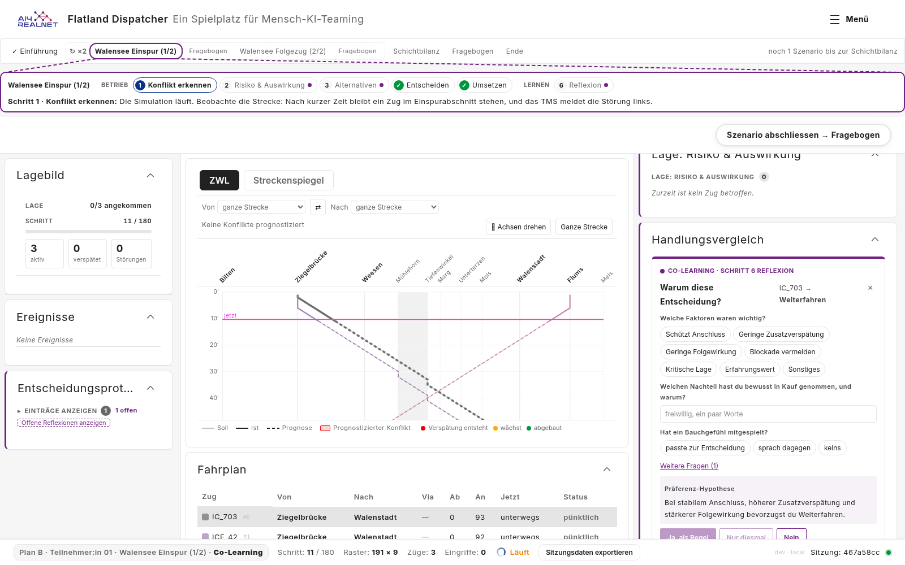 |
| 2 |  |  |
| 3 |  |  |
| 4 |  |  |
| 5 |  |  |
| 6 |  | 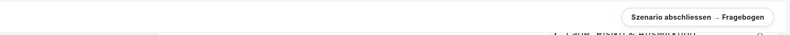 |
| 7 | – | 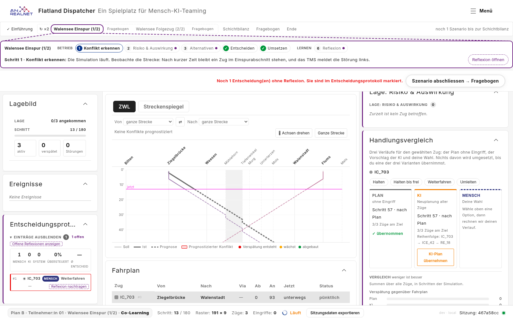 |

**S7 (2026-11-06).** The frontend suite passes with 670 specs; `i18n:check`,
`lint:styles` and the production build pass. In the running app, with
`pauseOnReflection` set on `colearning-experiment` in a local build only:
the step stands while the reflection is shown (7 → 7) and counts on after ×
(8 → 10). Without the flag it counts on (table above).

Not yet checked in the running app: a second decision while one is open,
finishing after a bare «Nein», the exported record's `reflectedAt`, leg 2,
`colearning-experiment`, the interview tour and a Recommendation tour. The
specs cover the first three.

## 7. Steps

| ID | Step | Needs |
|---|---|---|
| S1 | Store: open reflections, reopen by decision, stamps, refusal state, with specs | - |
| S2 | Decision log: open/answered marks, open count, reopen | S1 |
| S3 | Decision panel: inline reflection, dialog removed, logged label fix, texts | S1 |
| S4 | Finish gates (toolbar, guide), message, highlight; «Offene Reflexionen anzeigen» in the log | S1, S2 |
| S5 | Rename to «Handlungsvergleich» (de, en, fr, briefings, catalog) | - |
| S6 | Docs and after screenshots | S2-S5 |
| S7 | `pauseOnReflection`: flag, the pause effect in `AppComponent`, spec; no tour sets it (Q7) | S1, S3 |

Each step passes the CI checks on its own. S1-S6 were built together and
were committed with S7 as one commit, 15a13ca, because their changes share
files and hunks; S6 (pictures, script, plan) is the docs commit after it.
Finding 13's fix is in S3, which removes the pause. Findings
3, 5-12 and 18 (§9) are open; each becomes a step or a follow-up once decided.

## 8. Open questions

- ✅ ~~**(Q6) When does `pauseOnReflection` pause?**~~ **Decided 2026-11-06:**
  a), while a reflection is shown (D14).
  - a) While a reflection is shown, as the dialog did. × resumes the run and
    leaves the reflection open in the log.
  - b) While any reflection is open, shown or not. × no longer resumes, so the
    run stands until every decision is answered.

  *Proposal:* a). It is the old behaviour, and b) makes × pointless.
- ✅ ~~**(Q7) Which tours set it?**~~ **Decided 2026-11-06:** a), none for now
  (D14). For the product owner (@CleverManu) or the study lead to change.
  - a) None for now: #160 asks for no pause, and the flag waits for a study
    that needs it.
  - b) The interview tour (`co-learning-cost-benefit`, `-en`), where the
    interviewer may want the run to stand while the interviewee explains.
  - c) Others from the table in §4.7.

  *Proposal:* a). A tour that sets it also needs its own `reflect` hint,
  because the shared one says the run keeps going.
- ✅ ~~**(Q8) Does the flag work without `reasonDialog`?**~~ **Decided
  2026-11-06:** a), only together with `reasonDialog` (D14).
  - a) Only together with `reasonDialog`: the reflection then has its place in
    the decision panel, and the finish gate applies.
  - b) In any tour. Outside reason tours the short prompt
    (`rationale-capture`) sits in a panel that may be collapsed or missing, so
    the run could stand with no visible reason.

  *Proposal:* a).

- ✅ ~~**(Q2) Does «Nein» count as a reflection?**~~ **Decided 2026-11-05:**
  a), «Nein» counts as it is now, with or without a reason chip (D12). A
  participant can therefore clear an open reflection without a reason; the
  record shows it (§1.1).
- ✅ ~~**(Q4) Does the interview tour (`co-learning-cost-benefit`) also refuse
  to finish?**~~ **Decided 2026-11-05:** a), yes, like every `reasonDialog`
  tour (D13). It is a tour, not an experiment run, so the gate sits in
  `finishDemoMode()` and the guide (§4.4).
- ✅ ~~**(Q1) Plan B's decision log: open or collapsed by default?**~~
  **Decided 2026-11-05:** collapsed by default with all entries reachable, a
  header that opens them and a count of open reflections (D4). The header
  toggle came with #150; the count is this plan's.
- ✅ ~~**(Q3) What if the decision panel is collapsed when a reflection
  arrives?**~~ **Decided 2026-11-05:** it stays collapsed, and a button
  «Offene Reflexionen anzeigen» next to the log's open count opens the
  entries and highlights the open ones, built in S4 (D10, §4.3).
- ✅ ~~**(Q5) English and French title.**~~ **Decided 2026-11-05:** «Action
  comparison» / «Comparaison des actions», French to a native reviewer (D11).

## 9. Findings

PR [#176](https://github.com/flatland-association/flatland-ui-hub/pull/176),
based on `main` 1e33088. Code review findings (1-11) were added on 2026-11-05,
at 8e4b449 with steps S1-S6 not yet committed; their line numbers refer to
that working tree. Finding 12 (2026-11-06) was found while taking the
component screenshots, finding 13 (2026-11-06) while checking which setups
pause. PR review comments (14-17) were added on 2026-11-06; finding 18
(2026-11-06, at 15a13ca) comes from checking the code for references to the
issue. Sources: a `/code-review` pass, a review against this plan, and the
PR's review threads.

Fixed: ✅ fixed; ⏭️ open and taken over by a follow-up (§1.3); empty: open.
"resolved" in Source marks threads resolved on GitHub; ❌ next to ✅ marks a
finding fixed in the code whose thread is not resolved on GitHub yet.

| Fixed | ID | Source | Category | Severity | Finding | Commit message |
|---|---|---|---|---|---|---|
| ✅ | 1 | code review | bug | low | `frontend/src/app/core/operator-model-bridge.service.ts:24,92`, `frontend/src/app/core/session.store.ts:892`: the bridge holds back only the reflection *shown* (`pendingRationale`) before it reports a decision to the operator model. A decision that waits in `openReflections`, or was closed with ×, is reported at once without its answer and marked reported, so a later «Ja, als Regel» never calls `recordLearning`. The cause is two writable signals for one fact, kept in step by hand at 13 places. Low because only the Director-only `co-learning-effect` panel creates the bridge: Plan B and the interview tour never run it, and a new leg starts with no open reflections. On `main` a closed reflection answered later was lost the same way. Fix: `openReflections` the only stored list, `pendingRationale` derived from it, the bridge holding back every open decision (diagram and fix below the table). Fixed in 15a13ca: `pendingRationale` is derived from `openReflections` and `_shownSeq`, and the bridge holds back every open decision; new `operator-model-bridge.service.spec.ts`. | feat(reflection): ask the reflection in «Handlungsvergleich» without pausing the run. |
| ✅ | 2 | code review | bug | high | `frontend/src/app/app.component.ts:1283`, `frontend/src/app/features/tour-debrief/tour-debrief.component.ts:268`: in a tour that is not an experiment run (the interview tour, gated since Q4), the episode ending on its own opens the debrief, which hides the panels (`is-behind`), and its way back is off once `episodeDone`. With a reflection still open, the finish is refused and the reflection can no longer be reached: the tour cannot be finished. Plan B is not affected (no debrief between legs while `running`). Fix: show the open reflection in the debrief, or let the debrief's finish open the shift again while reflections are open. Fixed in 15a13ca, option a): `AppComponent.shiftScreenOpen()` stays closed while `reflectionsMissing() > 0`, so a refused finish brings the working screen back; the debrief opens again once all are answered. No spec: `AppComponent` has none for the shift screen (finding 11). | feat(reflection): ask the reflection in «Handlungsvergleich» without pausing the run. |
| ✅ | 4 | code review | design | medium | `frontend/src/app/core/session.store.ts:1403`: the queue applies in every session, not only in `reasonDialog` tours. With `rationale-capture` (Recommendation, the Co-Learning reflection panel) a new decision no longer replaces the shown prompt, and closing one shows an older one out of context. The plan says these stay unchanged (§1.3). Fix: keep the old replace-and-forget behaviour unless the tour asks for reasons, e.g. `_askReflection` taking a `queue` flag set by a store signal the app syncs from `tour.reasonDialog()`. Fixed in 15a13ca: `SessionStore.queueReflections`, set by `AppComponent` from `tour.reasonDialog()`; off, a new decision replaces the shown one and × drops it, as on `main`. | feat(reflection): ask the reflection in «Handlungsvergleich» without pausing the run. |
| ✅ | 13 | review against this plan | docs | low | `frontend/src/app/core/demo/tour-briefings.ts:241,597`: the guide step «Reflexion» still said "Nach deiner Entscheidung hält die Simulation an" (and "the simulation pauses" in English). All eight `reasonDialog` briefings show it (§2), so after #160 the guide contradicts the running clock. Fixed in 15a13ca: both hints now say the decision panel asks while the simulation keeps running, and that the decision log shows open reflections, all of which must be answered before finishing. | feat(reflection): ask the reflection in «Handlungsvergleich» without pausing the run. |
| ✅ | 14 | [PR comment](https://github.com/flatland-association/flatland-ui-hub/pull/176#discussion_r4483074726), resolved | design | medium | `docs/plans/reflection-inline.md:524` (at 8e4b449): which option for Q2, does «Nein» count as a reflection? @CleverManu: a), leave it as it is; the module will be rephrased, and «Nein» may go. Fixed in 8e4b449: recorded as Q2 a and D12. | docs(plans): record the decisions on Q2, Q3 and Q4 for #160. |
| ✅ | 15 | [PR comment](https://github.com/flatland-association/flatland-ui-hub/pull/176#discussion_r4483076853), resolved | design | medium | `docs/plans/reflection-inline.md:533` (at 8e4b449): which option for Q4, does the interview tour refuse to finish too? @CleverManu: a). Fixed in 8e4b449: recorded as Q4 a and D13. | docs(plans): record the decisions on Q2, Q3 and Q4 for #160. |
| ✅ ❌ | 16 | [PR comment](https://github.com/flatland-association/flatland-ui-hub/pull/176#discussion_r4485910809) | design | medium | `docs/plans/reflection-inline.md:260` (at 8e4b449): D6, finishing with open reflections is refused; @CleverManu agreed. Fixed in 15a13ca: built as decided (§4.4). | feat(reflection): ask the reflection in «Handlungsvergleich» without pausing the run. |
| ✅ ❌ | 17 | [PR comment](https://github.com/flatland-association/flatland-ui-hub/pull/176#discussion_r4485915765) | design | medium | `docs/plans/reflection-inline.md:261` (at 8e4b449): D7, `reflectedAt` and `reflectedAtStep` stamped on the decision; @CleverManu agreed. Fixed in 15a13ca: built as decided (§4.1). | feat(reflection): ask the reflection in «Handlungsvergleich» without pausing the run. |
|  | 3 | code review | design | medium | `frontend/src/app/core/interaction-log/view-tracker.service.ts:69`: a shown reflection still counts as the full-screen view `reflection` (kind `rationale`). Inline, it stays shown while the participant goes on working, and with the queue it is shown more often, so the view stream says "reflection" for time spent on the map and timetable. The plan does not mention it. Proposal: report it as a `session` detail (`reflectionShown: true`) in `reasonDialog` tours instead of a view of its own. Open. | fix(view-tracker): count an inline reflection as part of the working screen. |
|  | 5 | code review | bug | medium | `frontend/src/app/core/session.store.ts:1379,1389`, `frontend/src/app/features/toolbar/toolbar.component.html:101`: `reflectionsMissing` freezes the count at the refused click, so after answering two of three the message still says 3. It is also stored state with an effect only to zero it. Fix: a `finishRefused` flag and `computed(() => finishRefused() ? openReflections().length : 0)`, no effect. Open. | fix(reflection): count the missing reflections live after a refused finish. |
|  | 6 | code review | robustness | low | `frontend/src/app/features/proposal-compare/proposal-compare.component.ts:93`: a reflection reopened from the log only shows in the decision panel, and not in Director. After a mode switch, or with the panel collapsed or absent, «Reflexion nachtragen» does nothing visible while finishing is refused. Covered by §1.2's assumptions (Co-Learning only, the panel is in the layout), which are not checked in code. Proposal: keep the assumption, and expand nothing (D10); add a test that the `reasonDialog` layouts place the panel. Open. | test(layout): assert that every reasonDialog layout places the decision panel. |
|  | 7 | code review | design | low | `frontend/src/app/app.component.ts:1283`, `frontend/src/app/features/tour-guide/tour-guide.component.ts:77`: the finish guard is repeated in the two callers. Other ways to end a shift (`director-directive`'s «Schicht beenden», `finishExperiment`) do not check it; today they run only in Director or after the leg is finished. Proposal: one `canFinish()` on `TourContextService`, used by both, with a comment naming the paths that need no gate. Open. | refactor(tour): check open reflections in one place before finishing. |
|  | 8 | code review | robustness | low | `frontend/src/app/core/session.store.ts:1356,1369`: `reopenRationale(seq)` replaces a reflection being typed, and the prompt resets, contradicting the comment that typed text is never replaced. Listed in §1.1 as a limitation, without the `TODO` it promises. Fix: add the `TODO` and say "a new decision never replaces" in the comment. Open. | docs(reflection): name the reopen case that drops typed text. |
|  | 9 | code review | robustness | low | `frontend/src/app/features/proposal-compare/proposal-compare.component.ts:133`: `scrollIntoView` scrolls every scrolling ancestor, so a new reflection can move the right column (seen in the after screenshots: the panel above loses its title), and the uncleared `setTimeout` can fire after the panel is destroyed. Fix: scroll only the panel's own body, or drop the scroll. Open. | fix(proposal-compare): scroll only the panel when a reflection appears. |
|  | 10 | code review | refactor | low | `frontend/src/app/features/reflection-prompt/reflection-prompt.component.ts:113,143`, `frontend/src/app/core/session.store.ts:1277`: the logged-label lookup is written twice (prompt and `submitRationale`), and `strategyLabel()` only wraps `label()`. Fix: one store method `strategyLabelFor(pending)` used by both. Open. | refactor(reflection): look up the logged choice in one place. |
|  | 11 | code review | test-coverage | low | `frontend/src/app/app.component.ts:1283`: the gate in `finishDemoMode()` has no test, and the `TourContextService` stub is repeated in four spec files. Fix: a spec for the gate, and a shared `provideTourContextStub(reasonDialog)` in `src/testing/`. Open. | test(app): cover the finish gate and share the tour context stub. |
|  | 12 | code review | bug | medium | `frontend/src/app/features/rationale-capture/rationale-capture.component.ts:73,78`: the short "why?" prompt shows the same wrong label as D8 fixed in the reflection: after «Plan behalten» in the decision panel it says "IC_703 → Reroute" and "you prefer Reroute", because it calls `strategyLabelForAction(p.action, t)` without the logged choice. Seen on 2026-11-06 in `preset-colearning-study3`, a study condition, so participants of that condition read a hypothesis about a course they did not take. On `main` too. Fix: the same lookup as the reflection, best through the one store method of finding 10. Open. | fix(rationale-capture): name the course actually taken. |
|  | 18 | code review | docs | low | `frontend/src/app/app.component.ts:462,1207-1208,1216`, `frontend/src/app/core/demo/tour-briefings.ts:120`, `frontend/src/app/core/i18n/panel-titles.ts:51`, `frontend/src/app/core/operator-model-bridge.service.ts:51`, `frontend/src/app/core/operator-model-bridge.service.spec.ts:12-14,64`, `frontend/src/app/core/session.store.ts:893,1354-1355,1369,1376`, `frontend/src/app/core/session.store.spec.ts:137`, `scripts/docshots-reflection-inline.mjs:1,6`: comments name issue #160, which the PR closes, and the plan's finding numbers ("finding 1", "finding 4"). Once merged they point at a closed issue and at table rows that are not a stable reference. Fix: name the plan's sections and decisions (§4.1, D3, §4.7) instead, and say what happened before in words ("as before the reflection moved into the panel"). Open. | docs(reflection): point code comments at the plan's sections, not at the issue or its findings. |

**Issue references.** The PR closes #160 ("Closes #160" in its description).
Code comments still name it in 11 places, and name the plan's findings in 9
(finding 18).

### Finding 1

`SessionStore` keeps two things about reflections, and they answer different
questions:

- **`openReflections`:** which decisions still lack a reflection. Many, in
  decision order (new in #160).
- **`pendingRationale`:** which reflection the prompt shows right now. One,
  because one form is on screen. On `main` it was "the decision waiting for
  its reason"; since #160 it is only one of possibly several open ones.

All six readers of `pendingRationale` need exactly one value:

- `rationale-capture`, `reflection-prompt` and `ProposalCompareComponent` show
  one form;
- `co-learning-reflection` and `ViewTracker` ask "is one being shown?";
- `OperatorModelBridge` uses it to hold a decision back, and this is where it
  goes wrong: it is the one reader that needs the whole list.

Making `pendingRationale` a list would make every reader pick the entry to
show, copying the store's "oldest not closed, unless reopened" rule six times.
The weakness is elsewhere: both are writable signals the store keeps in step
by hand (13 writes in `session.store.ts`), and two copies of one fact are how
the bridge came to read the wrong one.

| Component | Responsibility in this flow | Lifetime |
|---|---|---|
| Operator | The participant who decides and reflects. | A person, not code. |
| `ProposalCompareComponent` | The decision panel «Handlungsvergleich»: compares plan, AI and own choice for a train, applies one, and shows the open reflection at its top. | Component: one instance per panel the layout places, created and destroyed with the layout; every instance shows the same reflection. |
| `SessionStore` | Holds the session's decision log and the reflections still open, and records an answer on its decision. | Singleton (`providedIn: 'root'`). |
| `OperatorModelBridge` | Watches the decision log and reports each human decision once to the operator model, after its reflection is settled. | Singleton (`providedIn: 'root'`), created lazily: only the Director panel `co-learning-effect` injects it, so it does not exist in Plan B; once created, it lives as long as the page and first reports the whole log so far. |
| `OperatorModelService` | The client of the backend operator model: `recordSignal` for a decision, `recordLearning` for a confirmed rule. | Singleton (`providedIn: 'root'`). |

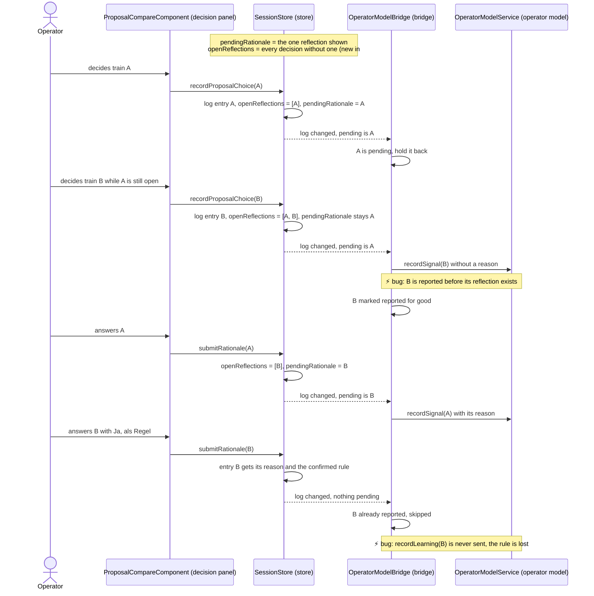

Fix:

```ts
readonly openReflections = signal<PendingRationale[]>([]);   // the only stored list
private readonly _shownSeq = signal<number | null>(null);    // which one the prompt shows
readonly pendingRationale = computed(() =>                   // read-only, derived
  this.openReflections().find((r) => r.decisionSeq === this._shownSeq()) ?? null);
```

- Readers stay as they are: still one value.
- Writers (ask, answer, close, reopen) only update the list and `_shownSeq`;
  the three `pendingRationale.set(null)` in the resets
  (`session.store.ts:1740, 1982, 2011`) go, because emptying the list empties
  the derived value.
- An answered reflection leaves the list, so it can no longer be the one
  shown.
- `OperatorModelBridge.drain()` holds back every seq in
  `store.openReflectionSeqs()`, so B is reported once, in the last block,
  with its reason and its rule.

Where the fix goes (`ProposalCompareComponent` and the other readers do not
change; they keep reading one `pendingRationale`):

| File | Change |
|---|---|
| `frontend/src/app/core/session.store.ts` | `_shownSeq`; `pendingRationale` computed; ask, answer, close, reopen and `clearDecisionLog()` write the list and `_shownSeq` only; the three resets drop their `pendingRationale.set(null)` |
| `frontend/src/app/core/session.store.spec.ts` | the shown reflection follows the list (answered → gone, list emptied → `null`) |
| `frontend/src/app/core/operator-model-bridge.service.ts` | the effect passes `store.openReflectionSeqs()` to `drain()` instead of the shown seq |
| `frontend/src/app/core/operator-model-bridge.service.spec.ts` (new) | the diagram's flow: B waits behind A, is not reported, and is reported with its rule once answered |

### Finding 2

Only tours that are not an experiment run are affected, e.g. the interview
tour `co-learning-cost-benefit` (`debrief: true`, gated since Q4). Plan B is an
experiment run: while a leg is `running` its shift screen stays closed, so the
panels stay visible after the episode ends and the reflection can be answered.

- The episode ends on its own (`episodeDone`), so `shiftReviewOpen` is true and
  `AppComponent.shiftScreenOpen()` opens the debrief.
- The debrief hides the layout (`is-behind` → `display: none`): the decision
  panel with the reflection and the decision log are gone.
- The guide hides «Reflexion öffnen» while `shiftReviewOpen`.
- «Zurück zur laufenden Schicht» shows only while the episode still runs
  (`TourDebriefComponent.canReopen`, `tour-debrief.component.ts:268`).
- The debrief's finish and the toolbar's button call `finishDemoMode()`, which
  refuses while a reflection is open (`app.component.ts:1283`).

So the open reflection cannot be reached, and the tour cannot be finished:

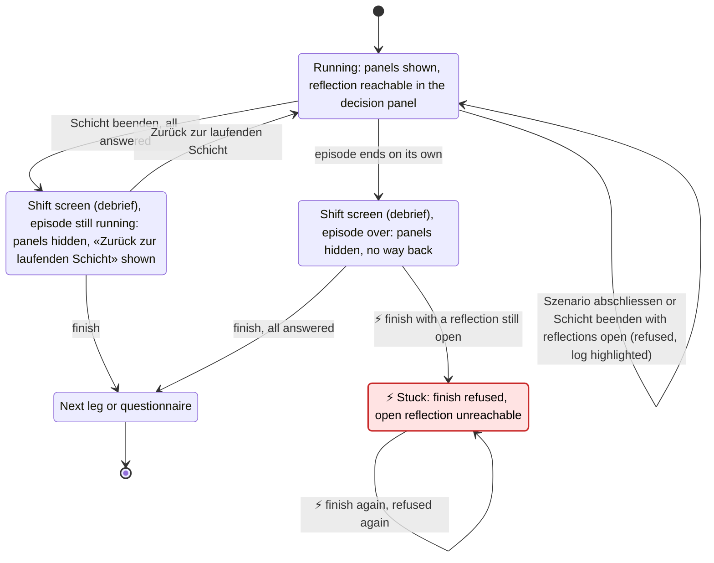

Legend: ⚡ and red mark the bug.

| Component | Responsibility in this flow | Lifetime |
|---|---|---|
| `AppComponent` | The shell: shows the working screen or the shift screen, and finishes a leg (`finishDemoMode`). | The application root, one for the page. |
| `TourDebriefComponent` | The shift screen of a tour with `debrief`: what the shift amounted to, and its finish. | Component: created while the shift screen is open. |
| `TourGuideComponent` | The tour's step strip, with «Reflexion öffnen» and «Schicht beenden». | Component: one, while a guided tour runs. |
| `SessionStore` | Knows whether the episode is over (`episodeDone`) and which reflections are open. | Singleton (`providedIn: 'root'`). |

Fix, two options (a) built 2026-11-06):

- a) While reflections are open, the debrief's finish reopens the working
  screen (`shiftScreenOpen` false while `reflectionsMissing`), with the
  message and the highlighted log, also after the episode ended. Small: one
  condition in `shiftScreenOpen()`.
- b) The debrief shows the open reflections itself. Larger: a second place to
  answer, against D1 (the reflection is asked in the decision panel).

Proposal: a).

### Finding 4

The queue of open reflections applied in every session, not only in tours
that ask for reasons (`reasonDialog`). Elsewhere the short "why?" prompt
(`RationaleCaptureComponent`, in the Recommendation panel and the Co-Learning
reflection panel) then behaved differently from `main`, against §1.3, and with
the fix for finding 1 its closed prompts were never reported. As built before
the fix:

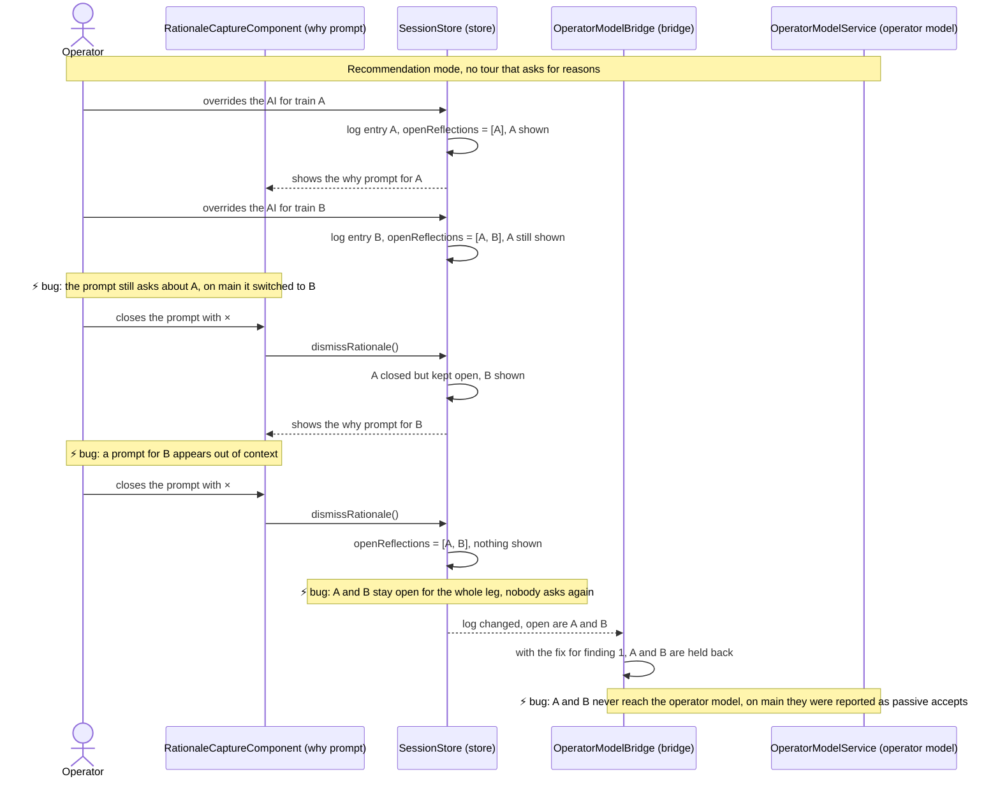

| Component | Responsibility in this flow | Lifetime |
|---|---|---|
| Operator | The person who overrides the AI and is asked why. | A person, not code. |
| `RationaleCaptureComponent` | The short "why?" prompt with reason chips, in the Recommendation panel and the Co-Learning reflection panel. | Component: one per panel that hosts it. |
| `SessionStore` | Holds the decision log and the reflections still open. | Singleton (`providedIn: 'root'`). |
| `OperatorModelBridge` | Reports each human decision once to the operator model, after its reason is settled. | Singleton, created lazily (only the Director panel `co-learning-effect` injects it). |
| `OperatorModelService` | The client of the backend operator model. | Singleton (`providedIn: 'root'`). |

On `main` the prompt always asks about the latest decision: a new decision
replaces it and × drops it, and the bridge reports a dropped decision at once
without a reason ("passive accept").

Fix (built 2026-11-06): queue only in tours that ask for reasons.

- `SessionStore.queueReflections`, set by `AppComponent` from
  `tour.reasonDialog()`; the store still does not read the tour.
- Off: a new decision replaces the list and is shown, × removes it from the
  list, as on `main`, so the bridge reports it at once.
- On: as designed in §4.1.
- Specs: the store with the queue off; the bridge reporting a closed prompt
  at once outside a reason tour.
