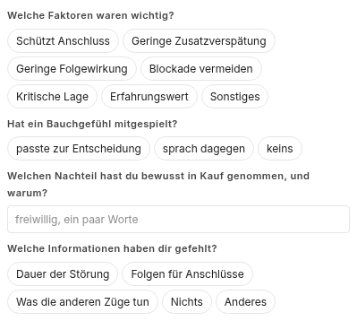
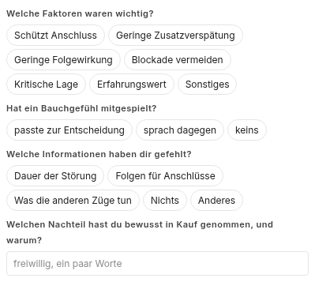
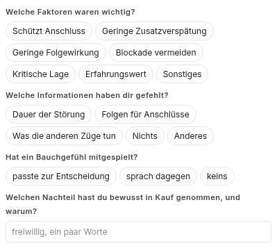
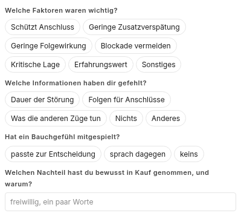
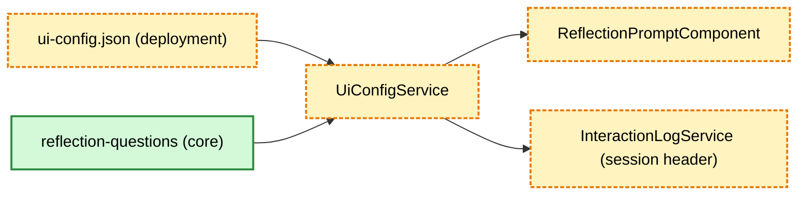

# Ask the reflection's questions in a fixed order, set per deployment (#182)

> **Status:** plan of 2026-11-16, built 2026-11-16. Based on `main` fd0c70c (PR #176,
> the reflection in the decision log, is merged); rebased onto `main` 7f284a9
> on 2026-11-18. Issue
> [#182](https://github.com/flatland-association/flatland-ui-hub/issues/182)
> ("Fragen in Reflexion fix oder randomisiert?", @CleverManu). Branch
> `feature/182-reflection-question-order`, off `main` (on request;
> contributors usually branch off `explore_db`). PR
> [#203](https://github.com/flatland-association/flatland-ui-hub/pull/203).
> Open questions: none (§9.1).
>
> **Why:** after each decision, the reflection asks its guided questions in a
> different order. Participants see an inconsistent prompt, and the order
> varies in the study data without being recorded. The study lead decided
> against a random order; the maintainer wants the order set by the
> deployment's config.

## 1. Introduction and goals

*What the change is for: the requirements, the qualities that matter, who has a stake, and what it leaves out.*

### 1.1 Requirements overview (functional requirements)

*The issue's text and the numbered requirements the rest of the plan refers to.*

> Sollen die Fragen in der Reflexion randomisiert sein (aktuell so
> implementiert)?

Answers in the issue: "Nein, die Reflexionsfragen würde ich nicht
randomisiert wiedergeben." (@SamiraAPS, 2026-11-11); "Should be configuration
issue, should not be randomised but fixed." (@chenkins, 2026-11-16).

Requirements:

- **REQ-1** The reflection asks its questions in the same order after every
  decision, in every session of a deployment.
- **REQ-2** The deployment's `ui-config.json` sets that order (Q-1). Without
  a setting, the order is the app's default (Q-2).
- **REQ-3** The session record says which order was in effect.

### 1.2 Quality goals (non-functional requirements)

*The few qualities the design must reach, each with a concrete scenario.*

| ID | Priority | Quality goal | Scenario |
|---|---|---|---|
| NFR-1 | 1 | Comparable study data | Two participants on the same lab machine answer the reflection's questions in the same order, and the analysis can read that order from each record. |
| NFR-2 | 2 | Fail-safe config | A typo in the setting warns in the console and still shows every question, as for the other `ui-config.json` entries. |

### 1.3 Stakeholders

*Who asks for the change, decides on it, reviews it or works with the result, and what they expect.*

| Role | Name | Expectations |
|---|---|---|
| Study lead (FHNW & SBB) | @SamiraAPS | No random order of the reflection's questions; chooses the order (Q-2). |
| Reporter | @CleverManu | A consistent reflection. |
| Maintainer | @chenkins | The order is a deployment setting (Q-1). |

### 1.4 Follow-ups (not in this PR)

*What this PR leaves out, why, and where it goes later.*

None. The two candidates were decided on 2026-11-16 instead (§9.2): one order
serves both study groups, so no order per condition; and the missing order
in older records is an accepted limitation (§2.1).

## 2. Constraints

*What limits the design from outside: platform, organisation and conventions.*

| ID | Constraint | Kind | Explanation |
|---|---|---|---|
| C-1 | Stored and logged ids stay. | Convention | `AGENTS.md`: the question ids `gut`, `missing`, `tradeoff` are keys of the recorded `reflection` answers, and now values in `ui-config.json`. They keep their names. |
| C-2 | No inline user-facing text. | Convention | No new text is needed; the labels stay in `reflectionPrompt.q.*`. |
| C-3 | Dependencies point from features to core. | Convention | `UiConfigService` (`core/config`) can't import from `features/reflection-prompt`, so the question ids move to `core` (§4.3). |
| C-4 | `ui-config.schema.json` has `additionalProperties: false`. | Technical | A new key needs a schema entry, or editors flag the file. |

### 2.1 Limitations

*What the built code gets wrong or ignores, each with the TODO or issue that tracks it.*

- Records made before the change have no `reflectionPromptQuestionOrder`: their
  order followed from the decision's timestamp. Accepted (decided
  2026-11-16, §9.2): it can be re-derived from the timestamp if an analysis
  needs it, which is analysis work, not app code. The function that drew it,
  `pickQuestions(t, 3)` in `reflection-prompt.component.ts` at fd0c70c, is
  named in `docs/experiment-logging.md` (F-1).

### 2.2 Assumptions

*What must hold for the design to be correct, but is not checked in code.*

Not checked in code; they hold by construction of the study setup.

- One order per installation serves every reason tour and both study groups.
  The study needs no counterbalancing of question order (decided by the study
  lead, 2026-11-11), and no order per condition (decided 2026-11-16, §9.2).
- Every lab machine runs the same build of this branch or later, started
  from the Plan B config in git (`UI_CONFIG=frontend/public/ui-configs/plan-b.json
  ./start-demo.sh`). That file sets no `reflectionPromptQuestionOrder`, so every
  machine asks in the default order from the code; so does a machine started
  without `UI_CONFIG` (the shipped `ui-config.json` sets none either). A
  different order on all machines goes into `plan-b.json` in git, not into a
  machine's copy.
- No machine's served `ui-config.json` is changed by hand (an edited copy in
  `backend/static`, or a file mounted into the Docker image). If one is, the
  sessions on that machine use its order; the header's
  `reflectionPromptQuestionOrder` records it, so the analysis can see it, and an
  older build shows in `appVersion` and in a header without the field. A
  replay does not draw this reflection at all, so it shows neither order.

## 3. Context and scope (checked 2026-11-16 on `main` fd0c70c)

*The code on the base branch that the change works in, as it is before the change, and where the change stops.*

- `ReflectionPromptComponent`
  (`frontend/src/app/features/reflection-prompt/reflection-prompt.component.ts`)
  is the reflection after a decision in a reason tour. It sits in the
  decision log (`decision-log-panel.component.html:166`) and in the panel host
  (`panel-plugin-host.component.html:71`).
- It always asks «Welche Faktoren waren wichtig?» first. Then come the three
  guided questions of `REFLECTION_QUESTION_POOL = ['gut', 'missing',
  'tradeoff']`: «Hat ein Bauchgefühl mitgespielt?», «Welche Informationen
  haben dir gefehlt?» and «Welchen Nachteil hast du bewusst in Kauf genommen,
  und warum?».
- `shown` orders them by `pickQuestions(p.timestamp, POOL.length)`, a shuffle
  seeded by the decision's timestamp. The order is fixed per decision, so
  reopening keeps it, and differs between decisions.
- History: 1504c722 (2026-09-19) drew two of the three questions per decision
  and put the third behind «Weitere Fragen». PR #176 shows all three (its plan
  `reflection-inline.md` D18), so the shuffle now only reorders them. Its
  finding 26 handed the order over to #182.
- The record holds only the answers (`reflectionAnswers()`: `gut`, `missing`,
  `tradeoff`, unanswered ones absent), not the order shown.
- `UiConfigService` (`core/config/ui-config.service.ts`) reads the
  deployment's `ui-config.json` once at startup (`load()`). Besides the
  merged restrictions (`hidden`, `collapsedByDefault`, `policyAllowlist`) it
  holds one value: `studyLogging`, "deployment file only", not merged, which
  `apply()` ignores. `InteractionLogService` reads it.
- `ui-config.schema.json` describes the file by hand;
  `ui-config-items.spec.ts` checks its id enums against the code.
- The record's header gained optional fields before, absent in older records:
  `shiftSummary` (#174), `playSpeedLevel`, `uiRestrictions`.
- Out of scope: the Co-Learning reflection panel
  (`co-learning-reflection.component.ts`). It already asks its questions in a
  fixed order, the first `reflectionQuestionLimit` of them.

## 4. Solution strategy

*The fundamental choices and why, the rules the design follows, how it is verified, and the design of each part.*

| Quality goal | Scenario | Solution approach | Details |
|---|---|---|---|
| NFR-1 | Same order, readable from the record | One resolved order per installation, shown by the prompt and written into the header | §4.3, §4.4 |
| NFR-2 | A typo in the setting | Unknown or repeated ids warn and are skipped; questions not listed follow in the default order | §4.3 |

### 4.1 Design principles

*The rules the design follows, each with its decision, the concepts it reuses instead of building new ones, and what
is not new on purpose.*

- **DP-1 The deployment decides the order, the app only resolves it.** One
  function turns the configured list into the order shown; the prompt and the
  record both use its result, so they can't differ (Q-1).
- **DP-2 Every question is still asked.** The setting orders the questions,
  it doesn't hide them: unlisted ones follow in the default order
  (`reflection-inline.md` D18, NFR-2).
- **DP-3 A value, not a restriction.** Like `studyLogging`, the order is read
  from the deployment file only and is not merged with a condition's `ui`
  block.

Reused concepts:

| Need | Reused concept | Instead of |
|---|---|---|
| Where the order is set | `ui-config.json`, read by `UiConfigService.load()` | A briefing flag or a new config file |
| How a deployment-only value is held | `studyLogging`: a readonly signal on `UiConfigService`, ignored by `apply()` | A merged entry like `hidden` |
| The default order | `REFLECTION_QUESTION_POOL` | A second list |
| Recording it | An optional header field, as `shiftSummary` | A new event type |

Not new on purpose: no UiConfig id or verb (`UI_CONFIG_ITEMS` stays), no
Layout Designer export, no change to the recorded answers, no new i18n key.

### 4.2 Verification

*How each requirement and quality goal is shown to work: tests, CI checks, before and after screenshots.*

Screenshots: Plan B condition `plan-b-p01`, Plan B deployment config,
German, two decisions in leg 1 (trains AB and BA), the reflection's
questions after each. Before on `main` fd0c70c, after on this branch
rebased onto `main` 7f284a9 (5ffca3d) without and with
`"reflectionPromptQuestionOrder": ["missing", "gut", "tradeoff"]` in the
served `ui-config.json`, production builds in the
running app, by `scripts/docshots-reflection-question-order.mjs`. Before,
the order is drawn per decision, so a run can draw the same order twice;
the pictures are from a run that drew two.

| ID | Requirement | Test or check | Result | Screenshots |
|---|---|---|---|---|
| REQ-1 | Same order after every decision | Spec: `shown()` is the same for decisions with different timestamps; the `.rp-q` labels in the DOM follow it | ✅ specs pass (S-2) | before:  <br>after:   |
| REQ-2 | The deployment sets the order | Specs: `resolveReflectionQuestionOrder()` (null, full list, partial list, unknown and repeated ids); `UiConfigService` after `load()`; the prompt follows the service | ✅ specs pass (S-3) | after, with `missing` first:   |
| REQ-3 | The record names the order | Spec: the header's `reflectionPromptQuestionOrder` equals the order in effect | ✅ specs pass (S-4) | - |
| NFR-1 | Comparable study data | REQ-1 and REQ-3's specs | ✅ specs pass (S-2, S-4) | - |
| NFR-2 | Fail-safe config | REQ-2's specs for unknown and repeated ids; the schema spec | ✅ specs pass (S-3) | - |

All steps: the four CI checks.

Read from the page (the guided questions, after «Welche Faktoren waren
wichtig?»):

| Run | Decision AB | Decision BA |
|---|---|---|
| before (`main`) | Bauchgefühl, Nachteil, Informationen gefehlt | Bauchgefühl, Informationen gefehlt, Nachteil |
| after, default order | Bauchgefühl, Informationen gefehlt, Nachteil | Bauchgefühl, Informationen gefehlt, Nachteil |
| after, `missing` first | Informationen gefehlt, Bauchgefühl, Nachteil | Informationen gefehlt, Bauchgefühl, Nachteil |

### 4.3 The order: setting, resolution and prompt (REQ-1, REQ-2; Q-1, Q-2)

*One part of the change: what changes and why, with the requirements and decisions it implements.*

- New `core/reflection-questions.ts` holds what core and the prompt share:
  `ReflectionQuestionId`, `REFLECTION_QUESTION_POOL` (moved from the
  component; its order is the default, Q-2) and
  `resolveReflectionQuestionOrder(configured: readonly string[] | null | undefined)`:
  - the listed ids that are in the pool, in the listed order, each once;
  - then the pool's ids not listed, in pool order;
  - an unknown or repeated id warns (`[uiConfig] …`, as `resolveIds`) and is
    skipped.
- `UiConfig` gets `reflectionPromptQuestionOrder?: string[]`, documented as
  "deployment file only", as `studyLogging`.
- `UiConfigService` resolves it in `load()` and exposes
  `reflectionPromptQuestionOrder` (a readonly signal, the pool's order before
  `load()` or without the key). `apply()` ignores the key.
- `ui-config.schema.json` gets the property: an array of unique items from
  `gut`, `missing`, `tradeoff`, with a description saying the factors question
  stays first and unlisted questions follow.
- `ReflectionPromptComponent.shown` returns `uiConfig.reflectionPromptQuestionOrder()`
  while a decision waits, `[]` otherwise. `pickQuestions()` goes: nothing else
  calls it. The docstring says "in the order the deployment sets".

Example (`frontend/public/ui-configs/plan-b.json`, only if the study leads
choose another order than the default, Q-2):

```diff
 {
   "$schema": "/ui-config.schema.json",
   "studyLogging": true,
+  "reflectionPromptQuestionOrder": ["missing", "gut", "tradeoff"],   // added, illustrative
   "hidden": [
```

### 4.4 The order in the record (REQ-3)

*One part of the change: what changes and why, with the requirements and decisions it implements.*

- `SessionHeader` gets `reflectionPromptQuestionOrder?: string[]`: the order in
  effect at session start, from `UiConfigService`. Absent in records made
  before it existed, whose order was drawn per decision.
- It is written for every session, not only reason tours: the value is
  cheap, and the analysis then needn't know which tours reflect.
- No `ui_state` event: the value is read once at startup and can't change
  during a session.

```diff
 "header": {
   "conditionId": "plan-b-p01",
   "appVersion": "fd0c70c",
+  "reflectionPromptQuestionOrder": ["gut", "missing", "tradeoff"],   // added
   "uiRestrictions": { "hidden": ["control.contrast"], … }
 }
```

Nothing is removed from the record. Values are illustrative.

## 5. Building block view

*The components the change adds or changes: an overview, why the system is split this way, what each is responsible
for, the important interfaces, and the planned data model.*

### 5.1 Reflection order, from the deployment to the record

*One white box: its building blocks, why it is split this way, and the interfaces between them.*



Notation: [flowchart in Mermaid](https://mermaid.js.org/syntax/flowchart.html);
green: added, yellow dashed: modified.

**Motivation:** the service already owns everything read from
`ui-config.json`, so it owns this value too (DP-3). The question ids move to
`core` because the service needs them and core can't import a feature (C-3).
The prompt and the record read one resolved value (DP-1).

**Contained building blocks:**

| Component | Responsibility | Change |
|---|---|---|
| `reflection-questions` | The guided questions' ids, their default order, and how a configured order is resolved. Not their texts or answers, which stay with the prompt. | 🟩 added: one place says in which order the questions come. |
| `UiConfigService` | Holds what the deployment file and a condition declare. Not where the values are used. | 🟨 modified: a deployment can set the reflection's question order. |
| `ReflectionPromptComponent` | Asks the reflection after a decision of a reason tour and hands the answers to the record. Not for the Co-Learning reflection panel, nor for the strategy reflection. | 🟨 modified: the guided questions come in the same order after every decision, the deployment's. |
| `InteractionLogService` | Writes the session record. Not what the UI shows. | 🟨 modified: the record says in which order the reflection asked. |
| `ui-config.json` (schema) | The deployment file's format. | 🟨 modified: an optional `reflectionPromptQuestionOrder`. |

## 8. Crosscutting concepts

*What the change introduces that other code will follow, and what it changes for existing callers.*

### 8.1 New patterns

*What is new compared with the base branch.*

Compared with `main`. What is reused, and what is not new on purpose, is in §4.1.

| ID | New | Defined in |
|---|---|---|
| PAT-1 | A deployment value that orders content rather than hiding it, resolved with a fallback for what it doesn't list | §4.3 |

### 8.2 Breaking changes

*What breaks for whom, and the migration path.*

None for callers or deployments: without the new key, the order is the
default. Visible only inside the frontend:

- `pickQuestions()` is removed; only the prompt and its spec used it.
- `ReflectionQuestionId` and `REFLECTION_QUESTION_POOL` move to
  `core/reflection-questions.ts`; the prompt's spec is the only other
  importer.

## 9. Decisions

*The decisions behind the plan: the questions still open, the decisions taken, and how each review finding was settled.*

### 9.1 Open questions

*Choices not made yet, each with its options and a proposal.*

✅ ~~**(Q-1) Fixed in code, or set per deployment?**~~ **Decided
2026-11-16 by the maintainer:** per deployment, in `ui-config.json` (§4.3).

✅ ~~**(Q-2) Which default order?**~~ **Decided 2026-11-16 by the
maintainer:** a), today's pool: Bauchgefühl → Informationen gefehlt →
Nachteil. It goes from a quick choice to the one free-text question, which
comes last. The study leads can set another order for their lab machines in
`ui-config.json` without a code change.

### 9.2 Decision log

*Every decision by date, with why it was taken and what follows from it.*

| Date | Decision | Why | Consequences |
|---|---|---|---|
| 2026-11-09 | ✅ The order is handled outside PR #176, in #182 (`reflection-inline.md` finding 26). | #176 was about where the reflection shows. | This plan. |
| 2026-11-11 | ✅ No random order of the reflection's questions (@SamiraAPS in #182; confirmed by @chenkins on 2026-11-16). | A random order varies between participants without being recorded; the study needs no counterbalancing. | REQ-1; `pickQuestions()` goes (§4.3). |
| 2026-11-16 | ✅ The order is set per deployment, in `ui-config.json` (Q-1). | The order is a study choice, not a code choice; the deployment file is where a lab machine's other study settings live. Not taken: fixed in code. | REQ-2, REQ-3; the ids move to `core` (C-3); the record names the order (§4.4). |
| 2026-11-16 | ✅ The default order is today's pool: Bauchgefühl → Informationen gefehlt → Nachteil (Q-2). | From a quick choice to the one free-text question; proposed in the issue. Not taken: another order, which the study can still set in `ui-config.json`. | `REFLECTION_QUESTION_POOL` keeps its order; `plan-b.json` needs no entry. |
| 2026-11-16 | ✅ One order serves both groups of the study: no order per study condition (a `LayoutPreset`'s `ui` block). | Per deployment is what was asked (Q-1); both groups run on the same lab machines and should answer in the same order. | The setting stays deployment-only (DP-3); no follow-up. |
| 2026-11-16 | ✅ Records made before this change, without `reflectionPromptQuestionOrder`, are an accepted limitation (§2.1). | The order can be re-derived from the decision's timestamp if an analysis needs it; that is analysis work, not app code. | No follow-up. |
| 2026-11-18 | ✅ The setting and the header field are called `reflectionPromptQuestionOrder` (F-9, PR comment). | A record also holds the Co-Learning reflection with its own questions; the name says which reflection it is. Both names were still free: no record and no deployment file carries them yet. Not taken: renaming only the header field, which would give one setting two names. | S-11. |

### 9.3 Code Review Findings

*Findings from code reviews, PR comments and TODOs, with their status and the commits that fix them.*

PR [#203](https://github.com/flatland-association/flatland-ui-hub/pull/203);
branch based on `main` fd0c70c, rebased onto 7f284a9 on 2026-11-18 (SHAs
below are the rebased ones). Code review findings (F-1–F-8) were added on
2026-11-16, at 9d45412; their line numbers refer to it. PR review comments
(F-9) were added on 2026-11-18, at 9d45412 (the pushed head). F-1–F-5 fixed
in S-6–S-10, F-9 in S-11; F-6, F-7 and F-8 dropped. Since
S-11 the setting and the header field are called
`reflectionPromptQuestionOrder`; F-1–F-9 name them as they were. No TODOs
added. In Fixed, ✅ marks a fixed finding, ⏭️ one taken
over by a follow-up, — a dropped one, ⚠️ a comment resolved on GitHub without
a code change and without a reason; ❌ next to ✅ marks a finding fixed in the
code whose PR comment is not resolved yet. "resolved" in Source marks threads
resolved and checkboxes ticked on GitHub.

| Fixed | ID | Source | Category | Severity | Finding | Commit message |
|---|---|---|---|---|---|---|
| ✅ | F-1 | code review | docs | medium | `docs/plans/reflection-question-order.md:84`, `docs/experiment-logging.md:208`: both say the order of older records "followed from" or "was drawn per" decision, and the plan says it "can be re-derived from the timestamp". But this PR removes `pickQuestions()`, the seeded shuffle that did it, so the order can only be re-derived with the function from git history, and neither doc says where it is. An analysis of position effects in the existing data has no pointer to it. Suggested fix: name it in both places: `pickQuestions(t, 3)` in `frontend/src/app/features/reflection-prompt/reflection-prompt.component.ts` at fd0c70c, seeded by the decision's `t` in the record. Fixed in 6ce871a (S-6). | docs(experiment-logging): say where the shuffle of older records' reflection order is kept. |
| ✅ | F-2 | code review | docs | low | `frontend/src/app/core/interaction-log/session-record.ts:99`, `frontend/src/app/core/interaction-log/interaction-log.service.ts:545`: the header names the order in every session, as decided (§4.4), but the field's doc says "the order the reflection asked its guided questions in". A Director session without a reflection carries the field too, so an analysis could read it as "a reflection ran". Suggested fix: say "the order a reflection asks in, if the session has one". Fixed in 073ef59 (S-7). | docs(session-record): say that the header's reflection order is written for every session. |
| ✅ | F-3 | code review | design | low | `frontend/src/app/core/config/ui-config.service.ts:90`: `apply()` ignores `reflectionQuestionOrder` in a condition's `ui` block without a warning. A study lead who puts it into one group's layout gets the deployment's order with no sign of it; only the schema description says "Ignored in a preset's ui block". `studyLogging` behaves the same today. Suggested fix: warn in `apply()` for both deployment-only keys. Fixed in 667cba8 (S-8). | fix(ui-config): warn when a condition sets a deployment-only value. |
| ✅ | F-4 | code review | test-coverage | low | `frontend/src/app/features/reflection-prompt/reflection-prompt.component.spec.ts:56`: the spec replaces the `reflectionQuestionOrder` signal with a plain spy, so it doesn't test that the prompt follows the service's signal, nor the path from `load()` to the prompt. A change that reads it outside the reactive context would still pass. Suggested fix: load the order through `HttpTestingController` and the real `UiConfigService`. Fixed in 5c8b3c5 (S-9). | test(reflection): load the configured order through the real UI config service. |
| ✅ | F-5 | code review | robustness | low | `scripts/docshots-reflection-question-order.mjs:53`: when `box.x - pad` is clamped to 0, the clip's width isn't reduced; and the height uses the hard-coded viewport height 1000 instead of the configured one, so a changed viewport clips wrongly or throws on a negative height. Suggested fix: compute both from `page.viewport()`. Fixed in 543e14e (S-10). | fix(docshots): clip the reflection's questions within the viewport. |
| ✅ | F-9 | [PR comment](https://github.com/flatland-association/flatland-ui-hub/pull/203#discussion_r4611511481), resolved | docs | low | `frontend/src/app/core/interaction-log/session-record.ts:103`, `docs/experiment-logging.md:203`: a record also holds the Co-Learning reflection with questions of its own, and the header field is written also when the reflection prompt never shows. The doc comment and the logging doc should say that it is the order of the reflection prompt after a decision (`reflectionPrompt.q.*`), recorded whether or not the prompt appears, and unrelated to the Co-Learning reflection. The comment also proposes renaming the field to `reflectionPromptQuestionOrder` while no records carry it yet. Fixed in 5ffca3d (S-11), with the rename of both the header field and the `ui-config.json` setting (the user, 2026-11-18). | refactor(reflection): name the question order after the reflection prompt, not the Co-Learning reflection. |
| — | F-6 | code review | design | low | `frontend/src/app/features/reflection-prompt/reflection-prompt.component.ts:84`: `shown` reads the replaying machine's order, not the record's. Checked: a replay doesn't draw this reflection at all (it never fills the open reflections, `session.store.ts:1535`), so no replay shows a wrong order today; this is the assumption in §2.2, and the user decided on 2026-11-16 not to plan a follow-up. Dropped: a replay shows no decisions of Plan B at all, not only no reflection, so showing the recorded order is part of a replay feature, not of this PR (the user, 2026-11-18). | - |
| — | F-7 | code review | test-coverage | low | `frontend/src/app/features/reflection-prompt/reflection-prompt.component.spec.ts:36`: the spec takes two decisions at different times although `shown` no longer reads the timestamp. Assessed: the setup is what makes it a regression test for REQ-1, as the old shuffle was seeded by exactly that timestamp. Dropped: kept as is, the spec guards REQ-1 against an order seeded by the timestamp (the user, 2026-11-16). | - |
| — | F-8 | code review | design | low | `frontend/src/app/core/reflection-questions.ts:21`, `frontend/src/app/core/config/ui-config.service.ts:104`: `resolveReflectionQuestionOrder` repeats the warn-and-skip loop of `resolveIds`, with other wording. Assessed: `resolveIds` checks registry ids against verbs and doesn't keep an order, so the two share only the warning; a shared helper would be one `console.warn` line. Dropped: the two loops share only the warning; a shared helper would save no code (the user, 2026-11-16). | - |

**Issue references:** the PR is to close #182. No TODO or comment in the code
references it.

## 10. Glossary

*The domain and technical words the plan uses, with their code symbols.*

- **Reflection** (`ReflectionPromptComponent`): the questions after a
  decision in a reason tour, in the decision log. Not the Co-Learning
  reflection panel (`co-learning-reflection`), nor the strategy reflection.
- **Guided questions** (`ReflectionQuestionId`: `gut`, `missing`,
  `tradeoff`): the reflection's questions after the factors. Not the factors
  question (`reflectionPrompt.q.factors`), which is always first.
- **Default order** (`REFLECTION_QUESTION_POOL`): the order without a
  setting (Q-2).
- **Deployment file** (`ui-config.json`, `UiConfig`): the config of one
  installation, read at startup. Not a condition's `ui` block in a
  `LayoutPreset`.
- **Reason tour**: a tour whose briefing sets `reasonDialog`, e.g. Plan B.

## 11. Execution plan and status

*The commits that build the change, in order, and which of them are done: the source of the PR's status.*

### 11.1 Steps

*One row per commit: what it does, the findings it fixes, its message, and its SHAs once committed.*

| ID | Findings | Step | Category | Severity | Commit message | Commit(s) | Needs | Blocked by |
|---|---|---|---|---|---|---|---|---|
| ✅ S-1 | - | This plan | docs | low | docs(plans): plan for #182, the reflection's questions in an order set per deployment. | 10a2e78 | - | - |
| ✅ S-2 | - | Fixed order: `shown` reads the pool, `pickQuestions()` and its specs go, an order spec, the docstring | bug | medium | fix(reflection): ask the reflection's questions in a fixed order. | 7d6d0d5 | S-1 | Q-2 |
| ✅ S-3 | - | `core/reflection-questions.ts` with the resolver; `UiConfig.reflectionPromptQuestionOrder`, the service signal, the schema; the prompt reads the service; specs | feature | medium | feat(ui-config): let the deployment set the order of the reflection's questions. | 8ee616f | S-2 | - |
| ✅ S-4 | - | `SessionHeader.reflectionPromptQuestionOrder`, written at session start; spec; `docs/experiment-logging.md` | feature | medium | feat(experiment-logging): record the order of the reflection's questions in the session header. | e56b5da | S-3 | - |
| ✅ S-5 | - | Before and after screenshots of two decisions, with and without a configured order | docs | low | docs(plans): screenshots of the reflection's question order for #182. | 00088fb | S-4 | - |
| ✅ S-6 | F-1 | Name the removed shuffle of older records in the logging doc | docs | medium | docs(experiment-logging): say where the shuffle of older records' reflection order is kept. | 6ce871a | S-4 | - |
| ✅ S-7 | F-2 | Say in the header field's doc that it is written for every session | docs | low | docs(session-record): say that the header's reflection order is written for every session. | 073ef59 | S-4 | - |
| ✅ S-8 | F-3 | Warn when a condition's `ui` block sets a deployment-only value; specs | design | low | fix(ui-config): warn when a condition sets a deployment-only value. | 667cba8 | S-3 | - |
| ✅ S-9 | F-4 | Spec: the configured order through the real `UiConfigService` | test-coverage | low | test(reflection): load the configured order through the real UI config service. | 5c8b3c5 | S-3 | - |
| ✅ S-10 | F-5 | Screenshot script: clip within the viewport | robustness | low | fix(docshots): clip the reflection's questions within the viewport. | 543e14e | S-5 | - |
| ✅ S-11 | F-9 | Rename the `ui-config.json` setting, the service signal and the header field to `reflectionPromptQuestionOrder`; say in their docs and the logging doc that the order is the reflection prompt's after a decision, recorded whether or not it shows, and unrelated to the Co-Learning reflection | refactor | low | refactor(reflection): name the question order after the reflection prompt, not the Co-Learning reflection. | 5ffca3d | S-7 | - |

## 12. Change inventory

*Every file the change adds, modifies, renames or removes, and what stays unchanged on purpose.*

### 12.1 New files

*The files the change adds, and what each adds.*

| File | Adds |
|---|---|
| `docs/plans/reflection-question-order.md` | This plan |
| `docs/plans/reflection-question-order/*.png` | Before and after screenshots (S-5) |
| `scripts/docshots-reflection-question-order.mjs` | Takes them: two decisions on Plan B, the reflection's questions after each, and the order printed (S-5) |
| `frontend/src/app/core/reflection-questions.ts` | `ReflectionQuestionId`, `REFLECTION_QUESTION_POOL` (moved), `resolveReflectionQuestionOrder()` (S-3) |
| `frontend/src/app/core/reflection-questions.spec.ts` | The resolver's specs (S-3) |

### 12.2 Modified files

*The files the change modifies, and what changes in each.*

| File | Changes |
|---|---|
| `frontend/src/app/features/reflection-prompt/reflection-prompt.component.ts` | S-2: `shown` returns the pool in order, `pickQuestions()` removed, docstring. S-3: the type and pool imported from core, `shown` reads `UiConfigService` |
| `frontend/src/app/features/reflection-prompt/reflection-prompt.component.spec.ts` | S-2: the `pickQuestions` specs give way to an order spec (same order for different decisions, in the DOM too). S-3: the prompt follows a configured order |
| `frontend/src/app/core/config/ui-config.service.ts` | S-3: `UiConfig.reflectionPromptQuestionOrder`; resolved in `load()`; readonly signal `reflectionPromptQuestionOrder` |
| `frontend/src/app/core/config/ui-config.service.spec.ts` | S-3: default, configured and invalid orders; `apply()` leaves the order alone |
| `frontend/public/ui-config.schema.json` | S-3: property `reflectionPromptQuestionOrder` |
| `frontend/src/app/core/interaction-log/session-record.ts` | S-4: `SessionHeader.reflectionPromptQuestionOrder?` |
| `frontend/src/app/core/interaction-log/interaction-log.service.ts` | S-4: writes it when the header is built |
| `frontend/src/app/core/interaction-log/interaction-log.service.spec.ts` | S-4: the header names the order in effect |
| `docs/experiment-logging.md` | S-4: the header field, and the `ui-config.json` key beside `studyLogging` |

Unchanged on purpose: `reflection-prompt.component.html` (it already renders
`shown()` in order), the i18n files, the recorded answers
(`reflectionAnswers()`), `UI_CONFIG_ITEMS`, `co-learning-reflection`,
`frontend/public/ui-configs/plan-b.json` (only if Q-2 picks another order
than the default), `docs/plans/reflection-inline.md` (a merged plan; its
finding 26 already points at #182).
