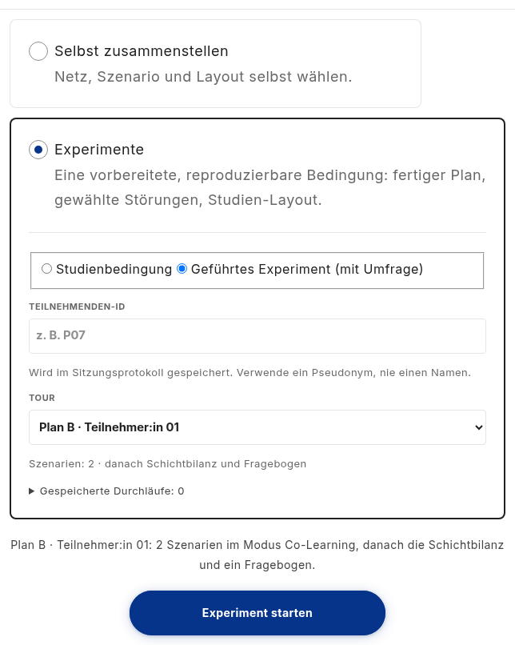
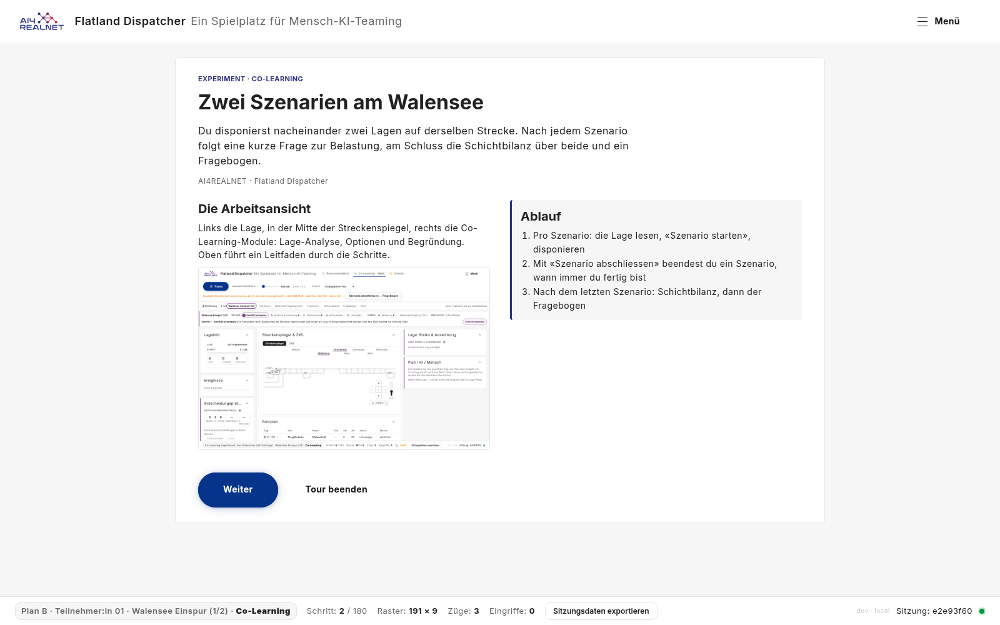
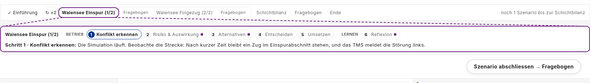
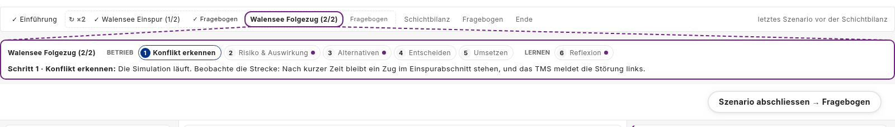
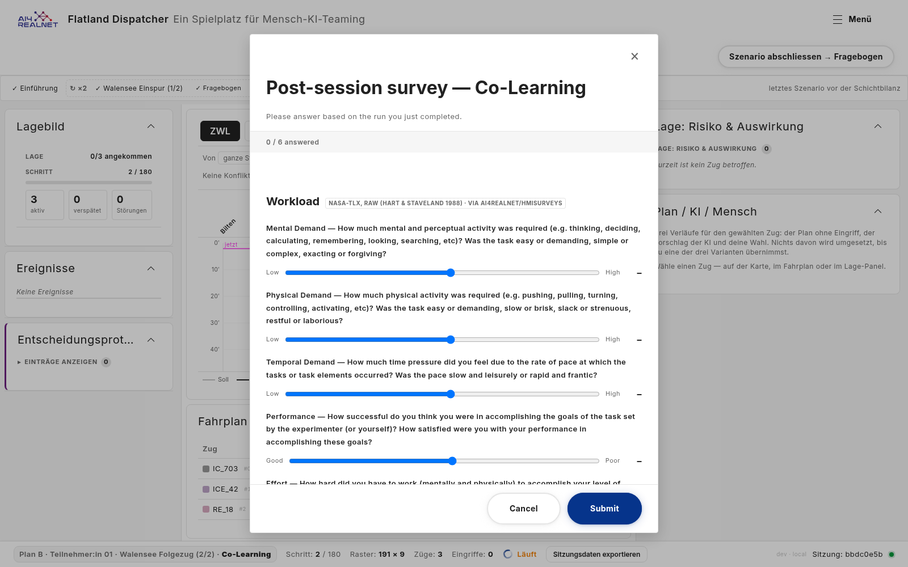
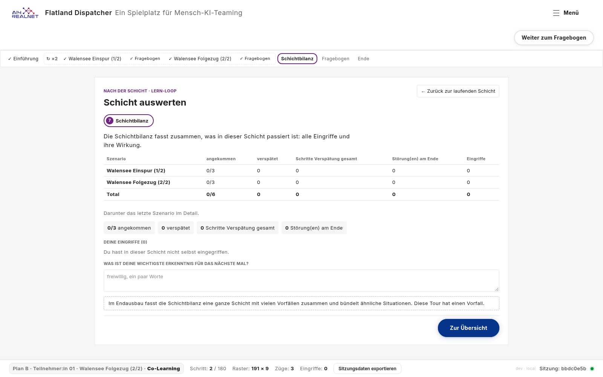
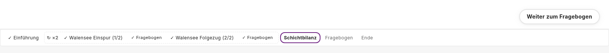
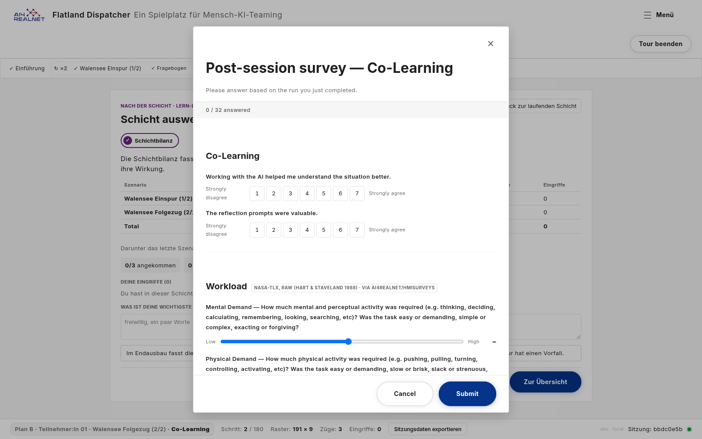

# Plan B experiment without the Schichtbilanz (#174)

> **Status:** plan, 2026-11-05. Based on `main` 1e33088, with #150
> merged ([PR #172](https://github.com/flatland-association/flatland-ui-hub/pull/172));
> written on 333013c and rebased (§7.1). Built 2026-11-05 (S1-S4); results in §6.2. All questions are decided (§8). Before screenshots: §6.1.
> Issue [#174](https://github.com/flatland-association/flatland-ui-hub/issues/174)
> ("Schichtauswertung entfernen", @CleverManu, label `plan b`). Branch
> `feature/174-remove-shift-evaluation`, off `main` (on request; contributors
> usually branch off `explore_db`).
>
> **Why:** an experiment does not need the shift evaluation. After the last
> scenario the participant should go straight to the questionnaire. The
> issue also asks whether this is already a setting, like a tour's
> `surveyAfterEachMode`. It is not (§2), so this plan adds one.

### Status

| ID | Commit message | SHA |
|---|---|---|
| S0 | docs(plans): plan for #174, the Plan B experiment without the Schichtbilanz, with before screenshots. | 1d06462 |
| S1 | feat(experiment-run): let a condition skip the Schichtbilanz after the last scenario. | 226ecca |
| S2 | feat(experiment-progress): drop the Schichtbilanz from the stepper and texts of a condition without it. | 475636b |
| S3 | feat(study-conditions): run Plan B without the Schichtbilanz (#174). | 8d5a550 |
| S4 | docs(plans): screenshots of Plan B without the Schichtbilanz for #174. | this commit |

### Design principles

- The flow of a guided run is the condition's: whether the Schichtbilanz
  comes is a `StudyCondition` field, like its questionnaires, not a
  briefing or tour flag (Q1, D1).
- The default keeps today's behaviour: only a condition that says
  `shiftSummary: false` changes (Q1, D1).
- Without the Schichtbilanz the shift is not ended into an evaluation:
  nothing opens behind the final questionnaire, and the replay shows what
  the participant saw (D3).
- No data moves: what the Schichtbilanz shows is recorded per leg anyway,
  and nothing new is recorded (D5).
- A text whose meaning changes gets a new key; the old one stays for the
  conditions that keep the Schichtbilanz (D4, AGENTS.md i18n rule).

Reused concepts:

| Need | Reused concept | Instead of |
|---|---|---|
| Switch the Schichtbilanz per experiment | an optional `StudyCondition` field, as `legSurveyParts` | `TourBriefing.debrief`/`debriefSections` (shared by tours, and `debrief: false` leaves an empty step, §2); a tour's `surveyAfterEachMode` (tours only) |
| Go from the last leg to the questionnaire | the existing phase `finalSurvey` and `openExperimentSurvey()` | a new phase |
| Stop the run at the last leg's end | `SessionStore.pause()` | `endShift()`, which opens the shift screen (D3) |
| Stepper and guide hint, live and in a replay | the existing switch `replay.active() ? replay.condition()… : run.…`, as for `hasLegSurvey` (`experiment-progress.component.ts:51`) | recording the field with the run (D5); a new replay signal |
| Pick a text by the condition | picking `summaryOne` or `summary` by the leg count (`app.component.ts:983`) | parameterised texts with the Schichtbilanz as a placeholder |

### Terms

- **Schichtbilanz** (shift summary; the issue says "Schichtauswertung"): the
  screen after the last leg of a guided condition. It is the briefing's
  debrief (`TourDebriefComponent`, "Nach der Schicht · Lern-Loop"), cut down
  to its `shift-summary` section, with one row per scenario. It is shown in
  the shift screen (`AppComponent.shiftScreenOpen`) while the run is in the
  phase `review`. Not the Director's shift review (`ShiftReviewComponent`),
  which only Director mode has and no experiment uses.
- **Guided condition:** a `StudyCondition` with `legs`
  (`core/demo/study-conditions.ts`), run by `ExperimentRunService`:
  `briefing → running (→ legSurvey) per leg → review → finalSurvey → done`.
  Two exist: `colearning-experiment` (one leg) and `plan-b-p01` (two legs).
- **Tour:** an entry of `TOURS` (`core/demo/tours.ts`). `surveyAfterEachMode`
  is a tour field. Experiments stopped being tours with #131: they are
  conditions now, and tour fields do not apply to them.
- **Plan B:** the study condition `plan-b-p01`, layout `preset-plan-b`.

### Components

| Component | Responsibility | Change |
|---|---|---|
| `StudyCondition` | Pins what one experiment run is: layout, mode, legs, questionnaires, and now whether the Schichtbilanz comes. Not how a run proceeds at runtime. | 🟨 modified: an optional switch that says whether the Schichtbilanz comes after the last leg. |
| `ExperimentRunService` | Follows a guided run through its phases and names the next step. Not the screens themselves. | 🟨 modified: skips `review` when the condition has no Schichtbilanz. |
| `AppComponent` (`nextLegOrReview`, `shiftScreenOpen`) | Moves the run on after a leg and decides what fills the working area. Not what the Schichtbilanz shows (`TourDebriefComponent`). | 🟨 modified: goes straight to the final questionnaire, opens no shift screen behind it, and the start screen no longer announces the Schichtbilanz. |
| `ExperimentProgressComponent` | The stepper above a guided run: where the participant is and what comes. Not the navigation, which is the toolbar's finish button. | 🟨 modified: no "Schichtbilanz" step and no "bis zur Schichtbilanz" count without one. |
| Briefing `colearning-experiment-2x` | The opening page Plan B participants read before the first scenario. Not the per-scenario intro cards. | 🟨 modified: it no longer announces the Schichtbilanz. |
| `TourGuideComponent` | The guide strip with the current scenario's steps. Not the stepper. | 🟨 modified (Q5): its closing hint no longer announces the Schichtbilanz. |
| `ReplayService` | Replays a recorded run as it was seen. | ⬜ unchanged (§4.4). |

## 1. What the issue asks for

| # | Requirement | Source |
|---|---|---|
| 1 | The Plan B experiment has no Schichtbilanz: after the last scenario comes the questionnaire | issue |
| 2 | Answer: is this already a setting, like `surveyAfterEachMode`? | issue |
| 3 | If not, it becomes one, per experiment | issue ("parametrisierbar"), D1 |

### 1.1 Assumptions and exclusions

- **Assumptions** (not checked in code; they hold by construction of the
  experiment flow and the study setup):
  - The per-leg data stays in the record. Every leg's `ShiftRecord`
    (KPIs, interventions, finish reason) is written at the leg's end
    (`ExperimentRunService.finishLeg`), not by the Schichtbilanz screen, so
    removing the screen loses no data for the analysis.
  - No Plan B run recorded before this change has to replay unchanged. Old
    records contain the `review` phase and still replay with it (§4.4).
  - Plan B runs in German: its briefing forces `language: 'de'`
    ([#170](https://github.com/flatland-association/flatland-ui-hub/issues/170),
    L1). The new en/fr texts (§4.3) show in Plan B only once #170 is
    fixed; until then they serve other conditions and the replay.

Exclusions (follow-ups):

| Follow-up | Why not in this PR | From | Findings | Issue |
|---|---|---|---|---|
| `colearning-experiment` without the Schichtbilanz | Not asked for Plan B; a one-line change with the new field | Q1 | - | - |
| Tours without their debrief | Tours are not experiments; `surveyAfterEachMode` stays as it is | issue | - | - |
| The Director's shift review (`shift-review` panel) | A Director-mode panel, used by no experiment | §2 | - | - |
| "Schicht beenden" and its evaluation in free sessions | Not part of an experiment; Plan B already hides the button (`control.endShift`) | §2 | - | - |
| Removing the debrief code (`TourDebriefComponent`, `shift-review.ts`) | Tours and `colearning-experiment` use it | Q1 | - | - |
| Plan B in the participant's language | Its own issue; this plan only adds the en/fr texts it needs | Assumptions | - | [#170](https://github.com/flatland-association/flatland-ui-hub/issues/170) |
| Hiding the guide strip under Plan B | Waits for #150's Q3; D6 stays correct either way, the hint is then not shown | §4.3 | - | [#150](https://github.com/flatland-association/flatland-ui-hub/issues/150) Q3, S5 |

### 1.2 Design changes and new patterns

Compared with `main`; the reused concepts are listed under the design
principles.

| What is new | Reuses | Defined in |
|---|---|---|
| `StudyCondition.shiftSummary?: boolean`: `false` skips the Schichtbilanz, absent keeps it | the optional per-condition flow fields (`legSurveyParts`, `studyLogging`) | §4.1 |
| A guided run that goes from the last leg straight to `finalSurvey` | the existing `finalSurvey` phase and `openExperimentSurvey()` | §4.2 |
| Texts chosen by the condition: `…NoShiftSummary` keys next to the old ones | the `summaryOne`/`summary` pick | §4.3, D4, D6 |

Not new on purpose: no new phase, no change to `ExperimentPhase`, the
record format or the backend.

### 1.3 Breaking changes

None for callers: `StudyCondition.shiftSummary` is optional, and a
condition without it runs as today. No API, payload, record or file format
changes. Behaviour, for Plan B only:

- `plan-b-p01` ends with the questionnaire after the last leg; the stepper
  has no "Schichtbilanz" step. Intended.
- The `experiment` view with `phase: 'review'` no longer occurs in new
  Plan B records. Analyses that time the `review` phase see none.

### 1.4 Limitations

- The branch in `AppComponent.nextLegOrReview()` has no spec: the
  experiment flow in `AppComponent` has none today. Covered by
  `hasShiftSummary`'s spec, the running app and the screenshot script
  (§6.2).
- `ExperimentProgressComponent` has no spec; its "Schichtbilanz" step and
  count are checked in the running app and by the screenshot script.
- The guide's closing hint (Q5) is not in the before pictures: it shows
  only after all six steps of a scenario, which the script does not play.
  §4.3 quotes its text instead.

## 2. Today (checked 2026-11-05 on `main` 333013c; the files cited here are unchanged in 1e33088)

**Not a setting today (requirement 2).** `surveyAfterEachMode` is a `Tour`
field (`tours.ts:51`) and only drives tours. Plan B is a `StudyCondition`,
and there the Schichtbilanz is hard-wired:

- `AppComponent.nextLegOrReview()` (`app.component.ts:1174`) sets the phase
  `review` and calls `store.endShift()` after the last leg, for every
  guided condition.
- `shiftScreenOpen` (`app.component.ts:457`) then shows the briefing's
  debrief, during `review` and also behind the final questionnaire
  (`finalSurvey`).
- The nearest switches do not remove it: `TourBriefing.debriefSections`
  only picks which debrief sections show, and `debrief: false` would leave
  the `review` phase with an empty working screen and a "Weiter zum
  Fragebogen" button, a step without content.

What the participant sees of the Schichtbilanz in `plan-b-p01`:

- the toolbar's finish button: "Szenario abschliessen → Fragebogen" on both
  legs (leg questionnaire), then on the Schichtbilanz "Weiter zum
  Fragebogen" (`ExperimentRunService.finishLabel`,
  `experiment-run.service.ts:128`);
- the stepper: "Einführung ─ ↻×2 [ … ] ─ **Schichtbilanz** ─ Fragebogen ─
  Ende", and "noch 1 Szenario bis zur Schichtbilanz" / "letztes Szenario
  vor der Schichtbilanz" (`experiment-progress.component.*`,
  `experimentRun.progress.left*`);
- the briefing's opening page (`colearning-experiment-2x`,
  `tour-briefings.ts:499`), German only: "am Schluss die Schichtbilanz über
  beide und ein Fragebogen" and "Nach dem letzten Szenario: Schichtbilanz,
  dann der Fragebogen";
- the picker line on the start screen: "… dann die Schichtbilanz und ein
  Fragebogen" (`experimentRun.summary`, `experimentRun.meta`).

The guide strip shows no Schichtbilanz step in Plan B: with two legs it
shows only the running leg's steps (`tour-guide.component.ts:60` drops the
`afterEpisode` ones). Its closing hint does announce it: once all steps of
the scenario are done, `tourUi.guide.afterLive` says "Alle Schritte während
der Fahrt sind erlebt. Beende die Schicht: danach folgen Schichtbilanz,
Event-Simulation und was die KI gelernt hat." (`tour-guide.component.html:39`).
Wrong for Plan B already today: it has no "Schicht beenden", no
Event-Simulation and no "KI lernt" (Q5).

## 3. Decisions

Decided 2026-11-05 (Q1-Q5).

| ID | Decision | Why |
|---|---|---|
| D1 | ✅ A condition field `shiftSummary?: boolean` (name decided 2026-11-05, Q3); `false` skips the Schichtbilanz, absent keeps it. Only `plan-b-p01` sets `shiftSummary: false` (decided 2026-11-05, Q1) | Answers "parametrisierbar" the way the issue suggests, per experiment; `colearning-experiment` keeps its Schichtbilanz |
| D2 | ✅ Without the Schichtbilanz, the last leg's end leads to `finalSurvey` directly; with a leg questionnaire, after it | Reuses the existing phase; one less click for the participant |
| D3 | ✅ The run still pauses at the last leg's end, but without `endShift()`: the shift is not "ended" into an evaluation, so nothing opens behind the questionnaire | `endShift()` sets `shiftEnded`, which opens the shift screen and makes the replay show the Schichtbilanz (§4.4) |
| D4 | ✅ Texts that announce the Schichtbilanz get a variant without it, under new keys; the existing keys keep their wording. The count drops its "bis …" part instead of naming the questionnaire (§4.3; decided 2026-11-05, Q4) | Changing a key's meaning means a new key (AGENTS.md, i18n rule). In Plan B a questionnaire follows every scenario, so "bis zum Fragebogen" would be wrong after leg 1 |
| D5 | ✅ Nothing new is recorded; the condition id says whether it had a Schichtbilanz, as it says whether it had leg questionnaires | No record change; `review` shows up only as an absent phase |
| D6 | ✅ Without the Schichtbilanz, the guide's closing hint says to finish the scenario, under a new key (decided 2026-11-05, Q5) | The hint is the one text left in Plan B that announces the Schichtbilanz (§2) |

## 4. Design

### 4.1 The field (requirement 3)

```ts
// core/demo/study-conditions.ts, StudyCondition
/** The Schichtbilanz after the last leg; `false` = straight to the final
 *  questionnaire (#174). Absent = shown. Only for a guided condition. */
shiftSummary?: boolean;
```

`ExperimentRunService.hasShiftSummary = computed(() => this.condition()?.shiftSummary !== false)`,
next to `hasLegSurvey`. `plan-b-p01` gets `shiftSummary: false`.

### 4.2 The flow (requirement 1)

- `nextLegOrReview()` on the last leg: with `hasShiftSummary()` as today; without,
  `store.pause()` if `store.playing()`, `run.setPhase('finalSurvey')` and
  `openExperimentSurvey()`. As today, the leg keeps playing while its
  own questionnaire is open; the pause comes after it.
- `finishLabel` on the last leg while `running`, with neither leg
  questionnaire nor Schichtbilanz: `experimentRun.finish.toQuestionnaire`
  ("Szenario abschliessen → Fragebogen"). With a leg questionnaire (Plan B)
  nothing changes: it already says "→ Fragebogen".
- `shiftScreenOpen`: during `finalSurvey` only if `hasShiftSummary()`. Without
  the Schichtbilanz the questionnaire opens over the paused working screen, as the leg
  questionnaires do.
- Resume after a reload (`ExperimentRunService.resume`,
  `experiment-run.service.ts:171`) restarts a broken `review` or
  `finalSurvey` in `running` today; without the Schichtbilanz that stays so, nothing
  to add.

### 4.3 Stepper and texts

- `ExperimentProgressComponent`: the "Schichtbilanz" step only with
  `hasShiftSummary()`; in a replay, from `ReplayService.condition()`.
- `TourGuideComponent`: the closing hint picks `afterLiveNoShiftSummary`
  without the Schichtbilanz, read the same way (live from
  `ExperimentRunService`, in a replay from `ReplayService.condition()`).
  Outside an experiment (tours) there is no condition, so `afterLive`
  stays. If #150's Q3 hides the guide strip under Plan B, the hint is not
  shown there at all; the change still holds for any other condition
  with `shiftSummary: false`.
- New keys in `en`, `de`, `fr`, used when the condition has no Schichtbilanz.
  The old keys stay for `colearning-experiment`. French drafts need a
  native reviewer.

  The count next to the stepper drops "bis …" (Q4). It does not say "bis
  zum Fragebogen", because in Plan B a questionnaire follows every
  scenario, and the next one after leg 1 is the short one, not the end:

  | New key (`experimentRun.…`) | Replaces | de today → planned | en planned | fr planned |
  |---|---|---|---|---|
  | `progress.leftOneNoShiftSummary` | `progress.leftOne` | noch 1 Szenario ~~bis zur Schichtbilanz~~ → **noch 1 Szenario** | 1 more scenario | encore 1 scénario |
  | `progress.leftManyNoShiftSummary` | `progress.leftMany` | noch {{n}} Szenarien ~~bis zur Schichtbilanz~~ → **noch {{n}} Szenarien** | {{n}} more scenarios | encore {{n}} scénarios |
  | `progress.leftNoneNoShiftSummary` | `progress.leftNone` | letztes Szenario ~~vor der Schichtbilanz~~ → **letztes Szenario** | Last scenario | dernier scénario |
  | `summaryNoShiftSummary` | `summary` | {{name}}: {{n}} Szenarien im Modus {{mode}}, danach ~~die Schichtbilanz und~~ ein Fragebogen. | {{name}}: {{n}} scenarios in {{mode}} mode, then a questionnaire. | {{name}} : {{n}} scénarios en mode {{mode}}, puis un questionnaire. |
  | `summaryOneNoShiftSummary` | `summaryOne` | {{name}}: ein Szenario im Modus {{mode}}, danach ~~die Schichtbilanz und~~ ein Fragebogen. | {{name}}: one scenario in {{mode}} mode, then a questionnaire. | {{name}} : un scénario en mode {{mode}}, puis un questionnaire. |
  | `metaNoShiftSummary` | `meta` | Szenarien: {{n}} · danach ~~Schichtbilanz und~~ Fragebogen | Scenarios: {{n}} · then a questionnaire | Scénarios : {{n}} · puis questionnaire |
  | `tourUi.guide.afterLiveNoShiftSummary` (Q5) | `tourUi.guide.afterLive` | Alle Schritte während der Fahrt sind erlebt. ~~Beende die Schicht: danach folgen Schichtbilanz, Event-Simulation und was die KI gelernt hat.~~ → **Schliesse das Szenario ab, wenn du fertig bist.** | All steps during the run are done. Finish the scenario when you are ready. | Toutes les étapes pendant la marche sont faites. Terminez le scénario quand vous êtes prêt·e. |

  The last row is the only one outside `experimentRun.…`.

  `summaryOneNoShiftSummary` has no user yet (Plan B has two legs). It is added
  so that a one-leg condition with `shiftSummary: false` shows a right text.
  `experimentRun.progress.review` ("Schichtbilanz") and
  `experimentRun.finish.toFinalSurvey` ("Weiter zum Fragebogen") are no
  longer shown in Plan B; they stay for `colearning-experiment`.
- The briefing `colearning-experiment-2x` is only used by `plan-b-p01`.
  Its opening page is tour-owned German text, no keys:

  | Where | Today | Planned |
  |---|---|---|
  | Lead | … Nach jedem Szenario folgt eine kurze Frage zur Belastung, am Schluss die Schichtbilanz über beide und ein Fragebogen. | … Nach jedem Szenario folgt eine kurze Frage zur Belastung, am Schluss ein Fragebogen. |
  | "Ablauf", item 3 | Nach dem letzten Szenario: Schichtbilanz, dann der Fragebogen | Nach dem letzten Szenario: der Fragebogen |

### 4.4 Record and replay

- The `experiment` view logs the phases it passes; without the Schichtbilanz it goes
  `legSurvey → finalSurvey`. No new field (D5).
- `ReplayService.screen()` shows the Schichtbilanz on `shiftEnded` or the
  `review` phase (`replay.service.ts:68`). With D3 neither occurs in a new
  Plan B record, so the replay goes from the last leg to the questionnaire
  as the participant did. Old records keep their `review` and replay with
  it. To be checked with a recorded run.

## 5. Files

### New files

| File | What it adds |
|---|---|
| `scripts/docshots-remove-shift-summary.mjs` | Before/after screenshots of every element this plan changes, on `plan-b-p01` (§6) |
| `docs/plans/remove-shift-summary/*.png` | Before pictures (§6.1), after pictures (S4) |

### Modified files

| File | What changes |
|---|---|
| `frontend/src/app/core/demo/study-conditions.ts` | `StudyCondition.shiftSummary`; `shiftSummary: false` on `plan-b-p01`; class comment ("the Schichtbilanz over all of them") |
| `frontend/src/app/core/demo/experiment-run.service.ts` | `hasShiftSummary`; `finishLabel` on the last leg; `legsLeft` comment |
| `frontend/src/app/app.component.ts` | `nextLegOrReview()` without the Schichtbilanz; `shiftScreenOpen` in `finalSurvey`; the picker line picks the `NoShiftSummary` keys |
| `frontend/src/app/app.component.html` | the meta line picks `metaNoShiftSummary` |
| `frontend/src/app/features/experiment-progress/experiment-progress.component.ts` / `.html` | the "Schichtbilanz" step and the count's keys depend on `hasShiftSummary` |
| `frontend/src/app/core/demo/tour-briefings.ts` | opening page of `colearning-experiment-2x` |
| `frontend/public/experiments/arbeitsansicht.png` | the briefing's picture of the working screen, retaken on Plan B (`BRIEFING_IMAGE` of the screenshot script): the old one showed the "Schichtbilanz" step, and the mode tabs, Play/Pause and "Schicht beenden" Plan B hides |
| `frontend/src/app/features/tour-guide/tour-guide.component.ts` / `.html` | the closing hint picks `afterLiveNoShiftSummary` without the Schichtbilanz (Q5) |
| `frontend/public/i18n/{en,de,fr}.json` | the seven new keys (§4.3) |
| `frontend/src/app/core/demo/experiment-run.service.spec.ts` | `hasShiftSummary`, `finishLabel` with and without the Schichtbilanz |
| `frontend/src/app/features/tour-guide/tour-guide.component.spec.ts` | the closing hint with and without the Schichtbilanz, and outside an experiment |
| `frontend/src/app/core/demo/study-conditions.spec.ts` | `plan-b-p01` has `shiftSummary: false`; `colearning-experiment` keeps it |
| `docs/plans/experiment-workflow.md` | §2c and §5: the Schichtbilanz after the last leg is optional (`shiftSummary`) |
| `docs/experiment-logging.md` | the `experiment` view's `review` phase only with the Schichtbilanz |
| `docs/README.md` | the experiment-workflow line ("→ Schichtbilanz over all legs →", optional) and a line for this plan |

## 6. Verification

### 6.1 Before (2026-11-05, `main` 1e33088)

Taken by `scripts/docshots-remove-shift-summary.mjs` (prefix `before`) on
`plan-b-p01`, production build served by the backend, Plan B deployment
config (`frontend/public/ui-configs/plan-b.json`), German UI, 1600×1000.
The same script with prefix `after` gives the pictures for the PR. Each row
is one element the plan changes; the last column is what the plan expects
afterwards (§4). Taken on the rebased branch, so #150's changes (event
titles, the decision log's "Einträge anzeigen") are in both before and
after, and the two differ only by this plan.

| # | Element | Before | Planned after |
|---|---|---|---|
| 1 | Start screen: meta line under the picker, summary above "Experiment starten" |  | "Szenarien: 2 · danach Fragebogen"; "… 2 Szenarien im Modus Co-Learning, danach ein Fragebogen." |
| 2 | Briefing's opening page: lead and "Ablauf" item 3 |  | "… am Schluss ein Fragebogen."; "3. Nach dem letzten Szenario: der Fragebogen" |
| 3 | Leg 1: stepper, count, finish button |  | no "Schichtbilanz" step; "noch 1 Szenario"; button unchanged |
| 4 | Leg 2: stepper, count, finish button |  | no "Schichtbilanz" step; "letztes Szenario"; button unchanged |
| 5 | Leg 2's short questionnaire: NASA-TLX only, about this scenario (Q2) |  | unchanged (Q2 a); Submit leads to row 8 directly |
| 6 | After leg 2's questionnaire |  | the final questionnaire, over the paused working screen |
| 7 | Stepper and button at that point |  | stepper on "Fragebogen"; no "Weiter zum Fragebogen" |
| 8 | Final questionnaire, and what is behind it; about the whole experiment, NASA-TLX included (Q2) |  | the working screen behind it, not the Schichtbilanz |

Read from the page (before):

| Where | Text |
|---|---|
| Picker meta line | Szenarien: 2 · danach Schichtbilanz und Fragebogen |
| Picker summary | Plan B · Teilnehmer:in 01: 2 Szenarien im Modus Co-Learning, danach die Schichtbilanz und ein Fragebogen. |
| Stepper | Einführung ─ ↻×2 [ Walensee Einspur (1/2) ─ Fragebogen ─ Walensee Folgezug (2/2) ─ Fragebogen ] ─ Schichtbilanz ─ Fragebogen ─ Ende |
| Count, leg 1 / leg 2 | noch 1 Szenario bis zur Schichtbilanz / letztes Szenario vor der Schichtbilanz |
| Finish button, leg 1 / leg 2 / Schichtbilanz | Szenario abschliessen → Fragebogen / same / Weiter zum Fragebogen |
| Leg 2's questionnaire | "Post-session survey — Co-Learning", 6 items, one section: Workload (NASA-TLX) |
| Final questionnaire | "Post-session survey — Co-Learning", 32 items, sections: Co-Learning / Workload / Trust in the system / Understanding / User experience / Open feedback; about the whole experiment (Q2); the toolbar shows "Tour beenden" |

What else goes with the Schichtbilanz screen (picture 6), all of it inside
`TourDebriefComponent`, which stays for `colearning-experiment`:

- the heading "Nach der Schicht · Lern-Loop / Schicht auswerten", the step
  chip "7 Schichtbilanz" and "← Zurück zur laufenden Schicht";
- the table per scenario (arrived, delayed, delay, breakdowns,
  interventions). Its data stays in the record (`ShiftRecord` per leg);
- the free-text question "Was ist deine wichtigste Erkenntnis für das
  nächste Mal?". It is not stored with the run
  (`tour-debrief.component.ts:77-79`), so no data is lost;
- the button "Zur Übersicht".

### 6.2 After

- Specs as in §5; the four CI checks (`lint:styles`, `i18n:check`,
  production build, `pytest -q`; no backend change).
- In the running app (production build, Plan B deployment config), on
  `plan-b-p01`: the stepper has no "Schichtbilanz"; during leg 1 "noch 1
  Szenario", during leg 2 "letztes Szenario"; leg 2 → leg questionnaire → final
  questionnaire directly, no shift screen behind it; thank-you page; the
  saved record has both legs' `ShiftRecord`s and no `review` phase.
- A reload during the final questionnaire behaves as today: the run resumes
  in `running` on the last leg (`experiment-run.service.ts:171`).
- The replay of that record ends on the questionnaire, not on a Schichtbilanz.
- `colearning-experiment` unchanged: Schichtbilanz after its leg, then the
  questionnaire; its guide hint and texts as today.
- What the toolbar shows during the final questionnaire without the
  Schichtbilanz (today, behind the Schichtbilanz, "Tour beenden").
- The screenshot script with prefix `after` (§6.1).

**Results (2026-11-05).** `i18n:check`, `lint:styles` and the production
build pass (the two build warnings, NG8102 in `survey.component.html` and
the bundle budget, are older). The frontend suite passes: 644 of 645, 1
skipped. No backend change, so `pytest -q` was not run.
`scripts/docshots-remove-shift-summary.mjs` with prefix `after` on
`plan-b-p01`, Plan B deployment config, read from the page:

| Where | After |
|---|---|
| Picker meta line | Szenarien: 2 · danach Fragebogen |
| Picker summary | Plan B · Teilnehmer:in 01: 2 Szenarien im Modus Co-Learning, danach ein Fragebogen. |
| Stepper | Einführung ─ ↻×2 [ Walensee Einspur (1/2) ─ Fragebogen ─ Walensee Folgezug (2/2) ─ Fragebogen ] ─ Fragebogen ─ Ende |
| Count, leg 1 / leg 2 | noch 1 Szenario / letztes Szenario |
| Finish button, leg 1 / leg 2 | Szenario abschliessen → Fragebogen / same |
| After leg 2's questionnaire | the final questionnaire, no shift screen behind it; the run is paused |
| Toolbar during the final questionnaire | "Tour beenden", as before |

The briefing's picture of the working screen was retaken on Plan B, leg 1
(1200×750), and shows in `after-2-briefing.png`.

Pictures: `docs/plans/remove-shift-summary/after-1-picker.png` …
`after-8-final-survey.png`, one per row of §6.1. Not checked yet: the
saved record, its replay, a reload during the final questionnaire, and
`colearning-experiment` in the app (its behaviour is covered by the specs).

## 7. Steps

| ID | Step | Needs |
|---|---|---|
| S1 | `StudyCondition.shiftSummary`, `hasShiftSummary`, the flow and `finishLabel`, with specs; `experiment-workflow.md` and `experiment-logging.md` | - |
| S2 | Stepper, guide hint (Q5) and the new keys, picker and meta lines, with the guide's spec | S1 |
| S3 | `plan-b-p01` sets `shiftSummary: false`, with its spec; its briefing's opening page and picture | S1, S2 |
| S4 | `docs/README.md`; after screenshots (§6.1, prefix `after`) and the PR's requirements table | S3 |

Each step passes the CI checks on its own.

### 7.1 Rebase onto `main` 1e33088 (done 2026-11-05)

- The branch held only the uncommitted S0 (plan, before pictures, script),
  so it was fast-forwarded to `origin/main` 1e33088; no conflicts.
- #150 touches `de/en/fr.json`, `layout-presets.ts` and
  `experiment-logging.md`, but other keys and sections than this plan; none
  of the code files cited in §2 and §4.
- The before pictures were taken again on 1e33088 (§6.1); the texts read
  from the page are unchanged.

## 8. Open questions

- ✅ ~~**(Q1) Only Plan B, or every experiment?**~~ **Decided 2026-11-05:**
  a), only `plan-b-p01` (D1). The issue says "für Experimente", but is
  labelled `plan b`. The other guided condition, `colearning-experiment`, has
  the Schichtbilanz in its description ("direkt zur Lage, durch die
  Schicht, zur Schichtbilanz, dann die Umfrage") and in its guide (step
  "7 Schichtbilanz"). The options were:
  - a) only `plan-b-p01` (proposed: the issue is labelled `plan b`, and
    the field makes the other a one-line change);
  - b) both; then `colearning-experiment` also loses the guide step, and
    its description and seven-step intro change;
  - c) flip the default to "no review", so every new condition is without.
- ✅ ~~**(Q2) Two questionnaires in a row?**~~ **Decided 2026-11-05:** a),
  keep both. They ask about different things: the leg questionnaire
  rates the workload of the last scenario (recorded with its
  `afterLegId`), the final one rates the whole experiment. NASA-TLX in
  both is therefore not a duplicate. Without the Schichtbilanz they only
  follow each other directly (§6.1, pictures 5 and 8). The options were:
  - a) keep both as they are;
  - b) skip the last leg's questionnaire, since the final one has NASA-TLX;
  - c) keep it, and drop `nasa-tlx` from Plan B's final `surveyParts`.
- ✅ ~~**(Q3) Name of the field.**~~ **Decided 2026-11-05:** b),
  `shiftSummary` (D1). The English UI calls the Schichtbilanz
  "**Shift summary**" (`experimentRun.progress.review`,
  `tourUi.debrief.steps.shift-summary`; French "Bilan de service"). The
  code calls it `review` (the phase, the stepper key) and `shift-summary`
  (the debrief section and guide step). Not to be confused with the
  Director's "Shift review" (`shift.title`, `ShiftReviewComponent`).
  - a) `review`: matches the phase it skips;
  - b) `shiftSummary`: matches the English name and the debrief section,
    reads clearer in a condition (`shiftSummary: false`). Proposed: b).
- ✅ ~~**(Q4) The count's "bis …".**~~ **Decided 2026-11-05:** a), drop
  it (D4, §4.3). The options were: a) drop it: "noch 1 Szenario", "letztes
  Szenario" (proposed, §4.3); b) "bis zum Fragebogen" (misleading in Plan
  B, where the leg questionnaire comes first); c) "bis zum Schluss".
- ✅ ~~**(Q5) The guide's closing hint in Plan B.**~~ **Decided 2026-11-05:**
  a), a new key (D6, §4.3). Once all steps of a
  scenario are done, the guide says "Beende die Schicht: danach folgen
  Schichtbilanz, Event-Simulation und was die KI gelernt hat." (§2). Found
  while revising this plan; not in the issue. The options were:
  - a) without the Schichtbilanz, a new key: "Alle Schritte während der
    Fahrt sind erlebt. Schliesse das Szenario ab, wenn du fertig bist."
    (§4.3);
  - b) leave it, as a follow-up: it is wrong for Plan B already today;
  - c) like a), but for every guided run with several legs.

  Chosen so that Plan B announces the Schichtbilanz nowhere.
