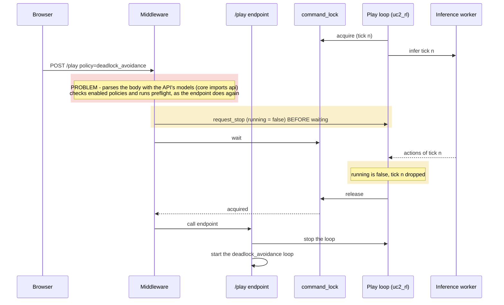
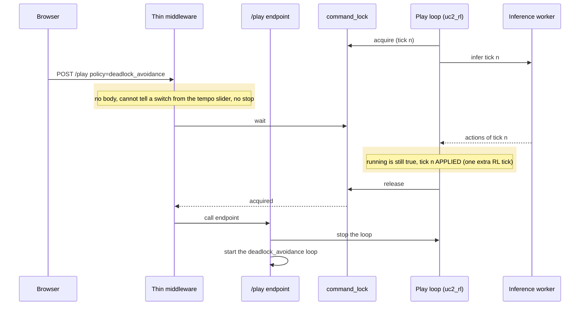
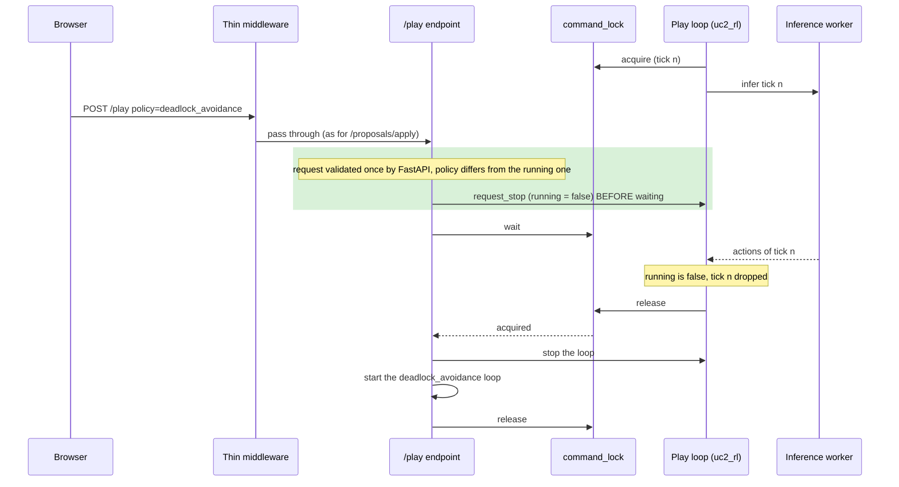

# RL drivers through the existing seams: the modularization findings of #196

> **Status:** plan of 2026-11-18, draft. Based on `feature/uc2-rl-keep-human-decisions` 04c23d49 (PR
> [#208](https://github.com/flatland-association/flatland-ui-hub/pull/208)), which builds on PR
> [#196](https://github.com/flatland-association/flatland-ui-hub/pull/196) (`codex/pf-ch-rl-main` 29b31139), both
> open, in stack 213. Branch `refactor/196-modularization`, the third PR of the stack (not opened yet). Q-1–Q-4
> decided 2026-11-18 (§9.2).
>
> **Why:** the review of #196 ([its plan](pf-ch-rl-main-integration.md), "Code Review Findings") found that the two
> learned drivers (`pf_ch_rl`, `uc2_rl`) bypass concepts the code already has: a second policy registry, UC2 checks by
> grid size in the API, hardcoded preset ids in the frontend, and a body-parsing middleware. A third learned policy
> would need edits in every one of these places. This PR moves them onto the existing seams, without changing what a
> user sees.

## 1. Introduction and goals

*What the change is for: the requirements, the qualities that matter, who has a stake, and what it leaves out.*

### 1.1 Requirements overview (functional requirements)

*The issue's text and the numbered requirements the rest of the plan refers to.*

From the maintainer (2026-11-18): "one PR on top with the review findings of the first PR and the cleanups for these
4": the four findings that bypass existing concepts.

| ID | Requirement | Finding of #196 |
|---|---|---|
| REQ-1 | Record the code review findings of #196 in its plan. | F-1–F-21 |
| REQ-2 | One place says which policies are learned drivers and what they need (preflight, inference in a worker, the command lock): the policy registry. No second registry, no policy-id strings at the call sites. | F-2 |
| REQ-3 | The proposal agent decides its forecast horizon and its arrival reference; the API module has no UC2 knowledge (no grid sizes, no `agent.id == "uc2_rl"`). | F-3 |
| REQ-4 | The frontend gets "learned driver" from the policy catalog and hides the directive bar through the presets' UI restrictions; no hardcoded preset ids or policy ids in components. | F-4 |
| REQ-5 | No middleware parses request bodies; the request that switches the actor decides it, once. | F-9 |

### 1.2 Quality goals (non-functional requirements)

*The few qualities the design must reach, each with a concrete scenario.*

| ID | Priority | Quality goal | Scenario |
|---|---|---|---|
| NFR-1 | 1 | Same behaviour | Every existing backend and frontend test passes unchanged in meaning; the RL tours, Plan B and the PF-CH demo behave as on #208. |
| NFR-2 | 2 | Extensible | A third learned driver needs a `PolicySpec` entry (and its bundle), no edit in `sessions.py`, `websockets.py`, `overrides.py`, `app.component.ts` or the toolbar. |
| NFR-3 | 3 | Small diff | The PR changes the special cases, not the code around them; no renames of modules or ids (F-18 stays a follow-up). |

### 1.3 Stakeholders

*Who asks for the change, decides on it, reviews it or works with the result, and what they expect.*

| Role | Name | Expectations |
|---|---|---|
| Maintainer | flatland-ui-hub maintainers | Existing concepts respected; decides Q-1 (Director mode). |
| Authors of #196 | `codex/pf-ch-rl-main` | Their behaviour kept; the findings readable as a review. |
| Study lead | Plan B | Plan B unchanged (stored ids, logged data, KI column). |

### 1.4 Follow-ups (not in this PR)

*What this PR leaves out, why, and where it goes later.*

| Follow-up | Why not in this PR | From | Findings | Issue |
|---|---|---|---|---|
| Fix the bugs found in #196: blocking accept (F-6), Reset keeping `"plan"` (F-7) and keeping fired disturbances (F-8), the 409 text (F-15), the 400 on step (F-16), the French string (F-20), `_plan_off_plan` (F-21). | Not asked for this PR, which only moves code onto existing seams. | §9.3 of #196's plan | F-6–F-8, F-15, F-16, F-20, F-21 | - |
| Shrink #196: evidence out of the repo (F-1), lab-only code out of the app (F-5), unrelated concerns split (F-11). | Changes what #196 contains, not how its code is structured; the authors decide. | §9.3 of #196's plan | F-1, F-5, F-11 | - |
| Strategy tiles with a driver that does not accept directives: say so on the tiles, or move `main`'s `goal_directed` id checks to a catalog field (Q-1 a″). | On `main`, not from #196 (Q-4). | Q-4 | - | untracked |
| Further structure: proposal service out of the API module (F-10), proposal costs (F-12), UC2 rollouts on the branch runner (F-13), one bundle module (F-14), re-indent (F-17), generic names (F-18), duplicate specs and presets (F-19). | Not among the four; each is a refactoring of its own. | §9.3 of #196's plan | F-10, F-12–F-14, F-17–F-19 | - |

## 2. Constraints

*What limits the design from outside: platform, organisation and conventions.*

| ID | Constraint | Kind | Explanation |
|---|---|---|---|
| C-1 | Stored and logged ids stay | Convention | `preset-pf-ch-rl`, `preset-uc2-rl`, tour ids, policy ids `pf_ch_rl`/`uc2_rl` live in saved designs and study data (AGENTS.md). |
| C-2 | Mode semantics only in `InteractionMode` | Convention | No parallel flags (AGENTS.md guardrail); Q-1. |
| C-3 | Leave `_recoverPolicyAndRetry*` alone | Convention | AGENTS.md's do-not-touch list; `step`/`play` keep passing `canRecover`. |
| C-4 | Behaviour of #196 and #208 kept | Scope | This PR restructures; bugs are follow-ups (§1.4). |

### 2.1 Limitations

*What the built code gets wrong or ignores, each with the TODO or issue that tracks it.*

- The command lock stays per process (in-memory `asyncio.Lock`), as on #196 (its plan, "OOM review and limits").
- The bugs of #196 stay (§1.4).

### 2.2 Assumptions

*What must hold for the design to be correct, but is not checked in code.*

Not checked in code; they hold by construction of the deployment and the registry:

- One ASGI worker owns all sessions (`deploy/hf/Dockerfile`), so a per-process lock serialises a session.
- A learned driver's `PolicySpec` names its bundle; the bundle module keeps `compatibility_error(env)` and
  `verify_bundle()`.

## 3. Context and scope (checked 2026-11-18 on `feature/uc2-rl-keep-human-decisions` 04c23d49)

*The code on the base branch that the change works in, as it is before the change, and where the change stops.*

- **Policy registry** (`backend/app/policies/registry.py`): `PolicySpec` (id, label, factories, catalog fields such as
  `family`); `uc2_rl` and `pf_ch_rl` registered with `_mk_*`/`_branch_*` factories that call their bundles'
  `require_compatible`/`verify_bundle`. `driving_policy_id` (`:381`) imports `is_specialist_policy` lazily from core
  (`:390`).
- **Second registry** (`backend/app/core/pf_ch_control.py`): `_SPECIALIST_BUNDLES` (`:20`), `is_specialist_policy`,
  `requires_command_lock` (also true for sessions with proposal agent `uc2_rl`), `preflight_policy`, `command_lock`,
  `run_inference` (worker pool), `broadcast_playback`, and `PFChControlMiddleware` (`:120-156`), which parses the
  bodies of `/policy`, `/play`, `/step` (`:94-117`, importing API models) to decide an actor change.
- **Call sites:** `sessions.py:18,417,513,596`; `websockets.py:26,98-155,257-305`; `overrides.py:37` (ids
  `{"uc2_rl", "pf_ch_rl"}`), `:397-410` (grid sizes `(6, 25)`, `(8, 78)`), `:648-655` (`agent.id == "uc2_rl"`
  horizon); `main.py:44` mounts the middleware.
- **Proposal agents** (`backend/app/core/proposal_agents/base.py`): `ProposalAgent` with `available`, `propose_for`,
  `resolve_for`, `respects_overrides`.
- **Frontend:** `isFixedActorPolicy` (`core/models.ts:15`, ids hardcoded) used in `app.component.ts:264-267`
  (`directDriverControls`, also with the two preset ids), `toolbar.component.ts:66,87,97,115`,
  `shift-review.component.ts:98,259` and `session.store.ts` (9 places). The policy catalog (`PolicyInfo`, from
  `backend/app/api/policies.py`) already carries `family` (`learned` for exactly `pf_ch_rl` and `uc2_rl`, `hybrid` for
  `goal_directed`), read only by the algorithm gallery; it says how a policy decides, not what it needs. `panelAvailable` already honours `widget.director-directive` in a preset's `ui.hidden`
  (`panel-mode-availability.ts:95`).
- **Where it stops:** no change to what the drivers do, to the tours, presets' ids, the proposal ranking, the lock's
  scope, or the names of modules (F-18).

## 4. Solution strategy

*The fundamental choices and why, the rules the design follows, how it is verified, and the design of each part.*

| Quality goal | Scenario | Solution approach | Details |
|---|---|---|---|
| NFR-2 Extensible | A third learned driver | Its needs are fields of its `PolicySpec`; call sites ask the spec | §4.3 |
| NFR-1 Same behaviour | Tours, Plan B, PF-CH demo | Pure moves, existing tests unchanged, new tests for the seams | §4.2 |
| NFR-3 Small diff | Review of the PR | Keep module and function names; replace predicates, not code around them | §4.1 |

### 4.1 Design principles

*The rules the design follows, each with its decision, the concepts it reuses instead of building new ones, and what
is not new on purpose.*

- **DP-1 The registry describes a policy.** Whether a policy is a learned driver, what it checks before it may drive,
  and whether its inference runs in the worker are fields of its `PolicySpec`; `pf_ch_control` reads them, it keeps no
  list of its own. (REQ-2, Q-3)
- **DP-2 The proposal agent describes its forecast.** Horizon and arrival reference are methods of `ProposalAgent`
  with PP's behaviour as default. (REQ-3)
- **DP-3 The browser asks the catalog, the mode keeps its meaning.** "Specialist" comes from the policy catalog; which
  controls a layout shows comes from its preset; Director mode means the same with every driver, and a pinned
  policy wins over its switch to `goal_directed`. (REQ-4, Q-1, Q-3)
- **DP-4 The endpoint decides.** The request that switches the actor (`/play`, `/step`, `/policy`) already has the
  validated policy; it stops the old actor, then takes the lock. The middleware only locks the other mutations.
  (REQ-5, Q-2)

Reused concepts:

| Need | Reused concept | Instead of |
|---|---|---|
| Which policies are learned drivers | `PolicySpec` in `registry.py` | `_SPECIALIST_BUNDLES` in `pf_ch_control.py` |
| Forecast horizon and yardstick per agent | `ProposalAgent` (`proposal_agents/base.py`) | `agent.id` and grid-size checks in `overrides.py` |
| Is a policy a learned driver (browser) | Policy catalog `/policies` (`PolicyInfo`) | `isFixedActorPolicy` with hardcoded ids |
| Which controls an RL tour shows | Preset `ui.hidden: ['widget.director-directive']` and a `toolbar` panel (`widget-catalog.ts:905`) | `directDriverControls` with preset ids in `app.component` |
| Keep the RL driver in Director | Pinned policy (`pinnedPolicy`, #196), as `main`'s "a picked policy wins" | `isFixedActorPolicy` in `setInteractionMode` |
| Plan check without a plan | `main`'s 400 path of `/director/verify` | The id check in `shift-review` |
| Footer survey of a demo | The tour's own `demoSurveyEnabled` | `directDriverControls` in `footerSurveyAllowed` |
| Validated request policy | The endpoints' request models | Body parsing in the middleware |

Not new on purpose: no new endpoint, no new mode, no new UI restriction id, no new module, no renamed id or module.

### 4.2 Verification

*How each requirement and quality goal is shown to work: tests, CI checks, before and after screenshots.*

No visible change, so no screenshots; the RL tours are checked in the running app (production build) for the toolbar,
the hidden directive bar and the footer survey.

| ID | Requirement | Test or check | Result | Screenshots |
|---|---|---|---|---|
| REQ-1 | Findings recorded | #196's plan, "Code Review Findings" | 💡 | - |
| REQ-2 | One registry | `test_policy_registry*`: the spec fields of `uc2_rl`/`pf_ch_rl`; `grep` finds no `_SPECIALIST_BUNDLES`, no `{"uc2_rl", "pf_ch_rl"}`; existing `test_pf_ch_*`, `test_uc2_*` green | 💡 | - |
| REQ-3 | Agent decides horizon and yardstick | `test_proposal_agents`: PP's defaults, UC2's overrides; existing proposal tests green | 💡 | - |
| REQ-4 | Catalog and `ui` block | `toolbar.component.spec`, `app.component.spec`, `pf-ch-session.spec`, `uc2-session.spec` green with the catalog flag; a spec for the presets' `ui.hidden` | 💡 | - |
| REQ-5 | No body parsing | `test_pf_ch_request_control` green (actor change via `/play`, `/policy`); no `app.api` import in `app/core` | 💡 | - |
| NFR-1 | Same behaviour | Full backend suite and frontend suite, production build | 💡 | - |

### 4.3 Learned drivers in the registry (REQ-2; Q-3)

*One part of the change: what changes and why, with the requirements and decisions it implements.*

- `PolicySpec` gains `bundle` (the bundle module, `None` for other policies). `is_specialist_policy(id)` becomes
  `get_policy_spec(id).bundle is not None` (unknown ids: false); `preflight_policy` uses `spec.bundle`.
- `pf_ch_control` keeps its functions and names (NFR-3); `_SPECIALIST_BUNDLES` goes.
- `overrides._policy_factory_for` asks the spec (`spec.bundle is not None` → `branch_factory`) instead of the id set.
- `driving_policy_id` stops importing from core: it asks the spec itself.
- `/policies` serves `specialist: bool` (additive).

### 4.4 Horizon and yardstick of a proposal agent (REQ-3)

- `ProposalAgent.forecast_horizon(env)`: PP's bounded horizon (`min(max(50, max_ep - elapsed), 250)`, 200 without a
  limit). `UC2RLProposalAgent` overrides it with the remaining episode.
- `ProposalAgent.arrival_reference(env)`: deadlines plus planned arrivals (today's non-UC2 branch).
  `UC2RLProposalAgent` returns the native deadlines when its bundle accepts the env (`compatibility_error(env) is
  None`), the default otherwise. The grid-size check goes.
- `overrides.py` calls both on the agent; `proposal_arrival_reference` goes (its one caller).

### 4.5 The browser asks the catalog, Director mode as on `main` (REQ-4; Q-1, Q-3)

*One part of the change: what changes and why, with the requirements and decisions it implements.*

- `PolicyInfo.specialist` from `/policies`; the store answers `isSpecialistPolicy(id)` from its catalog and replaces
  `isFixedActorPolicy` at every call site (Q-3 a). A session with a pinned policy waits for the catalog before it
  opens, so the check never runs against an empty catalog (a deep link can open a tour before `/policies` answers).
- Director mode as on `main` (Q-1 a‴):
  - **A pinned policy wins:** the store remembers the session's pinned policy; entering Director keeps it instead
    of switching to `goal_directed` (`main`'s "a picked policy wins", generalised).
  - **The RL presets choose their controls:** `ui.hidden: ['widget.director-directive']` and a `toolbar` panel in
    their layout; `directDriverControls` and its preset ids go, the header toolbar follows `main`'s rule again.
  - **The shift review** asks `/director/verify` as on `main`; without a `goal_directed` plan it answers 400 and the
    check is left out.
  - **The footer survey button** shows unless the tour disables its survey (`demoSurveyEnabled`), for every tour.
- `docs/reference/panel-mode-matrix.md` says that Director runs with any driver, and that the objective-level widgets
  need one that accepts directives.

### 4.6 The endpoints decide the actor change (REQ-5; Q-2)

- The middleware keeps one job: take `command_lock` for mutating requests of sessions that need it
  (`requires_command_lock`), and stop play first for destructive requests (`DELETE`, `/reset`, `/pause`). It lets
  `/play`, `/step` and `/policy` through, as it already does for `/proposals/apply`, and no longer reads bodies:
  `_requested_policy` and the `app.api` imports go.
- `/play`, `/step` and `/policy` own their lock (Q-2 c, diagram 3): with the request validated by FastAPI, they stop
  the old actor if the policy changes (`request_stop` before the wait), then take the lock. One helper in
  `pf_ch_control` holds that order, so the three endpoints share it. `set_session_policy` becomes `async`.

## 5. Building block view

*The components the change adds or changes: an overview, why the system is split this way, what each is responsible
for, and how they connect.*

### 5.1 Backend and frontend seams

*One white box: its building blocks, why it is split this way, and the interfaces between them.*

**Motivation:** each question ("is this a learned driver?", "how far does this agent forecast?", "what does this preset
hide?", "does this request switch the actor?") gets one owner that already exists (DP-1–DP-4).

**Contained building blocks:**

| Component | Responsibility | Change |
|---|---|---|
| `PolicySpec` (policy registry) | Describes each driving policy for the server and the catalog. Not for running it. | 🟨 modified: also says whether a policy is a learned driver, so a new one needs only its entry. |
| `pf_ch_control` | Runs learned-driver inference in a worker under the session's command lock. Not for deciding which policies are learned. | 🟨 modified: asks the registry; its middleware no longer reads request bodies. |
| `ProposalAgent` | Proposes courses for a train. Not for scoring them. | 🟨 modified: also says how far it forecasts and against which arrivals. |
| `/proposals` (`overrides.py`) | Scores the courses of plan, AI and human. Not for knowing which agent is which. | 🟨 modified: asks the agent instead of checking ids and grid sizes. |
| `/policies` catalog | Tells the browser what each policy is. | 🟨 modified: says whether a policy is a learned driver. |
| RL presets, `app.component`, toolbar, shift review, session store | Show and drive an RL tour. | 🟨 modified: read the catalog and the presets' `ui` block instead of hardcoded ids. |

## 8. Crosscutting concepts

*What the change introduces that other code will follow, and what it changes for existing callers.*

### 8.1 New patterns

*What is new compared with the base branch.*

Compared with `feature/uc2-rl-keep-human-decisions`. What is reused, and what is not new on purpose, is in §4.1.

| ID | New | Defined in |
|---|---|---|
| PAT-1 | A policy's capabilities live on its `PolicySpec` (`bundle`), and the catalog serves them (`specialist`). | §4.3, Q-3 |
| PAT-2 | A proposal agent owns its forecast horizon and arrival reference. | §4.4 |
| PAT-3 | A pinned policy wins over Director mode's switch to `goal_directed`. | §4.5, Q-1 |
| PAT-4 | An endpoint that switches the actor owns the command lock: it stops the old actor, then waits for the lock. | §4.6, Q-2 |

### 8.2 Breaking changes

*What breaks for whom, and the migration path.*

None for callers: `/policies` gains a field, every endpoint keeps its request and response. `ProposalAgent` gains two
methods with defaults, so existing agents keep working. Internal only: `pf_ch_control._SPECIALIST_BUNDLES` and
`overrides.proposal_arrival_reference` go (no importer outside the moved code; tests that patch them are updated in
their step).

Visible, decided with Q-1 (2026-11-18):

- The RL tours show the toolbar as a panel of their layout instead of in the header.
- `corridor-director` (a Director tour with "No survey") no longer shows the footer survey button in its shift
  review; the RL tours keep theirs hidden.

## 9. Decisions

*The decisions behind the plan: the questions still open, the decisions taken, and how each review finding was settled.*

### 9.1 Open questions

*Choices not made yet, each with its options and a proposal.*

All four were decided on 2026-11-18 as proposed (§9.2); the options stay for the record.

✅ **(Q-1) What does Director mode mean with an RL driver?** Who decides: the maintainer. Blocks S-4.

**The problem:** with an RL driver, Director mode behaves differently in four places, and policy ids and preset ids in
components decide this instead of the mode. In effect that is a hidden second mode.

It concerns six demo tours, all with `modes: ['director']` (`core/demo/tours.ts`):

- `uc2-rl-tutorial`, `uc2-rl-1` … `uc2-rl-4` (`UC2_RL_TOURS`, `:126-144`; layout `preset-uc2-rl`, driver `uc2_rl`);
- `pf-ch-rl-corridor` (`:339-350`; layout `preset-pf-ch-rl`, driver `pf_ch_rl`).

| What differs | Without an RL driver (`main`) | With an RL driver (#196) | With a‴) (proposed) |
|---|---|---|---|
| The driver on entering Director | Switches to `goal_directed`. Leaving restores the earlier policy, unless the human picked another one while in Director | Keeps the RL driver (`session.store.ts:1213`, by policy id) | Keeps the RL driver because the tour pins it: "a pinned policy wins", like `main`'s "a picked policy wins". Unpinned sessions behave as on `main` |
| Directive bar and toolbar | The directive bar shows where the preset offers it. The toolbar is hidden in a runtime layout (a preset) | Directive bar hidden, toolbar shown (`app.component.html:121,161,170,243`, by policy id **or** preset id) | The RL presets choose their controls: `ui.hidden: ['widget.director-directive']` and a `toolbar` panel in their layout. That panel type exists (`widget-catalog.ts:905`, all modes). Same controls. **To check:** the toolbar then sits in the layout, not the header |
| Plan check in the shift review | Asks `/director/verify` and shows predicted against verified. A 400 (no committed plan) leaves the check out | Not asked (`shift-review.component.ts:98,259`, by policy id) | Asked as on `main`. Without a `goal_directed` plan the answer is 400 and the check is left out, which looks the same as #196. One more request |
| Footer survey button | Shown once the shift review is open, unless the tour has its own debrief | Shown only if the demo enables its survey (`app.component.ts:266`, by policy id or preset id) | Shown unless the tour disables its survey, for every tour. **A change to confirm:** it also disappears in `corridor-director`, the other Director tour with "No survey" |

The rows are general: they describe any session in Director mode. Who they touch today (checked in
`core/demo/tours.ts` and `core/demo/study-conditions.ts`):

| Row | General rule under a‴) | Touches today | Plan B (`plan-b-p01` …, `plan-b-uc2`; `co-learning`, driver DLA, proposal agent `uc2_rl`) |
|---|---|---|---|
| 1 Driver on entering Director | A pinned policy wins over the switch to `goal_directed` | Only the six RL tours. No Director condition pins a policy | Unchanged. Plan B pins `deadlock_avoidance`, but runs in `co-learning` and never enters Director. `uc2_rl` is its proposal agent, not its driver: an accepted KI course drives as the plan policy (`plan`, #196; the full course since #208), with DLA for the trains off the course |
| 2 Directive bar and toolbar | The preset chooses its controls | Only the two RL presets, which get `ui.hidden` and a `toolbar` panel | Unchanged. `preset-plan-b` is not edited, and the directive bar is offered only in Director |
| 3 Plan check | Always asked; a 400 leaves it out | Only sessions without a `goal_directed` plan, which today means the RL tours | Unchanged. The shift review opens through "End shift" in the directive bar, so not in `co-learning` |
| 4 Footer survey | Hidden when the tour disables its survey | The RL tours and `corridor-director` | Unchanged. The rule applies only while the shift review is open; Plan B's own questionnaire (`surveyParts`) is untouched |

The guardrail "mode semantics only in `InteractionMode`" (C-2) rules out the #196 column. Its preset half also
misfires: in an RL layout with `goal_directed` driving, the directive bar is hidden too. And every new RL driver or
preset needs code edits.

**Options:**

- a‴) **Director as on `main`, with any driver:** the last column. There's no new field and no new mode, and
  `mode: director` in the logs is correct.
- a″) **As a‴), plus a catalog field `accepts_directives`:** the objective-level widgets (§10) show only when the
  driver takes directives. It is more explicit, but it is a new field. It pays off only once `main`'s `goal_directed`
  id checks and the tile gap (Q-4) move to it.
- a) **The directive bar hidden by the presets, the rest by the specialist flag:** two sources that can disagree, and
  `ui.hidden` would carry meaning.
- b) **A new mode** for "the AI drives, the human watches". It touches 7 per-mode maps, 59 `'director'` checks in 22
  files, about 16 specs, a matrix column, the briefings, i18n, and the logged `mode` values.
- c) **Leave it as on #196:** the hidden mode stays.

*Proposal:* a‴). Decided 2026-11-18: a‴), with both points accepted. Two points to confirm with it: the toolbar moves from the header into the RL presets' layout, and the
footer survey button also disappears in `corridor-director`.

✅ **(Q-2) Where is the session's command lock taken?** Blocks S-3.

**The problem:** to stop the old RL driver in time when the user switches policy, the middleware parses request bodies
itself, outside FastAPI and with the API's request models imported into `core` (`pf_ch_control._requested_policy`).

Why it needs the body that early:

- An RL tick holds the session's command lock while its model runs, a few hundred ms (`websockets.py:125-155`), and
  applies its actions only if play is still running (`if state.running`).
- A request that switches the actor (`/play`, `/step` or `/policy` with another policy) must stop the old actor
  *before* it waits for the lock. Otherwise the tick in flight is applied instead of dropped.
- The middleware is the only place that runs before the lock wait, so it reads the body there (diagram 1, the red
  part).
- Plan B sessions take the lock too, without an RL driver: their proposal agent is `uc2_rl`, and accepting a course
  runs under the lock (`requires_command_lock`, `pf_ch_control.py:28-31`). Their driver never switches to or from a
  specialist, so none of the options changes what Plan B does.

Highlighted: red is the problem to fix, yellow is where the options differ, green is the fix.

**Diagram 1, today.** The stop comes before the wait, so tick n is dropped (correct). The problem: to know about the
switch before the endpoint runs, the middleware parses and validates the body itself, a second time and outside
FastAPI, with the API's models imported into `core`.

**Diagram 2, option a) thin middleware.** No body parsing, but no early stop either: tick n is applied after the user
switched.

**Diagram 3, option c).** The middleware lets `/play` through; the endpoint has the request validated by FastAPI
(once), stops before it waits, then takes the lock: the order of diagram 1 without its problem.

**Options:**

- a) **A thin middleware for all requests:** it only locks, and stops play for `DELETE`, `/reset` and `/pause`. It
  can't see a switch, so the old RL driver plays one more tick after the user switched (diagram 2). That breaks
  "same behaviour" (NFR-1).
- b) **The lock in each mutating endpoint** (a FastAPI dependency): explicit, but every current and future mutating
  endpoint must remember it (overrides, what-ifs, apply, reset, …). `set_session_policy` becomes `async`.
- c) **A thin middleware, and the actor-switching endpoints own their lock:** the middleware lets `/play`, `/step` and
  `/policy` through, as it already does for `/proposals/apply` (`pf_ch_control.py:128`). These endpoints get the
  request validated once by FastAPI, stop the old actor if the policy changes, then take the lock (diagram 3). The
  order is the same as today, the body parsing and the `core → api` import go away, and `set_session_policy`
  becomes `async`.

*Proposal:* c). Decided 2026-11-18: c).

✅ **(Q-3) What is the concept, and its one name?** Blocks S-1, S-4.

**The problem:** one property of `pf_ch_rl` and `uc2_rl` is kept in two id lists under two names, so a third such
policy would need edits in both.

The two names describe two sides of that property (§10):

- **specialist** (backend, `is_specialist_policy`) is what the policy *is*:
  - a trained network bound to the infrastructures it learned on, because its input has a fixed size and meaning
    (PF-CH: the five PF-CH scenes, 9 × 191 cells, at most 16 trains, `pf_ch_bundle.py:43-54`; UC2: the five native
    Tutorial/UC2 infrastructures, `uc2_bundle.py:52-62`);
  - its bundle checks the infrastructure;
  - it runs in the inference worker under the command lock.
- **fixed actor** (frontend, `isFixedActorPolicy`) is how the browser *treats* it. It is never swapped for another
  policy:
  - no fallback on an error;
  - the toolbar keeps it selected;
  - Director doesn't replace it;
  - steps wait while its checkpoint loads.

The second follows from the first. `family="learned"` is no substitute: it says how a policy decides, not what it
needs, and only the gallery reads it.

**Options:**

- a) **One concept, "specialist":** it lives on `PolicySpec` (S-1). The catalog serves `specialist`, and the frontend
  asks `isSpecialistPolicy(id)`.
- b) **One concept, "fixed actor"** everywhere, renaming the backend's functions.
- c) **Two concepts:** the catalog serves `specialist`, and the frontend keeps a "fixed actor" check that equals it
  today but could take in other policies later.

*Proposal:* a): one concept while the two sets are the same; c) is cheap later if they part. Decided 2026-11-18:
a).

✅ **(Q-4) The strategy tiles and a driver that does not accept directives.** Blocks no step.

**The problem:** in Director mode, choosing a strategy tile while a driver that doesn't accept directives is driving
draws a plan that never drives, and the human isn't told.

- **The cause:** the A/B/C tiles (`strategy-options`) send their weights to `goal_directed` without checking the
  driver (`strategy-options.component.ts:927-931`). With `deadlock_avoidance`, for example, the plan is computed and
  drawn, but the driver ignores it.
- **The only warning that exists:** `director-weights` has such a note (`dw.policyNote`), but that widget is offered
  in no mode.
- **Scope:** this is on `main`, not from #196. The RL presets have no tiles, so the RL tours don't show it.

**Options:**

- a) **An untracked follow-up in §1.4:** it is outside this PR's job of fixing #196's special cases.
- b) **A follow-up with an issue,** with its text drafted for the maintainer.
- c) **Fix it in this PR,** for example with the note `director-weights` has.

*Proposal:* a). Decided 2026-11-18: a).

### 9.2 Decision log

*Every decision by date, with why it was taken and what follows from it.*

| Date | Decision | Why | Consequences |
|---|---|---|---|
| 2026-11-18 | ✅ Third PR on top of #208 with #196's findings and the cleanups of F-2, F-3, F-4, F-9 | The maintainer's choice of the four that bypass existing concepts | The other findings are follow-ups (§1.4) |
| 2026-11-18 | ✅ Q-1 a‴): Director mode as on `main`, with any driver | `main` already runs Director with a driver that does not accept directives; a new mode (b) costs every per-mode map and the logged values, a capability field (a″) pays off only with `main`'s own id checks | S-4: "a pinned policy wins", the RL presets choose their controls, the plan check and the footer survey as on `main`; the toolbar moves into the RL presets' layout and `corridor-director` loses its footer survey button (§8.2) |
| 2026-11-18 | ✅ Q-2 c): thin middleware, the actor-switching endpoints own their lock | Keeps the early stop of diagram 1 without body parsing; a) loses it, b) spreads the lock over every endpoint | S-3; `set_session_policy` becomes `async` |
| 2026-11-18 | ✅ Q-3 a): one concept, "specialist" | The fixed-actor behaviour follows from being a specialist; `family` is no substitute | S-1 (`PolicySpec.bundle`, catalog `specialist`), S-4 (`isSpecialistPolicy`) |
| 2026-11-18 | ✅ Q-4 a): the strategy-tile gap is an untracked follow-up | On `main`, outside #196's special cases | §1.4 |

### 9.3 Code Review Findings

*Findings from code reviews, PR comments and TODOs, with their status and the commits that fix them.*

None yet for this PR. The findings it implements are #196's F-2, F-3, F-4, F-9 ([its plan](pf-ch-rl-main-integration.md),
"Code Review Findings"); their status is kept there.

## 10. Glossary

*The domain and technical words the plan uses, with their code symbols.*

Where a term came with #196 or #208, the row says so; the rest is on `main`.

| Term | Code symbol | Meaning | Synonyms in docs and code |
|---|---|---|---|
| Interaction mode | `InteractionMode` (`core/events/event-types.ts:48`), `SessionStore.interactionMode`, `optionPresentation()` | How human and AI share the decisions (`docs/reference/interaction-modes-brief.md` §0–§1). One of three. Not which policy drives: every mode runs with a driver. | mode, Modus, collaboration mode |
| Recommendation mode | `'recommendation'`, `optionPresentation = 'recommended'` | WP 3.1: on a predicted incident the AI shows options **with** one recommended; the human decides. | AI-Assisted Human Control, Mode A |
| Co-learning mode | `'co-learning'`, `isCoLearning()`, `optionPresentation = 'neutral'` | WP 3.3: the AI shows **neutral** options; the human decides, reflects and compares what-ifs. Plan B runs in it. | Human-AI Co-Learning, Mode B |
| Director mode | `'director'`, `aiInControl()`, `optionPresentation = 'none'` | WP 3.4: the AI drives autonomously; the human sets the directive up front and supervises, and may intervene (adjustable autonomy, brief §4). | Trustworthy Autonomous AI, Mode C, autonomous mode |
| Driver | `session.policy` (backend), `activePolicy()` (frontend), `PolicySpec.runtime_factory`, `OverridePolicy.default_policy`, `driving_policy_id` | The policy that decides every train's action at each step; one per session (brief §4.4). The human's overrides go on top of it. Not a proposal agent, which only proposes. | policy, active policy, driving policy, default policy (inside `OverridePolicy`), control policy (`policyControlIds`, `enabled_policy_ids`: the ones offered), algorithm (Algorithm Gallery), "the Driver" (comments); for `pf_ch_rl`/`uc2_rl` (#196): actor, fixed actor, demo actor, direct actor, specialist actor |
| `goal_directed` | `PolicySpec` `goal_directed` (`registry.py:305-316`, `runtime_factory=_mk_goal_directed`, `branch_factory=GoalDirectedPolicy`), `GoalDirectedPolicy` (`policies/goal_directed_policy.py:510`), `SchedulePlayer`, `env_weights`/`set_env_weights` (`:132-157`), `DirectorPlanReplayPolicy` (`:457`), `usingDirectorPolicy` | The driver Director mode switches to; technically an ordinary `Policy` (`reset`, `act_for_handle`, `build_observation_builder`), so the step loop, `OverridePolicy` and the catalog treat it like any driver. Inside, it plans, then replays: `reset(env)` plans all trains on a decision-point graph, with the optional torch models by a weighted model-guided search (`director_plan`, scored on punctuality, connections, stability; a trace per decision), without them by `plan_avoiding_overlaps` ("degraded, never broken"); a step-0 cache keeps a known scenario's first plan. `act_for_handle` returns each train's next action from the plan's `SchedulePlayer`, no search per step; a train it can't route holds. Once per step `_maybe_replan` (`:385`) checks for a new malfunction or changed weights and computes a residual plan in a background thread while the old plan drives; after a malfunction it replaces the old plan only if it scores better, a weight change always applies. The weights are stored per env, not passed in: it reads `env_weights(env)` when it plans and reacts to `weights_dirty` (`replan_now`, `:210`): that is what accepting directives means technically. Plan, player and plan info live in weak-keyed caches per env (the policy object is rebuilt on every request) and go with an env reset. On forks a model-free `DirectorPlanReplayPolicy` replays the committed plan (`director_replay_factory`), hence `supports_scenarios=False`. `family="hybrid"`. The only driver that accepts directives. Same "plan, then replay" shape as the plan policy, which gets its plan from outside and never re-plans. | Director Planner (its label), the Director's planner, goal-directed planner, "PP objective planning" (#196, `app.component.ts:263`) |
| Directive | `DirectorWeights`, `strategy-options` (A/B/C tiles, `DirectorFocus`), `director-weights` (superseded by the tiles), `POST /director/whatif` | The human's high-level instruction in Director mode (brief Mode C, step 1): which policy the AI runs, and the priorities among punctuality, connections and stability, chosen as a strategy tile (focus) and turned into weights. Not the `director-directive` bar: despite its name it shows the run state, the driver's name, Start/Resume and End shift, and takes no directive. | goal weights, KPI weights, KPI priorities (`kpiPriorities`, `kpi-filter`, offered in no mode), focus, strategy, token-based directives (D3.1 §7) |
| Director's objective-level widgets | Panel types (`panel-mode-matrix.md`): `strategy-options`, `director-divergence`, `strategy-forecast`, `strategy-reflection`; offered in no mode: `director-weights`, `kpi-filter`, `goal-achievement` | The widgets through which the human gives the directive at the objective level (brief §4.1, "Strategic — Objective"), or sees and reflects on its effect. Input: `strategy-options` (the A/B/C tiles, a focus commits weights to `goal_directed`, the only active one), `director-weights` and `kpi-filter` (superseded by the tiles). Effect: `director-divergence` (which trains the shown tile changes), `strategy-forecast` (the next 30 minutes before committing), `goal-achievement` (progress toward the goal, superseded). Reflection: `strategy-reflection` (plays a committed strategy back, asks whether it is a rule). All of them assume a driver that accepts directives, but none of them checks it except `director-weights`. Not the `director-directive` bar (run control), not `shift-review` (end-of-shift evaluation), not the single-train or policy levers. | strategy tiles, A/B/C window, Director dials, objective lever (brief §4.2) |
| Accepting directives | `activePolicy() === 'goal_directed'` (`director-weights.component.ts:102`), `dw.policyNote` | A driver accepts directives when it plans by the weights; only `goal_directed` does. Other drivers (`deadlock_avoidance`, `pf_ch_rl`, `uc2_rl`, …) can drive in Director mode but ignore the weights. Only the `director-weights` widget checks this ("Dials apply when the Director Planner policy drives the session"), and it is offered in no mode; the strategy tiles that replaced it commit weights without checking the driver (`strategy-options.component.ts:927-931`). A property of the driver, written today as an id check, not a catalog field. | "uses the Director policy"; for the opposite: a driver that does not accept directives, other driver, non-planner (in this plan's earlier wording) |
| Pinned policy (#196) | `pinnedPolicy` (`SessionStore.newSession`), a tour's `backendPolicy`, a study condition's `policy` (`app.component.ts:748,1175`) | The driver a tour or a study condition fixes for its session: it wins over the scenario's premade plan, and (#196) a pinned learned driver is not swapped for a fallback. Not the plan policy. | pin, pinned Driver, pinned actor (`pinnedActor`) |
| Plan policy, accepted plan | `PLAN_POLICY_ID` `"plan"` (`registry.py:336`), `env._trainrun_plan`, `accept_trainrun_plan`, `revert_accepted_plan`, `driving_policy_id` | The driver that moves trains along a fixed plan: the scenario's premade plan, or (#196, #208) an AI course the human accepted, which keeps driving until the human switches the policy. Not `goal_directed`'s own committed plan. | Scripted Plan (its label), premade plan, trainrun plan, the AI's course, accepted course |
| Proposal agent | `ProposalAgent` (`core/proposal_agents/base.py`), `session.proposal_agent_id`, a condition's `proposalAgent`; ids `pp_replan` (default), `uc2_rl` (#196) | Who proposes the AI's courses for a train in `/proposals`. It does not drive; accepting a course hands it to the plan policy. `uc2_rl` is both a proposal agent and (as a policy) a driver: same id, two roles. | adviser, the AI (Plan B), the condition's AI, KI column / AI column (where its courses show) |
| Specialist, learned driver (#196) | `is_specialist_policy`, `_SPECIALIST_BUNDLES` (to become `PolicySpec.bundle`, S-1) | A driver that is a trained network bound to the infrastructures it was trained on (`pf_ch_rl`, `uc2_rl`), checked by its bundle, run in the inference worker under the command lock. Not every `family="learned"` policy needs to be one: `family` says how a policy decides, this says what it needs. | specialist actor, bounded neural driver, RL driver; in the frontend: fixed actor (see there) |
| Fixed actor (#196) | `isFixedActorPolicy` (`core/models.ts:14-17`, ids `pf_ch_rl`, `uc2_rl` hardcoded), `_fixedActorOpening`, `_fixedActorDemoSessionId`, `pinnedActor`, `directDriverControls` | The frontend's side of a specialist: a driver the browser never swaps for another policy ("Frozen demo actors must stay selected while unavailable or awaiting acceptance", `models.ts:14`). Effects: no fallback on an error (`canRecover = false` for `_recoverPolicyAndRetry*`, `session.store.ts:2109,2263`); steps and play wait while its checkpoint loads (`_fixedActorOpening`, `:2115,2275`); reported as unavailable when the catalog drops it (`:561`); entering Director does not switch to `goal_directed` (`:1213`); the toolbar keeps it selected even when not offered (`missingRlSelection`, `toolbar.component.ts:66,87,97,115`); the shift review skips the plan check (`shift-review.component.ts:98,259`); with the preset ids it hides the directive bar and shows the toolbar (`directDriverControls`, `app.component.ts:264`). Used in 5 files. Same set as the backend's specialist, kept in its own list (Q-3); S-4 makes it read the catalog. Not the pinned policy, which says what a session starts with. | frozen demo actor, demo actor, direct actor / direct driver (`directDriverControls`), pinned actor (`pinnedActor`) |
| Bundle (#196) | `pf_ch_bundle`, `uc2_roam_bundle` | The checkpoint and its checks (`compatibility_error`, `verify_bundle`). | checkpoint bundle |
| Command lock (#196) | `pf_ch_control.command_lock` | The per-session lock that serialises inference and mutations. | `_pf_ch_command_lock`, transaction lock |

Planning and accepting directives are two properties that coincide today (only `goal_directed` has both) but can come
apart. Director's objective level needs the second:

| Driver | Plans? | Plans by the directive's weights (accepts directives)? |
|---|---|---|
| `goal_directed` | yes | yes |
| A future CBS/PP driver (AGENTS.md names `flatland-blackbox`'s CBS/PP solver for the Director's PP/CBS layer) | yes | not necessarily |
| `plan` | no, it follows a given plan | no |
| `deadlock_avoidance`, `shortest_path`, `forward_only`, `random`, `do_nothing`, `pf_ch_rl`, `uc2_rl` | no | no |

A planner that does not take the weights would plan, but still ignore the strategy tiles: for Director, the axis is
"accepts directives", not "plans".

## 11. Execution plan and status

*The commits that build the change, in order, and which of them are done: the source of the PR's status.*

### 11.1 Steps

*One row per commit: what it does, the findings it fixes, its message, and its SHAs once committed.*

| ID | Findings | Step | Category | Severity | Commit message | Commit(s) | Needs | Blocked by |
|---|---|---|---|---|---|---|---|---|
| 💡 S-0 | - | This plan and #196's findings in its plan. | docs | low | docs(plans): record the review of #196 and plan its modularization findings. |  | - | - |
| 💡 S-1 | F-2 | `PolicySpec.bundle`; `is_specialist_policy`, `preflight_policy`, `_policy_factory_for` and `driving_policy_id` ask the spec; `/policies` serves `specialist`. Tests: the specs' fields, the catalog field. | refactor | high | refactor(policies): describe learned drivers on their PolicySpec instead of a second registry. |  | S-0 | - |
| 💡 S-2 | F-3 | `ProposalAgent.forecast_horizon` and `arrival_reference`; UC2 overrides both (bundle compatibility instead of grid sizes). Tests: defaults and UC2. | refactor | high | refactor(proposals): let the proposal agent decide its horizon and arrival reference. |  | S-0 | - |
| 💡 S-3 | F-9 | The middleware only locks and stops play for destructive requests; `/play`, `/step`, `/policy` stop the old actor and take the lock themselves. Tests: `test_pf_ch_request_control` adapted, no `app.api` import in core. | refactor | medium | refactor(sessions): decide the actor change in the endpoints and keep the middleware to the lock. |  | S-1 | - |
| 💡 S-4 | F-4 | The frontend reads `specialist` from the catalog; a pinned policy wins in Director; the RL presets choose their controls; plan check and footer survey as on `main`; the panel-mode matrix says Director runs with any driver. Tests: toolbar, app, shift review, session specs. | refactor | high | refactor(rl-tours): ask the policy catalog and the presets instead of hardcoded ids. |  | S-1 | - |

### 11.2 Rebase and merge

*How the branch is rebased or merged when it builds on other open PRs, and the known conflicts.*

The stack is #196 → #208 → this PR. When #208 changes, rebase with
`git rebase --onto feature/uc2-rl-keep-human-decisions <old #208 head> refactor/196-modularization`. Expected
conflicts: `overrides.py` (#208's accept and scoring code sits next to the horizon and yardstick code of S-2).

## 12. Change inventory

*Every file the change adds, modifies, renames or removes, and what stays unchanged on purpose.*

### 12.1 New files

*The files the change adds, and what each adds.*

| File | Adds |
|---|---|
| `docs/plans/rl-modularization.md` | This plan. |

### 12.2 Modified files

*The files the change modifies, and what changes in each.*

| File | Changes |
|---|---|
| `docs/plans/pf-ch-rl-main-integration.md` | The code review findings of #196 (S-0). |
| `backend/app/policies/registry.py` | `PolicySpec.bundle`; `driving_policy_id` asks the spec (S-1). |
| `backend/app/core/pf_ch_control.py` | No `_SPECIALIST_BUNDLES` (S-1); middleware without body parsing (S-3). |
| `backend/app/api/policies.py`, `backend/app/models/*` (catalog model) | `specialist` (S-1). |
| `backend/app/api/overrides.py` | `_policy_factory_for` asks the spec (S-1); horizon and yardstick from the agent (S-2). |
| `backend/app/core/proposal_agents/base.py`, `uc2_rl.py` | `forecast_horizon`, `arrival_reference` (S-2). |
| `backend/app/api/sessions.py`, `backend/app/api/websockets.py` | `/step`, `/policy` (now `async`) and `/play` stop the old actor and take the lock themselves (S-3). |
| `frontend/src/app/core/models.ts`, `session.store.ts`, `app.component.{ts,html}`, `features/toolbar/*`, `features/shift-review/shift-review.component.ts`, `core/layout/layout-presets.ts` | Catalog flag instead of ids, the pinned policy wins, the RL presets' `ui.hidden` and `toolbar` panel (S-4). |
| `docs/reference/panel-mode-matrix.md` | Director mode runs with any driver; the objective-level widgets need one that accepts directives (S-4, Q-1 a‴). |
| Tests of the touched files | As in §4.2. |

Unchanged on purpose: module names (`pf_ch_control`, `PFChControlMiddleware`), policy, preset and tour ids, the
endpoints' requests and responses, the drivers' behaviour.
