# Fahrweg einstellen: draw a train's route on the Streckenspiegel (#199, last bullet)

> **Status:** plan of 2026-11-16, draft. On `main` baf332b7 since #196, #208 and #215 were merged (2026-11-19);
> before that on [#215](https://github.com/flatland-association/flatland-ui-hub/pull/215)
> (`refactor/196-modularization` 27c585ee, on #208 1e0bf255), see §11.2. Originally based on `main` fd0c70cb, on branch `feature/199-flash-ahead-set-path` after
> the flash-ahead plan (00fad43d; kept on the same branch on request, may move to its own branch later). Rebased
> 2026-11-18 onto [#208](https://github.com/flatland-association/flatland-ui-hub/pull/208) (head 17707737, on #196's
> `codex/pf-ch-rl-main` 29b31139), whose overrides concept for the KI adviser meets this plan's (§3.4, Q-11). Issue
> [#199](https://github.com/flatland-association/flatland-ui-hub/issues/199), last bullet ("possible extension:
> Fahrweg einstellen Knoten-Knoten-Knoten"), label "plan b". PR [#207](https://github.com/flatland-association/flatland-ui-hub/pull/207). Open questions: none (§9.1; Q-11 to Q-13 and (Q-12) revisited decided 2026-11-18).
> Implemented 2026-11-16 (S-2 to S-4), verified in the Plan B tutorial (§4.2); user doc in `docs/reference/mode-guide.md` (S-5). S-6
> (`PlanPolicy` passes the call on and takes rerouted trains off plan, Q-12 a, revisited) in d71a8eb9; S-7 and S-8 from the review.
>
> **Why:** today "Umleiten" computes a route for the operator, only around a broken-down train. A dispatcher sets a
> route ("stellt einen Fahrweg ein") themselves, e.g. sends a train through the second track of a station so that
> two trains can cross there. This plan lets the operator draw that route on the Streckenspiegel.

## 1. Introduction and goals

*What the change is for: the requirements, the qualities that matter, who has a stake, and what it leaves out.*

### 1.1 Requirements overview (functional requirements)

*The issue's text and the numbered requirements the rest of the plan refers to.*

> - [ ] possible extension: Fahrweg einstellen Knoten-Knoten-Knoten

As described by chenkins (2026-11-16): when the operator clicks "Umleiten" in the action options ("Handlungsoptionen",
Plan / KI / Mensch), they can press on a train and, while the mouse button is down, set its route; on mouse up the
route is set as the train's override.

Requirements:

- **REQ-1** With the train selected and «Fahrweg ändern» chosen in the action options (Q-9), the operator presses on the train on the Streckenspiegel and drags
  along the tracks; the route follows the pointer over the switches (Q-1, Q-2).
- **REQ-2** On mouse up the drawn route becomes the train's reroute override; the train drives it (Q-3, Q-6).
- **REQ-3** The other trains take the drawn route into account, so that two trains can cross in a station (Q-4).
- **REQ-4** Validation in the Plan B tutorial: the train from the right (BA) is routed through the second track of
  the side track of the passing place in the middle (not straight, deviating); the train from the left (AB) waits on the side track and lets
  BA pass; both arrive, better than without the route (§4.2).

### 1.2 Quality goals (non-functional requirements)

*The few qualities the design must reach, each with a concrete scenario.*

| ID | Priority | Quality goal | Scenario |
|---|---|---|---|
| NFR-1 | 1 | Safe | A drawn route never drives a train into a head-on standstill that the deadlock avoidance would have prevented (the tutorial run of §3.3 must not happen). |
| NFR-2 | 2 | Direct | Drawing a route takes one press, one drag and one release; no dialog. |
| NFR-3 | 3 | Honest | Before the route is taken, its forecast shows what it does (Plan / KI / Mensch "Mensch" course). |

### 1.3 Stakeholders

*Who asks for the change, decides on it, reviews it or works with the result, and what they expect.*

| Role | Name | Expectations |
|---|---|---|
| Issue author, maintainer | chenkins | Setting a route as dispatchers do, validated on the Plan B tutorial. |
| Plan B study leads (FHNW, SBB) | label "plan b" | Whether the gesture is offered in the study conditions. They decide. |
| Dispatchers in the studies | - | A route they set is driven as set, and the other trains react to it. |

### 1.4 Follow-ups (not in this PR)

*What this PR leaves out, why, and where it goes later.*

| Follow-up | Why not in this PR | From | Findings | Issue |
|---|---|---|---|---|
| Edit or shorten a set route (drag again, remove a via node). | First the setting itself. | Q-1 | - | untracked |
| A route that ends before the target and hands back to the policy. | Needs a rule for where the policy takes over (Q-3 b). | Q-3 | - | untracked |
| Reroute for trains under `PlanPolicy` that rejoins their plan. | Today a rerouted train is off plan for the rest of the episode (§3.2). | Q-8 | - | untracked |
| Override awareness for the Director and PP re-plan, and for `PlanPolicy` beyond passing the call on (S-6) (implement the Q-4 b interface). | Plan B runs DLA; each needs its own design (re-plan with constraints, plan order with off-plan trains). | §3.4, Q-4 | - | untracked |
| The action hook in `OverridePolicy`: the overrides go into a certifying driver's proposals before `finalize_actions` (Joint ROAM), live and in the `uc2_rl` rollout, with one set of override rules instead of #208's copy in `_apply_kept_overrides` (§5.9, §6.10). With a test of a drawn route under the UC2 driver; if it stalls (§6.5), also the route as ROAM's mission (Q-11 e). Takes over #208's follow-ups F-3 (one override rule), F-6 (tests of kept reroutes and turns) and F-10 (the stop action and the DONE check in `uc2_rl.py`), and its limitation "overrides after ROAM when `uc2_rl` drives" ([uc2-rl-keep-human-decisions.md](uc2-rl-keep-human-decisions.md) §Follow-ups). Shape: §8.3.1; plan: `docs/plans/shared-override-rules.md` on branch `refactor/shared-override-rules`. | Decided as a follow-up after #208 is merged (Q-11 b): it touches #208's and #196's code; Plan B is driven by DLA. | §3.4, Q-11 | #208's F-3, F-6, F-10 | branch `refactor/shared-override-rules` |
| The fallback DLA walks the planned trains along their runs (`PlanPolicy` passes them as routes), so an off-plan train waits for a planned one coming along its run. | Planned trains still would not wait for off-plan ones; needs its own design and tests. | §2.1, §5.6, Q-12 | - | - |
| Port upstream DLA with set paths (`SetPathPolicy`), so routes are the policy's own set paths. | A larger change to the default policy; this plan only lets DLA read committed routes through the optional override-aware `Policy` method (Q-4 b). | flash-ahead plan §1.4 | - | untracked |

## 2. Constraints

*What limits the design from outside: platform, organisation and conventions.*

| ID | Constraint | Kind | Explanation |
|---|---|---|---|
| C-1 | Angular standalone + signals + Lyne; no hard-coded colours; every string in `en/de/fr.json`. | Convention | Repo `AGENTS.md`. |
| C-2 | The override channel stays: a reroute is override action 5 (`REROUTE_ACTION`), its route on the env (`env._route_overrides`). | Technical | Decision log, forecast caches and what-ifs already carry it (`route_overrides.py` docstring). |
| C-3 | Same branch as the flash-ahead plan for now. | Organisation | Asked 2026-11-16. |

### 2.1 Limitations

*What the built code gets wrong or ignores, each with the TODO or issue that tracks it.*

- Only DLA is override-aware (Q-4 b). Under the other policies a drawn route is driven unchecked, as computed
  reroutes are today, and nobody else knows it (follow-up in §1.4).
- Under the UC2 ROAM driver the overrides, a drawn route included, are applied after ROAM certifies the step
  (#208's "Remaining"), so ROAM may withdraw another train's move because of a move that does not happen (§3.4,
  follow-up in §1.4). The `uc2_rl` adviser's courses are not affected: they apply kept overrides before the
  certificate.
- After a KI course is accepted, `PlanPolicy` drives, and it does not implement the Q-4 b method: the call does not
  reach its fallback DLA, so a rerouted train (on plan or off it) drives its route unchecked, live and in the KI courses'
  scoring (`/proposals`, #208). S-6 fixes it (Q-12 a). Afterwards DLA still walks shortest paths for the trains on
  the plan, not their runs (follow-up in §1.4): a route into a planned train's course can end head-on, e.g. BA
  using the side track after the course `ai-2` sent AB there ([walk-through §4](set-route-on-map/walkthrough.md)). The
  «Mensch» course shows it before the route is taken.
- Taking a PP course clears `env._route_overrides` but not the drawn-route marker (`env._route_drawn`); harmless,
  because the next `commit_route` or `drop_route` for that train resets it, but untidy.
- #208's preview token binds the standing overrides and `_route_overrides`, not `_route_drawn`; the marker only
  changes together with a route, so a change in between is still caught.
- A train that leaves its drawn route ends the override; the route is not recomputed through the remaining via cells
  (`route_move`). Under DLA the train does not leave it.
- A drawn route ends at the target (Q-3 a); a route that ends early is a follow-up.
- `route_through` takes the shortest leg between via cells and does not avoid broken-down trains: the operator chose
  the switches.
- A drag samples cells; a fast drag skips cells, which are filled by the shortest way along the track (up to 8 cells,
  `pathTo`). A cell farther away is ignored.
- Holds reach DLA (`set_committed_overrides`) but change nothing there: a held train already occupies its cell.

### 2.2 Assumptions

Not checked in code; they hold by construction of the rail graph (`build_rail_digraph`).

- A drawn route is a path in the rail graph from the train's cell and heading; it cannot reverse.
- The Streckenspiegel maps a pointer position to one grid cell (`cellSize`), so a drag yields a cell sequence.

## 3. Context and scope (checked 2026-11-16 on `main` fd0c70cb)

*The code on the base branch that the change works in, as it is before the change, and where the change stops.*

### 3.1 Does an override already hold a full route until it is over?

Yes, for reroutes:

- A reroute is override action 5 (`REROUTE_ACTION`). `commit_route` stores a whole route, `[(row, col, heading), ...]`
  from the train's cell to its target, in `env._route_overrides[handle]` (`backend/app/core/route_overrides.py`).
- Every step `OverridePolicy` asks `route_move`, which returns the move that keeps the train on it. At the route's end
  (the target) it moves forward; when the train is done the override is cleared. Forks carry the route
  (`carry_to_fork`), so forecasts with the committed overrides follow it.
- What is missing for a drawn route:
  - **No way to pass a route in.** The route is always computed: `route_around_blocks` (shortest to the target around
    malfunctioning trains, preferring the train's planned cells). `POST /agent/{h}/override` takes only an action.
  - **Only offered with a block.** "Umleiten" is available when the impact analysis finds a blocked train with a way
    around (`can_reroute`, `proposalChoice.rerouteAvailable`).
  - **Not before the train is on the map.** `route_move` returns None for a train without a position, and
    `OverridePolicy` then clears the override at once; a train waiting at its origin cannot be rerouted.
  - **Off the route means recomputed.** If the train is not on its stored route, `route_move` commits a new computed
    route, which would replace a drawn one.
  - **The policy is bypassed.** For a rerouted train `OverridePolicy` returns the route's move every step, without the
    deadlock check; the other trains' DLA walks the rerouted train's *shortest* path, not its route (§3.3).

### 3.2 Where "Umleiten" is offered today

- **Action options** ("Handlungsoptionen", Plan / KI / Mensch, `ProposalCompareComponent`): options Halten, Halten bis
  frei, Weiterfahren, Umleiten for the selected train. Choosing one computes the "Mensch" course (`GET /proposals`
  with `option=reroute`, which needs `route_around_blocks`), "Take" commits it (`POST /proposals/apply`).
- **The map's train popover** (`FlatlandMapComponent`, `proposalChoice`): the same four options.
- **Impact panel**: "Reroute" for an affected train.
- Plan B runs Co-Learning with the layout `preset-plan-b`, which has the action options panel.
- The map pans on mouse drag (`onMouseDown`/`onMouseMove`), except on a train (`.agent`) or a pill.
- A train under `PlanPolicy` that leaves its planned cells is "off plan" and drives with DLA for the rest of the
  episode.

### 3.3 The Plan B tutorial today, and with a route using the side track

`backend/app/fixtures/plan-b/tutorial`: a 6 × 25 grid, station A at column 3, station B at column 21, a passing place with a side track
in the middle (second track on row 1, columns 10-14, switches at (2,10) and (2,14)). AB starts in A, BA in B;
AB breaks down at step 8 for 4 steps. The episode ends at step 40. DLA drives (no plan).

Measured in the sandbox (2026-11-16, a harness that steps DLA under `OverridePolicy` as `/step` does; log in the
workspace, not committed):

| Run | AB | BA | Outcome |
|---|---|---|---|
| DLA, no intervention | arrives at step 24 (latest arrival 18) | waits at B until AB is through, enters at step 25, not arrived by step 40 | one arrival, BA misses |
| BA rerouted through row 1 (cells (2,14) → (1,14) … (1,10) → (2,10)), set when BA enters at step 3 | stops at (2,4) until BA nears the passing place, then drives to (2,9) | drives the side track, leaves it at (2,10) at step 16 | head-on at (2,9)/(2,10) from step 17, both stuck to step 40 |

So the route itself works, but AB does not wait on the side track: its DLA does not know BA's route, and BA's route move is
not checked for deadlock. REQ-4 needs Q-4.

### 3.4 Are overrides communicated to the policies?

No. No policy is override-aware today: `OverridePolicy` (the only reader of `override_manager` and
`env._route_overrides` besides the APIs) asks the wrapped policy for all trains, then replaces the actions of the
overridden ones. The policy never learns of holds or routes; it only sees their effect in the env afterwards
(positions, a stopped train occupying a cell).

| Policy | What it does with an overridden train today | Path it assumes for other trains |
|---|---|---|
| DLA (`deadlock_avoidance`, default, Plan B) | nothing; sees it as an occupied cell | each train's shortest path (walked every step) |
| `shortest_path`, `forward_only`, `random`, `do_nothing` | nothing | none: no conflict logic |
| `PlanPolicy` (`plan`) | a rerouted train leaves its planned cells and is "off plan" (DLA for the rest); the order rule then ignores it (`_blocked_by_plan_order` skips off-plan trains), so planned trains no longer wait for it, but nothing keeps them apart from it either | the plan |
| Director (`goal_directed`) | nothing; it re-plans on malfunctions and weight changes, not on overrides | its schedules |
| PP re-plan (`replan_from_state`, KI-Vorschlag, contention strategies) | plans from the current positions; holds and routes are not constraints | its own plan |
| UC2 ROAM as the driver (PR #196, RL tours only) | not before the certificate: `OverridePolicy.apply_overrides` (split out of `act_many` by #196) replaces the actions after `finalize_actions` (`websockets.py`); open per #208's "Remaining" | one step ahead only |
| `uc2_rl` KI adviser (PR #208) | keeps the other trains' overrides in its courses (`respects_overrides`); `_apply_kept_overrides` writes them into the proposals by `OverridePolicy`'s rules before Joint ROAM certifies the step; a reroute through `route_move`, so a drawn route too | one step ahead only |

So a drawn route is safe only if the policy that drives the others knows it. Q-4 decides how far this plan goes.

**Two override concepts since #208** (checked 2026-11-18 on its head 17707737):

| | `ProposalAgent.respects_overrides` (#208) | `Policy.set_committed_overrides` (this plan, Q-4 b) |
|---|---|---|
| Question | Which standing decisions does an adviser's course keep, and which does taking it clear? | Does the driving policy plan around the committed holds and routes, and keep go/stop for a rerouted train? |
| Who | Proposal agents: `uc2_rl` yes, PP no | Driving policies: DLA yes, the others no |
| Rule | The last decision wins per train: the selected train's own override is open, the others are kept; taking a course clears only the selected one's | A route says where, the policy says when (DP-3): DLA's stop beats the route's move |
| How | A dict of kept overrides into `propose_for` / `resolve_for`; `_apply_kept_overrides` puts them into the raw proposals before `finalize_actions` | `OverridePolicy` passes holds and routes to the policy every step; DLA's walker follows the routes |
| Where | The KI courses of `/proposals` and `/proposals/apply` | Live play and every fork through `OverridePolicy` (what-if, `/proposals` plan and Mensch, contentions) |

Both rest on one principle, though named separately: **the safety check sees the overrides before it decides**
(ROAM's certificate, DLA's walker). Neither replaces the other: `respects_overrides` is about an adviser's scope,
not about a driver; DLA is no proposal agent. Q-11 decided how they come together (an action hook, as a follow-up).

`respects_overrides` in detail (#208, `proposal_agents/base.py`, `overrides.py`, `uc2_rl.py`):

- **Input:** a class flag, only declared, not checked. When True, the API passes `kept` = every standing override
  but the selected train's (`_kept_overrides`) to `propose_for` and `resolve_for`. Routes are not passed: they stay
  on the env and are copied onto the fork, so a kept drawn route is driven through `route_move`.
- **Guarantees (`uc2_rl`):**
  - the courses keep the other trains' overrides, by `OverridePolicy`'s rules (stop and turn at a decision point,
    a turn used up only when ROAM lets it through, a reroute every step), put in before `finalize_actions`;
  - each course is scored as it runs once taken: `PlanPolicy` plus `kept` (`ai_keeps_overrides`);
  - taking a course installs it as the plan and clears only the selected train's override and route;
  - the course taken is the one shown: with kept overrides a `candidate_id` or `preview_token` is required (400
    otherwise), and the token is bound to the standing overrides (409 when they changed).
- **When False (PP):** `kept` is empty; taking a course clears all overrides and routes.
- **Not guaranteed:** that an agent with the flag honours it; the selected train's own decision (the KI may move a
  stopped train when asked about it); a reroute that ends in the rollout (`route_move` None) keeps its override
  there, where live it is cleared; anything about the driver.

### 3.5 Who drives in Plan B, and how a taken KI course is driven (checked 2026-11-18)

- **Plan B pins DLA** (`study-conditions.ts`: `policy: 'deadlock_avoidance'`, `proposalAgent: 'uc2_rl'`, for
  `plan-b-p01`…`p10` and `plan-b-uc2`). `uc2_rl` only proposes the KI courses; the UC2 model and ROAM do not drive
  Plan B. They drive only the RL tours, where the UC2 driver itself is pinned (`is_specialist_policy`).
- **Taking a KI course** (`apply_proposal`, variant `ai`): `accept_trainrun_plan` makes the course
  (`TrainrunDict`: every running train's cells and entry steps to its target) the plan (`env._trainrun_plan`, the
  timetable kept as `_baseline_trainrun_plan`) and marks it accepted. `driving_policy_id` then keeps `PlanPolicy`
  driving although the client pins DLA on every step; DLA becomes its fallback. RL drivers are left alone.
- **How `PlanPolicy` follows it:** by position, not by clock, rebuilt every step. It finds the train's
  `(cell, heading)` in its run and steers to the next waypoint, waiting until that waypoint's step and until every
  train the plan sends through that cell first has passed (plan order). The whole course is followed to the target,
  not only to the next switch.
- **With overrides:** a held train stays on its cell, so it stays on plan, and plan order makes later trains wait
  for it. A turned or rerouted train leaves its run and is off plan for the rest of the episode (`_plan_off_plan`),
  driven by the fallback and `OverridePolicy`; planned trains no longer wait for it, and nothing but the fallback's
  view keeps them apart from it.
- **How a driver learns of overrides:** through `OverridePolicy` only (§5.3). On `main` it replaces the actions
  after the driver acted, so the driver sees only their effect in the env. Three ways lead into a driver: a call
  before it acts (this plan's `set_committed_overrides`), its proposals before its own certificate (Q-11 b, only
  for drivers that propose first and certify after, as UC2), or the data it follows (the route written into the
  course `PlanPolicy` follows). Under DLA only the call works: its check is inside `act_many` (Q-13).

Scope: the change adds drawing a route on the map, passing it to the backend, and lets DLA respect committed routes,
also as `PlanPolicy`'s fallback (S-6). The forecasts' runner only gets an optional `routes` parameter; the plan policy
only passes the call on (S-6); the Director is unchanged.

## 4. Solution strategy

*The fundamental choices and why, the rules the design follows, how it is verified, and the design of each part.*

| Quality goal | Scenario | Solution approach | Details |
|---|---|---|---|
| NFR-1 Safe | No head-on standstill | DLA keeps deciding go/stop for a rerouted train, along its route, and the other trains see the route. | Q-4, §4.5 |
| NFR-2 Direct | Press, drag, release | Drawing mode entered by «Fahrweg ändern»; press on the train starts it. | Q-1, §4.3 |
| NFR-3 Honest | Forecast before taking it | The drawn route becomes the "Mensch" course in Plan / KI / Mensch. | Q-6, §4.4 |

### 4.1 Design principles

- **DP-1 A drawn route is a reroute.** Same override value, same storage on the env, same forecasts; only its origin
  differs (drawn, not computed). (C-2)
- **DP-2 The operator chooses the switches, the system fills the cells.** The drag gives via cells; the backend
  makes a route through them and on to the target. (Q-2, Q-3)
- **DP-3 Safety stays with the policy.** A route says where a train goes, not when; the policy still says whether it
  may move now. Policies opt in to knowing committed overrides (today none does, §3.4); DLA is the first. The
  check sees the overrides before it decides, as #208 does for ROAM in the `uc2_rl` adviser. (Q-4, Q-11)
- **DP-4 Compare before commit.** The drawn route is a "Mensch" option like Halten or Fahrweg ändern. (Q-6)

Reused concepts:

| Need | Reused concept | Instead of |
|---|---|---|
| Keep and drive a route | `env._route_overrides`, `route_move`, `OverridePolicy` | a new override kind |
| Route through cells | `_rail_digraph`, `networkx` shortest paths | a new path finder |
| Compare and commit | `GET /proposals` / `POST /proposals/apply`, variant `human` | a new dialog |
| Draw on the map | the route-line drawing (`_planLinesFrom`), plan colour | a new overlay style |

Not new on purpose: no new override value, no new endpoint family; the forecasts' runner gets only an optional parameter.

### 4.2 Verification

Screenshots: Plan B tutorial (`#/experiment/plan-b-p01`, tutorial leg), German, before on `main` fd0c70cb, after on
this branch.

Preview (mockup, not the app): [tutorial-reroute-preview.gif](set-route-on-map/tutorial-reroute-preview.gif) shows the
clicks as decided (Q-9 a, Q-10 a): click on BA, which waits at B (step 2), "Umleiten", press on BA and drag through the
loop's second track (step 3), release, the "Mensch" course, "Take" (step 4); the clock keeps running at 5 s per step.
The run comes from a sandbox prototype of S-2: DLA's walker follows BA's committed route instead of the shortest path.
Result: AB arrives at step 24 (+6) and BA at step 25 (+5); without the reroute BA has not arrived by step 40
(committed at step 1 BA would arrive at step 23, at step 5 at step 26). AB does not stop on purpose in this run: it
stands with its malfunction (steps 8–11), then passes straight on while BA is on the side track.

| ID | Requirement | Test or check | Result | Screenshots |
|---|---|---|---|---|
| REQ-1 | Draw by dragging | `route-drawing.spec.ts` (track following, filling skipped cells, via cells); in the app: BA selected, «Umleiten», drag through row 1 | ✅ The line follows the track using the side track; via cells `1,14;2,8` | [drag.png](set-route-on-map/drag.png) |
| REQ-2 | Mouse up sets the reroute | `test_route_drawn.py`: `/proposals` and `/proposals/apply` with `via`, the override endpoint with `via`; in the app: release, «Mensch» course, «Umleiten übernehmen» | ✅ Mensch: step 26, 2/2 at the target (Plan: BA does not arrive) | [course.png](set-route-on-map/course.png) |
| REQ-3 | Others respect the route | `test_route_drawn.py::test_tutorial_drawn_route_lets_both_trains_arrive` | ✅ BA takes the side track, no head-on standstill | - |
| REQ-4 | Tutorial better | The same test; in the app (route taken at step 6) | ✅ AB step 24, BA step 27; without the route BA does not arrive by step 40 | [tutorial-after.png](set-route-on-map/tutorial-after.png) |
| NFR-1 | No head-on standstill | The §3.3 rerouted run, repeated with S-2 | ✅ Both arrive | - |
| REQ-3, NFR-1 under a taken KI course | Others respect the route after a KI course was taken | S-6: `test_route_drawn.py`, a train rerouted using the side track under a taken course (the tutorial's DLA run as plan) | ✅ BA goes off plan, takes the side track, both arrive at step 24 (with pass-on only: BA held for the plan's departure, does not arrive) | - |

Recording in the app (production build, German, Plan B tutorial, 2026-11-16):
[tutorial-in-app.mp4](set-route-on-map/tutorial-in-app.mp4) ([GIF](set-route-on-map/tutorial-in-app.gif)): click on BA,
«Umleiten», drag using the side track, release, «Umleiten übernehmen» (at step 7, the clock running), then the run at 4×.
The «Mensch» course says BA arrives at step 28; in the run AB arrives at step 25 and BA at step 28. The cursor and the
captions are added for the recording.

In the app, DLA keeps BA at B until step 9 (AB comes towards it and breaks down at step 8), so BA arrives at step 27,
not 25 as in the preview.

Technical walk-through: [walkthrough.md](set-route-on-map/walkthrough.md), per step and train who decides on what
(driver, wrapper, DLA's free cells), with the payloads, pictures and movies of the cases without a route, with DLA
driving, after a taken KI course (`ai-2`, `ai`) and the S-6 refinement.

### 4.3 Drawing on the map (REQ-1; Q-1, Q-2, Q-5, Q-7)

- «Fahrweg ändern» in the action options (or the map popover) puts the map into route mode for that train: a hint
  ("Zug drücken und den Fahrweg entlang ziehen"), Esc cancels.
- In route mode, mouse down on the train starts the drawing instead of panning. While the button is down, each cell
  under the pointer that is reachable from the last route cell is added; the route is drawn as a line in the
  train's plan colour; a cell that is not reachable is ignored (the line stays at the last valid cell).
- Mouse up ends it: the switches passed become the via cells (DP-2).

### 4.4 From drawing to override (REQ-2; Q-3, Q-6)

- The frontend sends the via cells with the option: `GET /proposals?handle=…&option=reroute&via=r,c;r,c…` for the
  "Mensch" course, `POST /proposals/apply` (variant `human`, `option=reroute`, `via`) to commit.
- The backend builds the route: the shortest path from the train's cell and heading through the via cells in order,
  then on to the target (Q-3 a), in the rail graph; 400 if there is none. It stores it with `commit_route`'s storage
  and sets override 5.
- `route_move` keeps a drawn route: when the train is not on it, it does not replace it with a computed one (§3.1).

### 4.5 Deadlock avoidance with committed routes (REQ-3; Q-4)

- DLA walks a rerouted train's committed route instead of its shortest path, both for the train itself and when
  other trains look for oncoming trains (`DeadlockAvoidanceShortestDistanceWalker`).
- `OverridePolicy` no longer returns the route's move unchecked: for a rerouted train the route gives the direction at
  switches, DLA gives move or stop.
- After a KI course is taken, `PlanPolicy` drives with DLA as fallback; it passes the call on to DLA and answers
  with DLA's True (S-6, Q-12 a), so the same holds there.
- This is the upstream `SetPathPolicy` idea (a route kept per train) applied only to committed routes.

## 5. Building block view

### 5.1 [Planned] Route drawing and driving

*State: planned, built on this branch (S-2 to S-4). Compared with #208's head; nothing proposed.*

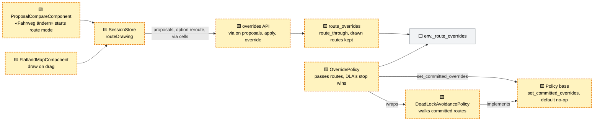

Notation: [flowchart in Mermaid](https://mermaid.js.org/syntax/flowchart.html); boxes: 🟩 green added, 🟨 yellow dashed modified, ⬜ grey unchanged, 💡 blue dotted follow-up, not in this PR (Q-11).

**Motivation:** the drawn route reuses the reroute override (DP-1); the map only collects via cells (DP-2); safety
stays with DLA (DP-3); the commit goes through Plan / KI / Mensch (DP-4).

**Contained building blocks:**

| Component | Responsibility | Change |
|---|---|---|
| `ProposalCompareComponent` (action options) | Compares Plan, KI and the operator's option for one train, and commits one. Not for drawing. | 🟨 modified: «Fahrweg ändern» lets the operator draw the route on the map, then shows its course. |
| `FlatlandMapComponent` (Streckenspiegel) | Draws the network, trains and overlays; takes clicks and drags. | 🟨 modified: in route mode a drag from the train draws its route. |
| `SessionStore` | Holds the session state the views share. | 🟨 modified: knows the train being routed and the drawn via cells. |
| overrides API (`/proposals`, `/proposals/apply`) | Simulates and commits the operator's option. | 🟨 modified: a reroute can carry via cells. |
| `route_overrides` | Keeps and drives a train's committed route. | 🟨 modified: builds a route through given via cells and keeps it. |
| `OverridePolicy` | Lets the operator's overrides win over the policy. | 🟨 modified: a route gives the direction, DLA still says move or stop. |
| `Policy` (base) | The interface every driver implements. | 🟨 modified: an optional method through which a driver learns the committed holds and routes. |
| `DeadLockAvoidancePolicy` | Moves trains on their path and stops them before a head-on conflict. | 🟨 modified: uses a rerouted train's committed route as its path. |
| `PlanPolicy` | Drives the trains on a taken KI course; trains off it go to its fallback (DLA). | 🟨 modified (S-6): a drawn route is respected after a KI course was taken, too. |

### 5.2 [Planned] From a KI course to the driver's next action (Q-11, Q-12)

*State: planned: this branch's changes (🟨, `PlanPolicy`'s pass-through planned in S-6, Q-12 a) and the follow-up Q-11 b (💡); the rest exists on #208's head.*

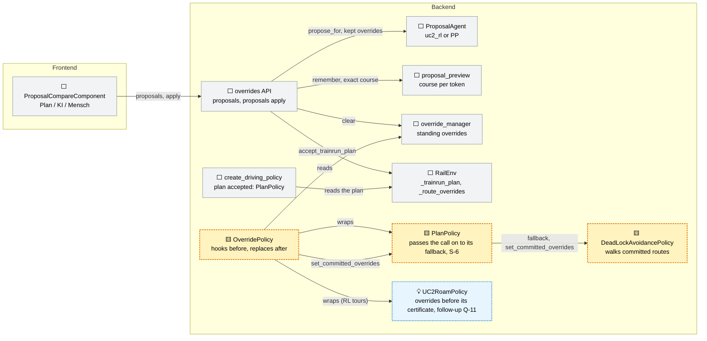

Notation: [flowchart in Mermaid](https://mermaid.js.org/syntax/flowchart.html); boxes: 🟩 green added, 🟨 yellow dashed modified, ⬜ grey unchanged, 💡 blue dotted follow-up, not in this PR (Q-11). Without the 💡 parts it is the branch as it is.

**Motivation:** `OverridePolicy` wraps every driver, live and on every fork, so it is the one place where overrides
reach the driver, by two hooks: **knowledge** before the driver acts (`set_committed_overrides`, this PR, Q-13 a; for
drivers with a built-in check: DLA, `PlanPolicy` through its fallback, S-6) and, as a follow-up (Q-11 b), **actions**
between propose and certify (for certifying drivers: ROAM). Routes need the knowledge hook: DLA's safety is inside its `act_many`, there is no step to inject an action
into. After acting, `apply_overrides` replaces the actions of overridden trains, as before (DP-3).

**Contained building blocks** (not already in §5.1):

| Component | Responsibility | Change |
|---|---|---|
| `ProposalAgent` (`uc2_rl`, PP) | Proposes courses (trainruns for every train to its target) for one train's question. Not a driver. | ⬜ unchanged |
| `proposal_preview` | Keeps the shown courses, so that taking one takes exactly that one. | ⬜ unchanged |
| `create_driving_policy` | Picks the driver: after an accepted course `PlanPolicy`, with the pinned policy as fallback; RL drivers stay. | ⬜ unchanged |
| `PlanPolicy` | Drives the trains on the accepted course, cell by cell, keeping the plan's order at each cell; trains off plan go to its fallback. Not a conflict check for off-plan trains. | 🟨 modified (S-6, Q-12 a): a rerouted train keeps DLA's check under an accepted course too, and waits for the plan's order. |
| `UC2RoamPolicy` | The RL driver of the RL tours; Joint ROAM certifies each step. | 💡 follow-up (Q-11 b): ROAM certifies the step with the operator's overrides in it. |

### 5.3 [Planned] `OverridePolicy` (Q-4, Q-11, Q-12, Q-13)

*State: planned: the class as on #208's head (⬜), this branch's changes (🟨, 🟩) and the follow-up Q-11 b (💡).*

**Motivation:** the one place where the operator's standing overrides meet whatever drives, live and on every fork.
It is built in `websockets.py` (play), `sessions.py` (step) and `TrajectoryBranchRunner._make_override_policy`
(forks, under a temporary `branch-…` session id). It does not choose routes (the driver does) and does not store
overrides (`override_manager`, `env._route_overrides`).

| Member | Change | Origin | Role |
|---|---|---|---|
| `__init__(default_policy, session_id)`, `reset`, `start_episode`, `end_episode`, `end_step`, `act`, `act_for_handle` | ⬜ unchanged | `main` | Wrap the driver and pass through. |
| `last_proposed`, `last_sources` | ⬜ unchanged | `main` | Where each action came from (`policy`, `override`, `reroute`), for the trajectory recorder. |
| `act_many(handles, observations)` | 🟨 modified | `main`, split by #196 | The driver acts for all trains, then `apply_overrides`. This branch: passes the committed overrides first. |
| `apply_overrides(handles, proposals)` | 🟨 modified | #196 | **After** the driver: stop or turn at a decision point (a stop stays), the route's move every step for a reroute, finished overrides cleared. The RL driver calls it after `finalize_actions`. This branch: keeps the driver's stop for a rerouted train when the driver took the overrides. |
| `start_step()` | 🟨 modified | `main` | This branch: calls `_pass_committed_overrides()` first. |
| `_pass_committed_overrides()`, `_policy_knows_overrides` | 🟩 added | this branch | **Before** the driver: `default_policy.set_committed_overrides(holds, routes)` when it has the method; its answer kept for `apply_overrides`. |
| action hook, e.g. `inject_overrides(handles, proposals)` | 💡 follow-up | Q-11 b | **Between** propose and certify: the overrides into a driver's proposals before `finalize_actions`, live and in the `uc2_rl` rollout instead of `_apply_kept_overrides`. |
| (`PlanPolicy.set_committed_overrides` passes on to its fallback) | 🟨 planned, S-6 | Q-12 a | Not a member here: lets the existing call reach DLA under a taken KI course. |

### 5.4 [Existing] UC2 ROAM as it is (reverse-engineered from #196 and #208, context for Q-11, Q-13)

*State: existing, as on #208's head 17707737; nothing here is changed by this plan (all ⬜).*

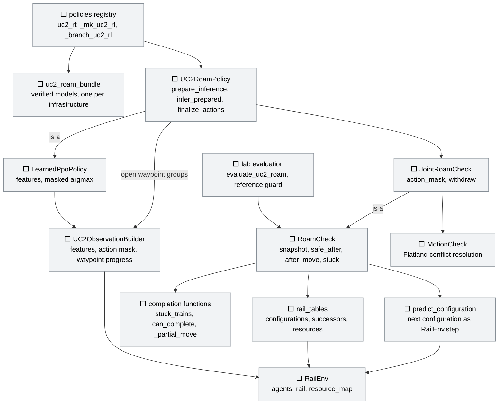

Notation: [flowchart in Mermaid](https://mermaid.js.org/syntax/flowchart.html); boxes: 🟩 green added, 🟨 yellow dashed modified, ⬜ grey unchanged, 💡 blue dotted follow-up, not in this PR (Q-11); arrows point from user
to used; "is a" is inheritance.

**Motivation of the split, as the code reads:** the trained actor only proposes; a separate, model-free check
(ROAM, vendored unchanged from `ecml2026-starterkit`, MIT) decides whether the proposals may run. Inference is
split in three so that the model runs in a worker without touching the live env: `prepare_inference` captures
features and masks on the session thread, `infer_prepared` runs on a private batch, `finalize_actions` certifies
on the session thread again, after a stale-batch check (same step, same handles). The id `uc2_rl` names both the RL
driver (registry) and the KI adviser (`proposal_agents/uc2_rl.py`, which runs the same policy on forks).

**Which policies are ROAM-capable:** only `UC2RoamPolicy` (registry id `uc2_rl`, the RL driver of the RL tours),
with Joint ROAM; the `uc2_rl` KI adviser runs the same policy on forks. DLA, `PlanPolicy`, PF-CH's
`LearnedPpoPolicy` and the simple policies do not use ROAM. Single-train ROAM (`RoamCheck`) drives no policy in the
app: it is the base class of Joint ROAM and the reference guard of the lab evaluation (`lab/marl/evaluate_uc2_roam.py`;
`get_check`, `calculate_safe_action_mask`, `calculate_withdrawn_actions` serve the lab). ROAM needs immediate STOP
braking, `remove_agents_at_target`, missions from the UC2 observation builder and one batch of all trains.

**Single-train ROAM and Joint ROAM:**

| | `RoamCheck` (single-train) | `JointRoamCheck` (joint) |
|---|---|---|
| Mask before inference | a move only into a cell that is free now and adds no stuck train | also into a cell whose holder can leave in the same step (conditional proposal) |
| Withdraw after inference | serial: trains in handle order, each against the state with the earlier moves applied; a move into a cell still held is refused; repeated while Flatland's motion check disagrees (§6.7) | joint: all moves at once, at most one train per resource, no new stuck train; else the highest-handle mover involved waits, repeated (§6.5) |
| Effect | a train cannot follow another out of a cell in the same step; the outcome depends on the handle order | trains in a chain move together; more moves certified |
| Used by | the lab's reference guard; base class | `UC2RoamPolicy` |

**Contained building blocks:**

| Component | Responsibility | Change |
|---|---|---|
| `uc2_rl` in the policies registry (`_mk_uc2_rl`, `_branch_uc2_rl`) | Builds the RL driver for a session or a fork, after checking the env fits the bundle. Not the KI adviser. | ⬜ unchanged |
| `uc2_roam_bundle` | Pins the trained models (one per infrastructure: tutorial, UC2 track) by hash and picks one from the scenario's identity. Not trained or changed at runtime. | ⬜ unchanged |
| `UC2RoamPolicy` (on `LearnedPpoPolicy`) | Proposes one action per train with the trained actor, within the model's and ROAM's masks, and has ROAM certify the whole batch. Only for all trains at once. Not override-aware: overrides come after (`apply_overrides`). | ⬜ unchanged |
| `UC2ObservationBuilder` | Features and the model's own action mask per train; tracks which waypoints a train has passed, which gives ROAM the missions (`open_waypoint_groups`). | ⬜ unchanged |
| `RoamCheck` | Single-train ROAM: for each train and action, the next configuration and whether it adds a stuck train; serial `withdraw` (§6.7). Requires immediate STOP braking and trains removed at their target. Drives no app policy itself. | ⬜ unchanged |
| `JointRoamCheck` | ROAM for a whole step: conditional moves into cells being vacated, and `withdraw` after inference (§6.5). | ⬜ unchanged |
| completion functions (`stuck_trains`, `can_complete`, `_partial_move`) | Decide which trains can no longer finish their missions, by a serial completion order over free paths. Not a route planner: any path counts. | ⬜ unchanged |
| `rail_tables` | The rail graph as configurations `(cell, heading)`, their successors and Flatland resources, cached per grid. | ⬜ unchanged |
| `predict_configuration` | The configuration a train reaches with an action, as `RailEnv.step` would (speed, braking, malfunctions known now, departure). | ⬜ unchanged |

### 5.5 [Existing] Taking a KI course and driving it, as on #208 (before this plan)

*State: existing, as on #208's head 17707737, without this branch (all ⬜). Reverse-engineered from `apply_proposal`,
`accept_trainrun_plan`, `driving_policy_id`, `create_driving_policy`, `PlanPolicy` and `OverridePolicy`.*

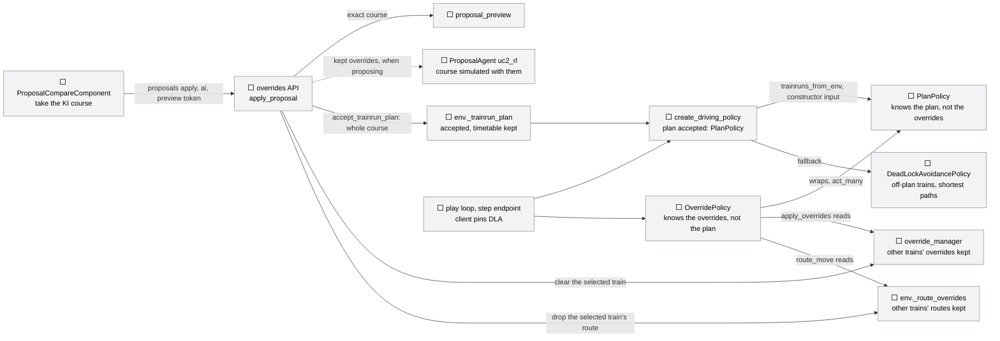

Notation: [flowchart in Mermaid](https://mermaid.js.org/syntax/flowchart.html); boxes: 🟩 green added, 🟨 yellow dashed modified, ⬜ grey unchanged, 💡 blue dotted follow-up, not in this PR (Q-11); dotted arrow: earlier, when the courses were proposed.

What a taken KI course leaves behind (`apply_proposal`, variant `ai`):

| What | Where it ends up | Who reads it |
|---|---|---|
| The whole UC2 course: every running train's `(cell, heading, entry step)` to its target, the trains with a kept override included (`da637caa`) | `env._trainrun_plan`, marked accepted (`_accepted_trainrun_plan`); the timetable kept in `_baseline_trainrun_plan` | `driving_policy_id`, `create_driving_policy` → `PlanPolicy` |
| The selected train's override and route | cleared (`override_manager.clear`, `drop_route`) | - |
| The other trains' overrides (`uc2_rl` keeps them) | stay in `override_manager` and `env._route_overrides` | `OverridePolicy` |
| `session.policy = "plan"` | the session | the step and play endpoints |

Who knows what:

- **The driver knows the plan, only as input.** Every step `create_driving_policy` builds
  `PlanPolicy(env, trainruns_from_env(env), fallback=DLA)` (the client still pins DLA). Neither `PlanPolicy` nor DLA
  reads `override_manager` or `env._route_overrides`; #208 has no call like `set_committed_overrides`.
- **The plan carries the overrides' effect, not the overrides.** The course was simulated with them: a held train's
  run stands where it is held; a rerouted train's run follows its route, so `_locate` finds it and it stays on plan;
  the plan's order then makes the other trains wait for both. `PlanPolicy` follows the consequences as long as
  reality matches the simulation, but does not know why, and cannot react when an override changes (e.g. a hold is
  released).
- **The driver's wrapper knows the overrides, not the plan.** `OverridePolicy` wraps the driver (`OverridePolicy` →
  `PlanPolicy` → DLA); it is not part of the proposal agent, which gets `kept` directly. `apply_overrides` reads them every step and
  replaces the driver's actions afterwards: a hold stops the train at a decision point, consistent with the plan;
  a reroute gets `route_move`'s move every step, which overwrites `PlanPolicy`'s wait for that train (its entry step,
  the plan's order). The rerouted train follows its route but ignores the plan's timing and order, while the others
  still wait for it by that order (Q-12).
- **When `PlanPolicy` hands a train to its fallback (DLA):** when the course has no run for it (a `uc2_rl` course
  leaves out trains already done and trains that never entered the map in its simulation), or when the train is on
  the map but not in its run: then it is off plan for the rest of the episode (`env._plan_off_plan`), in practice
  after a turn or a reroute committed after the course was taken. Waiting off the map, on its last cell, held or
  late, it stays with the plan. Details and what this means for S-6: Q-12.
- **The proposal agent's knowledge** (`kept`, explicitly in `propose_for`; routes through the forked env) survives
  only in the course (read by the driver) and in `override_manager` / `env._route_overrides` (read by the wrapper).
  The two meet only in the action dict, after the driver has decided.

**Which plan:** `env._trainrun_plan` holds one of two things.

- **At session start, the scenario plan,** if the scenario ships one (`env_factory`, `preset_plan_path`, `load_plan`):
  the intended course, cell by cell. Only two presets ship one, both PF-CH (`pf-ch-wn-wal-conflict.plan.json`,
  recorded from a DLA run, and `pf-ch-wn-wal-long-approach.plan.json`, routed per train and recorded).
  `validate_plan` checks that time advances, the cells are contiguous and no two trains are in one cell at one step;
  it does not check for deadlocks. Plan B's scenarios (tutorial, UC2) ship none: there it is `None` at start.
- **After a KI course is taken, the course:** the proposal agent's output (`install_trainrun_plan`); a scenario plan
  moves to `_baseline_trainrun_plan`. A reset or a deliberate policy switch reverts it (`revert_accepted_plan`).

The **yardstick for delay** is not always a plan: `proposal_arrival_reference` uses Flatland's timetable deadlines
(`latest_arrival`), overlaid with the scenario plan's arrivals where one exists; for the UC2 and tutorial grids only
the deadlines. A taken course never becomes the yardstick.

The **course** is a forecast, not an intention, and how it is made depends on the agent:
- `uc2_rl`: a **rollout trajectory**, what the UC2 driver with Joint ROAM did on a fork to the episode's end, each
  cell entry recorded with its step (`_rollout`, `note()`); simulated without new malfunctions (`NoMalfunctionGen`),
  with the kept overrides as they stood; a train that did not arrive has a run that ends where it stopped.
- PP (`pp_replan`): a **planner result**, computed by Prioritized Planning from the current state for a priority
  order (`replan_from_state`), collision-free in the planner's model, with standing malfunctions reserved, without
  the operator's overrides.

Both are `Proposal.trainruns` (a `TrainrunDict`), conflict-free only in their own model; `/proposals` scores each by
running `PlanPolicy` on it in a fork. `PlanPolicy` replays a taken course by position and the plan's order at each
cell, not by clock. Below, "plan" means the taken course.

**Plan and overrides, side by side** (values illustrative, tutorial with AB = train 0 from the left, BA = train 1
from the right; heading 1 = east, 3 = west):

| | Plan (taken course) | Overrides |
|---|---|---|
| What | where every running train is, cell by cell, and when it enters each cell, to its target | the operator's standing decision for single trains: stop, turn, reroute |
| Trains | all trains still running | only the trains the operator decided for |
| Time and order | entry step per cell; the order of trains at each cell follows from it | none: a stop holds until released, a turn acts once, a route has cells but no times |
| Stored | `env._trainrun_plan` (`TrainrunDict`), marked accepted; the timetable in `_baseline_trainrun_plan` | `override_manager` (per session: handle → action); a reroute's cells in `env._route_overrides`, a drawn one marked in `env._route_drawn` |
| Written by | `accept_trainrun_plan` when a KI course is taken; replaced by the next one; reset reverts it | the operator's override, the "Mensch" option, `/proposals/apply`; cleared by the operator, when used up (a turn) or on arrival |
| Read by | the driver: `PlanPolicy` gets it as constructor input every step | the driver's wrapper: `OverridePolicy.apply_overrides`; on this branch also the driver through `set_committed_overrides` (§5.6) |
| How it acts | the driver steers each train to its next waypoint and waits for its entry step and the plan's order | replaces the driver's actions afterwards (table below) |

Plan (`env._trainrun_plan`, a `TrainrunDict`: per train the waypoints it enters, with the entry step):

```json
{
  "0": [
    {"scheduled_at": 3,  "waypoint": {"position": [2, 1],  "direction": 1}},
    {"scheduled_at": 4,  "waypoint": {"position": [2, 2],  "direction": 1}},
    {"scheduled_at": 12, "waypoint": {"position": [2, 10], "direction": 1}},
    {"scheduled_at": 24, "waypoint": {"position": [2, 22], "direction": 1}}
  ],
  "1": [
    {"scheduled_at": 6,  "waypoint": {"position": [2, 22], "direction": 3}},
    {"scheduled_at": 14, "waypoint": {"position": [2, 14], "direction": 3}},
    {"scheduled_at": 15, "waypoint": {"position": [1, 14], "direction": 3}},
    {"scheduled_at": 27, "waypoint": {"position": [2, 1],  "direction": 3}}
  ]
}
```

Shortened to a few waypoints per train; a real run lists every cell. Train 1's run through (1,14) is the side track's
second track: the course was simulated with its kept reroute, so the plan carries the route too.

Overrides (in memory, shown as JSON; `override_manager` per session, the route on the env):

```json
{
  "override_manager": {"<session id>": {"0": 4, "1": 5}},
  "env._route_overrides": {
    "1": [[2, 14, 3], [1, 14, 3], [1, 13, 3], [1, 12, 3], [1, 11, 3], [1, 10, 3], [2, 10, 3], [2, 9, 3], [2, 1, 3]]
  },
  "env._route_drawn": [1]
}
```

Train 0 is held (4 = STOP), train 1 rerouted (5 = `REROUTE_ACTION`) along a drawn route (shortened; it runs on to
the target). No times anywhere. After a taken `uc2_rl` course both exist at once: the plan holds the overrides'
effect as simulated, the overrides stay standing. They can drift apart: release the hold, and the plan still has
train 0 standing where the simulation held it.

When the driver's action is used or ignored for an overridden train (`OverridePolicy.apply_overrides`, the same for
every driver; after a taken course the driver is `PlanPolicy`):

| Override | Train's situation | Driver's action | What applies |
|---|---|---|---|
| Reroute | on its route | ignored, every step | `route_move`'s move (`last_sources = "reroute"`) |
| Reroute | route over (arrived, or left a drawn route): `route_move` is None | used | override and route cleared |
| Stop | between decision points | used: the train drives on to the next switch | override stays pending |
| Stop | on a switch or merge cell | ignored | STOP; the override stays, and as the train stays on that cell, STOP applies every step until it is cleared |
| Turn (left, forward, right) | between decision points | used | override stays pending |
| Turn | on a switch or merge cell | ignored once | the turn; then the override is cleared |
| any | off the map (waiting) | used | override stays pending |
| any | done | used | override cleared |

After a taken course a kept stop matches the plan (the course was simulated with the same rule: the train drives on
to the switch and stands there); a kept reroute ignores `PlanPolicy` entirely, its waits for the entry step and the
plan's order included.

### 5.6 [Planned] What reaches DLA through `set_committed_overrides` (Q-4, Q-12)

*State: planned: built on this branch (S-2), and case B with S-6 (Q-12 a, not built yet); before S-6 DLA got nothing after a taken KI course.*

```mermaid
flowchart LR
    OM["⬜ override_manager<br/>handle: action, all committed"]
    RO["🟨 env._route_overrides<br/>handle: list of (row, col, heading), commit cell to target<br/>+ env._route_drawn"]
    OP["🟨 OverridePolicy<br/>_pass_committed_overrides"]
    POL["🟨 Policy base<br/>set_committed_overrides returns False"]
    PLP["🟨 PlanPolicy<br/>passes the call on, answers DLA's True, S-6"]
    DLA["🟨 DeadLockAvoidancePolicy<br/>stores routes, returns True"]
    W["🟨 walker<br/>routes, _walk follows them"]
    OM -- "STOP: holds, REROUTE: handles" --> OP
    RO -- "routes of REROUTE handles" --> OP
    OP -- "A, DLA drives: holds and routes" --> DLA
    OP -- "B, plan taken: holds and routes" --> PLP
    PLP -. "is a" .-> POL
    PLP -- "fallback, holds and routes passed on, S-6" --> DLA
    DLA -- "routes only, holds unused" --> W
    style OM fill:#f1f3f5,stroke:#868e96,color:#000
    style RO fill:#fff3bf,stroke:#e67700,stroke-width:2px,stroke-dasharray:4 2,color:#000
    style OP fill:#fff3bf,stroke:#e67700,stroke-width:2px,stroke-dasharray:4 2,color:#000
    style POL fill:#fff3bf,stroke:#e67700,stroke-width:2px,stroke-dasharray:4 2,color:#000
    style PLP fill:#fff3bf,stroke:#e67700,stroke-width:2px,stroke-dasharray:4 2,color:#000
    style DLA fill:#fff3bf,stroke:#e67700,stroke-width:2px,stroke-dasharray:4 2,color:#000
    style W fill:#fff3bf,stroke:#e67700,stroke-width:2px,stroke-dasharray:4 2,color:#000
```

Notation: [flowchart in Mermaid](https://mermaid.js.org/syntax/flowchart.html); boxes: 🟩 green added, 🟨 yellow dashed modified, ⬜ grey unchanged, 💡 blue dotted follow-up, not in this PR (Q-11); dotted arrow: inheritance.

What `OverridePolicy._pass_committed_overrides` passes, before every step (`start_step`, `act_many`), live and on
forks (routes through `carry_to_fork`, an uncommitted drawn route through `run_branch(routes=…)`):

| Argument | Form | Which trains | Source |
|---|---|---|---|
| `holds` | `Set[int]`, handles | every train with a standing STOP override, wherever it is (on the map, waiting off it) | `override_manager.get_all(session_id)` |
| `routes` | `Dict[int, List[(row, col, heading)]]` | only trains with a REROUTE override and a stored route; drawn and computed routes alike | `env._route_overrides` |
| (not passed) | - | turn overrides (left, forward, right), trains without an override | - |

- **Source:** the operator's overrides, as they stand in the override stores at that moment: set through the
  override endpoint, the map popover, or the "Mensch" option (`/proposals/apply`, variant `human`). The proposal
  agent has none of its own: it gets `kept`, a read-only copy minus the selected train's, only to simulate its
  courses; its output (the course) goes into `env._trainrun_plan`, never into the override stores and never through
  this call. Taking a course only removes overrides (`uc2_rl`: the selected train's; PP: all).
- **Lifetime:** re-read in every `start_step` and `act_many`, not captured when a course is taken. An override is
  passed on every step from when it is set until it ends: the operator clears or replaces it, a KI course is taken
  (as above), a reroute is over (arrived, or left a drawn route: `apply_overrides` clears it), the train is done, or
  the session is reset. On forks the overrides are copied into a temporary session when the fork is made and read
  the same way every step.
- A route is the full node list from where it was committed (the train's cell and heading then, or its origin
  while it waited off the map) to its target; it is not cut to the train's current position. The heading is the
  train's direction in that cell, as in the rail graph's nodes (`_rail_digraph`). Example, BA in the tutorial:
  `{1: [(2,14,3), (1,14,3), (1,13,3), …, (2,10,3), …, (2,1,3)]}`.
- DLA keeps the routes on its walker and clears its move decisions when they change; it does not use `holds` (a held
  train occupies its cell anyway). For every train walked, itself and when the others look for oncoming trains, the
  walker takes the route's next node while the train is on its route, otherwise the shortest path.
- **A, DLA drives:** DLA answers True, so `apply_overrides` keeps DLA's stop for a rerouted train.
- **B, a KI course was taken:** the call reaches `PlanPolicy`, which with S-6 (Q-12 a) first takes every train with a
  committed route the course was not simulated with off plan, then passes the call on to DLA, its fallback, and answers True; so DLA walks the committed routes, and `apply_overrides` keeps the driver's stop for a
  rerouted train (on plan: the plan's wait; off plan: DLA's). Before S-6 it inherited the `Policy` default (False):
  DLA got nothing and the route's move was forced. DLA still does not know the planned trains' runs (follow-up).

### 5.7 [Planned] The driver interfaces by type (Q-4, Q-11, Q-12)

*State: planned: the interfaces as on #208's head (⬜), this branch's changes (🟨, `+`; `PlanPolicy`'s in S-6); the
driver types as in §10 (certifying, with a built-in check, without a check).*

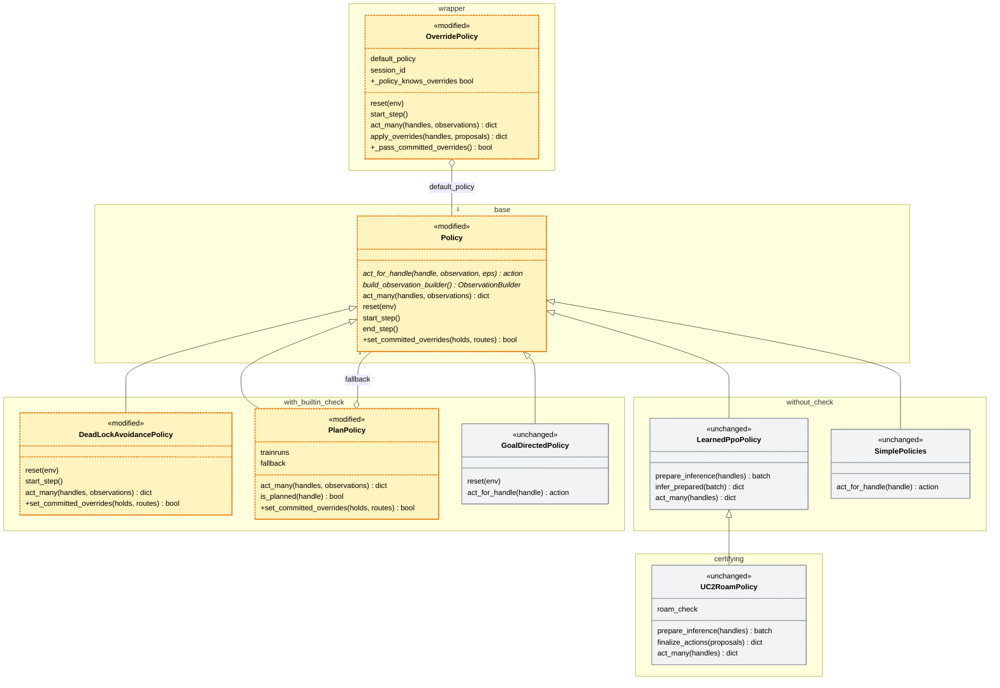

Notation: [UML class diagram in Mermaid](https://mermaid.js.org/syntax/classDiagram.html); status by colour and stereotype: green «added», yellow dashed «modified» (built, or planned in this PR), grey «unchanged» (no stereotype on unchanged classes where it would crowd them), blue dotted «follow-up» (not in this PR: Q-11); `+` marks a member added or proposed; `*` an abstract method; namespaces use `_` for spaces. `SimplePolicies` stands for `ShortestPathPolicy`, `ForwardOnlyPolicy`, `RandomPolicy` and `DoNothingPolicy`.
`OverridePolicy` is not a `Policy`; it wraps one.

| Method | Defined in, overridden by | Driver types | What it does | Who calls it, when |
|---|---|---|---|---|
| `reset(env)` | `Policy` (no-op); DLA, `PlanPolicy` (and its fallback), Director (plans its schedules), learned policies (observation builder; UC2: model per infrastructure, `JointRoamCheck`) | all | Binds the driver to an env and prepares per-episode state. | `OverridePolicy.reset` when the driver is built: per `/step` request, per play, per fork. |
| `build_observation_builder()` | abstract in `Policy`; every driver | all | The observation builder the driver needs (DLA: the env itself; learned: a dummy, they build their own features). | The registry when it builds the driver. |
| `start_step()`, `end_step()` | `Policy` (no-op); DLA (walks all trains), `PlanPolicy` (passes on to the fallback) | all | Per-step preparation and clean-up. | `OverridePolicy.start_step` / `end_step`, around every env step. |
| `act_many(handles, observations)` → `{handle: action}` | `Policy` (calls `act_for_handle` per train); DLA, `PlanPolicy`, learned (`infer_prepared(prepare_inference(…))`), UC2 (`finalize_actions(…)` as well) | all | One action per train. | `OverridePolicy.act_many`: live play and steps for drivers without a certificate, every fork for all drivers. |
| `act_for_handle(handle, observation)` → action | abstract in `Policy`; every driver (UC2 computes all trains and returns one) | all | One train's action. | `Policy.act_many`'s default; single-train callers. |
| `set_committed_overrides(holds, routes)` → `bool` | 🟨 `Policy` (returns False); 🟨 DLA (stores the routes, True); 🟨 `PlanPolicy` passes it on (S-6, Q-12 a) | built-in check | The knowledge hook: the committed holds and routes before the driver acts; True if the driver uses them. | `OverridePolicy._pass_committed_overrides` in `start_step` and `act_many`, every step. |
| `prepare_inference(handles)` → batch | `LearnedPpoPolicy`; UC2 (adds the ROAM safety mask, keeps the missions as pending) | certifying, without check (learned) | Captures features and masks on the session thread. | The play loop for RL drivers, then the worker. |
| `infer_prepared(batch)` → `{handle: action}` | `LearnedPpoPolicy` | certifying, without check (learned) | The model's argmax within the mask, on a private batch; reads no env. | The inference worker (`run_inference`). |
| `finalize_actions(proposals)` → `{handle: action}` | `UC2RoamPolicy` only | certifying | Joint ROAM's `withdraw` over the whole batch; refuses a stale batch. | The play loop after inference; the `uc2_rl` rollout after `_apply_kept_overrides`. |
| `trainruns`, `fallback`, `is_planned(handle)`, `off_plan_handles` | `PlanPolicy` | built-in check | The plan it follows, the policy for trains off it, introspection. | `create_driving_policy` (constructor), the API, tests. |
| `apply_overrides(handles, proposals)` → actions | `OverridePolicy` (not a driver) | all | Replaces the actions of overridden trains afterwards (§5.5's table). | `OverridePolicy.act_many`; the play loop after `finalize_actions`. |

Inputs and outputs of the complex methods (values illustrative; actions as numbers: 0 do nothing, 1 left, 2 forward,
3 right, 4 stop):

```json
{
  "set_committed_overrides": {
    "holds": [0],
    "routes": {"1": [[2, 14, 3], [1, 14, 3], [1, 13, 3], [1, 10, 3], [2, 10, 3], [2, 1, 3]]},
    "returns": true
  },
  "act_many": {"handles": [0, 1, 2], "returns": {"0": 4, "1": 2, "2": 1}},
  "prepare_inference": {
    "returns": {"handles": [0, 1, 2], "observations": "float32 array [3, OBSERVATION_DIM + 5]: features, then the action mask", "width": "OBSERVATION_DIM"},
    "pending (UC2)": {"step": 12, "handles": [0, 1, 2], "missions": {"0": [[[2, 22, 1]]], "1": [[[2, 1, 3]]], "2": []}}
  },
  "infer_prepared": {"returns": {"0": 2, "1": 2, "2": 1}},
  "finalize_actions": {"proposals": {"0": 2, "1": 2, "2": 1}, "returns": {"0": 4, "1": 2, "2": 1}, "withdrawn_handles": [0]}
}
```

- `routes`: per rerouted train its committed route, `(row, col, heading)` from where it was committed to the target
  (§5.6). `holds`: handles only.
- `act_many`: the driver's answer for every train asked; `OverridePolicy` then replaces overridden trains' actions.
- `prepare_inference`: the batch is private to the worker; UC2 additionally keeps the step, the handles and the
  missions (open waypoint groups, each a list of alternative `(row, col, heading)`) for `finalize_actions`, which
  refuses a batch from another step.
- `finalize_actions`: train 0's forward move was withdrawn to stop (it would add a stuck train); the others stand.
- `PlanPolicy`'s `trainruns`: a `TrainrunDict`, see the plan example in §5.5.

### 5.8 [Existing] #208's kept overrides: classes (context for Q-11)

*State: existing, as on #208's head; unchanged by this plan (all ⬜). The approach that puts the overrides into the
proposals of the KI adviser's rollout, before Joint ROAM certifies them (§6.5).*

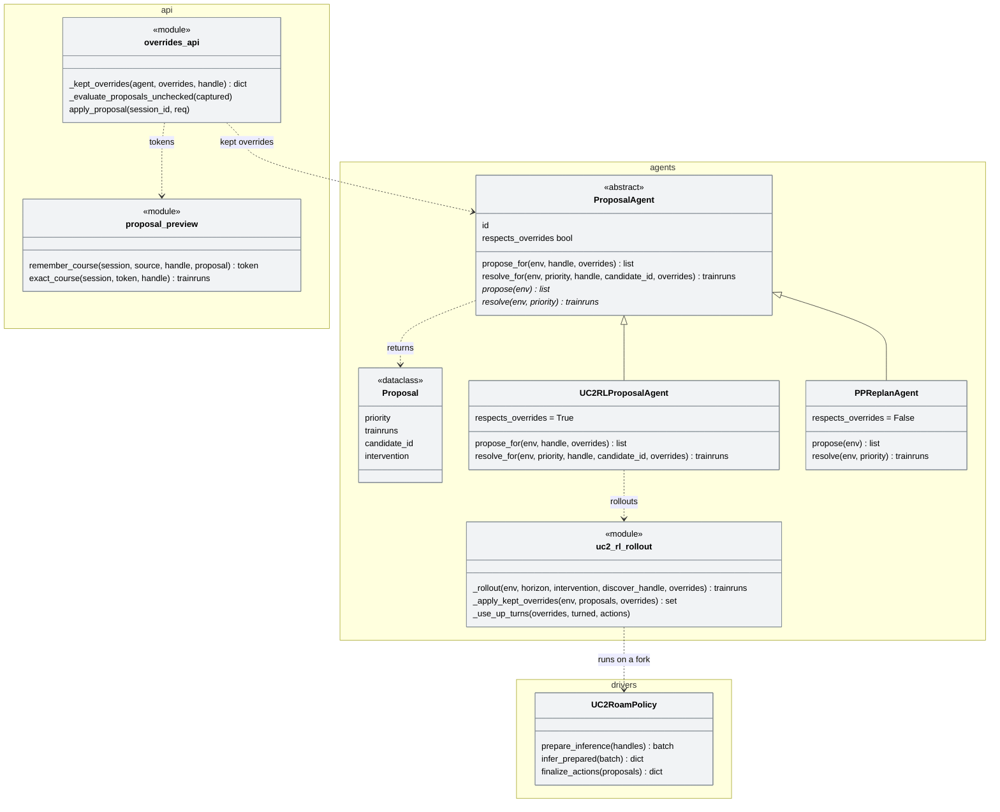

Notation: [UML class diagram in Mermaid](https://mermaid.js.org/syntax/classDiagram.html); status by colour and stereotype: green «added», yellow dashed «modified» (built, or planned in this PR), grey «unchanged» (no stereotype on unchanged classes where it would crowd them), blue dotted «follow-up» (not in this PR: Q-11); `+` marks a member added or proposed; `*` an abstract method; namespaces use `_` for spaces.

- `_kept_overrides` (API) gives an agent that `respects_overrides` every standing override but the selected
  train's; `propose_for` / `resolve_for` hand them to `_rollout`.
- `_apply_kept_overrides` writes them into the raw proposals by a copy of `OverridePolicy`'s rules (stop and turn at
  a decision point, reroute every step); `_use_up_turns` drops a turn once the certified step took it.
- `proposal_preview` binds each shown course to the state and the standing overrides (`preview_token`).
- `PPReplanAgent` ignores overrides (`respects_overrides = False`).

### 5.9 [Planned] Both approaches together: knowledge hook and action hook (Q-4, Q-11, Q-12)

*State: planned: this branch's knowledge hook (🟨), `PlanPolicy`'s pass-through (🟨, S-6, Q-12 a) and the follow-up Q-11 b, with Q-11 e if needed (💡).*

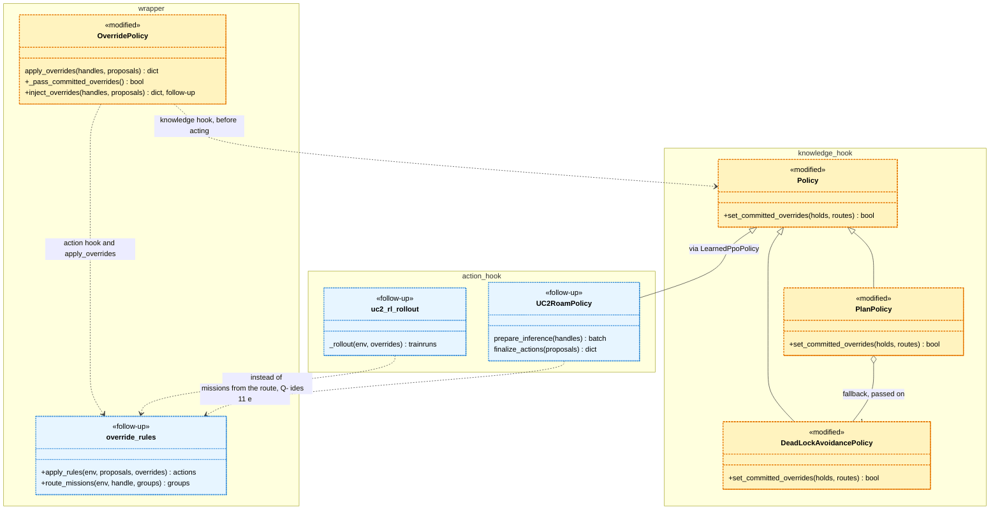

Notation: [UML class diagram in Mermaid](https://mermaid.js.org/syntax/classDiagram.html); status by colour and stereotype: green «added», yellow dashed «modified» (built, or planned in this PR), grey «unchanged» (no stereotype on unchanged classes where it would crowd them), blue dotted «follow-up» (not in this PR: Q-11); `+` marks a member added or proposed; `*` an abstract method; namespaces use `_` for spaces.

- **Knowledge hook** (this branch, `set_committed_overrides`): for drivers with a built-in check; DLA implements it,
  `PlanPolicy` passes it on (S-6, Q-12 a).
- **Action hook** (Q-11 b, `inject_overrides`): for certifying drivers; the proposals get the overrides before
  `finalize_actions`, by one set of rules (`override_rules.apply_rules`) that `apply_overrides` and the `uc2_rl`
  rollout share instead of `_apply_kept_overrides`.
- **Route as mission** (Q-11 e, `route_missions`): where the missions are built for ROAM, a rerouted train gets its
  route's choices instead of its open stops.
- Names of the follow-up's members are placeholders; the follow-up (Q-11 b) names them.

## 6. Runtime view

### 6.1 [Planned] Draw, compare, take (REQ-1, REQ-2; Q-6)

*State: planned, built on this branch (S-3, S-4).*

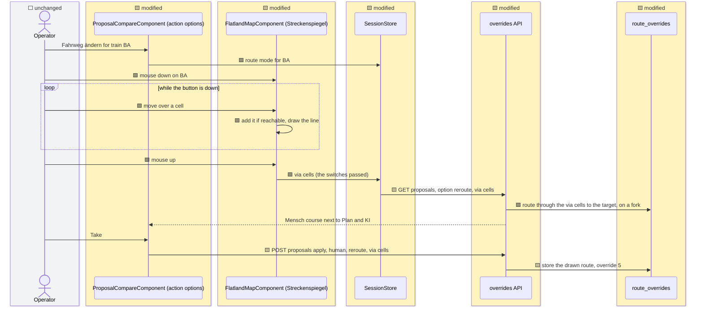

Notation: [UML sequence diagram in Mermaid](https://mermaid.js.org/syntax/sequenceDiagram.html); participants in coloured boxes: 🟩 added, 🟨 modified, ⬜ unchanged, 💡 follow-up (Q-11, not in this PR); messages marked 🟩 new, 🟨 changed (built, or planned in this PR: S-6), 💡 follow-up, unmarked unchanged.

### 6.2 [Planned] A step with a drawn route (REQ-3; Q-4)

*State: planned, built on this branch (S-2).*

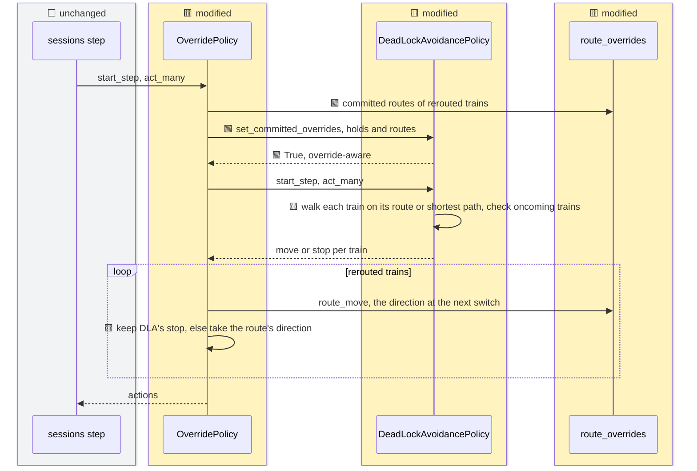

Notation: [UML sequence diagram in Mermaid](https://mermaid.js.org/syntax/sequenceDiagram.html); participants in coloured boxes: 🟩 added, 🟨 modified, ⬜ unchanged, 💡 follow-up (Q-11, not in this PR); messages marked 🟩 new, 🟨 changed (built, or planned in this PR: S-6), 💡 follow-up, unmarked unchanged.

### 6.3 [Existing] Taking a KI course (context for Q-11, Q-12)

*State: existing, as on #208's head; unchanged by this plan (all ⬜).*

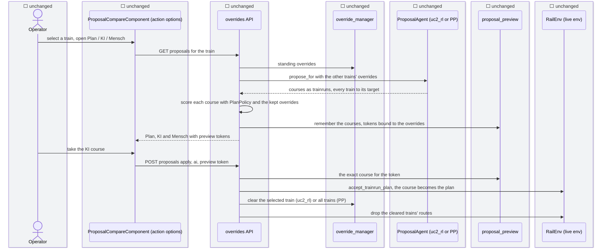

Notation: [UML sequence diagram in Mermaid](https://mermaid.js.org/syntax/sequenceDiagram.html); participants in coloured boxes: 🟩 added, 🟨 modified, ⬜ unchanged, 💡 follow-up (Q-11, not in this PR); messages marked 🟩 new, 🟨 changed (built, or planned in this PR: S-6), 💡 follow-up, unmarked unchanged. As on #208, unchanged
here; `uc2_rl` keeps the other trains' overrides (`respects_overrides`), PP clears all (§3.4).

### 6.4 [Planned] The steps after it: overrides on the driver, the next action (Q-11, Q-12)

*State: planned: this branch's changes (🟩, 🟨; the pass-through in S-6, Q-12 a) and the follow-up Q-11 b (💡).*

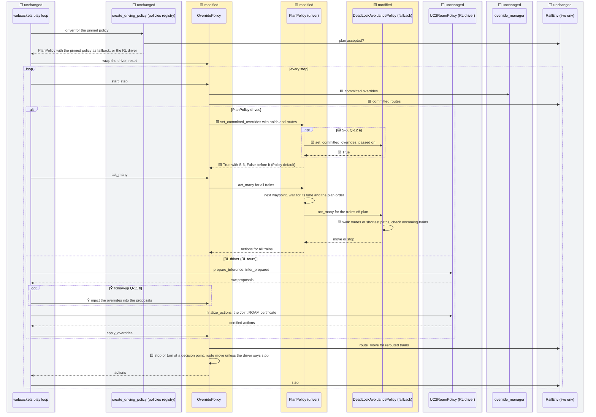

Notation: [UML sequence diagram in Mermaid](https://mermaid.js.org/syntax/sequenceDiagram.html); participants in coloured boxes: 🟩 added, 🟨 modified, ⬜ unchanged, 💡 follow-up (Q-11, not in this PR); messages marked 🟩 new, 🟨 changed (built, or planned in this PR: S-6), 💡 follow-up, unmarked unchanged. The `opt` block
marked 🟨 is S-6 (Q-12 a, planned in this PR; before it `PlanPolicy` answers False, the `Policy` default); the one
marked 💡 is the follow-up Q-11 b (until then the RL driver gets the overrides only after `finalize_actions`). The trains follow the accepted course to their
targets, not only to the next switch; a train that leaves it (a turn or reroute) is off plan for the rest of the
episode.

### 6.5 [Existing] How Joint ROAM decides whether a kept override's move happens (context for Q-11, Q-13)

*State: existing, as on #208's head; unchanged by this plan (all ⬜).*

One step of #208's `uc2_rl` rollout (`uc2_rl._rollout`, `uc2_roam_policy.py`, `roam_check.py`,
`roam_joint_check.py`; vendored from `ecml2026-starterkit`). ROAM is "Reserve Only if All Missions stay achievable":

- **Mission:** a train's open waypoint groups (its remaining stops) and its target, from the UC2 observation
  builder.
- **Stuck trains** (`stuck_trains`): trains are removed one by one when one can reach its target through its
  remaining stops (`can_complete`, a search over the rail graph with the cells of the trains still waiting blocked);
  a removed train frees its cell; whoever is left when no train can be removed is stuck. Bounded partial moves are
  tried before giving up.
- **Certificate:** a step is safe if, after it, no train is stuck that was not stuck before (baseline). This is a
  sufficient test, not a proof of a physical deadlock.
- **Before inference** (`action_mask`): per train, actions whose move alone would add a stuck train are masked; a
  move into a cell whose holder can leave in the same step is allowed conditionally. The model picks within the mask.
- **Kept overrides** are written into the raw proposals after inference (`_apply_kept_overrides`), so they bypass
  the mask; only `withdraw` checks them.
- **Withdraw** (`JointRoamCheck.withdraw`): resolve the joint move as Flatland would (`MotionCheck`: a train whose
  next cell stays taken does not move), apply all moves (`joint_after`, at most one train per resource), compute the
  stuck trains; if new ones appear, the highest-handle mover involved falls back (stop, or wait off the map), and the
  loop repeats (at most trains + 1 rounds). The victim may be the overridden train or another one.

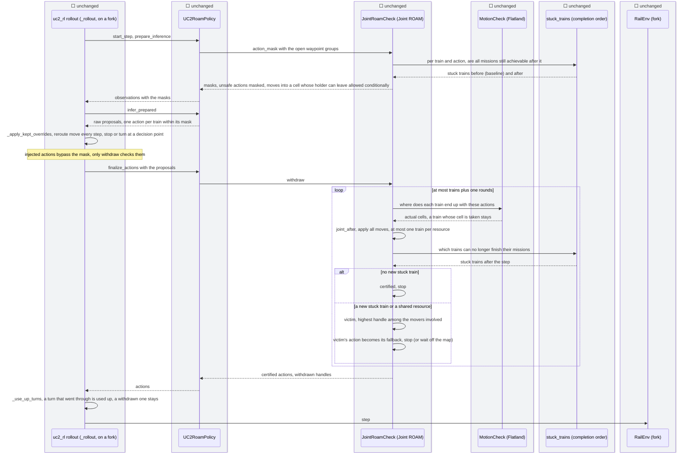

Notation: [UML sequence diagram in Mermaid](https://mermaid.js.org/syntax/sequenceDiagram.html); participants in coloured boxes: 🟩 added, 🟨 modified, ⬜ unchanged, 💡 follow-up (Q-11, not in this PR); messages marked 🟩 new, 🟨 changed (built, or planned in this PR: S-6), 💡 follow-up, unmarked unchanged.

So a kept reroute's move goes ahead only if the joint step keeps every mission achievable, not merely if the next
cell is free; a withdrawn route move keeps the override and is tried again next step. **Gap:** `can_complete` lets
every train take any path through its stops; it does not know that a rerouted train is bound to its route. ROAM can
certify a step after which the only completion needs the rerouted train off its route; from then on its route move
would be withdrawn every step, and the train would stand while ROAM still counts its mission achievable (read in
the code, not tested).

| Where | Does a route move go ahead when the next cell is free? | What decides |
|---|---|---|
| #208 KI rollout | not necessarily | Joint ROAM after injection: every mission stays achievable, with free paths, not the route |
| UC2 driver live (#196, RL tours) | yes | only Flatland's motion check: `apply_overrides` comes after `finalize_actions` |
| DLA on this branch (Plan B) | not necessarily | DLA along the route: no oncoming train on the stretch ahead; DLA's stop wins |

### 6.6 [Existing] A live step of the UC2 RL driver as it is (RL tours; context for Q-11)

*State: existing, as on #208's head; unchanged by this plan (all ⬜). `OverridePolicy` is shown as it is there; this branch's changes to it are in §6.4.*

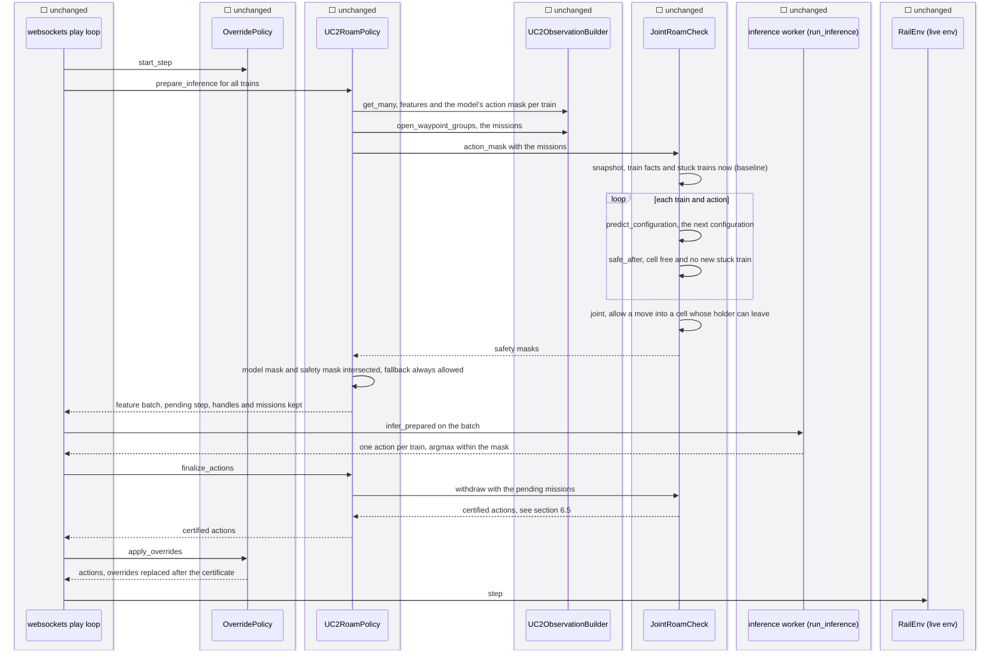

Notation: [UML sequence diagram in Mermaid](https://mermaid.js.org/syntax/sequenceDiagram.html); participants in coloured boxes: 🟩 added, 🟨 modified, ⬜ unchanged, 💡 follow-up (Q-11, not in this PR); messages marked 🟩 new, 🟨 changed (built, or planned in this PR: S-6), 💡 follow-up, unmarked unchanged. The session's set-up
comes first: `_mk_uc2_rl` checks the bundle, `UC2RoamPolicy.reset` loads the infrastructure's model and creates
`JointRoamCheck(env, partial_moves=True, max_candidates=60)`, whose rail tables are cached per grid. The withdraw loop
is §6.5; the #208 rollout differs only in writing the kept overrides into the proposals before `finalize_actions`,
where live play applies them after it (`apply_overrides`).

### 6.7 [Existing] Single-train ROAM's withdraw, for comparison (context for §5.4)

*State: existing, as on #208's head; unchanged by this plan (all ⬜). Used by no app policy; the lab's reference guard and the base of Joint ROAM.*

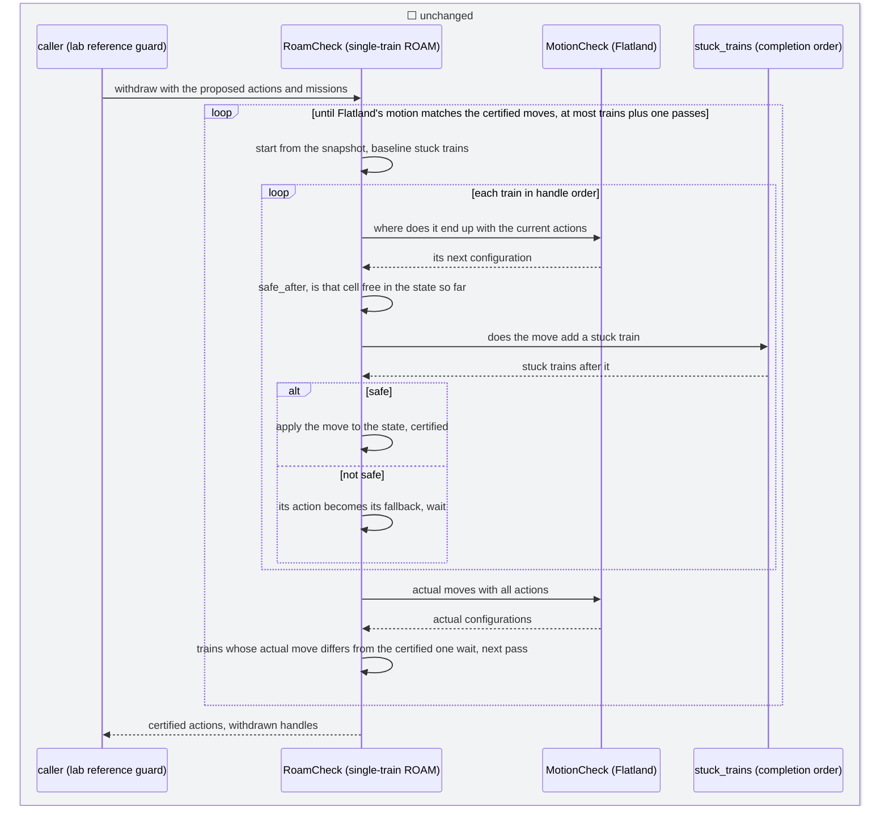

Notation: [UML sequence diagram in Mermaid](https://mermaid.js.org/syntax/sequenceDiagram.html); participants in coloured boxes: 🟩 added, 🟨 modified, ⬜ unchanged, 💡 follow-up (Q-11, not in this PR); messages marked 🟩 new, 🟨 changed (built, or planned in this PR: S-6), 💡 follow-up, unmarked unchanged.

The serial order is the difference to §6.5: each move is checked against the state with only the earlier trains'
moves applied, so a move into a cell that a later train vacates in the same step is refused. Joint ROAM checks all
moves together and lets such a chain move.

### 6.8 [Existing] A step after a KI course was taken, as on #208 (before this plan)

*State: existing, as on #208's head, without this branch (all ⬜). The same flow with this branch's changes is §6.4.*

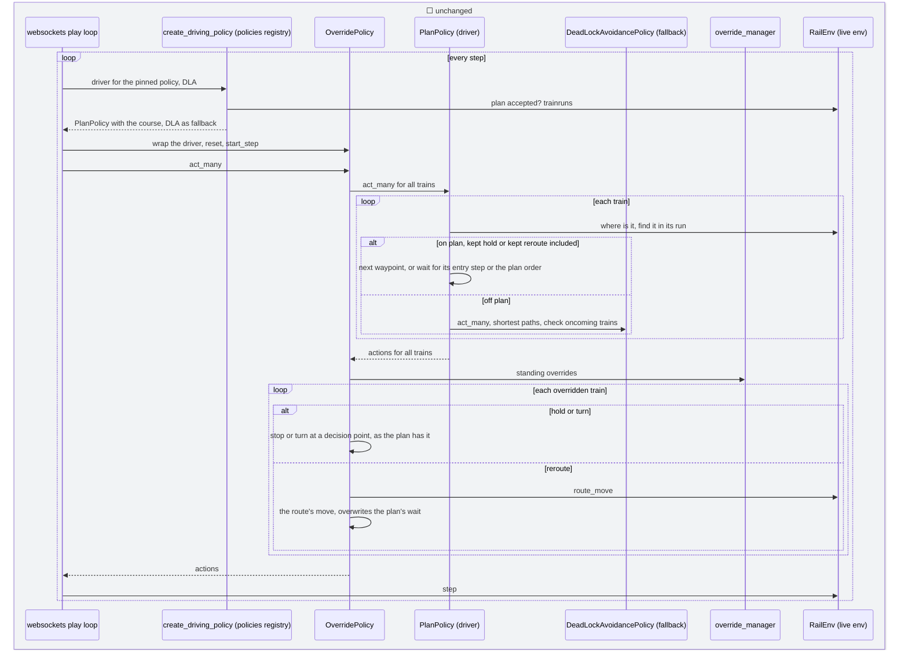

Notation: [UML sequence diagram in Mermaid](https://mermaid.js.org/syntax/sequenceDiagram.html); participants in coloured boxes: 🟩 added, 🟨 modified, ⬜ unchanged, 💡 follow-up (Q-11, not in this PR); messages marked 🟩 new, 🟨 changed (built, or planned in this PR: S-6), 💡 follow-up, unmarked unchanged.

The driver is rebuilt every step from the env, so the plan it follows is always the latest taken course. Overrides
reach the step only in `apply_overrides`, after the driver has decided; for a kept hold that matches the plan, for a
kept reroute the route's move replaces the plan's wait.

### 6.9 [Planned] A step with committed overrides: DLA driving, or after a taken KI course (Q-4, Q-12)

*State: planned: built on this branch (S-2), and case B with S-6 (Q-12 a, not built yet).*

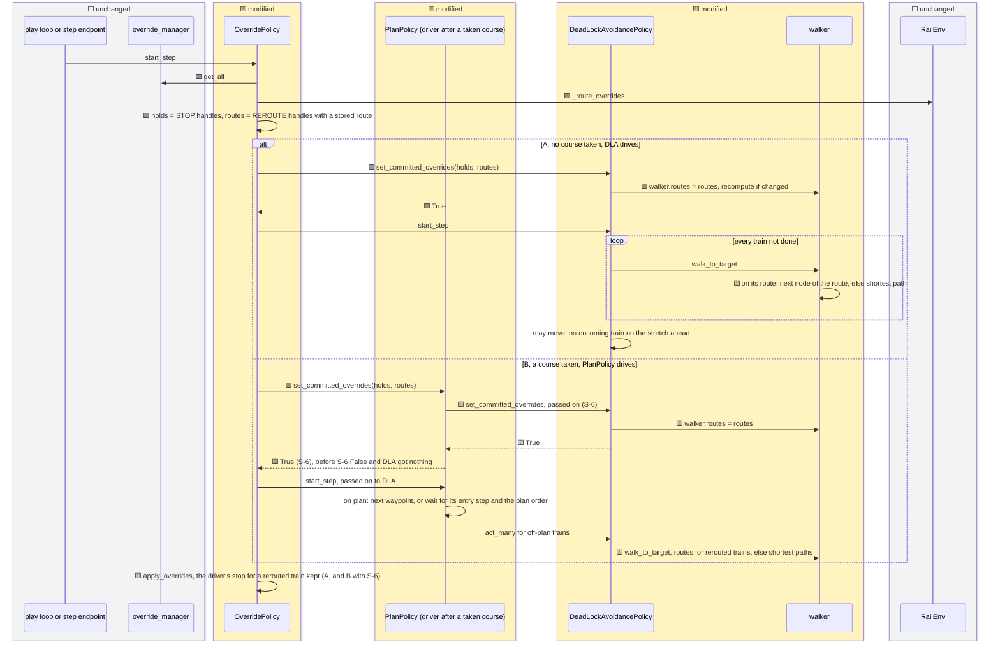

Notation: [UML sequence diagram in Mermaid](https://mermaid.js.org/syntax/sequenceDiagram.html); participants in coloured boxes: 🟩 added, 🟨 modified, ⬜ unchanged, 💡 follow-up (Q-11, not in this PR); messages marked 🟩 new, 🟨 changed (built, or planned in this PR: S-6), 💡 follow-up, unmarked unchanged.

Case A is §6.2 in more detail; case B is §6.8 with this branch's call added, which stops at `PlanPolicy` (§5.6).

### 6.10 [Follow-up] A step of a certifying driver with the action hook and the route as mission (Q-11 b, Q-11 e)

*State: follow-up, not in this PR (Q-11 b decided as a follow-up; Q-11 e only if the stall test needs it). The follow-up's parts are 💡; `OverridePolicy` is 🟨 for this branch's changes; the rest is unchanged.
The same steps for live play (RL tours) and for the `uc2_rl` rollout on a fork.*

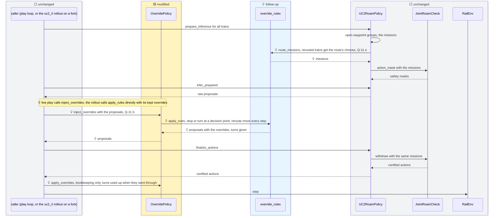

Notation: [UML sequence diagram in Mermaid](https://mermaid.js.org/syntax/sequenceDiagram.html); participants in coloured boxes: 🟩 added, 🟨 modified, ⬜ unchanged, 💡 follow-up (Q-11, not in this PR); messages marked 🟩 new, 🟨 changed (built, or planned in this PR: S-6), 💡 follow-up, unmarked unchanged.

Compared with §6.5 and §6.6: the overrides go in before the certificate in live play too (not only in the rollout),
by the same rules as `apply_overrides`; and ROAM's missions follow a rerouted train's route, so it does not certify a
step after which the train could finish only off its route.

## 8. Crosscutting concepts

### 8.1 New patterns

Compared with `main`. What is reused, and what is not new on purpose, is in §4.1.

| ID | New | Defined in |
|---|---|---|
| PAT-1 | A map mode in which a drag draws instead of panning. | §4.3, Q-1 |
| PAT-2 | Via cells on the override channel (reroute with a given route). | §4.4, Q-2 |
| PAT-3 | An override that gives the direction while the policy keeps go/stop. | §4.5, Q-4 |
| PAT-4 | Override-aware policies: an optional `Policy` method through which `OverridePolicy` passes the committed holds and routes. Not #208's `respects_overrides`, which is about an adviser's courses (§3.4). | Q-4 b, Q-11 |
| PAT-5 | A taken course records the routes it was simulated with (`env._plan_course_routes`, next to `env._plan_off_plan`); `PlanPolicy` takes a train with any other committed route off plan. | §9.1 (Q-12) revisited, S-6 |

### 8.2 Breaking changes

- **Reroutes become safer and possibly slower:** with Q-4 b (DLA override-aware), a computed reroute (before this plan «Umleiten» around a block)
  also waits when DLA says stop, where today it drives on. Forecasts of existing tours with reroutes may change.
  No API or stored format changes; existing calls without `via` behave as today apart from this.
- **After a taken KI course, rerouted trains wait** (S-6, Q-12 a): `PlanPolicy` takes a train rerouted after the course
  was taken off plan, passes the committed routes on to DLA and answers True, so `apply_overrides` keeps the
  driver's stop for a rerouted train. A kept reroute the course was simulated with stays on plan and waits for the
  plan's entry steps and order, any other rerouted train for DLA, where before the route's move was forced. Forecasts and the KI courses' scores (which run `PlanPolicy`) may change. No API or format change.
  Measured in the advanced tour's counter-train case (`test_sandbox.py::test_advanced_tour_case_rewards_the_reroute`):
  the reroute's delay goes from 20 to 23 (proceed and hold stay at 40). The rerouted train waits at (0,111) in steps
  31–33 until train 0 has left the shared track on row 0, and arrives at step 60 instead of 57. Before S-6 its forced
  moves got through only by timing. DLA's walk of train 0 is its shortest path, not its run (the follow-up "The
  fallback DLA walks the planned trains along their runs").
- **`_branch_run` and `TrajectoryBranchRunner.run_branch` take `routes`:** callers keep the default; a stub that
  replaces `_branch_run` must accept `routes=None` (adjusted in #208's `test_proposal_horizon_scope.py`).
- **«Fahrweg ändern» in the action options and the map popover always draws** (Q-5 a): it is offered for every train that
  has not arrived (`rerouteAvailable` no longer asks the impact analysis), and the «Mensch» course waits for the
  drawn route. The computed reroute around a block stays on the impact panel and on the override endpoint without
  `via`.


### 8.3 Policy independence of the override extensions (#196, #208, this PR)

*Whether the three PRs' override extensions depend on a particular driver, and where they are generic.*

The mechanism is generic in two places: the **wrapper `OverridePolicy`**, an adapter around whatever driver a step
or fork builds (it needs only `act_many` or `act`, and asks for `set_committed_overrides` with `getattr`), and the
**`Policy` base class**, which declares `set_committed_overrides` as a no-op answering False. The route store
(`app.core.route_overrides`: `commit_route`, `route_move`, `env._route_overrides`) knows no policy at all. Neither the
wrapper nor the route store names DLA, UC2 or any other policy. What a driver adds is only its own answer to the hook.

| Extension | From | Declared in | Called by | Implemented in | Policy-independent? |
|---|---|---|---|---|---|
| `apply_overrides`: overrides replace the driver's actions afterwards | #196 | `OverridePolicy` (the wrapper) | the wrapper, in every `/step`, `/play` and fork | the wrapper itself | Yes: it works on any driver's actions. For the UC2 driver `/play` calls it after `finalize_actions` (Joint ROAM), after the certificate: the action hook (Q-11 b). |
| `respects_overrides`, kept overrides: an adviser's course keeps the other trains' overrides | #208 | `ProposalAgent.respects_overrides` (base, default False) | `api/overrides.py`: `_kept_overrides`, `apply_proposal` | only `uc2_rl`: `_apply_kept_overrides` in its rollout | Only the flag: any adviser can opt in, but the mechanism is UC2's, inside the agent, a copy of the wrapper's rules rather than a delegation. It has drifted already (no driver STOP wins over the route; an ended route is not cleared). One set of rules: Q-11 b. |
| `set_committed_overrides`: the driver learns the holds and routes before it acts | this PR | `Policy` base (no-op, False) | the wrapper, `_pass_committed_overrides` (`getattr`; an object without it counts as False) | DLA (walks the routes, True); `PlanPolicy` (S-6, then delegates to its fallback and answers for it) | Yes: the wrapper adapts to the answer (True: the driver's STOP for a rerouted train wins; False: the route's move is forced, as before). Every driver without it behaves as before: UC2, PF-CH, Director, `shortest_path`, the simple policies. |

Delegation: `PlanPolicy` is the only `Policy` that holds another policy (`fallback`); it forwards the hook as it
forwards `reset`, `start_step`, `end_step` and the observation builder. S-6's off-plan rule is in `PlanPolicy`, so it
works with any fallback.

Where DLA is still named, outside the mechanism: defaults for when no driver is given. `PlanPolicy`'s fallback is DLA
when none is passed (`PlanPolicy(env, trainruns, fallback=None)`, as `plan_branch_factory` does for forecasts after a
taken course; live, `create_driving_policy` passes the pinned policy); the forecasts' factory falls back to
`deadlock_avoidance` for an unknown policy id (`api/overrides.py` `_policy_factory_for`), with the Director replay
special-cased. And the `/play` loop has a branch for the specialist drivers' interface (`prepare_inference`,
`infer_prepared`, `finalize_actions`), keyed on `is_specialist_policy`, around the same wrapper.


#### 8.3.1 Moving `_apply_kept_overrides` up (Q-11 b, follow-up)

*The shape of the follow-up that puts #208's copy of the override rules into the wrapper; not built in this PR.*

The two places that apply overrides differ today:

| | `OverridePolicy.apply_overrides` (#196) | `uc2_rl._apply_kept_overrides` (#208) |
|---|---|---|
| Overrides from | `override_manager` (the session's) | an explicit dict: the kept overrides, in a rollout on a fork |
| When | on the driver's actions, after a certificate | on the raw proposals, before `finalize_actions` (Joint ROAM) |
| Turns used up | at once, in `override_manager` | only if the certified step still takes them (`_use_up_turns`) |
| Route ended (`route_move` None) | clears the override, drops the route | leaves both |
| Train done | clears its override | keeps it |
| Driver knows the routes (S-2) | its STOP wins | not considered |
| Records `last_proposed` / `last_sources` | yes, for the trajectory | no |

The shape:

1. **One rule function** next to the wrapper, independent of any policy and without side effects:
   `override_moves(env, overrides, proposals, driver_knows) -> (actions, sources, turned, ended)`, the overrides
   given as a dict.
2. **Two phases in `OverridePolicy`:** `inject_overrides(handles, proposals)` before a certifying check (the action
   hook: the rule function with the session's overrides), and `commit_overrides(certified)` after it (use up the
   turns the certified step took, clear the ended routes, record the sources). `apply_overrides` stays as both in one
   go, for drivers without a certificate, unchanged.
3. **The callers:** the `/play` path of the specialist drivers calls `inject_overrides` before `finalize_actions`
   and `commit_overrides` after it, so the overrides no longer arrive after the certificate; the `uc2_rl` rollout
   calls the rule function with its `kept` dict instead of its own copy, and `_apply_kept_overrides` and
   `_use_up_turns` go away.

Live driving and the KI rollout then follow one set of rules, and the drifted differences (the driver's STOP,
the ended route, the finished train) are gone. Live driving then uses a turn up only once the certified step takes
it, as the rollout does today. Tests: a drawn route under the UC2 driver; the rollout's courses unchanged for overrides
it handled the same way. Not in this PR (Q-11 b): it changes #196's wrapper, #208's rollout and the `/play` loop, and
Plan B is driven by DLA, which needs no action hook. The follow-up's plan
(`docs/plans/shared-override-rules.md`, branch `refactor/shared-override-rules`) adds two clean-ups at the same time: one helper for an action's
number (three copies today, and the literal stop in `uc2_rl.py`), and one certified step shared by `/play` and the
rollout.

## 9. Decisions

### 9.1 Open questions

✅ ~~**(Q-1) The gesture: drag along the track, or click node by node?**~~ **Decided 2026-11-16:** a).
- a) Press on the train and drag along the tracks; release sets it (as described).
- b) Click the switches one by one ("Knoten-Knoten-Knoten"), double-click or Enter ends it.
- c) Both: a drag, and clicks on further switches to extend it before releasing.

*Proposed:* a, as described; b as a later fallback for touch screens.

✅ ~~**(Q-2) What does the frontend send: via cells or the full route?**~~ **Decided 2026-11-16:** a).
- a) Via cells (the switches passed), the backend builds the route through them.
- b) The full cell list, the backend checks it.

*Proposed:* a. A drag samples cells unevenly; switches are what the operator decides.

✅ ~~**(Q-3) Where does a drawn route end?**~~ **Decided 2026-11-16:** a).
- a) At the train's target: after the last via cell the backend continues by the shortest path (as reroutes do today).
- b) At the last drawn cell; there the override ends and the driving policy takes over.

*Proposed:* a. It keeps the existing reroute mechanics (route to the target, cleared on arrival); b is a follow-up.

✅ ~~**(Q-4) Who decides go or stop for a rerouted train, and do the others know its route?**~~ **Decided 2026-11-16:** b). No policy knows
overrides today (§3.4).
- a) DLA only: DLA says move or stop for the rerouted train along its route, and walks committed routes for every
  train (§4.5). Covers Plan B (DLA) and REQ-4; other policies stay as today.
- b) An optional interface on the policy base (`Policy`), e.g. `set_committed_overrides(holds, routes)` called by
  `OverridePolicy` every step, implemented by DLA in this PR; Director, `PlanPolicy`, PP and ROAM follow when needed
  (follow-ups). Same work as a for DLA, plus a small seam that names the contract.
- c) Policy-independent: `OverridePolicy` checks a rerouted train's next move itself (a reservation check against the
  other trains' current positions and committed routes) and holds it when it would meet one head-on. Works under
  every policy, but duplicates part of DLA and does not make the others wait on the side track.
- d) As today: the route's move wins, nobody else knows the route; the operator adds holds by hand.

*Proposed:* b. It solves REQ-4 with DLA (Plan B's policy) and makes "override-aware policy" an explicit, opt-in
contract instead of a DLA special case; the other policies keep today's behaviour until they implement it.

✅ ~~**(Q-5) When is "Umleiten" offered?**~~ **Decided 2026-11-16:** a).
- a) Always, for a train on the map or waiting at its origin.
- b) As today, only when the impact analysis finds a block with a way around.

*Proposed:* a: setting a route is a dispatching decision of its own, not only a way around a breakdown.

✅ ~~**(Q-6) Does mouse up set the override at once, or after comparing?**~~ **Decided 2026-11-16:** b).
- a) At once (as described): mouse up commits the reroute.
- b) Mouse up computes the "Mensch" course in Plan / KI / Mensch; "Take" commits it.

*Proposed:* b, because Co-Learning (Plan B) is about comparing before acting; a in modes without the action
options. chenkins decides.

✅ ~~**(Q-7) A train that is not on the map yet?**~~ **Decided 2026-11-16:** a).
- a) Allowed: the route starts at its origin and direction; `route_move` keeps the override until it enters.
- b) Not allowed until it enters.

*Proposed:* a. In the tutorial, BA waits at B under DLA (§3.3); the route is what lets it start.

✅ ~~**(Q-8) A train under `PlanPolicy`?**~~ **Decided 2026-11-16:** a).
- a) As today: once rerouted it is off plan and drives with DLA (and the drawn route) to the end.
- b) It rejoins its plan where the route meets it again.

*Proposed:* a now, b as a follow-up.

✅ ~~**(Q-9) Order of the clicks?**~~ **Decided 2026-11-16:** a).
- a) Train first, as today: a click on the train (on the map, also when it waits at its origin, or in the timetable)
  selects it, the action options show its buttons; then "Umleiten", then drag from the train.
- b) "Umleiten" first with no train selected; pressing on a train picks the target. The panel would need a state
  without a train.

*Proposed:* a: the action options already follow the selected train (`targetHandle` = `selectedHandle`).

✅ ~~**(Q-10) The clock while drawing?**~~ **Decided 2026-11-16:** a).
- a) It keeps running: in the tutorial (5 s per step) about one step passes while drawing, the route is committed
  at the step of "Take".
- b) It pauses while "Umleiten" is active (a new gate).

*Proposed:* a. Co-Learning has no global pause; it holds the affected trains only at a decision moment, which the
tutorial never reaches (the impact analysis lists no train, as BA waits off the map during AB's malfunction).

✅ ~~**(Q-11) How do the operator's overrides reach a driver with a certificate (UC2 ROAM), and how does that relate to
#208's `respects_overrides`?**~~ **Decided 2026-11-18:** b, as a follow-up after #208 is merged, with a test of a
drawn route under the UC2 driver; e added there if that test shows the stall (§1.4). Raised 2026-11-18 by the rebase onto #208 (§3.4). Does not reopen Q-4: it asks how far
its seam goes. `respects_overrides` stays as it is: it is about an adviser's courses (§10).
- a) Leave it: the RL driver applies the overrides after ROAM (#208's "Remaining"), the `uc2_rl` rollout keeps its
  own `_apply_kept_overrides`.
- b) An action hook in `OverridePolicy` (§5.2, §6.4): it writes the overrides into a driver's proposals between
  `infer_prepared` and `finalize_actions`, by the rules `apply_overrides` uses. The live RL driver and the `uc2_rl`
  rollout both call it, so the rules exist once. The driver needs no new method, only its existing phase split.
  As a follow-up after #208 is merged.
- c) Widen the Q-4 b method to the full override dict (`set_committed_overrides(overrides, routes)`) and let
  `UC2RoamPolicy` implement it, putting the overrides in inside `finalize_actions`. One hook for all drivers, but
  turns become knowledge although for ROAM they are actions.
- d) b or c in this PR: changes `uc2_rl.py`, `uc2_roam_policy.py`, `websockets.py` and `override_policy.py` of #196
  and #208 while both are open.
- e) As b, plus the route as the mission: for a rerouted train, ROAM's waypoint groups (the `groups` given to
  `action_mask` and `withdraw`, built by `open_waypoint_groups`) become one single-configuration group per route
  choice ahead of the train, then its target. A route choice is the configuration right after a point where the rail
  graph offers more than one successor: the first cell of the chosen branch, not the switch cell itself, which
  allows every branch. Between two choices there is only one path, so `can_complete` then only finds paths along the
  route, and ROAM no longer certifies a step after which the train could finish only off its route (the stall of
  §6.5).
  - Taken from the stored route (`env._route_overrides`, on forks through `carry_to_fork`) from the train's
    position on, not from the via cells: after the last via cell `route_through` continues by the shortest path,
    over switches the operator did not draw. So it covers computed reroutes too.
  - ROAM's view only: the env's `agent.waypoints`, the timetable and the model's observation stay as they are. A
    group is passed, not stopped at (`_advance` ticks it off when the train stands on it while moving through), so
    no train stops at these cells.
  - The timetable stops drop out of ROAM's mission for that train: harmless, because a route that skips a stop
    already skips it in the env.
  - A few lines where the groups are built (the `uc2_rl` rollout, the RL driver); ROAM itself unchanged. A held train
    would need its own treatment (it does not move until released).

*Proposed:* b, as a follow-up. Knowledge (routes) needs a call on the planner (Q-4 b); actions only need the
wrapper, at the point where the driver's own phases already separate proposing from certifying. With b, ROAM checks
each step but not the route ahead: a rerouted train can stall (§6.5); a test with a drawn route under the UC2 driver
belongs to the follow-up. e closes that gap at the mission level; whether it is needed depends on that test.

✅ ~~**(Q-12) Does `PlanPolicy` pass the Q-4 b call on to its fallback?**~~ **Decided 2026-11-18:** a, in this PR (S-6). Raised 2026-11-18 (§6.4). After a KI course is
accepted, `PlanPolicy` drives with DLA as fallback, but answers the call with the `Policy` default (False), so DLA
does not learn the routes and a rerouted, off-plan train drives its route unchecked (§2.1).
- a) Yes: `PlanPolicy.set_committed_overrides` calls `self.fallback`'s and returns its answer. Sound, because a train
  rerouted after the course was taken is off plan and so the fallback's, and a kept reroute that stays on plan then
  keeps `PlanPolicy`'s waits (below). A few lines and a test, in this PR. Revisited below.
- b) Leave it as a follow-up with the other policies.

When `PlanPolicy` falls back (`_plan_action` returns None, the train goes to `self.fallback.act_many`):
- **not in the plan:** the course has no run for the train; a `uc2_rl` course leaves out trains already done and
  trains that never entered the map in its simulation (those then depart under DLA, not by the course's timing); PP
  plans every train not yet arrived;
- **off plan:** the train is on the map but its `(cell, heading)` is not in its run; it goes into
  `env._plan_off_plan` for the rest of the episode (until another course is taken or the session is reset). In
  practice a turn, or a reroute committed after the course was taken; a kept reroute simulated in the course stays
  on plan. With S-6 also a train rerouted after the course was taken, as soon as the route is committed
  (revisited below).
- **not a fallback:** waiting off the map (the plan holds it until its first entry step), on its last cell or done
  (`DO_NOTHING`), held or late (still found in its run, it only waits).

So the fallback drives mostly the trains rerouted or turned after a course was taken, exactly those whose route DLA
needs. With a, `PlanPolicy` also answers True, so `apply_overrides` keeps its stop for a kept rerouted train on
plan: it then waits for the plan's entry steps and order instead of being forced along its route (§8.2). The
fallback gets `reset`, `start_step` and `end_step` every step either way.

*Proposed:* a. Plan B accepts KI courses, so a drawn route after one is the case this plan is for.

✅ **(Q-12) revisited 2026-11-18, at implementing S-6.** "A train rerouted after the course was taken is off plan"
holds only once the train leaves its run. Until then it is still on plan, and with the pass-on `apply_overrides`
keeps `PlanPolicy`'s stop: the train waits for the old plan's departure and order, although its new route no longer
fits them. In the tutorial with the DLA run as plan and BA's route using the side track drawn at step 3, BA then waited until step
24 and did not arrive; without the pass-on both arrived at step 24. *Built:* `PlanPolicy.set_committed_overrides`
first takes a train off plan (`env._plan_off_plan`, Q-8 a) when its committed route is not one the course was
simulated with, then passes the call on. Taking a course records its routes (`note_course_routes`: the reroutes
still committed then, #208's kept ones; none after a PP course); forks carry them. Both arrive at step 24, BA through
the side track. A first version compared the route with the run's cells instead: the advanced tour's computed reroutes use
only cells of their run, so they stayed on plan, and the plan's order held them where the reroute meant to let them
go (`test_sandbox.py`, second shift: delay 50 instead of 34). Walk-through of all cases:
[walkthrough.md](set-route-on-map/walkthrough.md). **Confirmed 2026-11-18 (chenkins): a, keep S-6.** Without
S-6 the tutorial ends the same (both at step 24), but the wrapper forces the route's moves unchecked; with S-6 DLA
checks them against oncoming trains, as Q-4 b intended for routes without a course.

✅ ~~**(Q-13) Drop `set_committed_overrides` and inject the drawn route only through `OverridePolicy`?**~~ **Decided
2026-11-18:** a, keep it; Q-4 b stands. Raised
2026-11-18 by chenkins. Would have revisited Q-4 b. Facts (§3.5, §5.3): Plan B is driven by DLA, after a taken KI course by
`PlanPolicy` with DLA as fallback; UC2 drives only the RL tours. A wrapper that only changes actions leaves the driver
unaware of the route: it sees the effect in the env afterwards.
- a) Keep it: the call is the only way into DLA, whose check is inside `act_many`; Q-12 extends it to taken KI
  courses, Q-11 b adds the action hook for drivers with a certificate.
- b) Drop it, wrapper only (the route's move after the driver, as on `main`): the head-on standstill of §3.3 comes
  back under DLA; breaks NFR-1 and REQ-3.
- c) Drop it and put the route into the course `PlanPolicy` follows (ask the KI for a course with the drawn route as
  a kept override, #208): the other trains wait for it through plan order. Needs a taken KI course; covers only a
  train the KI is not asked about; the rerouted train still leaves its run; a different interaction.
- d) Make UC2 the Plan B driver and use Q-11 b only: ROAM certifies the step with the route's move in it, but not the
  route further ahead, so the rerouted train can stall (§6.5); needs a test first, and changes the study condition
  (study leads decide). With Q-11 e the stall is closed, but `set_committed_overrides` can be dropped only if every
  policy that drives a rerouted train is ROAM-based: today also the forecasts (`/proposals` plan and Mensch,
  contentions: the session's policy, DLA in Plan B) and the KI courses' scoring and taken courses (`PlanPolicy`,
  DLA as fallback).

*Proposed:* a.

### 9.2 Decision log

| Date | Decision | Why | Consequences |
|---|---|---|---|
| 2026-11-16 | ✅ Same branch as the flash-ahead plan for now. | Asked by chenkins. | C-3. |
| 2026-11-16 | ✅ Drag from the train along the track (Q-1 a). | As described by chenkins; direct (NFR-2). Clicking switches one by one stays a fallback. | PAT-1, S-4. |
| 2026-11-16 | ✅ Via cells, the route to the target, offered always, also before the train enters, off plan under `PlanPolicy` (Q-2 a, Q-3 a, Q-5 a, Q-7 a, Q-8 a). | As proposed: reuses the reroute mechanics; the tutorial needs BA routed while it waits at B. | S-3; follow-ups for routes that end early and rejoining a plan. |
| 2026-11-16 | ✅ Override-aware policies through an optional `Policy` method; DLA first (Q-4 b). | No policy knows overrides today (§3.4); a contract instead of a DLA special case. DLA-only, a policy-independent check and holds by hand were not taken. | PAT-4, S-2; follow-up for the other policies. |
| 2026-11-16 | ✅ Mouse up computes the "Mensch" course; "Take" commits (Q-6 b). | Plan B is Co-Learning: compare before acting (NFR-3). Committing at once was not taken. | §6.1, S-4. |
| 2026-11-16 | ✅ Train first, then "Umleiten", then drag; the clock keeps running (Q-9 a, Q-10 a). | The action options already follow the selected train; Co-Learning has no global pause and the tutorial has no decision moment. "Umleiten" first and a pause while drawing were not taken. | §4.3; the route is committed a few steps later than at once (tutorial: step 4, BA +5 instead of +3). |
| 2026-11-18 | ✅ Rebased onto #208 (§11.2); how its `respects_overrides` relates to this plan's method written down, not decided (§3.4, §3.5, §5.3). | #208 adds an overrides concept for the KI adviser; the two meet in `OverridePolicy` and the driver. | Q-11, Q-12, Q-13 raised; limitations for the ROAM driver and for taken KI courses. |
| 2026-11-18 | ✅ Keep `set_committed_overrides` (Q-13 a). | Plan B is driven by DLA (after a taken course by `PlanPolicy` with DLA as fallback), whose check is inside `act_many`: the call is the only way in (§3.5, §5.7). Wrapper only (the §3.3 standstill), the route in the taken course and UC2 as Plan B driver were not taken. | Q-4 b stands; PAT-4. |
| 2026-11-18 | ✅ (Q-12) revisited, confirmed (a, keep S-6): `PlanPolicy` takes a train off plan when its committed route is not one the course was simulated with, before passing the call on. | Found at implementing S-6: with the pass-on alone, a train rerouted before it left its run kept the old plan's departure and order and, in the tutorial, did not arrive (§9.1). Consistent with Q-8 a (a rerouted train is off plan). Comparing with the run's cells instead kept the advanced tour's computed reroutes on plan, held by the plan's order. Dropping S-6 (b) ends the tutorial the same, but with the route's moves forced unchecked. | S-6 as built, with `env._plan_course_routes` recorded when a course is taken; a kept reroute stays on plan. |
| 2026-11-18 | ✅ `PlanPolicy` passes the call on to its fallback, in this PR (Q-12 a). | After a taken KI course the call stopped at `PlanPolicy`, so DLA did not know drawn routes (§5.6); the fallback drives exactly the rerouted and turned trains (§9.1). A follow-up was not taken. | S-6; a breaking change for rerouted trains under a taken course (§8.2); DLA walking the planned runs stays a follow-up. |
| 2026-11-18 | ✅ The action hook for certifying drivers, as a follow-up (Q-11 b; e if needed). | Overrides as actions before ROAM's certificate, by one set of rules; it touches #196's and #208's open code, and Plan B is driven by DLA. Leaving it, widening `set_committed_overrides` and doing it in this PR were not taken. | §1.4 follow-up with a stall test; §5.9, §6.10 show it as 💡. |

### 9.3 Code Review Findings

No review yet.

## 10. Glossary

*The domain words the plan relies on, with their code symbols, synonyms and what they are not.*

| Term (synonyms) | Code | Meaning | Context (where and when used) | Not |
|---|---|---|---|---|
| Fahrweg einstellen, set a route | - | The operator decides a train's route over the switches ahead. Here: drawing it on the Streckenspiegel. | The operator's side (#199, the mode guide, «Fahrweg ändern» in the action options). When: at any step for a train that has not arrived, also while it waits at its origin. | A timetable change. |
| Reroute («Fahrweg ändern», formerly «Umleiten») | override action 5, `REROUTE_ACTION`, `env._route_overrides` | A whole route for one train, kept on the env and driven by `OverridePolicy` until the train arrives. Before this plan always computed; now also drawn. | Override channel (`POST /agent/{h}/override`, `POST /proposals/apply` human), `OverridePolicy`, forks; in the UI «Fahrweg ändern» and the impact panel. When: from its commit until the train arrives, a drawn train leaves it, another override or «Plan behalten» replaces it, or a KI course that keeps no overrides is taken. | A one-step turn. |
| Via cells | `via`, `route_through` | The switches the drawn route passes, in order; the backend builds the route through them to the target. | Frontend (`viaCells`) → `GET /proposals?via=`, `POST /proposals/apply`, `POST /agent/{h}/override`. When: from mouse up after the drag until the route is taken or dropped; afterwards only the route built from them is kept. | The full cell list. |
| Route mode | `SessionStore.routeDrawing` | The map state after «Fahrweg ändern» in which a drag from the train draws instead of panning. | Frontend only. When: from «Fahrweg ändern» until mouse up or Escape. | A mode of the `InteractionMode` union. |
| Streckenspiegel (map) | `FlatlandMapComponent` | The track diagram the trains run on, where a route is drawn. | The working screen's map view, in every mode; Plan B's main view. When: always. | The ZWL (time-distance diagram). |
| DLA (deadlock avoidance) | `DeadLockAvoidancePolicy`, `deadlock_avoidance` | The default driver, Plan B's pinned policy: a train moves only if no oncoming train claims the single-track stretch ahead. | Live steps and forks of a session that pins it (Plan B); the Plan / KI / Mensch forecasts. When: every step as the driver until a course is taken; afterwards every step as `PlanPolicy`'s fallback, for the trains off plan or without a run, until reset or a policy switch. | A planner. |
| Walker | `DeadlockAvoidanceShortestDistanceWalker`, `walker.routes`, `_walk` | DLA's path follower: walks each train's path cell by cell (its committed route on this branch, else the shortest path) to find oncoming trains. | Inside DLA. When: every step DLA runs (`start_step`), live and in forks; rebuilt each step. | A route planner. |
| PP (Prioritized Planning) | `PPReplanAgent` (`pp_replan`), `replan_from_state`, flatland-blackbox | The default proposal agent's planner: plans the trains one after another in a priority order. | The KI column outside Plan B; contention strategies `pp`/`pp-human`; replans. When: per request, when a train is selected or a strategy is applied. | The UC2 model. |
| Director | `GoalDirectedPolicy` (`goal_directed`) | The Director mode's driver: plans schedules and replays them, re-planning on malfunctions and weight changes. | Director mode (WP 3.4), not Plan B. When: while the session is in Director mode. | DLA; a proposal agent. |
| Route choice | (Q-11 e) | The configuration right after a point with more than one successor: the first cell of the chosen branch. | Design only: ROAM's mission from a route (Q-11 e, follow-up). When: not built. | A switch cell, which allows every branch. |
| Stall | (§6.5) | A train that stands every step because its route move is withdrawn, while ROAM still counts its mission achievable. | The UC2 driver with a route (§6.5). When: would occur while UC2 drives a rerouted train; follow-up Q-11 b, not in Plan B. | A deadlock ROAM detects. |
| Passing place, side track (tutorial; passing loop) | - | The second track on row 1 between the switches at (2,10) and (2,14), where two trains can cross. | The Plan B tutorial; the walk-through calls it the side track in the passing place between the stations. When: always (infrastructure). | - |
| Decision point | `classify_cell_at` (SWITCH, MERGING) | A switch or merge cell, where a stop or turn override takes effect. A reroute acts every step. | `OverridePolicy.apply_overrides` for holds and turns; the map's action pills. When: the step a train stands on a switch or merge; a hold or turn waits until then. | Any cell. |
| Driver (driving policy) | the policy `OverridePolicy` wraps | What moves the trains in live steps and forks. Plan B: DLA; after a taken KI course `PlanPolicy` with DLA as fallback. | Every `/step`, `/play` and fork (`_step_session`, `create_driving_policy`). When: built per step (per play loop); the pinned policy until a course is taken, `PlanPolicy` from then until reset or a deliberate policy switch. | The proposal agent. |
| Certifying driver (driver with a certificate) | `UC2RoamPolicy` (`uc2_rl`): `prepare_inference`, `infer_prepared` (propose), `finalize_actions` (certify, Joint ROAM `withdraw`) | A driver whose safety check is separate: it proposes an action for every train first, then the check certifies the batch and withdraws unsafe moves before anything runs. The caller can step in between: the action hook (Q-11 b). In the app only the UC2 driver. | RL tours (UC2 driver) and the `uc2_rl` rollouts on forks; not Plan B's live driver. When: every step of an RL tour; every step of a rollout when KI courses are computed. | A driver with a built-in check, or without one. |
| Driver with a built-in check (planning driver) | DLA (`act_many` with its walker), `PlanPolicy` (plan order), Director (`goal_directed`, its schedules) | A driver whose safety logic is inside `act_many`, along the paths or schedule it assumes for the trains; nothing can be put between proposing and checking. Overrides reach it as knowledge before it acts, if it implements the knowledge hook (`set_committed_overrides`: DLA; `PlanPolicy` passes it on, S-6). | Plan B live driving (DLA, `PlanPolicy`), Director mode. When: every step it drives. | A certifying driver. "Planning" fits `PlanPolicy` and the Director, not DLA, which walks assumed paths. |
| Driver without a check | `pf_ch_rl` (`LearnedPpoPolicy`: phases like UC2, no `finalize_actions`), `shortest_path`, `forward_only`, `random`, `do_nothing` | A driver with no conflict logic: neither hook helps it; overrides reach it only through `apply_overrides`, afterwards. | PF-CH tours and the simple policies. When: every step it drives. | Either of the two above. The three classes describe the current code (by where the safety check sits), not a rule: they are disjoint today, and a driver could in principle have both a built-in check and a certificate. |
| RL driver (specialist policy) | `is_specialist_policy`, `UC2RoamPolicy` | The UC2 model driving the trains itself, with Joint ROAM; only in the RL tours. | RL tours. When: for the whole tour. | A plan follower: it never follows a taken course. |
| Course (KI course, Verlauf, proposal) | `Proposal.trainruns` (`TrainrunDict`), variants `ai`, `ai-2`…, `candidate_id`, `priority` | The proposal agent's output: one run per running train, a forecast. Made as a rollout trajectory (`uc2_rl`) or a planner result (PP). Used in two contexts: *shown* in Plan / KI / Mensch (a proposal, not yet driving anything); *taken*, it becomes the plan `PlanPolicy` follows (taken course). The walk-through also calls case 0's recorded DLA run, installed as taken, a course (case D). | Plan / KI / Mensch; walk-through cases B–D. When: *shown* from selecting a train until the state or the overrides change (its preview token then expires); *taken* from «KI-Plan übernehmen» or a PP contention strategy until reset, a policy switch or the next taken course. | An intention or the yardstick; an override; the "Plan" variant of Plan / KI / Mensch; a route. |
| Run (trainrun) | `Trainrun`, a list of `TrainrunWaypoint(scheduled_at, waypoint=(position, direction))`; `PlanPolicy.trainruns[h]`, `_at`, `_cell_at` | One train's part of a course: the cells it enters, with heading and entry step, in order; from a rollout it stops one cell before the target (the train is done on entering it). Used by `PlanPolicy` to drive the train (the next waypoint, not before its entry step, and only after the trains the course puts on that cell first: the order) and to tell on plan from off plan (`_locate`: the train's cell and heading in its run). | `PlanPolicy`; S-6's off-plan check; the yardstick's arrivals (baseline runs). When: while its course is taken; the baseline runs for the whole episode. | A route: a run has entry steps and belongs to a course; a route has none and belongs to an override. |
| Rollout trajectory | `uc2_rl._rollout`, `rollout_trainruns`, `note()` | A course recorded from simulating the UC2 driver with Joint ROAM on a fork: what the trains did, written as cell entries with steps. | `uc2_rl` KI courses (Plan B). When: computed per `/proposals` request, on a fork from that step. | A planner result: nothing is optimised, it is what the policy did. |
| Planner result (replan) | `PPReplanAgent` (`pp_replan`), `replan_from_state`, `priority` | A course computed by Prioritized Planning (flatland-blackbox) from the current state for one priority order; collision-free in the planner's model. | PP KI courses (outside Plan B), contention strategies, replans. When: computed per request, from that step's state. | A rollout trajectory; it ignores the operator's overrides. |
| Plan / KI / Mensch (action options, Handlungsoptionen) | `ProposalCompareComponent`, `GET /proposals` variants `plan`, `ai`, `human`; `POST /proposals/apply` | The three courses for one train, each simulated to the same horizon: "Plan" = what drives now with the committed overrides, if nobody steps in; "KI" = the proposal agent's best course; "Mensch" = the operator's option. | The «Handlungsoptionen» panel (co-learning, Plan B), `GET /proposals`, `POST /proposals/apply`. When: from selecting a train; recomputed when an option is chosen or a route drawn; for one source step, until something is taken or the state changes. | "Plan" here is not the scenario plan or the taken course. |
| Mensch course (operator's option) | `_human_course`, options `hold`, `hold_until_clear`, `proceed`, `reroute` (+ `via`) | The current course with one option of the operator for the selected train; taking it sets an override (`_commit_override`). | The «Mensch» column. When: after an option is chosen (for «Fahrweg ändern»: after the drag); taking it commits an override from that step. | A KI course. |
| Selected train | `handle`, `selectedHandle`, `targetHandle` | The train the action options are about; its own override is the question a KI course answers. | Action options, map and timetable selection; the `handle` of `/proposals`. When: from the click until deselected. | The other trains, whose overrides are kept. |
| Proposal agent (KI adviser) | `ProposalAgent`; Plan B `uc2_rl`, else PP | Proposes the KI courses in Plan / KI / Mensch. | The KI column; the session's `proposal_agent` (study condition). When: the whole session; asked per `/proposals` request. | The driver: in Plan B the UC2 model only advises. |
| Scenario plan (premade plan, baseline plan) | `env._trainrun_plan` at session start (`preset_plan_path`, `load_plan`, `*.plan.json`), then `_baseline_trainrun_plan` | The course the scenario intends, cell by cell, if it ships one: only two PF-CH presets do (recorded runs); none in Plan B. Validated for time, contiguity and one train per cell and step, not for deadlocks. Part of the yardstick where it exists. | PF-CH presets that ship one; the yardstick; not in Plan B. When: `env._trainrun_plan` from session start until a course is taken; kept as `_baseline_trainrun_plan` for the whole episode. | The timetable; a taken course. |
| Taken (accepted) course (the plan, after taking) | `accept_trainrun_plan`, `install_trainrun_plan`, `env._trainrun_plan`, `_accepted_trainrun_plan`, `plan_accepted` | A course installed as the plan; `PlanPolicy` follows it to the targets, cell by cell, keeping the plan's order at each cell. A rollout trajectory (`uc2_rl`) or a planner result (PP), conflict-free only in its own model (§5.5). | `PlanPolicy` drives it. When: from «KI-Plan übernehmen» (or a PP contention strategy) until reset, a deliberate policy switch, or the next taken course. | An override, only the next switch, the scenario plan or the yardstick. |
| On plan | `PlanPolicy.is_planned`, `_plan_action` returns an action | A train of the taken course that `PlanPolicy` drives by its run: off the map until its first entry step, then cell by cell, held at a cell until its entry step and the course's order. Also a held or late train (it waits on its run) and one with a route the course was simulated with (#208's kept reroute, `env._plan_course_routes`, S-6). Context: only after a taken course (`PlanPolicy` drives); the wrapper keeps its STOP for a rerouted train on plan when `PlanPolicy` answers True. | `PlanPolicy`. When: only while a course is taken; from taking it until the train leaves its run, or (S-6) a route the course was not simulated with is committed for it, or it is done. | A train DLA drives; "on time": a train on plan may be late. |
| Off plan | `env._plan_off_plan`, `PlanPolicy.off_plan_handles` | A train of the taken course that `PlanPolicy` hands to its fallback (DLA) for the rest of the episode, until another course is taken or the session is reset. Becomes off plan when it is on the map in a cell and heading its run does not have (`_locate`: a turn, or a reroute that left the run), or, with S-6, as soon as a route the course was not simulated with is committed for it (`set_committed_overrides`). Context: only after a taken course; in the walk-through, BA in cases B and D (S-6). | `PlanPolicy`; `_blocked_by_plan_order` skips these trains. When: only while a course is taken; from leaving its run (or, S-6, the commit of a route) until another course is taken or the session is reset. | A held train: that one stays on plan; a train the course has no run for, which the fallback drives too but is not in `env._plan_off_plan`. |
| Override (standing, committed override; decision) | `override_manager` (handle → action), `OverrideRequest.action`, actions 1–5 | The operator's decision for one train: stop, turn or reroute; stands until cleared, used up or the train arrives. No times. | `OverridePolicy` in every live step and fork; `GET /overrides`; the decision log. When: from its commit until cleared, used up (a turn) or the train arrives. | The plan; a one-off action of the driver. |
| Hold ("Halten", stop) | action 4, `STOP_MOVING`; option `hold`, `hold_until_clear` (`release_at`, in forecasts only) | Stops the train at its next decision point and keeps it there until released. | Action options «Halten», «Halten bis frei»; map pills. When: from its commit; acts from the train's next decision point until released (`release_at` in forecasts). | Proceed ("Weiterfahren", option `proceed`), which clears the override. |
| Turn | actions 1–3 (`MOVE_LEFT`, `MOVE_FORWARD`, `MOVE_RIGHT`) | The direction at the next decision point, once; then the override is cleared. Not passed to override-aware policies. | Map pills (Left / Forward / Right). When: from its commit until applied once, at the train's next decision point. | A reroute. |
| Computed route | `route_around_blocks`, `commit_route` without `via` | A reroute the backend computes: shortest to the target around broken-down trains, preferring the planned cells; recomputed when the train is off it. | The impact panel's reroute around a breakdown; the advanced tour's sandbox cases. When: from its commit until the train arrives; recomputed when the train is off it. | A drawn route. |
| Drawn route | `route_through`, `commit_route(via=…)`, `env._route_drawn` | A reroute through the via cells the operator drew, then the shortest way to the target; kept as drawn: a train that leaves it ends the override. | «Fahrweg ändern» and the drag on the map (this plan). When: from its commit until the train arrives or leaves it. | A computed route. |
| Committed route | `env._route_overrides` (handle → list of `(row, col, heading)`), `carry_to_fork` | The route a reroute override drives, computed or drawn, stored on the env and copied to forks. | `OverridePolicy`, DLA through `set_committed_overrides`, forks, S-6's off-plan check. When: stored from its commit until the reroute ends; passed to the driver every step. | An uncommitted drawn route, passed to a fork only (`run_branch(routes=…)`). |
| Wrapper (driver's wrapper) | `OverridePolicy` | Wraps the driver; reads the overrides; replaces the driver's actions afterwards (`apply_overrides`) and, on this branch, tells the driver before (`set_committed_overrides`). | Live steps (`/step`, `/play`, also the UC2 driver's path) and forks (`scenario_runner`): the «Plan» and «Mensch» courses of `/proposals`, the ZWL forecast, what-ifs, the sandbox. When: built per `/step` request, per play loop and per fork; it reads the overrides every step. | The driver. Not used by the proposal agents: the KI course of `uc2_rl` comes from its own rollout, which applies a copy of the wrapper's rules (`_apply_kept_overrides`, #208); PP ignores overrides. |
| Pinned policy | study condition `policy`, `state.policy`, `session.policy` | The driving policy the client sends with every step and play (Plan B: `deadlock_avoidance`). After a taken course it becomes `PlanPolicy`'s fallback. | Study conditions (Plan B); the client's `/step` and `/play` requests. When: the whole session; the driver until a course is taken, its fallback afterwards. | The driver after a taken course (`PlanPolicy`). |
| Fallback | `PlanPolicy.fallback` | The policy that drives the trains not on the plan (off plan, or not in it); the pinned policy, by default DLA. | `PlanPolicy`. When: only while a course is taken, every step, for the trains off plan or without a run. | The plan follower. |
| Plan order | `PlanPolicy._order`, `_blocked_by_plan_order` | The order in which the plan sends trains through each cell; a train waits until the trains before it have passed. Off-plan trains are skipped. | `PlanPolicy`. When: while a course is taken (or a scenario plan drives), every step. | The plan's times, which slip with delays. |
| Fork (branch, what-if, forecast) | `TrajectoryBranchRunner`, `run_branch`, `_branch_run`, `_fork_env` | A copy of the env run forward for a forecast, with `OverridePolicy` and the overrides at fork time. | Forecasts: Plan / KI / Mensch courses, the ZWL forecast, what-ifs, the sandbox. When: per request, from the current step; it lives for that forecast. | The live env. |
| Horizon | `horizon`, `_max_episode_steps` | How many steps a forecast runs: for `uc2_rl` to the episode's end, otherwise at most 250. | Forecasts of `/proposals`. When: per forecast. | - |
| Yardstick (delay reference) | `proposal_arrival_reference`, `latest_arrival`, `planned_arrival_steps`, `_baseline_trainrun_plan` | What lateness is measured against: Flatland's timetable deadlines, overlaid with the scenario plan's arrivals where one exists. | Delays in the Lagebild, the decision log and the courses' «+n gegenüber Plan». When: the whole episode; it stays the scenario's, also after a taken course. | A taken course. |
| Timetable | `waypoints_earliest_departure`, `waypoints_latest_arrival`, `latest_arrival` | Flatland's "leave no earlier than, arrive no later than" per stop. | Every Flatland env; the yardstick. When: the whole episode. | A plan: it does not say which cell at which step. |
| Override-aware policy | `Policy.set_committed_overrides` (PAT-4) | A driver that is told the committed holds and routes before each step and plans around them (DLA; `PlanPolicy` through its fallback, S-6). | This plan (S-2, S-6): DLA, and `PlanPolicy` through its fallback. When: every step it drives, before it acts. | An adviser that keeps decisions. |
| Keeps the decisions | `ProposalAgent.respects_overrides` (#208) | An adviser whose courses keep the other trains' standing overrides, and whose taken course clears only the selected train's (`uc2_rl`). | `uc2_rl` KI courses (#208). When: when its courses are computed (`/proposals`) and when one is taken. | A driver. |
| Kept overrides | `kept`, `_kept_overrides` | Every standing override but the selected train's, handed to an adviser that keeps the decisions. | `/proposals` and `POST /proposals/apply` for `uc2_rl`. When: read at the request; after taking, they stay committed. | The selected train's own override. |
| Preview token | `proposal_preview` | Names one shown KI course, bound to the state and the standing overrides, so that taking it takes exactly that course (409 when they changed). | Plan / KI / Mensch → «KI-Plan übernehmen». When: from showing a KI course until the state or the standing overrides change (then 409). | A session id. |
| Knowledge hook | `set_committed_overrides` (this plan) | `OverridePolicy` tells a driver with a built-in check the routes before it acts. | This plan (S-2, S-6). When: every step, before the driver acts. | `apply_overrides`, which replaces actions afterwards. |
| Action hook | follow-up (Q-11 b), e.g. `inject_overrides` | `OverridePolicy` writes the overrides into a certifying driver's proposals before its certificate. | Follow-up (Q-11 b). When: not built. | `apply_overrides`. |
| ROAM ("Reserve Only if All Missions stay achievable") | `roam_check.py`, vendored from `ecml2026-starterkit` | A safety check: a move may happen only if, afterwards, every train can still finish its mission. Works on the rail graph of `(cell, heading)` configurations and Flatland's resources (§5.4, §6.5). Two variants: single-train ROAM and Joint ROAM. | The UC2 driver (RL tours, `uc2_rl` rollouts). When: every step of that driver. | A planner, or exact: a refused move is no proof of a deadlock. |
| Single-train ROAM | `RoamCheck` (`action_mask`, `withdraw`) | Checks moves one train at a time: a move is allowed only into a cell that is free now; `withdraw` certifies the trains in handle order, each against the state with the earlier trains' moves applied (§6.7). A train cannot follow another out of a cell in the same step. In the app only the base of Joint ROAM and the lab's reference guard (`lab/marl/evaluate_uc2_roam.py`). | The UC2 driver's ROAM, one train at a time. When: every step of that driver. | Joint ROAM. |
| Mission | `open_waypoint_groups`, `TrainFacts` | A train's remaining stops (ordered waypoint groups, any one cell per group) and its target. Any path through them counts. | ROAM's checks. When: every check, from the train's current progress. | A route: a drawn route is unknown to it. |
| Stuck trains (completion order) | `stuck_trains`, `can_complete` | Trains are finished one by one, each by a path through its mission with the waiting trains' cells blocked, freeing its own cell; bounded partial moves are tried before giving up. Whoever is left is stuck. | ROAM's certificate. When: every check. | A physical deadlock. |
| Certificate (baseline) | `withdraw`, `stuck <= baseline` | A step is certified when it adds no stuck train to those stuck before it (the baseline). | ROAM and Joint ROAM. When: every step of the UC2 driver. | Absolute safety: already stuck trains stay allowed. |
| Joint ROAM | `JointRoamCheck` (on `RoamCheck`) | ROAM for all trains' moves of a step together: also allows a move into a cell whose holder can leave in the same step (conditional proposal), and `withdraw` applies all moves at once and checks the joint result, withdrawing the highest-handle mover involved until it holds (§6.5). Trains in a chain can move together. Used by `UC2RoamPolicy`. | The UC2 driver's ROAM for a whole step. When: every step of that driver. | Single-train ROAM, which certifies serially. |
| ROAM-capable policy | `UC2RoamPolicy` (`uc2_rl`) | A driver whose proposals a ROAM check certifies before they run. In the app only the UC2 driver (RL tours), which the `uc2_rl` KI adviser also runs on forks. Needs immediate STOP braking, trains removed at their target, missions from the UC2 observation builder and all trains in one batch. | RL tours and `uc2_rl` rollouts. When: while that driver runs. | DLA, `PlanPolicy`, PF-CH's `LearnedPpoPolicy`, the simple policies: none of them uses ROAM. |
| Withdraw (victim) | `JointRoamCheck.withdraw` | In a step that fails the certificate, the mover with the highest handle among those involved falls back to waiting, until the step is certified. | Joint ROAM. When: in a step that fails the certificate. | A rule that spares the overridden train: it may be the victim. |

## 11. Execution plan and status

### 11.1 Steps

| ID | Findings | Step | Category | Severity | Commit message | Commit(s) | Needs | Blocked by |
|---|---|---|---|---|---|---|---|---|
| ✅ S-1 | - | The plan | docs | low | docs(plans): plan for setting a train's route on the Streckenspiegel (#199). | e77d08b8 | - | - |
| ✅ S-2 | - | The optional override-aware method on `Policy` (Q-4 b), called by `OverridePolicy`; DLA implements it and walks committed routes; `OverridePolicy` keeps DLA's stop for rerouted trains; tutorial test with a fixed route | feat | high | feat(policies): deadlock avoidance respects committed reroutes. | 550e7e0a | S-1 | Q-4 |
| ✅ S-3 | - | Route through via cells to the target, `via` on `/proposals` and `/proposals/apply`, off-map trains, backend tests | feat | medium | feat(overrides): reroute along via cells chosen by the operator. | 59e37ac7 | S-2 | Q-2, Q-3, Q-5, Q-7 |
| ✅ S-4 | - | Route mode and drag drawing on the map, from «Fahrweg ändern» in the action options and the popover, i18n, specs | feat | medium | feat(map): draw a train's route on the Streckenspiegel. | 871984c2 | S-3 | Q-1, Q-6 |
| ✅ S-5 | - | Screenshots and recording (§4.2, in 871984c2 and 510ceabd); user doc: "Setting a route" in the mode guide, with the tutorial example; the plans in the docs index | docs | low | docs(map): setting a route by drawing it, with the tutorial example. | 13b1309f | S-4 | - |
| ✅ S-6 | - | Q-12 a, revisited: `PlanPolicy.set_committed_overrides` takes a train rerouted after the course was taken off plan and passes the call on to its fallback; tests: only the routes the course was simulated with stay on plan, a train rerouted using the side track under a taken course arrives; the sandbox's counter-train case at its new delay (23 instead of 20, §8.2) | feat | medium | feat(policies): an accepted plan passes committed reroutes on to its fallback. | d71a8eb9 | S-2 | - |
| ✅ S-7 | PR review | The clock runs while the operator draws and compares: the client sends the cell and heading the drawing began at (`start`) with the via cells; `route_through` rebuilds the drawn line from there and cuts it where the train is when the route is taken, 409 "draw it again" when the train has left it (before: a way back to the via cells that nobody drew, in the tutorial 57 cells via both dead ends). At most 64 via cells; the decision log records the drawn route (`drawnRoute`); the TrainActionService specs expect the route. Tests: the cut, a train past the drawn switch, both endpoints refusing it, the via limit and a malformed start | fix | medium | fix(overrides): take a drawn route as drawn, from where the train is when it is taken. | 519ed14a | S-3, S-4 | - |
| ✅ S-8 | PR review | A Director strategy (`pp`, `pp-human`) accepts a course without putting the trains back on plan: a train rerouted under the previous course stayed off plan, and DLA drove it instead of the new course that plans it. `accept_trainrun_plan` now starts every accepted course with no train off plan, for the Director and «Handlungsoptionen» alike (before: only `/proposals/apply` reset it). Test: course A, BA rerouted, course B → BA on plan again | fix | medium | fix(policies): a newly accepted course puts every train back on plan. | (this commit) | S-6 | - |

### 11.2 Rebase and merge

*How this branch sits on the open PRs below it.*

- On `main` baf332b7 (2026-11-19), after #196, #208 and #215 were merged. Before that the chain was `main` ←
  #196 `codex/pf-ch-rl-main` ← #208 `feature/uc2-rl-keep-human-decisions` 1e0bf255 ← #215
  `refactor/196-modularization` 27c585ee ← this branch.
  - First rebase 2026-11-18 onto #208's then head 17707737 (`git rebase --onto 17707737 fd0c70cb`); backup
    `backup/199-flash-ahead-set-path-pre-208`.
  - Second rebase 2026-11-18 onto #215 (`git rebase --onto origin/refactor/196-modularization 17707737`; #208 had been
    rewritten, so 17707737 is no longer in its history); backup `backup/199-flash-ahead-set-path-pre-215`.
  - Third rebase 2026-11-19 onto #215's rebased head 27c585ee (`git rebase --onto 27c585ee 792f6850`): all 12
    commits unchanged, no conflicts; the new base changed only `install_trainrun_plan` in the backend. Backup
    `backup/199-flash-ahead-set-path-pre-215-rebase`.
  - Fourth rebase 2026-11-19 onto `main` baf332b7, once #196, #208 and #215 were merged; PR #207 targets `main`
    since.
- Conflicts and how they were resolved:
  - `backend/app/api/overrides.py`: #208 splits `/proposals` into `_capture_proposal_source` (under the command lock)
    and `_evaluate_proposals` (worker); `via` is parsed in the capture, so a malformed `via` is a 400 before the
    worker, and the drawn route is built on the captured fork.
  - `override_policy.py` (merged without a conflict, but broken): #196 (in #208's base) moves the override loop from `act_many` into
    `apply_overrides`, which the UC2 driver calls directly; whether the policy took the overrides is now kept on
    the instance (`_policy_knows_overrides`), not a local of `act_many`.
  - `proposal-compare.component.ts`, `api.service.ts`, i18n: both sides kept (#208's load generation and
    `alternatives=8`, this branch's `via`).
  - Second rebase, i18n `proposals.option.reroute` / `rerouteHint`: the base relabelled the option ("Change route",
    "Fahrweg ändern", "Changer d’itinéraire") and kept the old hint ("the other branch at the next switch"); the
    resolution takes the base's label and this branch's hint (drawing the route). The plan's text still says
    «Umleiten» for that option. The other files merged without conflicts.
- Next rebase: onto `main`, when it moves on.

## 12. Change inventory

### 12.1 New files

| File | Adds |
|---|---|
| `docs/plans/set-route-on-map.md` | This plan. |
| `backend/tests/test_route_drawn.py` | Via-cell routes, off-map trains, the tutorial crossing, the endpoints with `via`; S-6: only the routes a course was simulated with stay on plan; a train rerouted using the side track under a taken KI course arrives. |
| `backend/tests/test_sandbox.py` | S-6: the advanced tour's counter-train case: the reroute's delay 23 instead of 20, the rerouted train at step 60 instead of 57 (§8.2). |
| `frontend/src/app/core/routing/route-drawing.ts` (+ spec) | Following the track from the rail grid, filling skipped cells, via cells. |
| `docs/plans/set-route-on-map/walkthrough.md` (+ `walkthrough.py`, `walkthrough/`) | The technical walk-through (§4.2): per step and train, who decides on what, with payloads, pictures and movies; the script that records it. |
| `scripts/docshots-set-route-walkthrough.mjs` | The walk-through's pictures and movie frames in the app, with the clock held. |

### 12.2 Modified files

| File | Changes |
|---|---|
| `backend/app/core/route_overrides.py` | `route_through(env, handle, via)`; `route_move` keeps a drawn route; off-map start. |
| `backend/app/policies/base.py` | The optional override-aware method (default: no-op). |
| `backend/app/policies/override_policy.py` | Passes the committed holds and routes to the policy; rerouted trains: route direction, the policy's stop kept. |
| `backend/app/policies/deadlock_avoidance_policy.py`, `backend/app/utils/deadlock_avoidance_walker.py` | Walk committed routes. |
| `backend/app/policies/plan_policy.py` | Q-12 a, revisited: `set_committed_overrides` takes a train with a committed route the course was not simulated with off plan, then passes the call on to its fallback; `note_course_routes` records the course's routes (`env._plan_course_routes`), `revert_accepted_plan` clears them. |
| `backend/app/api/overrides.py` (accept), `backend/app/core/contention_strategies.py` | Taking a course records its routes (`note_course_routes`): the reroutes still committed after it; none after a PP course. |
| `backend/app/core/route_overrides.py` (`carry_to_fork`), `backend/app/core/proposal_preview.py` | Forks carry `env._plan_course_routes`; the preview fingerprint includes it. |
| `backend/app/api/overrides.py` | `via` on `/proposals`, `/proposals/apply` and `POST /agent/{h}/override`; 400 when no route passes the cells. |
| `backend/app/core/scenario_runner.py` | `run_branch(routes=…)`: a fork keeps a drawn route the operator has not committed yet. |
| `frontend/src/app/features/flatland-map/flatland-map.component.{ts,html,scss}` | Route mode, drag drawing, the drawn line. |
| `frontend/src/app/features/proposal-compare/proposal-compare.component.{ts,html}` | «Fahrweg ändern» starts route mode; the course of the drawn route. |
| `frontend/src/app/core/session.store.ts`, `core/proposals/proposal-choice.service.ts` (+ spec), `core/api.service.ts`, `core/dispatch/train-action.service.ts` | Route mode state (`routeDrawing`), via cells, the API parameter; reroute always offered. |
| `frontend/public/i18n/{en,de,fr}.json` | Hint and error texts. |
| `docs/reference/mode-guide.md`, `docs/README.md` | "Setting a route (Fahrweg einstellen)" in the Co-Learning section, with the tutorial; both #199 plans in the index. |

Unchanged on purpose: the override values, `PlanPolicy`'s plan following (only the Q-12 pass-through), the Director. The forecasts' runner only gets the optional
`routes` parameter.

### 12.3 Size estimate

| Step | Code | Tests | Total |
|---|---|---|---|
| S-2 DLA with routes | +60 / -10 | +60 | ~ +120 / -10 |
| S-3 via-cell routes | +70 | +80 | ~ +150 |
| S-4 drawing on the map | +150 | +60 | ~ +210 |
| S-5 docs | +30 | - | ~ +30 |
| S-6 `PlanPolicy` passes the call on | +10 | +40 | ~ +50 |
| **Sum** | ~ +320 / -10 | ~ +240 | **~ +560 / -10** |

Actual (2026-11-16): code ~ +410 / -54, tests ~ +215 (backend 139, frontend 75); larger than estimated
mainly in the map (route mode, line, Esc: +119) and `route_overrides` (+107: `route_through`, off-map start, drawn
routes kept).
