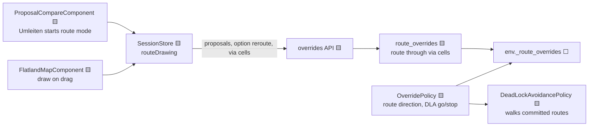
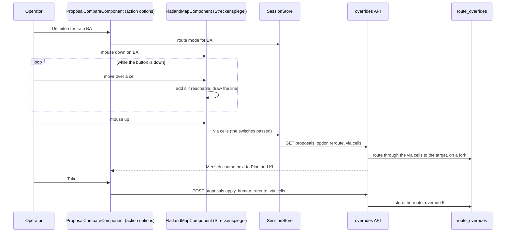
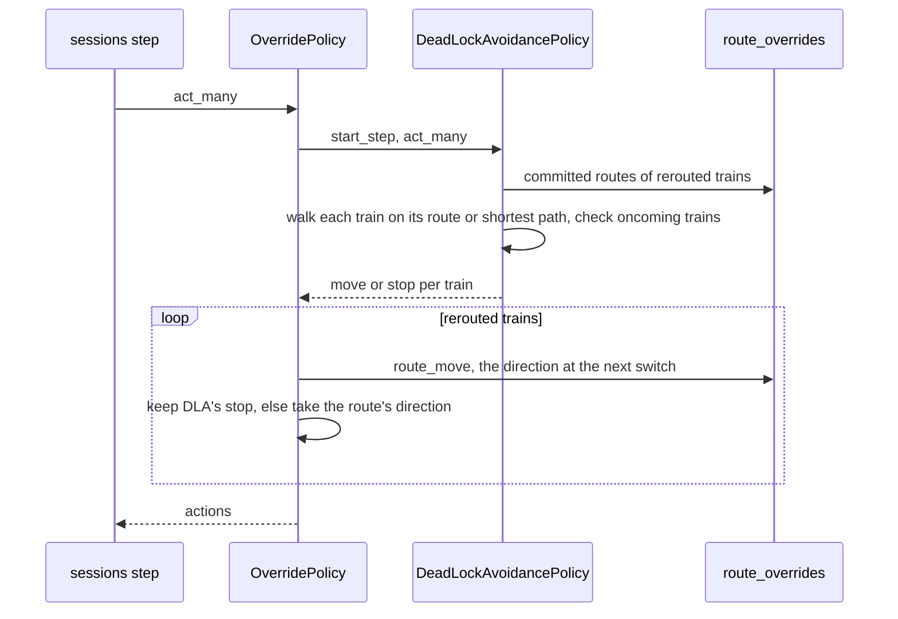

# Fahrweg einstellen: draw a train's route on the Streckenspiegel (#199, last bullet)

> **Status:** plan of 2026-11-16, draft. Based on `main` fd0c70cb, on branch `feature/199-flash-ahead-set-path` after
> the flash-ahead plan (00fad43d; kept on the same branch on request, may move to its own branch later). Issue
> [#199](https://github.com/flatland-association/flatland-ui-hub/issues/199), last bullet ("possible extension:
> Fahrweg einstellen Knoten-Knoten-Knoten"), label "plan b". No PR yet. Open questions: none (§9.1, all decided 2026-11-16).
> Implemented 2026-11-16 (S-2 to S-4), verified in the Plan B tutorial (§4.2); S-5 (user doc) open.
>
> **Why:** today "Umleiten" computes a route for the operator, only around a broken-down train. A dispatcher sets a
> route ("stellt einen Fahrweg ein") themselves, e.g. sends a train through the second track of a station so that
> two trains can cross there. This plan lets the operator draw that route on the Streckenspiegel.

## 1. Introduction and goals

*What the change is for: the requirements, the qualities that matter, who has a stake, and what it leaves out.*

### 1.1 Requirements overview (functional requirements)

*The issue's text and the numbered requirements the rest of the plan refers to.*

> - [ ] possible extension: Fahrweg einstellen Knoten-Knoten-Knoten

As described by chenkins (2026-11-16): when the operator clicks "Umleiten" in the action options ("Handlungsoptionen",
Plan / KI / Mensch), they can press on a train and, while the mouse button is down, set its route; on mouse up the
route is set as the train's override.

Requirements:

- **REQ-1** With the train selected and "Umleiten" chosen in the action options (Q-9), the operator presses on the train on the Streckenspiegel and drags
  along the tracks; the route follows the pointer over the switches (Q-1, Q-2).
- **REQ-2** On mouse up the drawn route becomes the train's reroute override; the train drives it (Q-3, Q-6).
- **REQ-3** The other trains take the drawn route into account, so that two trains can cross in a station (Q-4).
- **REQ-4** Validation in the Plan B tutorial: the train from the right (BA) is routed through the second track of
  the passing loop in the middle (not straight, deviating); the train from the left (AB) waits in the loop and lets
  BA pass; both arrive, better than without the route (§4.2).

### 1.2 Quality goals (non-functional requirements)

*The few qualities the design must reach, each with a concrete scenario.*

| ID | Priority | Quality goal | Scenario |
|---|---|---|---|
| NFR-1 | 1 | Safe | A drawn route never drives a train into a head-on standstill that the deadlock avoidance would have prevented (the tutorial run of §3.3 must not happen). |
| NFR-2 | 2 | Direct | Drawing a route takes one press, one drag and one release; no dialog. |
| NFR-3 | 3 | Honest | Before the route is taken, its forecast shows what it does (Plan / KI / Mensch "Mensch" course). |

### 1.3 Stakeholders

*Who asks for the change, decides on it, reviews it or works with the result, and what they expect.*

| Role | Name | Expectations |
|---|---|---|
| Issue author, maintainer | chenkins | Setting a route as dispatchers do, validated on the Plan B tutorial. |
| Plan B study leads (FHNW, SBB) | label "plan b" | Whether the gesture is offered in the study conditions. They decide. |
| Dispatchers in the studies | - | A route they set is driven as set, and the other trains react to it. |

### 1.4 Follow-ups (not in this PR)

*What this PR leaves out, why, and where it goes later.*

| Follow-up | Why not in this PR | From | Findings | Issue |
|---|---|---|---|---|
| Edit or shorten a set route (drag again, remove a via node). | First the setting itself. | Q-1 | - | - |
| A route that ends before the target and hands back to the policy. | Needs a rule for where the policy takes over (Q-3 b). | Q-3 | - | - |
| Reroute for trains under `PlanPolicy` that rejoins their plan. | Today a rerouted train is off plan for the rest of the episode (§3.2). | Q-8 | - | - |
| Override awareness for Director, `PlanPolicy`, PP re-plan and ROAM (implement the Q-4 b interface). | Plan B runs DLA; each needs its own design (re-plan with constraints, plan order with off-plan trains, certificate). | §3.4, Q-4 | - | - |
| Port upstream DLA with set paths (`SetPathPolicy`), so routes are the policy's own set paths. | A larger change to the default policy; this plan only lets DLA read committed routes through the optional override-aware `Policy` method (Q-4 b). | flash-ahead plan §1.4 | - | - |

## 2. Constraints

*What limits the design from outside: platform, organisation and conventions.*

| ID | Constraint | Kind | Explanation |
|---|---|---|---|
| C-1 | Angular standalone + signals + Lyne; no hard-coded colours; every string in `en/de/fr.json`. | Convention | Repo `AGENTS.md`. |
| C-2 | The override channel stays: a reroute is override action 5 (`REROUTE_ACTION`), its route on the env (`env._route_overrides`). | Technical | Decision log, forecast caches and what-ifs already carry it (`route_overrides.py` docstring). |
| C-3 | Same branch as the flash-ahead plan for now. | Organisation | Asked 2026-11-16. |

### 2.1 Limitations

*What the built code gets wrong or ignores, each with the TODO or issue that tracks it.*

- Only DLA is override-aware (Q-4 b). Under the other policies a drawn route is driven unchecked, as computed
  reroutes are today, and nobody else knows it (follow-up in §1.4).
- A train that leaves its drawn route ends the override; the route is not recomputed through the remaining via cells
  (`route_move`). Under DLA the train does not leave it.
- A drawn route ends at the target (Q-3 a); a route that ends early is a follow-up.
- `route_through` takes the shortest leg between via cells and does not avoid broken-down trains: the operator chose
  the switches.
- A drag samples cells; a fast drag skips cells, which are filled by the shortest way along the track (up to 8 cells,
  `pathTo`). A cell farther away is ignored.
- Holds reach DLA (`set_committed_overrides`) but change nothing there: a held train already occupies its cell.

### 2.2 Assumptions

Not checked in code; they hold by construction of the rail graph (`build_rail_digraph`).

- A drawn route is a path in the rail graph from the train's cell and heading; it cannot reverse.
- The Streckenspiegel maps a pointer position to one grid cell (`cellSize`), so a drag yields a cell sequence.

## 3. Context and scope (checked 2026-11-16 on `main` fd0c70cb)

*The code on the base branch that the change works in, as it is before the change, and where the change stops.*

### 3.1 Does an override already hold a full route until it is over?

Yes, for reroutes:

- A reroute is override action 5 (`REROUTE_ACTION`). `commit_route` stores a whole route, `[(row, col, heading), ...]`
  from the train's cell to its target, in `env._route_overrides[handle]` (`backend/app/core/route_overrides.py`).
- Every step `OverridePolicy` asks `route_move`, which returns the move that keeps the train on it. At the route's end
  (the target) it moves forward; when the train is done the override is cleared. Forks carry the route
  (`carry_to_fork`), so forecasts with the committed overrides follow it.
- What is missing for a drawn route:
  - **No way to pass a route in.** The route is always computed: `route_around_blocks` (shortest to the target around
    malfunctioning trains, preferring the train's planned cells). `POST /agent/{h}/override` takes only an action.
  - **Only offered with a block.** "Umleiten" is available when the impact analysis finds a blocked train with a way
    around (`can_reroute`, `proposalChoice.rerouteAvailable`).
  - **Not before the train is on the map.** `route_move` returns None for a train without a position, and
    `OverridePolicy` then clears the override at once; a train waiting at its origin cannot be rerouted.
  - **Off the route means recomputed.** If the train is not on its stored route, `route_move` commits a new computed
    route, which would replace a drawn one.
  - **The policy is bypassed.** For a rerouted train `OverridePolicy` returns the route's move every step, without the
    deadlock check; the other trains' DLA walks the rerouted train's *shortest* path, not its route (§3.3).

### 3.2 Where "Umleiten" is offered today

- **Action options** ("Handlungsoptionen", Plan / KI / Mensch, `ProposalCompareComponent`): options Halten, Halten bis
  frei, Weiterfahren, Umleiten for the selected train. Choosing one computes the "Mensch" course (`GET /proposals`
  with `option=reroute`, which needs `route_around_blocks`), "Take" commits it (`POST /proposals/apply`).
- **The map's train popover** (`FlatlandMapComponent`, `proposalChoice`): the same four options.
- **Impact panel**: "Reroute" for an affected train.
- Plan B runs Co-Learning with the layout `preset-plan-b`, which has the action options panel.
- The map pans on mouse drag (`onMouseDown`/`onMouseMove`), except on a train (`.agent`) or a pill.
- A train under `PlanPolicy` that leaves its planned cells is "off plan" and drives with DLA for the rest of the
  episode.

### 3.3 The Plan B tutorial today, and with a route through the loop

`backend/app/fixtures/plan-b/tutorial`: a 6 × 25 grid, station A at column 3, station B at column 21, a passing loop
in the middle (second track on row 1, columns 10-14, switches at (2,10) and (2,14)). AB starts in A, BA in B;
AB breaks down at step 8 for 4 steps. The episode ends at step 40. DLA drives (no plan).

Measured in the sandbox (2026-11-16, a harness that steps DLA under `OverridePolicy` as `/step` does; log in the
workspace, not committed):

| Run | AB | BA | Outcome |
|---|---|---|---|
| DLA, no intervention | arrives at step 24 (latest arrival 18) | waits at B until AB is through, enters at step 25, not arrived by step 40 | one arrival, BA misses |
| BA rerouted through row 1 (cells (2,14) → (1,14) … (1,10) → (2,10)), set when BA enters at step 3 | stops at (2,4) until BA nears the loop, then drives to (2,9) | drives the loop, leaves it at (2,10) at step 16 | head-on at (2,9)/(2,10) from step 17, both stuck to step 40 |

So the route itself works, but AB does not wait in the loop: its DLA does not know BA's route, and BA's route move is
not checked for deadlock. REQ-4 needs Q-4.

### 3.4 Are overrides communicated to the policies?

No. No policy is override-aware today: `OverridePolicy` (the only reader of `override_manager` and
`env._route_overrides` besides the APIs) asks the wrapped policy for all trains, then replaces the actions of the
overridden ones. The policy never learns of holds or routes; it only sees their effect in the env afterwards
(positions, a stopped train occupying a cell).

| Policy | What it does with an overridden train today | Path it assumes for other trains |
|---|---|---|
| DLA (`deadlock_avoidance`, default, Plan B) | nothing; sees it as an occupied cell | each train's shortest path (walked every step) |
| `shortest_path`, `forward_only`, `random`, `do_nothing` | nothing | none: no conflict logic |
| `PlanPolicy` (`plan`) | a rerouted train leaves its planned cells and is "off plan" (DLA for the rest); the order rule then ignores it (`_blocked_by_plan_order` skips off-plan trains), so planned trains no longer wait for it, but nothing keeps them apart from it either | the plan |
| Director (`goal_directed`) | nothing; it re-plans on malfunctions and weight changes, not on overrides | its schedules |
| PP re-plan (`replan_from_state`, KI-Vorschlag, contention strategies) | plans from the current positions; holds and routes are not constraints | its own plan |
| UC2 ROAM (PR #196) | explicitly not: "Human overrides remain a later layer and are outside the autonomous ROAM certificate" (`uc2_roam_policy.py` docstring) | one step ahead only |

So a drawn route is safe only if the policy that drives the others knows it. Q-4 decides how far this plan goes.

Scope: the change adds drawing a route on the map, passing it to the backend, and lets DLA respect committed routes.
It does not change the forecasts' runner, the plan policy or the Director.

## 4. Solution strategy

*The fundamental choices and why, the rules the design follows, how it is verified, and the design of each part.*

| Quality goal | Scenario | Solution approach | Details |
|---|---|---|---|
| NFR-1 Safe | No head-on standstill | DLA keeps deciding go/stop for a rerouted train, along its route, and the other trains see the route. | Q-4, §4.5 |
| NFR-2 Direct | Press, drag, release | Drawing mode entered by "Umleiten"; press on the train starts it. | Q-1, §4.3 |
| NFR-3 Honest | Forecast before taking it | The drawn route becomes the "Mensch" course in Plan / KI / Mensch. | Q-6, §4.4 |

### 4.1 Design principles

- **DP-1 A drawn route is a reroute.** Same override value, same storage on the env, same forecasts; only its origin
  differs (drawn, not computed). (C-2)
- **DP-2 The operator chooses the switches, the system fills the cells.** The drag gives via cells; the backend
  makes a route through them and on to the target. (Q-2, Q-3)
- **DP-3 Safety stays with the policy.** A route says where a train goes, not when; the policy still says whether it
  may move now. Policies opt in to knowing committed overrides (today none does, §3.4); DLA is the first. (Q-4)
- **DP-4 Compare before commit.** The drawn route is a "Mensch" option like Halten or Umleiten. (Q-6)

Reused concepts:

| Need | Reused concept | Instead of |
|---|---|---|
| Keep and drive a route | `env._route_overrides`, `route_move`, `OverridePolicy` | a new override kind |
| Route through cells | `_rail_digraph`, `networkx` shortest paths | a new path finder |
| Compare and commit | `GET /proposals` / `POST /proposals/apply`, variant `human` | a new dialog |
| Draw on the map | the route-line drawing (`_planLinesFrom`), plan colour | a new overlay style |

Not new on purpose: no new override value, no new endpoint family, no change to the forecasts' runner.

### 4.2 Verification

Screenshots: Plan B tutorial (`#/experiment/plan-b-p01`, tutorial leg), German, before on `main` fd0c70cb, after on
this branch.

Preview (mockup, not the app): [tutorial-reroute-preview.gif](set-route-on-map/tutorial-reroute-preview.gif) shows the
clicks as decided (Q-9 a, Q-10 a): click on BA, which waits at B (step 2), "Umleiten", press on BA and drag through the
loop's second track (step 3), release, the "Mensch" course, "Take" (step 4); the clock keeps running at 5 s per step.
The run comes from a sandbox prototype of S-2: DLA's walker follows BA's committed route instead of the shortest path.
Result: AB arrives at step 24 (+6) and BA at step 25 (+5); without the reroute BA has not arrived by step 40
(committed at step 1 BA would arrive at step 23, at step 5 at step 26). AB does not stop on purpose in this run: it
stands with its malfunction (steps 8–11), then passes straight on while BA is in the loop.

| ID | Requirement | Test or check | Result | Screenshots |
|---|---|---|---|---|
| REQ-1 | Draw by dragging | `route-drawing.spec.ts` (track following, filling skipped cells, via cells); in the app: BA selected, «Umleiten», drag through row 1 | ✅ The line follows the track through the loop; via cells `1,14;2,8` | [drag.png](set-route-on-map/drag.png) |
| REQ-2 | Mouse up sets the reroute | `test_route_drawn.py`: `/proposals` and `/proposals/apply` with `via`, the override endpoint with `via`; in the app: release, «Mensch» course, «Umleiten übernehmen» | ✅ Mensch: step 26, 2/2 at the target (Plan: BA does not arrive) | [course.png](set-route-on-map/course.png) |
| REQ-3 | Others respect the route | `test_route_drawn.py::test_tutorial_drawn_route_lets_both_trains_arrive` | ✅ BA takes the loop, no head-on standstill | - |
| REQ-4 | Tutorial better | The same test; in the app (route taken at step 6) | ✅ AB step 24, BA step 27; without the route BA does not arrive by step 40 | [tutorial-after.png](set-route-on-map/tutorial-after.png) |
| NFR-1 | No head-on standstill | The §3.3 rerouted run, repeated with S-2 | ✅ Both arrive | - |

Recording in the app (production build, German, Plan B tutorial, 2026-11-16):
[tutorial-in-app.mp4](set-route-on-map/tutorial-in-app.mp4) ([GIF](set-route-on-map/tutorial-in-app.gif)): click on BA,
«Umleiten», drag through the loop, release, «Umleiten übernehmen» (at step 7, the clock running), then the run at 4×.
The «Mensch» course says BA arrives at step 28; in the run AB arrives at step 25 and BA at step 28. The cursor and the
captions are added for the recording.

In the app, DLA keeps BA at B until step 9 (AB comes towards it and breaks down at step 8), so BA arrives at step 27,
not 25 as in the preview.

### 4.3 Drawing on the map (REQ-1; Q-1, Q-2, Q-5, Q-7)

- "Umleiten" in the action options (or the map popover) puts the map into route mode for that train: a hint
  ("Zug drücken und den Fahrweg entlang ziehen"), Esc cancels.
- In route mode, mouse down on the train starts the drawing instead of panning. While the button is down, each cell
  under the pointer that is reachable from the last route cell is added; the route is drawn as a line in the
  train's plan colour; a cell that is not reachable is ignored (the line stays at the last valid cell).
- Mouse up ends it: the switches passed become the via cells (DP-2).

### 4.4 From drawing to override (REQ-2; Q-3, Q-6)

- The frontend sends the via cells with the option: `GET /proposals?handle=…&option=reroute&via=r,c;r,c…` for the
  "Mensch" course, `POST /proposals/apply` (variant `human`, `option=reroute`, `via`) to commit.
- The backend builds the route: the shortest path from the train's cell and heading through the via cells in order,
  then on to the target (Q-3 a), in the rail graph; 400 if there is none. It stores it with `commit_route`'s storage
  and sets override 5.
- `route_move` keeps a drawn route: when the train is not on it, it does not replace it with a computed one (§3.1).

### 4.5 Deadlock avoidance with committed routes (REQ-3; Q-4)

- DLA walks a rerouted train's committed route instead of its shortest path, both for the train itself and when
  other trains look for oncoming trains (`DeadlockAvoidanceShortestDistanceWalker`).
- `OverridePolicy` no longer returns the route's move unchecked: for a rerouted train the route gives the direction at
  switches, DLA gives move or stop.
- This is the upstream `SetPathPolicy` idea (a route kept per train) applied only to committed routes.

## 5. Building block view

### 5.1 Route drawing and driving

Notation: [flowchart in Mermaid](https://mermaid.js.org/syntax/flowchart.html); 🟩 added, 🟨 modified, ⬜ unchanged.

**Motivation:** the drawn route reuses the reroute override (DP-1); the map only collects via cells (DP-2); safety
stays with DLA (DP-3); the commit goes through Plan / KI / Mensch (DP-4).

**Contained building blocks:**

| Component | Responsibility | Change |
|---|---|---|
| `ProposalCompareComponent` (action options) | Compares Plan, KI and the operator's option for one train, and commits one. Not for drawing. | 🟨 modified: "Umleiten" lets the operator draw the route on the map, then shows its course. |
| `FlatlandMapComponent` (Streckenspiegel) | Draws the network, trains and overlays; takes clicks and drags. | 🟨 modified: in route mode a drag from the train draws its route. |
| `SessionStore` | Holds the session state the views share. | 🟨 modified: knows the train being routed and the drawn via cells. |
| overrides API (`/proposals`, `/proposals/apply`) | Simulates and commits the operator's option. | 🟨 modified: a reroute can carry via cells. |
| `route_overrides` | Keeps and drives a train's committed route. | 🟨 modified: builds a route through given via cells and keeps it. |
| `OverridePolicy` | Lets the operator's overrides win over the policy. | 🟨 modified: a route gives the direction, DLA still says move or stop. |
| `DeadLockAvoidancePolicy` | Moves trains on their path and stops them before a head-on conflict. | 🟨 modified: uses a rerouted train's committed route as its path. |

## 6. Runtime view

### 6.1 Draw, compare, take (REQ-1, REQ-2; Q-6)

Notation: [UML sequence diagram in Mermaid](https://mermaid.js.org/syntax/sequenceDiagram.html).

### 6.2 A step with a drawn route (REQ-3; Q-4)

Notation: [UML sequence diagram in Mermaid](https://mermaid.js.org/syntax/sequenceDiagram.html).

## 8. Crosscutting concepts

### 8.1 New patterns

Compared with `main`. What is reused, and what is not new on purpose, is in §4.1.

| ID | New | Defined in |
|---|---|---|
| PAT-1 | A map mode in which a drag draws instead of panning. | §4.3, Q-1 |
| PAT-2 | Via cells on the override channel (reroute with a given route). | §4.4, Q-2 |
| PAT-3 | An override that gives the direction while the policy keeps go/stop. | §4.5, Q-4 |
| PAT-4 | Override-aware policies: an optional `Policy` method through which `OverridePolicy` passes the committed holds and routes. | Q-4 b |

### 8.2 Breaking changes

- **Reroutes become safer and possibly slower:** with Q-4 b (DLA override-aware), a computed reroute (today's "Umleiten" around a block)
  also waits when DLA says stop, where today it drives on. Forecasts of existing tours with reroutes may change.
  No API or stored format changes; existing calls without `via` behave as today apart from this.
- **«Umleiten» in the action options and the map popover always draws** (Q-5 a): it is offered for every train that
  has not arrived (`rerouteAvailable` no longer asks the impact analysis), and the «Mensch» course waits for the
  drawn route. The computed reroute around a block stays on the impact panel and on the override endpoint without
  `via`.

## 9. Decisions

### 9.1 Open questions

✅ ~~**(Q-1) The gesture: drag along the track, or click node by node?**~~ **Decided 2026-11-16:** a).
- a) Press on the train and drag along the tracks; release sets it (as described).
- b) Click the switches one by one ("Knoten-Knoten-Knoten"), double-click or Enter ends it.
- c) Both: a drag, and clicks on further switches to extend it before releasing.

*Proposed:* a, as described; b as a later fallback for touch screens.

✅ ~~**(Q-2) What does the frontend send: via cells or the full route?**~~ **Decided 2026-11-16:** a).
- a) Via cells (the switches passed), the backend builds the route through them.
- b) The full cell list, the backend checks it.

*Proposed:* a. A drag samples cells unevenly; switches are what the operator decides.

✅ ~~**(Q-3) Where does a drawn route end?**~~ **Decided 2026-11-16:** a).
- a) At the train's target: after the last via cell the backend continues by the shortest path (as reroutes do today).
- b) At the last drawn cell; there the override ends and the driving policy takes over.

*Proposed:* a. It keeps the existing reroute mechanics (route to the target, cleared on arrival); b is a follow-up.

✅ ~~**(Q-4) Who decides go or stop for a rerouted train, and do the others know its route?**~~ **Decided 2026-11-16:** b). No policy knows
overrides today (§3.4).
- a) DLA only: DLA says move or stop for the rerouted train along its route, and walks committed routes for every
  train (§4.5). Covers Plan B (DLA) and REQ-4; other policies stay as today.
- b) An optional interface on the policy base (`Policy`), e.g. `set_committed_overrides(holds, routes)` called by
  `OverridePolicy` every step, implemented by DLA in this PR; Director, `PlanPolicy`, PP and ROAM follow when needed
  (follow-ups). Same work as a for DLA, plus a small seam that names the contract.
- c) Policy-independent: `OverridePolicy` checks a rerouted train's next move itself (a reservation check against the
  other trains' current positions and committed routes) and holds it when it would meet one head-on. Works under
  every policy, but duplicates part of DLA and does not make the others wait in the loop.
- d) As today: the route's move wins, nobody else knows the route; the operator adds holds by hand.

*Proposed:* b. It solves REQ-4 with DLA (Plan B's policy) and makes "override-aware policy" an explicit, opt-in
contract instead of a DLA special case; the other policies keep today's behaviour until they implement it.

✅ ~~**(Q-5) When is "Umleiten" offered?**~~ **Decided 2026-11-16:** a).
- a) Always, for a train on the map or waiting at its origin.
- b) As today, only when the impact analysis finds a block with a way around.

*Proposed:* a: setting a route is a dispatching decision of its own, not only a way around a breakdown.

✅ ~~**(Q-6) Does mouse up set the override at once, or after comparing?**~~ **Decided 2026-11-16:** b).
- a) At once (as described): mouse up commits the reroute.
- b) Mouse up computes the "Mensch" course in Plan / KI / Mensch; "Take" commits it.

*Proposed:* b, because Co-Learning (Plan B) is about comparing before acting; a in modes without the action
options. chenkins decides.

✅ ~~**(Q-7) A train that is not on the map yet?**~~ **Decided 2026-11-16:** a).
- a) Allowed: the route starts at its origin and direction; `route_move` keeps the override until it enters.
- b) Not allowed until it enters.

*Proposed:* a. In the tutorial, BA waits at B under DLA (§3.3); the route is what lets it start.

✅ ~~**(Q-8) A train under `PlanPolicy`?**~~ **Decided 2026-11-16:** a).
- a) As today: once rerouted it is off plan and drives with DLA (and the drawn route) to the end.
- b) It rejoins its plan where the route meets it again.

*Proposed:* a now, b as a follow-up.

✅ ~~**(Q-9) Order of the clicks?**~~ **Decided 2026-11-16:** a).
- a) Train first, as today: a click on the train (on the map, also when it waits at its origin, or in the timetable)
  selects it, the action options show its buttons; then "Umleiten", then drag from the train.
- b) "Umleiten" first with no train selected; pressing on a train picks the target. The panel would need a state
  without a train.

*Proposed:* a: the action options already follow the selected train (`targetHandle` = `selectedHandle`).

✅ ~~**(Q-10) The clock while drawing?**~~ **Decided 2026-11-16:** a).
- a) It keeps running: in the tutorial (5 s per step) about one step passes while drawing, the route is committed
  at the step of "Take".
- b) It pauses while "Umleiten" is active (a new gate).

*Proposed:* a. Co-Learning has no global pause; it holds the affected trains only at a decision moment, which the
tutorial never reaches (the impact analysis lists no train, as BA waits off the map during AB's malfunction).

### 9.2 Decision log

| Date | Decision | Why | Consequences |
|---|---|---|---|
| 2026-11-16 | ✅ Same branch as the flash-ahead plan for now. | Asked by chenkins. | C-3. |
| 2026-11-16 | ✅ Drag from the train along the track (Q-1 a). | As described by chenkins; direct (NFR-2). Clicking switches one by one stays a fallback. | PAT-1, S-4. |
| 2026-11-16 | ✅ Via cells, the route to the target, offered always, also before the train enters, off plan under `PlanPolicy` (Q-2 a, Q-3 a, Q-5 a, Q-7 a, Q-8 a). | As proposed: reuses the reroute mechanics; the tutorial needs BA routed while it waits at B. | S-3; follow-ups for routes that end early and rejoining a plan. |
| 2026-11-16 | ✅ Override-aware policies through an optional `Policy` method; DLA first (Q-4 b). | No policy knows overrides today (§3.4); a contract instead of a DLA special case. DLA-only, a policy-independent check and holds by hand were not taken. | PAT-4, S-2; follow-up for the other policies. |
| 2026-11-16 | ✅ Mouse up computes the "Mensch" course; "Take" commits (Q-6 b). | Plan B is Co-Learning: compare before acting (NFR-3). Committing at once was not taken. | §6.1, S-4. |
| 2026-11-16 | ✅ Train first, then "Umleiten", then drag; the clock keeps running (Q-9 a, Q-10 a). | The action options already follow the selected train; Co-Learning has no global pause and the tutorial has no decision moment. "Umleiten" first and a pause while drawing were not taken. | §4.3; the route is committed a few steps later than at once (tutorial: step 4, BA +5 instead of +3). |

### 9.3 Code Review Findings

No review yet.

## 10. Glossary

- **Fahrweg einstellen, set a route**: the operator decides a train's route over the switches ahead. Here: drawing it
  on the Streckenspiegel. Not a timetable change.
- **Reroute** ("Umleiten", override action 5, `REROUTE_ACTION`): a whole route for one train, kept on the env
  (`env._route_overrides`) and driven by `OverridePolicy` until the train arrives. Today always computed; with this
  plan also drawn.
- **Via cells**: the switches the drawn route passes, in order; the backend builds the route through them.
- **Route mode**: the map state after "Umleiten" in which a drag from the train draws instead of panning.
- **Passing loop** (tutorial): the second track on row 1 between the switches at (2,10) and (2,14), where two trains
  can cross.

## 11. Execution plan and status

### 11.1 Steps

| ID | Findings | Step | Category | Severity | Commit message | Commit(s) | Needs | Blocked by |
|---|---|---|---|---|---|---|---|---|
| 💡 S-1 | - | The plan | docs | low | docs(plans): plan for setting a train's route on the Streckenspiegel (#199). |  | - | - |
| ✅ S-2 | - | The optional override-aware method on `Policy` (Q-4 b), called by `OverridePolicy`; DLA implements it and walks committed routes; `OverridePolicy` keeps DLA's stop for rerouted trains; tutorial test with a fixed route | feat | high | feat(policies): deadlock avoidance respects committed reroutes. | de4cd3a9 | S-1 | Q-4 |
| ✅ S-3 | - | Route through via cells to the target, `via` on `/proposals` and `/proposals/apply`, off-map trains, backend tests | feat | medium | feat(overrides): reroute along via cells chosen by the operator. | b2d7131b | S-2 | Q-2, Q-3, Q-5, Q-7 |
| 💡 S-4 | - | Route mode and drag drawing on the map, from "Umleiten" in the action options and the popover, i18n, specs | feat | medium | feat(map): draw a train's route on the Streckenspiegel. |  | S-3 | Q-1, Q-6 |
| 💡 S-5 | - | Screenshots and user doc, the tutorial walk-through | docs | low | docs(map): setting a route by drawing it, with the tutorial example. |  | S-4 | - |

## 12. Change inventory

### 12.1 New files

| File | Adds |
|---|---|
| `docs/plans/set-route-on-map.md` | This plan. |
| `backend/tests/test_route_drawn.py` | Via-cell routes, off-map trains, the tutorial crossing, the endpoints with `via`. |
| `frontend/src/app/core/routing/route-drawing.ts` (+ spec) | Following the track from the rail grid, filling skipped cells, via cells. |

### 12.2 Modified files

| File | Changes |
|---|---|
| `backend/app/core/route_overrides.py` | `route_through(env, handle, via)`; `route_move` keeps a drawn route; off-map start. |
| `backend/app/policies/base.py` | The optional override-aware method (default: no-op). |
| `backend/app/policies/override_policy.py` | Passes the committed holds and routes to the policy; rerouted trains: route direction, the policy's stop kept. |
| `backend/app/policies/deadlock_avoidance_policy.py`, `backend/app/utils/deadlock_avoidance_walker.py` | Walk committed routes. |
| `backend/app/api/overrides.py` | `via` on `/proposals`, `/proposals/apply` and `POST /agent/{h}/override`; 400 when no route passes the cells. |
| `backend/app/core/scenario_runner.py` | `run_branch(routes=…)`: a fork keeps a drawn route the operator has not committed yet. |
| `frontend/src/app/features/flatland-map/flatland-map.component.{ts,html,scss}` | Route mode, drag drawing, the drawn line. |
| `frontend/src/app/features/proposal-compare/proposal-compare.component.{ts,html}` | "Umleiten" starts route mode; the course of the drawn route. |
| `frontend/src/app/core/session.store.ts`, `core/proposals/proposal-choice.service.ts` (+ spec), `core/api.service.ts`, `core/dispatch/train-action.service.ts` | Route mode state (`routeDrawing`), via cells, the API parameter; reroute always offered. |
| `frontend/public/i18n/{en,de,fr}.json` | Hint and error texts. |

Unchanged on purpose: the override values, `PlanPolicy`, the Director. The forecasts' runner only gets the optional
`routes` parameter.

### 12.3 Size estimate

| Step | Code | Tests | Total |
|---|---|---|---|
| S-2 DLA with routes | +60 / -10 | +60 | ~ +120 / -10 |
| S-3 via-cell routes | +70 | +80 | ~ +150 |
| S-4 drawing on the map | +150 | +60 | ~ +210 |
| S-5 docs | +30 | - | ~ +30 |
| **Sum** | ~ +310 / -10 | ~ +200 | **~ +510 / -10** |

Actual (2026-11-16): code ~ +410 / -54, tests ~ +215 (backend 139, frontend 75); larger than estimated
mainly in the map (route mode, line, Esc: +119) and `route_overrides` (+107: `route_through`, off-map start, drawn
routes kept).
