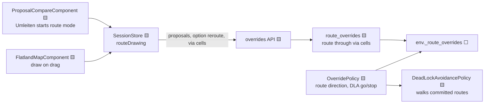
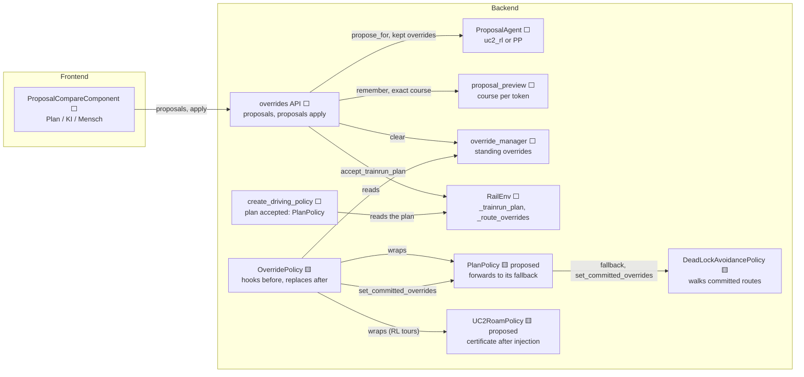
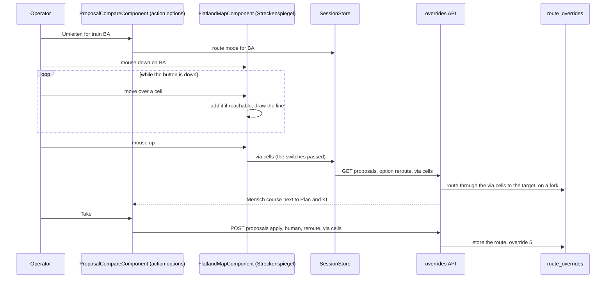
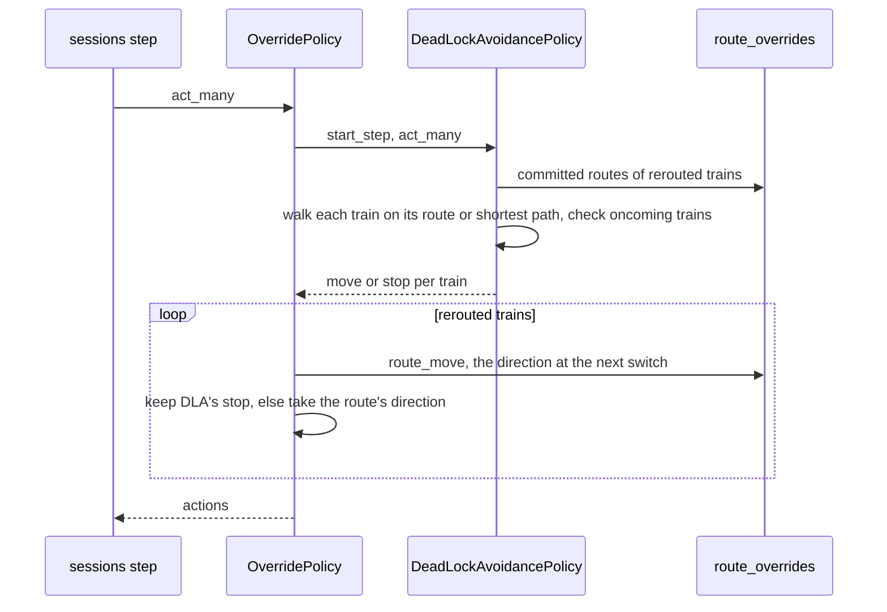
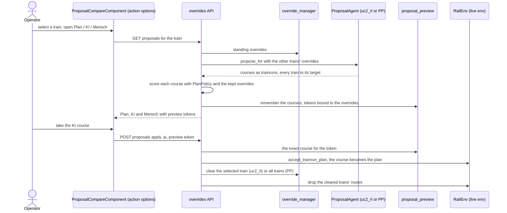
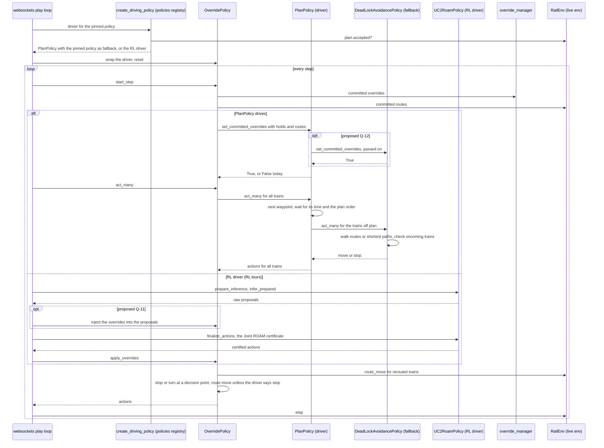
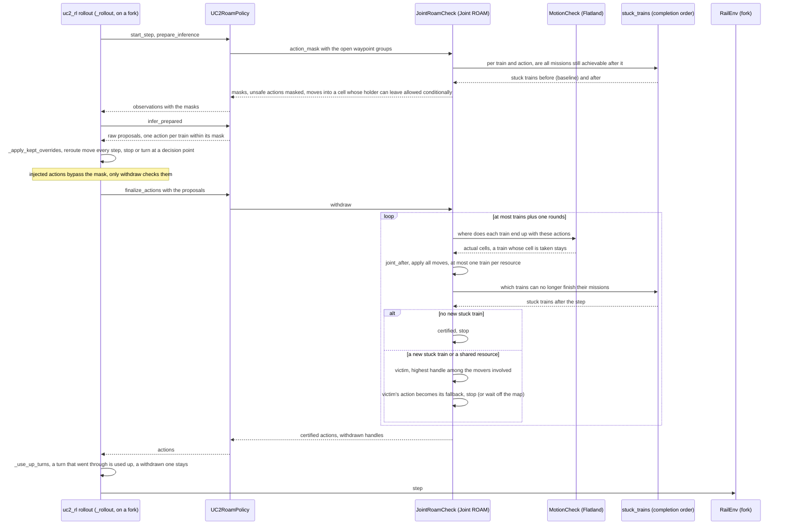

# Fahrweg einstellen: draw a train's route on the Streckenspiegel (#199, last bullet)

> **Status:** plan of 2026-11-16, draft. Based on `main` fd0c70cb, on branch `feature/199-flash-ahead-set-path` after
> the flash-ahead plan (00fad43d; kept on the same branch on request, may move to its own branch later). Rebased
> 2026-11-18 onto [#208](https://github.com/flatland-association/flatland-ui-hub/pull/208) (head 17707737, on #196's
> `codex/pf-ch-rl-main` 29b31139), whose overrides concept for the KI adviser meets this plan's (§3.4, Q-11). Issue
> [#199](https://github.com/flatland-association/flatland-ui-hub/issues/199), last bullet ("possible extension:
> Fahrweg einstellen Knoten-Knoten-Knoten"), label "plan b". No PR yet. Open questions: Q-11, Q-12 and Q-13 (how overrides reach the driver after #208, §9.1).
> Implemented 2026-11-16 (S-2 to S-4), verified in the Plan B tutorial (§4.2); user doc in `docs/reference/mode-guide.md` (S-5).
>
> **Why:** today "Umleiten" computes a route for the operator, only around a broken-down train. A dispatcher sets a
> route ("stellt einen Fahrweg ein") themselves, e.g. sends a train through the second track of a station so that
> two trains can cross there. This plan lets the operator draw that route on the Streckenspiegel.

## 1. Introduction and goals

*What the change is for: the requirements, the qualities that matter, who has a stake, and what it leaves out.*

### 1.1 Requirements overview (functional requirements)

*The issue's text and the numbered requirements the rest of the plan refers to.*

> - [ ] possible extension: Fahrweg einstellen Knoten-Knoten-Knoten

As described by chenkins (2026-11-16): when the operator clicks "Umleiten" in the action options ("Handlungsoptionen",
Plan / KI / Mensch), they can press on a train and, while the mouse button is down, set its route; on mouse up the
route is set as the train's override.

Requirements:

- **REQ-1** With the train selected and "Umleiten" chosen in the action options (Q-9), the operator presses on the train on the Streckenspiegel and drags
  along the tracks; the route follows the pointer over the switches (Q-1, Q-2).
- **REQ-2** On mouse up the drawn route becomes the train's reroute override; the train drives it (Q-3, Q-6).
- **REQ-3** The other trains take the drawn route into account, so that two trains can cross in a station (Q-4).
- **REQ-4** Validation in the Plan B tutorial: the train from the right (BA) is routed through the second track of
  the passing loop in the middle (not straight, deviating); the train from the left (AB) waits in the loop and lets
  BA pass; both arrive, better than without the route (§4.2).

### 1.2 Quality goals (non-functional requirements)

*The few qualities the design must reach, each with a concrete scenario.*

| ID | Priority | Quality goal | Scenario |
|---|---|---|---|
| NFR-1 | 1 | Safe | A drawn route never drives a train into a head-on standstill that the deadlock avoidance would have prevented (the tutorial run of §3.3 must not happen). |
| NFR-2 | 2 | Direct | Drawing a route takes one press, one drag and one release; no dialog. |
| NFR-3 | 3 | Honest | Before the route is taken, its forecast shows what it does (Plan / KI / Mensch "Mensch" course). |

### 1.3 Stakeholders

*Who asks for the change, decides on it, reviews it or works with the result, and what they expect.*

| Role | Name | Expectations |
|---|---|---|
| Issue author, maintainer | chenkins | Setting a route as dispatchers do, validated on the Plan B tutorial. |
| Plan B study leads (FHNW, SBB) | label "plan b" | Whether the gesture is offered in the study conditions. They decide. |
| Dispatchers in the studies | - | A route they set is driven as set, and the other trains react to it. |

### 1.4 Follow-ups (not in this PR)

*What this PR leaves out, why, and where it goes later.*

| Follow-up | Why not in this PR | From | Findings | Issue |
|---|---|---|---|---|
| Edit or shorten a set route (drag again, remove a via node). | First the setting itself. | Q-1 | - | untracked |
| A route that ends before the target and hands back to the policy. | Needs a rule for where the policy takes over (Q-3 b). | Q-3 | - | untracked |
| Reroute for trains under `PlanPolicy` that rejoins their plan. | Today a rerouted train is off plan for the rest of the episode (§3.2). | Q-8 | - | untracked |
| Override awareness for Director, `PlanPolicy` and PP re-plan (implement the Q-4 b interface). | Plan B runs DLA; each needs its own design (re-plan with constraints, plan order with off-plan trains). | §3.4, Q-4 | - | untracked |
| The action hook in `OverridePolicy`: the overrides go into an RL driver's proposals before `finalize_actions` (Joint ROAM), live and in the `uc2_rl` rollout, with one set of override rules instead of #208's copy in `_apply_kept_overrides` (§6.4). | #208 leaves it open ("Remaining": as driver, overrides still come after the ROAM check); touches #208's and #196's code while both are open. | §3.4, Q-11 | - | - |
| Port upstream DLA with set paths (`SetPathPolicy`), so routes are the policy's own set paths. | A larger change to the default policy; this plan only lets DLA read committed routes through the optional override-aware `Policy` method (Q-4 b). | flash-ahead plan §1.4 | - | untracked |

## 2. Constraints

*What limits the design from outside: platform, organisation and conventions.*

| ID | Constraint | Kind | Explanation |
|---|---|---|---|
| C-1 | Angular standalone + signals + Lyne; no hard-coded colours; every string in `en/de/fr.json`. | Convention | Repo `AGENTS.md`. |
| C-2 | The override channel stays: a reroute is override action 5 (`REROUTE_ACTION`), its route on the env (`env._route_overrides`). | Technical | Decision log, forecast caches and what-ifs already carry it (`route_overrides.py` docstring). |
| C-3 | Same branch as the flash-ahead plan for now. | Organisation | Asked 2026-11-16. |

### 2.1 Limitations

*What the built code gets wrong or ignores, each with the TODO or issue that tracks it.*

- Only DLA is override-aware (Q-4 b). Under the other policies a drawn route is driven unchecked, as computed
  reroutes are today, and nobody else knows it (follow-up in §1.4).
- Under the UC2 ROAM driver the overrides, a drawn route included, are applied after ROAM certifies the step
  (#208's "Remaining"), so ROAM may withdraw another train's move because of a move that does not happen (§3.4,
  follow-up in §1.4). The `uc2_rl` adviser's courses are not affected: they apply kept overrides before the
  certificate.
- After a KI course is accepted, `PlanPolicy` drives, and it does not implement the Q-4 b method: the call does not
  reach its fallback DLA, so a rerouted (off-plan) train drives its route unchecked, live and in the KI courses'
  scoring (`/proposals`, #208). Q-12 proposes the fix.
- Taking a PP course clears `env._route_overrides` but not the drawn-route marker (`env._route_drawn`); harmless,
  because the next `commit_route` or `drop_route` for that train resets it, but untidy.
- #208's preview token binds the standing overrides and `_route_overrides`, not `_route_drawn`; the marker only
  changes together with a route, so a change in between is still caught.
- A train that leaves its drawn route ends the override; the route is not recomputed through the remaining via cells
  (`route_move`). Under DLA the train does not leave it.
- A drawn route ends at the target (Q-3 a); a route that ends early is a follow-up.
- `route_through` takes the shortest leg between via cells and does not avoid broken-down trains: the operator chose
  the switches.
- A drag samples cells; a fast drag skips cells, which are filled by the shortest way along the track (up to 8 cells,
  `pathTo`). A cell farther away is ignored.
- Holds reach DLA (`set_committed_overrides`) but change nothing there: a held train already occupies its cell.

### 2.2 Assumptions

Not checked in code; they hold by construction of the rail graph (`build_rail_digraph`).

- A drawn route is a path in the rail graph from the train's cell and heading; it cannot reverse.
- The Streckenspiegel maps a pointer position to one grid cell (`cellSize`), so a drag yields a cell sequence.

## 3. Context and scope (checked 2026-11-16 on `main` fd0c70cb)

*The code on the base branch that the change works in, as it is before the change, and where the change stops.*

### 3.1 Does an override already hold a full route until it is over?

Yes, for reroutes:

- A reroute is override action 5 (`REROUTE_ACTION`). `commit_route` stores a whole route, `[(row, col, heading), ...]`
  from the train's cell to its target, in `env._route_overrides[handle]` (`backend/app/core/route_overrides.py`).
- Every step `OverridePolicy` asks `route_move`, which returns the move that keeps the train on it. At the route's end
  (the target) it moves forward; when the train is done the override is cleared. Forks carry the route
  (`carry_to_fork`), so forecasts with the committed overrides follow it.
- What is missing for a drawn route:
  - **No way to pass a route in.** The route is always computed: `route_around_blocks` (shortest to the target around
    malfunctioning trains, preferring the train's planned cells). `POST /agent/{h}/override` takes only an action.
  - **Only offered with a block.** "Umleiten" is available when the impact analysis finds a blocked train with a way
    around (`can_reroute`, `proposalChoice.rerouteAvailable`).
  - **Not before the train is on the map.** `route_move` returns None for a train without a position, and
    `OverridePolicy` then clears the override at once; a train waiting at its origin cannot be rerouted.
  - **Off the route means recomputed.** If the train is not on its stored route, `route_move` commits a new computed
    route, which would replace a drawn one.
  - **The policy is bypassed.** For a rerouted train `OverridePolicy` returns the route's move every step, without the
    deadlock check; the other trains' DLA walks the rerouted train's *shortest* path, not its route (§3.3).

### 3.2 Where "Umleiten" is offered today

- **Action options** ("Handlungsoptionen", Plan / KI / Mensch, `ProposalCompareComponent`): options Halten, Halten bis
  frei, Weiterfahren, Umleiten for the selected train. Choosing one computes the "Mensch" course (`GET /proposals`
  with `option=reroute`, which needs `route_around_blocks`), "Take" commits it (`POST /proposals/apply`).
- **The map's train popover** (`FlatlandMapComponent`, `proposalChoice`): the same four options.
- **Impact panel**: "Reroute" for an affected train.
- Plan B runs Co-Learning with the layout `preset-plan-b`, which has the action options panel.
- The map pans on mouse drag (`onMouseDown`/`onMouseMove`), except on a train (`.agent`) or a pill.
- A train under `PlanPolicy` that leaves its planned cells is "off plan" and drives with DLA for the rest of the
  episode.

### 3.3 The Plan B tutorial today, and with a route through the loop

`backend/app/fixtures/plan-b/tutorial`: a 6 × 25 grid, station A at column 3, station B at column 21, a passing loop
in the middle (second track on row 1, columns 10-14, switches at (2,10) and (2,14)). AB starts in A, BA in B;
AB breaks down at step 8 for 4 steps. The episode ends at step 40. DLA drives (no plan).

Measured in the sandbox (2026-11-16, a harness that steps DLA under `OverridePolicy` as `/step` does; log in the
workspace, not committed):

| Run | AB | BA | Outcome |
|---|---|---|---|
| DLA, no intervention | arrives at step 24 (latest arrival 18) | waits at B until AB is through, enters at step 25, not arrived by step 40 | one arrival, BA misses |
| BA rerouted through row 1 (cells (2,14) → (1,14) … (1,10) → (2,10)), set when BA enters at step 3 | stops at (2,4) until BA nears the loop, then drives to (2,9) | drives the loop, leaves it at (2,10) at step 16 | head-on at (2,9)/(2,10) from step 17, both stuck to step 40 |

So the route itself works, but AB does not wait in the loop: its DLA does not know BA's route, and BA's route move is
not checked for deadlock. REQ-4 needs Q-4.

### 3.4 Are overrides communicated to the policies?

No. No policy is override-aware today: `OverridePolicy` (the only reader of `override_manager` and
`env._route_overrides` besides the APIs) asks the wrapped policy for all trains, then replaces the actions of the
overridden ones. The policy never learns of holds or routes; it only sees their effect in the env afterwards
(positions, a stopped train occupying a cell).

| Policy | What it does with an overridden train today | Path it assumes for other trains |
|---|---|---|
| DLA (`deadlock_avoidance`, default, Plan B) | nothing; sees it as an occupied cell | each train's shortest path (walked every step) |
| `shortest_path`, `forward_only`, `random`, `do_nothing` | nothing | none: no conflict logic |
| `PlanPolicy` (`plan`) | a rerouted train leaves its planned cells and is "off plan" (DLA for the rest); the order rule then ignores it (`_blocked_by_plan_order` skips off-plan trains), so planned trains no longer wait for it, but nothing keeps them apart from it either | the plan |
| Director (`goal_directed`) | nothing; it re-plans on malfunctions and weight changes, not on overrides | its schedules |
| PP re-plan (`replan_from_state`, KI-Vorschlag, contention strategies) | plans from the current positions; holds and routes are not constraints | its own plan |
| UC2 ROAM as the driver (PR #196, RL tours only) | not before the certificate: `OverridePolicy.apply_overrides` (split out of `act_many` by #196) replaces the actions after `finalize_actions` (`websockets.py`); open per #208's "Remaining" | one step ahead only |
| `uc2_rl` KI adviser (PR #208) | keeps the other trains' overrides in its courses (`respects_overrides`); `_apply_kept_overrides` writes them into the proposals by `OverridePolicy`'s rules before Joint ROAM certifies the step; a reroute through `route_move`, so a drawn route too | one step ahead only |

So a drawn route is safe only if the policy that drives the others knows it. Q-4 decides how far this plan goes.

**Two override concepts since #208** (checked 2026-11-18 on its head 17707737):

| | `ProposalAgent.respects_overrides` (#208) | `Policy.set_committed_overrides` (this plan, Q-4 b) |
|---|---|---|
| Question | Which standing decisions does an adviser's course keep, and which does taking it clear? | Does the driving policy plan around the committed holds and routes, and keep go/stop for a rerouted train? |
| Who | Proposal agents: `uc2_rl` yes, PP no | Driving policies: DLA yes, the others no |
| Rule | The last decision wins per train: the selected train's own override is open, the others are kept; taking a course clears only the selected one's | A route says where, the policy says when (DP-3): DLA's stop beats the route's move |
| How | A dict of kept overrides into `propose_for` / `resolve_for`; `_apply_kept_overrides` puts them into the raw proposals before `finalize_actions` | `OverridePolicy` passes holds and routes to the policy every step; DLA's walker follows the routes |
| Where | The KI courses of `/proposals` and `/proposals/apply` | Live play and every fork through `OverridePolicy` (what-if, `/proposals` plan and Mensch, contentions) |

Both rest on one principle, though named separately: **the safety check sees the overrides before it decides**
(ROAM's certificate, DLA's walker). Neither replaces the other: `respects_overrides` is about an adviser's scope,
not about a driver; DLA is no proposal agent. Q-11 asks how they come together.

`respects_overrides` in detail (#208, `proposal_agents/base.py`, `overrides.py`, `uc2_rl.py`):

- **Input:** a class flag, only declared, not checked. When True, the API passes `kept` = every standing override
  but the selected train's (`_kept_overrides`) to `propose_for` and `resolve_for`. Routes are not passed: they stay
  on the env and are copied onto the fork, so a kept drawn route is driven through `route_move`.
- **Guarantees (`uc2_rl`):**
  - the courses keep the other trains' overrides, by `OverridePolicy`'s rules (stop and turn at a decision point,
    a turn used up only when ROAM lets it through, a reroute every step), put in before `finalize_actions`;
  - each course is scored as it runs once taken: `PlanPolicy` plus `kept` (`ai_keeps_overrides`);
  - taking a course installs it as the plan and clears only the selected train's override and route;
  - the course taken is the one shown: with kept overrides a `candidate_id` or `preview_token` is required (400
    otherwise), and the token is bound to the standing overrides (409 when they changed).
- **When False (PP):** `kept` is empty; taking a course clears all overrides and routes.
- **Not guaranteed:** that an agent with the flag honours it; the selected train's own decision (the KI may move a
  stopped train when asked about it); a reroute that ends in the rollout (`route_move` None) keeps its override
  there, where live it is cleared; anything about the driver.

### 3.5 Who drives in Plan B, and how a taken KI course is driven (checked 2026-11-18)

- **Plan B pins DLA** (`study-conditions.ts`: `policy: 'deadlock_avoidance'`, `proposalAgent: 'uc2_rl'`, for
  `plan-b-p01`…`p10` and `plan-b-uc2`). `uc2_rl` only proposes the KI courses; the UC2 model and ROAM do not drive
  Plan B. They drive only the RL tours, where the UC2 driver itself is pinned (`is_specialist_policy`).
- **Taking a KI course** (`apply_proposal`, variant `ai`): `accept_trainrun_plan` makes the course
  (`TrainrunDict`: every running train's cells and entry steps to its target) the plan (`env._trainrun_plan`, the
  timetable kept as `_baseline_trainrun_plan`) and marks it accepted. `driving_policy_id` then keeps `PlanPolicy`
  driving although the client pins DLA on every step; DLA becomes its fallback. RL drivers are left alone.
- **How `PlanPolicy` follows it:** by position, not by clock, rebuilt every step. It finds the train's
  `(cell, heading)` in its run and steers to the next waypoint, waiting until that waypoint's step and until every
  train the plan sends through that cell first has passed (plan order). The whole course is followed to the target,
  not only to the next switch.
- **With overrides:** a held train stays on its cell, so it stays on plan, and plan order makes later trains wait
  for it. A turned or rerouted train leaves its run and is off plan for the rest of the episode (`_plan_off_plan`),
  driven by the fallback and `OverridePolicy`; planned trains no longer wait for it, and nothing but the fallback's
  view keeps them apart from it.
- **How a driver learns of overrides:** through `OverridePolicy` only (§5.3). On `main` it replaces the actions
  after the driver acted, so the driver sees only their effect in the env. Three ways lead into a driver: a call
  before it acts (this plan's `set_committed_overrides`), its proposals before its own certificate (Q-11 b, only
  for drivers that propose first and certify after, as UC2), or the data it follows (the route written into the
  course `PlanPolicy` follows). Under DLA only the call works: its check is inside `act_many` (Q-13).

Scope: the change adds drawing a route on the map, passing it to the backend, and lets DLA respect committed routes.
It does not change the forecasts' runner, the plan policy or the Director.

## 4. Solution strategy

*The fundamental choices and why, the rules the design follows, how it is verified, and the design of each part.*

| Quality goal | Scenario | Solution approach | Details |
|---|---|---|---|
| NFR-1 Safe | No head-on standstill | DLA keeps deciding go/stop for a rerouted train, along its route, and the other trains see the route. | Q-4, §4.5 |
| NFR-2 Direct | Press, drag, release | Drawing mode entered by "Umleiten"; press on the train starts it. | Q-1, §4.3 |
| NFR-3 Honest | Forecast before taking it | The drawn route becomes the "Mensch" course in Plan / KI / Mensch. | Q-6, §4.4 |

### 4.1 Design principles

- **DP-1 A drawn route is a reroute.** Same override value, same storage on the env, same forecasts; only its origin
  differs (drawn, not computed). (C-2)
- **DP-2 The operator chooses the switches, the system fills the cells.** The drag gives via cells; the backend
  makes a route through them and on to the target. (Q-2, Q-3)
- **DP-3 Safety stays with the policy.** A route says where a train goes, not when; the policy still says whether it
  may move now. Policies opt in to knowing committed overrides (today none does, §3.4); DLA is the first. The
  check sees the overrides before it decides, as #208 does for ROAM in the `uc2_rl` adviser. (Q-4, Q-11)
- **DP-4 Compare before commit.** The drawn route is a "Mensch" option like Halten or Umleiten. (Q-6)

Reused concepts:

| Need | Reused concept | Instead of |
|---|---|---|
| Keep and drive a route | `env._route_overrides`, `route_move`, `OverridePolicy` | a new override kind |
| Route through cells | `_rail_digraph`, `networkx` shortest paths | a new path finder |
| Compare and commit | `GET /proposals` / `POST /proposals/apply`, variant `human` | a new dialog |
| Draw on the map | the route-line drawing (`_planLinesFrom`), plan colour | a new overlay style |

Not new on purpose: no new override value, no new endpoint family, no change to the forecasts' runner.

### 4.2 Verification

Screenshots: Plan B tutorial (`#/experiment/plan-b-p01`, tutorial leg), German, before on `main` fd0c70cb, after on
this branch.

Preview (mockup, not the app): [tutorial-reroute-preview.gif](set-route-on-map/tutorial-reroute-preview.gif) shows the
clicks as decided (Q-9 a, Q-10 a): click on BA, which waits at B (step 2), "Umleiten", press on BA and drag through the
loop's second track (step 3), release, the "Mensch" course, "Take" (step 4); the clock keeps running at 5 s per step.
The run comes from a sandbox prototype of S-2: DLA's walker follows BA's committed route instead of the shortest path.
Result: AB arrives at step 24 (+6) and BA at step 25 (+5); without the reroute BA has not arrived by step 40
(committed at step 1 BA would arrive at step 23, at step 5 at step 26). AB does not stop on purpose in this run: it
stands with its malfunction (steps 8–11), then passes straight on while BA is in the loop.

| ID | Requirement | Test or check | Result | Screenshots |
|---|---|---|---|---|
| REQ-1 | Draw by dragging | `route-drawing.spec.ts` (track following, filling skipped cells, via cells); in the app: BA selected, «Umleiten», drag through row 1 | ✅ The line follows the track through the loop; via cells `1,14;2,8` | [drag.png](set-route-on-map/drag.png) |
| REQ-2 | Mouse up sets the reroute | `test_route_drawn.py`: `/proposals` and `/proposals/apply` with `via`, the override endpoint with `via`; in the app: release, «Mensch» course, «Umleiten übernehmen» | ✅ Mensch: step 26, 2/2 at the target (Plan: BA does not arrive) | [course.png](set-route-on-map/course.png) |
| REQ-3 | Others respect the route | `test_route_drawn.py::test_tutorial_drawn_route_lets_both_trains_arrive` | ✅ BA takes the loop, no head-on standstill | - |
| REQ-4 | Tutorial better | The same test; in the app (route taken at step 6) | ✅ AB step 24, BA step 27; without the route BA does not arrive by step 40 | [tutorial-after.png](set-route-on-map/tutorial-after.png) |
| NFR-1 | No head-on standstill | The §3.3 rerouted run, repeated with S-2 | ✅ Both arrive | - |

Recording in the app (production build, German, Plan B tutorial, 2026-11-16):
[tutorial-in-app.mp4](set-route-on-map/tutorial-in-app.mp4) ([GIF](set-route-on-map/tutorial-in-app.gif)): click on BA,
«Umleiten», drag through the loop, release, «Umleiten übernehmen» (at step 7, the clock running), then the run at 4×.
The «Mensch» course says BA arrives at step 28; in the run AB arrives at step 25 and BA at step 28. The cursor and the
captions are added for the recording.

In the app, DLA keeps BA at B until step 9 (AB comes towards it and breaks down at step 8), so BA arrives at step 27,
not 25 as in the preview.

### 4.3 Drawing on the map (REQ-1; Q-1, Q-2, Q-5, Q-7)

- "Umleiten" in the action options (or the map popover) puts the map into route mode for that train: a hint
  ("Zug drücken und den Fahrweg entlang ziehen"), Esc cancels.
- In route mode, mouse down on the train starts the drawing instead of panning. While the button is down, each cell
  under the pointer that is reachable from the last route cell is added; the route is drawn as a line in the
  train's plan colour; a cell that is not reachable is ignored (the line stays at the last valid cell).
- Mouse up ends it: the switches passed become the via cells (DP-2).

### 4.4 From drawing to override (REQ-2; Q-3, Q-6)

- The frontend sends the via cells with the option: `GET /proposals?handle=…&option=reroute&via=r,c;r,c…` for the
  "Mensch" course, `POST /proposals/apply` (variant `human`, `option=reroute`, `via`) to commit.
- The backend builds the route: the shortest path from the train's cell and heading through the via cells in order,
  then on to the target (Q-3 a), in the rail graph; 400 if there is none. It stores it with `commit_route`'s storage
  and sets override 5.
- `route_move` keeps a drawn route: when the train is not on it, it does not replace it with a computed one (§3.1).

### 4.5 Deadlock avoidance with committed routes (REQ-3; Q-4)

- DLA walks a rerouted train's committed route instead of its shortest path, both for the train itself and when
  other trains look for oncoming trains (`DeadlockAvoidanceShortestDistanceWalker`).
- `OverridePolicy` no longer returns the route's move unchecked: for a rerouted train the route gives the direction at
  switches, DLA gives move or stop.
- This is the upstream `SetPathPolicy` idea (a route kept per train) applied only to committed routes.

## 5. Building block view

### 5.1 Route drawing and driving

Notation: [flowchart in Mermaid](https://mermaid.js.org/syntax/flowchart.html); 🟩 added, 🟨 modified, ⬜ unchanged.

**Motivation:** the drawn route reuses the reroute override (DP-1); the map only collects via cells (DP-2); safety
stays with DLA (DP-3); the commit goes through Plan / KI / Mensch (DP-4).

**Contained building blocks:**

| Component | Responsibility | Change |
|---|---|---|
| `ProposalCompareComponent` (action options) | Compares Plan, KI and the operator's option for one train, and commits one. Not for drawing. | 🟨 modified: "Umleiten" lets the operator draw the route on the map, then shows its course. |
| `FlatlandMapComponent` (Streckenspiegel) | Draws the network, trains and overlays; takes clicks and drags. | 🟨 modified: in route mode a drag from the train draws its route. |
| `SessionStore` | Holds the session state the views share. | 🟨 modified: knows the train being routed and the drawn via cells. |
| overrides API (`/proposals`, `/proposals/apply`) | Simulates and commits the operator's option. | 🟨 modified: a reroute can carry via cells. |
| `route_overrides` | Keeps and drives a train's committed route. | 🟨 modified: builds a route through given via cells and keeps it. |
| `OverridePolicy` | Lets the operator's overrides win over the policy. | 🟨 modified: a route gives the direction, DLA still says move or stop. |
| `DeadLockAvoidancePolicy` | Moves trains on their path and stops them before a head-on conflict. | 🟨 modified: uses a rerouted train's committed route as its path. |

### 5.2 From a KI course to the driver's next action (Q-11, Q-12)

Notation: [flowchart in Mermaid](https://mermaid.js.org/syntax/flowchart.html); 🟨 modified on this branch, "proposed"
for Q-11 and Q-12, ⬜ unchanged. Without the proposed parts it is the branch as it is.

**Motivation:** `OverridePolicy` wraps every driver, live and on every fork, so it is the one place where overrides
reach the driver. Proposed, not decided (Q-11, Q-13): two hooks, **knowledge** before the driver acts (`set_committed_overrides`, for planners:
DLA, `PlanPolicy` through its fallback) and **actions** between propose and certify (for drivers with a certificate:
ROAM). Routes need the knowledge hook: DLA's safety is inside its `act_many`, there is no step to inject an action
into. After acting, `apply_overrides` replaces the actions of overridden trains, as before (DP-3).

**Contained building blocks** (not already in §5.1):

| Component | Responsibility | Change |
|---|---|---|
| `ProposalAgent` (`uc2_rl`, PP) | Proposes courses (trainruns for every train to its target) for one train's question. Not a driver. | ⬜ unchanged |
| `proposal_preview` | Keeps the shown courses, so that taking one takes exactly that one. | ⬜ unchanged |
| `create_driving_policy` | Picks the driver: after an accepted course `PlanPolicy`, with the pinned policy as fallback; RL drivers stay. | ⬜ unchanged |
| `PlanPolicy` | Drives the trains on the accepted course, cell by cell, keeping the plan's order at each cell; trains off plan go to its fallback. Not a conflict check for off-plan trains. | 🟨 proposed (Q-12): a rerouted train keeps DLA's check under an accepted course too. |
| `UC2RoamPolicy` | The RL driver of the RL tours; Joint ROAM certifies each step. | 🟨 proposed (Q-11, follow-up): ROAM certifies the step with the operator's overrides in it. |

### 5.3 `OverridePolicy` (Q-4, Q-11, Q-12, Q-13)

**Motivation:** the one place where the operator's standing overrides meet whatever drives, live and on every fork.
It is built in `websockets.py` (play), `sessions.py` (step) and `TrajectoryBranchRunner._make_override_policy`
(forks, under a temporary `branch-…` session id). It does not choose routes (the driver does) and does not store
overrides (`override_manager`, `env._route_overrides`).

| Member | Origin | Role |
|---|---|---|
| `__init__(default_policy, session_id)`, `reset`, `start_episode`, `end_episode`, `end_step`, `act`, `act_for_handle` | `main` | Wrap the driver and pass through. |
| `last_proposed`, `last_sources` | `main` | Where each action came from (`policy`, `override`, `reroute`), for the trajectory recorder. |
| `act_many(handles, observations)` | `main`, split by #196 | The driver acts for all trains, then `apply_overrides`. 🟨 this PR: passes the committed overrides first. |
| `apply_overrides(handles, proposals)` | #196 | **After** the driver: stop or turn at a decision point (a stop stays), the route's move every step for a reroute, finished overrides cleared. The RL driver calls it after `finalize_actions`. 🟨 this PR: keeps the driver's stop for a rerouted train when the driver took the overrides. |
| `start_step()` | `main` | 🟨 this PR: calls `_pass_committed_overrides()` first. |
| `_pass_committed_overrides()`, `_policy_knows_overrides` | 🟩 this PR | **Before** the driver: `default_policy.set_committed_overrides(holds, routes)` when it has the method; its answer kept for `apply_overrides`. |
| action hook, e.g. `inject_overrides(handles, proposals)` | 💡 proposed, Q-11 b | **Between** propose and certify: the overrides into a driver's proposals before `finalize_actions`, live and in the `uc2_rl` rollout instead of `_apply_kept_overrides`. |
| (`PlanPolicy.set_committed_overrides` passes on to its fallback) | 💡 proposed, Q-12 a | Not a member here: lets the existing call reach DLA under a taken KI course. |

## 6. Runtime view

### 6.1 Draw, compare, take (REQ-1, REQ-2; Q-6)

Notation: [UML sequence diagram in Mermaid](https://mermaid.js.org/syntax/sequenceDiagram.html).

### 6.2 A step with a drawn route (REQ-3; Q-4)

Notation: [UML sequence diagram in Mermaid](https://mermaid.js.org/syntax/sequenceDiagram.html).

### 6.3 Taking a KI course (context for Q-11, Q-12)

Notation: [UML sequence diagram in Mermaid](https://mermaid.js.org/syntax/sequenceDiagram.html). As on #208, unchanged
here; `uc2_rl` keeps the other trains' overrides (`respects_overrides`), PP clears all (§3.4).

### 6.4 The steps after it: overrides on the driver, the next action (Q-11, Q-12)

Notation: [UML sequence diagram in Mermaid](https://mermaid.js.org/syntax/sequenceDiagram.html). The `opt` blocks are
proposals (Q-11, Q-12); without them it is the branch as it is: `PlanPolicy` answers False (the `Policy` default),
and the RL driver gets the overrides only after `finalize_actions`. The trains follow the accepted course to their
targets, not only to the next switch; a train that leaves it (a turn or reroute) is off plan for the rest of the
episode.

### 6.5 How Joint ROAM decides whether a kept override's move happens (context for Q-11, Q-13)

One step of #208's `uc2_rl` rollout (`uc2_rl._rollout`, `uc2_roam_policy.py`, `roam_check.py`,
`roam_joint_check.py`; vendored from `ecml2026-starterkit`). ROAM is "Reserve Only if All Missions stay achievable":

- **Mission:** a train's open waypoint groups (its remaining stops) and its target, from the UC2 observation
  builder.
- **Stuck trains** (`stuck_trains`): trains are removed one by one when one can reach its target through its
  remaining stops (`can_complete`, a search over the rail graph with the cells of the trains still waiting blocked);
  a removed train frees its cell; whoever is left when no train can be removed is stuck. Bounded partial moves are
  tried before giving up.
- **Certificate:** a step is safe if, after it, no train is stuck that was not stuck before (baseline). This is a
  sufficient test, not a proof of a physical deadlock.
- **Before inference** (`action_mask`): per train, actions whose move alone would add a stuck train are masked; a
  move into a cell whose holder can leave in the same step is allowed conditionally. The model picks within the mask.
- **Kept overrides** are written into the raw proposals after inference (`_apply_kept_overrides`), so they bypass
  the mask; only `withdraw` checks them.
- **Withdraw** (`JointRoamCheck.withdraw`): resolve the joint move as Flatland would (`MotionCheck`: a train whose
  next cell stays taken does not move), apply all moves (`joint_after`, at most one train per resource), compute the
  stuck trains; if new ones appear, the highest-handle mover involved falls back (stop, or wait off the map), and the
  loop repeats (at most trains + 1 rounds). The victim may be the overridden train or another one.

Notation: [UML sequence diagram in Mermaid](https://mermaid.js.org/syntax/sequenceDiagram.html).

So a kept reroute's move goes ahead only if the joint step keeps every mission achievable, not merely if the next
cell is free; a withdrawn route move keeps the override and is tried again next step. **Gap:** `can_complete` lets
every train take any path through its stops; it does not know that a rerouted train is bound to its route. ROAM can
certify a step after which the only completion needs the rerouted train off its route; from then on its route move
would be withdrawn every step, and the train would stand while ROAM still counts its mission achievable (read in
the code, not tested).

| Where | Does a route move go ahead when the next cell is free? | What decides |
|---|---|---|
| #208 KI rollout | not necessarily | Joint ROAM after injection: every mission stays achievable, with free paths, not the route |
| UC2 driver live (#196, RL tours) | yes | only Flatland's motion check: `apply_overrides` comes after `finalize_actions` |
| DLA on this branch (Plan B) | not necessarily | DLA along the route: no oncoming train on the stretch ahead; DLA's stop wins |

## 8. Crosscutting concepts

### 8.1 New patterns

Compared with `main`. What is reused, and what is not new on purpose, is in §4.1.

| ID | New | Defined in |
|---|---|---|
| PAT-1 | A map mode in which a drag draws instead of panning. | §4.3, Q-1 |
| PAT-2 | Via cells on the override channel (reroute with a given route). | §4.4, Q-2 |
| PAT-3 | An override that gives the direction while the policy keeps go/stop. | §4.5, Q-4 |
| PAT-4 | Override-aware policies: an optional `Policy` method through which `OverridePolicy` passes the committed holds and routes. Not #208's `respects_overrides`, which is about an adviser's courses (§3.4). | Q-4 b, Q-11 |

### 8.2 Breaking changes

- **Reroutes become safer and possibly slower:** with Q-4 b (DLA override-aware), a computed reroute (today's "Umleiten" around a block)
  also waits when DLA says stop, where today it drives on. Forecasts of existing tours with reroutes may change.
  No API or stored format changes; existing calls without `via` behave as today apart from this.
- **`_branch_run` and `TrajectoryBranchRunner.run_branch` take `routes`:** callers keep the default; a stub that
  replaces `_branch_run` must accept `routes=None` (adjusted in #208's `test_proposal_horizon_scope.py`).
- **«Umleiten» in the action options and the map popover always draws** (Q-5 a): it is offered for every train that
  has not arrived (`rerouteAvailable` no longer asks the impact analysis), and the «Mensch» course waits for the
  drawn route. The computed reroute around a block stays on the impact panel and on the override endpoint without
  `via`.

## 9. Decisions

### 9.1 Open questions

✅ ~~**(Q-1) The gesture: drag along the track, or click node by node?**~~ **Decided 2026-11-16:** a).
- a) Press on the train and drag along the tracks; release sets it (as described).
- b) Click the switches one by one ("Knoten-Knoten-Knoten"), double-click or Enter ends it.
- c) Both: a drag, and clicks on further switches to extend it before releasing.

*Proposed:* a, as described; b as a later fallback for touch screens.

✅ ~~**(Q-2) What does the frontend send: via cells or the full route?**~~ **Decided 2026-11-16:** a).
- a) Via cells (the switches passed), the backend builds the route through them.
- b) The full cell list, the backend checks it.

*Proposed:* a. A drag samples cells unevenly; switches are what the operator decides.

✅ ~~**(Q-3) Where does a drawn route end?**~~ **Decided 2026-11-16:** a).
- a) At the train's target: after the last via cell the backend continues by the shortest path (as reroutes do today).
- b) At the last drawn cell; there the override ends and the driving policy takes over.

*Proposed:* a. It keeps the existing reroute mechanics (route to the target, cleared on arrival); b is a follow-up.

✅ ~~**(Q-4) Who decides go or stop for a rerouted train, and do the others know its route?**~~ **Decided 2026-11-16:** b). No policy knows
overrides today (§3.4).
- a) DLA only: DLA says move or stop for the rerouted train along its route, and walks committed routes for every
  train (§4.5). Covers Plan B (DLA) and REQ-4; other policies stay as today.
- b) An optional interface on the policy base (`Policy`), e.g. `set_committed_overrides(holds, routes)` called by
  `OverridePolicy` every step, implemented by DLA in this PR; Director, `PlanPolicy`, PP and ROAM follow when needed
  (follow-ups). Same work as a for DLA, plus a small seam that names the contract.
- c) Policy-independent: `OverridePolicy` checks a rerouted train's next move itself (a reservation check against the
  other trains' current positions and committed routes) and holds it when it would meet one head-on. Works under
  every policy, but duplicates part of DLA and does not make the others wait in the loop.
- d) As today: the route's move wins, nobody else knows the route; the operator adds holds by hand.

*Proposed:* b. It solves REQ-4 with DLA (Plan B's policy) and makes "override-aware policy" an explicit, opt-in
contract instead of a DLA special case; the other policies keep today's behaviour until they implement it.

✅ ~~**(Q-5) When is "Umleiten" offered?**~~ **Decided 2026-11-16:** a).
- a) Always, for a train on the map or waiting at its origin.
- b) As today, only when the impact analysis finds a block with a way around.

*Proposed:* a: setting a route is a dispatching decision of its own, not only a way around a breakdown.

✅ ~~**(Q-6) Does mouse up set the override at once, or after comparing?**~~ **Decided 2026-11-16:** b).
- a) At once (as described): mouse up commits the reroute.
- b) Mouse up computes the "Mensch" course in Plan / KI / Mensch; "Take" commits it.

*Proposed:* b, because Co-Learning (Plan B) is about comparing before acting; a in modes without the action
options. chenkins decides.

✅ ~~**(Q-7) A train that is not on the map yet?**~~ **Decided 2026-11-16:** a).
- a) Allowed: the route starts at its origin and direction; `route_move` keeps the override until it enters.
- b) Not allowed until it enters.

*Proposed:* a. In the tutorial, BA waits at B under DLA (§3.3); the route is what lets it start.

✅ ~~**(Q-8) A train under `PlanPolicy`?**~~ **Decided 2026-11-16:** a).
- a) As today: once rerouted it is off plan and drives with DLA (and the drawn route) to the end.
- b) It rejoins its plan where the route meets it again.

*Proposed:* a now, b as a follow-up.

✅ ~~**(Q-9) Order of the clicks?**~~ **Decided 2026-11-16:** a).
- a) Train first, as today: a click on the train (on the map, also when it waits at its origin, or in the timetable)
  selects it, the action options show its buttons; then "Umleiten", then drag from the train.
- b) "Umleiten" first with no train selected; pressing on a train picks the target. The panel would need a state
  without a train.

*Proposed:* a: the action options already follow the selected train (`targetHandle` = `selectedHandle`).

✅ ~~**(Q-10) The clock while drawing?**~~ **Decided 2026-11-16:** a).
- a) It keeps running: in the tutorial (5 s per step) about one step passes while drawing, the route is committed
  at the step of "Take".
- b) It pauses while "Umleiten" is active (a new gate).

*Proposed:* a. Co-Learning has no global pause; it holds the affected trains only at a decision moment, which the
tutorial never reaches (the impact analysis lists no train, as BA waits off the map during AB's malfunction).

💡 **(Q-11) How do the operator's overrides reach a driver with a certificate (UC2 ROAM), and how does that relate to
#208's `respects_overrides`?** Raised 2026-11-18 by the rebase onto #208 (§3.4). Does not reopen Q-4: it asks how far
its seam goes. `respects_overrides` stays as it is: it is about an adviser's courses (§10). chenkins decides.
- a) Leave it: the RL driver applies the overrides after ROAM (#208's "Remaining"), the `uc2_rl` rollout keeps its
  own `_apply_kept_overrides`.
- b) An action hook in `OverridePolicy` (§5.2, §6.4): it writes the overrides into a driver's proposals between
  `infer_prepared` and `finalize_actions`, by the rules `apply_overrides` uses. The live RL driver and the `uc2_rl`
  rollout both call it, so the rules exist once. The driver needs no new method, only its existing phase split.
  As a follow-up after #208 is merged.
- c) Widen the Q-4 b method to the full override dict (`set_committed_overrides(overrides, routes)`) and let
  `UC2RoamPolicy` implement it, putting the overrides in inside `finalize_actions`. One hook for all drivers, but
  turns become knowledge although for ROAM they are actions.
- d) b or c in this PR: changes `uc2_rl.py`, `uc2_roam_policy.py`, `websockets.py` and `override_policy.py` of #196
  and #208 while both are open.
- e) As b, plus the route as the mission: for a rerouted train, ROAM's waypoint groups (the `groups` given to
  `action_mask` and `withdraw`, built by `open_waypoint_groups`) become one single-configuration group per route
  choice ahead of the train, then its target. A route choice is the configuration right after a point where the rail
  graph offers more than one successor: the first cell of the chosen branch, not the switch cell itself, which
  allows every branch. Between two choices there is only one path, so `can_complete` then only finds paths along the
  route, and ROAM no longer certifies a step after which the train could finish only off its route (the stall of
  §6.5).
  - Taken from the stored route (`env._route_overrides`, on forks through `carry_to_fork`) from the train's
    position on, not from the via cells: after the last via cell `route_through` continues by the shortest path,
    over switches the operator did not draw. So it covers computed reroutes too.
  - ROAM's view only: the env's `agent.waypoints`, the timetable and the model's observation stay as they are. A
    group is passed, not stopped at (`_advance` ticks it off when the train stands on it while moving through), so
    no train stops at these cells.
  - The timetable stops drop out of ROAM's mission for that train: harmless, because a route that skips a stop
    already skips it in the env.
  - A few lines where the groups are built (the `uc2_rl` rollout, the RL driver); ROAM itself unchanged. A held train
    would need its own treatment (it does not move until released).

*Proposed:* b, as a follow-up. Knowledge (routes) needs a call on the planner (Q-4 b); actions only need the
wrapper, at the point where the driver's own phases already separate proposing from certifying. With b, ROAM checks
each step but not the route ahead: a rerouted train can stall (§6.5); a test with a drawn route under the UC2 driver
belongs to the follow-up. e closes that gap at the mission level; whether it is needed depends on that test.

💡 **(Q-12) Does `PlanPolicy` pass the Q-4 b call on to its fallback?** Raised 2026-11-18 (§6.4). After a KI course is
accepted, `PlanPolicy` drives with DLA as fallback, but answers the call with the `Policy` default (False), so DLA
does not learn the routes and a rerouted, off-plan train drives its route unchecked (§2.1).
- a) Yes: `PlanPolicy.set_committed_overrides` calls `self.fallback`'s and returns its answer. Sound, because a
  rerouted train is off plan and so the fallback's. A few lines and a test, in this PR.
- b) Leave it as a follow-up with the other policies.

*Proposed:* a. Plan B accepts KI courses, so a drawn route after one is the case this plan is for.

💡 **(Q-13) Drop `set_committed_overrides` and inject the drawn route only through `OverridePolicy`?** Raised
2026-11-18 by chenkins. Would revisit Q-4 b. Facts (§3.5, §5.3): Plan B is driven by DLA, after a taken KI course by
`PlanPolicy` with DLA as fallback; UC2 drives only the RL tours. A wrapper that only changes actions leaves the driver
unaware of the route: it sees the effect in the env afterwards.
- a) Keep it: the call is the only way into DLA, whose check is inside `act_many`; Q-12 extends it to taken KI
  courses, Q-11 b adds the action hook for drivers with a certificate.
- b) Drop it, wrapper only (the route's move after the driver, as on `main`): the head-on standstill of §3.3 comes
  back under DLA; breaks NFR-1 and REQ-3.
- c) Drop it and put the route into the course `PlanPolicy` follows (ask the KI for a course with the drawn route as
  a kept override, #208): the other trains wait for it through plan order. Needs a taken KI course; covers only a
  train the KI is not asked about; the rerouted train still leaves its run; a different interaction.
- d) Make UC2 the Plan B driver and use Q-11 b only: ROAM certifies the step with the route's move in it, but not the
  route further ahead, so the rerouted train can stall (§6.5); needs a test first, and changes the study condition
  (study leads decide). With Q-11 e the stall is closed, but `set_committed_overrides` can be dropped only if every
  policy that drives a rerouted train is ROAM-based: today also the forecasts (`/proposals` plan and Mensch,
  contentions: the session's policy, DLA in Plan B) and the KI courses' scoring and taken courses (`PlanPolicy`,
  DLA as fallback).

*Proposed:* a. chenkins decides.

### 9.2 Decision log

| Date | Decision | Why | Consequences |
|---|---|---|---|
| 2026-11-16 | ✅ Same branch as the flash-ahead plan for now. | Asked by chenkins. | C-3. |
| 2026-11-16 | ✅ Drag from the train along the track (Q-1 a). | As described by chenkins; direct (NFR-2). Clicking switches one by one stays a fallback. | PAT-1, S-4. |
| 2026-11-16 | ✅ Via cells, the route to the target, offered always, also before the train enters, off plan under `PlanPolicy` (Q-2 a, Q-3 a, Q-5 a, Q-7 a, Q-8 a). | As proposed: reuses the reroute mechanics; the tutorial needs BA routed while it waits at B. | S-3; follow-ups for routes that end early and rejoining a plan. |
| 2026-11-16 | ✅ Override-aware policies through an optional `Policy` method; DLA first (Q-4 b). | No policy knows overrides today (§3.4); a contract instead of a DLA special case. DLA-only, a policy-independent check and holds by hand were not taken. | PAT-4, S-2; follow-up for the other policies. |
| 2026-11-16 | ✅ Mouse up computes the "Mensch" course; "Take" commits (Q-6 b). | Plan B is Co-Learning: compare before acting (NFR-3). Committing at once was not taken. | §6.1, S-4. |
| 2026-11-16 | ✅ Train first, then "Umleiten", then drag; the clock keeps running (Q-9 a, Q-10 a). | The action options already follow the selected train; Co-Learning has no global pause and the tutorial has no decision moment. "Umleiten" first and a pause while drawing were not taken. | §4.3; the route is committed a few steps later than at once (tutorial: step 4, BA +5 instead of +3). |
| 2026-11-18 | ✅ Rebased onto #208 (§11.2); how its `respects_overrides` relates to this plan's method written down, not decided (§3.4, §3.5, §5.3). | #208 adds an overrides concept for the KI adviser; the two meet in `OverridePolicy` and the driver. | Q-11, Q-12, Q-13 open; S-6 blocked by Q-12; limitations for the ROAM driver and for taken KI courses. |

### 9.3 Code Review Findings

No review yet.

## 10. Glossary

*The domain words the plan relies on, with their code symbols, synonyms and what they are not.*

| Term (synonyms) | Code | Meaning | Not |
|---|---|---|---|
| Fahrweg einstellen, set a route | - | The operator decides a train's route over the switches ahead. Here: drawing it on the Streckenspiegel. | A timetable change. |
| Reroute ("Umleiten") | override action 5, `REROUTE_ACTION`, `env._route_overrides` | A whole route for one train, kept on the env and driven by `OverridePolicy` until the train arrives. Before this plan always computed; now also drawn. | A one-step turn. |
| Via cells | `via`, `route_through` | The switches the drawn route passes, in order; the backend builds the route through them to the target. | The full cell list. |
| Route mode | `SessionStore.routeDrawing` | The map state after "Umleiten" in which a drag from the train draws instead of panning. | A mode of the `InteractionMode` union. |
| Passing loop (tutorial) | - | The second track on row 1 between the switches at (2,10) and (2,14), where two trains can cross. | - |
| Decision point | `classify_cell_at` (SWITCH, MERGING) | A switch or merge cell, where a stop or turn override takes effect. A reroute acts every step. | Any cell. |
| Driver (driving policy) | the policy `OverridePolicy` wraps | What moves the trains in live steps and forks. Plan B: DLA; after a taken KI course `PlanPolicy` with DLA as fallback. | The proposal agent. |
| RL driver (specialist policy) | `is_specialist_policy`, `UC2RoamPolicy` | The UC2 model driving the trains itself, with Joint ROAM; only in the RL tours. | A plan follower: it never follows a taken course. |
| Proposal agent (KI adviser) | `ProposalAgent`; Plan B `uc2_rl`, else PP | Proposes the KI courses in Plan / KI / Mensch. | The driver: in Plan B the UC2 model only advises. |
| Taken (accepted) course | `accept_trainrun_plan`, `env._trainrun_plan` | A KI course installed as the plan; `PlanPolicy` follows it to the targets, cell by cell, keeping the plan's order at each cell. | An override, or only the next switch. |
| Off plan | `env._plan_off_plan` | A train that has left its run of the taken course (a turn or reroute); the fallback drives it for the rest of the episode. | A held train: that one stays on plan. |
| Override-aware policy | `Policy.set_committed_overrides` (PAT-4) | A driver that is told the committed holds and routes before each step and plans around them (DLA). | An adviser that keeps decisions. |
| Keeps the decisions | `ProposalAgent.respects_overrides` (#208) | An adviser whose courses keep the other trains' standing overrides, and whose taken course clears only the selected train's (`uc2_rl`). | A driver. |
| Kept overrides | `kept`, `_kept_overrides` | Every standing override but the selected train's, handed to an adviser that keeps the decisions. | The selected train's own override. |
| Preview token | `proposal_preview` | Names one shown KI course, bound to the state and the standing overrides, so that taking it takes exactly that course (409 when they changed). | A session id. |
| Knowledge hook | `set_committed_overrides` (this plan) | `OverridePolicy` tells a planning driver the routes before it acts. | `apply_overrides`, which replaces actions afterwards. |
| Action hook | proposed (Q-11 b) | `OverridePolicy` writes the overrides into a certifying driver's proposals before its certificate. | `apply_overrides`. |
| ROAM ("Reserve Only if All Missions stay achievable") | `roam_check.py`, vendored from `ecml2026-starterkit` | A safety check: a move may happen only if, afterwards, every train can still finish its mission. Works on the rail graph of `(cell, heading)` configurations and Flatland's resources (§6.5). | A planner, or exact: a refused move is no proof of a deadlock. |
| Mission | `open_waypoint_groups`, `TrainFacts` | A train's remaining stops (ordered waypoint groups, any one cell per group) and its target. Any path through them counts. | A route: a drawn route is unknown to it. |
| Stuck trains (completion order) | `stuck_trains`, `can_complete` | Trains are finished one by one, each by a path through its mission with the waiting trains' cells blocked, freeing its own cell; bounded partial moves are tried before giving up. Whoever is left is stuck. | A physical deadlock. |
| Certificate (baseline) | `withdraw`, `stuck <= baseline` | A step is certified when it adds no stuck train to those stuck before it (the baseline). | Absolute safety: already stuck trains stay allowed. |
| Joint ROAM | `JointRoamCheck` | ROAM for all trains' moves of a step together: masks unsafe actions before inference, allows a move into a cell whose holder leaves in the same step (conditional proposal), withdraws after inference. | Single-train ROAM. |
| Withdraw (victim) | `JointRoamCheck.withdraw` | In a step that fails the certificate, the mover with the highest handle among those involved falls back to waiting, until the step is certified. | A rule that spares the overridden train: it may be the victim. |

## 11. Execution plan and status

### 11.1 Steps

| ID | Findings | Step | Category | Severity | Commit message | Commit(s) | Needs | Blocked by |
|---|---|---|---|---|---|---|---|---|
| 💡 S-1 | - | The plan | docs | low | docs(plans): plan for setting a train's route on the Streckenspiegel (#199). |  | - | - |
| ✅ S-2 | - | The optional override-aware method on `Policy` (Q-4 b), called by `OverridePolicy`; DLA implements it and walks committed routes; `OverridePolicy` keeps DLA's stop for rerouted trains; tutorial test with a fixed route | feat | high | feat(policies): deadlock avoidance respects committed reroutes. | 09e636a9 | S-1 | Q-4 |
| ✅ S-3 | - | Route through via cells to the target, `via` on `/proposals` and `/proposals/apply`, off-map trains, backend tests | feat | medium | feat(overrides): reroute along via cells chosen by the operator. | 29bf9bfe | S-2 | Q-2, Q-3, Q-5, Q-7 |
| ✅ S-4 | - | Route mode and drag drawing on the map, from "Umleiten" in the action options and the popover, i18n, specs | feat | medium | feat(map): draw a train's route on the Streckenspiegel. | 3dad642e | S-3 | Q-1, Q-6 |
| 💡 S-5 | - | Screenshots and recording (§4.2, in 3dad642e and 39a335a5); user doc: "Setting a route" in the mode guide, with the tutorial example; the plans in the docs index | docs | low | docs(map): setting a route by drawing it, with the tutorial example. |  | S-4 | - |
| 💡 S-6 | - | Q-12 a: `PlanPolicy.set_committed_overrides` passes the call on to its fallback; test: a rerouted train under an accepted course waits for an oncoming train | feat | medium | feat(policies): an accepted plan passes committed reroutes on to its fallback. |  | S-2 | Q-12 |

### 11.2 Rebase and merge

*How this branch sits on the open PRs below it.*

- Chain: `main` fd0c70cb ← #196 `codex/pf-ch-rl-main` 29b31139 ← #208 `feature/uc2-rl-keep-human-decisions`
  17707737 ← this branch. Rebased 2026-11-18 with `git rebase --onto 17707737 fd0c70cb`; the pre-rebase head is
  kept as `backup/199-flash-ahead-set-path-pre-208`. PR #207 still targets `main`.
- Conflicts and how they were resolved:
  - `backend/app/api/overrides.py`: #208 splits `/proposals` into `_capture_proposal_source` (under the command lock)
    and `_evaluate_proposals` (worker); `via` is parsed in the capture, so a malformed `via` is a 400 before the
    worker, and the drawn route is built on the captured fork.
  - `override_policy.py` (merged without a conflict, but broken): #196 (in #208's base) moves the override loop from `act_many` into
    `apply_overrides`, which the UC2 driver calls directly; whether the policy took the overrides is now kept on
    the instance (`_policy_knows_overrides`), not a local of `act_many`.
  - `proposal-compare.component.ts`, `api.service.ts`, i18n: both sides kept (#208's load generation and
    `alternatives=8`, this branch's `via`).
- Next rebase: onto `main` once #196 and #208 are merged (`git rebase --onto main 17707737`).

## 12. Change inventory

### 12.1 New files

| File | Adds |
|---|---|
| `docs/plans/set-route-on-map.md` | This plan. |
| `backend/tests/test_route_drawn.py` | Via-cell routes, off-map trains, the tutorial crossing, the endpoints with `via`. |
| `frontend/src/app/core/routing/route-drawing.ts` (+ spec) | Following the track from the rail grid, filling skipped cells, via cells. |

### 12.2 Modified files

| File | Changes |
|---|---|
| `backend/app/core/route_overrides.py` | `route_through(env, handle, via)`; `route_move` keeps a drawn route; off-map start. |
| `backend/app/policies/base.py` | The optional override-aware method (default: no-op). |
| `backend/app/policies/override_policy.py` | Passes the committed holds and routes to the policy; rerouted trains: route direction, the policy's stop kept. |
| `backend/app/policies/deadlock_avoidance_policy.py`, `backend/app/utils/deadlock_avoidance_walker.py` | Walk committed routes. |
| `backend/app/policies/plan_policy.py` | Q-12 a: passes `set_committed_overrides` on to its fallback. |
| `backend/app/api/overrides.py` | `via` on `/proposals`, `/proposals/apply` and `POST /agent/{h}/override`; 400 when no route passes the cells. |
| `backend/app/core/scenario_runner.py` | `run_branch(routes=…)`: a fork keeps a drawn route the operator has not committed yet. |
| `frontend/src/app/features/flatland-map/flatland-map.component.{ts,html,scss}` | Route mode, drag drawing, the drawn line. |
| `frontend/src/app/features/proposal-compare/proposal-compare.component.{ts,html}` | "Umleiten" starts route mode; the course of the drawn route. |
| `frontend/src/app/core/session.store.ts`, `core/proposals/proposal-choice.service.ts` (+ spec), `core/api.service.ts`, `core/dispatch/train-action.service.ts` | Route mode state (`routeDrawing`), via cells, the API parameter; reroute always offered. |
| `frontend/public/i18n/{en,de,fr}.json` | Hint and error texts. |
| `docs/reference/mode-guide.md`, `docs/README.md` | "Setting a route (Fahrweg einstellen)" in the Co-Learning section, with the tutorial; both #199 plans in the index. |

Unchanged on purpose: the override values, `PlanPolicy`'s plan following (only the Q-12 pass-through), the Director. The forecasts' runner only gets the optional
`routes` parameter.

### 12.3 Size estimate

| Step | Code | Tests | Total |
|---|---|---|---|
| S-2 DLA with routes | +60 / -10 | +60 | ~ +120 / -10 |
| S-3 via-cell routes | +70 | +80 | ~ +150 |
| S-4 drawing on the map | +150 | +60 | ~ +210 |
| S-5 docs | +30 | - | ~ +30 |
| **Sum** | ~ +310 / -10 | ~ +200 | **~ +510 / -10** |

Actual (2026-11-16): code ~ +410 / -54, tests ~ +215 (backend 139, frontend 75); larger than estimated
mainly in the map (route mode, line, Esc: +119) and `route_overrides` (+107: `route_through`, off-map start, drawn
routes kept).
