# Walk-through: setting a route in the Plan B tutorial, step by step

*Technical companion to [set-route-on-map.md](../set-route-on-map.md): who decides each train's action in each step,
on which information, and what each part keeps. In the tutorial: AB from A to B, BA from B to A, between the
stations a passing place with a side track between the switches (2,10) and (2,14), AB broken down at steps 8–11.*

Made with the branch's code, S-6 included (2026-11-18). The step tables and payloads come from
[walkthrough.py](walkthrough.py), which runs the app's own endpoints (session, proposals, apply, step) and records,
per step and train, the driver's action, the wrapper's, and what deadlock avoidance (DLA) decided on. The pictures
and movies come from the production build in the browser, by
[scripts/docshots-set-route-walkthrough.mjs](../../../scripts/docshots-set-route-walkthrough.mjs), with the clock
held so that each picture is taken at the step named here.

```bash
PYTHONPATH=backend python docs/plans/set-route-on-map/walkthrough.py          # tables; JSON in tmp/walkthrough/
node scripts/docshots-set-route-walkthrough.mjs A docs/plans/set-route-on-map/walkthrough   # pictures, frames
```

| Case | KI course taken | BA's route drawn | Result | Section |
|---|---|---|---|---|
| 0 | none | none | AB step 24, BA does not arrive by step 40 | §2 |
| A | none, DLA drives | step 3, using the side track | both at step 24 | §3 |
| B | `ai-2` at step 2 (AB using the side track) | step 3, using the side track | head-on on the side track, neither arrives | §4 |
| C | `ai` for AB at step 3, after BA's route | step 2, using the side track | BA stays on plan; BA step 23, AB step 24 | §5 |
| D | the DLA run of case 0 (backend only) | step 3, using the side track | pass-on only: BA does not arrive; S-6: both at step 24 | §6 |

Terms (course, taken course, run, on plan, off plan, route, driver, fallback): the plan's
[glossary](../set-route-on-map.md#10-glossary).

## 1. The parts and what they keep

### 1.1 Who decides what in one step

Every step (`POST /session/{id}/step`, `api/sessions.py` `_step_session`) builds the driver anew and wraps it:

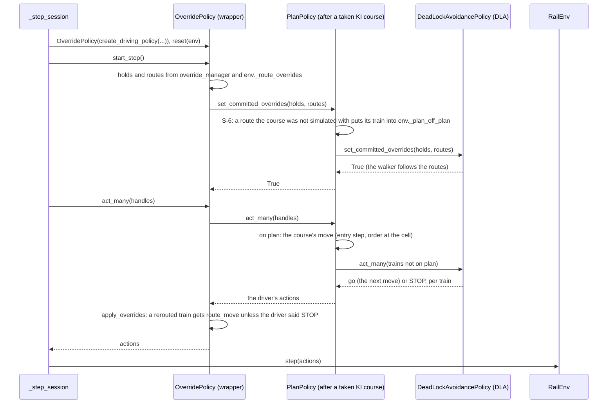

Without a taken KI course, DLA is the driver itself (no `PlanPolicy` in between). The parts and what they decide on:

| Part | Decides | On which information | Keeps |
|---|---|---|---|
| Frontend (`route-drawing.ts`, the map) | the via cells of the drawn route | the rail grid, the mouse path | nothing after «übernehmen» |
| `POST /proposals/apply` (`variant: human, option: reroute, via`) | commits the route | `route_through(env, BA, via)` | `override_manager`, `env._route_overrides`, `env._route_drawn` |
| `OverridePolicy` (wrapper) | per rerouted train: the route's move, or the driver's STOP | `override_manager`, `env._route_overrides`, the driver's answer to `set_committed_overrides` | nothing between steps (built per step) |
| `POST /proposals/apply` (`variant: ai`) | takes the KI course | the course; the routes still committed after it (#208 keeps the other trains') | `env._trainrun_plan`, `env._plan_course_routes` (S-6) |
| `PlanPolicy` (driver after a taken KI course) | per train on plan: the course's move or STOP; hands the others to DLA | `env._trainrun_plan`, the train's cell and heading, the order at each cell; S-6: the committed routes against `env._plan_course_routes` | `env._plan_off_plan` |
| `DeadLockAvoidancePolicy` (driver, or `PlanPolicy`'s fallback) | per train: go (the walked path's next move) or STOP | every train's walked path: its committed route, else its shortest path; the cells occupied | the routes for this step (built per step) |

### 1.2 Payloads

The KI course, `env._trainrun_plan` (case B, `ai-2`, after «KI-Plan übernehmen» at step 2; runs shortened). AB's run
goes using the side track, BA's along the main line; neither run has its target cell, since a train is done on entering
it:

```json
{
  "env._accepted_trainrun_plan": true,
  "session.policy": "plan",
  "env._trainrun_plan": {
    "0": [{"scheduled_at": 2, "position": [2, 3], "direction": 1}, "… 18 more, through (1,12) …",
          {"scheduled_at": 25, "position": [2, 20], "direction": 1}],
    "1": [{"scheduled_at": 3, "position": [2, 21], "direction": 3}, "… 16 more, along row 2 …",
          {"scheduled_at": 20, "position": [2, 4], "direction": 3}]
  },
  "override_manager": {},
  "env._plan_off_plan": []
}
```

The drawn route after «Fahrweg ändern übernehmen» at step 3 (all cases; the route shortened). The override value 5
is `REROUTE_ACTION`; a node is `[row, col, heading]`:

```json
{
  "override_manager": {"1": 5},
  "env._route_overrides": {
    "1": [[2, 21, 3], [2, 20, 3], "…", [2, 14, 3], [1, 14, 0], [1, 13, 3], [1, 12, 3], [1, 11, 3], [1, 10, 3],
          [2, 10, 2], "…", [2, 4, 3], [2, 3, 3]]
  },
  "env._route_drawn": [1]
}
```

What `OverridePolicy` passes to the driver every step from then on, `set_committed_overrides(holds, routes)`:

```json
{"holds": [], "routes": {"1": [[2, 21, 3], "… the 21 nodes above …", [2, 3, 3]]}}
```

The routes a course was simulated with, recorded when it is taken (S-6, `note_course_routes`), and the off-plan set
at step 9:

```json
{"B (ai-2 taken, then BA's route drawn)": {"env._plan_course_routes": {}, "env._plan_off_plan": [1]},
 "C (BA's route drawn, then ai for AB taken)": {"env._plan_course_routes": {"1": ["… BA's 21 nodes …"]},
                                                "env._plan_off_plan": []}}
```

The full payloads per step: `tmp/walkthrough/walkthrough-<case>.json` after running the script.

### 1.3 How DLA decides go or stop

Per step DLA walks every train to its target (`DeadlockAvoidanceShortestDistanceWalker`): along its committed
route if it has one, else along its shortest path. A train may move when, against every train coming the other way
on its path, enough cells of its path up to the next switch are neither on the other's path nor occupied
(`_can_agent_move`: "free" ≥ "needed", needed = 1 + the number of oncoming trains). In the tables: `DLA, side track, AB
oncoming: 5 free of 2 → go`. The lower handle does not win by itself; it is the free cells that decide.

### 1.4 Where the operator's route is stored

On the session's env object and in the override manager, in the backend's memory. They are written once, when the
operator takes the drawn route (`POST /proposals/apply`, `variant: human, option: reroute, via: [[1,12]]`):
`apply_proposal` → `_commit_override` (`backend/app/api/overrides.py`) → `commit_route`
(`backend/app/core/route_overrides.py`).

| Where | What | Set by |
|---|---|---|
| `env._route_overrides[1]` | the whole route, 21 `[row, col, heading]` nodes from B through (1,12) to A, built once by `route_through(env, 1, [(1,12)])` | `commit_route` |
| `env._route_drawn` | `{1}`: BA's route was drawn, so it is kept as drawn and never recomputed | `commit_route` |
| `override_manager._overrides["<session id>"][1]` | `5` (`REROUTE_ACTION`): BA has a standing reroute | `_commit_override` |

How long they live:

- **Not on disk.** `override_manager` is an in-memory singleton keyed by the session id, and the env lives in the
  session: both are gone when the backend restarts or the session is deleted.
- **Forks** for forecasts get a copy of the route and the drawn marker (`carry_to_fork`), so a forecast follows the
  same route; also the routes a taken course was simulated with (`env._plan_course_routes`, S-6).
- **Removed** when the train arrives (`route_move` finds no next node), when a drawn train leaves its route, with
  «Plan behalten», when another override replaces the reroute, and when a KI course is taken that does not keep
  overrides.

### 1.5 How the route reaches DLA's walker

Every step, the wrapper hands the stored route down to the driver, and from there to DLA's walker. Case D with S-6:

1. **`OverridePolicy.start_step` → `_pass_committed_overrides`** (`backend/app/policies/override_policy.py`) reads
   `override_manager` (`{1: 5}`: BA has a reroute) and `env._route_overrides[1]`, and calls the driver's
   `set_committed_overrides(holds=set(), routes={1: [...the 21 nodes...]})`.
2. **`PlanPolicy.set_committed_overrides`** (`backend/app/policies/plan_policy.py`): S-6 sees that the course was not
   simulated with this route and puts BA into `env._plan_off_plan`; then it passes the same `routes` on to its
   fallback, DLA.
3. **`DeadLockAvoidancePolicy.set_committed_overrides`** (`backend/app/policies/deadlock_avoidance_policy.py`) keeps
   the routes in `self._routes` and in its walker's `routes`, and clears its go/stop results when they changed. The
   driver is built anew every step, so this copy lasts one step.
4. **DLA's `start_step` → `_walk_all_agents` → `walker.walk_to_target(BA)`**: the walker walks every train cell by
   cell to its target. Per cell, `_walk` (`backend/app/utils/deadlock_avoidance_walker.py`) looks the train's
   `(row, col, heading)` up in its route; when it is there, the next cell is the route's next node, otherwise the
   shortest path's. BA waits off the map at step 3, so the walker starts at its origin `(2,21,3)`, the route's first
   node, and follows the route through (2,14) onto the side track at (1,14).
5. **The go/stop check** (§1.3) compares this path with AB's: on the side track BA's path has 5 cells AB's does not
   use, of 2 needed, so DLA says go.

What triggers DLA to walk BA along the side track is the route, not S-6:

- **Pass-on only:** DLA gets the same routes and walks BA along the side track too, for BA and for the other trains'
  checks. S-6 adds that DLA also *drives* BA (BA is off plan, so `PlanPolicy` takes BA's action from DLA instead of
  the course).
- **Before S-6** `PlanPolicy` did not pass the call on: after a taken course DLA got no routes and walked BA along the
  main line. Without a taken course (case A) DLA is the driver and gets the routes directly from the wrapper.
- **Case 0** has no committed route: `routes` is empty, the walker takes the shortest path along the main line and
  finds 0 free cells against AB.

## 2. Case 0: no route, BA waits for AB

Movie (steps 1–39): 

DLA walks both trains along the main line (row 2), towards each other. BA's path up to the next switch has no cell
that AB's path does not also use: `0 free of 2 → stop`. BA stays at B until AB has arrived (step 24), leaves at step
24 and is at (2,7) at step 39: it does not arrive by step 40. The side track stays unused, because no train's shortest path
uses it. 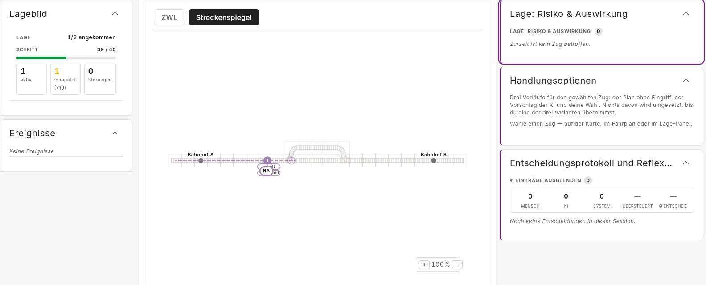

| Step | AB at | AB: driver (why) | AB: wrapper | BA at | BA: driver (why) | BA: wrapper |
|---|---|---|---|---|---|---|
| 3 | 2,4 | FORWARD (DLA, main line, nobody oncoming) | kept FORWARD | off map | STOP (DLA, main line, AB oncoming: 0 free of 2 → stop) | kept STOP |
| 8 | 2,8 | FORWARD (DLA, main line, nobody oncoming) | kept FORWARD | off map | STOP (DLA, main line, AB oncoming: 0 free of 2 → stop) | kept STOP |
| 23 | 2,20 | FORWARD (DLA, main line, nobody oncoming) | kept FORWARD | off map | STOP (DLA, main line, AB oncoming: 0 free of 2 → stop) | kept STOP |
| 24 | done | - | - | off map | FORWARD (DLA, main line, nobody oncoming) | kept FORWARD |
| 39 | done | - | - | 2,7 | FORWARD (DLA, main line, nobody oncoming) | kept FORWARD |

AB stands at (2,8) in steps 8–11 with its breakdown: DLA says FORWARD, the env does not move it.

## 3. Case A: DLA drives, BA's route drawn at step 3

Movie: 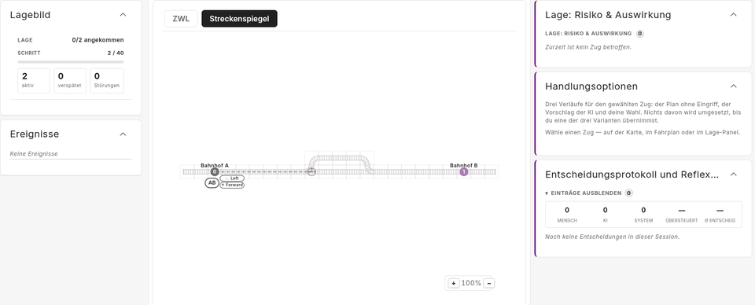

### 3.1 Phase 1, step 3: the operator draws and takes the route

| Who | Does | On which information | Result |
|---|---|---|---|
| Operator | selects BA, «Fahrweg ändern», drags from B to A using the side track in the passing place | the map | the line on the map 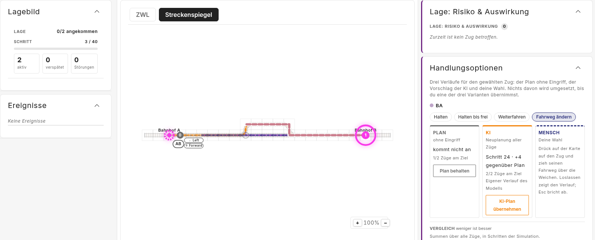 |
| Frontend | via cells from the drag; `GET /proposals?handle=1&option=reroute&via=…` | `viaCells` of the drawn nodes | the «Mensch» course: BA at step 24, 2/2 at the target  |
| Operator | «Fahrweg ändern übernehmen» | the three courses | `POST /proposals/apply` with `via` |
| Backend | `_commit_override`: `override_manager.set(1, 5)`, `commit_route(env, 1, via)` | `route_through` from BA's origin through (1,12) to A | the payloads in §1.2 |

### 3.2 Phase 2, steps 3–11: BA leaves B although AB comes towards it

From step 3 the wrapper passes BA's route to DLA, which answers True. DLA now walks BA along the route, using the
side track. AB, oncoming on the main line, uses none of the side track's cells, so BA's path has 5 free cells against it: BA may
go. AB likewise sees BA oncoming but 3 free cells (the side track is BA's): AB may go too. The wrapper gives BA the route's
move (FORWARD here, RIGHT at the switch (2,14)), and keeps no STOP because DLA said go.

| Step | AB at | AB: driver (why) | AB: wrapper | BA at | BA: driver (why) | BA: wrapper |
|---|---|---|---|---|---|---|
| 3 | 2,4 | FORWARD (DLA, main line, nobody oncoming) | kept FORWARD | off map | FORWARD (DLA, side track, AB oncoming: 5 free of 2 → go) | route move FORWARD |
| 4 | 2,5 | FORWARD (DLA, main line, BA oncoming: 3 free of 2 → go) | kept FORWARD | 2,21 | FORWARD (DLA, side track, AB oncoming: 5 free of 2 → go) | route move FORWARD |
| 8 | 2,8 | FORWARD (DLA, main line, BA oncoming: 3 free of 2 → go) | kept FORWARD | 2,17 | FORWARD (DLA, side track, AB oncoming: 5 free of 2 → go) | route move FORWARD |
| 11 | 2,8 | FORWARD (DLA, main line, BA oncoming: 3 free of 2 → go) | kept FORWARD | 2,14 | RIGHT (DLA, side track, AB oncoming: 5 free of 2 → go) | route move RIGHT |

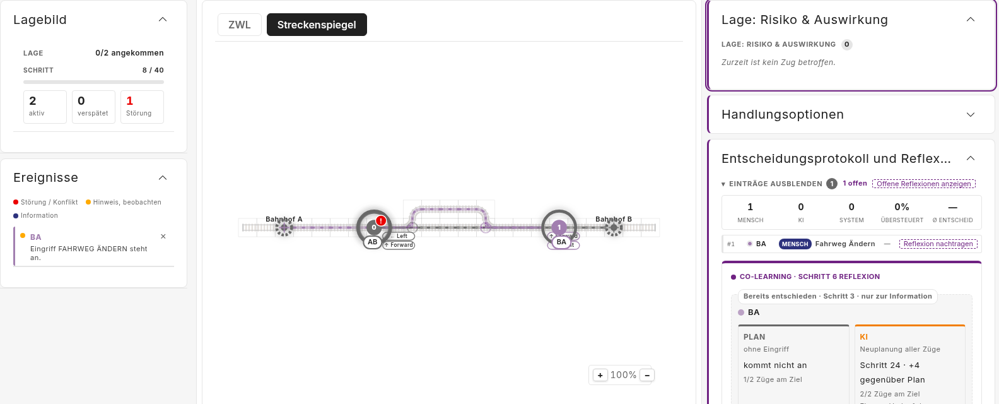

### 3.3 Phase 3, steps 12–17: BA on the side track, AB passes on the main line

| Step | AB at | AB: driver (why) | AB: wrapper | BA at | BA: driver (why) | BA: wrapper |
|---|---|---|---|---|---|---|
| 12 | 2,9 | FORWARD (DLA, main line, nobody oncoming) | kept FORWARD | 1,14 | LEFT (DLA, side track, AB oncoming: 4 free of 2 → go) | route move LEFT |
| 13 | 2,10 | FORWARD (DLA, main line, nobody oncoming) | kept FORWARD | 1,13 | FORWARD (DLA, side track, AB oncoming: 3 free of 2 → go) | route move FORWARD |
| 14 | 2,11 | FORWARD (DLA, main line, nobody oncoming) | kept FORWARD | 1,12 | FORWARD (DLA, side track, nobody oncoming) | route move FORWARD |
| 16 | 2,13 | FORWARD (DLA, main line, nobody oncoming) | kept FORWARD | 1,10 | LEFT (DLA, main line, nobody oncoming) | route move LEFT |
| 17 | 2,14 | FORWARD (DLA, main line, nobody oncoming) | kept FORWARD | 2,10 | RIGHT (DLA, main line, nobody oncoming) | route move RIGHT |

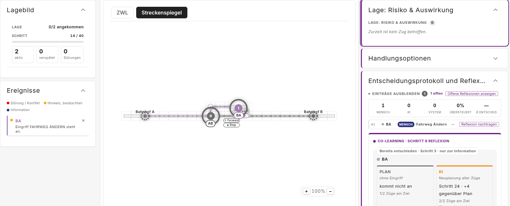

### 3.4 Phase 4, steps 18–24: both run to their targets

Nobody is oncoming any more; both arrive at step 24. 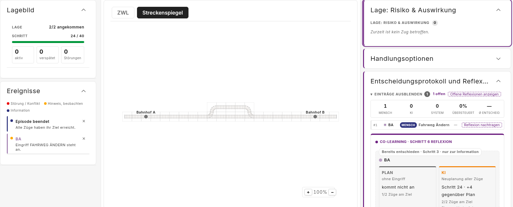

**Why BA does not wait for AB:** the information that changed is BA's walked path. Without the route DLA assumes
BA takes the main line and finds no free cell against AB (case 0); with it, DLA walks BA using the side track, which AB
does not use. Neither train's action is forced against DLA: the wrapper's route move and DLA's go agree in every
step, and a STOP from DLA would have won (S-2).

## 4. Case B: a KI course that sends AB onto the side track, then BA's route using the side track

Movie: 

At step 2 the operator takes the first alternative KI course, `ai-2` ("ab Schritt 10 den Ast geradeaus nehmen"):
AB using the side track, BA on the main line. 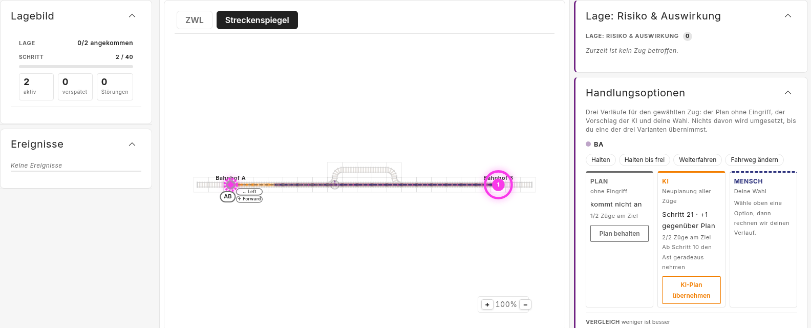

At step 3 they draw BA's route using the side track as in case A. The «Mensch» course already shows the outcome:
«kommt nicht an», 0/2 at the target. 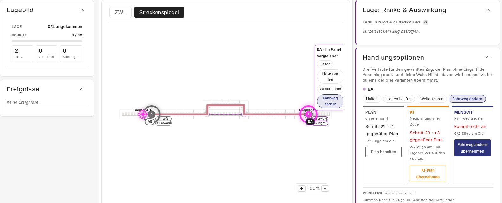
Once taken, the events panel warns too: «Eingriff: Blockaden können zunehmen (0 → 2)» and «weniger Züge erreichen
womöglich ihr Ziel (2 → 0)».

Taken anyway, the three versions of `PlanPolicy` give:

| Step | AB at | AB: driver (why) | BA at | before S-6: BA driver, wrapper | pass-on only | S-6 |
|---|---|---|---|---|---|---|
| 3 | 2,4 | FORWARD (course) | 2,21 | FORWARD (course), route move | FORWARD (course), route move | FORWARD (DLA (fallback), side track, AB oncoming: 5 free of 2 → go), route move |
| 10 | 2,8 | STOP (course) | 2,14 | FORWARD (course), route move RIGHT | the same | RIGHT (DLA (fallback), 5 free of 2 → go), route move RIGHT |
| 11 | 2,8 | FORWARD (course) | 1,14 | LEFT (DLA (fallback), 4 free of 2 → go), route move | the same | the same |
| 13 | 2,10 | LEFT (course) | 1,12 | FORWARD (DLA (fallback), 2 free of 2 → go), route move | the same | the same |
| 14 | 1,10 | RIGHT (course) | 1,11 | STOP (DLA (fallback), 0 free of 2 → stop), route move FORWARD | STOP, kept STOP | STOP, kept STOP |

- **Before S-6** `PlanPolicy` answers False: DLA gets no routes, the wrapper forces the route's move. BA is on its
  run until (1,14) (its run and the route share the cells up to (2,14)), then off plan.
- **Pass-on only** and **S-6** let DLA walk BA's route and keep DLA's STOP. S-6 takes BA off plan at step 3 already
  (the course was taken before the route), so DLA drives BA from the start.
- **In all three, AB and BA meet head-on on the side track at step 14** ([step 14](walkthrough/B-5-step-14.png)). DLA, as
  the fallback, walks AB along its *shortest* path (the main line), not along its course using the side track: it sees
  free cells for BA until AB actually turns onto the side track at step 13. `PlanPolicy` drives AB by the course and does
  not wait for a train off plan. This is the known gap "the fallback DLA walks the planned trains along their runs"
  ([the plan's §1.4](../set-route-on-map.md#14-follow-ups-not-in-this-pr)); the «Mensch» course shows it before the operator takes the route.

## 5. Case C: BA's route first, then a KI course for AB that keeps it

Movie: 

At step 2 the operator draws BA's route using the side track in the passing place between the stations and takes it. 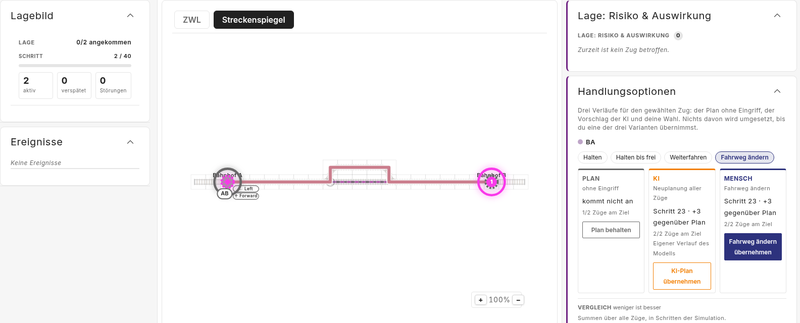
At step 3 they select AB and take the KI course `ai`. 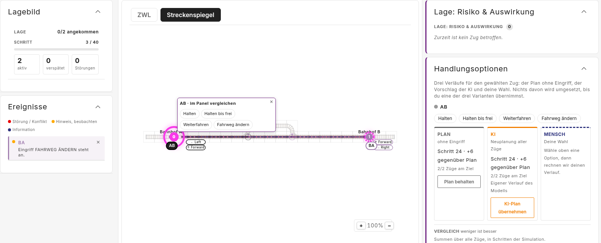 The KI adviser
(`uc2_rl`, #208) keeps BA's reroute and simulates the course with it: BA's run goes using the side track. When the course
is taken, BA's route is still committed and is recorded as one the course was simulated with
(`env._plan_course_routes`). So S-6 keeps BA on plan: `PlanPolicy` drives it by the course (entry steps, order at
each cell), the wrapper gives the route's move where the course does not stop it.

| Step | AB at | AB: driver (why) | AB: wrapper | BA at | BA: driver (why) | BA: wrapper |
|---|---|---|---|---|---|---|
| 3 | 2,4 | FORWARD (course) | kept FORWARD | 2,21 | FORWARD (course) | route move FORWARD |
| 10 | 2,8 | STOP (course) | kept STOP | 2,14 | RIGHT (course) | route move RIGHT |
| 11 | 2,8 | FORWARD (course) | kept FORWARD | 1,14 | LEFT (course) | route move LEFT |
| 13 | 2,10 | FORWARD (course) | kept FORWARD | 1,12 | FORWARD (course) | route move FORWARD |
| 16 | 2,13 | FORWARD (course) | kept FORWARD | 2,10 | RIGHT (course) | route move RIGHT |
| 22 | 2,19 | FORWARD (course) | kept FORWARD | 2,4 | DO_NOTHING (course: its last cell) | route move FORWARD |
| 23 | 2,20 | DO_NOTHING (course) | kept DO_NOTHING | done | - | - |

BA arrives at step 23, AB at step 24. 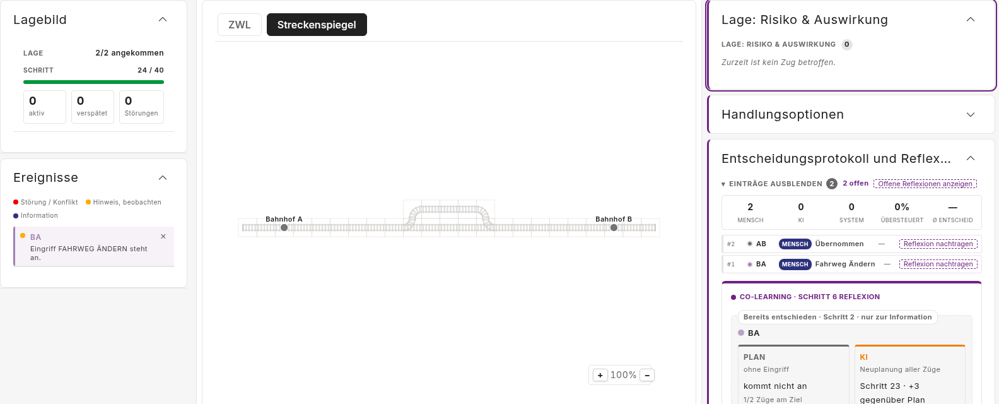

Drawn *after* a taken course instead, the same route takes BA off plan, even where the course's run has the same
cells: the course's waits (its entry steps, the order at each cell) answer the situation before the route. The
advanced tour's counter-train cases (`test_sandbox.py`) need that: their computed reroute uses only cells of the
train's run, and only leaving the plan's order lets the train go.

## 6. Case D: the refinement, a course whose timing no longer fits the route (backend only)

The course is case 0's run, recorded cell by cell: DLA alone, without a route, so BA waits at B and departs at
step 25, after AB, along the main line. That is what makes it a course whose timing no longer fits the route drawn
at step 3, which lets BA leave at once. Case C's course would not do: it already sends BA over the side track from
step 3, so the same route would change nothing. No KI course in the app is case 0's run; the S-6 test
(`test_route_drawn.py::test_drawn_route_under_a_taken_plan_is_driven_by_the_fallback`, `_record_plan`) uses it.

The steps, as in case B:

| Step | Who | Does |
|---|---|---|
| 2 | Operator (here: the script) | takes the course: `accept_trainrun_plan`, what «KI-Plan übernehmen» does. AB and BA both follow it on the main line, BA departing at step 25. |
| 3 | Operator (here: the script) | **chooses the side track for BA**: draws BA's route from B across the side track (via (1,12)) to A and takes it, as in case A. |
| 3– | `PlanPolicy`, DLA, `OverridePolicy` | drive the trains, as in the table below. |

Nobody drags a mouse here: at step 3 the script sends the request the frontend sends on «Fahrweg ändern übernehmen»
after the drag,

```http
POST /session/{id}/proposals/apply
{"variant": "human", "handle": 1, "option": "reroute", "via": [[1, 12]]}
```

`via` is what the frontend computes from the drawn line (`viaCells`). From there it is the app's path: the route is
built and stored as in §1.4.

| Step | BA at | pass-on only: BA driver, wrapper | S-6: BA driver, wrapper |
|---|---|---|---|
| 2 | off map | the course is taken: BA to depart at step 25 | the same |
| 3, before the step | off map | **the operator chooses the side track for BA** (the route is committed) | the same; S-6 takes BA off plan at the next `set_committed_overrides` |
| 3 | off map | STOP (course: departs at step 25), kept STOP | FORWARD (DLA (fallback), side track, AB oncoming: 5 free of 2 → go), route move |
| 11 | off map / 2,14 | STOP (course), kept STOP | RIGHT (DLA (fallback), 5 free of 2 → go), route move RIGHT |
| 14 | off map / 1,12 | STOP (course), kept STOP | FORWARD (DLA (fallback), nobody oncoming), route move |
| 23 | off map / 2,4 | STOP (course), kept STOP | FORWARD (DLA (fallback), main line, nobody oncoming), route move |
| 24 | off map / done | FORWARD (course: its departure), route move | - |
| Result | | AB step 24, BA does not arrive | both at step 24 |

With the pass-on only, `PlanPolicy` answers True, so the wrapper keeps the course's STOP for BA, which is still on
its run (off the map): BA waits for the old course's departure although its new route no longer needs it. S-6 sees
that the course was not simulated with the route and takes BA off plan when the route is committed; DLA then drives BA
as in case A.

**Before S-6** BA arrives at step 24 too: `PlanPolicy` answers False, so the wrapper forces BA's route move from step
3 on and ignores the course's STOP. Nothing checks BA then, but nothing is in its way either. The pass-on alone breaks
this case; the refinement repairs it.

### 6.1 Who decides that BA takes the side track

The operator decides it when drawing the route. While the trains run, the driver and the wrapper only carry that
decision out, and neither chooses the branch itself.

**The operator, once, at step 3.** Dragging BA's route across the side track gives the via cell (1,12). On «Fahrweg
ändern übernehmen», `route_through(env, BA, [(1,12)])` builds the whole route from B through (1,12) to A and stores
it in `env._route_overrides[1]` as `[row, col, heading]` nodes (where and how long: §1.4). Around the passing place:

```json
[[2, 15, 3], [2, 14, 3], [1, 14, 0], [1, 13, 3], [1, 12, 3], [1, 11, 3], [1, 10, 3], [2, 10, 2], [2, 9, 3]]
```

After the switch (2,14) the next node is (1,14) with heading 0: onto the side track. After (1,10) it is (2,10): back
onto the main line.

**Every step, two parts read the route (S-6).** `PlanPolicy` has handed BA to DLA, because the course was taken
before the route.

| Step | BA at | DLA (fallback) proposes | `OverridePolicy` (wrapper) gives the env |
|---|---|---|---|
| 10 | (2,15) | FORWARD | route move FORWARD |
| 11 | (2,14), the switch | RIGHT | route move RIGHT: onto the side track |
| 12 | (1,14) | LEFT | route move LEFT |
| 16 | (1,10), the switch back | LEFT | route move LEFT |
| 17 | (2,10) | RIGHT | route move RIGHT: back on the main line |

- **DLA** proposes RIGHT at (2,14) because its walker follows the committed route it got through
  `set_committed_overrides` (the chain: §1.5). Without a route it would walk its shortest path, straight along the main line.
- **The wrapper** works out the same move on its own, `route_move(env, BA)`: from the train's cell and heading to the
  route's next node. It gives that move to the env, unless the driver says STOP; then the driver's STOP wins.

So the two agree in every step. The only thing DLA decides for BA is go or wait, from the free cells against an
oncoming train (5 free of 2 needed at step 11).

**With the pass-on only**, the same route is stored, but BA stays on the course, which holds it with STOP until its
old departure at step 24. BA reaches the switch at step 32. There the course proposes FORWARD (the main line, as in
its run), and the wrapper replaces it with the route's RIGHT, because only a STOP from the driver would win. In the
next cell BA is no longer on its run, so `PlanPolicy` hands it to DLA, which then proposes the route's moves. BA uses
the side track, but too late: it does not arrive by step 40.

### 6.2 Compared with case 0

Case D's course is case 0's run, recorded: without the route, D would be case 0 step by step. *Italics* mark what
case D (S-6) does differently.

| Step | AB at (both) | AB: case 0 | AB: case D | BA at: case 0 | BA at: case D | BA: case 0 | BA: case D |
|---|---|---|---|---|---|---|---|
| 3 | 2,4 | FORWARD (DLA) | FORWARD (*course*) | off map | off map | STOP (DLA, main line, AB oncoming: 0 free of 2), kept | *FORWARD (DLA (fallback), side track, AB oncoming: 5 free of 2), route move* |
| 4 | 2,5 | FORWARD (DLA) | FORWARD (*course*) | off map | *2,21* | STOP (DLA, main line, 0 free of 2), kept | *FORWARD (DLA (fallback), side track, 5 free of 2), route move* |
| 7–10 | 2,8 (broken down 8–11) | FORWARD (DLA), the env does not move it | *STOP (course)* | off map | *2,18 → 2,15* | STOP (DLA, main line, 0 free of 2), kept | *FORWARD (DLA (fallback), side track, 5 free of 2), route move* |
| 11 | 2,8 | FORWARD (DLA) | FORWARD (*course*) | off map | *2,14, the switch* | STOP (DLA, main line, 0 free of 2), kept | *RIGHT (DLA (fallback), side track, 5 free of 2), route move RIGHT* |
| 12 | 2,9 | FORWARD (DLA) | FORWARD (*course*) | off map | *1,14* | STOP (DLA, main line, 0 free of 2), kept | *LEFT (DLA (fallback), side track, 4 free of 2), route move LEFT* |
| 14 | 2,11 | FORWARD (DLA) | FORWARD (*course*) | off map | *1,12* | STOP (DLA, main line, 0 free of 2), kept | *FORWARD (DLA (fallback), side track, nobody oncoming), route move* |
| 16 | 2,13 | FORWARD (DLA) | FORWARD (*course*) | off map | *1,10, the switch back* | STOP (DLA, main line, 0 free of 2), kept | *LEFT (DLA (fallback), nobody oncoming), route move LEFT* |
| 17 | 2,14 | FORWARD (DLA) | FORWARD (*course*) | off map | *2,10* | STOP (DLA, main line, 0 free of 2), kept | *RIGHT (DLA (fallback), nobody oncoming), route move RIGHT* |
| 23 | 2,20 | FORWARD (DLA) | *DO_NOTHING (course: its last cell)* | off map | *2,4* | STOP (DLA, main line, 0 free of 2), kept | *FORWARD (DLA (fallback), nobody oncoming), route move* |
| 24 | done | - | - | off map | *done* | FORWARD (DLA, nobody oncoming): BA leaves B | - |
| Result | AB step 24 | | | | | does not arrive by step 40 | *step 24* |

- **AB** runs the same cells at the same steps in both cases. Only the part that drives it differs: DLA in case 0,
  `PlanPolicy` by the course in case D. In steps 7–10 the course says STOP where DLA said FORWARD; AB stands with its
  breakdown either way.
- **BA** is the one difference, from step 3 on. Its walked path is the side track instead of the main line, so DLA
  finds 5 free cells against AB instead of 0 and says go instead of stop. The wrapper gives the route's move instead
  of keeping DLA's STOP. BA takes the side track at (2,14) while AB stands broken down at (2,8), passes AB, and
  arrives at step 24, the same step as AB. In case 0 it only leaves B at step 24.
- **Nothing else changes.** AB does not wait for BA in either case: the course runs AB as recorded, and BA's path on
  the side track never needs a cell AB uses at the same time.

### 6.3 Compared with case A

Case A draws the same route at the same step, without a taken course. Step by step, case D (S-6) puts the trains on
the same cells and gives the env the same moves; DLA decides the same for BA in every step (the same walked path,
oncoming train, free cells and go). What differs is only which part drives, in *italics*:

| Steps | AB: case A | AB: case D | BA: case A | BA: case D | env gets (both) |
|---|---|---|---|---|---|
| 3–6 | DLA: FORWARD (BA oncoming: 3 free of 2 → go) | *the course: FORWARD* | DLA: FORWARD (side track, 5 free of 2 → go), route move | *DLA as `PlanPolicy`'s fallback (BA off plan)*: the same | AB FORWARD, BA FORWARD |
| 7–10, AB broken down | DLA: FORWARD, the env does not move it | *the course: STOP* | as in 3–6 | *as in 3–6, as the fallback* | AB stands, BA FORWARD |
| 11–22 | DLA: FORWARD | *the course: FORWARD* | DLA, route move (RIGHT at (2,14), LEFT at (1,14), LEFT at (1,10), RIGHT at (2,10)) | *DLA as the fallback*: the same | the same moves |
| 23 | DLA: FORWARD | *the course: DO_NOTHING (its last cell)* | DLA: FORWARD, route move | *DLA as the fallback*: the same | AB enters its target, BA FORWARD |
| Result | step 24 | step 24 | step 24 | step 24 | |

- **The call chain:** in case A the wrapper calls DLA's `set_committed_overrides` directly; in case D it calls
  `PlanPolicy`'s, which *puts BA into `env._plan_off_plan`* and passes the call on to DLA (§1.5). Both answer True.
- **AB:** driven by DLA in case A, *by the course in case D*. The course is case 0's run, in which AB runs the same
  cells at the same steps, so the env sees no difference.
- **BA:** driven by DLA in both, *in case D as the fallback for a train off plan*. Its route, its walked path and
  DLA's go/stop are the same.

That is what the refinement is for: a route drawn after a taken course behaves as in case A, where no course is
taken. Without it (pass-on only) the course's STOP would hold BA until step 25 (§6).

**Does case A need the refinement?** No. Case A has no taken course, so `PlanPolicy` is not involved: neither the
pass-on nor the refinement plays a part, and case A works with S-2 alone (DLA gets the routes from the wrapper).
The refinement matters only after a taken course, and there only for a route committed after it (case D); case C,
whose course was simulated with the route, works in every version, and so does case D before S-6, where the wrapper
forces the route's move (§6).

### 6.4 Why the course, not DLA, drives BA without the refinement

With the pass-on only, DLA does learn BA's route; it does not drive BA. Step 3 of case D:

1. **The route reaches DLA.** The wrapper passes `routes={1: [...]}` to `PlanPolicy`, which passes it on to DLA
   (§1.5). DLA's walker walks BA along the side track, finds 5 free cells against AB and has "go" ready for BA.
2. **`PlanPolicy` decides who drives BA, by BA's position, not by its route.** `PlanPolicy.act_many` first asks the
   course for every train (`_plan_action`); only the trains it returns None for go to DLA (`needs_fallback`): no run
   for the train, or the train on the map but not on its run. BA is still off the map, and for a train off the map
   `_plan_action` gives the course's departure: STOP until step 25. So BA is on plan and DLA's "go" is never asked
   for.
3. **The course does not change when a route is drawn.** The route is an override (`env._route_overrides`); the
   course (`env._trainrun_plan`) stays as taken, BA's run along the main line, departing at step 25. Nothing rewrites
   BA's run from the route.
4. **The wrapper keeps the driver's STOP.** `PlanPolicy` answers True (its fallback's answer), so `apply_overrides`
   keeps the driver's STOP instead of the route's move, and the driver's STOP for BA is the course's, not DLA's.

So two parts know different things about BA: DLA knows the route ("go"), the course knows the old timing ("wait"),
and the course is BA's driver. Without the refinement BA would go off plan once on the map in a cell its run does not
have, but the course keeps it off the map until step 25.

The refinement changes step 2: it takes BA off plan when the route is committed, since the course was not simulated
with it. `_plan_action` then returns None for BA, `PlanPolicy` asks DLA, and DLA's "go" is what the wrapper sees, as
in case A. The alternative, rewriting BA's run from the route (new entry steps, a new order at each cell), would be a
re-plan: the PP and KI planners' job, left to the follow-ups ("a reroute that rejoins its plan", Q-8).

## 7. Summary

| | Without a taken KI course (DLA drives) | After a taken KI course (`PlanPolicy` drives) |
|---|---|---|
| Who gets the route | DLA, through `set_committed_overrides` | `PlanPolicy`, which passes it on to DLA (S-6) |
| Who drives the rerouted train | DLA along the route | a route the course was simulated with (kept, #208): the course; a route committed after it: DLA along the route (off plan) |
| What the wrapper does | the route's move, unless DLA says STOP | the route's move, unless the driver (course or DLA) says STOP |
| Others wait for it | yes: DLA walks it along its route | only DLA-driven trains; planned trains follow their course and DLA walks them on their shortest path (follow-up, case B) |
