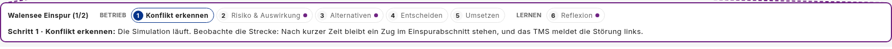
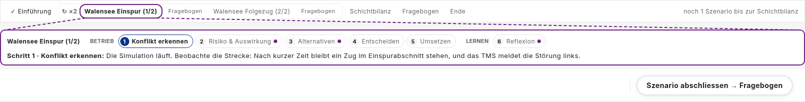
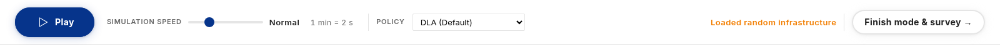
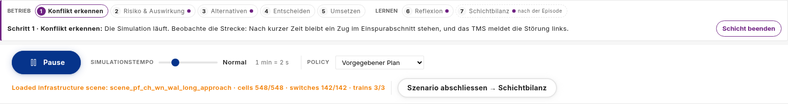
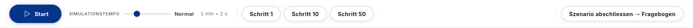

# Play toolbar: under the guide strip, no step buttons, Plan B without playback (#167)

> **Status:** plan, 2026-11-03, revised the same day after a code review.
> Based on `main` 0ec3516. Requirements 1-3 are built on this branch
> (S1-S4), and so are the code-review follow-ups (F1-F16, §7), verified in §6.
> Issue [#167](https://github.com/flatland-association/flatland-ui-hub/issues/167)
> ("\"Play\" Taskliste anpassen und verschieben", @CleverManu, label `plan b`).
> Branch `feature/167-play-tasklist`, off `main` (on request; contributors
> usually branch off `explore_db`). Open questions are in §8, the code-review
> findings under "Findings".
>
> **Why:** in the Plan B study the participant should work the scenario, not
> drive the simulation. The run controls move next to the scenario's guide,
> the step buttons go, and Plan B hides Play/Pause and speed.

### Status

| ID | Commit message | SHA |
|---|---|---|
| S0 | docs(toolbar): plan for #167, the play toolbar under the guide strip. | 27da5e1 |
| S1 | feat(toolbar): remove the Schritt 1/10/50 step buttons. | 09d08d4 |
| S2 | feat(ui-config): hide Play/Pause and speed under Plan B. | b825010 |
| S3 | feat(toolbar): show the toolbar under the guide strip. | da5326a |
| S4 | docs(toolbar): screenshots of the toolbar under the guide strip. | e1f2c3e |
| - | docs(toolbar): take the #167 screenshots on the Plan B configuration. | a7a76b7 |
| - | docs(plans): revise the #167 plan after the code review. | dee2437 |
| F16 | refactor(frontend): delete the unused simulation-slider component. | 75ecd55 |
| F12 | test(toolbar): drop the duplicate speed assertion. | f93899e |
| F13 | docs(toolbar): name the plan next to #167 in comments. | 5a385f1 |
| F11 | fix(toolbar): show the finish divider only when controls precede it. | b1036fd |
| F10 | docs(experiment-logging): drop the removed step buttons from the click example. | 9b8167a |
| F4 | fix(toolbar): start the policy selection from the session's policy. | b560278 |
| F3 | docs(ui-config): note that control.playback needs a briefing with autoStart. | d8bda54 |
| F2 | fix(experiment): pin the play speed of every guided leg. | f0e2f9b |
| F5 | fix(app): show the toolbar while the guide waits for a session. | bc99427 |
| F9 | test(app): cover where the toolbar renders with and without the guide. | d4fd009 |
| F14 | feat(interaction-log): record the start tempo in the session header. | 4fae5cd |
| F15 | feat(replay): show the recorded tempo in the replayed toolbar. | ae5e43c |
| F1 | fix(toolbar): say when the run stopped on an error, and record it on the leg. | 01859da |
| F6, F7 | in the plan revision | dee2437 |
| F8 | test(toolbar): walk the Plan B run to its end, and retake the screenshots. | 214b4af |

### Terms

- **Guide strip:** `TourGuideComponent` (`app-tour-guide`,
  `features/tour-guide/`), the violet box with the current scenario's working
  steps; the "Szenario" line of the issue. Left to right, top to bottom:
  - the scenario label, "Walensee Einspur (1/2)", only in a condition with
    several legs;
  - the steps in two groups, "Betrieb" (1 Konflikt erkennen … 5 Umsetzen) and
    "Lernen" (6 Reflexion). The current step has a blue number, a done step a
    ✓, a violet dot marks a step backed by a Co-Learning module. The run ticks
    them off (a conflict appears, a decision is taken), not the participant;
  - the hint line, "Schritt 1 · Konflikt erkennen: …". "Schritt n" is a guide
    step, not a simulation step;
  - on the right, where allowed, "Schicht beenden" (hidden under Plan B by
    `control.endShift`) and the reopen-reflection button.

  Above it, in a condition with several legs, sits the scenario stepper
  (`app-experiment-progress`), tied to the strip by dashed lines. The strip
  shows only in runs whose briefing has guide steps (guided conditions, some
  tours), and with several legs only while a leg runs (`guideShown()`, D5).
  Free sessions have none.

  

  
- **Toolbar:** `ToolbarComponent` (`app-toolbar`), the row with, left to
  right: the run controls (Play/Pause, speed with "1 min = n s"), the policy
  select (only with more than one allowed policy), then status and info
  messages and the finish button ("Szenario abschliessen → …" in a guided
  condition, "Finish mode & survey →" in the demo). Without a guide strip it
  sits at the top of the working screen; while a guide strip is shown, directly
  under it (D5).
  Under Plan B only the finish button is left (see the second picture above).
  Also rendered as a layout panel of type `toolbar`. Not the Director bar
  (`app-director-directive`) and not the replay stepper. Pictures taken at
  a7a76b7, so without the step buttons:

  

  
- **Run controls / playback:** Play/Pause and the speed control together,
  UI-config id `control.playback`. Not the finish button.
- **Tempo / "Normal":** the play speed as a level 1-5
  (`SessionStore.playSpeedLevel`, `core/play-speed.ts`). One simulation step
  is one simulated minute. "Normal" is the default level 2
  (`PLAY_SPEED_DEFAULT_LEVEL`): 0.5 steps per second, so one simulated minute
  takes two seconds ("1 min = 2 s" in the toolbar), 30 times real time.
- **Step buttons:** "Schritt 1", "Schritt 10", "Schritt 50" in the toolbar,
  click id `toolbar.step`; removed by S1 (D3). Shown only while the run was
  paused; each moved the paused run forward by exactly n steps (one server
  `/step` call per step, with an "N left" countdown) and left it paused. Not
  Play/Pause, which runs the simulation continuously, and not the opening
  fast-forward, which steps a new session to its start state on its own
  (D10). The toolbar before #167, from the issue:

  
- **Opening fast-forward:** `SessionStore._autoAdvanceToOpeningState`. Right
  after a session is created, before the map shows, it steps the scenario on
  its own until the first train moves and `openAtStep` is reached. No control;
  it keeps `ApiService.step()` and the backend's `/step` in use (D10).
- **Call log (call stream):** the `calls` stream of a session record
  (`call-log.interceptor.ts`): every HTTP call with its response, and the
  WebSocket's `connect`, `close`, `episode_done` and `error`. Recorded with
  "Study logging", which Plan B enforces. The replay answers its requests from
  it (D12).
- **Run error:** the server's play loop raised while computing actions or
  stepping the environment, stopped the run and sent a WebSocket
  `{"type": "error"}` (`backend/app/api/websockets.py:120-128`). Not a dropped
  connection (the WebSocket reconnects by itself) and not a failed HTTP call
  (those set `store.error` only). Code symbol: `SessionStore.runError` (F1).
- **Condition / leg:** `StudyCondition` and its `ExperimentLeg`s
  (`core/demo/study-conditions.ts`); Plan B is the condition `plan-b-p01`
  on the layout preset `preset-plan-b`.

### Components

| Component | Responsibility | Change |
|---|---|---|
| `ToolbarComponent` | Lets the person on duty run the simulation and finish the scenario. Not for configuring the session (Settings) or for study restrictions themselves, which come from the UI config. | 🟨 modified: no step buttons; under Plan B no Play/Pause or speed; after a run error it says so instead of stopping silently (F1). |
| `AppComponent` (working-screen shell) | Places the chrome and panels of the working screen. Not for panel content. | 🟨 modified: the toolbar sits under the guide strip while that is shown. |
| `UI_CONFIG_ITEMS` / `ui-config.schema.json` | Lists what a deployment or a preset may hide. Not where a condition decides what to hide. | 🟨 modified: playback can be hidden. |
| `PLAN_B_UI` (Plan B preset) | Declares what the Plan B condition removes. Not the deployment-wide restrictions. | 🟨 modified: Plan B hides playback. |
| `legSessionOpts` (guided run) | Starts each leg of a guided condition the same way for every participant. Not for tours. | 🟨 modified: every leg starts at a known tempo (F2). |
| `ExperimentRunService.finishLeg` / `ShiftRecord` | Records how each leg of a guided condition ended. Not the call log, which keeps every call. | 🟨 modified: a leg that stopped on a run error says so in its record (F1). |
| `InteractionLogService` / `SessionHeader` | Writes the study record of a session: header, context events, streams. Not the replay. | 🟨 modified: the record says at which tempo the session started (F14). |
| `ReplayService` | Plays a recorded session back on the working screen. Not for live runs. | 🟨 modified: the replayed toolbar shows the tempo the participant had (F15) and the run-error notice where it appeared (F1). |
| `TourGuideComponent` | Shows the current scenario's steps. | ⬜ unchanged |
| `SessionStore` | Holds the run state and drives play, pause and steps. | 🟨 modified: remembers that the run stopped on an error, apart from other failures (F1); the step path stays (D10). |
| `SimulationSliderComponent` | An old step slider with +1/+10/+50 buttons, rendered nowhere. | 🟥 removed with its module-registry entry: no step buttons are left in the source (F16). |

## 1. What the issue asks for

| # | Requirement (issue wording) | Scope | Where in this plan |
|---|---|---|---|
| 1 | "Die ganze Zeile [the play toolbar] soll in/unter der «Szenario» Zeile erscheinen" | wherever the guide strip is shown | §4.1 |
| 2 | "Schritte Buttons entfernen" (Schritt 1 / 10 / 50) | general, every run | §4.2 |
| 3 | "Play/Pause und Speed sollen nicht angezeigt werden" | the experiment, Plan B only | §4.3 |

The "Szenario" line is the guide strip (`app-tour-guide`, see Terms): the leg
label ("Walenstadt: Türstörung (1/3)" in the issue's screenshot), the
Betrieb/Lernen steps and, below them, the
hint "Schritt 1 · Konflikt erkennen: …". The "Schritt n" there is a guide step,
not a simulation step, and stays.

### 1.1 Assumptions and exclusions

- **"allgemein" means every run**, not only experiments: the step buttons go
  from the toolbar for good. The scenario can still be advanced step by step
  nowhere else in the working screen; that is the point of the request.
- **The move applies wherever the guide strip is shown** (guided experiments
  and the tours that have a guide), since the issue lists it before the
  Plan B part. Without a guide strip the toolbar stays at the top as today.
- **`control.playback` is only safe on conditions that never leave the run
  paused for a human** (assumption; decided 2026-11-03). Plan B meets it
  (§2.1). Two existing behaviours do not, and stay excluded from this plan:
  Recommendation's conflict countdown (`impact-panel`,
  `decisionMoment: 'countdown'`) pauses globally and resumes only when the AI
  decides on timeout, not after a human decision; and `combined-actions`
  pauses once at the first conflict of a guided run and never resumes. A
  condition that hides playback **and** uses either would strand the
  participant at the first conflict. Such a condition needs an automatic
  resume after the decision, or must not use these pauses; that is not built
  here.
- **`control.playback` also needs a briefing with `autoStart`** (finding 3).
  Without it, «Szenario starten» only closes the intro, and nothing starts the
  run. A spec checks every condition that hides playback through its preset
  (§7, F3). A deployment `ui-config.json` that lists the id has no such
  check: hiding playback there is only supported together with briefings that
  set `autoStart` (stated at the id, F3).
- **No resume after a run error** (D7). A run error comes from a bug in a
  policy, the environment or the step code; a retry meets the same state and
  fails again, or runs on a half-applied step. The run stays stopped, the
  participant is told, and the experimenter ends or restarts the scenario.
- **No step buttons left in the source** (F16): the unused
  `features/simulation-slider` component, the only other place with
  +1/+10/+50 buttons, is deleted. Out of scope: the replay's own stepper (not
  the toolbar), and the rest of `ModuleRegistryService`, which nothing outside
  `core/modules/` uses either; only its `simulation-slider` entry goes.

### 1.2 Design changes and new patterns

| What is new compared with today | Reuses | Defined in |
|---|---|---|
| The toolbar renders in one of two places | `ngTemplateOutlet`, already used in `app.component.html` (`agentInspectorPanel`, `welcomeScenario`) | §4.1, D5 |
| A UI-config id that hides run controls | the `CONTROL_IDS` mechanism of configurable-ui-plan.md §4 | §4.3, D1 |
| A notice in the toolbar when the run stopped on an error | `store.message()`'s place in the toolbar; i18n keys | D7, §7 F1 |
| A leg remembers a run error (`runError`) | `ShiftRecord` and the `leg_finished` payload, both extended by one optional field | D12, §7 F1 |
| The session header records the start tempo (`playSpeedLevel`) | the header's start values (`mode`, `activePolicy`), later changes as context events | D13, §7 F14 |
| The replay applies `speed_change` | the replay's `_startLeg` / `_applyEvent`, which already set mode, layout and views from the record | D13, §7 F15 |
| Guided legs pin their tempo by default | `ExperimentLeg.playSpeedLevel` | D8, §7 F2 |

Not new on purpose: no backend change, no new endpoint, service or event
type (the call log already has the error), no new record version, no new
style token, no projection slot in `app-tour-guide`.

### 1.3 Breaking changes

None for APIs, payloads or stored files. Behaviour and study data change:

- **The step buttons are gone** in every run. New records no longer contain
  `toolbar.step` clicks or `{"kind": "step"}` click objects; old records keep
  them, and the `toolbar.step` key stays so they still read (D4).
- **New optional field `runError`** on a leg in the experiment-run record and
  in the `leg_finished` event (F1, D12). Additive: old records lack it and
  read as before; the record versions stay (`EXPERIMENT_RUN_RECORD_VERSION` 1,
  `SESSION_RECORD_VERSION` 3), since readers ignore unknown fields.
- **New optional header field `playSpeedLevel`** (F14, D13). Additive like
  `runError`; old records lack it, and the replay then assumes the default.
- **Removed: the unused `simulation-slider` component** and its `ModuleId`
  member (F16). Nothing renders or imports it, and the module registry is not
  persisted, so nothing breaks.
- **A run error is announced** in every run (D7), where it used to stop the
  run silently. New strings `toolbar.runError` and `toolbar.runErrorExperiment`
  in `en/de/fr.json`.
- **Guided legs reset the tempo** to the default unless the leg sets one (F2).
  A facilitator's earlier speed change no longer carries into a guided run.

## 2. Today (checked 2026-11-03 on `main`, `0ec3516`)

- `app.component.html:116-118` renders `<app-toolbar>` at the top of the
  working screen, above `<app-experiment-progress>` and `<app-tour-guide>`
  (`:150-155`).
- `features/toolbar/toolbar.component.html` holds, in this order: Play/Pause
  (`data-log` `toolbar.play` / `toolbar.pause`), the speed slider
  (`toolbar.speed`, with level label and "1 min = n s"), the three step buttons
  (`toolbar.step`, shown only while not playing), the policy select (only with
  more than one selectable policy, so hidden under Plan B's
  `policyAllowlist`), then the spacer, "Episode beendet", the loading/countdown
  indicator, the info message and the finish button ("Szenario abschliessen →
  …", `experimentRun.finishLabel()`).
- `features/layout/.../panel-plugin-host.component.html:43` also renders the
  toolbar, as a layout panel of type `toolbar`.
- Plan B's in-run restrictions are `PLAN_B_UI` in
  `core/layout/layout-presets.ts:695`, a `UiConfig` whose `hidden` ids come
  from `CONTROL_IDS` in `core/config/ui-config-items.ts` and are mirrored in
  `public/ui-config.schema.json` (docs/plans/configurable-ui-plan.md §4-§5).

### 2.1 Can a Plan B participant do without Play/Pause?

For the designed pauses yes, for errors not yet (finding 1). Checked against
everything that starts or stops the run:

- **Start:** the mode intro's «Szenario starten» plays the run when the
  briefing sets `autoStart` (`mode-intro.component.ts:76`);
  `colearning-experiment-2x`, which `plan-b-p01` uses, inherits
  `autoStart: true`. A reload resumes on a fresh session through the same
  intro (experiment-workflow.md §5.3).
- **Tempo:** a leg can pin `playSpeedLevel` (`ExperimentLeg`), so the study
  sets the speed per scenario without the slider. **Gap (finding 2):** a leg
  without one keeps the level of the previous session in the same tab
  (`session.store.ts:380,1675`), and the `WAL_*` legs set none. Addressed by D8 (planned, §7 F2).
  The record misses the start tempo, and the replay ignores the changes
  (findings 14, 15, D13).
- **Automatic pauses:** in Co-Learning the impact panel *holds* the affected
  trains and does not pause the world (`decisionMoment: 'hold'`,
  `impact-panel.component.ts:194`); the reason dialog pauses and resumes by
  itself (`tour-reason-dialog.component.ts:45-48`); the once-per-session pause
  in `combined-actions` is not in the Plan B layout. `endShift()` pauses, but
  `control.endShift` is hidden under Plan B and the finish button leaves the
  leg anyway.
- **End:** `episode_done` stops the run; the participant presses "Szenario
  abschliessen" (experiment-workflow.md §5.2), which stays.
- **Errors (finding 1, missed at first):** a WebSocket `error` message sets
  `playing` to false (`session.store.ts:1436-1438`), and nothing restarts the
  run. A retry would not help (D7); planned instead: a notice and the leg
  flag (§7 F1).

So no intended pause leaves a Plan B run stopped. A run error does, by
design (D7). A future condition that
hides playback **and** pauses for a decision (Recommendation's countdown,
`combined-actions`) would need its own resume; that is noted, not built (§8 Q3).

## 3. Decisions

D1-D6 are built; the user decided D5 and D6 on 2026-11-03 (§8 Q1, Q2).
D7-D13 come from the code review of the same day and are planned (§7): the
user decided D7 and D12 (§8 Q4), D8 and D13 (§8 Q5) and D11 on 2026-11-03;
D9 and D10 are technical and stand unless a reviewer objects.

| # | Decision | Why |
|---|---|---|
| D1 | One new UI-config id, `control.playback`, hides the toolbar's run controls as one region: the Play/Pause button and the speed control together. No separate `control.play`, `control.pause` or `control.speed` | The existing control ids each hide a whole region, not single elements in it (`ui-config-items.ts:24-27`, configurable-ui-plan.md:578): `control.mapNavigation` hides the pan and the zoom overlay, `control.modeTabs` all three mode tabs, `control.menuAreas` all area links. The issue's Plan B item asks for both in one sentence ("Play/Pause und Speed sollen nicht angezeigt werden"), and D6 drops Pause with Play. Trade-off: a later condition cannot hide only the speed or only Play/Pause; it would get an extra id (e.g. `control.playSpeed`) then, rather than a change to what `control.playback` means |
| D2 | `control.playback` goes into the Plan B preset block (`PLAN_B_UI.hidden` on `preset-plan-b`), not into the deployment file (`ui-config.json`, Plan B variant `ui-configs/plan-b.json`) | The two sites differ in scope (configurable-ui-plan.md §5.1, §5.2). The deployment file applies to the whole installation from page load and holds only what is reachable before a condition starts (`control.contrast`, `control.menuAreas`). The preset block applies only to runs on that layout. Play/Pause and speed exist only inside a run, so they belong to the condition. In the deployment file they would also vanish from free sessions, tours and other experiments, most of which do not auto-start, so nothing would start those runs (finding 3). All Plan B participant conditions name the same layout, so the restriction is declared once and cannot differ between participants. Trade-off: a lab machine started with `plan-b.json` still shows Play/Pause in runs that are not Plan B; the restriction belongs to the study condition, not to the machine |
| D3 | The step buttons ("Schritt 1/10/50") are deleted from the toolbar in every run, not hidden by a UI-config id such as `control.stepButtons` | The issue lists their removal under "Anpassung allgemein", apart from the Plan B items. An id would invert that: the buttons would stay by default, and every installation or condition would have to opt out. An id nobody leaves visible is dead weight (an entry in `CONTROL_IDS` and the schema, a template branch, a test). UI-config ids are for what differs between conditions; Play/Pause does (D1), the step buttons do not. Trade-off: nobody can step through a run in the working screen any more, developers and demos included; the replay keeps its own stepper. To bring them back: revert S1, or re-add them with an id then. F16 deletes the unused `simulation-slider` component with its own +1/+10/+50 buttons, so none are left in the source. Kept on purpose: the translation key (D4) and the store's step path (D10) |
| D4 | The `toolbar.step` translation key ("Schritt {{n}}") stays in `en/de/fr.json`, though no control uses it any more | A click is recorded with the control's `data-log` id, and by project rule that id is the control's translation key: part of the study data, never renamed or removed (`scripts/data-log-ids.mjs`, AGENTS.md). Records made before S1 contain `toolbar.step` clicks; an analyst reads what they were from the key. An unused English key does not fail `i18n:check`. What the key does not do: the replay places a click by finding the element with that `data-log` id on the current screen (`core/replay/click-locator.ts:70-71`). In a build without the buttons an old step click is left out without a splash, by the locator's design ("a click that cannot be placed for sure is left out"). The simulation still replays correctly, because the recorded states drive it, not the clicks |
| D5 | While the guide strip is shown, the toolbar row renders **directly under it** instead of at the top; without a guide it stays at the top. The `<app-toolbar>` element with its ten bindings sits once in `<ng-template #toolbar>`, rendered by one of two `ngTemplateOutlet`s; one `guideShown` computed gates both outlets and the guide itself (decided 2026-11-03: under, for now, §8 Q1) | The issue allows "in/unter". Under, not inside: inside would mean a third row in `app-tour-guide` filled by content projection, and `app.component.html:98-104` documents projection silently failing for content that appears later inside a nested `@if`. One template, not two copies of the binding line, so the two places cannot drift; `ngTemplateOutlet` is already used this way in the same file (`agentInspectorPanel`, `welcomeScenario`). Costs: each switch between the places rebuilds the toolbar, one more trigger for rebuilds that already happen (finding 4, D9); between legs the place under the guide does not exist yet (finding 5, F5); under Plan B the row is mostly empty, one button on the right |
| D6 | Under Plan B the participant has **no Pause** either: `control.playback` hides the Play/Pause button as a whole, with no separate id that keeps Pause. Once «Szenario starten» has started a leg, it runs until the episode ends or the participant presses "Szenario abschliessen" (decided 2026-11-03, §8 Q2) | The issue asks for it ("Play/Pause und Speed sollen nicht angezeigt werden"). Realistic time pressure: in operations the world does not stop while the dispatcher thinks, and delay keeps accruing while the participant reads and decides. Comparable runs: with Pause, each participant would buy a different amount of thinking time, which would confound the results. The run still stops where the design wants it to: Co-Learning holds only the affected trains, which accrue delay until the decision (`impact-panel.component.ts:194`); the reason dialog pauses and resumes by itself (`tour-reason-dialog.component.ts:45-48`); the episode end; a run error, where it stays stopped (D7). Trade-off: an overwhelmed participant cannot stop to catch up, only end the leg. A condition that wants Pause without Play or speed gets its own id (e.g. `control.pause`, D1). Conditions whose pauses do not resume by themselves are excluded (§1.1) |
| D7 | **No resume after a run error**, neither a button nor an automatic retry; the run stays stopped. While `store.runError()` is set, the toolbar shows a translated notice in every run, not only Plan B: `toolbar.runError` ("Die Simulation wurde wegen eines Fehlers angehalten."), plus `toolbar.runErrorExperiment` ("Bitte melde dich bei der Versuchsleitung.") in a guided condition. The server's message goes into the notice's `title` only. The experimenter decides what follows: "Szenario abschliessen" ends the leg, the menu's "Durchlauf neu starten" restarts the run (reachability under Plan B checked in F8) (decided 2026-11-03, §8 Q4; the study lead confirms the wording, French needs a native reviewer) | A run error is an exception in the server's play loop while computing actions or stepping the environment (`websockets.py:120-128`), the only source of `{"type": "error"}`: a bug, not a passing condition. A dropped connection reconnects by itself, and a failed HTTP call does not stop the run, so neither counts. A retry fails again: after a failed action computation the same deterministic policy meets the same state; after a failed step Flatland may have applied it halfway, and a retry runs on an inconsistent state that the study record would show as a normal run. An automatic retry loops on a lasting error. The participant cannot diagnose or fix the cause, so no control is offered. Today the stop is silent in every run: `store.error` is set in 22 places and read nowhere; only the footer's "Läuft" disappears. Built with a dedicated `SessionStore.runError` signal, since `store.error` also carries failures that do not stop the run; the leg records it (D12) |
| D8 | Every leg of a guided condition starts at a known tempo: `legSessionOpts` (`app.component.ts:1122-1129`) passes `leg.playSpeedLevel ?? PLAY_SPEED_DEFAULT_LEVEL`, so a leg starts at its own level, else at "Normal". Every leg of every guided condition, Plan B or not; tours keep today's behaviour (decided 2026-11-03, §8 Q5, as planned and not the variant that resets only the first leg) (finding 2) | Today the level is one value in the store that survives from session to session until a page reload, and a leg passes one only if it sets it, which `WAL_SINGLE_TRACK` and `WAL_FOLLOWER` do not. So an experimenter's "Schnell" from an earlier session in the same tab carries into a Plan B run, where the participant can neither see nor change it, and the tempo differs between participants unnoticed. Resetting every leg also makes legs comparable where the slider is visible. Cost: in a non-Plan B guided condition, a participant who chose "Schnell" in leg 1 starts leg 2 at "Normal" and raises it again; under Plan B nothing changes. D13 records the start tempo, so with D8 every leg starts at a known tempo and the record says which |
| D9 | `ToolbarComponent` starts its `policy` signal from `store.activePolicy()` instead of the literal `'deadlock_avoidance'` (`toolbar.component.ts:43`), wherever it is created: at the top, under the guide strip, or as a layout panel. Rebuilding the toolbar stays as it is (F4) (finding 4) | Not a consequence of D5. The top slot has always sat in an `@if` whose guard flips on every mode intro (before each leg of a guided run), a tour's opening page, the end screens and the replay's own screens; each time the toolbar comes back as a new component, fetches the policies again (`getScenarioPolicies`, a read, written back unchanged) and holds `'deadlock_avoidance'` until an effect copies the session's policy. D5 only adds one more trigger, the guide strip appearing or disappearing. The literal is the weakness, independent of placement: Play and the speed slider send the toolbar's `policy` (`togglePlay()`, `onSpeedChange()`), so a click before the effect has run would switch a run on, e.g., "Vorgegebener Plan" to deadlock avoidance. The effect corrects the value before the first render, so nothing visible goes wrong today, and no screenshot shows it. Keeping one toolbar instance is not pursued: it would not remove the existing rebuilds |
| D10 | The store code behind the removed step buttons stays, unreachable from the UI: `SessionStore.step()`, `_stepWithPolicy`, `_stepSequential` (`session.store.ts:1828-1907`), the `targetStep` signal and the toolbar's "N left" countdown (`toolbar.component.html:73`) (finding 6) | **What the UI can trigger.** Before #167: Play/Pause, which starts and halts the server's play loop (`POST /session/{id}/play`, `websockets.py:_play_loop`); and, only while paused, "Schritt 1/10/50", which moved the paused run forward by exactly n steps, one `POST /session/{id}/step` each with an "N left" countdown, and left it paused (same `step_env` as Play, so the same episode). After #167: Play/Pause only (none under Plan B, where «Szenario starten» auto-starts). **What runs on its own.** The opening fast-forward (`_autoAdvanceToOpeningState`, `session.store.ts:1620-1660`): right after a session is created, before the map is shown, it steps the scenario until the first train moves and `openAtStep` is reached, calling `ApiService.step()` directly. It is no control and stays, and with it `ApiService.step()` and the backend's `/step`. **What is dead.** Only the code behind the step buttons. It stays because `_stepSequential` falls back to `_recoverPolicyAndRetryStep` (`session.store.ts:1880`, `:2306`) when the server rejects a policy, one of the `_recoverPolicyAndRetry*` fallbacks AGENTS.md says to leave alone; removing the code would delete that fallback or leave it dead. Removing the store's ability to step is the maintainers' call, not #167's, and the dead code costs nothing at runtime. A later removal is one change: that code, `targetStep`, the countdown and its style, `toolbar.stepsRemaining`, and `_recoverPolicyAndRetryStep` with the maintainers' agreement |
| D11 | Code comments that cite #167 also name the plan, in the form `(#167, docs/plans/toolbar-under-guide.md …)` that `app.component.html:117` already uses: `app.component.ts:667`, `layout-presets.ts:699` and `toolbar.component.html:3` get the plan path; `app.component.html:117` and the script header `scripts/docshots-toolbar-under-guide.mjs:1` already name both; the test name `toolbar.component.spec.ts:124` keeps `(#167)` only (decided 2026-11-03, finding 13) | The repo cites issues in comments (`issue #145` in `PLAN_B_UI`, #131, #146 and #156 in `study-conditions.ts`, PRs in the screenshot scripts); dropping the number would make this change the exception. The issue number is stable, searchable and links to the requester's own screenshots; the plan holds the reasons (why Pause goes, why the toolbar moved). Citing both keeps the convention and sends the reader to the explanation. Options not taken: the plan only (six lines, breaks the convention) and the issue only (no pointer to the reasons). Accepted: the code keeps a reference to an issue the PR closes, next to the plan |
| D12 | A leg that saw a run error records it, and the replay shows it. `SessionStore.runError = { message, simStep, at } \| null`, written only in the WebSocket `error` branch (`session.store.ts:1436-1438`) and cleared when a session starts or ends. `finishLeg` (`experiment-run.service.ts:193`) copies it into `ShiftRecord.runError` (experiment-run record) and the `leg_finished` payload (session record), and leaves the field out when there was none. **Replay:** `_startLeg` clears `store.runError`; while the replay clock passes the recorded WebSocket `error` entry of the leg's call stream (`method: 'WS'`, `body.event: 'error'`, written by `call-log.interceptor.ts:53`), `store.runError` is set from it, and seeking back before it clears it again, so the notice (D7) appears where the participant saw it (decided 2026-11-03, §8 Q4) (finding 1) | The analysis sees a broken leg in the record without joining the call log. A dedicated signal, because `store.error` also carries HTTP and forecast failures that do not stop the run. `finishReason` stays how the leg was ended (`clicked`, `endShift`, `aborted`); `runError` says whether the run broke underneath, so they combine ("clicked, after a run error at step 40"). Optional and additive: old records lack it, the record versions stay (§1.3). **Replay with an error in the original:** the replay feeds the store from the recorded states and the recorded calls; the states end at the step of the error, and without D12 the replayed toolbar would not say why; the call stream has the error at its time, so the replay reads it from there rather than from `leg_finished`, which is written at the leg's end. Without a call stream (study logging off) the replay shows no notice; the leg record still has `runError`. **No error in the original, but one in the replay:** cannot happen. A replay sends nothing to the backend: the WebSocket stays closed (`replay.service.ts:222`), and every HTTP request is answered from the recorded calls (`replay-http.interceptor.ts`), so no play loop runs and no new run error can arise. A recorded HTTP error is replayed as that HTTP error and does not set `runError` |
| D13 | The tempo a session starts with is recorded, and the replay shows the participant's tempo. **Record (F14):** a new optional header field `SessionHeader.playSpeedLevel` (level 1-5), written with the other start values as `mode` is; later changes stay `speed_change {from, to}` context events. **Replay (F15):** `_startLeg` sets `store.playSpeedLevel` from the header, or "Normal" (`PLAY_SPEED_DEFAULT_LEVEL`) for old records without it; `_applyEvent` handles `speed_change` by setting `to`; leaving the replay restores the viewer's own level (decided 2026-11-03, §8 Q5) (findings 14, 15) | **Record:** every change is recorded (`speed_change`, the `toolbar.speed` click, the `speed` in each `/play` call), but not the start: the header (`session-record.ts:56-92`) has the start mode and policy but no tempo, and the watchers take the start as the baseline without an event (`interaction-log.service.ts:543`). A leg that never changes speed has its tempo only in the `/play` bodies of the call stream. With D8 every leg starts at a known tempo; with D13 the record also says which, and the tempo over a whole leg follows from the header plus the change events, without the call stream. **Replay:** it plays the states at their recorded times, so the timing is right, but it ignores `speed_change`, so its toolbar shows the viewer's level (normally "Normal"), not the participant's; under Plan B the speed control is hidden, so this shows only in other conditions. Restoring on exit keeps a replayed level from leaking into the next live session, the leak D8 closes for guided legs. Optional and additive: old records read as before, `SESSION_RECORD_VERSION` stays 3, no new event type (§1.3) |

## 4. Design

### 4.1 Placement (requirement 1)

`app.component.ts` gets one computed, `guideShown`, with the exact condition
that today gates `<app-tour-guide>`:

```ts
readonly guideShown = computed(() =>
  this.tourGuide.active() && (this.replay.active() ? this.replay.guideVisible() : this.experimentRun.guideVisible()));
```

In `app.component.html`:

- The `<app-toolbar …>` element with all its bindings moves into
  `<ng-template #toolbar>`.
- The top slot keeps its guard and adds `&& !guideShown()`, rendering
  `<ng-container [ngTemplateOutlet]="toolbar">`.
- Directly after `<app-tour-guide>` the same outlet renders when `guideShown()`.
- The guide's `@if` uses `guideShown()` too, so the two never disagree.

Result in a guided leg: stepper → guide strip → toolbar row → panels. Outside
a guide the toolbar stays at the top, unchanged.

Styling: the toolbar keeps its own row and styles. In the running app
(screenshots 1 and 3) the guide's bottom margin already separates the two, so
there are no style changes (finding 7).

Follow-up (finding 5, §7 F5): the guide outlet only exists while there is a
session, so the toolbar should move under the guide only then. A second
computed, `toolbarUnderGuide = guideShown() && !!store.session()`, gates both
outlets. While the session is briefly null, the toolbar stays at the top with
its loading indicator.

### 4.2 Step buttons (requirement 2)

- `toolbar.component.html`: delete the `@if (!store.playing())` block with the
  divider and the three `sbb-secondary-button`s.
- `toolbar.component.ts`: delete `step(n)`, and with it the `ClickLogService`
  import and field, which only `step(n)` used.
- `ApiService.step()` stays: the opening fast-forward
  (`_autoAdvanceToOpeningState`) calls it at every session start.
  `SessionStore.step()`, the manual n-step wrapper, has no caller left but
  stays with its recovery fallback (D10).
- The `'step'` event kind in `session-record.ts` stays: it records the
  simulation's steps (`interaction-log.service.ts:176`), not the button.
- `docs/experiment-logging.md`: regenerate the click-id table
  (`node scripts/data-log-ids.mjs`); the three `toolbar.step` rows go.

### 4.3 Plan B: no Play/Pause, no speed (requirement 3)

- `ui-config-items.ts`: add
  `{ id: 'control.playback', label: 'Play/Pause and simulation speed (toolbar)', supports: ['hidden'] }`
  to `CONTROL_IDS`.
- `public/ui-config.schema.json`: add `"control.playback"` to the id enum.
- `toolbar.component.html`: wrap the Play/Pause `@if` and the `.speed-control`
  div in `@if (!uiConfig.isHidden('control.playback'))`; `uiConfig` becomes
  public on the component (it was `private`).
- `layout-presets.ts`: add `'control.playback'` to `PLAN_B_UI.hidden` with a
  comment (built as `// #167 — Play/Pause and speed`; F13 points it to this
  plan, D11).
- `configurable-ui-plan.md` §5.2: add the line to the `PLAN_B_UI` excerpt.

Under Plan B the toolbar row then holds only the right-hand side: status,
loading indicator and "Szenario abschliessen → …".

## 5. Files

### New files

| File | Adds |
|---|---|
| `docs/plans/toolbar-under-guide.md` | This plan |
| `docs/plans/toolbar-under-guide/{1,2,3}-*.png` | The PR's screenshots, one per requirement |
| `docs/plans/toolbar-under-guide/terms-*.png` | The pictures in Terms: guide strip, toolbar at the top and under the guide, the toolbar before #167 (from the issue) |
| `scripts/docshots-toolbar-under-guide.mjs` | Takes them on `plan-b-p01` with the Plan B deployment config |

### Modified files

| File | Change |
|---|---|
| `frontend/src/app/app.component.ts` | New `guideShown` computed (§4.1); `NgTemplateOutlet` was already imported |
| `frontend/src/app/app.component.html` | Toolbar binding into `<ng-template #toolbar>`; top slot gated on `!guideShown()`; outlet after `<app-tour-guide>`; guide gated on `guideShown()` |
| `frontend/src/app/features/toolbar/toolbar.component.html` | Step-button block deleted; Play/Pause + speed gated on `control.playback` |
| `frontend/src/app/features/toolbar/toolbar.component.ts` | `step()` deleted; `uiConfig` public |
| `frontend/src/app/features/toolbar/toolbar.component.spec.ts` | Tests: no step buttons; Play/Pause and speed absent with `control.playback` hidden, present without |
| `frontend/src/app/core/config/ui-config-items.ts` | `control.playback` in `CONTROL_IDS` |
| `frontend/public/ui-config.schema.json` | `control.playback` in the id enum |
| `frontend/src/app/core/layout/layout-presets.ts` | `control.playback` in `PLAN_B_UI.hidden` |
| `docs/experiment-logging.md` | Regenerated click-id table (no `toolbar.step`) |
| `docs/plans/configurable-ui-plan.md` | §5.2 excerpt of `PLAN_B_UI` |

The files of the code-review follow-ups are listed in §7.

Deliberately unchanged: `SessionStore.step/play/pause` (D10),
`tour-guide` (no projection slot), the `toolbar.step` translation key, the
trajectory compression, the scenario-refresh throttling and the
`_recoverPolicyAndRetry*` fallbacks.

## 6. Verification

- `npm run lint:styles`, `npm run i18n:check`, `npx ng build --configuration production`,
  the toolbar and ui-config specs; `pytest -q` is untouched by this change but run as CI does.
- In the running app (production build on :8000):
  - `plan-b-p01`: leg 1 starts on «Szenario starten» without Play; the toolbar
    row sits under the guide strip with only "Szenario abschliessen → …";
    the conflict holds trains and the run keeps going; the reason dialog
    resumes; leg 2 and the end screen are reached.
  - `colearning-experiment` (not Plan B): toolbar under the guide with
    Play/Pause and speed, no step buttons.
  - A free session without a guide: toolbar at the top, no step buttons.
- Screenshots: `scripts/docshots-toolbar-under-guide.mjs` runs `plan-b-p01`
  only (decided 2026-11-03: all screenshots on the Plan B configuration),
  prints the toolbar's click ids and checks that the run advances without Play.
- Covered (2026-11-03, at 01859da, production build with the Plan B
  deployment config):
  - CI checks: `lint:styles`, `i18n:check`, the production build, all 618
    frontend specs; `pytest -q`: 552 passed, 22 skipped. The one failure,
    `test_smoke.py::test_root`, came from a local `backend/static` (the root
    then serves the frontend, not the API's JSON); without it the smoke tests
    pass.
  - `plan-b-p01` to its end (`scripts/docshots-toolbar-under-guide.mjs`):
    toolbar under the guide with only "Szenario abschliessen → …"; the run
    advances without Play and keeps running through the conflict (the
    affected trains held, the step counter moving); no run-error notice; the
    menu's "Durchlauf neu starten" is reachable; leg 2, the Schichtbilanz and
    the end screen.
  - `colearning-experiment`: toolbar under the guide with Play/Pause, speed
    and policy, no step buttons when paused. A free session: toolbar at the
    top, no step buttons (the Terms pictures).
  - **Not run:** the reason dialog resuming the run, which needs a scripted
    decision; its code is unchanged by this plan.
- PR: a `### Requirements` table with one screenshot per requirement, taken on
  `plan-b-p01` (several scenarios), committed as
  `docs/plans/toolbar-under-guide/<N>-<slug>.png`.

## 7. Code-review follow-ups

One step per finding, each its own commit, green on its own (lint, i18n,
build, specs). F1-F5, F11, F14 and F15 change behaviour; F9, F10, F12 and F13
are tests and docs; F16 deletes unused code; F8 is the verification run. F6
and F7 are done in this plan and need no code commit. The commit message for
each step is in the Findings table.

Order: F5 before F9 (F9 tests F5's computed), F14 before F15 (F15 reads
F14's header field), F8 after all code steps, then the screenshots again
(F11 changes screenshot 2). The rest is independent.

| Step | Finding | Change | Files (new / modified) | Needs |
|---|---|---|---|---|
| F1 | 1 | D7 and D12. Store: `runError = signal<{ message: string; simStep: number; at: number } \| null>(null)`, set in the WebSocket `error` branch next to `error`/`playing`, cleared in `newSession`/`endSession`. Toolbar: the notice left of the spacer while `store.runError()` is set, `role="alert"`. Run service: `finishLeg` copies it into `ShiftRecord.runError` and the `leg_finished` payload. Replay: `_startLeg` clears it; advancing past the leg's recorded WebSocket `error` call sets it, seeking before it clears it. Specs: the store sets and clears it; the toolbar shows the notice with and without a guided condition; `finishLeg` records it, and omits it when there was none; the replay shows it from the error's time on and not before | new: `core/session.store.spec.ts` (no store spec exists yet; it feeds a WebSocket `error` message). Modified: `core/session.store.ts`, `features/toolbar/toolbar.component.html`, `.scss` (notice style with existing `--app-*` tokens), `toolbar.component.spec.ts`, `core/demo/tour-context.service.ts` (`ShiftRecord`), `core/demo/experiment-run.service.ts`, `experiment-run.service.spec.ts`, `core/replay/replay.service.ts`, `replay.service.spec.ts`, `public/i18n/{en,de,fr}.json` (`toolbar.runError`, `toolbar.runErrorExperiment`; French needs a native reviewer), `docs/experiment-logging.md` (`leg_finished` and the leg record gain `runError`) | - |
| F2 | 2 | D8 in `legSessionOpts`. Spec: a leg without `playSpeedLevel` gets the default | modified: `app.component.ts`, `app.component.spec.ts` | - |
| F3 | 3 | Comment at the id (needs a briefing with `autoStart`; nothing else starts the run). Spec over `STUDY_CONDITIONS`: every condition whose layout preset hides `control.playback` names only briefings with `autoStart` | modified: `core/config/ui-config-items.ts`, `core/demo/study-conditions.spec.ts` | - |
| F4 | 4 | D9: `ToolbarComponent.policy` starts from `store.activePolicy()`. Spec: a toolbar created while the session runs `shortest_path` holds `shortest_path` before any effect has run | modified: `toolbar.component.ts`, `toolbar.component.spec.ts` | - |
| F5 | 5 | §4.1 follow-up: a `toolbarUnderGuide` computed gates both outlets (tested in F9) | modified: `app.component.ts`, `app.component.html` | - |
| F6 | 6 | D10: no code change; §4.2 corrected in the plan | modified: this plan | - |
| F7 | 7 | The unbuilt styling dropped from §4.1 and §5 | modified: this plan | - |
| F8 | 8 | Run the missing §6 checks: extend the docshots script to walk `plan-b-p01` to the end (conflict hold, reason dialog, leg 2, end screen) without screenshots; check that the menu's "Durchlauf neu starten" is reachable under Plan B (D7 relies on it); run `pytest -q`. Record the result in §6 | modified: `scripts/docshots-toolbar-under-guide.mjs`, this plan | F1-F7, F9-F16 |
| F9 | 9 | Spec on `toolbarUnderGuide`: false without a guide, false while the session is null, true with both | modified: `app.component.spec.ts` | F5 |
| F10 | 10 | Drop the step-button click example | modified: `docs/experiment-logging.md` | - |
| F11 | 11 | The finish button's divider renders only when something stands left of it: playback, a policy select, the episode status, the loading indicator or a message | modified: `toolbar.component.html` | - |
| F12 | 12 | The step-button test proves the toolbar rendered via `toolbar.play`, not a second `toolbar.speed` check | modified: `toolbar.component.spec.ts` | - |
| F13 | 13 | D11: add the plan path next to `#167` in the three comments that cite only the issue | modified: `app.component.ts`, `layout-presets.ts`, `toolbar.component.html` | - |
| F14 | 14 | D13: `SessionHeader.playSpeedLevel?: number`, written with the other start values (`interaction-log.service.ts:524`). Spec: the header has the level at session start; a later change still emits `speed_change` | modified: `core/interaction-log/session-record.ts`, `interaction-log.service.ts`, `interaction-log.service.spec.ts`, `docs/experiment-logging.md` (header field) | - |
| F15 | 15 | D13: `_startLeg` sets `store.playSpeedLevel` from `header.playSpeedLevel ?? PLAY_SPEED_DEFAULT_LEVEL`; `_applyEvent` handles `speed_change` with `to`; `exit()` (`replay.service.ts:257`) restores the level from before the replay. Spec: seeking before and after a recorded change shows the matching level; the level is restored on exit | modified: `core/replay/replay.service.ts`, `replay.service.spec.ts` | F14 |
| F16 | 16 | Delete the unused `simulation-slider` component and its module entry. Check: `ng build` and the specs still pass, and `grep -rn "simulation-slider" src` finds nothing | deleted: `features/simulation-slider/simulation-slider.component.{ts,html,scss}`. Modified: `core/modules/module-types.ts` (`ModuleId` loses `'simulation-slider'`), `core/modules/module-registry.service.ts` (its default entry) | - |

After F1-F16: rebuild, take the screenshots again, and update the Findings
table.

## Findings

Code review of `feature/167-play-tasklist`, based on `main` 0ec3516, reviewed at
a7a76b7 (2026-11-03), fixes up to 01859da. Line numbers refer to a7a76b7. Findings 1-13 come from the
code review, 14 and 15 from the follow-up discussion of finding 2 on the same
day, 16 from the discussion of D3; the branch is not pushed yet, so there is no PR and no
review threads. "resolved" in Source marks threads resolved on GitHub, and ❌
next to ✓ marks a finding fixed in the code whose PR comment thread is not
resolved on GitHub yet.

| Fixed | ID | Source | Category | Severity | Finding | Commit message |
|---|---|---|---|---|---|---|
| ✓ | 1 | code review | design | high | `frontend/src/app/features/toolbar/toolbar.component.html:5`, `frontend/src/app/core/session.store.ts:1436-1438`: with `control.playback` hidden, nothing can restart a run that stopped for another reason. A WebSocket `error` message sets `playing` to false. Under Plan B the Play button and the mode tabs are hidden, so the participant is stuck in a logged session. §2.1 checked the pauses that are by design, but not the error path. Fixed in 01859da. | fix(toolbar): say when the run stopped on an error, and record it on the leg. |
| ✓ | 2 | code review | correctness | medium | `frontend/src/app/app.component.ts:1127`, `frontend/src/app/core/session.store.ts:380,1675`: `playSpeedLevel` is an in-memory signal. A new session resets it only when the options name a level, and the `WAL_*` legs that `plan-b-p01` uses don't. Speed changed in an earlier session in the same tab carries over into the Plan B run, where the participant can neither see nor change it. So the tempo can differ between participants. Fixed in f0e2f9b. | fix(experiment): pin the play speed of every guided leg. |
| ✓ | 3 | code review | design | medium | `frontend/src/app/core/config/ui-config-items.ts:32`, `frontend/src/app/features/mode-intro/mode-intro.component.ts:76`: `control.playback` only works if the briefing sets `autoStart`. Otherwise «Szenario starten» never plays the run, and with no Play button it never starts. The schema accepts the id in any deployment `ui-config.json`. Nothing checks or documents this; §1.1 names only the pauses. Fixed in d8bda54. | docs(ui-config): note that control.playback needs a briefing with autoStart. |
| ✓ | 4 | code review | robustness | low | `frontend/src/app/features/toolbar/toolbar.component.ts:43`, `frontend/src/app/app.component.html:121,162`: a newly created toolbar holds the policy `'deadlock_avoidance'` until an effect copies the session's policy, and Play and the speed slider send that value. The toolbar is rebuilt whenever its `@if` guard flips: before #167 on every mode intro, tour opening, end screen and replay screen; D5 adds the guide strip appearing or disappearing as one more trigger. Reviewed first as caused by the move; it is an existing weakness independent of placement. No visible effect today, since the effect runs before the first render. Fixed in b560278. | fix(toolbar): start the policy selection from the session's policy. |
| ✓ | 5 | code review | correctness | low | `frontend/src/app/app.component.html:121,159-163`: the top outlet is hidden whenever `guideShown()` is true, but the outlet under the guide only renders inside `@if (store.session())` and its final `@else`. While the guide is active and the session is briefly null (between legs), neither toolbar shows, and the loading indicator and messages are gone. Fixed in bc99427. | fix(app): show the toolbar while the guide waits for a session. |
| ✓ | 6 | code review | dead-code | low | `frontend/src/app/core/session.store.ts:1828-1907`, `frontend/src/app/features/toolbar/toolbar.component.html:73`: `SessionStore.step()`, `_stepWithPolicy`, `targetStep` and the toolbar's `step-countdown` branch have no callers left. §4.2 says `simulation-slider` uses `SessionStore.step()`, which is wrong: it calls `ApiService.step()`. Partly, by decision: the plan's wrong claim is corrected in dee2437; the code stays, as it ends in the `_recoverPolicyAndRetryStep` fallback that AGENTS.md protects (D10). | refactor(store): remove the unused multi-step path. |
| ✓ | 7 | code review | docs | low | `docs/plans/toolbar-under-guide.md:125-128,175`: §4.1 and the files table describe a `toolbar--under-guide` class and spacing in `toolbar.component.scss`. Neither was built. Fixed in dee2437: §4.1 and §5 no longer describe the unbuilt styling. | docs(plans): drop the unbuilt under-guide styling from the #167 plan. |
| ✓ | 8 | code review | test-coverage | low | `docs/plans/toolbar-under-guide.md:190-202`, `scripts/docshots-toolbar-under-guide.mjs:64`: §6 says the script walks both experiments, but it now runs only `plan-b-p01`. Several §6 checks were not run: the conflict hold, the reason dialog resuming, leg 2 and the end screen, a free session without the guide, and `pytest -q`. Fixed in 214b4af: the script walks `plan-b-p01` to its end, and §6 records what ran (CI checks, `pytest`, the run, a free session). Not run: the reason dialog, whose code this plan does not change. | docs(plans): record what the #167 verification covered. |
| ✓ | 9 | code review | test-coverage | low | `frontend/src/app/app.component.html:121,162`: no spec checks where the toolbar renders, at the top without a guide and under it with one. A regression in the `guideShown()` gating would pass CI. Fixed in d4fd009. | test(app): cover where the toolbar renders with and without the guide. |
| ✓ | 10 | code review | docs | low | `docs/experiment-logging.md:504`: still says "the step buttons add `{"kind": "step", "n": 10}`". The buttons and that click object are gone. Fixed in 9b8167a. | docs(experiment-logging): drop the removed step buttons from the click example. |
| ✓ | 11 | code review | style | low | `frontend/src/app/features/toolbar/toolbar.component.html:84`: under Plan B nothing stands left of the finish button, but its vertical divider still renders (visible in `2-keine-schritt-buttons.png`). Fixed in b1036fd: the divider draws when anything stands left of the button (playback, a policy choice, the episode status, the loading indicator or a message), slightly wider than F11 planned, since status text can stand there under Plan B too. | fix(toolbar): show the finish divider only when controls precede it. |
| ✓ | 12 | code review | style | low | `frontend/src/app/features/toolbar/toolbar.component.spec.ts:125,131`: two tests assert `toolbar.speed` is present. The step-button test only needs the absence check plus proof that the toolbar rendered. Fixed in f93899e. | test(toolbar): drop the duplicate speed assertion. |
| ✓ | 13 | code review | docs | low | `frontend/src/app/app.component.ts:667`, `frontend/src/app/core/layout/layout-presets.ts:699`, `frontend/src/app/features/toolbar/toolbar.component.html:3`: comments cite #167 only. A reader who follows the number reaches a closed issue with the request, not the reasons, which are in the plan. `frontend/src/app/app.component.html:117` and `scripts/docshots-toolbar-under-guide.mjs:1` already name issue and plan; the test name `frontend/src/app/features/toolbar/toolbar.component.spec.ts:124` keeps `(#167)`. Decided 2026-11-03: keep the issue number and add the plan (D11), following the repo's habit of citing issues. Fixed in 5a385f1. | docs(toolbar): name the plan next to #167 in comments. |
| ✓ | 14 | code review | data | low | `frontend/src/app/core/interaction-log/session-record.ts:56-92`, `frontend/src/app/core/interaction-log/interaction-log.service.ts:543`: the record has every tempo change (`speed_change`) but not the tempo the session started with: the header has no field, and the watchers take the start as the baseline without an event. A leg that never changes speed has its tempo only in the `/play` calls of the call stream. Fixed in 4fae5cd. | feat(interaction-log): record the start tempo in the session header. |
| ✓ | 15 | code review | data | low | `frontend/src/app/core/replay/replay.service.ts` (`_startLeg`, `_applyEvent`): the replay plays the states at their recorded times, so the timing is right, but it ignores `speed_change`. The replayed toolbar shows the viewer's tempo, not the participant's. Fixed in ae5e43c. | feat(replay): show the recorded tempo in the replayed toolbar. |
| ✓ | 16 | code review | dead-code | low | `frontend/src/app/features/simulation-slider/simulation-slider.component.html:19-23`, `frontend/src/app/core/modules/module-registry.service.ts:12`: a second set of +1/+10/+50 step buttons in a component nothing renders or imports; only `ModuleRegistryService` names it, and nothing outside `core/modules/` uses that. Fixed in 75ecd55. | refactor(frontend): delete the unused simulation-slider component. |

**Issue references:** no PR exists yet. The PR is expected to close #167.
No TODO references #167. Five explanatory comments and one test name do; by
D11 they keep the number, and the three that cite only the issue also get the
plan path (finding 13, §7 F13).

## 8. Open questions

✅ ~~**(Q1) "in" or "unter"?**~~ **Decided 2026-11-03:** **under the guide box for
   now** (D5). Should it later have to sit *inside* the violet box,
   `app-tour-guide` gets a third row and the toolbar is projected into it — a
   larger change, and against the projection caveat in `app.component.html`.

✅ ~~**(Q2) Pause for the participant?**~~ **Decided 2026-11-03:** Plan B loses Pause
   too, as the issue says (D6).

✅ ~~**(Q3) Future conditions that hide playback and pause for decisions?**~~
   **Decided 2026-11-03:** excluded (§1.1).

✅ ~~**(Q4) How does a Plan B participant get going again after a run
error (finding 1)?**~~ **Decided 2026-11-03 (user):** not at all from the
participant's side. A run error is a bug; neither a resume button nor an
automatic retry helps, the latter can loop or run on a half-applied step. The
toolbar says that the run stopped (D7), the leg records the error (D12), and
the experimenter ends the scenario ("Szenario abschliessen") or restarts the
run from the menu. The study lead (@CleverManu) confirms the notice's wording.

✅ ~~**(Q5) Which tempo does a guided leg start with, and is it on record?**~~
**Decided 2026-11-03 (user):** every leg starts at the leg's own
`playSpeedLevel`, else at "Normal" (level 2, 0.5 steps per second, one
simulated minute in two seconds), also when the participant changed it in the
leg before (D8, as planned; the variant "reset only on the first leg" was
not taken). The start tempo goes into the session header, and the replay shows
the recorded tempo (D13, findings 14, 15).
