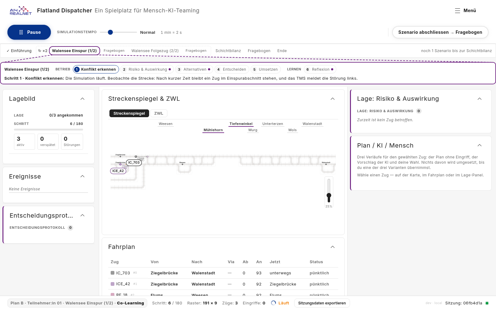
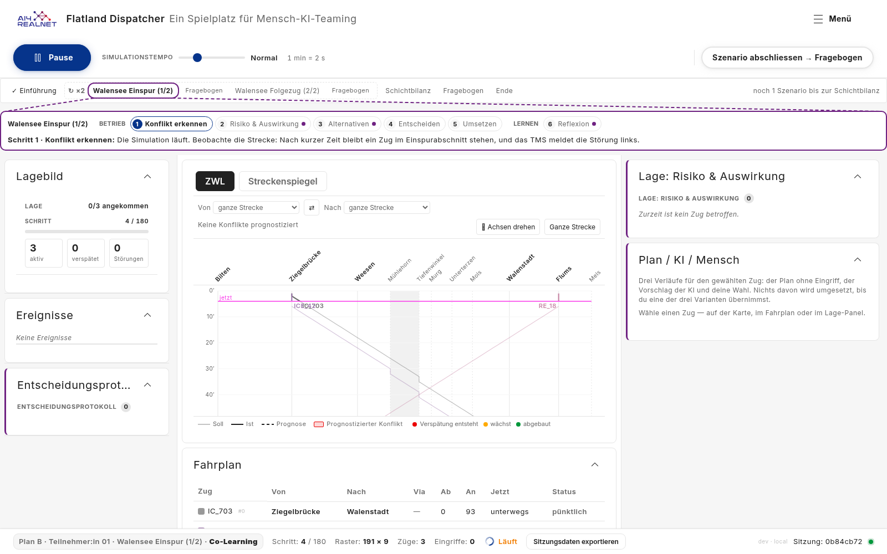
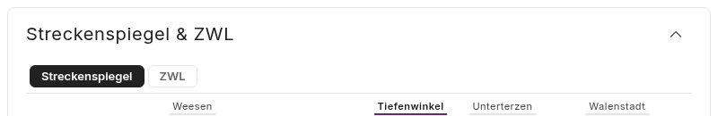
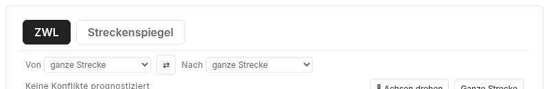
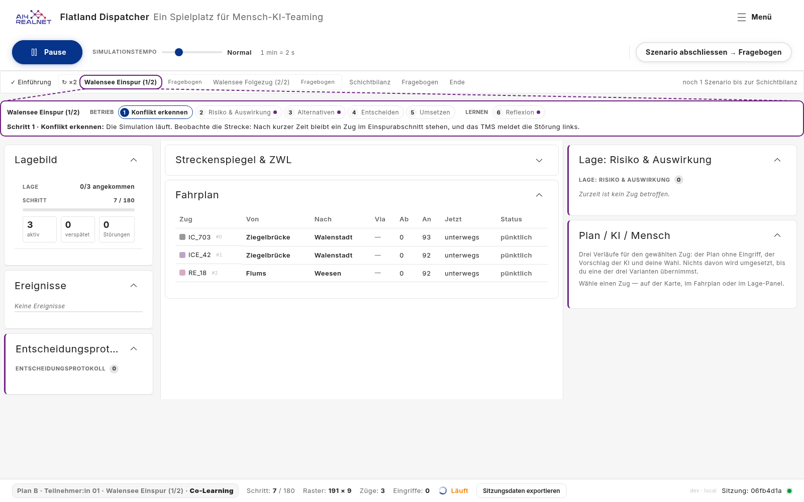
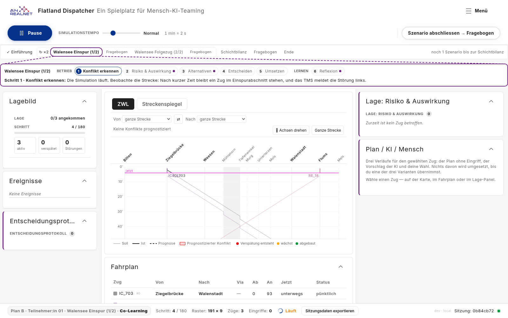

# Plan B centre panel: ZWL first and by default, tabs instead of the title (#168)

> **Status:** plan, 2026-11-03; built 2026-11-04 (S1-S4), with
> before/after screenshots (§6). Based on `main` 0ec3516.
> All questions are decided (§8).
> Issue [#168](https://github.com/flatland-association/flatland-ui-hub/issues/168)
> ("ZWL als default Bildschirm", @CleverManu, label `plan b`), with the
> approach in its first comment. Branch `feature/168-zwl-default`, off `main`
> (on request; contributors usually branch off `explore_db`). Related: the
> title item of [#150](https://github.com/flatland-association/flatland-ui-hub/issues/150)
> ("Titel «Streckenspiegel/ZWL» entfernen"), which this plan settles for the
> Plan B centre panel.
>
> **Why:** a dispatcher reads the situation from the time-distance diagram
> (ZWL), so the Plan B study should open on it. The panel's title repeats
> what the two tabs already say, so the tabs take its place, and a panel
> without a header can no longer be collapsed by accident.

### Status

| ID | Commit message | SHA |
|---|---|---|
| S0 | docs(plans): plan for #168, the ZWL as the Plan B default view. | c8ae6c8 |
| S1 | feat(view-tabs): let a layout name the tab a panel opens on, and its tab size. | 4564bc2 |
| S2 | feat(ui-config): hide the centre panel's title under Plan B, the tabs take its place. | 95ba050 |
| S3 | feat(layout): open the Plan B centre panel on the ZWL, left of the Streckenspiegel. | a786690 |
| S4 | docs(plans): screenshots of the Plan B centre panel for #168. | this commit |

### Terms

- **Centre panel:** the `view-tabs` panel (`ViewTabsComponent`,
  `features/view-tabs/`) in the middle column, titled "Streckenspiegel & ZWL".
  One panel that shows one of several views at a time. Not the Fahrplan
  panel below it, which is a panel of its own.
- **Tab:** one button in the centre panel's tab bar (`.view-tabs__tab`), one
  per view. Which tabs, and in which order, comes from the panel's
  `settings.tabs`, else from the registry `CENTER_VIEWS`.
- **Streckenspiegel:** the network view, view type `flatland-map`
  (`FlatlandMapComponent`), click id `views.map`. Called "Karte" in some older
  texts.
- **ZWL** (Zeit-Weg-Linie, time-distance diagram): view type
  `zug-weg-diagramm` (`ZugWegDiagrammComponent`), click id `views.zugWeg`. It
  draws the scene's corridor, so it needs no selected train. Not the archived
  Marey view (`marey`), which resolves to it.
- **Default tab:** the tab a panel shows until the participant picks one.
  Today: the mode's view from `MODE_DEFAULT_VIEW` (Streckenspiegel in
  Co-Learning), else the first tab.
- **Panel header:** the row with the panel title and the chevron
  (`sbb-expansion-panel-header` in `PanelShellComponent`). Clicking it
  collapses or expands the panel. Click id: the title's key, here
  `panels.viewsMapZwl`.
- **Plan B:** the study condition `plan-b-p01`, layout `preset-plan-b`
  (`PLAN_B` in `core/layout/layout-presets.ts`); what it removes is its `ui`
  block `PLAN_B_UI` (`docs/plans/configurable-ui-plan.md` §5.2).
- **UiConfig id:** a name the deployment file or a preset's `ui` block can hide
  (`UI_CONFIG_ITEMS` in `core/config/ui-config-items.ts`).

### Components

| Component | Responsibility | Change |
|---|---|---|
| `ViewTabsComponent` | Shows one of the run's views at a time behind a tab bar. Not for choosing which views exist (the layout does) or for episodic tasks such as reflection (overlays). | 🟨 modified: a layout can name the tab it opens on and ask for bigger tabs. |
| `PanelShellComponent` | Frames every accordion panel with its title and lets the user collapse it. Not for the panel's content. | 🟨 modified: a panel whose title is hidden is shown without header, so it cannot be collapsed. |
| `UI_CONFIG_ITEMS` | Lists what a deployment or a study condition may hide. Not the place that hides it (the gate points do). | 🟨 modified: one new id, the centre panel's title. |
| `PLAN_B` / `PLAN_B_UI` | The Plan B study layout and what it removes. Not shared with other presets. | 🟨 modified: ZWL left and by default, bigger tabs, the centre panel's title hidden. |

## 1. What the issue asks for

| # | Requirement | Source |
|---|---|---|
| 1 | The middle column opens on the ZWL | issue |
| 2 | Only for Plan B ("configurable for plan b") | comment |
| 3 | The ZWL tab is left of the Streckenspiegel tab | comment |
| 4 | The title "Streckenspiegel & ZWL" goes | comment, #150 |
| 5 | The centre panel cannot be collapsed | comment |
| 6 | The two tabs are bigger, since they take the title's place | comment |

### 1.1 Assumptions and exclusions

- **Assumptions** (checked at setup, not enforced in code):
  - No Plan B run recorded before this change has to replay as it was seen.
    A replay rebuilds the default tab from today's code, so an older Plan B
    log would replay on the ZWL (§4.4; decided 2026-11-03, Q4).
  - The Plan B scenarios have a corridor the ZWL can draw. True for both
    Walensee legs (§2).
- **Exclusions:**
  - Other presets keep their tab order, default and title. A later condition
    can use the same two settings.
  - The layout designer gets no control for the default tab; `settings.tabs`
    stays its only tab setting. A follow-up if the designer needs it.
  - Hint texts that say "Karte" ("Wähle einen Zug — auf der Karte, im
    Fahrplan oder im Lage-Panel") stay. A train can be picked in the ZWL too;
    rewording is a translation change, not part of #168.
  - The other #150 items (Ereignisse title, Prozessleiste, buttons in the
    decision log) are not part of this plan.
  - `collapsible: false` stays without effect for the other eleven panels
    that set it (Q2); making the shell honour it is its own issue.

### 1.2 Design changes and new patterns

| What is new | Reuses | Defined in |
|---|---|---|
| A layout names its centre panel's default tab (`settings.defaultTab`) | the existing `settings.tabs` path from preset to panel | §4.1 |
| A layout asks for bigger tabs (`settings.tabSize: 'l'`) | the same path | §4.3 |
| A UiConfig id for a part of a panel, the centre panel's title (`widget.view-tabs.title`) | the sub-panel id pattern of `widget.proposal-compare.axis.*` | §4.2 |
| A panel shown without header | the shell's existing header-less frame for canvas panels | §4.2 |

Not new on purpose: no new UiConfig verb, no new preset field, no change to
the session record or the replay (the restriction lands in the existing
`uiRestrictions` snapshot), no new translation keys.

### 1.3 Breaking changes

None in an API, payload, file format or config. Behaviour:

- Plan B opens on the ZWL, and its centre panel has no header. Intended.
- The click id `panels.viewsMapZwl` (a click on the header) no longer occurs
  under Plan B. The key stays; analyses that count it see none for new runs.
- A Plan B log recorded before this change replays on the ZWL (§1.1, Q4).

## 2. Today (checked 2026-11-03 on `main`, `0ec3516`)

- The Plan B centre panel is `preset-pb-views`: `type: 'view-tabs'`, title
  "Streckenspiegel & ZWL", `collapsible: false`,
  `settings: { tabs: ['flatland-map', 'zug-weg-diagramm'], minBodyHeight: 340 }`
  (`layout-presets.ts:756-763`).
- It opens on the Streckenspiegel: `ViewTabsComponent.active()` takes the
  participant's pick, else `MODE_DEFAULT_VIEW[mode]` (`flatland-map` for
  Co-Learning), else the first tab (`view-tabs.component.ts:16-20, 111-123`).
  A mode switch drops the pick. Plan B hides the mode tabs, so it has none.
- **`collapsible: false` has no effect.** `PanelShellComponent.toggleExpanded()`
  (`panel-shell.component.ts:149-159`) never reads it: a click on the header
  collapses the Plan B centre panel to its title, and the map or ZWL is gone
  until the participant clicks again. Checked in the running app (the picture
  below). The same holds for every preset panel marked `collapsible: false`
  that is not a canvas panel (Q2).
- The tabs are 13 px, under a 20 px title.
- The ZWL needs no selected train: it draws the scene's corridor
  (`zug-weg-diagramm.component.ts` §axis), and clicking a train line selects
  it as on the map.
- The tab pick is recorded as `ui_state` key `panel.view-tabs.tab`, `null`
  until the participant picks. The tab shown by default is not recorded; it
  follows from the layout and the code.

Pictures: §6, "before".

## 3. Decisions

Decided 2026-11-03 (Q1-Q4).

| ID | Decision | Why |
|---|---|---|
| D1 | The Plan B layout lists the ZWL first: `tabs: ['zug-weg-diagramm', 'flatland-map']` | The tab order already comes from `settings.tabs`; no code change |
| D2 | A new panel setting `settings.defaultTab` names the default tab, set in the Plan B layout; it ranks after the participant's pick and before `MODE_DEFAULT_VIEW` (decided 2026-11-03, Q1) | Order and default are separate wishes; deriving the default from the order would change designer-made layouts |
| D3 | The title is hidden through a UiConfig id, `widget.view-tabs.title`, listed in `PLAN_B_UI.hidden` | Plan B's removals live in `PLAN_B_UI`; the session record then says the title was hidden, like every other Plan B restriction |
| D4 | A panel whose title is hidden is shown without header, so it cannot collapse (requirement 5 follows from 4) | One mechanism for both requirements; no chevron left that does nothing |
| D5 | The tab size is a panel setting, `settings.tabSize: 'l'`, set in the Plan B layout; it does not follow from the hidden title (decided 2026-11-03, Q3). The tab bar always carries the panel title as its accessible name | Size is a layout choice like order and default, so all three sit together in the Plan B layout; screen readers still hear "Streckenspiegel & ZWL" without the visible title |
| D6 | Nothing new is recorded for the default tab (decided 2026-11-03, Q4) | No Plan B run recorded before this change has to replay as it was seen |
| D7 | `collapsible: false` is not fixed here; Plan B's centre panel stops collapsing through D4 alone (decided 2026-11-03, Q2) | The fix would change eleven panels outside Plan B; it gets its own issue and review |

## 4. Design

### 4.1 Tab order and default tab (requirements 1-3)

- `PLAN_B` (`preset-pb-views`):
  `settings: { tabs: ['zug-weg-diagramm', 'flatland-map'], defaultTab: 'zug-weg-diagramm', tabSize: 'l', minBodyHeight: 340 }`.
- `ViewTabsComponent.active()` gains one step:
  1. the participant's pick, if it is a tab;
  2. **`settings.defaultTab`, if it is a tab** (new; a retired type resolves
     through `centerViewByType`, like the tab list);
  3. `MODE_DEFAULT_VIEW[mode]`;
  4. the first tab.
- A mode switch still drops the pick, so a panel with `defaultTab` returns to
  it. Plan B has no mode switch.
- Every other preset sets no `defaultTab` and behaves as today.

### 4.2 No title, no collapse (requirements 4-5)

- `UI_CONFIG_ITEMS` gets `widget.view-tabs.title` ("Centre view panel title
  (the tabs take its place)", `supports: ['hidden']`), next to the
  `widget.proposal-compare.axis.*` ids. `ui-config.schema.json` lists it, as
  its spec requires.
- `PLAN_B_UI.hidden` adds it, with a comment naming #168 and #150.
- `PanelShellComponent`: `headerHidden()` is true when
  `uiConfig.isHidden('widget.' + panel.type + '.title')`. The template gets a
  third frame next to the canvas and the accordion frame: the body only, no
  `sbb-expansion-panel`, so nothing can collapse it. It keeps the
  `data-panel-type`/`data-panel-zone` attributes and the guide-focus and
  Co-Learning classes. The id is looked up by type, so it hides the title of
  every `view-tabs` panel in a layout that lists it; only Plan B does, and it
  has one.

### 4.3 Bigger tabs (requirement 6)

- `ViewTabsComponent` reads `settings.tabSize` (`'s'`, today's size and the
  default, or `'l'`) and sets a host class `view-tabs--size-l`. In it the tabs
  grow from 13 px to 16 px text and from `4px 12px` to `8px 16px` padding, and
  the bar gets more top padding, where the header was. Sizes in `rem`, colours
  from the existing tokens. An unknown value falls back to `'s'`. Names follow
  Lyne's `size` values.
- The tab bar (`role="tablist"`) gets `aria-label` = the panel's translated
  title, always, so it keeps a name when the visible title is gone.

### 4.4 Record and replay

- The session record's `uiRestrictions` snapshot lists
  `widget.view-tabs.title` for Plan B runs; nothing to add.
- The pick (`panel.view-tabs.tab`) is recorded as today. The default tab is
  not, as today; a replay of a new Plan B log opens on the ZWL because it uses
  the same layout. An older Plan B log would too (§1.1, Q4).

## 5. Files

### New files

| File | What it adds |
|---|---|
| `frontend/src/app/features/view-tabs/view-tabs.component.spec.ts` | Default-tab ranking (pick, `defaultTab`, mode, first), `tabSize`, the tab bar's name |
| `frontend/src/app/features/layout/components/panel-shell/panel-shell.component.spec.ts` | Header shown by default; with `widget.view-tabs.title` hidden no header, no expansion panel, body still there |
| `scripts/docshots-zwl-default.mjs` | Plan B screenshots for the PR, as `scripts/docshots-toolbar-under-guide.mjs` does for #167 |
| `docs/plans/zwl-default/*.png` | Before pictures (§2), after pictures (S4) |

### Modified files

| File | What changes |
|---|---|
| `frontend/src/app/features/view-tabs/view-tabs.component.ts` | `active()` reads `settings.defaultTab`; `tabSize` from `settings.tabSize`; host class |
| `frontend/src/app/features/view-tabs/view-tabs.component.html` | `aria-label` on the tab bar |
| `frontend/src/app/features/view-tabs/view-tabs.component.scss` | `view-tabs--size-l` sizes |
| `frontend/src/app/features/layout/components/panel-shell/panel-shell.component.ts` / `.html` / `.scss` | `headerHidden()` and the header-less frame |
| `frontend/src/app/core/config/ui-config-items.ts` | `widget.view-tabs.title` |
| `frontend/public/ui-config.schema.json` | the same id |
| `frontend/src/app/core/layout/layout-presets.ts` | `PLAN_B` tab order, `defaultTab` and `tabSize`; `PLAN_B_UI.hidden` |
| `docs/plans/center-view-tabs.md` | "Mode → default center view": `settings.defaultTab` ranks before the mode default; `settings.tabSize` |
| `docs/plans/configurable-ui-plan.md` | the new id in the id list and in the Plan B block |

## 6. Verification

- Specs as in §5; the four CI checks (`lint:styles`, `i18n:check`, production
  build, `pytest -q`).
- In the running app (production build, Plan B deployment config), on
  `plan-b-p01`: leg 1 and leg 2 open on the ZWL, the ZWL tab left; no
  title, no chevron, a click above the tabs changes nothing; the tabs are
  bigger; switching to the Streckenspiegel and back works; a train picked in
  the ZWL shows in "Plan / KI / Mensch".
- A Co-Learning tour without Plan B (`colearning-experiment`): title, chevron,
  tab order and the Streckenspiegel default as today.

**Results (2026-11-04).** `i18n:check`, `lint:styles` and the production
build pass, as do the new and changed specs. Screenshots by `scripts/docshots-zwl-default.mjs` on
`plan-b-p01`, leg 1, with the Plan B deployment config: "before" on a `main`
build (0ec3516), "after" on this branch. `main` still has the toolbar with
Play/Pause and the step buttons; #167 removes them.

| | Before (`main`) | After (this branch) |
|---|---|---|
| Tabs, active starred | Streckenspiegel\*, ZWL | ZWL\*, Streckenspiegel |
| Panel title | "Streckenspiegel & ZWL" with chevron | none |
| Tab text | 13 px | 16 px |
| Click on the panel's top edge | collapses the panel to its title | nothing changes |

Working screen:

| Before | After |
|---|---|
|  |  |

Top of the centre panel:

| Before | After |
|---|---|
|  |  |

After a click on the panel's top edge, where the header is or was:

| Before | After |
|---|---|
|  |  |

The full frontend suite passes (615 of 616, 1 skipped). Not yet run: leg 2,
the non-Plan B tour and `pytest -q` (no backend change).

## 7. Steps

| ID | Step | Needs |
|---|---|---|
| S1 | `defaultTab` and `tabSize` in `ViewTabsComponent`, with spec and the `center-view-tabs.md` note | - |
| S2 | `widget.view-tabs.title`: id, schema, panel shell frame, specs, `configurable-ui-plan.md` | - |
| S3 | `PLAN_B`: tab order, `defaultTab`, `tabSize`, the id in `PLAN_B_UI` | S1, S2 |
| S4 | Screenshots on Plan B, script, plan status | S3 |

Each step passes the CI checks on its own.

## 8. Open questions

- ✅ ~~**(Q1) How is the default tab set?**~~ **Decided 2026-11-03:** a new
  panel setting, `settings.defaultTab`, set in the Plan B layout (D2). Not
  "the first configured tab", which would change designer-made layouts.
- ✅ ~~**(Q2) Should `collapsible: false` work everywhere?**~~ **Decided
  2026-11-03:** a), not in this branch (D7). Today it is ignored (§2):
  outside Plan B, eleven accordion panels set it (the centre panels of five
  other presets, five ZWL panels and the Director's strategy options) and
  still collapse. Making the shell honour it is its own issue.
- ✅ ~~**(Q3) How big are the tabs?**~~ **Decided 2026-11-03:** configured
  in the Plan B layout, `settings.tabSize: 'l'` (16 px text, `8px 16px`
  padding, §4.3), not derived from the hidden title (D5). The S4
  screenshots show the result to the product owner (@CleverManu).
- ✅ ~~**(Q4) Have Plan B runs already been recorded that must replay as they
  were seen?**~~ **Decided 2026-11-03:** assume none (§1.1); nothing new is
  recorded for the default tab (D6). Their records hold the pick `null`, and
  the replay derives the default tab from today's layout, so such a log would
  replay on the ZWL.
