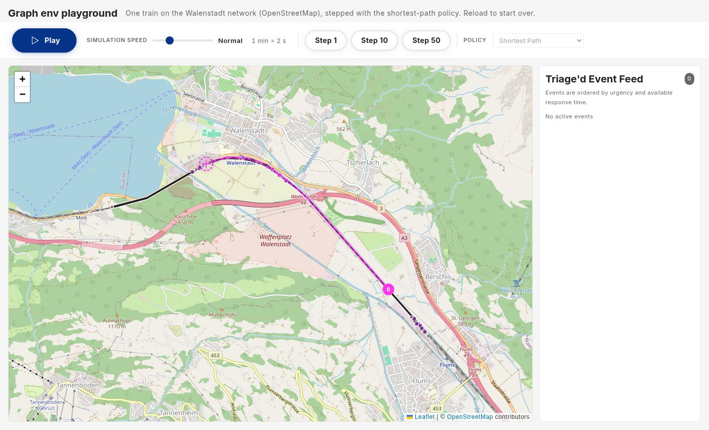

# Graph env playground

A single page at **`/graph-env`**: a flatland `GraphRailEnv` on a real rail network (Walenstadt, imported from
OpenStreetMap), with one train stepped by a shortest-path policy and shown on an OpenStreetMap basemap. It is not
integrated with the rest of the app. Design and decisions: [`docs/plans/graph-env-playground.md`](../plans/graph-env-playground.md).



## Run it

```bash
cd backend && pip install -r requirements.txt   # flatland-rl from PR #542 (branch 526-edge-lengths)
cd backend && uvicorn app.main:app --reload --port 8000
cd frontend && npm run start                    # then open http://localhost:4200/graph-env
```

Every page load creates a new env (a new backend session), so **reload to start over**.

- **Play / Pause, Step 1/10/50, speed:** the toolbar, copied from the main toolbar. The speed levels are the same
  (`core/play-speed.ts`); "Normal" is 0.5 steps per second. The whole episode is 257 steps.
- **Policy:** fixed to the shortest-path policy, so the select is disabled.
- **Route and target:** hover the train to show its remaining route and target; click it to keep them shown (in the
  selection colour), click the empty map to clear. This is the grid map's convention.
- **Event feed:** copied from the triaged event feed. It stays empty for now.

## How it fits together

| Layer | Where | What |
|---|---|---|
| Network data | `backend/app/graph_env/data/walensee.{graphml,json}` | The GraphML is a verbatim copy from flatland-scenarios #36. The JSON is generated from it by `backend/scripts/build_graph_env_network.py` (needs osmnx and a scenarios checkout; see its docstring) and is the only file the backend reads. |
| Env | `backend/app/graph_env/env_factory.py`, `network.py` | Adapted copy of the scenarios' `double_vertex_graph_to_env.py`: `create_env`, `GraphShortestPathPolicy`, and the notebook's step-through setup (edge lengths scaled to the shortest edge, source `2042222934`, target `2048248489`, speed 1). |
| Sessions | `backend/app/graph_env/service.py` | One live env and policy per session, stepped directly (`act_many` + `step`). In memory, at most 20, least recently used evicted. |
| JSON | `backend/app/graph_env/projection.py` | Train position along the edge geometry (`distance / edge_length`), heading, remaining route (one polyline per edge), target. |
| API | `backend/app/api/graph_env.py` | `GET /graph-env-api/network`, `POST /graph-env-api/sessions`, `POST /graph-env-api/sessions/{id}/step?n=`. Not under `/graph-env`: that is the page, and the dev proxy matches by prefix. |
| Page | `frontend/src/app/features/graph-env-playground/` | `GraphEnvStore` (mirrors the `SessionStore` members the copies read), the Leaflet map, and the toolbar and event-feed copies. |

### Copies

The toolbar (`graph-env-toolbar.component.*`) and the event feed (`graph-env-events.component.*`) are copies of
`features/toolbar/` and `features/triaged-events/`. Each landed as a verbatim commit first, then an adaptation
commit, so `git log -p` on them shows exactly what differs. The train glyph, target marker and route styles of the
map are copied verbatim from `features/flatland-map/`. Keep these diffs small: the plan is to merge the two setups
into one view later.

### Upstream pins

| Repo | Ref |
|---|---|
| flatland-rl | PR #542, `be8cd30543` (`backend/requirements.txt`) |
| flatland-scenarios | PR #36, `c2bc7b4093` (the GraphML, `env_factory.py`, the conversion script) |
